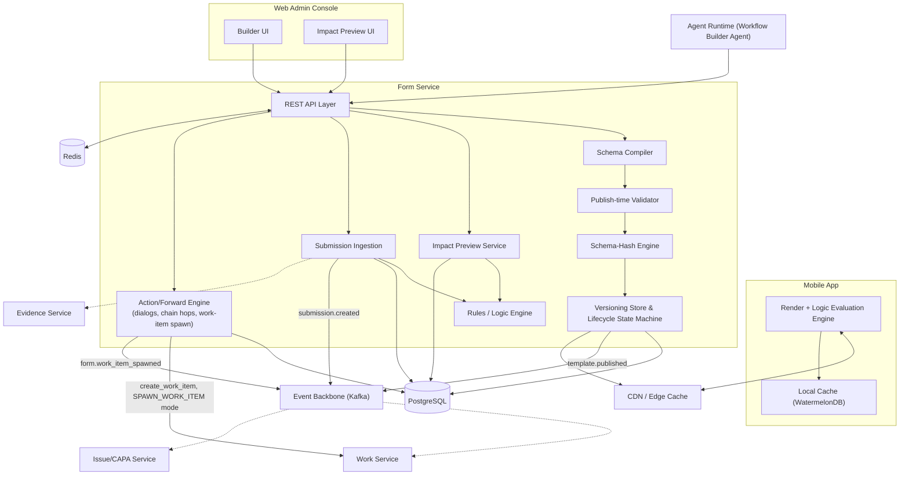
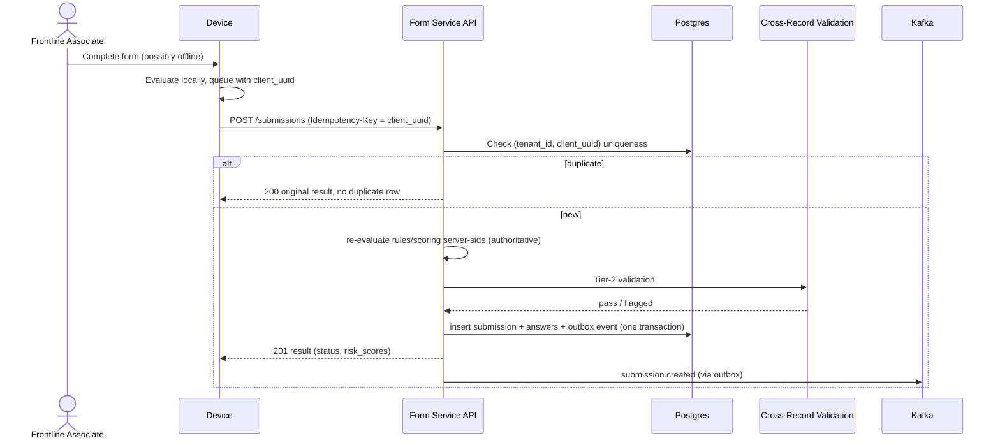
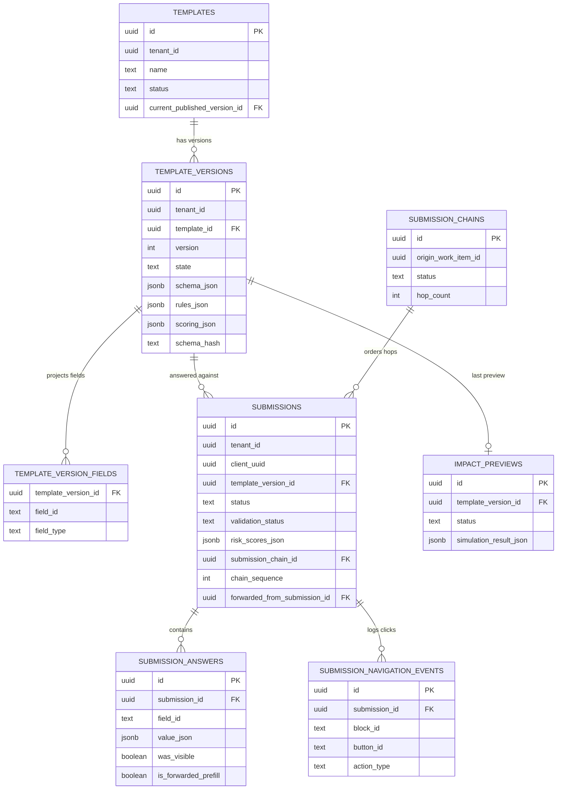
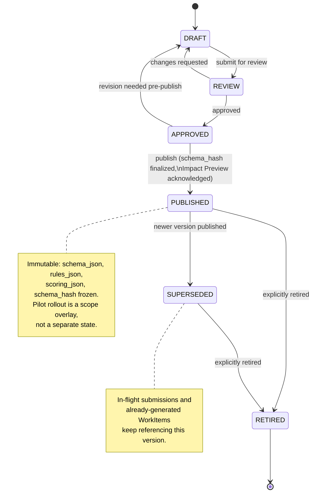
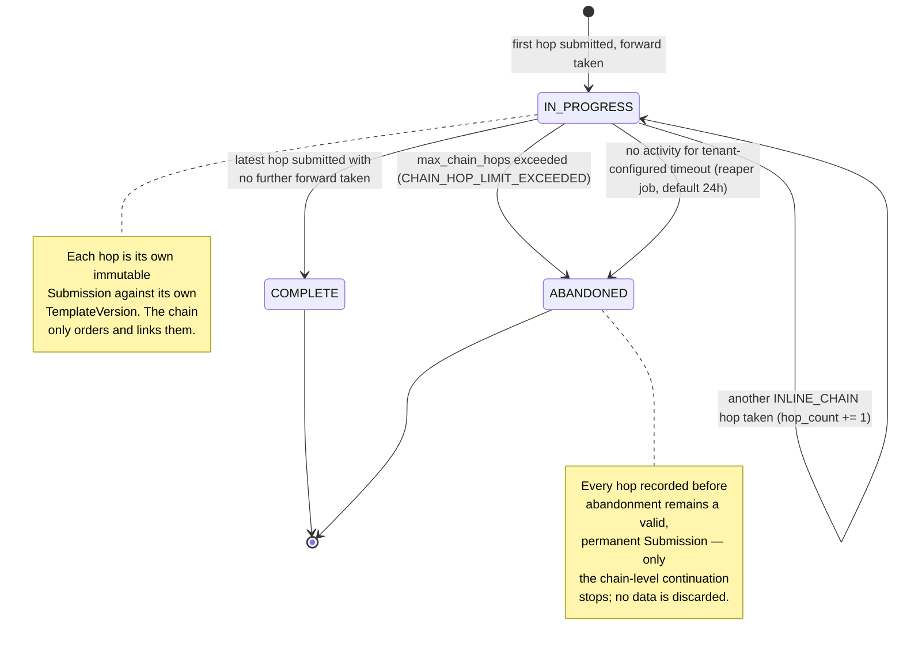

# Architecture Diagrams — No-Code Forms & Workflow Builder

Focused diagram set for the Form Service. See high-level-design.md and low-level-design.md for full
narrative, data ownership, and endpoint detail.

## 1. Component / Container Diagram



The Builder and Impact Preview UI talk to a single REST API layer that fronts a compile → validate →
hash → version pipeline for authoring, and a separate ingestion path for submissions that shares only
the Rules/Logic Engine (the same evaluation semantics run at authoring-time simulation and at
submission-time authoritative re-validation). Published schema payloads flow one-way from the
Versioning Store to a CDN, which the mobile Render Engine reads directly, keeping the origin database
off the hot path for the platform's largest fan-out (millions of devices fetching the same immutable
artifact). Kafka decouples the Form Service from its consumers (Work Service, Issue/CAPA) so neither
service's availability gates submission ingestion or template publishing.

A new **Action/Forward Engine** fronts every button/option action that is not a plain field answer:
resolving a dialog to show (purely a schema lookup, no service call), advancing an `INLINE_CHAIN`
(reading/writing `submission_chains` in Postgres only — never leaves the Form Service), and — the one
case that reaches outside the service boundary — a `SPAWN_WORK_ITEM` forward, which makes a
synchronous call into Work Service's existing `create_work_item` API. This keeps the composable-card
and dialog machinery a purely additive layer over the same Rules/Logic Engine and the same
event-sourced outbox pattern already used for `template.published`/`submission.created`, rather than a
second service or a second event-emission path.

## 2. Sequence Diagram — Publish + Impact Preview

```mermaid
sequenceDiagram
    actor Admin
    participant BuilderUI
    participant API as Form Service API
    participant Validator
    participant ImpactSvc as Impact Preview Service
    participant RulesEngine
    participant DB as Postgres
    participant Kafka

    Admin->>BuilderUI: Click "Publish"
    BuilderUI->>API: Transition to APPROVED
    API->>Validator: structural + logic validation (cycles, dangling refs)
    Validator-->>API: OK
    API->>DB: persist APPROVED + schema_hash
    BuilderUI->>API: Request Impact Preview (simulate=true)
    API->>ImpactSvc: enumerate affected objects + diff + simulate
    ImpactSvc->>RulesEngine: replay recent submissions through new rules
    RulesEngine-->>ImpactSvc: visibility/validation/risk deltas
    ImpactSvc->>DB: persist impact_previews row
    ImpactSvc-->>API: summary + warnings
    API-->>BuilderUI: Impact Preview result
    Admin->>BuilderUI: Acknowledge warnings, confirm Publish
    BuilderUI->>API: Publish (impact_preview_id, acknowledged_warnings)
    API->>DB: PUBLISHED; prior version -> SUPERSEDED; outbox event
    API->>Kafka: template.published (via outbox relay)
    API-->>BuilderUI: 200 Published
```

Publishing is gated behind two independent checks that must both pass in the same request: structural
validation (can this schema even be evaluated deterministically) and an acknowledged Impact Preview
(does the admin understand what production surface this change touches). The prior `PUBLISHED`
version's transition to `SUPERSEDED` happens atomically with the new version's `PUBLISHED` transition,
inside one database transaction, so there is never a window with zero or two simultaneously
`PUBLISHED` versions of the same template.

## 3. Sequence Diagram — Submission Ingestion



Idempotency is enforced at the database constraint level (`UNIQUE(tenant_id, client_uuid)`), not just
in application logic, so a retried sync request — the normal case after an offline period or a flaky
connection — can never create a second submission regardless of which service instance handles the
retry. A submission that fails Tier-2 cross-record validation is still persisted and flagged, never
silently dropped, consistent with the platform's offline-first, evidence-first principles.

## 3a. Sequence Diagram — Cross-Template Forwarding (Card → Dialog → Spawn Work Item)

```mermaid
sequenceDiagram
    actor Filler as Frontline Associate
    participant Device
    participant API as Form Service API
    participant DB as Postgres
    participant WorkSvc as Work Service

    Filler->>Device: Tap "No, damaged" on a CARD-decorated Yes/No field
    Device->>Device: Resolve action -> SHOW_DIALOG (on-device, no network)
    Device-->>Filler: Confirmation dialog: "Report as maintenance issue?"
    Filler->>Device: Tap "Confirm & Report"
    Device->>API: POST /submissions/{id}/forward (forward_mode=SPAWN_WORK_ITEM)
    API->>DB: verify target template ACTIVE + published
    API->>WorkSvc: create_work_item(MAINTENANCE_WORK_ORDER, assignment_rule, originating_submission_id)
    WorkSvc-->>API: work_item_id, status (AVAILABLE or NEEDS_ASSIGNMENT)
    API-->>Device: 201 spawned_work_item_id + status
    Device-->>Filler: Inline confirmation; original checklist continues unaffected
```

Two things this diagram makes explicit: the dialog itself never touches the network (it is rendered
from the already-cached compiled schema, same as any other offline-first form element), and the
spawned `WorkItem`'s assignment outcome — whether it resolves cleanly or lands in `NEEDS_ASSIGNMENT` —
never blocks or alters the originating submission, which completes on its own template regardless.

## 4. ER Diagram — Owned Entities



`Template` is the stable logical identity a `WorkItem` or schedule points at indirectly (via
`current_published_version_id` for "give me whatever is current"); `TemplateVersion` is the actual
immutable artifact a `Submission` always points at directly and permanently, which is what guarantees
a historical submission renders correctly forever regardless of how many newer versions exist.
`SubmissionChain` is a thin ordering ledger over `Submissions` for `INLINE_CHAIN` forwarding — it does
not own or duplicate any answer data, it only records which submissions belong to one filler's
continuous cross-template hand-off and in what order. `SubmissionNavigationEvents` is deliberately kept
separate from `SubmissionAnswers`: a Pattern-B (navigation-only) card click is UX telemetry, not an
attested fact, and must never be mistaken for one downstream.

## 5. Template Lifecycle State Machine



`DRAFT` and `REVIEW` are the only states in which content can change; every forward transition past
`APPROVED` is a one-way door for that version's content (a needed change becomes a *new* version, not
a reopened old one), which is the mechanism that makes source-spec's version-immutability acceptance
test ("historical submission still renders exactly against the original template version after later
versions publish") true by construction rather than by convention.

## 6. SubmissionChain Lifecycle (INLINE_CHAIN Forwarding)



This state machine is deliberately independent of the `WorkItem` state machine (conventions.md):
`SubmissionChain` reaches `COMPLETE`/`ABANDONED` on its own timeline, while the originating `WorkItem`
progresses to `SUBMITTED` based on its own first-hop submission's completion, not on the chain's
overall status — so a chain that is later `ABANDONED` (filler never returns to a mid-chain forward)
never retroactively invalidates the work already recorded in its completed hops.
