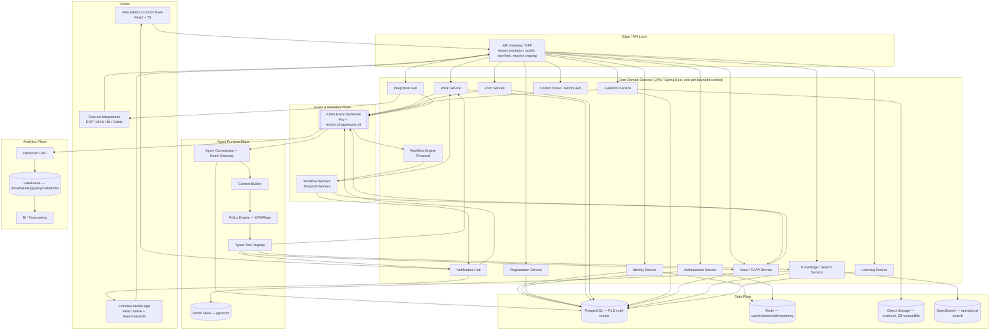
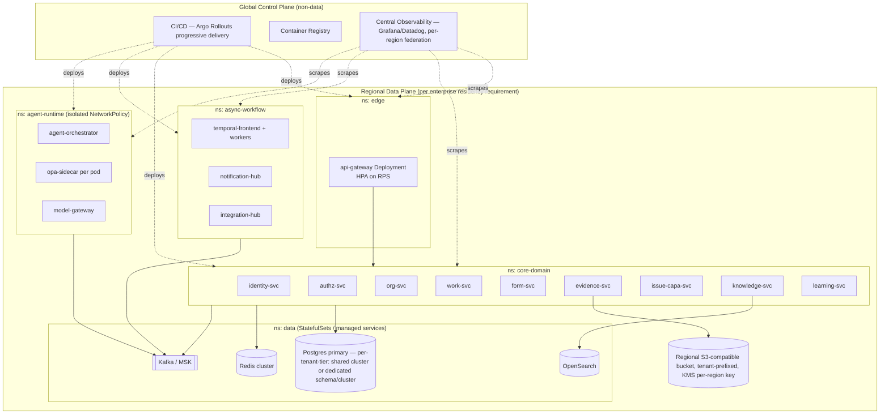
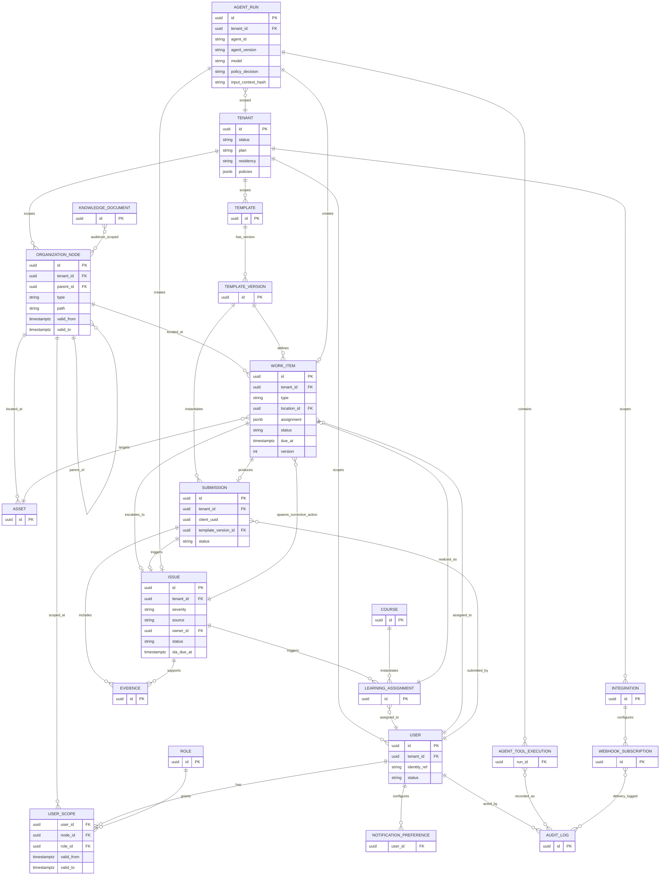
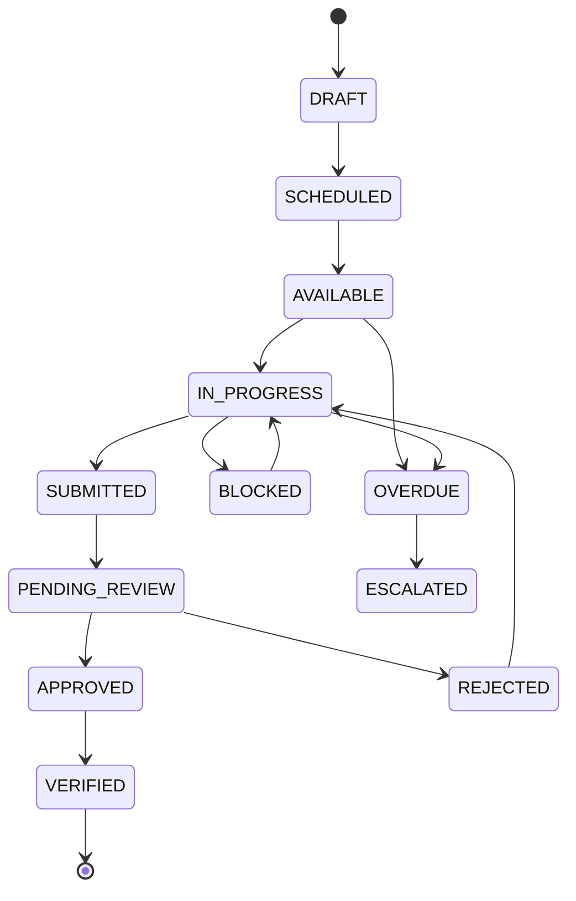
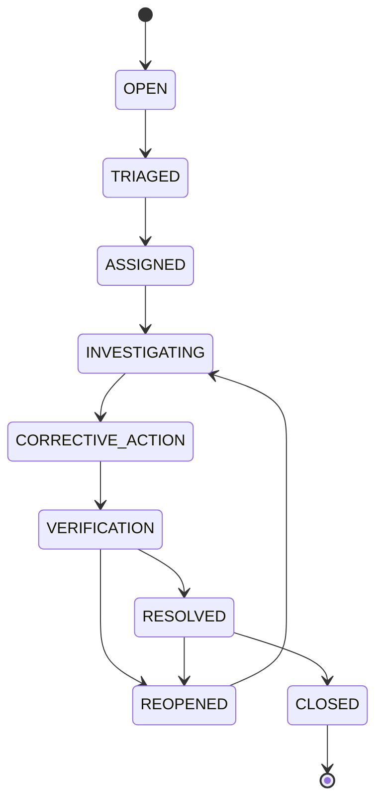
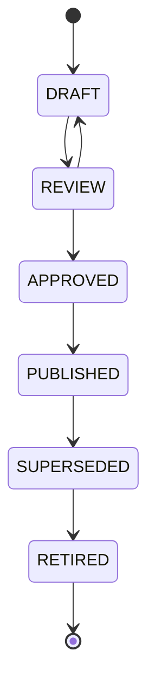
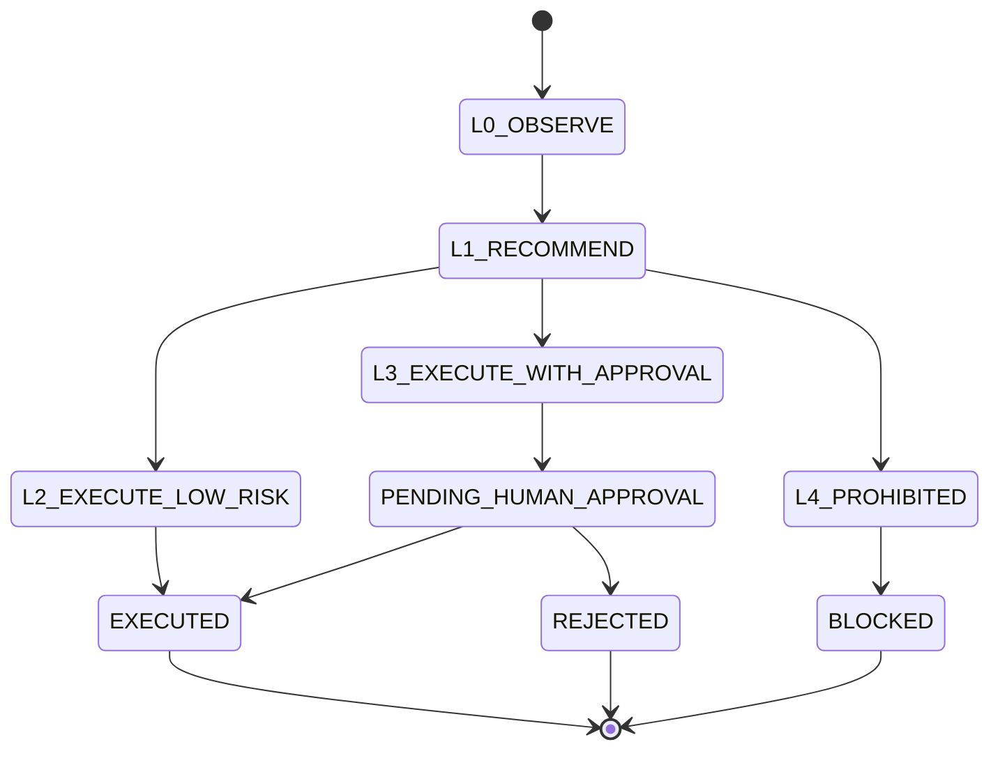
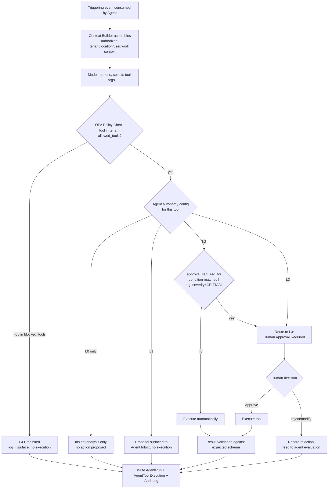

# 01 — Functional Specification Document (Platform-Wide)

**Frontline Operations & Agentic Ops Platform — Master FSD**
Version 2.1 (build-ready) | Supersedes and deepens source-spec.md §16–24 | Status: Baseline for engineering

This document is the platform-level FSD. It defines the architecture, domain model, state machines,
API/event platform, offline sync protocol, AI runtime governance, security model, observability
model, non-functional targets, and cross-module integration contracts that every per-module
`functional-spec.md` / `high-level-design.md` / `low-level-design.md` / `architecture-diagram.md`
must build against. Per-module documents own their own field-level detail; this document owns
what is cross-cutting. It must not be read in isolation from `_context/conventions.md`, which is
authoritative on tech stack, entity naming and state-machine terminal states.

---

## 1. Architecture Overview

### 1.1 Logical Architecture

The platform is a **modular monolith at the trust/transaction boundary, decomposed into
independently deployable services along bounded-context lines** (see ADR-001). Thirteen core
services (§3) sit behind a single API Gateway / BFF layer, share a tenant-scoped PostgreSQL
transactional tier, and communicate asynchronously through a Kafka event backbone.



**Layer responsibilities:**

- **Client layer** — three client classes (admin web, frontline mobile, machine/API integrations),
  each with distinct latency, connectivity and trust profiles; the BFF exists precisely to shape
  responses differently per client rather than forcing one contract on all three.
- **Edge/API layer** — single ingress; owns authentication termination, tenant resolution from the
  authenticated principal (never trusts a client-asserted tenant header except for signed support
  tooling), per-tenant/per-principal rate limiting, and request/response shaping (e.g., mobile gets
  denormalized sync payloads; web gets paginated REST/GraphQL).
- **Core domain services** — one deployable per bounded context (§3), each owning its own tables in
  the shared Postgres cluster (schema-per-service logically, RLS-enforced), each publishing/consuming
  events rather than calling each other's databases directly.
- **Agent Runtime plane** — structurally separated from core domain services because it has a
  different trust model (LLM-authored intent must pass through policy before touching write paths);
  it calls the same typed APIs/tools as any other authenticated principal — it has no back-door DB
  access.
- **Data plane** — Postgres is authoritative for operational state; Redis is disposable cache/session
  state (must never be a system of record); S3 holds large evidence payloads addressed by hash;
  OpenSearch + pgvector serve retrieval, never authorization decisions.
- **Async plane** — Kafka decouples write-path latency from downstream processing (workflows,
  analytics, agents, integrations); Temporal owns anything that is a *durable, resumable process*
  (SLA timers, escalation ladders, CAPA orchestration, agent multi-step workflows) rather than an
  in-memory scheduler.
- **Analytics plane** — CDC-fed lakehouse keeps analytical query load off the transactional tier
  entirely; the Control Tower API reads pre-aggregated marts, not live OLTP tables, for anything
  beyond simple list/detail views.

### 1.2 Deployment / Infrastructure View

Each bounded-context service is an independent Kubernetes Deployment with its own Helm chart,
namespace-isolated by domain tier, so that blast radius, scaling policy, and network policy differ
appropriately between (e.g.) the Identity Service and the Agent Runtime.



**Residency and multi-region model:** each enterprise tenant is pinned to exactly one regional data
plane at provisioning time (`Tenant.residency`). A regional data plane is a full stack replica
(Postgres cluster/schema, Kafka cluster, S3 bucket, OpenSearch cluster, Agent Runtime) — there is no
cross-region synchronous call for tenant data. The global control plane (CI/CD, container registry,
central observability aggregation, non-tenant-data billing/usage metering) is the only component
that spans regions, and it never carries tenant payload data, only metadata and metrics. Large
enterprise tenants (>10k locations or contractual isolation requirements) may be pinned to a
**dedicated cluster tier** (dedicated Postgres cluster + dedicated Kafka topic set + dedicated
namespace set) rather than the shared multi-tenant cluster tier; this is a deployment-time decision
recorded on `Tenant.plan`/`Tenant.isolation_tier`, invisible to application code because all queries
are RLS/scope-filtered regardless of physical placement.

### 1.3 Binding Engineering Decisions Register

`_context/engineering-decisions.md` is a platform-wide, binding register that this FSD incorporates
by reference rather than duplicates — where this document or any per-module spec is silent on a
cross-cutting mechanic, that register's answer is authoritative, and no module document may
contradict it. It covers: **AuthN/AuthZ mechanics** (OAuth 2.1 + OIDC with DPoP-bound, sender-
constrained access tokens; token lifetimes and the 72-hour offline-grace ceiling; mTLS + short-lived
internal JWTs for service-to-service calls); the **mobile OS/device support matrix** (Android API 29+,
iOS 16+, app-freshness soft/hard update gates); **API versioning and deprecation** mechanics that
concretize §6.1/§6.5 below; **repository structure, CI/CD, and environments** (polyrepo plus
`platform-contracts`, GitOps promotion via ArgoCD, per-tenant regional environments); **testing gates
and the Definition of Done** that every user story across all 25 modules must satisfy; and a binding
**EU AI Act high-risk-AI compliance addendum** for employment/worker-management AI, which sharpens
§8/§9 below with concrete Article 9/12/13/14 obligations (human oversight, audit-retention floors,
tenant-facing transparency, and per-agent risk-assessment artifacts). Engineering teams implementing
any module must read that register alongside this FSD; it is not restated here to avoid the two
documents drifting apart.

---

## 2. Architectural Decision Records

### ADR-001: Modular monolith at the domain-service boundary, not microservices-by-default
- **Context:** Thirteen bounded contexts (§3) must ship independently and scale independently, but a
  fully independent-microservice-per-entity approach multiplies operational overhead and
  distributed-transaction risk for a domain (work/forms/issues) that is highly relationally coupled.
- **Decision:** Decompose only at genuine bounded-context boundaries with distinct data ownership,
  scaling profile, or security posture (13 services, §3) — not at the entity or feature level. Each
  service owns its own tables; cross-service reads happen through published APIs or consumed events,
  never direct DB access. Within a service, keep code modular (packages per subdomain) so a future
  split (e.g., Evidence Service off Work Service) is a low-risk extraction, not a rewrite.
- **Consequences:** Fewer network hops and simpler transactional consistency inside a bounded
  context; requires strict internal module boundaries and a "no shared DB table across services"
  rule enforced by schema ownership + CI checks; a service that outgrows its resource profile (e.g.,
  Evidence under media-heavy load) can be split later without a domain redesign.

### ADR-002: PostgreSQL Row-Level Security as a mandatory defense-in-depth tenant boundary
- **Context:** `tenant_id`-filtered application queries are necessary but not sufficient — a single
  missed `WHERE tenant_id = ?` in any of 13 services is a cross-tenant data leak, and this class of
  bug is the single highest-severity risk in a multi-tenant SaaS (source-spec §21.1).
- **Decision:** Every tenant-scoped table has `tenant_id NOT NULL` plus a Postgres RLS policy of the
  form `USING (tenant_id = current_setting('app.tenant_id')::uuid)`; the connection pool sets
  `app.tenant_id` via `SET LOCAL` at the start of every transaction from the authenticated
  principal's resolved tenant, and application code additionally filters by `tenant_id` (belt AND
  suspenders — RLS is the backstop, not the only mechanism, so a service is never one query away from
  a leak even if RLS is misconfigured for a new table).
- **Consequences:** All migrations must include RLS policy creation as a checklist item (CI gate
  fails a migration lacking one); a small per-query overhead from RLS predicate evaluation
  (acceptable at target scale); support/ops tooling that needs cross-tenant visibility must use an
  explicit, audited, separately-privileged role — never the default app role.

### ADR-003: Kafka as the single event backbone for all asynchronous cross-service communication
- **Context:** Workflows, analytics, agent triggers, notification fan-out and integration delivery
  all need durable, replayable, ordered-per-aggregate asynchronous processing; ad hoc point-to-point
  calls or a lighter message queue don't provide replay/DLQ/ordering guarantees at platform scale.
- **Decision:** All domain state changes that other services/consumers need to react to are published
  as canonical events (§6.3) to Kafka, partitioned by `tenant_id:aggregate_id` for per-aggregate
  ordering; no direct service-to-service synchronous calls are used to propagate state changes
  (synchronous calls are reserved for request/response reads, per §12).
  Consumers use consumer groups with at-least-once delivery + idempotent handlers (dedup by
  `event_id`).
- **Consequences:** Enables independent scaling of consumers, replay for new consumers or bug
  recovery, and natural backpressure; requires every consumer to be idempotent and every producer to
  emit the standard envelope (§6.4); operational cost of running/monitoring a Kafka cluster per
  regional data plane.

### ADR-004: Temporal for all durable, long-running or timer-based orchestration
- **Context:** SLA escalation ladders, recurring schedule expansion, CAPA multi-step lifecycles, and
  multi-step agent action sequences all require durable state across days/weeks, must survive worker
  restarts, and must be independently versioned as their logic evolves — a naive cron+DB-flag
  approach becomes unmaintainable and loses exactly-once timer semantics.
- **Decision:** Model every stateful, time-spanning process (scheduling recurrence, SLA/escalation
  timers, CAPA orchestration, multi-step agent workflows requiring human-approval waits) as a
  Temporal Workflow; simple, stateless request/response logic stays in the owning domain service.
  Workflow definitions are versioned (Temporal's built-in versioning API) so in-flight workflow
  executions are unaffected by code deploys.
- **Consequences:** One more piece of platform infrastructure to operate, but eliminates a large
  class of "the escalation cron missed a run" and "the timer double-fired" bugs; workflow code must
  follow Temporal's determinism constraints (no direct I/O in workflow code, only in Activities),
  which is a real but bounded learning cost for the team.

### ADR-005: WatermelonDB for mobile offline-first local persistence
- **Context:** Frontline mobile must support full CRUD across forms/work/evidence with zero
  connectivity for extended periods (source-spec §9.2), then reconcile via an idempotent sync
  protocol; this requires a reactive, SQLite-backed local DB with built-in sync primitives rather
  than hand-rolled AsyncStorage/Realm sync logic.
- **Decision:** Use WatermelonDB as the on-device store for React Native, modeling local tables per
  §7.1, with a custom sync adapter implementing the platform's `/api/v1/sync` contract (§6.2) rather
  than WatermelonDB's default sync protocol, because the platform needs domain-specific conflict
  semantics (§7.3) that a generic sync adapter does not provide out of the box.
- **Consequences:** Fast local reads/writes and lazy-loading reactivity for large offline datasets
  (100k+ location hierarchies cached selectively, not wholesale); requires a bespoke sync adapter
  layer (owned jointly by mobile + Work/Form/Evidence services) rather than an off-the-shelf sync
  SDK; schema migrations on-device must be additive-first to avoid breaking cached offline data.

### ADR-006: Open Policy Agent (OPA/Rego) for agent action authorization and tenant policy
- **Context:** Agent tool-execution authorization (autonomy levels, per-tenant allow/block lists,
  approval-required conditions) must be declarative, independently testable, auditable, and
  changeable by non-engineers (policy authors) without a service redeploy — hardcoding this logic in
  Kotlin service code would make policy changes a deployment event and make policy testing coupled to
  application test suites.
- **Decision:** Every agent tool call is authorized through an OPA policy evaluation (Rego rules
  keyed by `tenant_id`, `agent_id`, `tool_name`, `autonomy_level`, resource attributes) before
  execution; policies are versioned artifacts stored and deployed independently of service code, with
  their own CI (Rego unit tests) and rollout process. The same OPA engine backs general ABAC
  evaluation for the Authorization Service (§9), so there is one policy technology, not two.
- **Consequences:** Policy authors can write/test/ship a new tenant policy without an engineering
  release; requires an OPA sidecar or embedded evaluation library per service that needs
  authorization decisions, plus a policy-bundle distribution and versioning pipeline; Rego has a
  learning curve but is purpose-built for exactly this class of problem.

### ADR-007: pgvector as the default vector store for RAG, with managed-vector-DB escape hatch
- **Context:** Knowledge Hub search and Agent Runtime retrieval need embeddings-based semantic
  search over tenant-scoped documents; introducing a wholly separate vector database (Pinecone/
  Weaviate-class) adds an additional system with its own tenant-isolation surface to secure and
  operate, when the existing Postgres tenant-isolation model (RLS) could cover it directly.
- **Decision:** Use `pgvector` inside the same tenant-scoped Postgres tier as the default vector
  store — embeddings tables carry `tenant_id` and inherit the same RLS policy as every other table
  (ADR-002), so no new isolation surface is introduced. For tenants whose corpus size or query
  volume exceeds pgvector's practical ANN performance envelope (approx. >5M vectors per tenant or
  sub-50ms p95 recall requirements at high QPS), the Knowledge Service's retrieval interface is
  abstracted behind a `VectorStore` port so a managed vector DB can be swapped in per-tenant without
  changing calling code.
- **Consequences:** One fewer system to secure/operate for the common case; RLS gives "free"
  tenant isolation for embeddings; requires monitoring pgvector ANN index (HNSW) performance and a
  documented tenant-tier threshold at which the managed-store escape hatch is exercised.

### ADR-008: API Gateway / BFF pattern with client-specific response shaping
- **Context:** Web admin (rich, paginated, low-latency-tolerant) and mobile frontline (bandwidth-
  constrained, offline-first, needs denormalized batch payloads) and machine integrations (strict
  versioned contracts) have fundamentally different API consumption patterns; exposing one generic
  REST surface to all three forces compromises (over-fetching for mobile, under-shaping for
  integrations).
- **Decision:** A single API Gateway / BFF layer (Node.js/TypeScript or Spring Cloud Gateway, per
  conventions) terminates authentication and tenant resolution once, then routes to backend services,
  applying client-specific composition/shaping rules — e.g., the mobile `/api/v1/sync` endpoint is a
  BFF-composed aggregate across Work/Form/Evidence services, while the web admin API exposes more
  granular per-resource REST endpoints directly.
- **Consequences:** Single point for cross-cutting concerns (authN, rate limiting, observability
  correlation IDs) instead of duplicating them per service; BFF composition logic must be kept thin
  (orchestration only, no business logic) to avoid it becoming an unversioned shadow domain layer;
  the BFF itself must be horizontally scaled and is a single point of failure risk mitigated by
  multi-replica deployment and circuit breakers to backend services (§10).

### ADR-009: TimescaleDB extension on the existing Postgres fleet for IoT sensor time-series data
- **Context:** Module 17 (IoT Sensor Platform) ingests high-volume, high-frequency `SensorReading`
  data (target: 50,000 readings/second platform-wide, NFR-IOT-001) that must be time-partitioned,
  efficiently compressed once aged past its raw-resolution window, and queryable for downsampled
  trend charts (`1m`/`1h`/`1d` continuous aggregates) — none of which the original 13 modules' data
  model needed, since no other module writes time-series volume at this rate.
- **Decision:** Model `sensor_readings` as a **TimescaleDB hypertable** on the platform's existing
  Postgres fleet (time-partitioned, chunked by day by default, with an additional `tenant_id`
  space-partitioning dimension for high-density tenants) rather than introducing a separate
  dedicated time-series database (e.g. InfluxDB or a managed time-series service). This is chosen
  over a new system because it (a) keeps the platform on one operational database technology at MVP
  sensor volumes, avoiding a second system to secure, back up, and staff for; (b) TimescaleDB's
  hypertables/native compression/continuous aggregates satisfy the time-partitioning and downsampled-
  query requirements without leaving the Postgres/SQL ecosystem; and (c) it inherits the same RLS
  tenant-isolation model (ADR-002) and CDC pipeline (Debezium) already used platform-wide, requiring
  no new isolation surface or analytics ingestion path.
- **Consequences:** No new database technology to operate for the common case, and full reuse of
  ADR-002's RLS isolation and the existing CDC-to-lakehouse path; requires monitoring hypertable
  chunk/compression health as its own operational concern, and a documented revisit trigger — if
  sustained per-tenant or platform-wide write throughput materially and persistently exceeds
  NFR-IOT-001's target even after adding hypertable space-partitions, a purpose-built time-series
  store decoupled from the transactional fleet should be evaluated, fed by the same
  `sensor.reading.raw` Kafka topic this design already produces (module 17 functional-spec.md §8,
  high-level-design.md §8).

---

## 3. Core Technical Components

For each of the 13 original services plus the 12 services introduced by the competitive-gap modules
(14–25, `_context/new-modules-addendum.md`): owned data, public API surface (representative, not
exhaustive — full endpoint specs live in per-module LLDs), events published/consumed, primary scaling
dimension, and dependencies. The competitive-gap services follow the same "own your entities,
integrate through published APIs/events, never a second execution engine" discipline as the original
13 — most of them are thin configuration/orchestration layers over Work Orchestration, Issues & CAPA,
Forms & Workflow Builder, or Evidence rather than new parallel systems.

**Identity Service**
- Owned data: `User`, session records, SSO/SCIM provisioning state, credential metadata (no raw
  passwords — delegated to IdP where SSO is configured).
- API surface: `POST /auth/login`, `POST /auth/token/refresh`, `GET /users`, `POST /scim/v2/Users`,
  `POST /scim/v2/Groups`, `GET /users/{id}/sessions`, `POST /users/{id}/deactivate`.
- Events published: `user.provisioned`, `user.deactivated`, `user.role_changed`.
- Events consumed: `organization.node_deactivated` (cascades scope review).
- Scaling dimension: authentication request rate (RPS at login/token-refresh); read-heavy session
  validation cached in Redis.
- Dependencies: Redis (session cache), external IdPs (SAML/OIDC), Authorization Service (post-login
  scope resolution).

**Authorization Service**
- Owned data: `Role`, `UserScope`, policy bundle versions (OPA-backed ABAC rules).
- API surface: `GET /authz/effective-access?user_id=&node_id=`, `POST /authz/check`,
  `GET /roles`, `POST /user-scopes`, `DELETE /user-scopes/{id}`.
- Events published: `scope.granted`, `scope.revoked`.
- Events consumed: `user.deactivated`, `organization.node_moved`.
- Scaling dimension: authorization-check QPS (every API call on the hot path calls this, so it must
  be cache-first — Redis-cached effective-permission sets with short TTL + event-driven invalidation).
- Dependencies: OPA policy bundles, Redis, Organization Service (node hierarchy for scope
  resolution).

**Organization Service**
- Owned data: `OrganizationNode` (effective-dated tree), brand/business-unit dimensions.
- API surface: `GET /org/nodes/{id}`, `GET /org/nodes/{id}/children`, `POST /org/nodes`,
  `POST /org/nodes/{id}/move` (effective-dated reparent), `GET /org/nodes/{id}/history`.
- Events published: `organization.node_created`, `organization.node_moved`,
  `organization.node_deactivated`.
- Events consumed: none (source of truth for hierarchy).
- Scaling dimension: read QPS on tree traversal (heavily cached; materialized `path` column for
  subtree queries) vs. low write volume (reorgs are infrequent, bulk operations).
- Dependencies: Postgres only; downstream consumers cache subtree snapshots.

**Work Service**
- Owned data: `WorkItem`, assignments, schedules, SLA timer references.
- API surface: `GET /work-items`, `POST /work-items`, `PATCH /work-items/{id}` (optimistic
  concurrency via `version`), `POST /work-items/{id}/assign`, `POST /work-items/{id}/submit`,
  `GET /work-items/{id}/history`.
- Events published: `task.created`, `task.assigned`, `task.completed`, `task.overdue`.
- Events consumed: `submission.created` (transitions WorkItem to SUBMITTED), workflow-engine timer
  callbacks (OVERDUE/ESCALATED transitions).
- Scaling dimension: write volume (millions of work items/day at target scale) — partitioned by
  `tenant_id` and time; read volume for "my work today" queries (cached, denormalized per-user view).
- Dependencies: Organization Service (scope), Form Service (linked template), Workflow Engine (SLA
  timers), Authorization Service.

**Form Service**
- Owned data: `Template`, `TemplateVersion`, `Submission`.
- API surface: `GET /templates`, `POST /templates`, `POST /templates/{id}/versions`,
  `POST /templates/{id}/versions/{v}/publish`, `POST /submissions` (idempotent by `client_uuid`),
  `GET /submissions/{id}`.
- Events published: `audit.submitted`, `audit.approved`, `template.published`,
  `template.superseded`.
- Events consumed: `work_item.completed` triggers submission linkage validation.
- Scaling dimension: submission write throughput (bursty — shift-start/close-of-business peaks);
  template read cache (published versions are immutable, cache-forever with version-keyed cache
  entries).
- Dependencies: Evidence Service (media refs), Organization Service (audience/scope), Work Service.

**Evidence Service**
- Owned data: `Evidence` (metadata: hash, capture metadata, retention class); binary payload lives
  in object storage, not this service's DB.
- API surface: `POST /evidence` (metadata + signed upload URL issuance), `POST /evidence/{id}/complete`
  (finalize after upload), `GET /evidence/{id}` (signed read URL), `POST /evidence/{id}/verify-hash`.
- Events published: `evidence.captured`, `evidence.upload_failed`.
- Events consumed: `submission.created` (link evidence to submission), retention-policy timer events
  (archival/deletion).
- Scaling dimension: object storage throughput and metadata write volume; resumable upload session
  concurrency.
- Dependencies: S3-compatible object storage, KMS, Form/Work Services (linkage), Visual AI pipeline
  (async consumer of newly captured photo evidence).

**Issue/CAPA Service**
- Owned data: `Issue`, root-cause records, corrective/preventive action records, effectiveness
  verification records.
- API surface: `GET /issues`, `POST /issues`, `PATCH /issues/{id}/transition`,
  `POST /issues/{id}/root-cause`, `POST /issues/{id}/corrective-action`,
  `POST /issues/{id}/verify`.
- Events published: `issue.created`, `issue.escalated`, `issue.resolved`, `issue.reopened`.
- Events consumed: `task.overdue`, `submission.created` (rule-engine-triggered issue creation, e.g.
  Appendix B temperature rule), `agent.action_approved` (agent-created issues).
- Scaling dimension: SLA-timer volume (delegates timer durability to Temporal); read volume for
  Control Tower exception views (served from analytics marts, not this service, at scale).
- Dependencies: Workflow Engine (SLA/escalation), Work Service (corrective task linkage), Learning
  Service (training-triggered remediation), Notification Hub.

**Workflow Engine**
- Owned data: Temporal workflow/activity execution history (Temporal's own event-sourced store);
  the platform's rule definitions (Appendix B–style rule specs) as versioned config.
- API surface: internal only — `POST /workflows/{type}/start`, `GET /workflows/{id}/status`
  (used by other services, not exposed externally except via admin rule-builder UI endpoints in the
  Workflow Builder module).
- Events published: `workflow.step_completed`, timer-fired internal signals (consumed by Work/Issue
  services, not published externally as domain events).
- Events consumed: all canonical events that can trigger a rule (`submission.created`,
  `task.overdue`, etc.).
- Scaling dimension: concurrent workflow execution count and worker pool throughput.
- Dependencies: Temporal cluster, Kafka (event triggers in), all domain services (activities call
  out via their APIs).

**Event Backbone (Kafka)**
- Owned data: none (transport only) — topic configuration, schema registry entries.
- API surface: not directly exposed; producer/consumer client libraries per service.
- Events: carries all canonical events (§6.3).
- Scaling dimension: partition count per topic, tenant-key cardinality, consumer lag.
- Dependencies: schema registry (Avro/JSON-Schema for envelope validation), all services.

**Agent Runtime**
- Owned data: `AgentRun`, `AgentToolExecution`, agent policy bindings.
- API surface: `POST /agents/{agent_id}/invoke` (internal, event-triggered or manual), 
  `GET /agent-runs/{id}`, `POST /agent-runs/{id}/approve`, `POST /agent-runs/{id}/reject`.
- Events published: `agent.invoked`, `agent.tool_executed`, `agent.action_approved`,
  `agent.action_rejected`.
- Events consumed: any event a given agent's trigger policy subscribes to (e.g. Compliance Monitor
  consumes `submission.created`, `issue.created`).
- Scaling dimension: model-call latency/cost and concurrent agent-run count; independently scaled
  from core domain services because load is bursty and cost-sensitive.
- Dependencies: OPA (policy), Model Gateway (provider abstraction), Knowledge Service (retrieval),
  every domain service (as a tool-calling client, same auth path as any principal).

**Analytics Platform (Control Tower / Metrics API)**
- Owned data: pre-aggregated fact/dimension marts (lakehouse), materialized metric snapshots.
- API surface: `GET /metrics/kpi/{kpi_id}`, `GET /control-tower/exceptions`,
  `GET /control-tower/enterprise-health`.
- Events published: none (read-side).
- Events consumed: all canonical events via CDC, not direct Kafka consumption for most marts (CDC
  from Postgres is the primary ingestion path; select high-volume event types are consumed directly
  from Kafka for near-real-time Control Tower widgets).
- Scaling dimension: query concurrency on the lakehouse; freshness SLA (CDC lag).
- Dependencies: Debezium CDC, lakehouse, BI layer.

**Notification Hub**
- Owned data: `NotificationPreference`, delivery receipts/dedup state.
- API surface: `POST /notifications/send` (internal), `GET /notification-preferences/{user_id}`,
  `PATCH /notification-preferences/{user_id}`.
- Events published: `message.published`, `message.acknowledged`, delivery-status events (internal).
- Events consumed: `task.created`, `task.overdue`, `issue.escalated`, `training.assigned`,
  virtually every canonical event that has a "notify" side effect.
- Scaling dimension: outbound send throughput (FCM/APNs/email/SMS); dedup-window Redis lookups.
- Dependencies: FCM, APNs, email/SMS providers, Redis (dedup), Identity Service (preference/contact
  resolution).

**Integration Hub**
- Owned data: `Integration`, `WebhookSubscription`, connector credential vault refs, delivery logs.
- API surface: `GET /integrations`, `POST /integrations`, `POST /webhooks`,
  `POST /webhooks/{id}/test`, `GET /webhooks/{id}/deliveries`.
- Events published: none directly (relays canonical events outward via webhook delivery).
- Events consumed: all canonical events matching an active `WebhookSubscription` filter.
- Scaling dimension: outbound delivery throughput and per-tenant rate limits; retry queue depth.
- Dependencies: Kafka (source of relay events), secret manager (connector credentials), external
  systems (ERP/HRIS/BI/collab per source-spec §15).

### Competitive-gap services (modules 14–25)

**Scheduling Service** (Workforce Scheduling & Labor Management, module 14)
- Owned data: `ShiftTemplate`, `Shift`, `AvailabilityWindow`, `ShiftAssignment`, `SwapRequest`,
  `LaborForecast`, `LaborPolicy`.
- API surface: `/api/v1/shift-templates`, `/api/v1/shifts`, `/api/v1/availability`,
  `/api/v1/swap-requests`, `/api/v1/labor-forecasts`.
- Events published: `shift.published`, `shift.cancelled`, `shift.reassigned`,
  `shift.assignment_created`, `availability.window_changed`, `swap.requested`, `swap.accepted`,
  `swap.approved`, `swap.rejected`, `swap.expired`, `coverage.gap_detected`,
  `coverage.gap_resolved`, `forecast.generated`.
- Events consumed: `user.deactivated`, `user.role_changed`, `location.hours_changed`,
  `location.closed`, `location.reopened`.
- Scaling dimension: shift-publish/coverage-recompute burst load around schedule-window rollovers;
  read-heavy "my schedule"/availability queries (Redis-cached).
- Dependencies: Identity/Org (eligibility, scope), Work Orchestration (`SHIFT_BASED` schedule mode
  consumes `shift.published`/`shift.cancelled` as its materialization trigger — one-directional,
  event-only, never a shared table), Time & Attendance (downstream reader of planned shifts),
  Integration Hub (POS/traffic demand signals into `LaborForecast`), Temporal (template generation,
  coverage recompute, swap-expiry timers).

**Time & Attendance Service** (module 15)
- Owned data: `TimeClockEvent`, `Timesheet`, `TimesheetLine`, `GeofenceZone`, `BreakPolicy`,
  `OvertimeRule`, `CorrectionRequest`.
- API surface: clock-in/out and break endpoints (delivered via the mobile offline sync batch),
  correction-request CRUD, timesheet approval and export endpoints.
- Events published: `time.clocked_in`, `time.clocked_out`, `time.break_started`,
  `time.break_ended`, `timesheet.pending_approval`, `timesheet.approved`, `timesheet.exported`,
  `timesheet.correction_after_export`, `correction_request.created`,
  `correction_request.approved`, `correction_request.rejected`.
- Events consumed: `user.deactivated`; reads (not consumes as an event) planned `Shift`/
  `ShiftAssignment` from Workforce Scheduling for planned-vs-actual comparison.
- Scaling dimension: sharp write bursts clustered around common shift-start/end times across every
  location in a tenant; nightly batch timesheet aggregation load.
- Dependencies: Workforce Scheduling (planned shift read), Identity/Org (scope), Mobile & Offline
  (clock events travel inside the standard `/api/v1/sync` batch), Evidence Service (anti-buddy-punch
  photo), Integration Hub (payroll export connector — this service owns timesheet data, never
  payroll computation).

**Asset & Maintenance (CMMS) Service** (module 16)
- Owned data: `Asset` (promoted from placeholder), `AssetType`, `MaintenanceSchedule`,
  `PartInventoryItem`, `PartUsage`, `Vendor`, `Technician`. Does **not** own `MaintenanceWorkOrder`
  rows themselves — those are `WorkItem`s (`type_code=MAINTENANCE_WORK_ORDER`) owned by Work
  Orchestration.
- API surface: asset registry CRUD, maintenance-schedule authoring, parts-inventory endpoints,
  technician/vendor directory; calls out to Work Orchestration's `POST /api/v1/work-items` to spawn
  work rather than exposing its own work-creation endpoint.
- Events published: `asset.created`, `asset.status_changed`, `asset.retired`,
  `asset.location_changed`, `maintenance_schedule.materialized`, `part_inventory.low_stock`.
- Events consumed: `task.completed`, `task.overdue`, `task.rejected` (filtered to
  `type_code=MAINTENANCE_WORK_ORDER`), `user.deactivated`.
- Scaling dimension: PM-schedule materialization volume and parts-inventory write concurrency at
  shift-change/reorder-point moments; read-heavy asset-history and trend queries.
- Dependencies: Work Orchestration (owns `MaintenanceWorkOrder` execution — this service registers a
  type-specific transition-validator hook rather than duplicating state), Evidence Service
  (before/after and meter-reading photos), Issues & CAPA (recurring-failure auto-creates an Issue),
  Inventory/Procurement (low-stock reorder requisition), IoT Sensor Platform (optional meter-reading
  feed for predictive scheduling), Field Service (vendor-assignment handoff), Integration Hub (ERP
  parts/vendor sync).

**IoT Sensor Platform** (module 17)
- Owned data: `Sensor`, `SensorDeviceBinding`, `SensorAlertRule`, `SensorAlertEvent`, and the
  high-volume `SensorReading` time-series (TimescaleDB hypertable, ADR-009).
- API surface: sensor/binding/alert-rule CRUD, trend/history query API
  (`GET /api/v1/iot/sensors/{id}/readings`) used by the mobile/web trend chart and by CMMS's
  predictive-maintenance scoring.
- Events published: `sensor.reading.raw` (internal, high-volume normalized-reading topic),
  `sensor.alert.triggered` (and related `sensor.alert.*` breach/resolution events),
  `sensor.offline`, `sensor.recovered`, `sensor.battery_low`.
- Events consumed: `asset.decommissioned` (reconciles bound-sensor state).
- Scaling dimension: sustained ingestion throughput (target 50,000 readings/second platform-wide,
  NFR-IOT-001) via TimescaleDB hypertable chunking/space-partitioning; rule-evaluation consumer lag
  under sensor-density growth.
- Dependencies: Issues & CAPA (breached alert rule calls the internal `create_issue` path, same
  pattern as a Forms rule breach), Evidence Service (a reading can be attached as evidence), Asset &
  Maintenance/CMMS (sensor bound to an `Asset` feeds predictive maintenance), Food Safety & HACCP
  (temperature-sensor CCP binding), Analytics (time-series feed via CDC/rollup export).

**Engagement Service** (Employee Engagement & Voice of Frontline, module 18)
- Owned data: `PulseSurvey`, `SurveyQuestion`, `PulseSurveyRun`, `SurveyResponse`,
  `RespondentDedupeToken`, `RecognitionEvent`, `EngagementScore`.
- API surface: survey design/campaign CRUD, response submission, recognition creation,
  threshold-gated aggregate/eNPS/engagement-score dashboard reads.
- Events published: `survey.campaign.published`, `survey.campaign.closed`, `enps.computed`,
  `engagement.score.computed`, `recognition.event.created`.
- Events consumed: `task.completed` (`work_item_type=SURVEY`, signals a `Survey` WorkItem was
  submitted and triggers the anonymization-boundary response-ingestion handler).
- Scaling dimension: campaign-driven response bursts (up to ~100k responses per occurrence for a
  large tenant); every read path is gated through the Aggregation/Score Rollup Engine, never a raw
  table scan, to enforce the anonymity-aggregation-threshold rule.
- Dependencies: Communications & Knowledge (audience resolution and delivery/fan-out — this service
  has no notification-channel or audience-rule code of its own), Work Orchestration (functional
  owner of the pre-existing `Survey` WorkItem type and its scheduling primitives), Gamification
  (optional points award on recognition), Identity/Org (grouping-dimension and scope resolution),
  Analytics (threshold-safe facts only).

**Inventory/Procurement Service** (module 19)
- Owned data: `SKU`, `SKUCategory`, `SKUSupplierLink`, `SKULocationThreshold`, `SKULocationStock`,
  `StockCount`, `StockCountLine`, `PurchaseOrder`, `PurchaseOrderLine`, `Supplier`,
  `SupplierScorecard`, `GoodsReceipt`, `GoodsReceiptLine`.
- API surface: SKU catalog CRUD, stock-count and purchase-order lifecycle endpoints, supplier/
  scorecard endpoints, goods-receipt recording.
- Events published: `stock_count.created`, `stock_count.line_updated`,
  `stock_count.variance_flagged`, `stock_count.completed`, `purchase_order.created`,
  `purchase_order.submitted_for_approval`, `purchase_order.approved`, `purchase_order.rejected`,
  `purchase_order.sent`, `purchase_order.receipt_recorded`, `purchase_order.closed`,
  `goods_receipt.price_variance_flagged`, `supplier.scorecard_updated`.
- Events consumed: `approval.step_decided`, `task.completed`, `task.rejected` (both scoped to this
  module's `STOCK_COUNT`/`PURCHASE_APPROVAL` WorkItems), `issue.created`, `issue.resolved`
  (supplier-quality scorecard input).
- Scaling dimension: shift-handoff stock-count write concurrency; PO-approval-chain read volume
  (always live-read through Work Orchestration, never a duplicated local copy).
- Dependencies: Work Orchestration (owns `STOCK_COUNT`/`PURCHASE_APPROVAL` WorkItem execution — this
  service reuses Work Orchestration's existing multi-level Approval Routing (`approval_routes`/
  `work_item_approval_steps`) in full rather than implementing its own approval engine, storing only
  `purchase_orders.approval_work_item_id` as a foreign key), Forms & Workflow Builder (stock-count
  `TemplateVersion`), Evidence Service, Issues & CAPA, Integration Hub (ERP/POS sync), Analytics.

**EHS Service** (Safety Incident & Risk Register, module 20)
- Owned data: `SafetyIncident`, `IncidentWitnessStatement`, `RegulatoryClassificationHistory`,
  `RiskAssessment`, `HazardRegisterEntry`, `SafetyObservation`, `RegulatoryTaxonomy`,
  `RegulatoryReportingRule`, `RegulatoryReportDeadline`, `RegulatoryReport`.
- API surface: incident intake/classification, witness statements, risk assessments, hazard
  register, safety observations, regulatory report filing.
- Events published: `safety_incident.reported`, `safety_incident.classified`,
  `safety_incident.issue_spawned`, `safety_incident.closed`, `safety_incident.reopened`,
  `regulatory_deadline.approaching`, `regulatory_deadline.missed`, `regulatory_report.submitted`,
  `hazard_register.review_due`, `safety_observation.recorded`.
- Events consumed: `issue.resolved`, `issue.escalated` (advance/reopen `SafetyIncident` corrective-
  action status), `visual_ai.result_available` (PPE-violation detections), `training.completed`.
- Scaling dimension: regulatory-deadline countdown cache (Redis) freshness under high incident
  volume; `SafetyObservation` write throughput (high-volume, low-individual-importance).
- Dependencies: Issues & CAPA (a `SafetyIncident` spawns a corrective-action `Issue` by reference,
  `linked_issue_id` — EHS is a thin regulatory/classification layer over Issues & CAPA, not a
  parallel CAPA engine), Evidence Service, Learning (hazard-control training linkage), Work
  Orchestration (`Incident`/`SAFETY_OBSERVATION` WorkItem submissions call this service's API
  directly), Visual AI, Identity/Org, Analytics (TRIR/LTIR-style KPIs).

**Food Safety & HACCP Service** (module 21)
- Owned data: `HACCPPlan`/`HACCPPlanVersion`, `CriticalControlPoint`, `FoodSafetyCorrectiveAction`,
  `HACCPShiftReview`. Does **not** own a dedicated `TemperatureLog` table — modeled as a
  materialized, tenant-scoped read model (`ccp_monitoring_records`) projected from Forms
  `Submission`s and IoT `SensorReading`/`SensorAlertEvent` data, never a dual-write copy.
- API surface: `/api/v1/haccp/...` for plan/CCP authoring, compliance-history queries, shift review,
  audit export.
- Events published: `haccp_plan.published`, `ccp.breach_detected` (a thin annotation emitted
  alongside, not instead of, the underlying `issue.created`/`sensor.alert.triggered` event),
  `ccp.corrective_action_recorded`, `haccp_shift_review.completed`.
- Events consumed: `submission.created` (filtered to `ccp_id`-tagged), `sensor.alert.*`,
  `sensor.offline`, `sensor.recovered` (drives the sensor-offline manual-check fallback),
  `issue.resolved`, `issue.reopened`.
- Scaling dimension: read-side aggregation/export load over the `ccp_monitoring_records` projection,
  not a primary write-volume concern — this module is a thin configuration/orchestration layer, not
  a new execution engine.
- Dependencies: IoT Sensor Platform (automated CCP monitoring via `SensorAlertRule`), Forms &
  Workflow Builder + Mobile & Offline (manual CCP checks as template-backed, offline-capable
  `WorkItem`s), Issues & CAPA (every breach creates/joins an `Issue` through the existing internal
  creation path), Evidence Service, Work Orchestration (scheduling of manual checks and shift
  reviews).

**Gamification Service** (module 22)
- Owned data: `Badge`/`BadgeRule`, `BadgeAward`/`BadgeRevocation`, `PointsLedgerEntry`,
  `Leaderboard` (materialized), `Pathway`/`PathwayStep`, `PathwayProgress`,
  `UserGamificationPreference`.
- API surface: my-badges/points/pathway reads, leaderboard query, opt-out, badge-rule/pathway
  authoring (admin).
- Events published: `badge.awarded`, `points.credited`, `points.reversed`, `pathway.completed`,
  `leaderboard.materialized`.
- Events consumed: `training.completed`, `audit.submitted`, `task.completed` (or an equivalent
  streak-classification event), `recognition.event.created`, `issue.created` (fraud/invalidation
  class, triggers points/badge reversal), `user.deactivated`, `user.role_changed`.
- Scaling dimension: near-zero synchronous load — a pure event-consumer service; the Leaderboard
  Materializer's scheduled batch recompute is the only meaningfully expensive component.
- Dependencies: Learning, Work Orchestration, Employee Engagement, Issues & CAPA, Identity/Org — all
  consumed as upstream event producers only; this service is never in another module's write path
  and can be disabled without affecting any other module's core operation. No event, API, or export
  from this service is scoped for HR/performance-review consumption (EU AI Act posture, §9.2).

**Launch Orchestration Service** (New-Location Launch Management, module 23)
- Owned data: `LaunchTemplate`/`LaunchTemplateVersion`, `LaunchTemplateMilestone`,
  `LaunchTemplateTask`, `LaunchProject`, `LaunchProjectMilestoneProgress` (a derived rollup, never a
  copy of WorkItem state).
- API surface: template CRUD/publish, launch-project instantiate/get/cancel/patch, portfolio
  dashboard query.
- Events published: `launch.instantiated`, `launch.milestone_completed`,
  `launch.milestone_at_risk`, `launch.completed`, `launch.cancelled`, `launch.template_published`.
- Events consumed: `task.completed`, `task.verified`, `task.overdue`, `task.cancelled` (filtered to
  `type_code=LAUNCH_TASK`).
- Scaling dimension: low absolute volume relative to Work Orchestration (tens of thousands of
  `LAUNCH_TASK` WorkItem references at once even for dozens of concurrent large launches).
- Dependencies: Work Orchestration (bulk `WorkItem` + dependency-graph creation at instantiation —
  this service is a configuration/orchestration layer over Work Orchestration's `Campaign`
  primitive, not a second execution engine), Identity/Org (new `OrganizationNode` provisioning at a
  configured milestone trigger), Integration Hub (new-store data feeds), Notification Hub, Analytics.

**Marketplace Service** (App Marketplace & Template Catalog, module 24)
- Owned data: `AppListing`, `AppVersion`, `AppVersionBundleItem`, `Publisher`, `AppInstallation`,
  `AppReview`. Never owns the materialized `TemplateVersion`/`Workflow`/`Integration` rows an install
  produces — only records their resulting ids.
- API surface: catalog browse/search, install/uninstall, publisher submission and review-queue
  endpoints.
- Events published: `app.submitted`, `app.review_started`, `app.approved`, `app.rejected`,
  `app.listed`, `app.deprecated`, `app.installed`, `app.uninstalled`, `app.updated`, `app.rated`.
- Events consumed: Forms/Integration lifecycle events (incidental — e.g. to detect a materialized
  `TemplateVersion` independently retired by the tenant, for uninstall-impact accuracy).
- Scaling dimension: catalog browse/search at scale (OpenSearch-backed, 500+ apps and growing) —
  dry-run/real materialization calls are comparatively low-volume, admin-triggered actions.
- Dependencies: Forms & Workflow Builder (materializes a bundled template as a tenant-owned
  `Template`/`TemplateVersion`), Integration Hub (provisions a tenant-owned `Integration` shell,
  credentials never touch this service), Identity/Org (plan-tier/scope/role authorization).

**Field Service Service** (Field Service & Third-Party Vendor Scheduling, module 25)
- Owned data: `Vendor`, `VendorTechnician`, `VendorServiceCategory`, `VendorCoverageArea`,
  `ServiceRequest`, `VendorSLA`, `VendorScorecard`. Does **not** own `ServiceAppointment` rows —
  those are `WorkItem`s (`type_code=SERVICE_APPOINTMENT`, `assignee_type=VENDOR`) owned by Work
  Orchestration.
- API surface: internal API (vendor directory, service-request intake, matching), a physically and
  logically separate vendor-facing API/gateway path (`VAPI`) that a mandatory Vendor Scope Guard
  authorizes on every request before any read/write reaches Postgres.
- Events published: `service_request.created`, `service_request.vendor_matched`,
  `service_request.window_proposed`, `service_request.confirmed`, `service_request.rescheduled`,
  `service_request.signed_off`, `service_request.no_vendor_available`,
  `service_request.escalated`, `vendor_sla.breach_detected`, `vendor_scorecard.updated`.
- Events consumed: `task.status_changed`, `task.overdue`, `task.escalated`, `task.rejected`
  (filtered to `type_code=SERVICE_APPOINTMENT`), `user.deactivated`.
- Scaling dimension: vendor/technician/coverage volume is small relative to `WorkItem` volume;
  primary scaling concern is the mandatory scope-check on every vendor-facing request.
- Dependencies: Work Orchestration (owns `ServiceAppointment` execution, escalation timers via a
  referenced `escalation_policy_id`, and approval routing — this module never implements its own SLA
  timer), Asset & Maintenance/CMMS (a `MaintenanceWorkOrder` can be handed off to this module and
  dispatched to `assignee_type=VENDOR`, the new assignee type this module introduces), Identity/Org
  (provisions the restricted `ASSIGNED_WORK_ITEM_ONLY`-scope vendor principal), Issues & CAPA
  (persistent SLA underperformance), Evidence Service, Notification Hub, Integration Hub.

---

## 4. Canonical Domain Model

### 4.1 Entity-Relationship Diagram



### 4.2 Field-Level Detail — Eight Central Entities

**Tenant**

| Field | Type | Notes |
|---|---|---|
| `id` | uuid PK | |
| `name` | string | |
| `status` | enum(`PROVISIONING`,`ACTIVE`,`SUSPENDED`,`OFFBOARDING`) | |
| `plan` | enum(`STANDARD`,`ENTERPRISE`,`ENTERPRISE_DEDICATED`) | drives isolation tier |
| `isolation_tier` | enum(`SHARED_CLUSTER`,`DEDICATED_SCHEMA`,`DEDICATED_CLUSTER`) | ADR-002 |
| `residency` | enum region code (e.g. `us-east-1`,`eu-west-1`) | pins regional data plane |
| `policies` | jsonb | tenant-level feature/AI/security policy bundle refs |
| `created_at`, `updated_at` | timestamptz | |

**OrganizationNode**

| Field | Type | Notes |
|---|---|---|
| `id` | uuid PK | |
| `tenant_id` | uuid FK | RLS key |
| `parent_id` | uuid FK, nullable | null = root |
| `type` | enum(`ENTERPRISE`,`BRAND`,`BUSINESS_UNIT`,`REGION`,`DISTRICT`,`SITE`,custom) | tenant-extensible |
| `name` | string | |
| `path` | ltree/materialized string | subtree query optimization |
| `valid_from` | timestamptz | effective dating |
| `valid_to` | timestamptz, nullable | null = currently active |
| `metadata` | jsonb | franchise/brand attributes |

**User**

| Field | Type | Notes |
|---|---|---|
| `id` | uuid PK | |
| `tenant_id` | uuid FK | |
| `identity_ref` | string | SSO subject / SCIM external id |
| `status` | enum(`INVITED`,`ACTIVE`,`DEACTIVATED`) | deactivated retains historical attribution |
| `primary_node_id` | uuid FK | home location |
| `locale`, `timezone` | string | |
| `deactivated_at` | timestamptz, nullable | |

**UserScope**

| Field | Type | Notes |
|---|---|---|
| `user_id` | uuid FK | |
| `node_id` | uuid FK | subtree root of the grant |
| `role_id` | uuid FK | |
| `valid_from` | timestamptz | |
| `valid_to` | timestamptz, nullable | |
| `inherited` | boolean | true if propagated from an ancestor node vs. explicit |
| `deny` | boolean | explicit-deny override (P3/§6.1 exception controls) |

**WorkItem**

| Field | Type | Notes |
|---|---|---|
| `id` | uuid PK | |
| `tenant_id` | uuid FK | |
| `type` | enum (Task, Audit/Inspection, Approval, Issue/CorrectiveAction, TrainingAssignment, AnnouncementAck, CampaignTask, SiteVisit, AssetInspection, Survey, Incident/Observation, `MAINTENANCE_WORK_ORDER`, `STOCK_COUNT`, `PURCHASE_APPROVAL`, `SAFETY_OBSERVATION`, `LAUNCH_TASK`, `SERVICE_APPOINTMENT`) | the six competitive-gap types (modules 16/19/19/20/23/25 respectively, `_context/new-modules-addendum.md`) all reuse this same canonical state machine (§5.1) unchanged — none of modules 14–25 defines a second "work" state machine |
| `location_id` | uuid FK → OrganizationNode | |
| `template_version_id` | uuid FK, nullable | |
| `assignment` | jsonb | user_id / role_id / node_id target |
| `assignee_type` | enum(`USER`,`ROLE`,`NODE`, `VENDOR`) | `VENDOR` is a platform-wide extension of this enum introduced by module 25 (Field Service & Third-Party Vendor Scheduling) for an external, non-employee actor; also referenced by module 16 (CMMS) when a `MaintenanceWorkOrder` is dispatched to an outside vendor instead of an internal technician — documented here as an extension of the existing enum, not a parallel field |
| `status` | enum — see §5.1 | |
| `due_at` | timestamptz | |
| `version` | int | optimistic concurrency |
| `source` | enum(`MANUAL`,`SCHEDULE`,`RULE_ENGINE`,`AGENT`) | |

**Submission**

| Field | Type | Notes |
|---|---|---|
| `id` | uuid PK | |
| `tenant_id` | uuid FK | |
| `client_uuid` | uuid | idempotency key, unique with tenant_id |
| `template_version_id` | uuid FK | immutable reference |
| `work_item_id` | uuid FK | |
| `status` | enum(`DRAFT`,`SUBMITTED`,`FINALIZED`) | |
| `answers` | jsonb | schema-validated against template_version schema_hash |
| `device_id`, `client_sequence` | string/int | §7.2 |
| `created_at_client`, `modified_at_client`, `created_at_server` | timestamptz | server time authoritative |

**Issue**

| Field | Type | Notes |
|---|---|---|
| `id` | uuid PK | |
| `tenant_id` | uuid FK | |
| `severity` | enum(`LOW`,`MEDIUM`,`HIGH`,`CRITICAL`) | |
| `source` | enum(`SUBMISSION`,`RULE`,`AGENT`,`MANUAL`) | |
| `owner_id` | uuid FK → User | |
| `status` | enum — see §5.2 | |
| `sla_due_at` | timestamptz | Temporal-managed escalation timer |
| `root_cause_method` | enum(`FIVE_WHYS`,`FISHBONE`,`PARETO`,`FMEA`,`CUSTOM`) | |
| `linked_work_item_ids` | uuid[] | corrective/preventive actions |

**AgentRun**

| Field | Type | Notes |
|---|---|---|
| `id` | uuid PK | |
| `tenant_id` | uuid FK | |
| `agent_id` | string | e.g. `compliance_monitor` |
| `agent_version` | string | |
| `model` | string | provider/model id via gateway |
| `input_context_hash` | string | hash of assembled context, not raw content, for audit without leaking PII in logs |
| `retrieved_sources` | jsonb[] | knowledge doc refs |
| `decision` | jsonb | recommendation/action payload |
| `confidence` | float | |
| `policy_decision` | enum(`ALLOWED`,`DENIED`,`APPROVAL_REQUIRED`) | OPA output |
| `human_approval` | enum(`N/A`,`PENDING`,`APPROVED`,`REJECTED`) | |
| `execution_result` | jsonb, nullable | |
| `latency_ms`, `cost_usd` | numeric | |
| `trace_id` | string | correlates to OTel trace |

---

## 5. State Machines

### 5.1 Work Item



| From | Event/Trigger | To | Guard/Condition |
|---|---|---|---|
| DRAFT | `schedule.activated` | SCHEDULED | schedule rule evaluates a future occurrence |
| SCHEDULED | `window.opened` (time/shift/location trigger fires) | AVAILABLE | current time within availability window |
| AVAILABLE | assignee opens/starts item | IN_PROGRESS | assignee has valid, non-expired `UserScope` on `location_id` |
| IN_PROGRESS | dependency unmet or explicit block | BLOCKED | blocking dependency `WorkItem` not yet VERIFIED |
| BLOCKED | dependency resolved | IN_PROGRESS | blocking `WorkItem.status = VERIFIED` |
| IN_PROGRESS | `submission.created` (sync accepted) | SUBMITTED | submission passes schema validation against `template_version` |
| SUBMITTED | workflow requires review | PENDING_REVIEW | `TemplateVersion` marks item as requiring approval |
| PENDING_REVIEW | reviewer approves | APPROVED | reviewer holds approval permission at `location_id` scope |
| PENDING_REVIEW | reviewer rejects | REJECTED | rejection reason required |
| REJECTED | assignee resubmits | IN_PROGRESS | same `client_uuid`/work item id reused, not a new item |
| APPROVED | verification evidence/rule satisfied | VERIFIED | evidence-completeness or verification-policy check passes |
| AVAILABLE/IN_PROGRESS | `due_at` passed, no submission | OVERDUE | Temporal SLA timer fires |
| OVERDUE | escalation ladder step | ESCALATED | escalation policy step N reached without resolution |

### 5.2 Issue



| From | Event/Trigger | To | Guard/Condition |
|---|---|---|---|
| — | `submission.created` fails rule threshold, or manual report, or `agent.action_approved` | OPEN | issue-creation policy/rule matched |
| OPEN | triage review | TRIAGED | severity + root-cause-method assigned |
| TRIAGED | owner assignment | ASSIGNED | `owner_id` set, owner has scope at `location_id` |
| ASSIGNED | investigation begins | INVESTIGATING | root-cause record opened |
| INVESTIGATING | corrective action defined | CORRECTIVE_ACTION | at least one linked `WorkItem` (corrective) created |
| CORRECTIVE_ACTION | corrective work `VERIFIED` | VERIFICATION | linked corrective `WorkItem.status = VERIFIED` |
| VERIFICATION | effectiveness check passes | RESOLVED | verification evidence meets policy |
| VERIFICATION | effectiveness check fails | REOPENED | re-inspection or recurrence detected |
| RESOLVED | recurrence detected within monitoring window | REOPENED | new matching `submission`/rule trigger within `Issue.monitoring_window` |
| REOPENED | — | INVESTIGATING | resets corrective-action cycle, increments `reopen_count` |
| RESOLVED | closure confirmation (manual or auto after monitoring window elapses) | CLOSED | no reopen within monitoring window |

### 5.3 TemplateVersion



| From | Event/Trigger | To | Guard/Condition |
|---|---|---|---|
| DRAFT | author submits for review | REVIEW | schema validates, no dangling field references |
| REVIEW | reviewer requests changes | DRAFT | |
| REVIEW | reviewer approves | APPROVED | approver holds template-approval permission |
| APPROVED | admin publishes | PUBLISHED | Impact Preview (source-spec §8.4) acknowledged; `schema_hash` computed and frozen |
| PUBLISHED | a newer version of the same `Template` publishes | SUPERSEDED | new version's `published_at` > this version's |
| SUPERSEDED | retention/deprecation policy elapses | RETIRED | no `WorkItem` currently references this version as active |

Once `PUBLISHED`, a `TemplateVersion`'s `schema_hash`, field definitions, and scoring/rules version
are immutable; a required change always creates a new `TemplateVersion`, never a mutation (P7 —
Historical Truth).

### 5.4 Agent Autonomy (per-run authorization state, not a persistent entity lifecycle)



| From | Event/Trigger | To | Guard/Condition |
|---|---|---|---|
| L0_OBSERVE | agent produces an insight/analysis with no proposed action | terminal (logged) | no tool call attempted |
| L0_OBSERVE | agent proposes an action | L1_RECOMMEND | tool call requested, policy lookup begins |
| L1_RECOMMEND | OPA policy resolves tool+context to low-risk allowance | L2_EXECUTE_LOW_RISK | tool in tenant `allowed_tools`, autonomy config = L2, no `approval_required_for` condition matched |
| L1_RECOMMEND | OPA policy resolves to approval-required | L3_EXECUTE_WITH_APPROVAL | tool allowed but `approval_required_for` condition matched (e.g. `severity=CRITICAL`) |
| L1_RECOMMEND | tool is in tenant `blocked_tools` or agent autonomy config = L1/L0 only | L4_PROHIBITED | policy explicitly denies |
| L2_EXECUTE_LOW_RISK | tool executes | EXECUTED | result validated against expected schema |
| L3_EXECUTE_WITH_APPROVAL | routed to Agent Inbox | PENDING_HUMAN_APPROVAL | approval request created with evidence/rationale |
| PENDING_HUMAN_APPROVAL | human approves | EXECUTED | approver holds required permission |
| PENDING_HUMAN_APPROVAL | human rejects/modifies-and-rejects | REJECTED | reason captured, `AgentRun.human_approval=REJECTED` |
| L4_PROHIBITED | — | BLOCKED | attempt logged to `AuditLog` and `AgentToolExecution` with `outcome=BLOCKED`, kill-switch state checked |

---

## 6. API & Event Platform

### 6.1 API Convention Table (deepened)

| Convention | Requirement | Detail |
|---|---|---|
| Base path | `/api/v1/` | major version in path; breaking changes require `/api/v2/` |
| AuthN | OAuth 2.0 / OIDC bearer, or service credential (mTLS + signed JWT) for service-to-service | tenant resolved server-side from token claims, never from a client header, except signed support-tooling tokens which are scoped + fully audited |
| Idempotency | `Idempotency-Key` header required on POST/PUT/PATCH where retries possible | server stores key→response mapping for 24h; duplicate key returns original response, no re-execution |
| Concurrency | `ETag`/`version` field | mismatched version on write returns `409 Conflict` with `{ "error": { "code": "VERSION_CONFLICT", "current": {...} } }` |
| Pagination | cursor-based | `?cursor=&limit=` (default 50, max 200) → `{ "items": [...], "next_cursor": "..." }` |
| Filtering | server-enforced tenant + scope filters | client-supplied filters are additive, never a substitute for scope enforcement |
| Errors | stable enumerated `code` + message + `trace_id` | canonical codes: `SCOPE_DENIED`, `VERSION_CONFLICT`, `VALIDATION_FAILED`, `IDEMPOTENCY_REPLAYED`, `RATE_LIMITED`, `NOT_FOUND`, `POLICY_DENIED` |
| Rate limiting | tenant-aware + principal-aware, token-bucket in Redis | `429` with `Retry-After` header |
| Webhooks | signed (HMAC-SHA256), versioned envelope, retryable, idempotent | see §6.6 |
| Content negotiation | JSON only for v1 | `Accept: application/json` |

**Versioning strategy:** additive changes (new optional fields, new endpoints) ship within `v1`
without a version bump. Breaking changes (removed/renamed fields, changed semantics, changed status
codes) require a new major path version (`/api/v2/`); both versions run in parallel for a published
deprecation window.

**Deprecation policy:** a deprecated endpoint/field is marked with a `Deprecation` HTTP header and
`Sunset` date header (RFC 8594) at least 180 days before removal for externally-consumed APIs
(integrations, webhooks) and 90 days for internal-only endpoints; deprecation is announced via the
Integration Hub's tenant-facing changelog and via a `platform.deprecation_notice` event tenants can
subscribe to.

### 6.2 Sync Endpoint — Full Contract

`POST /api/v1/sync`

**Request**
```json
{
  "device_id": "device-123",
  "sync_token": "eyJjdXJzb3IiOiIyMDI2LTA5LTE5VDEyOjAwOjAwWiJ9",
  "client_time": "2026-09-19T12:00:03Z",
  "changes": [
    {
      "client_uuid": "3f2b...",
      "entity_type": "submission",
      "operation": "CREATE",
      "client_sequence": 42,
      "created_at_client": "2026-09-19T11:58:10Z",
      "modified_at_client": "2026-09-19T11:59:00Z",
      "base_version": null,
      "payload": { "template_version_id": "...", "answers": {} }
    },
    {
      "client_uuid": "work-item-uuid",
      "entity_type": "work_item",
      "operation": "UPDATE",
      "base_version": 3,
      "payload": { "status": "IN_PROGRESS" }
    }
  ]
}
```

**Response**
```json
{
  "accepted": [
    { "client_uuid": "3f2b...", "server_id": "sub_9182", "entity_type": "submission" }
  ],
  "conflicts": [
    {
      "client_uuid": "work-item-uuid",
      "entity_type": "work_item",
      "reason": "VERSION_CONFLICT",
      "server_version": 5,
      "server_state": { "status": "ESCALATED" }
    }
  ],
  "rejected": [
    {
      "client_uuid": "abc-123",
      "entity_type": "submission",
      "reason": "TEMPLATE_VERSION_RETIRED",
      "message": "The referenced template version is no longer accepting submissions."
    }
  ],
  "server_changes": [
    { "entity_type": "work_item", "id": "wi_552", "operation": "UPDATE", "payload": {}, "server_version": 4 }
  ],
  "next_sync_token": "eyJjdXJzb3IiOiIyMDI2LTA5LTE5VDEyOjAwOjEwWiJ9"
}
```

**Field semantics:**
- `sync_token` — opaque server-issued cursor; first sync uses a sentinel `"__initial__"` token and
  receives a bounded initial snapshot (§7.1), not full history.
- `client_uuid` — the idempotency key for the change; unique per `tenant_id` for the entity type.
- `base_version` — the last-known server `version` the client had when it made local edits; `null`
  for creates. Used for optimistic-concurrency conflict detection on `UPDATE`.
- `accepted` — changes durably persisted; the client may safely discard its local queue entry.
- `conflicts` — the change was not applied because `base_version` did not match current server
  state; the client must reconcile per the entity's conflict rule (§7.3) and resubmit if applicable.
- `rejected` — the change is permanently invalid (e.g., references a retired template version,
  fails schema validation, or the acting user's scope was revoked between capture and sync); the
  client preserves local data and surfaces it to the user rather than silently dropping it.
- `server_changes` — downstream changes since the client's last `sync_token` (new/updated work
  items, published templates, policy changes) that the client must apply locally.

**Error cases:**

| Case | HTTP status | `reason`/`code` | Client behavior |
|---|---|---|---|
| Duplicate `client_uuid` already accepted previously | 200 | included in `accepted` with original `server_id`, no duplicate row created | discard local queue entry |
| Stale `base_version` on mutable entity | 200 (in `conflicts`) | `VERSION_CONFLICT` | run entity-specific merge/re-prompt (§7.3) |
| Template version retired/superseded and no longer accepting new submissions | 200 (in `rejected`) | `TEMPLATE_VERSION_RETIRED` | prompt user to re-sync template catalog before retry |
| User's scope revoked since capture | 200 (in `rejected`) | `SCOPE_DENIED` | preserve locally, flag for admin review, do not silently discard |
| Malformed payload (schema validation failure) | 200 (in `rejected`) | `VALIDATION_FAILED` | surface field-level errors to user for correction |
| Auth token expired mid-sync | 401 | `TOKEN_EXPIRED` | refresh token, retry entire batch idempotently |
| Sync token invalid/expired (server retention window exceeded) | 409 | `SYNC_TOKEN_EXPIRED` | client falls back to bounded resync (§7.1) |
| Payload exceeds batch size limit | 413 | `BATCH_TOO_LARGE` | client splits batch and retries in chunks |
| Rate limited | 429 | `RATE_LIMITED` | exponential backoff with jitter (§7.4) |

### 6.3 Canonical Event Catalog

| Event | Producer | Consumer(s) | Payload shape ref |
|---|---|---|---|
| `task.created` | Work Service | Notification Hub, Workflow Engine, Analytics CDC | `WorkItem` summary |
| `task.assigned` | Work Service | Notification Hub, Analytics CDC | `WorkItem` + assignee |
| `task.completed` | Work Service | Issue Service (rule eval), Learning Service, Analytics CDC | `WorkItem` + `Submission` ref |
| `task.overdue` | Workflow Engine (Temporal timer) | Work Service (state transition), Notification Hub, Issue Service | `WorkItem` id + SLA context |
| `audit.submitted` | Form Service | Issue Service (rule eval), Agent Runtime, Analytics CDC | `Submission` |
| `audit.approved` | Work Service | Analytics CDC, Notification Hub | `Submission` + reviewer |
| `issue.created` | Issue Service | Notification Hub, Agent Runtime (Compliance Monitor), Analytics CDC | `Issue` |
| `issue.escalated` | Issue Service / Workflow Engine | Notification Hub, Agent Runtime, Analytics CDC | `Issue` + escalation step |
| `issue.resolved` | Issue Service | Learning Service, Analytics CDC, Agent Runtime (outcome measurement) | `Issue` |
| `training.assigned` | Learning Service | Notification Hub, Analytics CDC | `LearningAssignment` |
| `training.completed` | Learning Service | Issue Service (verification linkage), Analytics CDC | `LearningAssignment` |
| `message.published` | Notification Hub | Analytics CDC | announcement summary |
| `message.acknowledged` | Notification Hub | Analytics CDC | ack record |
| `agent.invoked` | Agent Runtime | Analytics CDC, Audit pipeline | `AgentRun` (initial) |
| `agent.tool_executed` | Agent Runtime | Audit pipeline, Analytics CDC | `AgentToolExecution` |
| `agent.action_approved` | Agent Runtime | Work/Issue Services (execute), Analytics CDC | `AgentRun` + approval |
| `agent.action_rejected` | Agent Runtime | Analytics CDC, Agent evaluation pipeline | `AgentRun` + rejection reason |
| `template.published` | Form Service | Work Service, mobile sync catalog, Analytics CDC | `TemplateVersion` |
| `template.superseded` | Form Service | Work Service, mobile sync catalog | `TemplateVersion` |
| `organization.node_moved` | Organization Service | Authorization Service, Analytics CDC | `OrganizationNode` diff |
| `user.deactivated` | Identity Service | Authorization Service, Work Service (unassign guard) | `User` id |
| `evidence.captured` | Evidence Service | Visual AI pipeline, Analytics CDC | `Evidence` metadata |
| `webhook.delivery_failed` | Integration Hub | Notification Hub (admin alert), Analytics CDC | delivery attempt record |

**Competitive-gap module events (14–25).** These follow the identical canonical envelope (§6.4) and
are derived from each module's own functional-spec/low-level-design.md — see that module's
"Resolved Decisions" section for anything still in flux. Grouped by producing module:

| Event | Producer | Consumer(s) | Payload shape ref |
|---|---|---|---|
| `shift.published`, `shift.cancelled`, `shift.reassigned`, `shift.assignment_created` | Scheduling Service (14) | Work Orchestration (`SHIFT_BASED` schedule mode), Time & Attendance, Notification Hub, Analytics CDC | `Shift` |
| `availability.window_changed`, `swap.requested`, `swap.accepted`, `swap.approved`, `swap.rejected`, `swap.expired` | Scheduling Service (14) | Notification Hub, Analytics CDC | `AvailabilityWindow`/`SwapRequest` |
| `coverage.gap_detected`, `coverage.gap_resolved`, `forecast.generated` | Scheduling Service (14) | Notification Hub, Analytics CDC | coverage/forecast summary |
| `time.clocked_in`, `time.clocked_out`, `time.break_started`, `time.break_ended` | Time & Attendance (15) | Scheduling Service (planned-vs-actual), Analytics CDC | `TimeClockEvent` |
| `timesheet.pending_approval`, `timesheet.approved`, `timesheet.exported`, `timesheet.correction_after_export` | Time & Attendance (15) | Integration Hub (payroll connector), Analytics CDC | `Timesheet` |
| `correction_request.created`, `correction_request.approved`, `correction_request.rejected` | Time & Attendance (15) | Notification Hub, Analytics CDC | `CorrectionRequest` |
| `asset.created`, `asset.status_changed`, `asset.retired`, `asset.location_changed` | Asset & Maintenance/CMMS (16) | Issues & CAPA, IoT Sensor Platform, Analytics CDC | `Asset` |
| `maintenance_schedule.materialized`, `part_inventory.low_stock` | Asset & Maintenance/CMMS (16) | Notification Hub, Inventory/Procurement, Analytics CDC | `MaintenanceSchedule`/`PartInventoryItem` |
| `sensor.reading.raw` | IoT Sensor Platform (17) | Rule Evaluation Engine (internal), Food Safety & HACCP, Analytics CDC | normalized `SensorReading` |
| `sensor.alert.triggered` (and related `sensor.alert.*`) | IoT Sensor Platform (17) | Issues & CAPA (`create_issue`), Food Safety & HACCP, Notification Hub, Analytics CDC | `SensorAlertEvent` |
| `sensor.offline`, `sensor.recovered`, `sensor.battery_low` | IoT Sensor Platform (17) | Food Safety & HACCP, Asset & Maintenance/CMMS, Notification Hub, Analytics CDC | sensor health status |
| `survey.campaign.published`, `survey.campaign.closed` | Engagement Service (18) | Communications & Knowledge (delivery), Analytics CDC | `PulseSurveyRun` |
| `enps.computed`, `engagement.score.computed` | Engagement Service (18) | Analytics CDC (threshold-safe facts only) | aggregate score, never individual-level |
| `recognition.event.created` | Engagement Service (18) | Gamification (optional points award), Analytics CDC | `RecognitionEvent` |
| `stock_count.created`, `stock_count.line_updated`, `stock_count.variance_flagged`, `stock_count.completed` | Inventory/Procurement (19) | Work Orchestration, Analytics CDC | `StockCount` |
| `purchase_order.created`, `purchase_order.submitted_for_approval`, `purchase_order.approved`, `purchase_order.rejected`, `purchase_order.sent`, `purchase_order.receipt_recorded`, `purchase_order.closed` | Inventory/Procurement (19) | Integration Hub (ERP), Analytics CDC | `PurchaseOrder` |
| `goods_receipt.price_variance_flagged`, `supplier.scorecard_updated` | Inventory/Procurement (19) | Issues & CAPA, Analytics CDC | `GoodsReceipt`/`SupplierScorecard` |
| `safety_incident.reported`, `safety_incident.classified`, `safety_incident.issue_spawned`, `safety_incident.closed`, `safety_incident.reopened` | EHS Service (20) | Issues & CAPA, Notification Hub, Analytics CDC | `SafetyIncident` |
| `regulatory_deadline.approaching`, `regulatory_deadline.missed`, `regulatory_report.submitted` | EHS Service (20) | Notification Hub, Executive Control Tower (governance-severity alert), Analytics CDC | `RegulatoryReportDeadline`/`RegulatoryReport` |
| `hazard_register.review_due`, `safety_observation.recorded` | EHS Service (20) | Notification Hub, Analytics CDC | `HazardRegisterEntry`/`SafetyObservation` |
| `haccp_plan.published`, `ccp.breach_detected`, `ccp.corrective_action_recorded`, `haccp_shift_review.completed` | Food Safety & HACCP (21) | Issues & CAPA (breach shares the same underlying `Issue`), Analytics CDC | `HACCPPlan`/`CriticalControlPoint` |
| `badge.awarded`, `points.credited`, `points.reversed`, `pathway.completed`, `leaderboard.materialized` | Gamification (22) | Notification Hub, Analytics CDC | `BadgeAward`/`PointsLedgerEntry`/`Pathway` |
| `launch.instantiated`, `launch.milestone_completed`, `launch.milestone_at_risk`, `launch.completed`, `launch.cancelled`, `launch.template_published` | Launch Orchestration Service (23) | Notification Hub, Analytics CDC | `LaunchProject` |
| `app.submitted`, `app.review_started`, `app.approved`, `app.rejected`, `app.listed`, `app.deprecated` | Marketplace Service (24) | Notification Hub, Analytics CDC | `AppListing`/`AppVersion` |
| `app.installed`, `app.uninstalled`, `app.updated`, `app.rated` | Marketplace Service (24) | Analytics CDC (adoption KPIs), Notification Hub | `AppInstallation`/`AppReview` |
| `service_request.created`, `service_request.vendor_matched`, `service_request.window_proposed`, `service_request.confirmed`, `service_request.rescheduled`, `service_request.signed_off`, `service_request.no_vendor_available`, `service_request.escalated` | Field Service Service (25) | Notification Hub, Analytics CDC | `ServiceRequest` |
| `vendor_sla.breach_detected`, `vendor_scorecard.updated` | Field Service Service (25) | Issues & CAPA, Asset & Maintenance/CMMS, Notification Hub, Analytics CDC | `VendorSLA`/`VendorScorecard` |

### 6.4 Event Envelope Schema

```json
{
  "event_id": "uuid",
  "event_type": "audit.submitted",
  "version": "1",
  "tenant_id": "uuid",
  "occurred_at": "ISO-8601",
  "actor_id": "uuid | agent_id | system",
  "actor_type": "USER | AGENT | SYSTEM",
  "resource_id": "uuid",
  "resource_type": "submission",
  "trace_id": "uuid",
  "schema_version": "1.0",
  "data": { }
}
```

`event_id` is globally unique and used as the dedup key by every consumer (idempotent handler
pattern, ADR-003). `actor_type` distinguishes human, agent, and system-initiated events, which
matters for both audit and for agent-loop-prevention (an agent must not treat its own prior action's
resulting event as new evidence to re-act on without a cycle-detection guard in the Context Builder).

### 6.5 Event Versioning & Compatibility Rules

- `data` payload changes follow additive-only evolution within the same `version`: new optional
  fields may be added; existing fields are never removed or repurposed without a `version` bump.
- A `version` bump (`"1"` → `"2"`) is published side-by-side with the prior version for a minimum of
  90 days; producers emit both versions during the transition window; consumers declare which
  version(s) they handle and unrecognized-but-additive fields are ignored, not treated as errors.
- Schema Registry (Avro or JSON-Schema, tied to Kafka topic) enforces backward-compatible evolution
  at publish time — a producer cannot publish a schema-breaking payload without a registry
  compatibility-check failure blocking the deploy.
- Topic naming embeds the aggregate, not the version (`work.task-events`), with `version` carried in
  the envelope so consumers can branch on it rather than subscribing to versioned topic names.

### 6.6 Webhook Delivery Guarantees

- At-least-once delivery with exponential backoff + jitter; retry schedule: immediate, 30s, 2m,
  10m, 1h, 6h, then daily for up to 7 days before moving to a dead-letter state visible in
  `GET /webhooks/{id}/deliveries`.
- Every delivery is signed (`X-Signature: hmac-sha256=...`) over the raw body using the tenant's
  webhook secret (rotatable via Integration Hub API); receivers must verify the signature before
  trusting payload contents.
- Every delivery carries `X-Event-Id` (matches the event envelope's `event_id`); receivers are
  expected to dedup on this id to tolerate at-least-once redelivery — this is a documented contract
  requirement for external consumers, mirroring the platform's own idempotency principle (P9).
- Out-of-order delivery is possible across retries; consumers needing strict ordering should use
  `occurred_at` plus `resource_id`'s implied sequence, not arrival order.
- A subscription with a sustained failure rate above a configurable threshold (default 50% over a
  rolling 1-hour window) is auto-paused and the tenant admin is notified; manual re-enable required.

---

## 7. Offline Sync & Conflict Resolution

### 7.1 Local Schema (WatermelonDB tables)

| Local table | Purpose | Sync direction | Retention on device |
|---|---|---|---|
| `users` | identity + bounded profile of self and relevant teammates | pull | while active session |
| `permissions` | cached effective `UserScope` resolution for the device's assigned nodes | pull, refreshed on `scope.granted/revoked` | 24h TTL, forced refresh on app foreground |
| `locations` | subset of `OrganizationNode` relevant to assigned work | pull | until superseded |
| `templates` / `template_versions` | published templates + exact schema/rules for offline-available work | pull, immutable once cached | until `template.superseded` + grace window |
| `work_items` | assigned/open work for this user/location | pull + local status transitions | until `VERIFIED`/terminal + sync confirmation |
| `submissions` | draft and completed offline submissions | push (client-authored) | drafts indefinite until submitted; submitted removed after `accepted` ack |
| `evidence` | pending media metadata + local file path + upload state | push (metadata) + resumable upload (binary) | until upload confirmed `complete` |
| `sync_queue` | ordered outbound change log (client_uuid, entity_type, operation, base_version) | push | until server `accepted`/`rejected` |
| `sync_cursor` | last-applied `next_sync_token` | local only | persists across sessions |
| `knowledge_cache` | audience-scoped Knowledge documents cached for offline reference | pull | LRU-evicted under storage pressure |

### 7.2 Submission Identity

Unique key = `tenant_id + client_uuid`. Client also records `device_id`, `client_sequence`
(monotonic per-device counter, used to detect out-of-order replays), `created_at_client`,
`modified_at_client`. Server timestamps (`created_at_server`) are authoritative for all reporting
and SLA calculations; client timestamps are retained only for forensic/debugging purposes.

### 7.3 Sync Protocol Sequence Diagram

```mermaid
sequenceDiagram
    participant App as Mobile App (WatermelonDB)
    participant Q as Local sync_queue
    participant GW as API Gateway
    participant SYNC as Sync Orchestrator (BFF)
    participant WORK as Work Service
    participant FORM as Form Service
    participant EVID as Evidence Service
    participant S3 as Object Storage

    Note over App: User completes checklist offline
    App->>Q: enqueue CREATE submission (client_uuid, payload)
    App->>Q: enqueue UPDATE work_item (base_version=3)

    Note over App: Connectivity restored
    App->>GW: POST /api/v1/sync {sync_token, changes[]}
    GW->>SYNC: route (tenant resolved from token)
    SYNC->>FORM: validate + persist submission (idempotency check on client_uuid)
    FORM-->>SYNC: accepted (server_id=sub_9182)
    SYNC->>WORK: apply work_item UPDATE (check base_version)
    alt version matches
        WORK-->>SYNC: accepted, new version=4
    else version mismatch (server already at version=5)
        WORK-->>SYNC: conflict {server_version:5, server_state:{...}}
    end
    SYNC->>WORK: pull server_changes since sync_token
    WORK-->>SYNC: [updated work items]
    SYNC-->>GW: {accepted, conflicts, server_changes, next_sync_token}
    GW-->>App: 200 response

    Note over App: Apply server_changes locally; resolve conflicts per §7.4 table
    App->>Q: dequeue accepted entries
    App->>App: surface conflict UI for work_item (if needed)

    Note over App: Resumable evidence upload (separate channel)
    App->>GW: POST /api/v1/evidence {metadata}
    GW->>EVID: create Evidence record, issue signed multipart upload URL
    EVID-->>App: {evidence_id, upload_url, part_size}
    loop each chunk (resumable)
        App->>S3: PUT chunk (Content-Range)
        S3-->>App: 200 (partial)
    end
    App->>GW: POST /api/v1/evidence/{id}/complete {hash}
    GW->>EVID: verify hash, finalize
    EVID-->>App: 200 confirmed
    EVID->>EVID: publish evidence.captured
```

### 7.4 Conflict Resolution Decision Table by Entity Type

| Entity type | Conflict semantics | Resolution rule |
|---|---|---|
| `Submission` (finalized) | Immutable once `FINALIZED` | never merged; duplicate `client_uuid` returns original server identity, no new row (200, in `accepted`) |
| `Submission` (draft) | Field-level merge where safe | last-write-per-field by `modified_at_client` only for genuinely independent fields (e.g., different repeating-group rows); conflicting edits to the *same* field surface an explicit conflict requiring user choice |
| `WorkItem` | Optimistic concurrency (`base_version`) | mismatched version → `conflicts` response; client re-fetches current server state and either (a) auto-reapplies if the local change is orthogonal (e.g., local note vs. server status change) or (b) prompts the user with both versions |
| `Issue` | Optimistic concurrency, same as WorkItem | additionally: a client-side status regression (e.g., trying to move CLOSED→OPEN from stale cache) is always rejected server-side regardless of version match, since state machine transitions are validated independently of concurrency |
| `Evidence` metadata | Append-only, no conflict | each capture is a new `Evidence` row; no update-in-place, so no conflict class exists |
| `TemplateVersion` (client cache) | Immutable, server-authoritative | client never writes; a stale cached version is simply superseded on next catalog pull, never merged |
| `NotificationPreference` | Last-write-wins by server timestamp | low-stakes, single-user-owned, LWW acceptable |
| `OrganizationNode` (cached subset) | Read-only on client | any local staleness resolved by full subtree re-pull, never merged |

**General sync rules (retained and elaborated from source-spec §19.4):**
- Duplicate submission UUID always returns 200 with original server identity — never a duplicate
  insert, regardless of retry count or client crash/restart timing.
- Rejected changes return a machine-readable `reason` and the client preserves local data for user
  recovery wherever the rejection is not a permanent business-rule violation.
- Large media uses resumable multipart upload (§7.3) decoupled from the JSON sync channel so a
  submission's structured data can sync successfully even if a large video is still uploading.
- Sync retries use exponential backoff with jitter: base 2s, factor 2x, max 5 minutes, ±20% jitter,
  capped at 8 attempts before surfacing a persistent-failure state to the user.
- Server returns `next_sync_token` for incremental downstream changes; a token older than the
  server's retention window (default 30 days) returns `409 SYNC_TOKEN_EXPIRED`, forcing a bounded
  full resync of the client's assigned scope rather than an unbounded incremental replay.
- Client clock is never trusted for authoritative ordering or SLA computation; all `due_at`,
  `sla_due_at`, and reporting timestamps use server time.

### 7.5 Tombstone & Retention Rules

- Deleted/deactivated records (e.g., a `WorkItem` cancelled before completion, an `OrganizationNode`
  deactivated) are soft-deleted with a `deleted_at` tombstone, not physically removed, for a
  **replication window of 30 days** — long enough to cover the sync retention window (§7.4) so that
  a device that was offline for up to 30 days still receives the tombstone and can remove its local
  copy rather than resurrecting a deleted record on next sync.
- After the replication window elapses, tombstoned rows become eligible for physical deletion per
  the entity's data-lifecycle retention class (§9.4); tombstones for entities under a legal/retention
  hold are excluded from physical deletion regardless of window elapsed.
- Tombstone propagation is itself a `server_changes` entry with `operation: "DELETE"`; clients apply
  it by removing (or archiving, per local UX policy — e.g., keep a greyed-out historical row for
  submissions) the local record.

---

## 8. AI Runtime & Governance

### 8.1 Agent Contract (elaborated)

Every agent invocation follows: authorized context assembly → policy check → model reasoning →
typed tool call → policy re-check on the specific action → execution or human escalation → audit.
No agent holds a raw database credential or unrestricted API scope; an agent's effective permissions
are always a **subset** of what a human with the agent's assigned `UserScope`-equivalent role could
do, further constrained by autonomy level and tool allowlist.

### 8.2 Tool Catalog (typed signatures)

| Tool | Args | Returns | Side-effect class | Min autonomy required |
|---|---|---|---|---|
| `get_submission(submission_id)` | `submission_id: uuid` | `Submission` | read-only | L0 |
| `get_location(node_id)` | `node_id: uuid` | `OrganizationNode` | read-only | L0 |
| `get_recent_failures(node_id, window_days, work_item_type?)` | scoped filter args | `Issue[]`/`Submission[]` | read-only | L0 |
| `get_active_policy(tenant_id, policy_key)` | policy lookup key | policy document | read-only | L0 |
| `search_knowledge(query, node_id, language?)` | free text + scope | ranked `KnowledgeDocument[]` with citations | read-only | L0 |
| `get_task_status(work_item_id)` | `work_item_id: uuid` | `WorkItem` status | read-only | L0 |
| `create_task(type, location_id, assignment, due_at, template_version_id?)` | typed create payload | `WorkItem` | write, reversible (cancellable) | L2 |
| `assign_task(work_item_id, assignee)` | ids | updated `WorkItem` | write, reversible | L2 |
| `create_issue(severity, source, location_id, evidence_refs)` | typed create payload | `Issue` | write, reversible (closable) | L2 (L3 if `severity=CRITICAL`) |
| `send_notification(audience, template, data)` | typed payload | delivery receipt | write, low-reversibility (message already seen) | L2 (L3 if `external_customer_notification=true`) |
| `schedule_training(user_id/role, course_id, due_at)` | typed payload | `LearningAssignment` | write, reversible | L2 |
| `schedule_reinspection(location_id, template_id, due_at)` | typed payload | `WorkItem` | write, reversible | L2 |
| `request_approval(action_payload, rationale, evidence_refs)` | proposed action + context | `AgentRun` pending-approval record | write, gated (no direct effect until approved) | L1/L3 |
| `delete_submission(*)` | — | — | **blocked**, irreversible destructive | L4 (prohibited) |
| `modify_policy(*)` | — | — | **blocked**, governance-altering | L4 (prohibited) |
| `change_user_role(*)` | — | — | **blocked**, privilege-altering | L4 (prohibited) |

### 8.3 Autonomy Level Decision Flow



### 8.4 Agent Run Record Schema

| Field | Type | Notes |
|---|---|---|
| `agent_id` | string | e.g. `compliance_monitor` |
| `agent_version` | string | semver of agent config/prompt bundle |
| `model` | string | provider/model identifier via Model Gateway |
| `prompt_version` | string | versioned prompt template id |
| `input_context_hash` | string | SHA-256 of assembled context (not raw content) |
| `retrieved_sources[]` | array of `{doc_id, version, score}` | knowledge citations |
| `tools_called[]` | array of tool names in call order | |
| `tool_arguments_hash[]` | array of SHA-256 hashes, one per call | avoids storing raw PII in run log |
| `tool_results_hash[]` | array of SHA-256 hashes | |
| `decision` | jsonb | structured recommendation/action with rationale |
| `confidence` | float [0,1] | |
| `policy_decision` | enum(`ALLOWED`,`DENIED`,`APPROVAL_REQUIRED`) | |
| `human_approval` | enum(`N/A`,`PENDING`,`APPROVED`,`REJECTED`) | |
| `execution_result` | jsonb, nullable | |
| `latency_ms` | int | |
| `cost_usd` | numeric | |
| `trace_id` | uuid | correlates OTel span |

### 8.5 Evaluation Metric Definitions

| Metric | Definition |
|---|---|
| Precision/recall (classification agents) | correct positive detections / all flagged, and / all actual positives, evaluated against human-labeled holdout sets per tenant vertical |
| False escalation rate | escalations later judged unwarranted by a human reviewer / total escalations |
| Missed critical event rate | critical events later confirmed but not flagged by the agent / total critical events (requires periodic backfill audit) |
| Tool selection correctness | agent chose the tool a policy/expert rubric considers correct / total tool-selection decisions, sampled |
| Policy adherence | tool calls that passed policy on first attempt / total tool calls (a low score indicates prompt drift toward disallowed actions) |
| Unauthorized action block rate | blocked (`L4`/policy-denied) attempts / total attempts — tracked as a leading indicator, not a target to minimize (an increase may mean a model is probing boundaries, not that policy is failing) |
| Human override rate | human `REJECTED` or `MODIFIED` outcomes / total `PENDING_HUMAN_APPROVAL` decisions |
| Outcome improvement after intervention | change in recurrence rate for the same failure signature, measured over a defined post-intervention monitoring window (default 30 days) vs. pre-intervention baseline |
| Latency (p50/p95) | end-to-end `AgentRun` duration from `agent.invoked` to terminal state |
| Cost per resolved exception | sum of `cost_usd` across all `AgentRun`s contributing to an `Issue` / count of `Issue`s reaching `RESOLVED` with agent involvement |

---

## 9. Security, Privacy & Tenant Isolation

### 9.1 Enforcement Points Per Architecture Layer

| Layer | Isolation mechanism | Verification method |
|---|---|---|
| API Gateway/BFF | tenant resolved from authenticated token claims only; request rejected if no resolvable tenant | contract tests asserting client-supplied tenant headers are ignored/rejected |
| Application service (business logic) | every query/service method requires an explicit `tenant_id`/scope parameter derived from the authenticated principal, enforced by a shared authorization interceptor | static analysis rule (CI) flags any DB call bypassing the interceptor; authorization regression suite (source-spec §6.1) |
| PostgreSQL | RLS policy per table (ADR-002) using `current_setting('app.tenant_id')` | automated migration linter requires RLS policy on every new tenant-scoped table; periodic pen-test attempts direct cross-tenant query |
| Redis cache | all keys namespaced `tenant:{tenant_id}:...` | key-scan audit job flags any unnamespaced key pattern |
| Object storage (S3) | per-tenant key prefix + bucket policy scoping IAM role to prefix + per-tenant KMS data key | automated bucket-policy test suite; access-log review |
| OpenSearch / pgvector | tenant_id filter mandatory in every query template; pgvector inherits Postgres RLS (ADR-007) | query-template review + RLS test as above |
| Event backbone (Kafka) | `tenant_id` embedded in partition key and envelope; consumer-side filter as defense-in-depth | consumer contract tests verify tenant filtering; topic ACLs restrict cross-service raw topic access |
| Worker/workflow processing (Temporal) | workflow input carries `tenant_id`; activities re-derive scope via the same authorization interceptor as synchronous APIs, never trust workflow input alone for authorization | workflow integration tests include a cross-tenant-input rejection case |
| Analytics/lakehouse | CDC pipeline preserves `tenant_id` on every fact row; BI/query layer enforces tenant filter at the semantic layer, not left to dashboard authors | automated dashboard-query linter; access review |
| AI context assembly | Context Builder queries only through the same scoped application APIs (no direct DB access for agents); retrieval tools filter by tenant + `UserScope`-equivalent before embedding in prompt | agent-context unit tests assert no cross-tenant document ever enters a prompt, using a poisoned-fixture test tenant |
| Exports | every export job stamps `tenant_id` and is generated inside a job scoped to a single tenant; no bulk cross-tenant export path exists | export-service code review + isolation test |

### 9.2 AI Data Controls

- PII/sensitive-field classification applied at the schema level (`Submission.answers` fields tagged
  by `Template` field definitions); classified fields can be excluded from agent context assembly by
  tenant policy.
- Optional redaction (tokenization or field-drop) before any payload leaves the platform boundary to
  an external model provider; redaction policy is tenant-configurable per data class.
- Tenant/provider/model allowlists enforced at the Model Gateway — a tenant can restrict which
  underlying model providers may process their data (e.g., data-residency-sensitive tenants disallow
  non-regional model endpoints).
- Configurable retention for prompts/completions at the Model Gateway layer, independent of platform
  data retention (§9.4); default: prompts/completions not retained by the model provider beyond the
  call (zero-retention API tier where available), platform's own `AgentRun` audit record retained per
  §9.4.
- No cross-tenant retrieval: retrieval tools are scoped exactly as described in §9.1's "AI context
  assembly" row.
- Source citation mandatory for any knowledge-derived answer (`retrieved_sources[]` in `AgentRun`).
- Model-version traceability: `AgentRun.model` and `agent_version` pinned per run; a model/prompt
  change is itself a versioned deploy subject to the same release path as code (source-spec §24.3).
- AI feature disablement available per tenant and per data class (e.g., a tenant can disable Visual
  AI entirely, or disable AI processing specifically for HR/incident-report data classes while
  keeping it enabled for inspection data).
- **EU AI Act high-risk classification (binding, global default, not tenant-configurable downward):**
  `_context/engineering-decisions.md` §12 is authoritative here and is only summarized in this
  paragraph to avoid two drifting copies. Employment/worker-management AI is classified **high-risk**
  under EU AI Act Annex III §4 (obligations enforceable from August 2, 2026). This platform applies
  four controls globally, as defaults, rather than building a region-conditional compliance path:
  (1) **Article 14 human oversight** — any agent output materially affecting a named individual
  employee's performance record, standing, or continued employment always requires human approval
  before taking effect, regardless of configured autonomy level, and this floor is never
  tenant-configurable downward; (2) **Article 12 logging** — the existing `AgentRun`/
  `AgentToolExecution` audit trail is retained a minimum of 3 years for any record touching an
  individual-employee-affecting decision; (3) **Article 13 transparency** — every tenant exposes an
  "AI in this workplace" notice (mobile account/settings surface) listing every active agent, what it
  does, and a contact path for human review; (4) **Article 9 risk management** — a structured
  per-agent risk-assessment artifact is required before an agent may be enabled for a tenant and is
  re-reviewed at least annually or on any autonomy-level increase. Module 10 (Agentic Operations)
  carries these as numbered FR items; module 22's (Gamification) leaderboards/scoring are explicitly
  scoped out of HR/performance-review use by design (no such export or API scope exists), and module
  18's (Employee Engagement) `EngagementScore` is kept out of this category structurally by its
  aggregation-threshold rule, never surfaced at the individual level.

### 9.3 Threat Model Summary (STRIDE-style, top 8)

| # | Threat category | Scenario | Mitigation |
|---|---|---|---|
| 1 | Spoofing | Forged/stolen JWT used to impersonate a principal or claim a different tenant | short-lived tokens, mTLS for service-to-service, token audience/issuer validation, anomaly detection on impossible-travel/device-mismatch login patterns |
| 2 | Tampering | Client-side manipulation of `base_version`/`sync_token` to force an unintended server state overwrite | server-side version re-validation ignores any client claim about "current" server state beyond the `base_version` compare; all writes re-derive authoritative state server-side |
| 3 | Tampering | Man-in-the-middle alteration of webhook payloads to injected downstream systems | HMAC signature over raw body (§6.6), TLS everywhere, receivers required to verify signature |
| 4 | Repudiation | An actor denies having approved a high-risk agent action | `AgentRun.human_approval` + `AuditLog` capture approver identity, timestamp, and full evidence/rationale shown at approval time; audit log is append-only/tamper-evident (hash-chained) |
| 5 | Information disclosure | Cross-tenant data leak via a missed scope filter in a new endpoint or a shared-cache key collision | RLS backstop (ADR-002), namespaced cache keys, isolation test suite run in CI on every service, periodic third-party pen test targeting exactly this class |
| 6 | Information disclosure | Agent prompt injection via a malicious `Submission` free-text field causing the model to exfiltrate unrelated tenant context | tool-scoped retrieval (agent never receives unscoped raw DB access), output validation against expected schema, policy engine authorizes the *tool call*, not the model's free text, so injected instructions cannot themselves grant elevated tool access |
| 7 | Denial of service | Mobile sync storm or malicious burst of `/api/v1/sync` calls exhausting DB connections | tenant+principal rate limiting at the gateway, connection pool bulkheading per service, backpressure signaling to clients (§10) |
| 8 | Elevation of privilege | A frontline user exploits an IDOR to act on a `WorkItem` outside their `UserScope` subtree, or a deactivated user's session is not immediately revoked | scope check on every mutating call (not just list/read endpoints), session invalidation triggered synchronously on `user.deactivated`, authorization regression suite specifically targets IDOR/horizontal-escalation per source-spec §6.1 |

### 9.4 Data Lifecycle with Retention Periods

| Data class | Active | Archived | Retention hold | Delete/destroy |
|---|---|---|---|---|
| Operational records (`WorkItem`, `Submission`, `Issue`) | live in OLTP tier while operationally relevant (default 13 months) | moved to cold/lakehouse-only storage after 13 months, queryable via analytics not OLTP APIs | tenant-configurable legal hold overrides any scheduled deletion | default destroy at 7 years unless tenant policy/regulatory requirement extends it (configurable per tenant, e.g. food-safety records often require longer) |
| Evidence media (photos/video/audio/docs) | active while linked `Submission`/`Issue` is active | archived to cold object-storage tier after 13 months (lower-cost storage class) | same as above | default destroy at 7 years, or tenant-configured shorter window for non-regulated evidence classes (e.g. 24 months) |
| `AuditLog` | active indefinitely while tenant is active | never soft-archived out of query reach — always queryable for compliance | legal hold never overridden | destroyed only on tenant offboarding + contractual retention expiry (default 7 years post-offboarding) |
| `AgentRun` / `AgentToolExecution` | active 13 months (supports evaluation/audit) | archived to lakehouse after 13 months | governance/legal hold honored | default destroy at 3 years (shorter than operational records — AI governance retention driven by model-risk audit needs, not operational compliance) |
| Sync tombstones | 30-day replication window (§7.5) | n/a | n/a | physically deleted after replication window unless entity under hold |
| Session/auth tokens | active for session lifetime (default 12h access token, 30-day refresh) | n/a | n/a | destroyed immediately on logout/deactivation; refresh tokens revoked synchronously |
| Notification delivery logs | active 90 days (for delivery troubleshooting) | archived 90 days–13 months | n/a | destroyed at 13 months |
| Model provider prompts/completions | not retained beyond call (zero-retention tier default) | n/a | n/a | n/a — platform's own `AgentRun` record is the durable artifact, not the provider-side log |

Lifecycle transitions are driven by scheduled Temporal workflows per tenant, respecting
`Tenant.residency` (archival storage stays within the same regional data plane) and any active
retention hold flags that block the `ARCHIVED → DELETE` transition regardless of elapsed time.

---

## 10. Observability & Reliability

### 10.1 SLO Table

| Service | SLI | Target | Error budget (monthly) |
|---|---|---|---|
| API Gateway/BFF | availability | 99.95% | ~21.6 min |
| API Gateway/BFF | p95 latency | < 300 ms | budget: <5% of requests exceed target |
| Work Service | write success rate | 99.9% | 0.1% failed writes (excl. client-side validation rejects) |
| Form Service | submission durability (accepted → persisted) | 99.99% | near-zero tolerance — data loss class |
| Evidence Service | upload completion rate (resumable) | 99.5% within 24h of initiation | 0.5% |
| Sync Orchestrator | `/api/v1/sync` p95 latency | < 1.5 s for standard payload (≤50 changes) | <5% exceed |
| Sync Orchestrator | reconnect-sync success | 95% complete in < 30 s (source-spec §23) | 5% |
| Event Backbone | consumer lag | p95 < 30 s from publish to consume | alert at 2x target |
| Workflow Engine (Temporal) | SLA timer accuracy | fire within ±5 s of scheduled time | <0.1% missed/late beyond window |
| Notification Hub | delivery latency (push) | p95 < 10 s from event to provider ack | 5% |
| Agent Runtime | tool-call authorization latency | p95 < 500 ms (OPA eval) | 5% |
| Agent Runtime | end-to-end agent run latency | p95 < 8 s for L0-L2 automated paths | 10% (higher tolerance — model latency variable) |
| Knowledge/Search Service | retrieval query p95 | < 400 ms | 5% |
| Analytics Platform | CDC freshness | p95 < 5 min lag from OLTP commit to mart availability | 10% |
| Integration Hub | webhook first-attempt delivery success | 98% | 2% |

### 10.2 Reliability Pattern Application Table

| Pattern | Where used | Why |
|---|---|---|
| Idempotency keys | `/api/v1/sync`, webhook receivers, agent tool execution, all mutation endpoints | mobile retries, webhook at-least-once redelivery, and agent-retry-on-timeout must never double-execute (P9) |
| Retry with backoff + jitter | mobile sync client, webhook delivery, Kafka consumer error handling | avoids thundering-herd retry storms after transient outages |
| Dead-letter queues | every Kafka consumer group, workflow activity failures | prevents one poison message from blocking an entire partition's processing; enables manual/automated replay after fix |
| Circuit breakers | BFF → downstream service calls, Agent Runtime → domain service tool calls, Model Gateway → external model providers | contains cascading failure when one dependency degrades; fails fast to preserve overall system responsiveness |
| Bulkheads | per-tenant-tier connection pool allocation (dedicated tier tenants get isolated pools), Agent Runtime worker pool separated from core-domain worker pools | a large tenant's load spike or an agent cost/latency spike cannot starve unrelated tenants or core transactional paths |
| Graceful degradation | Control Tower falls back to last-known-good cached metrics if lakehouse query times out; mobile app serves cached "Today" view if sync fails | keeps core "what do I do next" experience available even when a dependency is degraded |
| Read replicas | Postgres read replicas for Control Tower/reporting read paths and heavy list/search endpoints | isolates analytical/reporting read load from the primary OLTP write path |
| Backpressure | sync endpoint returns `429`/`BATCH_TOO_LARGE` under load; Kafka consumer lag triggers autoscaling before dropping messages | protects downstream capacity rather than silently failing or queuing unboundedly |
| Feature flags | every new capability behind a flag per source-spec §24.3 release path | enables staged rollout and instant rollback without a redeploy |
| Kill switches | tenant/agent/tool-level agent disable (source-spec §20.1), integration connector disable | immediate governance/incident-response lever independent of the standard deploy pipeline |
| Disaster recovery drills | quarterly per-region failover exercise against defined RPO/RTO tiers (§11) | validates DR posture is real, not theoretical, before it's needed |

---

## 11. Non-Functional Requirements

| Capability area | Requirement | Numeric target | Measurement |
|---|---|---|---|
| API — availability | Core API uptime | 99.9% platform-wide; 99.95% for API Gateway specifically | monthly SLA report |
| API — latency | Standard read/write endpoints | p95 < 300 ms, p99 < 800 ms under normal load | APM percentile dashboards |
| API — throughput | Sustained write capacity | ≥ 5,000 writes/sec platform-wide at target scale (millions of work items/day) | load test |
| Mobile — startup | Cold start to usable "Today" screen | < 2.5 s on mid-tier device, fully offline-capable (no network dependency for home screen) | device telemetry (p75 across supported device tier matrix) |
| Mobile — app size | Installed app size | < 150 MB baseline (excl. cached offline data) | build artifact measurement |
| Sync — reconnect | Standard payload full sync after reconnect | 95% complete in < 30 s | sync telemetry |
| Sync — batch limit | Max changes per sync request | 500 changes / request; larger client queues auto-chunk | client + server enforcement |
| Scale — locations | Architecture-validated ceiling | 100,000+ locations per tenant, 1,000,000+ total platform-wide | load test against synthetic org graph |
| Scale — users | Concurrent active users | 1,000,000+ provisioned, ≥ 150,000 concurrent peak | load test |
| Scale — work items | Daily volume | tens of millions of work item state transitions/day platform-wide | load test |
| DR — Tier 1 (transactional core) | RPO / RTO | RPO ≤ 5 min, RTO ≤ 1 hour | quarterly DR drill |
| DR — Tier 2 (async/analytics) | RPO / RTO | RPO ≤ 1 hour, RTO ≤ 4 hours | quarterly DR drill |
| DR — Tier 3 (agent runtime) | RPO / RTO | RPO ≤ 1 hour, RTO ≤ 4 hours (degrades to L0/L1-only mode during recovery, never silently resumes L2+ autonomy without health check) | quarterly DR drill |
| Accessibility — web | WCAG conformance | WCAG 2.1 AA for Web Admin/Control Tower | automated (axe) + manual audit per release |
| Accessibility — mobile | Platform accessibility patterns | full VoiceOver (iOS) / TalkBack (Android) support for all frontline critical-path flows | manual audit per release, automated where tooling permits |
| Localization | Language/locale coverage | UI + date/time/number formatting localized for all tenant-configured locales; RTL layout support | localization test suite across supported locale matrix |
| Localization — translation latency | Time to make a published Knowledge/announcement available in a target locale | < 24h for machine-translated fallback, tenant-configurable for human-reviewed translation SLA | content pipeline telemetry |
| Security | Enterprise SSO/MFA, encryption in transit (TLS 1.3, per `_context/engineering-decisions.md` §8) and at rest (AES-256, with envelope encryption via a per-tenant DEK wrapped by a platform KEK for `SENSITIVE`-classified fields and EHS/HACCP incident records specifically), least-privilege service identities | 100% coverage, no exceptions | security scan + annual pen test |
| AI governance | Every L2+ autonomous action traceable to a policy decision and evidence | 100% of `AgentRun`s with `execution_result` have a non-null `policy_decision` and `trace_id` | agent audit test suite, run per release |

---

## 12. Cross-Module Integration Contracts

This table makes explicit which services call which others synchronously (direct API/gRPC call,
request/response) versus asynchronously (event on the Kafka backbone), so per-module LLDs can be
written against a stable contract rather than inferring coupling from source spec prose.

| Calling module | Called module | Interaction type | Purpose |
|---|---|---|---|
| API Gateway/BFF | Identity, Authorization, Organization, Work, Form, Evidence, Issue/CAPA, Knowledge, Learning, Analytics, Integration Hub | Synchronous (REST/gRPC) | request routing, tenant/authN resolution, per-client composition |
| Work Service | Organization Service | Synchronous (gRPC) | resolve `UserScope`/location validity at assignment time |
| Work Service | Form Service | Synchronous (gRPC) | fetch `TemplateVersion` schema when creating template-linked work |
| Work Service | Authorization Service | Synchronous (gRPC, cached) | scope check on assignment/transition actions |
| Form Service | Evidence Service | Synchronous (gRPC) | resolve/validate evidence references attached to a submission |
| Form Service | Work Service | Asynchronous (`audit.submitted`, `task.completed`) | notify work item of submission completion |
| Issue/CAPA Service | Work Service | Synchronous (gRPC) | create/link corrective-action `WorkItem`s |
| Issue/CAPA Service | Workflow Engine | Synchronous (start workflow) + Asynchronous (timer callbacks) | SLA/escalation orchestration |
| Issue/CAPA Service | Learning Service | Asynchronous (`issue.resolved`, `issue.escalated`) | trigger targeted micro-learning on repeated failure |
| Workflow Engine | Work Service, Issue Service, Notification Hub | Synchronous (Temporal Activities call service APIs) | execute orchestrated side effects |
| Workflow Engine | Kafka | Asynchronous (consumes canonical events as workflow triggers) | rule-engine-style event-triggered workflow starts |
| Agent Runtime | Knowledge Service | Synchronous (gRPC/REST, retrieval tool) | RAG context assembly |
| Agent Runtime | Work Service, Issue Service, Notification Hub, Learning Service | Synchronous (typed tool calls, same authz path as any principal) | execute L2/L3 approved actions |
| Agent Runtime | OPA (Policy Engine) | Synchronous (sidecar eval) | authorize every tool call before execution |
| Agent Runtime | Kafka | Asynchronous (consumes triggering events; publishes `agent.*` events) | event-triggered invocation and audit trail |
| Notification Hub | Identity Service | Synchronous (gRPC) | resolve contact/preference data |
| Notification Hub | Kafka | Asynchronous (consumes nearly all canonical events) | fan-out to push/email/SMS |
| Integration Hub | Kafka | Asynchronous (consumes canonical events matching active `WebhookSubscription`s) | outbound webhook relay |
| Integration Hub | Identity Service (SCIM) | Synchronous (inbound REST from external IdP) | automated user provisioning/deprovisioning |
| Analytics Platform | All domain services' Postgres schemas | Asynchronous (Debezium CDC) | mart ingestion, decoupled from OLTP load |
| Analytics Platform | Kafka (select high-volume event types) | Asynchronous (direct consumption) | near-real-time Control Tower widgets bypassing CDC lag |
| Visual AI pipeline | Evidence Service | Asynchronous (`evidence.captured`) | trigger image analysis on new photo evidence |
| Visual AI pipeline | Issue/CAPA Service | Synchronous (gRPC) | create issue from a violation result exceeding confidence/policy threshold |
| Learning Service | Work Service | Synchronous (gRPC) | realize a `LearningAssignment` as a trackable `WorkItem` |
| Authorization Service | Organization Service | Synchronous (gRPC, cached) | resolve node subtree for scope inheritance evaluation |
| All services | AuditLog sink | Asynchronous (structured log/event, not a callable service) | tamper-evident audit trail, written by a shared logging interceptor, not a cross-service call |

**Competitive-gap modules (14–25).** Every one of these follows the same rule as the original 13: a
new module owns its own supporting entities and integrates with Work Orchestration, Issues & CAPA,
Forms & Workflow Builder, Evidence, or each other through published APIs/events, never a shared
table or a second execution engine (`_context/new-modules-addendum.md`).

| Calling module | Called module | Interaction type | Purpose |
|---|---|---|---|
| Scheduling Service (14) | Work Orchestration | Asynchronous (`shift.published`/`shift.cancelled`) | Work Orchestration's `SHIFT_BASED` schedule mode materializes/cancels shift-anchored `WorkItem`s; the two Scheduling Engines are one-directional and event-mediated only, neither reads the other's tables |
| Time & Attendance (15) | Scheduling Service (14) | Synchronous (internal read) | resolve planned `Shift`/`ShiftAssignment` for geofence-window eligibility and planned-vs-actual comparison |
| Time & Attendance (15) | Integration Hub | Asynchronous (`timesheet.approved`/`timesheet.exported`) | outbound payroll export connector — this module owns timesheet data, never payroll computation |
| Asset & Maintenance/CMMS (16) | Work Orchestration | Synchronous (`POST /api/v1/work-items`, type=`MAINTENANCE_WORK_ORDER`) + Asynchronous (`task.completed`/`task.overdue` consumed) | Work Orchestration is the sole owner of `MaintenanceWorkOrder` execution state; this module registers a type-specific transition-validator hook rather than duplicating the state machine |
| Asset & Maintenance/CMMS (16) | Inventory/Procurement (19) | Synchronous (purchase requisition API) | low-stock parts reorder handoff, when module 19 is enabled |
| Asset & Maintenance/CMMS (16) | Field Service (25) | Synchronous (vendor-assignment handoff) | dispatches a `MaintenanceWorkOrder` to an external vendor via `assignee_type=VENDOR` |
| IoT Sensor Platform (17) | Issues & CAPA | Synchronous (internal `create_issue` API) | a debounced rule breach creates/joins an `Issue`, same pattern as a Forms-rule breach |
| IoT Sensor Platform (17) | Asset & Maintenance/CMMS (16) | Synchronous (trend/history query API) | sensor bound to an `Asset` feeds predictive-maintenance scoring |
| Employee Engagement (18) | Communications & Knowledge | Synchronous (audience resolution + delivery/fan-out APIs) | this module has no notification-channel or audience-rule code of its own — reuses Module 07 in full |
| Employee Engagement (18) | Work Orchestration | Synchronous (WorkItem create/read) + Asynchronous (`task.completed`, `work_item_type=SURVEY`) | functional owner of the pre-existing `Survey` WorkItem type |
| Employee Engagement (18) | Gamification (22) | Asynchronous (`recognition.event.created`) | optional points award trigger |
| Inventory/Procurement (19) | Work Orchestration | Synchronous (`POST /api/v1/work-items`, type=`STOCK_COUNT`/`PURCHASE_APPROVAL`) + Asynchronous (`approval.step_decided`, `task.completed`/`task.rejected` consumed) | `PURCHASE_APPROVAL` reuses Work Orchestration's existing multi-level Approval Routing (`approval_routes`/`work_item_approval_steps`) in full — this module stores only an `approval_work_item_id` FK, never a parallel approval engine |
| Inventory/Procurement (19) | Issues & CAPA | Asynchronous (`issue.created`/`issue.resolved` consumed, supplier-quality Issues produced) | `SupplierScorecard` quality-metric input |
| EHS Service (20) | Issues & CAPA | Synchronous (spawn corrective-action `Issue`) + Asynchronous (`issue.resolved`/`issue.escalated` consumed) | EHS is a thin regulatory/classification layer over Issues & CAPA, not a parallel CAPA engine — root-cause, CAPA steps, and effectiveness verification stay in module 06 |
| EHS Service (20) | Visual AI | Asynchronous (`visual_ai.result_available` consumed) | PPE-violation detections create a `SafetyObservation` draft, never auto-confirmed |
| Food Safety & HACCP (21) | IoT Sensor Platform (17) | Synchronous (`POST /api/v1/iot/alert-rules`) + Asynchronous (`sensor.alert.*`, `sensor.offline`/`sensor.recovered` consumed) | automated CCP monitoring; sensor-offline drives a manual-check fallback |
| Food Safety & HACCP (21) | Forms & Workflow Builder (03) | Synchronous (`POST /api/v1/forms/templates`/`versions`) + Asynchronous (`submission.created`, `ccp_id`-tagged, consumed) | manual CCP checks are template-backed, offline-capable `WorkItem`s |
| Food Safety & HACCP (21) | Issues & CAPA (06) | Asynchronous (breach shares the underlying `Issue`; `issue.resolved`/`issue.reopened` consumed) | every CCP breach creates/joins an `Issue` through Module 06's existing internal path — this module never runs its own CAPA engine; it depends on modules 3, 6, and 17 exactly as `new-modules-addendum.md` specifies |
| Gamification (22) | Learning, Work Orchestration, Employee Engagement, Issues & CAPA, Identity/Org | Asynchronous (event consumption only) | pure event-consumer service — never in another module's write path, safe to disable without affecting any other module's core function |
| Launch Orchestration Service (23) | Work Orchestration | Synchronous (`POST /api/v1/work-items/bulk`) + Asynchronous (`task.completed`/`task.verified`/`task.overdue`/`task.cancelled` consumed) | a launch is a structured `Campaign` of dependent `LAUNCH_TASK` WorkItems — this module is a configuration/orchestration layer over Work Orchestration, not a second execution engine |
| Launch Orchestration Service (23) | Identity/Org | Synchronous (`POST /api/v1/orgs/nodes`) | new `OrganizationNode` provisioning at a configured milestone trigger |
| Marketplace Service (24) | Forms & Workflow Builder, Integration Hub | Synchronous (dry-run + real materialization calls) | the one place this module reaches into another module's write path, always as a normal tenant-scoped API client, never a direct DB writer |
| Field Service (25) | Work Orchestration | Synchronous (`POST /api/v1/work-items`/`.../reassign`, type=`SERVICE_APPOINTMENT`, `assignee_type=VENDOR`) + Asynchronous (`task.status_changed`/`task.overdue`/`task.escalated` consumed) | Work Orchestration owns `ServiceAppointment` execution, escalation timers, and approval routing; this module never implements its own SLA timer |
| Field Service (25) | Identity/Org | Synchronous (restricted-principal provisioning + per-request scope-evaluation) | provisions the `ASSIGNED_WORK_ITEM_ONLY`-scope vendor principal; the Vendor Scope Guard re-checks scope on every vendor-facing request rather than caching a broad grant |
| Field Service (25) | Issues & CAPA | Synchronous (`create_issue`) | persistent vendor SLA underperformance crossing a tenant-configured threshold |

Synchronous calls are used only for read-heavy, low-latency, request/response needs where the caller
requires an immediate answer to proceed (e.g., a scope check before allowing a write); anything that
is a side effect of a state change that other consumers may or may not care about is asynchronous
via the event backbone (ADR-003), keeping the synchronous call graph shallow and avoiding
distributed-transaction coupling across bounded contexts.

---

*End of Master FSD. Per-module `functional-spec.md` / `high-level-design.md` /
`low-level-design.md` / `architecture-diagram.md` files under `docs/modules/` must reference this
document's entity names, state machines, event catalog and integration contracts rather than
redefining them.*
