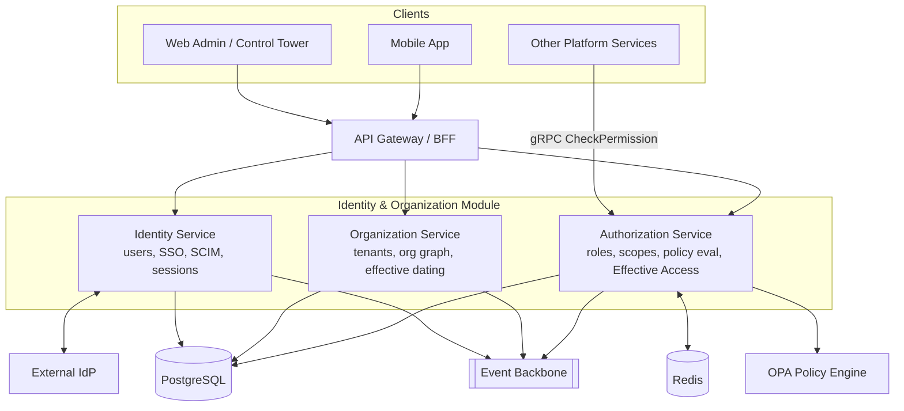
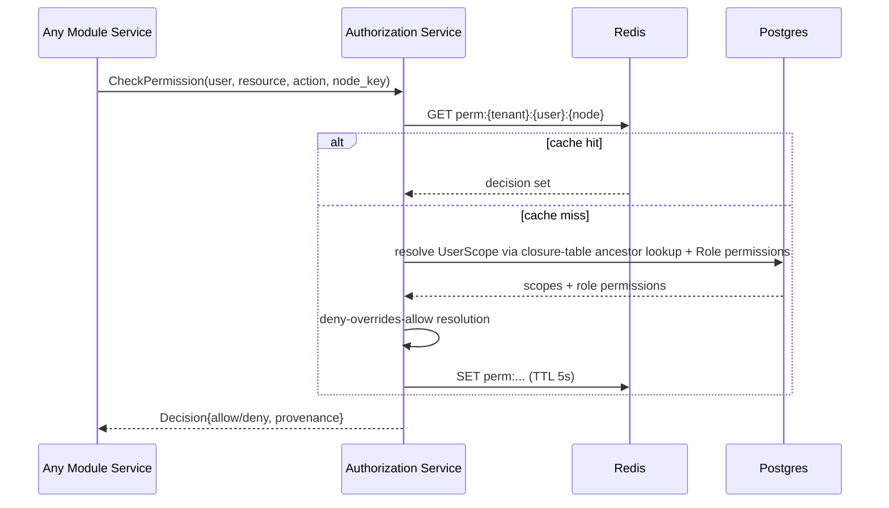
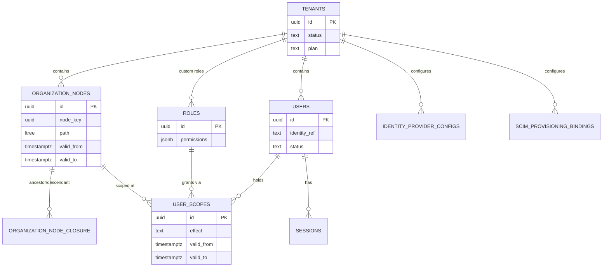
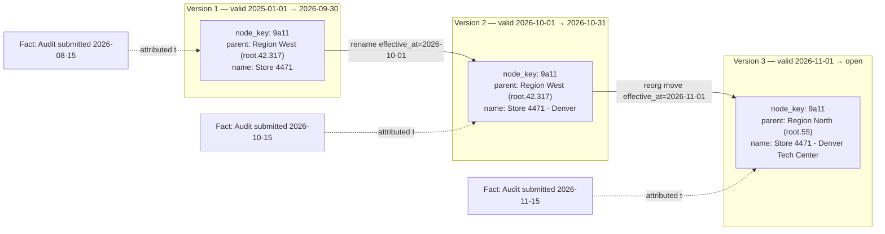

# Identity & Organization — Architecture Diagrams

## 1. Component / Container Diagram

This module is three logical services — Identity, Organization, Authorization — deployed initially
as one bounded-context service and split independently only when scale or ownership demands it. The
Gateway routes all administrative and login traffic here, while every other platform service reaches
the Authorization Service directly over internal gRPC for permission checks on every request it
serves; no other service queries this module's tables directly. Redis and OPA sit behind the
Authorization Service as a performance cache and a declarative attribute-policy evaluator,
respectively, keeping the sub-15ms permission-check latency budget achievable at 1M-user scale.

## 2. Sequence Diagram — Permission Check (primary flow)

Every permission check first tries the Redis cache, populated on demand, before touching Postgres.
The Authorization Service resolves the caller's ancestor chain through the closure table (an O(depth)
lookup), applies role permissions from each contributing `UserScope`, and returns a decision plus its
provenance — the same code path the Effective Access preview reuses so the two can never diverge.

## 3. ER Diagram — Owned Entities

`OrganizationNode` is effective-dated (one row per version, keyed by a stable `node_key`), which is
why it is drawn distinctly from the current-state-only `OrganizationNodeClosure` performance index.
`UserScope` is the join between `User`, `Role`, and a node, and is itself effective-dated so that
"who could access what, when" remains answerable after any role or reorg change.

## 4. OrganizationNode Effective-Dating Timeline (conceptual)

This module has no single lifecycle state machine (unlike WorkItem, Issue, or TemplateVersion) —
instead, each logical node accumulates a sequence of non-overlapping, effective-dated versions.
The diagram below shows one `SITE` node's version history across a reorg and a rename.

Each version's `[valid_from, valid_to)` window is disjoint and contiguous for the same `node_key`.
Historical facts (audits, submissions, issues) resolve their organizational attribution by matching
their own `occurred_at` timestamp into the version window that contained it at the time, which is
what keeps a 2026-08-15 audit permanently attributed to Region West even after the store moves to
Region North on 2026-11-01 — satisfying the platform's "Reorganization" acceptance test without any
special-case logic in the reporting layer.
