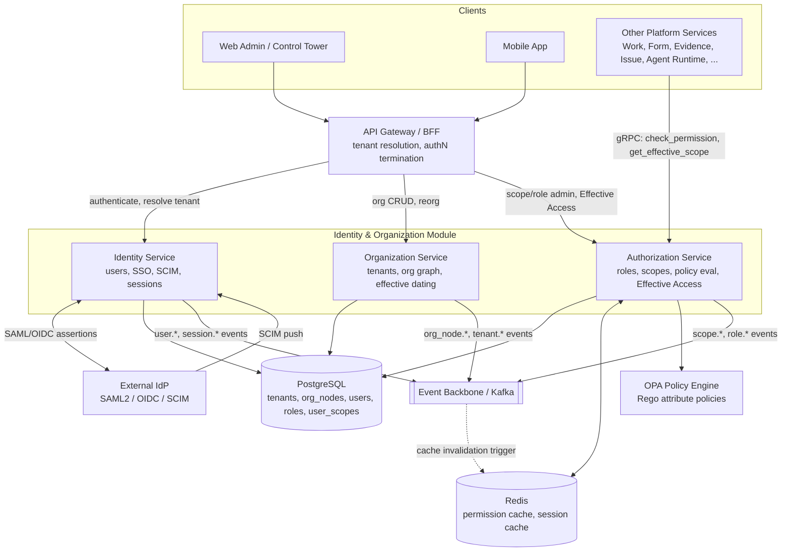

# Identity & Organization — High-Level Design

## 1. Module Responsibilities & Boundaries

This module is realized as three cooperating services, matching the Core Technical Components table
in the source spec (§16.3):

| Service | Responsibility | Owns |
|---|---|---|
| **Identity Service** | User identity, SSO (SAML2/OIDC), SCIM provisioning endpoints, session issuance/refresh/revocation | `User`, `Session`, `IdentityProviderConfig`, `ScimProvisioningBinding` |
| **Organization Service** | Tenant lifecycle, organization hierarchy CRUD, effective dating, reorg orchestration, materialized path / closure table maintenance | `Tenant`, `OrganizationNode`, `OrganizationNodeClosure` |
| **Authorization Service** | Role/permission definitions, `UserScope` assignment, policy evaluation (RBAC + scope + ABAC), Effective Access preview computation, permission cache management | `Role`, `Permission`, `UserScope`, `PolicyRule`, permission cache (Redis) |

These three services share a bounded context and a single Postgres schema/database at small-to-mid
tenant scale (deployed as one JVM service initially, per the architectural decision principle "split
services only where scale/deployment/security/ownership justify it" — source-spec §16.2). They are
designed with clean internal module boundaries (separate packages, separate DB schemas within the
same database) so they can be split into independently deployable services once a single large
tenant's authorization QPS or SSO/SCIM volume justifies isolated scaling and blast-radius control.
This document treats them as three logical components regardless of physical deployment.

**Boundary rule**: no other module ever queries `organization_nodes`, `user_scopes`, `roles`, or
`users` tables directly. All access is through the Authorization Service's permission-check API or
the Organization Service's read APIs; this is the same principle as the platform-wide "prove
object-level scope at every access boundary" rule (source-spec §21.1).

## 2. Component Diagram

**Narration**: The API Gateway resolves the authenticated principal and tenant before any request
reaches a downstream service. Every other platform service calls the Authorization Service directly
(via internal gRPC, per convention) for permission checks rather than re-implementing authorization
logic. The Organization Service and Authorization Service both write to the same Postgres instance
but through distinct table ownership; Redis sits in front of the Authorization Service as a
read-through permission cache; OPA evaluates the ABAC layer as declarative Rego policy so attribute
rules are testable and auditable independent of application code deploys.

## 3. Data Ownership

| Entity | Owner | Referenced (read-only) by |
|---|---|---|
| `Tenant` | Organization Service | Every service, for `tenant_id` scoping |
| `OrganizationNode` (+ closure/path) | Organization Service | Work, Form, Evidence, Issue, Knowledge, Analytics, Agent Runtime |
| `User` | Identity Service | Every service, for actor attribution (`actor_id`) |
| `Session` | Identity Service | API Gateway (token introspection) |
| `Role`, `Permission`, `PolicyRule` | Authorization Service | Admin Console (display only) |
| `UserScope` | Authorization Service | Nobody directly; only via permission-check API |

No other module's schema contains a foreign key directly into these tables beyond a denormalized
`tenant_id` / `location_id` / `actor_id` value used for filtering and display — referential
integrity across service/schema boundaries is enforced at write time via API validation, not
cross-schema DB foreign keys, so that Organization/Identity/Authorization can eventually be split
into physically separate databases without a big-bang migration.

## 4. External Interfaces

### 4.1 APIs exposed by this module (consumed by other modules/clients)

- `POST /api/v1/auth/login`, `/callback`, `/logout`, `/refresh` (Identity Service)
- `POST /api/v1/scim/v2/Users`, `/Groups` (+ GET/PATCH/DELETE) (Identity Service — SCIM 2.0)
- `POST /api/v1/orgs/nodes`, `PUT /api/v1/orgs/nodes/{id}`, `POST /api/v1/orgs/nodes/{id}/move`
  (Organization Service)
- `GET /api/v1/orgs/nodes/{id}/subtree`, `GET /api/v1/orgs/nodes/{id}/path?as_of=...`
  (Organization Service)
- `POST /api/v1/authz/user-scopes`, `GET /api/v1/authz/effective-access` (Authorization Service)
- Internal gRPC: `AuthorizationService.CheckPermission(principal, resource, action, context) →
  Decision`, `AuthorizationService.GetEffectiveScope(principal) → ScopeSet` — this is the interface
  every other service (Work, Form, Evidence, Issue, Knowledge, Agent Runtime) calls on every
  authorized request. Full REST/JSON shapes are in `low-level-design.md`.

### 4.2 Events produced

`tenant.created`, `tenant.suspended`, `tenant.reactivated`, `org_node.created`, `org_node.moved`,
`org_node.deactivated`, `user.invited`, `user.activated`, `user.deactivated`, `user.deleted`,
`scope.granted`, `scope.revoked`, `role.updated`, `session.revoked`, `sso.login_failed`,
`scim.sync_error` — all in the canonical event envelope (source-spec §18.4), tenant-partitioned by
`tenant_id:aggregate_id` on Kafka per convention.

### 4.3 Events/APIs consumed

- None from other business modules (this module is foundational and acyclic with respect to other
  modules' domain events). It does consume external IdP endpoints (SAML metadata, OIDC discovery,
  SCIM push) as an inbound integration, not an internal platform dependency.
- It consumes the platform's central secret management service for IdP signing keys/client secrets
  and the Notification Hub (outbound only, fire-and-forget) to send invite/deactivation emails.

## 5. Scalability Approach

### 5.1 Organization graph at 100k+ nodes / 1M+ users

Two representations are maintained together on `OrganizationNode`, chosen for complementary strengths:

- **Materialized path** (`path ltree` column, e.g. `1.42.317.8842`) — cheap subtree queries
  (`path <@ '1.42'`), cheap "is descendant of" checks, human-debuggable, and the natural
  representation for effective-dated versioning (each version of a node has its own path snapshot
  valid for its `[valid_from, valid_to)` window).
- **Closure table** (`organization_node_closure(ancestor_id, descendant_id, depth)`) — maintained
  incrementally on node move, gives O(1) "all ancestors of X" and "all descendants of X" lookups
  without string-prefix scans, and is what the Authorization Service's scope-inheritance resolution
  and the Effective Access preview query against for performance at 100k-node scale. The closure
  table is rebuilt only for the subtree under a moved node (bounded cost proportional to subtree
  size, not tree size — see LLD §7 pseudocode), not the whole tree.

Both are kept in sync inside the same transaction as a node move; the materialized path is the
source of truth for effective-dated correctness (it is versioned per row), and the closure table is
a current-state-only performance index rebuilt on each move (it does not need historical versions
because historical resolution always goes through the path/version table, never the closure table).

### 5.2 Permission cache strategy (Redis)

- Cache key: `perm:{tenant_id}:{user_id}:{node_id}` → serialized resolved permission set (allow/deny
  per `resource:action`, with provenance for Effective Access display).
- Populated lazily on first `CheckPermission` call for a given `(user, node)` pair; TTL default 5s
  (tenant-configurable, FR-ORG per functional spec §7).
- **Invalidation triggers** (push-based, not TTL-only): `scope.granted`/`scope.revoked`,
  `role.updated`, `user.deactivated`, `org_node.moved` (invalidates all cached entries whose node is
  in the moved subtree), `tenant.suspended`. Each of these events is consumed by a small cache-
  invalidation worker inside the Authorization Service that deletes matching key patterns (via
  Redis `SCAN` + pipeline delete, scoped by `tenant_id` prefix to bound cost) rather than relying on
  TTL expiry alone, so the "< 5 second propagation" NFR is met even at a 5-second TTL ceiling.
- A secondary, longer-lived cache (`scope-set:{tenant_id}:{user_id}`, TTL 60s) holds the user's full
  resolved node-set for authorization pre-filtering of list/search queries (e.g., "which locations
  can this user see" for a Control Tower dashboard), invalidated by the same event triggers.

### 5.3 SSO/SCIM scale

SAML/OIDC login is a low-QPS, latency-tolerant path (bounded by human login frequency) and does not
need special scaling beyond standard horizontal replica scaling of the Identity Service. SCIM bulk
provisioning bursts (e.g., initial 50k-user tenant onboarding) are handled by accepting the SCIM
write, persisting it as a pending `ScimSyncJob` row, returning `202 Accepted` semantics where the
IdP connector supports async patterns, and processing the batch through a bounded-concurrency worker
pool so a single tenant's bulk sync cannot starve another tenant's interactive SSO traffic (bulkhead
pattern per source-spec §22.3).

## 6. Multi-Tenancy Enforcement Specifics

- Every table in this module carries `tenant_id` (including `organization_nodes`, `users`,
  `user_scopes`, `roles` for tenant-custom roles) with Postgres Row-Level Security policies as the
  defense-in-depth backstop, per the platform-wide convention.
- The Authorization Service's `CheckPermission` call requires `tenant_id` to be resolved from the
  authenticated principal's session — never accepted as a caller-supplied parameter from
  non-support-tooling callers. Support-tooling cross-tenant access (e.g., a platform support engineer
  investigating a customer issue) is a separately audited, explicitly logged, time-boxed elevated
  role, never the default code path.
- The organization graph closure table and materialized path both include `tenant_id` in every
  query predicate in addition to path/closure filters, so a path-prefix collision across tenants
  (paths are tenant-local integers) can never leak cross-tenant data even if an index scan were
  mis-scoped.
- Redis cache keys are tenant-namespaced (`perm:{tenant_id}:...`) so a cache flush or pattern-delete
  is inherently tenant-bounded and a bug in one tenant's invalidation logic cannot evict or corrupt
  another tenant's cache entries.
- Very large enterprise tenants (per source-spec's tenant-tier sharding note) may be placed in a
  dedicated Postgres schema or cluster; the Organization/Authorization Service code path is identical
  either way — only the connection routing changes, resolved once per request from the tenant's
  registry entry.

## 7. Failure Modes & Degradation Strategy

| Failure | Impact | Degradation strategy |
|---|---|---|
| External IdP (SAML/OIDC) outage | New interactive logins for that tenant fail | Existing sessions remain valid until natural expiry/refresh failure; surface a clear "your organization's sign-in provider is unavailable" error (FR-ORG-043); optionally allow break-glass local admin login if tenant has opted in (functional-spec §9). Circuit breaker trips after N consecutive IdP failures to avoid hammering a down IdP. |
| SCIM push failure (IdP-side outage or malformed payload) | New provisioning/deprovisioning events are delayed or dropped | Errors land in a per-tenant SCIM dead-letter log (FR-ORG-053); the periodic reconciliation job (FR-ORG-054) catches drift within its interval; deprovisioning failure specifically pages/alerts (security-sensitive — a user who should have lost access might not have) rather than silently retrying indefinitely. |
| Redis (permission cache) unavailable | Every permission check would otherwise fail closed | Fail **closed by default** for write/administer actions (deny, do not silently allow), but fall back to a direct-to-Postgres policy evaluation path (slower, p95 target relaxes to the cache-miss bound) for read actions so the platform degrades in latency, not in availability, for the common case; Postgres is the source of truth so correctness is never compromised, only speed. |
| Postgres primary unavailable | Full read/write outage for this module, cascading to every other module | Standard managed-Postgres HA failover; read replicas serve Effective Access preview and read-heavy org-tree browsing during failover to shrink the blast radius; this module's 99.95% availability target (functional-spec §7) is the platform's binding constraint. |
| Node move (reorg) partially applied (crash mid-transaction) | Risk of path/closure divergence | The move is executed as a single Postgres transaction covering the path update and closure table delta; a crash rolls back atomically — there is no partially-applied state by construction (see LLD §7 pseudocode for the transactional boundary). |
| OPA policy engine unavailable | ABAC overlay checks cannot evaluate | RBAC + scope evaluation (the majority of checks) proceeds independently of OPA; ABAC-gated permissions specifically fail closed (deny) until OPA recovers, since an attribute policy is by definition a *restriction*, not a grant, so failing closed cannot under-protect a resource, only over-restrict temporarily. |

## 8. Technology Choices (justified)

- **PostgreSQL with `ltree` extension** for materialized paths: native, indexable, operator-rich
  (`<@`, `@>`) hierarchical query support without a bespoke graph store; consistent with the
  platform's single relational-primary-datastore convention.
- **Closure table as a secondary structure**: chosen over relying on `ltree` alone because ancestor/
  descendant lookups used on every permission check need to be O(1) index lookups, not string-prefix
  scans, at 100k-node scale with sub-15ms cache-hit / sub-80ms cache-miss latency budgets.
- **Redis** for the permission cache: matches the platform-wide cache convention; sub-millisecond
  read latency is required to keep permission checks off the platform's critical path latency budget.
- **OPA/Rego** for ABAC policy: matches the platform's chosen policy-engine convention (also used by
  the Agent Runtime for tool-execution policy), giving a single declarative, testable, versioned
  policy language across both human-user ABAC and agent-action policy rather than two bespoke rule
  engines.
- **SCIM 2.0 + SAML2/OIDC** as protocol choices: industry-standard, required for interoperability
  with enterprise IdPs (Okta/Entra ID/OneLogin/Google Workspace) per source-spec §15; building a
  proprietary provisioning protocol would block enterprise sales.
- **Kotlin + Spring Boot**, per platform convention, with Spring Security's SAML2/OIDC relying-party
  support as the base for the Identity Service's SSO handling, extended for tenant-per-IdP
  multi-tenant configuration (Spring Security's defaults assume a single IdP per deployment; this
  module wraps that with a tenant-keyed registration resolver).
