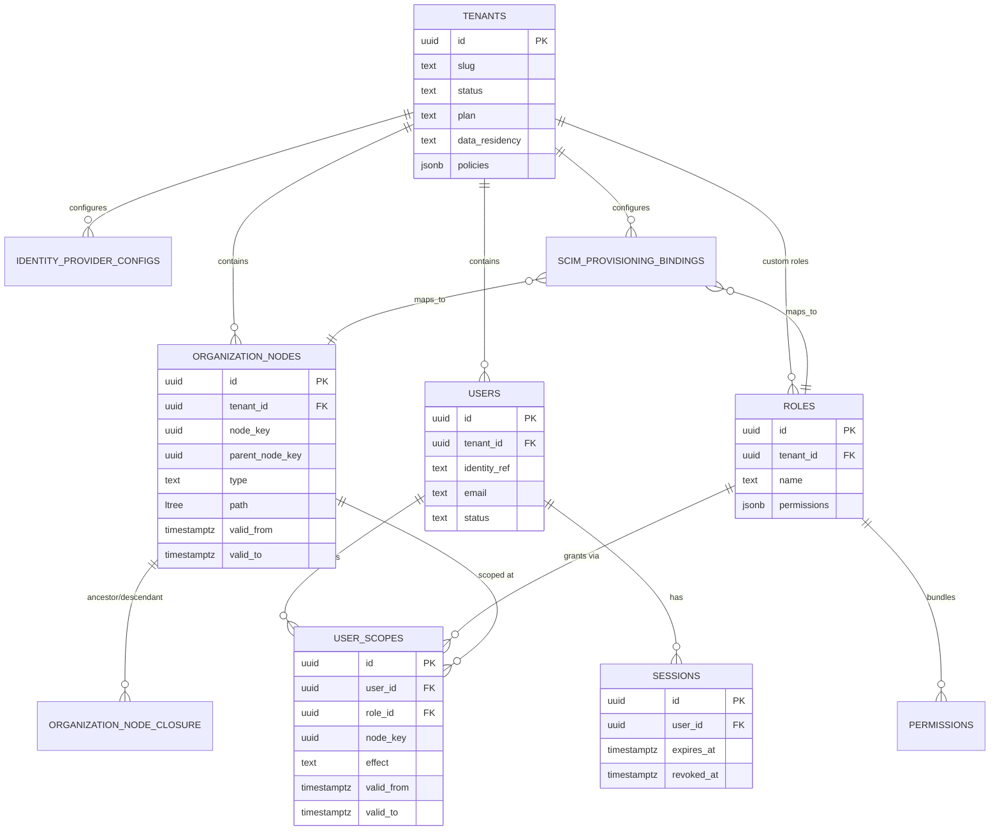
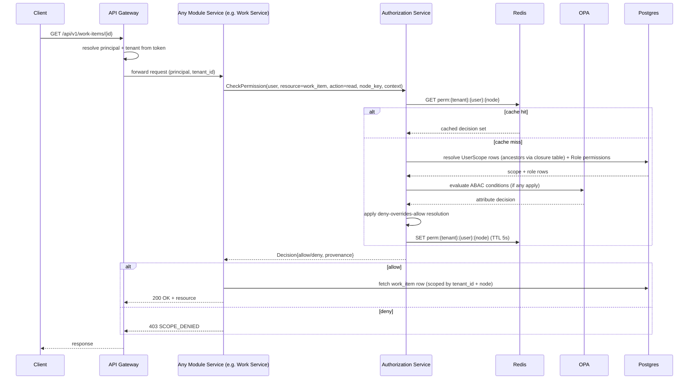
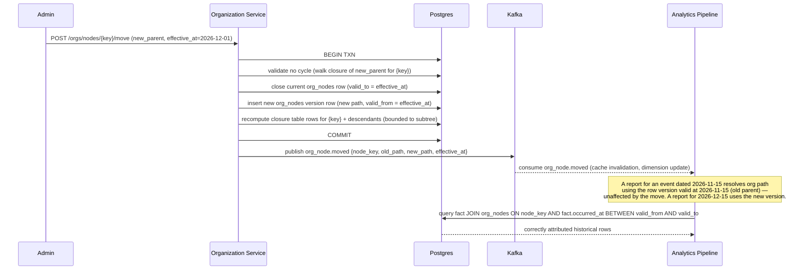
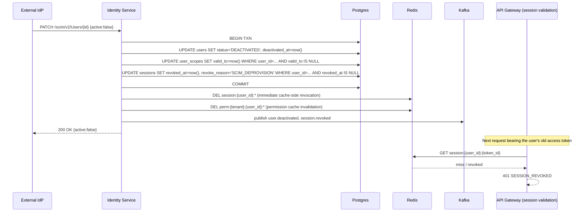

# Identity & Organization — Low-Level Design

## 1. Database Schema

All tables live in Postgres, `tenant_id` present on every row, Row-Level Security enabled per
platform convention. Primary keys are UUIDv7 (time-sortable) unless noted.

### 1.1 `tenants`

| Column | Type | Constraints |
|---|---|---|
| id | uuid | PK |
| slug | text | unique, not null |
| name | text | not null |
| status | text | not null, enum(`PROVISIONING`,`ACTIVE`,`SUSPENDED`,`OFFBOARDING`,`DELETED`) |
| plan | text | not null |
| data_residency | text | not null, e.g. `us-east`, `eu-west` |
| sso_required | boolean | not null, default false |
| scim_enabled | boolean | not null, default false |
| policies | jsonb | not null, default `{}` — password policy, session timeout, IP allowlist |
| root_node_id | uuid | FK → organization_nodes(id), nullable until root provisioned |
| created_at | timestamptz | not null |
| updated_at | timestamptz | not null |
| version | bigint | not null, default 1 — optimistic concurrency |

Indexes: `uniq(slug)`, `idx(status)`.

### 1.2 `organization_nodes`

Effective-dated: each logical node has one row per version. `node_key` is the stable logical
identity across versions; `id` is the version-row's own identity.

| Column | Type | Constraints |
|---|---|---|
| id | uuid | PK (identifies this version row) |
| tenant_id | uuid | not null, FK → tenants |
| node_key | uuid | not null — stable logical node identity across versions |
| parent_node_key | uuid | nullable (null only for the tenant root) |
| type | text | not null, e.g. `ENTERPRISE`,`COUNTRY`,`REGION`,`DISTRICT`,`BRAND`,`BUSINESS_UNIT`,`DEPARTMENT`,`SITE`, or tenant-custom |
| name | text | not null |
| path | ltree | not null — materialized path using `node_key` segments, e.g. `root.42.317` |
| depth | int | not null |
| attributes | jsonb | not null, default `{}` — tenant-custom attribute schema per type |
| physical_location_id | uuid | nullable — links sibling nodes representing one physical site |
| valid_from | timestamptz | not null |
| valid_to | timestamptz | nullable (null = currently open-ended) |
| created_by | uuid | FK → users |
| created_at | timestamptz | not null |

Constraints:
- Exclusion constraint: `EXCLUDE USING gist (tenant_id WITH =, node_key WITH =, tstzrange(valid_from, valid_to, '[)') WITH &&)` — prevents overlapping validity windows for the same logical node (functional-spec §6).
- `CHECK (valid_to IS NULL OR valid_to > valid_from)`.

Indexes: `gist(path)` for `<@`/`@>` subtree queries, `btree(tenant_id, node_key, valid_from)`,
`btree(tenant_id, parent_node_key)`, `btree(tenant_id, valid_to)` (partial index `WHERE valid_to IS
NULL` for "current" lookups).

### 1.3 `organization_node_closure`

Current-state-only performance index (see HLD §5.1); rebuilt per affected subtree on every move.

| Column | Type | Constraints |
|---|---|---|
| tenant_id | uuid | not null |
| ancestor_key | uuid | not null |
| descendant_key | uuid | not null |
| depth | int | not null — 0 for self-row |

PK: `(tenant_id, ancestor_key, descendant_key)`. Indexes: `btree(tenant_id, descendant_key)` (for
"all ancestors of X"), `btree(tenant_id, ancestor_key)` (for "all descendants of X").

### 1.4 `users`

| Column | Type | Constraints |
|---|---|---|
| id | uuid | PK |
| tenant_id | uuid | not null, FK → tenants |
| identity_ref | text | not null — SSO subject / SCIM externalId |
| identity_source | text | not null, enum(`SSO`,`SCIM`,`LOCAL`,`JIT`) |
| email | citext | not null |
| given_name | text | nullable |
| family_name | text | nullable |
| status | text | not null, enum(`INVITED`,`ACTIVE`,`DEACTIVATED`,`DELETED`) |
| home_node_key | uuid | nullable — primary/default location for mobile home screen |
| locale | text | not null, default `en-US` |
| timezone | text | not null, default `UTC` |
| deactivated_at | timestamptz | nullable |
| deleted_at | timestamptz | nullable |
| created_at | timestamptz | not null |
| updated_at | timestamptz | not null |
| version | bigint | not null, default 1 |

Constraints: `unique(tenant_id, identity_ref)`, `unique(tenant_id, email) WHERE deleted_at IS NULL`.
Indexes: `btree(tenant_id, status)`, `btree(tenant_id, home_node_key)`.

### 1.5 `roles`

| Column | Type | Constraints |
|---|---|---|
| id | uuid | PK |
| tenant_id | uuid | nullable — null for system-provided roles shared across tenants |
| name | text | not null |
| is_system | boolean | not null, default false |
| description | text | nullable |
| permissions | jsonb | not null — array of `{resource, action, conditions?}` |
| created_at | timestamptz | not null |
| updated_at | timestamptz | not null |
| version | bigint | not null, default 1 |

Constraints: `unique(tenant_id, name)` (tenant_id nullable-aware via partial indexes for system
roles). Indexes: `btree(tenant_id)`.

### 1.6 `permissions` (reference/catalog table)

| Column | Type | Constraints |
|---|---|---|
| id | text | PK, e.g. `work_item:approve` |
| resource | text | not null |
| action | text | not null |
| supports_conditions | boolean | not null, default false |
| description | text | not null |

Static reference data seeded at deploy time; not tenant-scoped.

### 1.7 `user_scopes`

| Column | Type | Constraints |
|---|---|---|
| id | uuid | PK |
| tenant_id | uuid | not null |
| user_id | uuid | not null, FK → users |
| role_id | uuid | not null, FK → roles |
| node_key | uuid | not null — logical node this scope is granted at (inherits to descendants) |
| effect | text | not null, enum(`ALLOW`,`DENY`) |
| conditions | jsonb | nullable — ABAC overlay, OPA input fragment |
| valid_from | timestamptz | not null |
| valid_to | timestamptz | nullable |
| granted_by | uuid | FK → users |
| source | text | not null, enum(`MANUAL`,`SCIM`,`DEFAULT_JIT`) |
| created_at | timestamptz | not null |

Indexes: `btree(tenant_id, user_id, valid_from, valid_to)`, `btree(tenant_id, node_key)`,
`btree(tenant_id, role_id)`. Exclusion constraint not applied here (overlapping scopes are valid
business reality per functional-spec §6; conflicts resolved at evaluation time).

### 1.8 `sessions`

| Column | Type | Constraints |
|---|---|---|
| id | uuid | PK |
| tenant_id | uuid | not null |
| user_id | uuid | not null, FK → users |
| device_id | text | nullable |
| refresh_token_hash | text | not null |
| issued_at | timestamptz | not null |
| expires_at | timestamptz | not null |
| revoked_at | timestamptz | nullable |
| revoke_reason | text | nullable |

Indexes: `btree(tenant_id, user_id)`, `btree(refresh_token_hash)`.

### 1.9 `identity_provider_configs`

| Column | Type | Constraints |
|---|---|---|
| id | uuid | PK |
| tenant_id | uuid | not null |
| protocol | text | not null, enum(`SAML2`,`OIDC`) |
| issuer | text | not null |
| metadata | jsonb | not null — SSO URL/certs (SAML) or discovery doc/client creds ref (OIDC) |
| attribute_mapping | jsonb | not null |
| jit_provisioning_enabled | boolean | not null, default false |
| default_role_id | uuid | nullable, FK → roles |
| default_node_key | uuid | nullable |
| cert_rotation_overlap_until | timestamptz | nullable |
| enabled | boolean | not null, default true |

### 1.10 `scim_provisioning_bindings`

| Column | Type | Constraints |
|---|---|---|
| id | uuid | PK |
| tenant_id | uuid | not null |
| scim_group_external_id | text | not null |
| role_id | uuid | not null, FK → roles |
| node_key | uuid | not null |

Constraint: `unique(tenant_id, scim_group_external_id)`.

### 1.11 `scim_sync_errors`

| Column | Type | Constraints |
|---|---|---|
| id | uuid | PK |
| tenant_id | uuid | not null |
| occurred_at | timestamptz | not null |
| operation | text | not null |
| payload | jsonb | not null |
| error_code | text | not null |
| error_detail | text | not null |
| status | text | not null, enum(`RETRYABLE`,`DEAD_LETTER`,`RESOLVED`) |

### 1.12 ER Diagram



## 2. REST Endpoints

All under `/api/v1/`. Auth: bearer OIDC token unless noted. Mutations require `Idempotency-Key`
where retries are possible; mutable resources use `version`/`ETag` optimistic concurrency.

### 2.1 Create organization node

`POST /api/v1/orgs/nodes`

Request:
```json
{
  "parent_node_key": "5e2b...c1",
  "type": "SITE",
  "name": "Store 4471 - Denver",
  "attributes": { "brand": "Acme Coffee", "square_footage": 1800 },
  "effective_at": "2026-10-01T00:00:00Z"
}
```

Response `201 Created`:
```json
{
  "id": "9a11...ef",
  "node_key": "9a11...ef",
  "parent_node_key": "5e2b...c1",
  "type": "SITE",
  "name": "Store 4471 - Denver",
  "path": "root.42.317.9a11",
  "depth": 3,
  "valid_from": "2026-10-01T00:00:00Z",
  "valid_to": null,
  "version": 1
}
```

Errors: `400 ORG_INVALID_PARENT`, `404 ORG_PARENT_NOT_FOUND`, `409 ORG_CYCLE_DETECTED`.

### 2.2 Update org node (rename / attribute change — effective-dated)

`PUT /api/v1/orgs/nodes/{node_key}`

Request:
```json
{
  "name": "Store 4471 - Denver Tech Center",
  "attributes": { "square_footage": 2100 },
  "effective_at": "2026-11-01T00:00:00Z",
  "expected_version": 1
}
```

Response `200 OK`: same shape as create, with the new version row's `id` and incremented `version`.
Errors: `409 CONFLICT` (stale `expected_version`), `404 ORG_NODE_NOT_FOUND`.

### 2.3 Move node (reorg)

`POST /api/v1/orgs/nodes/{node_key}/move`

Request:
```json
{
  "new_parent_node_key": "7c30...aa",
  "effective_at": "2026-12-01T00:00:00Z",
  "cascade_descendants": true
}
```

Response `202 Accepted` (scheduled) or `200 OK` (immediate, `effective_at <= now`):
```json
{
  "node_key": "9a11...ef",
  "old_path": "root.42.317.9a11",
  "new_path": "root.55.9a11",
  "effective_at": "2026-12-01T00:00:00Z",
  "affected_descendant_count": 0,
  "affected_active_work_item_count": 3,
  "status": "SCHEDULED"
}
```

Errors: `409 ORG_CYCLE_DETECTED`, `422 ORG_NODE_HAS_ACTIVE_CHILDREN` (if `cascade_descendants=false`
and children exist).

### 2.4 Effective Access preview

`GET /api/v1/authz/effective-access?user_id={id}&node_key={key}&as_of={iso8601}`

Response `200 OK`:
```json
{
  "user_id": "u-1001",
  "node_key": "9a11...ef",
  "as_of": "2026-09-19T00:00:00Z",
  "permissions": [
    {
      "resource": "work_item",
      "action": "approve",
      "effect": "ALLOW",
      "source_scope_id": "us-330",
      "source_node_key": "root.42",
      "via_role": "District Manager",
      "inherited": true
    },
    {
      "resource": "issue",
      "action": "export",
      "effect": "DENY",
      "source_scope_id": "us-512",
      "source_node_key": "9a11...ef",
      "via_role": "explicit deny exception",
      "inherited": false,
      "overrides_scope_id": "us-330"
    }
  ]
}
```

Errors: `403 SCOPE_DENIED` (caller lacks permission to preview this user/node), `404
USER_NOT_FOUND`/`ORG_NODE_NOT_FOUND`.

### 2.5 Assign scope

`POST /api/v1/authz/user-scopes`

Request:
```json
{
  "user_id": "u-1001",
  "role_id": "role-store-manager",
  "node_key": "9a11...ef",
  "effect": "ALLOW",
  "valid_from": "2026-09-20T00:00:00Z",
  "valid_to": null,
  "conditions": null
}
```

Response `201 Created`: echoes the created `UserScope` row with `id`.
Errors: `403 SELF_ESCALATION_DENIED` (functional-spec §6), `422 ROLE_NODE_TYPE_MISMATCH` (if a role
is restricted to certain node types by policy).

### 2.6 SSO login callback (OIDC)

`GET /api/v1/auth/oidc/callback?code=...&state=...`

Response: `302` redirect to the web app with a session cookie set, or renders a branded error page
per the FR-ORG-043 classification (e.g. `?error=SSO_ASSERTION_EXPIRED`).

### 2.7 SCIM: create user

`POST /api/v1/scim/v2/Users`

Request (SCIM 2.0 shape):
```json
{
  "schemas": ["urn:ietf:params:scim:schemas:core:2.0:User"],
  "userName": "jane.doe@acmeco.com",
  "name": { "givenName": "Jane", "familyName": "Doe" },
  "emails": [{ "value": "jane.doe@acmeco.com", "primary": true }],
  "active": true,
  "externalId": "00u1a2b3c4"
}
```

Response `201 Created`:
```json
{
  "schemas": ["urn:ietf:params:scim:schemas:core:2.0:User"],
  "id": "u-1002",
  "externalId": "00u1a2b3c4",
  "userName": "jane.doe@acmeco.com",
  "active": true,
  "meta": { "resourceType": "User", "created": "2026-09-19T00:00:00Z" }
}
```

### 2.8 SCIM: deactivate user

`PATCH /api/v1/scim/v2/Users/{id}`

Request:
```json
{
  "schemas": ["urn:ietf:params:scim:api:messages:2.0:PatchOp"],
  "Operations": [{ "op": "replace", "path": "active", "value": false }]
}
```

Response `200 OK` with `active: false`; triggers deactivation cascade (§4.3 sequence diagram c).

### 2.9 SCIM: group (role/scope binding) membership update

`PATCH /api/v1/scim/v2/Groups/{id}`

Request:
```json
{
  "schemas": ["urn:ietf:params:scim:api:messages:2.0:PatchOp"],
  "Operations": [
    { "op": "add", "path": "members", "value": [{ "value": "u-1002" }] }
  ]
}
```

Response `200 OK`; internally resolves the group's `scim_provisioning_bindings` row and creates/
extends the corresponding `UserScope`.

## 3. Sequence Diagrams

### 3.1 Permission check on resource access



**Narration**: Every downstream service delegates the authorization decision to the Authorization
Service rather than embedding its own scope logic; the cache is checked first, and only a cache miss
touches Postgres and OPA. The decision's provenance (which `UserScope` row and rule produced it) is
returned alongside the boolean so callers can log it for audit and so the Effective Access preview
can reuse the identical code path (functional-spec FR-ORG-062).

### 3.2 Effective-dated reorg and its effect on historical reports



**Narration**: The move never updates a historical row in place; it closes the old version and opens
a new one at `effective_at`. Downstream analytics joins facts to the org node version whose validity
window contains the fact's own timestamp, which is what guarantees the "Reorganization" acceptance
test (source-spec §24.1) — a location's history stays attributed to its old region for events before
the move, and to its new region afterward.

### 3.3 SCIM deprovisioning cascading to session revocation



**Narration**: Deactivation, scope closure, and session revocation happen inside one transaction so
there is no window where the user is marked inactive but their sessions remain valid. Cache deletion
is performed synchronously in the same request path (not only via the async Kafka event) so the
"< 5 second propagation" NFR is met even if the event consumer is briefly lagging.

## 4. Algorithms / Pseudocode

### 4.1 Permission-check algorithm

```
function check_permission(principal, resource, action, node_key, context, as_of = now()):
    tenant_id = principal.tenant_id

    # 1. Fast path: tenant suspended?
    if tenant_status(tenant_id) != ACTIVE:
        return Decision(deny, reason="TENANT_SUSPENDED")

    # 2. Cache lookup
    cache_key = f"perm:{tenant_id}:{principal.user_id}:{node_key}"
    cached = redis.get(cache_key)
    if cached and as_of == now():   # cached entries are always "now"-relative
        decision_set = cached
    else:
        decision_set = resolve_decision_set(tenant_id, principal.user_id, node_key, as_of)
        if as_of == now():
            redis.set(cache_key, decision_set, ttl = tenant_permission_cache_ttl(tenant_id))

    entry = decision_set.get((resource, action))
    if entry is None:
        return Decision(deny, reason="NO_MATCHING_GRANT")

    # 3. ABAC overlay for entries that carry conditions
    if entry.conditions:
        opa_result = opa.evaluate(policy="authz/attribute_check", input={
            principal: principal, resource: resource, action: action,
            node_key: node_key, context: context, conditions: entry.conditions
        })
        if not opa_result.allowed:
            return Decision(deny, reason="ATTRIBUTE_POLICY_DENIED", provenance=entry)

    return Decision(entry.effect, provenance=entry)


function resolve_decision_set(tenant_id, user_id, node_key, as_of):
    # Ancestors of node_key (inclusive), most specific first
    ancestor_chain = closure_table.get_ancestors(tenant_id, node_key)  # O(depth), indexed lookup

    # All UserScope rows valid at as_of, for this user, whose node is on the ancestor chain
    scopes = db.query("""
        SELECT * FROM user_scopes
        WHERE tenant_id = :tenant_id AND user_id = :user_id
          AND node_key = ANY(:ancestor_chain)
          AND valid_from <= :as_of AND (valid_to IS NULL OR valid_to > :as_of)
        ORDER BY node_key_depth(node_key) DESC   -- most specific (deepest) node first
    """)

    decision_set = {}
    for scope in scopes:
        role_permissions = role_cache.get(scope.role_id)   # {resource, action, conditions}
        for perm in role_permissions:
            key = (perm.resource, perm.action)
            existing = decision_set.get(key)
            if existing is None:
                decision_set[key] = Entry(effect=scope.effect, conditions=perm.conditions or scope.conditions,
                                           source_scope_id=scope.id, source_node_key=scope.node_key)
            elif existing.effect == ALLOW and scope.effect == DENY:
                # deny-overrides-allow: a DENY found at any node (regardless of processing order)
                # always wins once discovered
                decision_set[key] = Entry(effect=DENY, ..., overrides_scope_id=existing.source_scope_id)
            # ALLOW does not overwrite an existing DENY; ALLOW does not overwrite ALLOW (first/most
            # specific wins for provenance display, but the permission itself is already granted)
    return decision_set
```

Complexity: `get_ancestors` is O(depth) via the closure table (bounded by tree depth, typically < 10,
independent of tree width/size). The scope query is indexed on `(tenant_id, user_id)` and filtered
by a small ancestor-chain `IN` list, so it stays sub-millisecond even for a 100k-node tenant. Note
the resolution order guarantees deny-overrides-allow *regardless of node depth ordering* by using an
explicit override check rather than relying on scan order alone.

### 4.2 Closure table update on node move

```
function move_node(tenant_id, node_key, new_parent_key, effective_at, cascade_descendants):
    BEGIN TRANSACTION

    old_row = get_current_version(tenant_id, node_key)
    new_parent_row = get_current_version(tenant_id, new_parent_key)

    # Cycle check: new_parent must not be node_key itself or any of node_key's current descendants
    descendant_keys = closure_table.get_descendants(tenant_id, node_key)  # includes self
    if new_parent_key in descendant_keys:
        ROLLBACK; raise OrgCycleDetected

    # Compute new path for node_key and shift descendants' paths by the same prefix change
    new_path = new_parent_row.path + '.' + node_key
    path_prefix_old = old_row.path
    path_prefix_new = new_path

    # Effective-dated versioning: close old row, open new row for node_key
    UPDATE organization_nodes SET valid_to = effective_at
        WHERE tenant_id = tenant_id AND node_key = node_key AND valid_to IS NULL
    INSERT INTO organization_nodes (node_key, parent_node_key, path, valid_from, ...)
        VALUES (node_key, new_parent_key, new_path, effective_at, ...)

    if cascade_descendants:
        for descendant in descendant_keys where descendant != node_key:
            desc_row = get_current_version(tenant_id, descendant)
            shifted_path = desc_row.path.replace_prefix(path_prefix_old, path_prefix_new)
            UPDATE organization_nodes SET valid_to = effective_at
                WHERE tenant_id = tenant_id AND node_key = descendant AND valid_to IS NULL
            INSERT INTO organization_nodes (node_key = descendant, path = shifted_path,
                                             valid_from = effective_at, parent_node_key unchanged, ...)

    # Closure table rebuild: only for the affected subtree (node_key + descendants), bounded cost
    DELETE FROM organization_node_closure
        WHERE tenant_id = tenant_id AND descendant_key IN (node_key, *descendant_keys)
          AND ancestor_key NOT IN (node_key, *descendant_keys)   -- keep internal subtree edges

    new_ancestors = closure_table.get_ancestors(tenant_id, new_parent_key)  -- includes new_parent
    for ancestor in new_ancestors:
        for member in (node_key, *descendant_keys):
            depth = path_depth(member) - path_depth(ancestor)
            INSERT INTO organization_node_closure (tenant_id, ancestor, member, depth)

    COMMIT

    publish_event("org_node.moved", {node_key, old_path: path_prefix_old, new_path, effective_at,
                                      affected_descendant_count: len(descendant_keys) - 1})
```

Complexity: bounded by the size of the moved subtree (`descendant_keys`), not the whole tree — moving
a leaf `SITE` node is O(1); moving a `REGION` with 5,000 sites is O(5,000), which is acceptable as an
infrequent admin operation and is executed inside one transaction so it is atomic (HLD §7 failure
mode: no partially-applied state).

### 4.3 Effective-date activation sweep (background job)

```
# Runs every minute. Handles nodes/scopes created with a future effective_at that has now arrived,
# for representations (e.g. denormalized "current org" read views, cache warmers) that are not
# naturally lazy-evaluated at read time.
function activation_sweep():
    due_node_versions = SELECT * FROM organization_nodes
        WHERE valid_from <= now() AND valid_from > last_sweep_watermark
    for version in due_node_versions:
        refresh_materialized_current_org_view(version.tenant_id)
        invalidate_redis_scope_set_cache(version.tenant_id)  # broad invalidation, bounded to tenant

    due_scopes = SELECT * FROM user_scopes
        WHERE valid_from <= now() AND valid_from > last_sweep_watermark
    for scope in due_scopes:
        redis.del(f"perm:{scope.tenant_id}:{scope.user_id}:*")

    advance_watermark(now())
```

This sweep is a safety net, not the primary correctness mechanism — the permission-check algorithm
already filters by `valid_from <= as_of` at evaluation time, so a future-dated scope correctly has no
effect until its date arrives even without the sweep. The sweep exists only to proactively warm/
invalidate caches and denormalized views at the moment a scheduled change activates, avoiding a
"stale until next natural cache miss" gap for low-traffic nodes.

## 5. Caching Strategy

| Cache | Key | TTL | Invalidation trigger |
|---|---|---|---|
| Permission decision set | `perm:{tenant_id}:{user_id}:{node_key}` | 5s default (tenant-configurable to 1s) | `scope.granted`, `scope.revoked`, `role.updated`, `user.deactivated`, `org_node.moved` (pattern delete for affected subtree), `tenant.suspended` |
| Resolved scope-set (list of accessible node_keys) | `scope-set:{tenant_id}:{user_id}` | 60s | Same triggers as above |
| Role permission bundle | `role:{role_id}` | 300s (roles change rarely) | `role.updated` |
| Session validity | `session:{user_id}:{token_id}` | matches token TTL | `session.revoked`, `user.deactivated` |
| Org node closure (hot ancestor chains) | `closure:{tenant_id}:{node_key}` | 300s | `org_node.moved` for the specific subtree |

All invalidation is event-driven (Kafka consumer inside the Authorization/Identity Service), not
TTL-only, to meet the < 5 second propagation NFR even at longer TTLs. Cache stampede protection: on
a cache miss, the resolving request acquires a short-lived per-key Redis lock (`SET NX PX 200`) so
concurrent requests for the same `(tenant, user, node)` triple do not all hit Postgres simultaneously
during a burst (e.g., right after a role update invalidates a hot key).

## 6. Concurrency Control

- **Org node edits**: optimistic concurrency via `version`/`expected_version` on update/move
  requests; a stale version returns `409 CONFLICT` with the current row so the client can re-fetch
  and retry (matches platform-wide ETag convention).
- **Concurrent reorgs on overlapping subtrees**: the move operation takes a Postgres advisory lock
  keyed on `(tenant_id, node_key)` for the moved node and briefly on the closure-table rows being
  rewritten, for the duration of the transaction, so two concurrent moves targeting overlapping
  subtrees serialize rather than race; a second mover waiting on the lock beyond a short timeout
  (2s) receives `409 ORG_NODE_LOCKED` and should retry.
- **Concurrent scope assignment**: `user_scopes` inserts are append-only (no update-in-place except
  `valid_to` closure), so concurrent grants to the same user/node do not conflict at the DB level;
  logical conflicts (allow vs. deny) are resolved at evaluation time, not at write time, by design
  (functional-spec FR-ORG-034).
- **SCIM concurrent writes for the same external user**: SCIM requests for the same `externalId` are
  serialized per-user via a short-lived advisory lock to prevent a race between, e.g., a group-
  membership PATCH and a deactivation PATCH arriving close together from the IdP.

## 7. Background Jobs

| Job | Trigger | Purpose |
|---|---|---|
| SCIM reconciliation | Scheduled, tenant-configurable interval (default 24h) | Diff last-known SCIM state vs. current `User`/`UserScope` state; flag drift for admin review (FR-ORG-054). |
| Effective-date activation sweep | Every 1 minute | Proactively warm/invalidate caches and denormalized "current org" views when a future-dated node/scope version activates (§4.3). |
| Session expiry cleanup | Every 15 minutes | Physically delete/archive `sessions` rows past `expires_at + retention_window` to bound table growth. |
| Duplicate identity detection | Triggered on each SCIM user create + nightly full scan | Detect matching email/employee ID with a different `identity_ref`; enqueue to reconciliation queue (FR-ORG-023). |
| Tenant suspension cache flush | Triggered on `tenant.suspended` event | Bulk-invalidate all `perm:{tenant_id}:*` and `session:*` keys for the tenant (bounded `SCAN` by tenant prefix, pipelined delete). |
| Soft-delete retention sweep | Daily | Enforce data lifecycle (`ARCHIVED → RETENTION HOLD → DELETE`, source-spec §21.4) for `DELETED` users/nodes past their tenant's retention policy. |

## 8. Error Handling

| Error code | HTTP status | Condition | Client guidance |
|---|---|---|---|
| `SCOPE_DENIED` | 403 | Principal lacks the required permission at the resolved node | Not retryable without a scope change; surface a clear denial reason from provenance where available |
| `TENANT_SUSPENDED` | 403 | Tenant status is not `ACTIVE` | Show tenant-suspended state; contact support |
| `ORG_CYCLE_DETECTED` | 409 | Move/create would create a circular hierarchy | Reject client-side move attempt; no retry with same parent |
| `ORG_NODE_HAS_ACTIVE_CHILDREN` | 422 | Deactivate/delete attempted without cascade on a node with children | Prompt for cascade confirmation |
| `ORG_NODE_NOT_FOUND` | 404 | `node_key` does not resolve to a currently valid (or valid-as-of) row | Refresh tree, retry |
| `ORG_NODE_LOCKED` | 409 | Concurrent move on overlapping subtree | Retry with backoff |
| `ORG_INVALID_PARENT` | 400 | Parent missing or of an illegal type per tenant hierarchy rules | Fix request, no retry |
| `SELF_ESCALATION_DENIED` | 403 | Caller attempted to grant a scope exceeding their own permission ceiling | Not retryable; requires an admin with sufficient privilege |
| `ROLE_NODE_TYPE_MISMATCH` | 422 | Role restricted to certain node types assigned at an incompatible node | Fix request |
| `SSO_ASSERTION_EXPIRED` / `SSO_ASSERTION_INVALID_SIGNATURE` / `SSO_IDP_UNREACHABLE` / `SSO_ATTRIBUTE_MISSING` / `SSO_JIT_DISABLED_UNKNOWN_USER` | 401/502 | Per FR-ORG-043 classification | Branded error page per code; retry only for `SSO_IDP_UNREACHABLE` after delay |
| `SESSION_REVOKED` | 401 | Session invalidated (deactivation, SCIM, logout, tenant suspension) | Force re-authentication |
| `SCIM_MALFORMED_PAYLOAD` | 400 | SCIM request fails schema validation | Logged to `scim_sync_errors`; IdP-side fix required |
| `SCIM_UNMAPPED_GROUP` | 422 | SCIM group has no `scim_provisioning_bindings` row | Admin must configure the binding; item held pending, not dropped |
| `SCIM_DUPLICATE_EXTERNAL_ID` | 409 | Conflicting `externalId` across users | Routed to reconciliation queue |
| `CONFLICT` | 409 | Stale `version`/`expected_version` on optimistic-concurrency update | Re-fetch and retry with current version |
