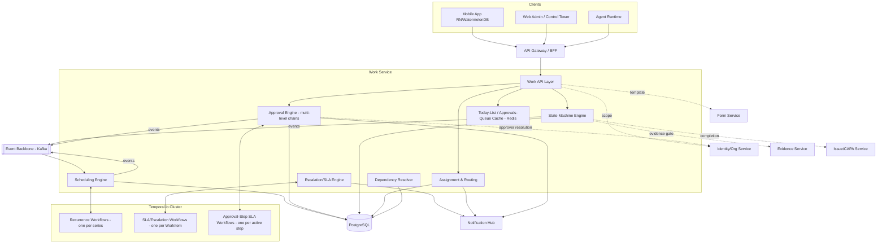
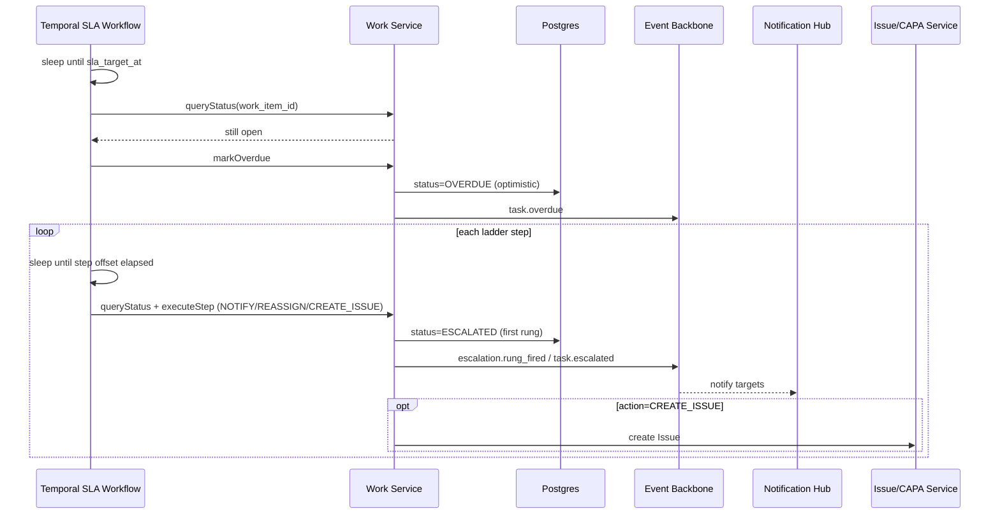
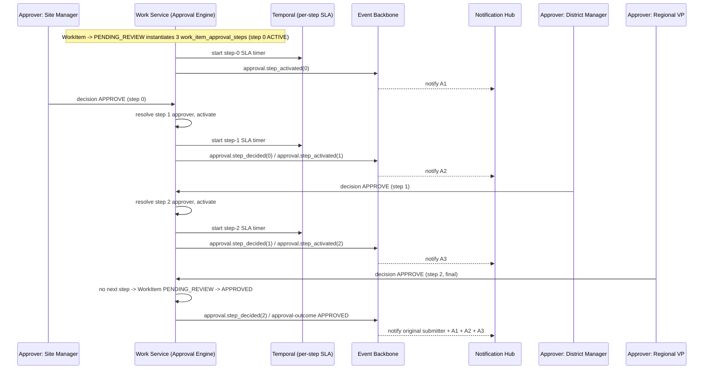
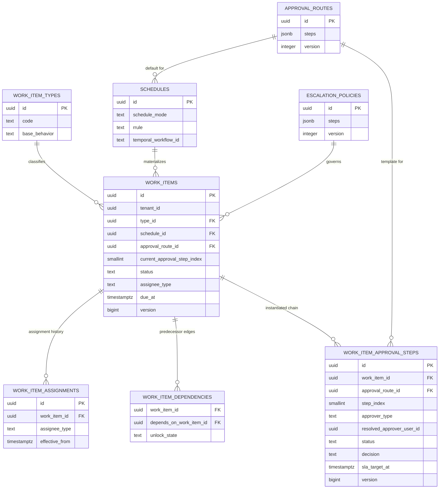
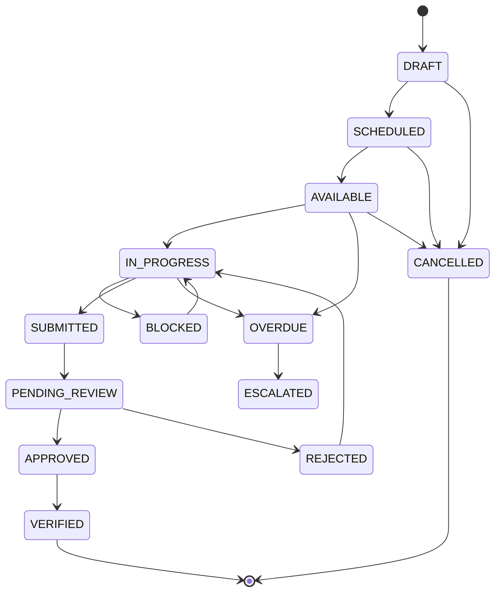
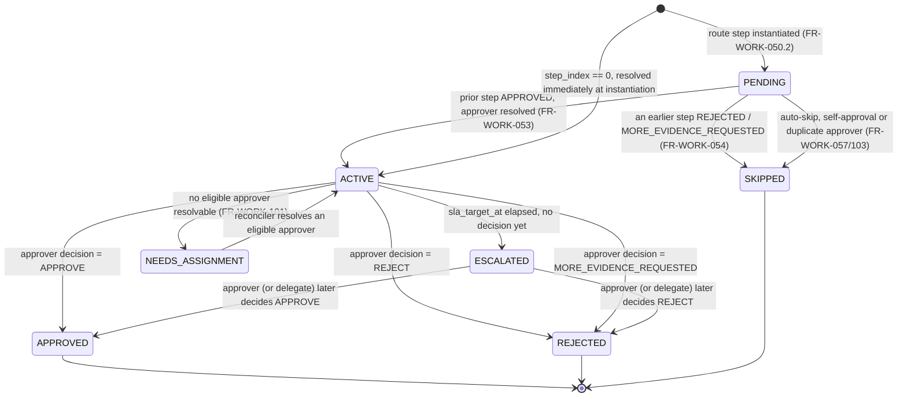

# Work Orchestration — Architecture Diagrams

## 1. Component Diagram



The Work API layer fronts five internal engines that share the same Postgres store: the
**Scheduling Engine** (backed by long-lived Temporal recurrence workflows, one per `Schedule`),
the **State Machine Engine** (sole authority over `WorkItem.status` transitions), the
**Assignment & Routing** component (individual/role/location/queue assignment), the **Approval
Engine** (sequential multi-level approval chains — see §5/§6 below), and the **Dependency
Resolver** (graph-edge gating). The **Escalation/SLA Engine** runs one short-lived Temporal
workflow per WorkItem that carries an SLA, *and* the Approval Engine reuses the identical pattern
one level down — one short-lived Temporal workflow per **active approval step** — decoupling
high-cardinality per-instance/per-step timers from the low-cardinality per-series recurrence
workflows. All state changes are mirrored onto Kafka as canonical `task.*`/`approval.*` events;
other modules (Identity/Org, Form, Evidence, Issue/CAPA, Notification Hub) are referenced by ID and
interacted with via events or narrow synchronous calls, never owned.

## 2. Sequence Diagram — Recurrence to Device

```mermaid
sequenceDiagram
    participant TWF as Temporal Recurrence Workflow
    participant WS as Work Service
    participant PG as Postgres
    participant KAFKA as Event Backbone
    participant NOTIF as Notification Hub
    participant DEV as Mobile Device

    TWF->>WS: computeNextInstances(schedule_id, window)
    WS->>PG: insert work_items (status=AVAILABLE), advance high_water_mark
    WS->>KAFKA: task.created
    KAFKA-->>NOTIF: task.created (assignee resolved)
    NOTIF->>DEV: push notification
    DEV->>WS: GET /work-items?assignee=me&updated_since=...
    WS-->>DEV: new item included
    DEV->>DEV: upsert local DB; Today screen renders offline-first
```

A Temporal recurrence workflow wakes on its own schedule-specific checkpoint, expands the next
window of occurrences transactionally into `work_items`, and emits `task.created`. Delivery to the
device is push-assisted but never required for correctness: the client's own sync cycle (triggered
by push, foreground, or periodic background sync) is the actual mechanism that lands the item in
local storage, consistent with the platform's offline-first design rule.

## 3. Sequence Diagram — SLA Breach and Escalation



Each WorkItem with an `escalation_policy_id` gets its own durable Temporal workflow the moment it
becomes `AVAILABLE`. The workflow re-checks live status before every sleep and every step, so a
completion at any point stops further rungs without any separate cancellation call — the workflow
simply observes the terminal/paused state on its next wake and exits. This durability guarantees no
rung is lost or duplicated across Work Service process restarts.

## 4. Sequence Diagram — Multi-Level Approval Chain



Each step is a durable, independently-timed link in the chain: only the currently `ACTIVE` step's
resolved approver can act, the next step's approver is resolved fresh at activation time (never at
WorkItem-creation time, so a reorg between steps is reflected correctly), and a rejection at any
step immediately fans out `SKIPPED` to every step still `PENDING` rather than leaving them dangling.
Full detail — including the escalation and rejection branches — is in
`low-level-design.md` §3.4.

## 5. ER Diagram



`WorkItem` is the hub entity: every type in §7.1 of the source spec is one row here, distinguished
by `type_id` and `type_config`. `Schedule` and `EscalationPolicy` are the two configuration entities
that drive, respectively, when a WorkItem is created and how it is timed/escalated once created.
`WorkItemAssignment` is deliberately append-only so historical attribution survives reassignment
and user deactivation (source-spec §24.1). `WorkItemDependencies` models the graph edges that gate
the `SCHEDULED/DRAFT → AVAILABLE` transition independent of any time-based trigger.
`WorkItemApprovalStep` is the multi-level-approval equivalent of `WorkItemAssignment`: an
append-style, per-WorkItem instantiation of the shared `ApprovalRoute` template, so a specific
WorkItem's approval chain remains a stable, audit-durable record even if the underlying route
template is edited or versioned later (FR-WORK-102).

## 6. Work Item State Machine



This is the exact canonical `WorkItem` state machine reused verbatim from conventions.md /
source-spec §17.2: `DRAFT → SCHEDULED → AVAILABLE → IN_PROGRESS → SUBMITTED → PENDING_REVIEW →
APPROVED → VERIFIED`, with side branches `IN_PROGRESS ↔ BLOCKED`, `PENDING_REVIEW → REJECTED →
IN_PROGRESS`, and `AVAILABLE/IN_PROGRESS → OVERDUE → ESCALATED`. Every one of the 11 WorkItem types
(§7.1) shares this single machine — type-specific behavior (e.g., Approval skipping execution,
Incident/Observation skipping `SCHEDULED`) is expressed as which transitions a type actually uses,
never as an alternate state set. `CANCELLED` is an explicit terminal branch available from any
pre-`IN_PROGRESS` state for admin/bulk cancellation (LLD §2.5), not part of the original diagram's
happy/exception path but required for the cancel bulk-action and location-closure edge cases.

Note that `PENDING_REVIEW` is a single WorkItem-level state that can internally span *several*
sequential approval levels — see §7 below for what happens underneath it during a multi-level
approval chain.

## 7. Approval Step Lifecycle (within `PENDING_REVIEW`)



Every `WorkItemApprovalStep` row moves through this lifecycle independently, but only one step per
WorkItem is ever `ACTIVE` at a time (sequential routing, FR-WORK-050.1) — that invariant, not a
top-level WorkItem status, is what actually represents "which level is this approval currently at."
`ESCALATED` is a *notification* state layered on top of `ACTIVE` (the same approver, or a delegate,
still holds decision authority; escalation only widens who else is told, per FR-WORK-058) rather
than a hand-off of authority, which is why the diagram shows `ESCALATED` resolving directly to
`APPROVED`/`REJECTED` rather than back through `ACTIVE`. The WorkItem-level `PENDING_REVIEW →
APPROVED` transition (§6) fires only when the *last* step in the chain reaches `APPROVED`; a
`REJECTED` at any step fires `PENDING_REVIEW → REJECTED` immediately and fans `SKIPPED` out to
every remaining `PENDING` step in the same transaction (LLD §4.3).
