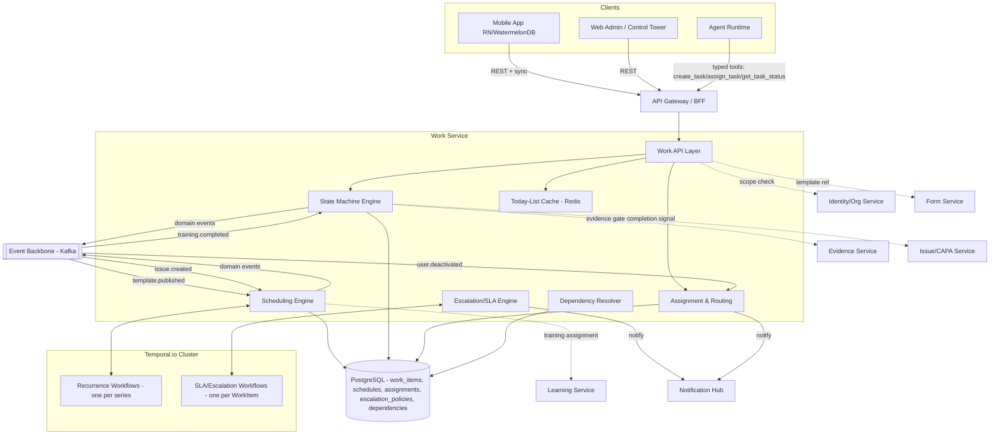

# Work Orchestration — High-Level Design

## 1. Module Responsibilities and Boundaries

The **Work Service** owns the universal `WorkItem` abstraction, all scheduling modes, SLA timers and
escalation ladders, assignment/reassignment, approval routing, and dependency-based sequencing
(source-spec §7, Appendix E EPIC-03). It is the system of record for "what work exists, who owns it,
what state it is in, and when it is due."

It explicitly does **not** own: form schema/content (Form Service), evidence bytes/metadata
(Evidence Service), issue root-cause workflow (Issue/CAPA Service), course content (Learning),
notification delivery (Notification Hub), or organizational/identity data (Identity/Authorization
Services). Work Service references those entities by ID and reacts to/emits events rather than
owning their data.

Boundary rule: Work Service is authoritative for the `WorkItem` state machine transitions
themselves — even when a transition is *caused* by an event from another module (e.g., evidence
completeness confirmed by Evidence Service), the actual `status` write and the `task.*` event
emission happen inside Work Service, preserving one authoritative state-machine owner.

## 2. Component Diagram

## 3. Data Ownership

| Entity | Owner | Notes |
|---|---|---|
| `WorkItem` | Work Service | Full lifecycle owner |
| `WorkItemAssignment` | Work Service | Append-only assignment history; current pointer on `WorkItem` |
| `Schedule` | Work Service | All scheduling modes |
| `EscalationPolicy` | Work Service | Reusable, versioned, tenant-scoped |
| `ApprovalRoute` | Work Service | Attached to WorkItem type/template config |
| `work_item_dependencies` | Work Service | Graph edges |
| `OrganizationNode`, `UserScope` | Identity/Org (referenced) | Read-only reference for scoping/assignment eligibility |
| `TemplateVersion` | Form Service (referenced) | Read-only reference for form-backed types |
| `Evidence` | Evidence Service (referenced) | Read-only completeness check |
| `Issue` | Issue/CAPA Service (referenced) | Bidirectional event link, not owned |

## 4. External Interfaces

### 4.1 Events Produced (canonical, source-spec §18.3, extended)
`task.created`, `task.assigned`, `task.reassigned`, `task.claimed`, `task.started`,
`task.submitted`, `task.approved`, `task.rejected`, `task.verified`, `task.completed`,
`task.overdue`, `task.escalated`, `task.blocked`, `task.unblocked`, `task.cancelled`,
`schedule.materialized`, `escalation.rung_fired`.

All emitted in the envelope shape from source-spec §18.4 (`event_id`, `event_type`, `version`,
`tenant_id`, `occurred_at`, `actor_id`, `resource_id`, `trace_id`, `data`).

### 4.2 Events Consumed
`template.published` (Form Service — enables/updates schedules referencing that template),
`template.superseded` (flags schedules for admin review, does not auto-migrate in-flight items),
`issue.created` (Issue/CAPA — spawns corrective-action WorkItem), `issue.reopened` (spawns
follow-up verification WorkItem), `training.completed` (Learning — closes training WorkItem),
`user.deactivated`, `user.role_changed`, `location.hours_changed`, `location.closed`,
`location.reopened` (Identity/Org — drive reassignment and schedule re-evaluation),
`agent.action_approved` (Agent Runtime — executes an approved agent-proposed WorkItem action),
`asset.telemetry_threshold_breached` (Asset/IoT integration — event-triggered scheduling).

### 4.3 Synchronous APIs
REST under `/api/v1/work-items`, `/api/v1/schedules`, `/api/v1/escalation-policies` (see LLD).
Internal gRPC calls to Identity/Org (scope resolution) and Form Service (template metadata) on the
request path where a cached copy is unavailable.

## 5. Scalability Approach

**Target:** millions of WorkItems/day across up to 100k locations (source-spec §23 Scale NFR).

- **Partitioning strategy.** `work_items` is partitioned by `tenant_id` hash into a bounded number
  of logical shards (Postgres native partitioning, list/hash partition on `tenant_id_bucket =
  hash(tenant_id) % N`), with large enterprise tenants optionally isolated to a dedicated
  schema/cluster per the platform-wide tenant-tier sharding convention. Within a tenant partition,
  a secondary range partition by `due_at` (monthly) keeps the hot "current + near-future" partition
  small and lets old, terminal-state WorkItems age out of the hot path (archival job moves
  `VERIFIED`/`CLOSED` rows older than N months to a cold table/warehouse-only representation).
- **Kafka topic keying.** All Work Service events are published with key `tenant_id:work_item_id`
  (aggregate-id keying per platform convention) to guarantee per-WorkItem ordering for downstream
  consumers (Analytics CDC, Notification Hub, Agent Runtime) without a global ordering requirement.
- **Temporal workflow-per-recurrence-series pattern.** Each `Schedule` row maps to exactly one
  long-lived Temporal workflow execution (`workflow_id = schedule:{schedule_id}`), which owns that
  series' recurrence-window materialization (sleeps until the next materialization checkpoint,
  computes the next N instances, writes them transactionally, then re-sleeps). This avoids a
  single global cron sweeping millions of schedule rows every tick, distributes materialization
  load across Temporal's worker pool, and makes editing a schedule a signal to its own workflow
  (`UpdateSchedule` signal) rather than a race against a shared batch job. Each materialized
  WorkItem that carries SLA/escalation policy additionally starts a **separate, short-lived**
  Temporal workflow (`workflow_id = sla:{work_item_id}`) purely for its escalation ladder timers —
  decoupling the (long-lived, low-cardinality) series workflow from the (short-lived,
  high-cardinality, one-per-instance) SLA workflow keeps worker/history-size profiles healthy on
  both sides.
- **Today-list read path.** The mobile Today screen never hits this scalability concern directly —
  it reads local WatermelonDB. Server-side "my work" queries (initial sync, web admin, reconciliation)
  are served by an index on `(tenant_id, assignee_type, assignee_id/role/location, status, due_at)`
  plus a Redis-backed per-user "today" cache invalidated on any WorkItem mutation affecting that
  user (see LLD caching).
- **Horizontal scaling.** Work API pods are stateless and scale horizontally behind the gateway;
  the Scheduling Engine's Temporal workers scale independently by worker task-queue, so a burst of
  schedule edits or SLA timer fan-out does not starve interactive API traffic.

## 6. Multi-Tenancy

Every table carries `tenant_id`; Postgres RLS policies enforce tenant isolation as a
defense-in-depth backstop behind application-layer scoping (platform convention). Kafka messages
carry `tenant_id` in both the key and envelope. Temporal workflow IDs are namespaced
`{tenant_id}:schedule:{schedule_id}` / `{tenant_id}:sla:{work_item_id}` so a single Temporal
namespace can safely serve all tenants (or a per-tenant-tier namespace for isolated large tenants,
mirroring the Postgres tenant-tier sharding model). Redis cache keys are prefixed `tenant_id:`.

## 7. Failure Modes and Degradation

| Failure | Impact | Degradation Strategy |
|---|---|---|
| Temporal cluster outage | New recurrence materialization pauses; SLA/escalation timers cannot be newly scheduled or fired | WorkItem CRUD, status transitions, and Today reads continue to function directly against Postgres (Temporal is not on the read/write hot path for existing items). On recovery, Temporal workflows resume from durable history — no lost schedules. A circuit breaker prevents API calls from blocking on Temporal availability; schedule/escalation-policy writes queue locally and replay. |
| Scheduling backlog (materializer falling behind) | WorkItems for near-future due dates may not appear on time | Alert on `schedule.materialization_lag` metric (per-schedule lag against its expected next-run time) crossing threshold; auto-scale Temporal worker pool on that task queue; a manual "catch-up" priority queue processes overdue-to-materialize schedules first (closest due date first) rather than FIFO by schedule ID |
| Kafka backbone unavailable | Downstream consumers (Analytics, Notification Hub, Agent Runtime) stop receiving new events | Work Service continues to accept API writes and commit to Postgres; outbox pattern (transactional outbox table + relay) buffers events for replay once Kafka recovers — writes are never blocked on Kafka availability |
| Postgres primary failure | Full write unavailability for Work Service | Standard managed-Postgres failover (source-spec §22 reliability patterns); read replicas continue serving Today/list reads in a brief read-only degraded mode during failover |
| Identity/Org scope service slow/unavailable | Assignment eligibility checks on write path degrade | Short-TTL local cache of scope resolutions (Redis) serves recent lookups; new/uncached scope checks fail closed (deny) rather than open, consistent with tenant-isolation-first posture |
| Downstream module event storm (e.g. issue.created burst) | Scheduling Engine event-consumer lag | Consumer-side backpressure/bulkhead per source topic; a burst from one event type cannot starve calendar-based materialization workflows since they run as independent Temporal workflows, not a shared event-loop |

## 8. Technology Choices (Justified)

- **Temporal.io for SLA timers and escalation ladders.** SLA/escalation logic is fundamentally
  "durable timers plus conditional branching over long, unreliable real-world time horizons" —
  exactly Temporal's design target. A naive cron/polling sweep of `due_at`/`sla_target_at` columns
  does not scale to millions of concurrently-ticking WorkItems and reintroduces exactly-once/at
  most-once execution bugs (duplicate escalation notifications on worker restart, missed rungs on
  crash) that Temporal's durable execution model solves natively: a workflow's `sleep()` survives
  process/worker restarts and resumes precisely, ladder-step logic is expressed as ordinary
  sequential code (not a separate state table to keep in sync), and Temporal's built-in
  visibility/query API gives "what step is this WorkItem's ladder on right now" for free, feeding
  the Manager Exceptions view.
- **Temporal for recurrence** (rather than a Kafka-topic-driven cron or Quartz-style scheduler)
  because recurrence *is* long-running stateful process per series (next-fire computation depends
  on the series' own history: skip-if-still-open rules, edit-in-place semantics) — a natural fit
  for one workflow execution per series rather than a stateless scheduler re-deriving state from
  a database row on every tick.
- **PostgreSQL** as authoritative transactional store (platform convention) — WorkItem read/write
  patterns are relational and require strong consistency for status transitions (optimistic
  concurrency, FK integrity for dependencies/assignments); no operational reason to introduce a
  second OLTP store for this module.
- **Redis** for the Today-list cache and short-TTL scope-check cache — sub-millisecond reads at
  the volume needed for a "my work" list refresh, standard platform cache choice.
- **Kafka** for all cross-module signaling (platform convention) — decouples Work Service from
  Notification Hub, Analytics, Agent Runtime, and Issues/Learning without synchronous coupling,
  and gives replay/dead-letter semantics needed for reliable escalation notification delivery.
