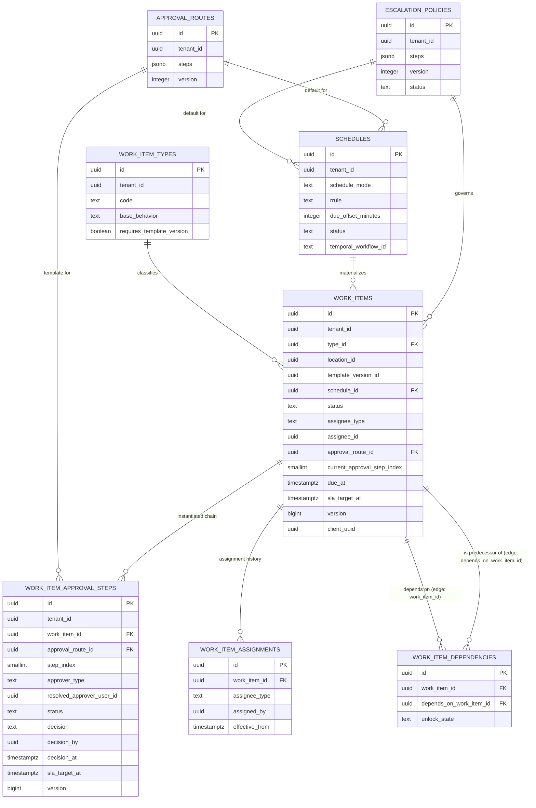
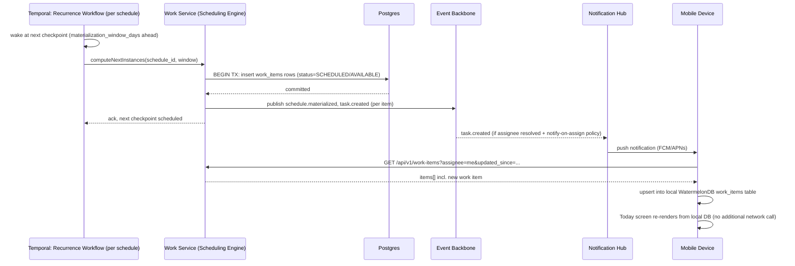
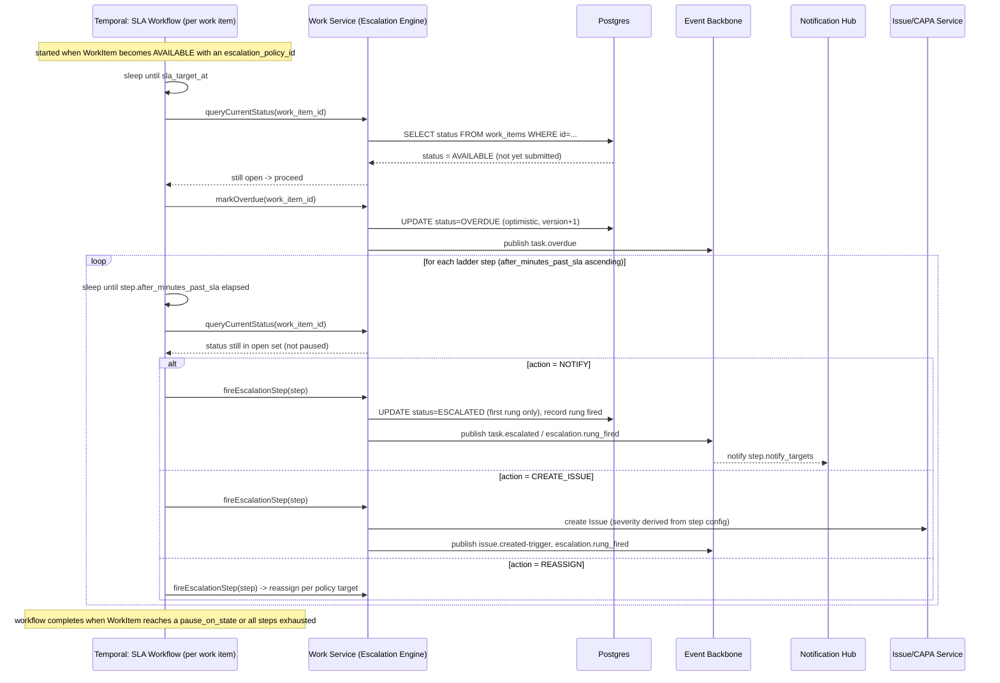
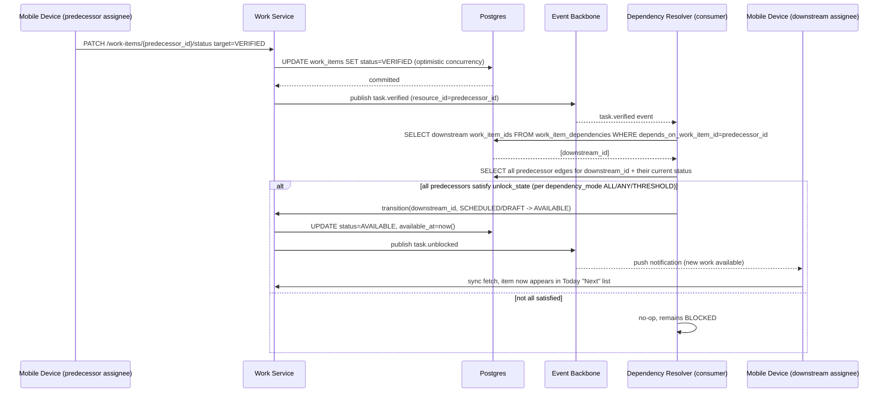

# Work Orchestration — Low-Level Design

## 1. Postgres Schema

### 1.1 Tables

**work_item_types** (catalog, per FR-WORK-012)

| Column | Type | Notes |
|---|---|---|
| id | uuid PK | |
| tenant_id | uuid, nullable | NULL = system-seeded global type |
| code | text | e.g. `TASK`, `AUDIT_INSPECTION`, `SAFETY_WALK` (tenant sub-type) |
| base_behavior | text | one of the 11 base behaviors (FR-WORK-001..011) |
| display_name | text | |
| requires_template_version | boolean | |
| default_escalation_policy_id | uuid FK -> escalation_policies | nullable |
| active | boolean | |
| created_at, updated_at | timestamptz | |

Unique `(tenant_id, code)`.

**work_items**

| Column | Type | Notes |
|---|---|---|
| id | uuid PK | |
| tenant_id | uuid | partition key |
| tenant_id_bucket | smallint | generated: `hash(tenant_id) % 64`, partition key alongside due_at range |
| type_id | uuid FK -> work_item_types | |
| location_id | uuid | FK ref to OrganizationNode (Identity/Org, not enforced cross-service FK) |
| template_version_id | uuid, nullable | ref to Form Service TemplateVersion |
| subject_ref | jsonb, nullable | for Approval type: `{entity_type, entity_id}` |
| approval_route_id | uuid, nullable FK -> approval_routes | resolved at `PENDING_REVIEW` entry from type_config/schedule default; null for WorkItems whose flow never requires review |
| current_approval_step_index | smallint, nullable | index into this WorkItem's own `work_item_approval_steps` (not the shared route) of the currently `ACTIVE` step; null when not in an approval flow or after terminal APPROVED/REJECTED |
| issue_id | uuid, nullable | ref to Issue/CAPA |
| asset_id | uuid, nullable | ref to Asset |
| campaign_id | uuid, nullable | |
| type_config | jsonb | type-specific payload, validated against per-type JSON Schema at write time |
| status | text | enum: `DRAFT, SCHEDULED, AVAILABLE, IN_PROGRESS, BLOCKED, SUBMITTED, PENDING_REVIEW, APPROVED, REJECTED, VERIFIED, OVERDUE, ESCALATED, CANCELLED` |
| origin | text | `SCHEDULE`, `EVENT_TRIGGER`, `DEPENDENCY`, `AD_HOC`, `AGENT`, `MANUAL_ADMIN` |
| schedule_id | uuid, nullable FK -> schedules | |
| priority | smallint | default 0; higher sorts first |
| assignee_type | text | `USER, ROLE, LOCATION, QUEUE` |
| assignee_id | uuid, nullable | user id when USER |
| assignee_role_id | uuid, nullable | role id when ROLE |
| queue_id | uuid, nullable | when QUEUE |
| due_at | timestamptz | computed at materialization, in location tz then stored UTC |
| sla_target_at | timestamptz, nullable | internal SLA distinct from due_at |
| available_at | timestamptz, nullable | when dependency/schedule gating clears |
| escalation_policy_id | uuid, nullable FK -> escalation_policies | |
| submitted_at, approved_at, verified_at, cancelled_at | timestamptz, nullable | |
| client_uuid | uuid, nullable | set when created via offline sync path |
| version | bigint | optimistic concurrency counter, default 0 |
| created_at, updated_at | timestamptz | |

Partitioned by LIST(`tenant_id_bucket`) then RANGE(`due_at`) monthly sub-partitions.
Indexes: `(tenant_id, assignee_type, assignee_id, status, due_at)`,
`(tenant_id, assignee_type, assignee_role_id, location_id, status)`,
`(tenant_id, location_id, status, due_at)`, `(schedule_id)`, `(campaign_id)`, `(client_uuid)` unique
partial where not null, `(issue_id)`.

**work_item_assignments** (append-only history)

| Column | Type | Notes |
|---|---|---|
| id | uuid PK | |
| tenant_id | uuid | |
| work_item_id | uuid FK -> work_items | |
| assignee_type | text | |
| assignee_id / assignee_role_id / queue_id | uuid, nullable | |
| assigned_by | uuid, nullable | actor; null for system |
| reason | text, nullable | |
| effective_from | timestamptz | |
| created_at | timestamptz | |

Index `(work_item_id, effective_from desc)`.

**schedules**

| Column | Type | Notes |
|---|---|---|
| id | uuid PK | |
| tenant_id | uuid | |
| name | text | |
| schedule_mode | text | `CALENDAR, OPEN_CLOSE_RELATIVE, SHIFT_BASED, EVENT_TRIGGERED, LOCATION_TRIGGERED, ROLE_TRIGGERED, DEPENDENCY, SEASONAL_CAMPAIGN` |
| work_item_type_id | uuid FK -> work_item_types | |
| location_scope | jsonb | node id(s)/subtree selector |
| template_version_id | uuid, nullable | |
| rrule | text, nullable | RFC5545 subset, for CALENDAR |
| open_close_offset | jsonb, nullable | `{anchor: OPEN|CLOSE, offset_minutes}` |
| shift_anchor | jsonb, nullable | `{shift_definition_ref, anchor: START|MID|END}` |
| trigger_event_type | text, nullable | for EVENT_TRIGGERED |
| trigger_filter | jsonb, nullable | filter expression |
| campaign_id | uuid, nullable | |
| campaign_window_start, campaign_window_end | timestamptz, nullable | |
| due_offset_minutes | integer | offset from availability to due_at |
| sla_offset_minutes | integer, nullable | |
| escalation_policy_id | uuid, nullable FK | |
| approval_route_id | uuid, nullable FK | |
| materialization_window_days | integer | default 14 |
| status | text | `ACTIVE, PAUSED, ARCHIVED` |
| dedupe_identical | boolean | default false, FR-WORK-090 |
| temporal_workflow_id | text | `{tenant_id}:schedule:{schedule_id}` |
| created_by, created_at, updated_at | | |

**work_item_dependencies**

| Column | Type | Notes |
|---|---|---|
| id | uuid PK | |
| tenant_id | uuid | |
| work_item_id | uuid FK -> work_items | the dependent (downstream) item |
| depends_on_work_item_id | uuid FK -> work_items | predecessor |
| unlock_state | text | default `VERIFIED`; also `SUBMITTED`, `APPROVED` |
| dependency_mode | text | `ALL, ANY, THRESHOLD` — set on the group, see below |
| created_at | timestamptz | |

Unique `(work_item_id, depends_on_work_item_id)`. `dependency_mode`/threshold value stored once per
`work_item_id` group in a companion column set (`work_items.dependency_mode`,
`work_items.dependency_threshold`) to avoid repeating group-level config per edge.

**escalation_policies**

| Column | Type | Notes |
|---|---|---|
| id | uuid PK | |
| tenant_id | uuid | |
| name | text | |
| steps | jsonb | ordered array: `[{after_minutes_past_sla, notify_targets:[...], action}]` |
| pause_on_states | text[] | default `['SUBMITTED','PENDING_REVIEW','APPROVED','VERIFIED','CANCELLED']` |
| version | integer | policies are versioned; in-flight WorkItems keep the version resolved at creation |
| status | text | `DRAFT, ACTIVE, RETIRED` |
| created_at, updated_at | | |

**approval_routes** (shared, reusable *template*)

| Column | Type | Notes |
|---|---|---|
| id | uuid PK | |
| tenant_id | uuid | |
| name | text | |
| steps | jsonb | ordered: `[{step_index, approver_type, role_id?, levels_up?, escalate_after_minutes, escalation_target?}]` |
| version | integer | routes are versioned; see FR-WORK-102 — editing a route never mutates already-instantiated `work_item_approval_steps` |
| status | text | `DRAFT, ACTIVE, RETIRED` |
| created_at, updated_at | | |

**work_item_approval_steps** (per-WorkItem, *instantiated* copy of the route — the durable audit
record for that specific approval chain; FR-WORK-050.2)

| Column | Type | Notes |
|---|---|---|
| id | uuid PK | |
| tenant_id | uuid | |
| work_item_id | uuid FK -> work_items | |
| approval_route_id | uuid FK -> approval_routes | traceability back to the template version used |
| step_index | smallint | 0-based position in this WorkItem's chain |
| approver_type | text | copied from route step at instantiation time (immutable thereafter) — `SPECIFIC_USER, ROLE_AT_LOCATION, ROLE_AT_PARENT_NODE, MANAGER_OF_SUBMITTER` |
| approver_type_config | jsonb | copied `{role_id?, levels_up?}` from route step at instantiation time |
| escalate_after_minutes | integer | copied from route step at instantiation time |
| escalation_target | jsonb, nullable | copied from route step; who gets notified on step escalation |
| resolved_approver_user_id | uuid, nullable | populated when the step is resolved (immediately for step 0 at instantiation; at activation time for steps ≥ 1 per FR-WORK-052/053) |
| status | text | `PENDING, ACTIVE, APPROVED, REJECTED, SKIPPED, ESCALATED` |
| decision | text, nullable | `APPROVE, REJECT, MORE_EVIDENCE_REQUESTED, DELEGATED, AUTO_SKIPPED_SELF_APPROVAL, AUTO_SKIPPED_DUPLICATE_APPROVER` |
| decision_by | uuid, nullable | actor who made the decision (may differ from `resolved_approver_user_id` on delegation) |
| decision_at | timestamptz, nullable | |
| comment | text, nullable | |
| activated_at | timestamptz, nullable | when this step became `ACTIVE` (starts its SLA clock) |
| sla_target_at | timestamptz, nullable | `activated_at + escalate_after_minutes`, recomputed if the step is re-resolved (FR-WORK-101) |
| escalated_at | timestamptz, nullable | set on first escalation fire for this step |
| version | bigint | optimistic concurrency counter for step-level decisions |
| created_at, updated_at | timestamptz | |

Unique `(work_item_id, step_index)`. Indexes: `(work_item_id, status)`,
`(resolved_approver_user_id, status)` — this is the index the manager Approvals queue (FR-WORK-081/
§6.3) reads: *"steps where status=ACTIVE and resolved_approver_user_id = me."*

### 1.2 ER Diagram



## 2. REST Endpoints

All under `/api/v1/`, OAuth2/OIDC bearer, `Idempotency-Key` required on POST/PATCH per platform
convention, `ETag`/`version` optimistic concurrency, cursor pagination, standard error envelope
`{"error":{"code","message","trace_id"}}`.

### 2.1 Create work item from template
`POST /api/v1/work-items`

Request:
```json
{
  "type_code": "AUDIT_INSPECTION",
  "location_id": "loc_9a1",
  "template_version_id": "tv_4471",
  "assignee_type": "ROLE",
  "assignee_role_id": "role_store_mgr",
  "due_at": "2026-09-20T22:00:00Z",
  "escalation_policy_id": "esc_std_audit",
  "origin": "MANUAL_ADMIN"
}
```
Response `201`:
```json
{
  "id": "wi_8831",
  "status": "AVAILABLE",
  "version": 0,
  "due_at": "2026-09-20T22:00:00Z",
  "created_at": "2026-09-19T14:02:11Z"
}
```
Errors: `400 VALIDATION_ERROR`, `404 TEMPLATE_VERSION_NOT_FOUND`, `403 SCOPE_DENIED`,
`422 DEPENDENCY_CYCLE_DETECTED` (if `depends_on` provided in payload extension).

### 2.2 List "my work" (offline-sync-friendly)
`GET /api/v1/work-items?assignee=me&status=AVAILABLE,IN_PROGRESS,OVERDUE&updated_since=2026-09-19T00:00:00Z&cursor=...&limit=200`

Response `200`:
```json
{
  "items": [
    {
      "id": "wi_8831",
      "type_code": "AUDIT_INSPECTION",
      "status": "AVAILABLE",
      "location_id": "loc_9a1",
      "due_at": "2026-09-20T22:00:00Z",
      "version": 0,
      "updated_at": "2026-09-19T14:02:11Z"
    }
  ],
  "next_cursor": "eyJvZmZzZXQiOjIwMH0=",
  "server_time": "2026-09-19T14:05:00Z"
}
```
`updated_since` + `status` filters make this endpoint directly reusable as the delta-fetch behind
the generic `/api/v1/sync` protocol (source-spec §18.2) — the mobile sync client treats `work_items`
as one of its bounded local tables (§19.1) and calls this list with `updated_since = last
sync_cursor watermark for this entity type`. `server_time` lets the client anchor its next
watermark to server clock, consistent with §19.4 ("client clock cannot be trusted").

### 2.3 Update status / complete
`PATCH /api/v1/work-items/{id}/status`

Request (requires `If-Match: <version>` or body `version` field):
```json
{ "target_status": "SUBMITTED", "version": 3, "client_uuid": "c-uuid-77", "submission_id": "sub_221" }
```
Response `200`:
```json
{ "id": "wi_8831", "status": "SUBMITTED", "version": 4, "submitted_at": "2026-09-19T14:10:00Z" }
```
`409 CONFLICT`:
```json
{ "error": { "code": "VERSION_CONFLICT", "message": "WorkItem has been modified", "trace_id": "t-1",
  "conflict": { "current_status": "CANCELLED", "current_version": 5 } } }
```
Idempotent on `(work_item_id, client_uuid)` — a retried identical status update returns the
original result with `200`, never a duplicate transition.

### 2.4 Reassign
`POST /api/v1/work-items/{id}/reassign`
```json
{ "assignee_type": "USER", "assignee_id": "usr_552", "reason": "shift coverage" }
```
Response `200` mirrors the WorkItem summary; emits `task.reassigned`. `403 SCOPE_DENIED` if the
target assignee lacks eligible scope at the location.

### 2.5 Bulk operations
`POST /api/v1/work-items/bulk`
```json
{
  "operation": "REASSIGN",
  "work_item_ids": ["wi_1", "wi_2", "wi_3"],
  "params": { "assignee_type": "USER", "assignee_id": "usr_552", "reason": "coverage" }
}
```
Response `200` (per-item result array, partial failure visible):
```json
{
  "results": [
    { "work_item_id": "wi_1", "status": "OK", "version": 6 },
    { "work_item_id": "wi_2", "status": "OK", "version": 2 },
    { "work_item_id": "wi_3", "status": "ERROR", "error": { "code": "SCOPE_DENIED" } }
  ]
}
```
Also supports `operation: EXTEND_DUE`, `ESCALATE_NOW`, `CANCEL`.

### 2.6 Escalation policy CRUD
`POST /api/v1/escalation-policies`
```json
{
  "name": "Standard Audit Ladder",
  "steps": [
    { "after_minutes_past_sla": 15, "notify_targets": ["assignee"], "action": "NOTIFY" },
    { "after_minutes_past_sla": 60, "notify_targets": ["location_manager"], "action": "NOTIFY" },
    { "after_minutes_past_sla": 240, "notify_targets": ["district_manager"], "action": "CREATE_ISSUE" }
  ]
}
```
`GET /api/v1/escalation-policies/{id}`, `PATCH /api/v1/escalation-policies/{id}` (creates a new
`version`; existing WorkItems keep the version resolved at their creation time — see §5 concurrency),
`GET /api/v1/escalation-policies?cursor=...`, `DELETE` (soft, sets `status=RETIRED`, blocked if
referenced by an `ACTIVE` schedule).

### 2.7 Get approval chain (full history + current state)
`GET /api/v1/work-items/{id}/approval-steps`

Response `200`:
```json
{
  "work_item_id": "wi_8831",
  "approval_route_id": "route_hi_risk_audit",
  "current_approval_step_index": 1,
  "steps": [
    {
      "step_index": 0,
      "approver_type": "ROLE_AT_LOCATION",
      "resolved_approver": { "user_id": "usr_101", "display_name": "J. Rao", "role": "Site Manager" },
      "status": "APPROVED",
      "decision": "APPROVE",
      "decision_by": "usr_101",
      "decision_at": "2026-09-19T15:02:00Z",
      "comment": "Confirmed corrective action complete on-site.",
      "activated_at": "2026-09-19T14:40:00Z",
      "sla_target_at": "2026-09-19T18:40:00Z"
    },
    {
      "step_index": 1,
      "approver_type": "ROLE_AT_PARENT_NODE",
      "resolved_approver": { "user_id": "usr_205", "display_name": "A. Fernandes", "role": "District Manager" },
      "status": "ACTIVE",
      "decision": null,
      "activated_at": "2026-09-19T15:02:00Z",
      "sla_target_at": "2026-09-19T19:02:00Z",
      "escalated_at": null
    },
    {
      "step_index": 2,
      "approver_type": "ROLE_AT_PARENT_NODE",
      "resolved_approver": null,
      "status": "PENDING",
      "decision": null
    }
  ]
}
```
`resolved_approver` for `PENDING` steps is `null` until the step activates (FR-WORK-052/053) — the
client shows the *approver_type* (e.g. "Regional VP") as a placeholder, not a named person, for
not-yet-activated steps.

### 2.8 Record an approval-step decision
`POST /api/v1/work-items/{id}/approval-steps/{step_index}/decision`

Request:
```json
{
  "decision": "APPROVE",
  "comment": "Verified evidence, escalation ladder history reviewed.",
  "version": 2,
  "idempotency_key_scope": "step-decision"
}
```
(`Idempotency-Key` header required per platform convention; `decision ∈ {APPROVE, REJECT,
MORE_EVIDENCE_REQUESTED, DELEGATE}`; `DELEGATE` additionally requires `delegate_to_user_id` and
`reason`.)

Response `200` (APPROVE, next step activated):
```json
{
  "work_item_id": "wi_8831",
  "step_index": 1,
  "step_status": "APPROVED",
  "work_item_status": "PENDING_REVIEW",
  "next_step": { "step_index": 2, "status": "ACTIVE", "resolved_approver": { "user_id": "usr_318", "role": "Regional VP" } }
}
```
Response `200` (APPROVE, final step — WorkItem now fully approved):
```json
{
  "work_item_id": "wi_8831",
  "step_index": 2,
  "step_status": "APPROVED",
  "work_item_status": "APPROVED",
  "next_step": null
}
```
Response `200` (REJECT):
```json
{
  "work_item_id": "wi_8831",
  "step_index": 1,
  "step_status": "REJECTED",
  "work_item_status": "IN_PROGRESS",
  "skipped_steps": [2]
}
```
Errors:
- `409 APPROVAL_STEP_NOT_ACTIVE` — decision submitted against a step that is not the current
  `ACTIVE` step (FR-WORK-100); body includes `current_approval_step_index` so the client can
  reconcile.
- `409 VERSION_CONFLICT` — the step was concurrently decided (e.g. delegate and original approver
  both submit near-simultaneously); standard conflict envelope.
- `403 SCOPE_DENIED` — caller is not the `resolved_approver_user_id` (or an authorized delegate) for
  this step.
- `422 SELF_APPROVAL_NOT_ALLOWED` — should not normally surface to a client since self-approval is
  auto-skipped server-side (FR-WORK-057), but returned defensively if a resolved approver
  coincides with the submitter at decision time due to a race (e.g. a reassignment happened between
  step activation and decision).
- `400 DELEGATE_TARGET_INELIGIBLE` — `delegate_to_user_id` lacks the scope/role required to act as
  this step's approver type.

## 3. Sequence Diagrams

### 3.1 Scheduled recurrence generating a WorkItem and pushing to device



### 3.2 SLA breach triggering escalation ladder via Temporal timer



### 3.3 Dependency-based unlocking of a downstream WorkItem



### 3.4 Multi-level approval chain progression (Site Manager → District Manager → Regional VP)

```mermaid
sequenceDiagram
    participant WEB1 as Web/Mobile (Site Manager)
    participant WS as Work Service (Approval Engine)
    participant PG as Postgres
    participant TAPP as Temporal: Per-Step SLA Workflow
    participant KAFKA as Event Backbone
    participant NOTIF as Notification Hub
    participant WEB2 as Web/Mobile (District Manager)
    participant WEB3 as Web/Mobile (Regional VP)

    Note over WS,PG: WorkItem enters PENDING_REVIEW; 3 work_item_approval_steps rows created (step 0 ACTIVE, steps 1-2 PENDING)
    WS->>TAPP: start SLA workflow for step 0 (sla_target_at = now + escalate_after_minutes)
    WS->>KAFKA: publish approval.step_activated (step_index=0)
    KAFKA-->>NOTIF: notify step 0 resolved approver
    NOTIF->>WEB1: push "Approval needed: Audit #8831"

    WEB1->>WS: POST /work-items/8831/approval-steps/0/decision {decision: APPROVE}
    WS->>PG: UPDATE work_item_approval_steps SET status=APPROVED WHERE step_index=0 AND version=$v
    WS->>TAPP: cancel step-0 SLA workflow (terminal decision reached)
    WS->>WS: resolveApprover(route.steps[1], work_item)  # fresh lookup, per FR-WORK-052/053
    WS->>PG: UPDATE work_item_approval_steps SET status=ACTIVE, resolved_approver_user_id=$u, activated_at=now(), sla_target_at=now()+esc WHERE step_index=1
    WS->>PG: UPDATE work_items SET current_approval_step_index=1
    WS->>TAPP: start SLA workflow for step 1
    WS->>KAFKA: publish approval.step_decided (step_index=0, decision=APPROVE), approval.step_activated (step_index=1)
    KAFKA-->>NOTIF: notify step 1 resolved approver
    NOTIF->>WEB2: push "Approval needed: Audit #8831 (Step 2 of 3)"

    Note over WEB2,TAPP: step 1 SLA lapses before decision
    TAPP->>WS: onEscalate(step_index=1)
    WS->>PG: UPDATE work_item_approval_steps SET status=ESCALATED, escalated_at=now() WHERE step_index=1
    WS->>KAFKA: publish approval.step_escalated (step_index=1)
    KAFKA-->>NOTIF: notify step.escalation_target (does not change resolved_approver_user_id)

    WEB2->>WS: POST /work-items/8831/approval-steps/1/decision {decision: APPROVE}
    WS->>PG: UPDATE work_item_approval_steps SET status=APPROVED WHERE step_index=1 AND version=$v
    WS->>WS: resolveApprover(route.steps[2], work_item)
    WS->>PG: UPDATE work_item_approval_steps SET status=ACTIVE, resolved_approver_user_id=$u2 WHERE step_index=2
    WS->>PG: UPDATE work_items SET current_approval_step_index=2
    WS->>TAPP: start SLA workflow for step 2
    WS->>KAFKA: publish approval.step_decided (step_index=1), approval.step_activated (step_index=2)
    KAFKA-->>NOTIF: notify step 2 resolved approver
    NOTIF->>WEB3: push "Approval needed: Audit #8831 (Step 3 of 3 — final)"

    WEB3->>WS: POST /work-items/8831/approval-steps/2/decision {decision: APPROVE}
    WS->>PG: UPDATE work_item_approval_steps SET status=APPROVED WHERE step_index=2 AND version=$v
    WS->>PG: UPDATE work_items SET status=APPROVED, approved_at=now(), current_approval_step_index=NULL, version=version+1
    WS->>TAPP: cancel step-2 SLA workflow
    WS->>KAFKA: publish approval.step_decided (step_index=2), task.completed-class approval outcome event
    KAFKA-->>NOTIF: notify original submitter + all 3 approvers of final APPROVED outcome
```

Rejection at any step (not shown as a separate diagram) follows the same shape through the
`APPROVE` branch up to the point of decision, then instead: the Approval Engine marks that step
`REJECTED`, bulk-updates every remaining `PENDING` step to `SKIPPED` in the same transaction,
transitions `work_items.status → REJECTED → IN_PROGRESS`, cancels any not-yet-started per-step SLA
workflows (none are running yet for `PENDING` steps, so this is a no-op beyond the currently active
one), and emits `approval.step_decided (decision=REJECT)` plus `task.rejected`, notifying the
original assignee and every approver whose earlier step had already approved.

## 4. Algorithms / Pseudocode

### 4.1 Recurrence expansion (materialization)

```
function materializeSchedule(schedule, now):
    window_end = now + schedule.materialization_window_days
    last_materialized_at = schedule.high_water_mark  # stored on schedule row / workflow state

    if schedule.schedule_mode == CALENDAR:
        occurrences = expandRRule(schedule.rrule, from=last_materialized_at, to=window_end,
                                   timezone=locationTimezone(schedule.location_scope))
    elif schedule.schedule_mode == OPEN_CLOSE_RELATIVE:
        occurrences = []
        for each operating_day in operatingDays(schedule.location_scope, last_materialized_at, window_end):
            anchor_time = operating_day.close_time if schedule.open_close_offset.anchor == CLOSE else operating_day.open_time
            occurrences.append(anchor_time + schedule.open_close_offset.offset_minutes)
    elif schedule.schedule_mode == SHIFT_BASED:
        occurrences = []
        for each shift_instance in shiftInstances(schedule.location_scope, last_materialized_at, window_end):
            occurrences.append(anchorWithinShift(shift_instance, schedule.shift_anchor))
    elif schedule.schedule_mode == SEASONAL_CAMPAIGN:
        clip window to [schedule.campaign_window_start, schedule.campaign_window_end]
        occurrences = expandRRule(...) intersected with clipped window   # or single occurrence if one-shot
    else:
        return  # EVENT_TRIGGERED, LOCATION_TRIGGERED, ROLE_TRIGGERED, DEPENDENCY are event-driven, not time-swept

    for each location in resolveLocations(schedule.location_scope):
        for each occurrence_time in occurrences:
            if schedule.dedupe_identical and existingIdenticalInstance(schedule, location, occurrence_time):
                continue
            due_at = occurrence_time + schedule.due_offset_minutes
            sla_target_at = occurrence_time + (schedule.sla_offset_minutes or schedule.due_offset_minutes)
            assignee = resolveAssignee(schedule, location)   # role/location/queue per assignment model
            status = DRAFT if schedule.hasUnmetDependencies() else AVAILABLE
            insert work_items row:
                schedule_id, location, occurrence_time as available_at (if AVAILABLE),
                due_at, sla_target_at, status, assignee, escalation_policy_id = schedule.escalation_policy_id
            emit task.created

    schedule.high_water_mark = window_end
    persist schedule.high_water_mark transactionally with inserted rows
```

Notes:
- `expandRRule` operates in the location's IANA timezone and converts to UTC only for storage
  (FR-WORK-091/092): a wall-clock recurrence is computed as (local calendar date, local time) →
  UTC instant using the tz database rule in effect for that specific date, not a fixed offset.
- The transactional write of `high_water_mark` together with the inserted rows is what makes
  workflow retries (Temporal's at-least-once activity execution) safe: a retried
  `materializeSchedule` activity re-reads the persisted high-water mark and produces no duplicate
  rows for the already-materialized range (idempotent by construction, additionally guarded by a
  unique constraint on `(schedule_id, location_id, occurrence_time)`).

### 4.2 Escalation ladder state machine (within the SLA Temporal workflow)

```
function runEscalationWorkflow(work_item_id, policy):
    sleep_until(sla_target_at(work_item_id))
    status = queryStatus(work_item_id)
    if status in policy.pause_on_states:
        return  # completed/reviewed before SLA breach, nothing to do

    setStatus(work_item_id, OVERDUE)
    emit task.overdue

    rungs_fired = []
    for step in sorted(policy.steps, key=after_minutes_past_sla):
        sleep_until(sla_target_at(work_item_id) + step.after_minutes_past_sla)

        status = queryStatus(work_item_id)
        if status in policy.pause_on_states:
            return
        if isPausedByManager(work_item_id):      # explicit pause with audit reason
            waitForResumeSignal(work_item_id)
            status = queryStatus(work_item_id)
            if status in policy.pause_on_states:
                return

        executeStep(work_item_id, step)           # NOTIFY | REASSIGN | CREATE_ISSUE | NOTIFY_PARENT_SCOPE
        rungs_fired.append(step)
        if step == first_step:
            setStatus(work_item_id, ESCALATED)
        emit escalation.rung_fired(work_item_id, step)

    # ladder exhausted; item remains ESCALATED until resolved or manually closed
```

Idempotency: `executeStep` is itself a Temporal Activity with its own retry policy; each activity
invocation carries a deterministic idempotency key `(work_item_id, policy_version, step_index)` so
a retried activity (e.g., notification send retried after a transient failure) never double-fires
a rung — Notification Hub and Issue/CAPA `create_task`/`create_issue` calls both accept this key as
their `Idempotency-Key` header.

### 4.3 Multi-level approval chain — instantiation and advancement

```
function enterApprovalFlow(work_item, route):
    # Called exactly once, at the transition SUBMITTED -> PENDING_REVIEW, inside the same
    # transaction as the WorkItem status update.
    steps = []
    for i, route_step in enumerate(route.steps):
        steps.append(WorkItemApprovalStep(
            work_item_id = work_item.id,
            approval_route_id = route.id,
            step_index = i,
            approver_type = route_step.approver_type,          # copied, immutable (FR-WORK-102)
            approver_type_config = route_step.config,
            escalate_after_minutes = route_step.escalate_after_minutes,
            escalation_target = route_step.escalation_target,
            status = PENDING
        ))
    bulk_insert(steps)                                          # single transaction
    activateStep(work_item, steps[0])                           # step 0 resolves immediately


function activateStep(work_item, step):
    approver = resolveApprover(step.approver_type, step.approver_type_config, work_item)
    approver = applySelfApprovalAndDuplicateGuards(approver, work_item, priorApprovedSteps(work_item))
    if approver is None:
        setStatus(step, NEEDS_ASSIGNMENT)                       # FR-WORK-101
        flagWorkItemException(work_item, "approval step unresolved")
        return
    update step: resolved_approver_user_id = approver.id, status = ACTIVE,
                 activated_at = now(), sla_target_at = now() + step.escalate_after_minutes
    update work_items: current_approval_step_index = step.step_index
    startStepSlaWorkflow(work_item.id, step.step_index, step.sla_target_at)  # Temporal, mirrors §4.2
    emit approval.step_activated(work_item.id, step.step_index, approver.id)
    notify(approver, work_item, step)


function applySelfApprovalAndDuplicateGuards(candidate, work_item, prior_approved_steps):
    while candidate is not None and (
            candidate.id == work_item.submitted_by or
            candidate.id in [s.decision_by for s in prior_approved_steps]):
        record_audit_event(candidate is submitter
                            ? AUTO_SKIPPED_SELF_APPROVAL : AUTO_SKIPPED_DUPLICATE_APPROVER)
        candidate = resolveNextEligible(candidate, work_item)   # walk up hierarchy per approver_type
    return candidate


function recordApprovalDecision(work_item_id, step_index, decision, actor_id, comment, expected_version):
    step = SELECT * FROM work_item_approval_steps
           WHERE work_item_id = work_item_id AND step_index = step_index FOR UPDATE
    if step.status != ACTIVE:
        return 409 APPROVAL_STEP_NOT_ACTIVE(current = work_item.current_approval_step_index)
    if step.version != expected_version:
        return 409 VERSION_CONFLICT
    if actor_id not in (step.resolved_approver_user_id, currentDelegateOf(step)):
        return 403 SCOPE_DENIED

    UPDATE work_item_approval_steps
        SET status = (decision == APPROVE) ? APPROVED : REJECTED,
            decision = decision, decision_by = actor_id, decision_at = now(),
            comment = comment, version = version + 1
        WHERE step_index = step_index AND version = expected_version   # 0 rows => race, re-check above
    cancelStepSlaWorkflow(work_item_id, step_index)
    emit approval.step_decided(work_item_id, step_index, decision, actor_id)

    if decision in (REJECT, MORE_EVIDENCE_REQUESTED):
        UPDATE work_item_approval_steps SET status = SKIPPED
            WHERE work_item_id = work_item_id AND status = PENDING
        transitionWorkItem(work_item_id, PENDING_REVIEW -> REJECTED -> IN_PROGRESS)
        notify(all_prior_approvers(work_item_id) + original_assignee, outcome = decision)
        return 200 { work_item_status: IN_PROGRESS, skipped_steps: [...] }

    # decision == APPROVE
    next_step = SELECT * FROM work_item_approval_steps
                WHERE work_item_id = work_item_id AND step_index = step_index + 1
    if next_step exists:
        activateStep(work_item, next_step)                      # recurses the same logic above
        return 200 { work_item_status: PENDING_REVIEW, next_step: next_step }
    else:
        transitionWorkItem(work_item_id, PENDING_REVIEW -> APPROVED)
        UPDATE work_items SET current_approval_step_index = NULL, approved_at = now()
        emit task.completed-class approval-outcome event
        notify(all_approvers(work_item_id) + original_assignee, outcome = APPROVED)
        return 200 { work_item_status: APPROVED, next_step: null }
```

Notes:
- `activateStep` and `recordApprovalDecision` are the two entry points; both run inside a single
  Postgres transaction per invocation, and the `FOR UPDATE` row lock on the target step row is what
  makes concurrent decision attempts (e.g. an approver double-tapping "Approve" on a flaky network)
  safe without a separate distributed lock — the second attempt sees `status != ACTIVE` after the
  first commits and returns `409 APPROVAL_STEP_NOT_ACTIVE`, which the client treats as a benign
  "already handled" outcome when it was in fact its own retry (matched via `Idempotency-Key`).
- Per-step SLA workflows reuse the exact Temporal pattern from §4.2 (one durable workflow, this time
  scoped to `(work_item_id, step_index)` rather than the whole WorkItem), so escalation ladder
  durability guarantees (survives Work Service restarts, ±60s p99 accuracy) apply identically at
  the step level.

## 5. Caching

- **Today-list cache.** Redis key `today:{tenant_id}:{user_id}` → serialized list of open WorkItem
  summaries for that user, TTL 24h, invalidated (not just expired) on any event affecting that
  user's assignment set: `task.created/assigned/reassigned/unblocked/status-changed` where the
  resource's current or prior assignee matches. Used by the server-side "my work" reconciliation
  path and web admin quick views; the mobile Today screen itself never depends on this cache
  (renders from local DB per NFR-WORK-01).
- **Scope-resolution cache.** Redis key `scope:{tenant_id}:{user_id}:{node_id}` short TTL (5 min),
  used by the Assignment/Approval engines to avoid a synchronous Identity/Org call on every write;
  invalidated on `user.role_changed` events.
- **Schedule high-water-mark** is not cached — it is read/written transactionally in Postgres as
  part of materialization (see §4.1) since it is a correctness-critical value, not a performance
  cache.
- **Manager Approvals queue cache.** Redis key `approvals:{tenant_id}:{approver_user_id}` →
  serialized list of `work_item_approval_steps` rows where `status=ACTIVE` and
  `resolved_approver_user_id = approver_user_id`, TTL 24h, invalidated on `approval.step_activated`/
  `approval.step_decided` events naming that approver (either as the newly-active approver, gaining
  an entry, or the just-decided approver, losing one).

## 6. Concurrency Control

- **Optimistic concurrency on status transitions.** Every `work_items` row carries `version`
  (bigint, incremented on every mutating update). `PATCH .../status` requires the caller's known
  `version` (via body field or `If-Match` ETag); the update statement is
  `UPDATE work_items SET status=$1, version=version+1, updated_at=now() WHERE id=$2 AND version=$3`.
  Zero rows affected → `409 CONFLICT` with current server state returned so the client can
  reconcile (re-render or prompt) rather than silently overwrite (source-spec §24.1 "Conflict
  safety" acceptance test).
- **Claim races (FR-WORK-041, FR-WORK-099).** `CLAIM`-mode role assignment uses the same
  version-guarded update: `UPDATE work_items SET assignee_type='USER', assignee_id=$1,
  version=version+1 WHERE id=$2 AND version=$3 AND assignee_type='ROLE'`. The loser's zero-row
  result triggers a re-read and a `409 ALREADY_CLAIMED` response naming the winning assignee.
- **Escalation ladder vs. concurrent completion.** The SLA workflow's `queryStatus` +
  `executeStep` pair is not itself transactional with a concurrent user completion, so a rung can
  in rare cases fire within the same few-hundred-ms window as a completion; this is treated as
  acceptable (a stray notification, not a data-integrity issue) rather than adding cross-system
  locking — the workflow always re-checks status immediately before executing a step and again
  before the next sleep, bounding the false-fire window to the check-to-execute gap.
- **Dependency resolution** reads are done inside a single Postgres transaction (predecessor
  states + downstream transition) to avoid unlocking on a stale snapshot when multiple predecessors
  complete concurrently; `SELECT ... FOR UPDATE` on the downstream row serializes concurrent
  unlock attempts from multiple predecessor completions.
- **Approval step decisions.** `recordApprovalDecision` (§4.3) takes a `SELECT ... FOR UPDATE` row
  lock on the target `work_item_approval_steps` row and additionally checks `version` (optimistic
  concurrency, same pattern as WorkItem status transitions) before applying a decision — this
  covers both "two people click Approve on the same delegated step at once" and "client retries an
  already-applied decision." Advancing to the next step and updating `work_items.
  current_approval_step_index` happen in the *same* transaction as marking the current step
  `APPROVED`, so a crash between the two is impossible by construction (not a two-phase risk).

## 7. Background Jobs

| Job | Trigger | Responsibility |
|---|---|---|
| Recurrence materializer | Temporal workflow per schedule (self-scheduling, §HLD §5) | Expands schedules into `work_items` rows per §4.1 |
| Overdue sweep | Temporal SLA workflow per work item (§4.2); a secondary lightweight cron (every 5 min) reconciles any WorkItem whose `sla_target_at` has passed but has no active SLA workflow (defensive — e.g., policy attached after creation) by starting one | Ensures no WorkItem with an escalation policy is ever left un-monitored |
| Assignment reconciliation on user deactivation | Consumes `user.deactivated` event | Executes FR-WORK-045 mass reassignment; runs as an idempotent Kafka consumer with per-user dedup key |
| Dependency cycle guard | Runs synchronously at schedule/dependency create time (topological sort check); nightly batch job re-validates the full graph defensively | Detects cross-template/cross-schedule cycles not visible at single-schedule authoring time (FR-WORK-093) |
| Archival job | Nightly, per tenant partition | Moves `VERIFIED`/`CANCELLED` WorkItems older than the tenant's retention window out of the hot `due_at` partition into a cold/archive table, keeping hot-path indexes small |
| Today-cache warmer | On `task.created`/`task.assigned` for a resolved individual assignee | Proactively updates (rather than just invalidates) the affected user's Redis today-list entry to avoid a cache-miss stampede on next read |
| Approval-step escalation sweep | Temporal SLA workflow per active approval step (§4.3, mirrors §4.2's per-WorkItem pattern); secondary lightweight cron (every 5 min) reconciles any `ACTIVE` step whose `sla_target_at` has passed with no running workflow (defensive) | Ensures no active approval step is ever left un-escalated; notifies `escalation_target` without changing `resolved_approver_user_id` |
| Approval-step unresolved reconciler | Cron, every 15 min | Re-attempts resolution for any step in `NEEDS_ASSIGNMENT` (FR-WORK-101) — e.g. a role that had zero eligible holders now has one after a new hire's SCIM provisioning completes — and activates the step if resolution now succeeds |
| Approvals-cache warmer | On `approval.step_activated`/`approval.step_decided` | Proactively updates (rather than just invalidates) the newly-active and newly-freed approver's Redis approvals-queue entry |

## 8. Error Handling

| Condition | HTTP Status | Error Code | Client Guidance |
|---|---|---|---|
| Version mismatch on status update | 409 | `VERSION_CONFLICT` | Re-fetch current state, reconcile UI, retry if still valid |
| Role-claim race lost | 409 | `ALREADY_CLAIMED` | Show current assignee, remove from claimable list |
| Dependency cycle detected | 422 | `DEPENDENCY_CYCLE_DETECTED` | Reject configuration; show cycle path to admin |
| Predecessor(s) not yet satisfied, transition attempted anyway | 409 | `DEPENDENCY_NOT_SATISFIED` | Block UI action; show blocking predecessors |
| Target assignee lacks scope | 403 | `SCOPE_DENIED` | Prevent reassignment; suggest eligible assignees |
| Template version not found/retired | 404 / 410 | `TEMPLATE_VERSION_NOT_FOUND` / `TEMPLATE_VERSION_RETIRED` | Admin must select a current version for new schedules; in-flight items unaffected |
| Duplicate `client_uuid` submission | 200 | n/a (idempotent success) | Return original server result, no duplicate row |
| Escalation policy referenced by active schedule, delete attempted | 409 | `POLICY_IN_USE` | Must retire schedules or reassign policy first |
| Bulk operation partial failure | 200 (per-item errors) | item-level codes as above | Client renders per-item success/failure, offers retry for failed subset |
| Location/timezone missing at materialization time | 422 | `LOCATION_TIMEZONE_UNRESOLVED` | Materializer skips that location, alerts admin, does not fail the whole schedule run |
| Temporal unavailable on schedule create | 202 (accepted, deferred) | n/a — schedule row persisted `PENDING_WORKFLOW_START` | Background reconciler starts the workflow once Temporal recovers |
| Decision on non-active approval step | 409 | `APPROVAL_STEP_NOT_ACTIVE` | Client re-fetches approval chain (§2.7), reconciles UI to show current active step |
| Approval step version conflict (concurrent decision/delegation) | 409 | `VERSION_CONFLICT` | Re-fetch step, show who already decided |
| No eligible approver resolvable for a step | 200 (step flagged, not an error to the caller who triggered entry) | n/a — step status `NEEDS_ASSIGNMENT` | Surfaced in manager Exceptions view; background reconciler retries resolution |
| Delegate target lacks required scope/role | 400 | `DELEGATE_TARGET_INELIGIBLE` | Approver must pick an eligible delegate; UI filters the picker by eligibility server-side |
| Self-approval / duplicate-approver race at decision time | 422 | `SELF_APPROVAL_NOT_ALLOWED` | Defensive only (normally auto-skipped at activation, FR-WORK-057/103); client re-fetches chain, which will show the step already auto-advanced |
