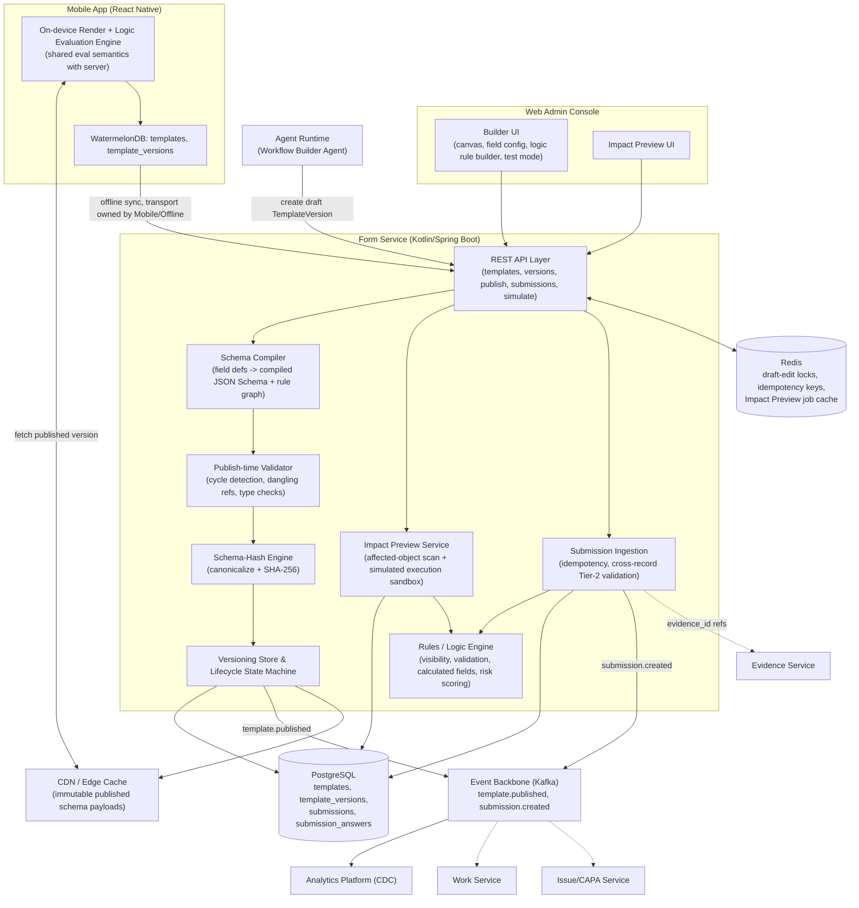

# High-Level Design — No-Code Forms & Workflow Builder (Form Service)

## 1. Module Responsibilities

The **Form Service** is the authoritative owner of:
- `Template` — stable logical identity of a form/checklist/audit definition.
- `TemplateVersion` — immutable-once-published compiled schema, logic rule set, and scoring config.
- `Submission` — the record of a filler's answers against one exact `TemplateVersion`.
- `FormFieldDefinition` — the individual field definitions that compose a `TemplateVersion`'s schema
  (modeled as a structured column inside `template_versions.schema_json` rather than a separate
  normalized table — see low-level-design.md §1 rationale).

It is **not** responsible for: deciding when a form should be filled (Work Orchestration), storing
media bytes (Evidence), running the offline sync transport (Mobile/Offline), or executing Issue/CAPA
workflows triggered by a risk score (Issues/CAPA). The Form Service's job ends at: compiling a valid,
versioned, hash-verified schema; validating and ingesting a submission against that schema; and
exposing the structured facts (answers, risk score, validation outcome) that other services react to.

## 2. Component Diagram

## 3. Data Ownership

| Entity | Owner | Notes |
|---|---|---|
| `Template` | Form Service | Stable ID + status only; version history lives in `TemplateVersion`. |
| `TemplateVersion` | Form Service | Compiled schema, rules, scoring, hash, lifecycle state. Immutable once `PUBLISHED`. |
| `Submission` | Form Service | Header record: which version, who, when, risk outcome, validation status. |
| `SubmissionAnswer` (implementation detail of `Submission`) | Form Service | Field-level answers; evidence-bearing answers hold a reference only. |
| `FormFieldDefinition` | Form Service (embedded) | Not a standalone row-per-field table; see low-level-design.md §1 for the JSON-vs-normalized trade-off. |
| `Evidence` | Evidence Service (referenced) | Form Service stores `evidence_id` + `content_hash` only. |
| `WorkItem` | Work Service (referenced) | Form Service is told "render template version X for work item Y"; it does not create/schedule `WorkItem`s. |
| `OrganizationNode`, `UserScope` | Organization/Identity Service (referenced) | Consumed for Builder authoring scope and Impact Preview location enumeration. |
| `Issue` | Issue/CAPA Service (referenced) | Form Service emits a risk-scoring "would create issue" fact; Issue/CAPA owns the object. |

## 4. External Interfaces

### 4.1 Events Produced

| Event | Emitted when | Key payload fields |
|---|---|---|
| `template.published` | A `TemplateVersion` transitions to `PUBLISHED` | `template_id`, `template_version_id`, `schema_hash`, `version`, `published_by`, `superseded_version_id` |
| `template.retired` | A `TemplateVersion` transitions to `RETIRED` | `template_id`, `template_version_id`, `open_work_item_count` |
| `submission.created` | A submission is durably ingested (online or via offline sync) | `submission_id`, `client_uuid`, `template_version_id`, `work_item_id`, `risk_scores[]`, `validation_status` |
| `submission.validation_failed` | Server-side (Tier-2) validation fails post-ingestion | `submission_id`, `failed_rules[]` |

All events use the canonical envelope from source-spec §18.4 (`event_id`, `event_type`, `version`,
`tenant_id`, `occurred_at`, `actor_id`, `resource_id`, `trace_id`, `data`), partitioned on Kafka by
`tenant_id:template_id` (templates) or `tenant_id:submission_id` (submissions) for ordering.

### 4.2 Events/Calls Consumed

The Form Service is intentionally low-fan-in: it does not subscribe to most platform events. Its
inbound dependencies are synchronous reference lookups, not event subscriptions:
- Organization/Identity Service (gRPC, internal): resolve `UserScope` for Builder authorization and
  Impact Preview location enumeration.
- Evidence Service (REST, internal): register an evidence-bearing answer's upload intent and receive
  back an `evidence_id` reference (the actual byte upload/signed-URL flow is between the mobile
  client and Evidence Service directly, per source-spec Core Technical Components — Form Service is
  not on the media data path).
- Reference-data providers (Asset/Product/Location/custom lists — via Organization/Integration
  services): resolved at lookup-field configuration time and snapshotted into the compiled schema
  (`reference_set_version`) for offline distribution.
- Agent Runtime (REST, internal): the Workflow Builder Agent calls the same `POST
  /api/v1/templates/{id}/versions` draft-creation endpoint any human admin uses — no privileged
  back-door API — so every agent-authored draft is subject to the identical publish gate.

### 4.3 APIs Produced
See low-level-design.md §6 for the full endpoint list. Consumers: Web Admin Console (Builder), Mobile
App (schema fetch/cache), Work Service (create a `WorkItem`'s render pointer by
`template_version_id`), Analytics (via CDC, not this API).

## 5. Scalability

### 5.1 Schema Caching for Offline Distribution
A `PUBLISHED` `TemplateVersion`'s compiled schema payload is content-addressed by `schema_hash` and
is **immutable forever**, which makes it maximally cacheable: it is served through a CDN/edge cache
with a far-future `Cache-Control: immutable` header, and the mobile client's local cache uses the
`schema_hash` as its own integrity check (re-download only if the hash the client has recorded for a
`template_version_id` differs from what the server currently reports — which, by definition, only
happens if the client never fully finished a prior download). This means a fleet of 1,000,000 devices
re-syncing after a regional outage places load on the CDN edge, not the origin database or
application tier.

### 5.2 Submission Ingestion Throughput
Submission ingestion is designed for high write fan-in from bursty reconnect events (e.g., a whole
region regaining connectivity after an outage and flushing a queued backlog simultaneously,
source-spec §9.2/§19). Design choices:
- Ingestion is append-only (`submissions` + `submission_answers` insert, no update-in-place for a
  completed submission) — no lock contention on existing rows.
- The idempotency check (`tenant_id + client_uuid` unique constraint) is a single indexed lookup, not
  a scan.
- Cross-record Tier-2 validation (functional-spec.md FR-FORM-028) that needs recent-submission
  aggregates is served from a pre-aggregated rolling-window table refreshed asynchronously, not a
  live `COUNT()`/`AVG()` query against the full `submissions` table, to keep ingestion latency
  independent of historical data volume.
- Bulk reconnect bursts are absorbed by horizontal scaling of stateless ingestion API pods behind the
  gateway; Postgres write throughput is protected by batching within the sync endpoint's transaction
  (the Mobile/Offline sync protocol batches multiple `client_uuid` changes per call, per source-spec
  §18.2) and by routing analytical/reporting reads to read replicas so ingestion writes are never
  contended by dashboard queries.

## 6. Multi-Tenancy

Every table carries `tenant_id` with Postgres RLS as the defense-in-depth backstop (conventions.md).
`Template`/`TemplateVersion` authoring is additionally scoped by `OrganizationNode` via `UserScope` —
an Operations Admin can only author templates whose assignment scope falls within their own scope
subtree. Large enterprise tenants with very large form catalogs and submission volume are candidates
for the tenant-tier dedicated-schema/cluster sharding strategy described in conventions.md; the
`template_version_id`-keyed CDN caching (§5.1) is tenant-agnostic at the cache layer (the schema
payload URL itself is namespaced by `tenant_id/template_id/version`) so sharding the origin database
does not require re-architecting the caching layer.

## 7. Failure Modes and Degradation

| Failure | Behavior / Degradation |
|---|---|
| Publish-time validation failure (cycle, dangling ref, type mismatch) | Publish action is rejected synchronously with the specific violating rule(s) identified (functional-spec.md FR-FORM-061/§9); the version remains in `APPROVED` (or is bounced to `DRAFT` per tenant policy), never partially published. |
| Impact Preview affected-object scan times out (very large tenant) | Falls back to an asynchronous background job (low-level-design.md §12) that emails/notifies the admin when the full scan completes; the Builder shows a best-effort partial count with a "still calculating exact totals" indicator rather than blocking publish indefinitely — publish itself still requires acknowledgement of whatever high-severity warnings (FR-FORM-052) are already known at that point. |
| Mobile schema cache staleness (device offline for a long period, template retired/updated meanwhile) | Device continues to render the last cached, hash-verified `PUBLISHED` version until it reconnects (functional-spec.md FR-FORM-063/FR-FORM-074); the server is the sole source of truth for lifecycle-state transitions, and a stale-cache submission is still accepted (never discarded) if it was validly `IN_PROGRESS`/`PUBLISHED` at the time the device last synced, consistent with source-spec P4/P9. |
| Evidence Service unavailable during fill | Evidence capture queues locally (Mobile/Offline concern); the Form Service's ingestion endpoint accepts a submission whose evidence-bearing answers reference not-yet-uploaded `evidence_id`s in a `PENDING_UPLOAD` state and does not block submission ingestion on media upload completion. |
| Kafka unavailable at submission ingestion | The Postgres write (submission + answers) is authoritative and commits first; event emission uses the transactional outbox pattern (write to an `outbox_events` table in the same DB transaction, a separate publisher relays to Kafka) so a Kafka outage delays downstream reactions (Issue creation, Work Service progression) but never loses or duplicates the submission itself. |
| Concurrent draft edit conflict | Optimistic concurrency (`version`/`ETag`) on `template_versions` in `DRAFT`; a losing writer gets `409 Conflict` with the current draft state to merge against (low-level-design.md §10) rather than silently overwriting a co-editor's change. |
| Schema-hash mismatch detected at publish (compiler drift / bug) | Publish is aborted; this is treated as a Sev-2 defect (not a user-facing recoverable error) because it indicates the compiled artifact does not match what was reviewed/tested — alerted to on-call, per source-spec §22 reliability patterns. |

## 8. Technology Choices (Justified)

| Choice | Rationale |
|---|---|
| Schema representation: versioned JSON Schema (Draft 2020-12 superset) + a separate compiled rule graph (`rules_json`) and scoring config (`scoring_json`), rather than one monolithic document | Keeps the three concerns (structure/typing, conditional logic, risk scoring) independently versionable and independently testable by the Impact Preview's simulated execution, and lets the rendering engine on mobile use a standard JSON-Schema-aware form-rendering approach for the structural part while running a purpose-built interpreter (low-level-design.md §9) for the rule graph, which is not expressible in plain JSON Schema (cross-field, cross-record, aggregate-over-repeating-group logic). |
| Content-hash (`schema_hash`) for immutability, rather than relying solely on a `PUBLISHED` status flag + DB permissions | A status flag only prevents the application layer from *intending* to mutate; a content hash gives a cryptographically verifiable, client-checkable guarantee that what a device rendered is exactly what a reviewer approved and exactly what a historical submission references — required for the source-spec §24.1 version-immutability acceptance test and for CDN-level immutable caching (§5.1). |
| PostgreSQL for `templates`/`template_versions`/`submissions`, not a document store | Matches the platform-wide transactional-store decision (conventions.md); the compiled schema/rules/scoring are stored as `jsonb` columns (queryable where needed, e.g., for the structural diff in FR-FORM-052) while relational integrity (foreign keys, unique idempotency constraints, RLS) governs the surrounding metadata — the hybrid relational+jsonb approach avoids standing up a second datastore purely for form definitions. |
| Kotlin/Spring Boot service, one deployable Form Service | Matches conventions.md's per-bounded-context JVM microservice pattern; Form Service has a distinct scaling profile (bursty ingestion, CPU-bound rule compilation/simulation) that justifies its own deployment unit rather than folding into Work Service. |
| Restricted formula/rule expression grammar (no embedded scripting language, no arbitrary code eval) | Keeps the logic engine's evaluation deterministic, side-effect-free, statically analyzable (cycle detection, type checking, satisfiability warnings) and safely runnable identically on-device (mobile, offline) and server-side (authoritative Tier-2 re-validation) without a sandboxing/security concern that a general-purpose scripting language would introduce. |
| CDN/edge caching keyed by immutable `schema_hash`/`template_version_id` | Converts the hardest scaling problem (millions of devices needing the same small set of published schemas) into a pure cache-hit workload; because published versions never change, cache invalidation — usually the hardest caching problem — is a non-issue here. |

## 9. Key Design Decisions and Trade-offs

- **Embedded JSON schema/rules vs. fully normalized per-field tables**: chosen embedded (jsonb) for
  authoring/versioning atomicity and hash determinism (a single canonicalizable document is far
  simpler to hash deterministically than reconstructing one from N rows); trade-off is that
  field-level SQL queries (e.g., "find all templates using field type BARCODE") require jsonb
  indexing (GIN) rather than a simple join, which is an acceptable trade-off given such queries are
  low-frequency admin/analytics operations, not hot-path reads.
- **Pilot rollout as a policy overlay, not a lifecycle state**: chosen to keep the immutability
  guarantee (FR-FORM-041) strictly about content, and rollout scope strictly about assignability,
  so the two concerns cannot be conflated by a future feature needing "80% published, but also still
  in review" states that the naive six-state model would not support cleanly.
- **Tier-1/Tier-2 cross-record validation split**: chosen to satisfy both the offline-first principle
  (immediate feedback without connectivity, source-spec P2) and the authoritative-server principle
  (source-spec P9 idempotency/consistency) rather than picking one at the expense of the other.
