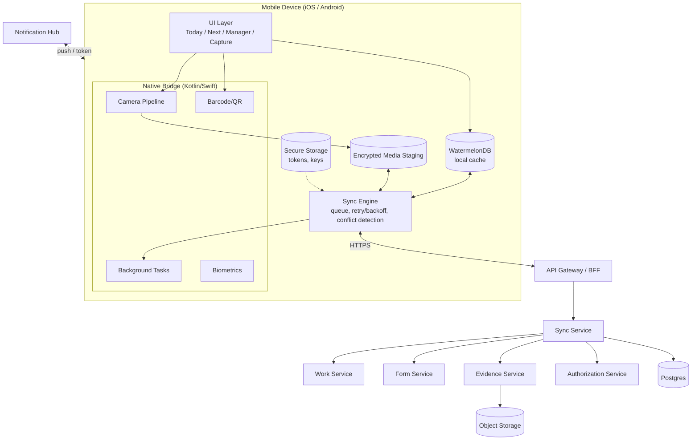
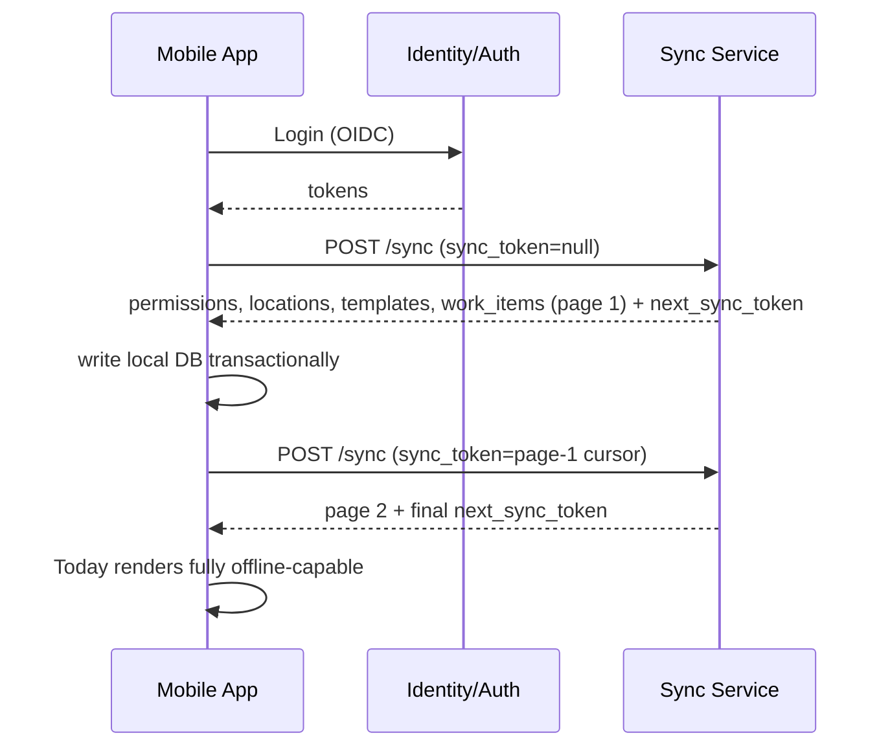
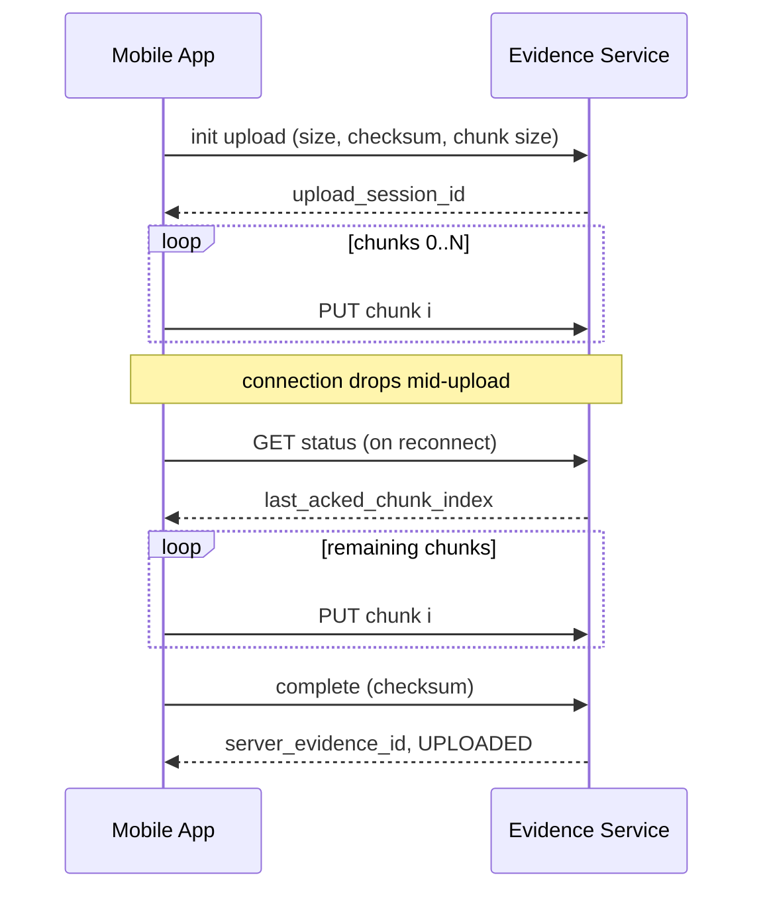
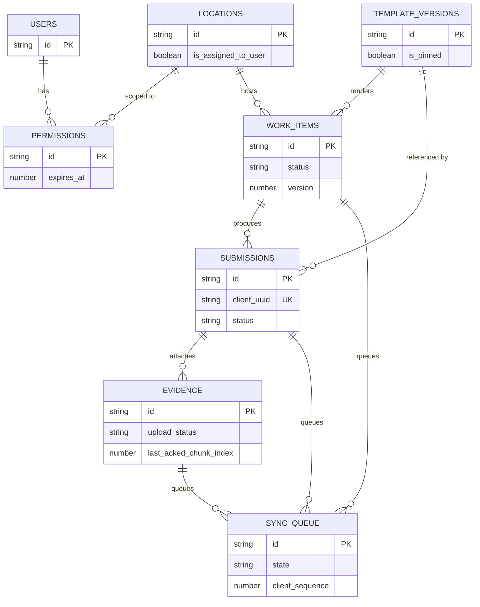
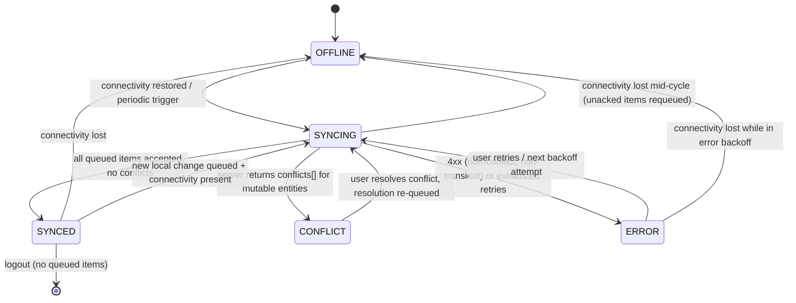

# Frontline Mobile & Offline — Architecture Diagrams

Module corresponds to **EPIC-05 (Mobile Offline)**. Focused diagram set for this module only;
narrative detail lives in `functional-spec.md`, `high-level-design.md`, and `low-level-design.md`.

## 1. Component / Container Diagram


The device holds only a bounded, disposable cache (WatermelonDB) plus a protected outbound queue;
the Sync Service is the single mobile-facing façade over Work/Form/Evidence/Authorization Services,
so no other backend service talks to a device directly except the Notification Hub's push channel.

## 2. Sequence — New Device Bootstrap


Bootstrap is the one flow that requires connectivity; it is paginated and checkpointed so an
interruption resumes from the last acknowledged cursor rather than restarting.

## 3. Sequence — Offline Capture to Sync (with Conflict)

```mermaid
sequenceDiagram
    participant User
    participant App as Mobile App (offline)
    participant Sync as Sync Service
    User->>App: Capture evidence, submit WorkItem
    App->>App: write evidence + submission + sync_queue atomically
    App->>App: connectivity restored → background sync fires
    App->>Sync: POST /sync (batched changes)
    Sync-->>App: submission accepted; work_item_status conflict (409-class)
    App->>App: mark submission SYNCED; mark WorkItem CONFLICT
    User->>App: resolve conflict (per-field keep mine/use server's)
    App->>Sync: POST /sync (resolution)
    Sync-->>App: accepted
```
Submission acceptance and WorkItem-field conflict are independent outcomes within one batch
response — a conflict on a mutable task field never blocks or rolls back an already-valid,
immutable submission.

## 4. Sequence — Resumable Media Upload with Interruption


Large evidence media never transits the same request path as JSON sync deltas, and never restarts
from byte zero after an interruption — only the unacknowledged remainder is re-sent.

## 5. Local On-Device ER Diagram


`template_versions` and unsynced `submissions`/`evidence`/`sync_queue` rows are the only data
treated as protected/pinned; everything else is a disposable, TTL'd cache subset of server state.

## 6. State Diagram — Sync / Connectivity States


`OFFLINE` is a normal, expected steady state, not a fault — matching the product principle that
offline is a supported operating mode, not an error path. `CONFLICT` and `ERROR` are the only
states requiring explicit user or operator attention; every other transition is automatic.
