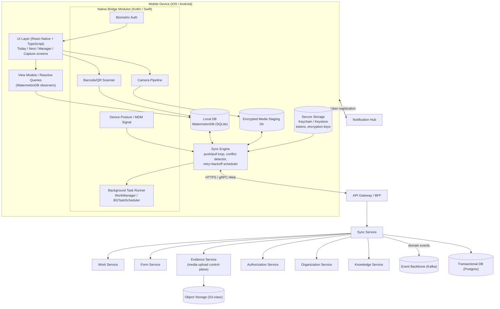

# Frontline Mobile & Offline — High-Level Design

Module corresponds to **EPIC-05 (Mobile Offline)**. Covers both the React Native mobile client and
the server-side Sync Service that serves it (source-spec §16.3 lists "Work Service" concerns but
the Sync Service is the mobile-facing façade over Work/Form/Evidence services described here).

## 1. Module Responsibilities & Boundaries

**Owns:**
- The mobile client application shell, navigation, rendering engine for cached form schemas, and
  all capture UX (camera, barcode, signature, audio).
- The on-device local database (WatermelonDB) as a bounded cache — schema, migration, eviction.
- The client-side sync engine: outbound queueing, batching, retry/backoff, conflict detection
  presentation.
- The server-side **Sync Service**: the `/api/v1/sync` endpoint family, delta/cursor computation,
  conflict adjudication, and the resumable media upload control-plane (init/chunk/complete).
- Device push-token registration and local-notification scheduling logic.

**Does not own** (references/delegates):
- Business validation rules inside a form schema (owned by Forms/Form Service) — the client
  executes rules shipped in the schema; it does not define them.
- WorkItem state machine transitions beyond the client-visible subset
  (`AVAILABLE → IN_PROGRESS → SUBMITTED`) — escalation, SLA, and approval routing live in Work
  Service.
- Evidence object storage, hashing, retention, and Visual AI processing — owned by Evidence
  Service; Sync Service's media-upload endpoints are a transport/control-plane in front of it.
- Authorization decisions — the Authorization Service computes `UserScope`; this module caches and
  enforces the resulting decision but treats it as opaque, expiring data.
- Push fan-out and delivery guarantees beyond token registration — owned by the Notification Hub.

## 2. Component Diagram

## 3. Data Ownership

The local device DB is a **bounded, TTL'd, scope-filtered subset** of server state — never a full
replica. It is authoritative only for **unsynced local mutations**; every cached read entity is a
disposable, reconstructable copy.

| Local table | Source of truth | Freshness policy | Eviction behavior |
|---|---|---|---|
| `users` | Identity Service | Refreshed every bootstrap/full sync; max staleness 24h | Never evicted while session active; replaced wholesale on refresh |
| `permissions` | Authorization Service | Refreshed every sync cycle; **hard max staleness 24h** — expired permission cache blocks new mutating actions client-side until refreshed (fail-closed) | Replaced wholesale on refresh, not incrementally merged |
| `locations` | Organization Service | Delta-synced; max staleness 7 days for non-assigned locations, 24h for the user's currently assigned location(s) | LRU-evicted for locations outside current assignment/recent-use window when storage pressure requires it |
| `templates` / `template_versions` | Form Service | Delta-synced; pinned (never evicted) for any `TemplateVersion` referenced by a cached, unsubmitted `work_item` | LRU-evicted otherwise once no longer referenced by open work |
| `work_items` | Work Service | Delta-synced every sync cycle; assigned/open work only (server-side filter, not a client-side "download everything and filter") | Removed locally once terminal (`VERIFIED`/closed) and synced beyond a short local-history window (default 30 days, for offline "recent work" viewing) |
| `submissions` | Client-authoritative until synced, then Form/Work Service | N/A (write-through) | Never evicted while `PENDING`/`QUEUED`; archived locally after confirmed sync per local-history window |
| `evidence` | Client-authoritative until uploaded, then Evidence Service | N/A (write-through) | **Never evicted while unsynced** (protected); local media file deleted only after server-confirmed upload + a configurable retention grace period (default 48h) for offline re-view |
| `sync_queue` | Client-only (transient) | N/A | Drained on successful ack; never evicted otherwise |
| `sync_cursor` | Client-only (transient) | N/A | Single row per device, always current |
| Knowledge documents (cached subset) | Knowledge Service | Delta-synced; max staleness 7 days | LRU-evicted by least-recently-viewed once storage budget pressure requires it |

This freshness/eviction policy is the concrete instantiation of source-spec §19.1's "bounded
reference data" requirement and is detailed further in `low-level-design.md` §7.

## 4. External Interfaces

**Consumed:**
- `POST /api/v1/sync` (extended, LLD §2) — primary bidirectional sync.
- `POST /api/v1/media/upload/init|chunk|complete` — resumable evidence upload control-plane.
- `POST /api/v1/devices/register` — push token + device posture registration.
- `GET /api/v1/app/version-policy` — forced-upgrade minimum-version check (cacheable, 24h TTL).
- Notification Hub push channel (FCM/APNs) — inbound push delivery to the device.

**Produced:**
- Canonical domain events (source-spec §18.3) — `task.completed`, `audit.submitted`, etc. — emitted
  by the Sync Service onto the Event Backbone *as a side effect of accepting a synced change*, not
  emitted by the mobile client directly. The client's contract is with the Sync API only; it never
  writes to Kafka directly, preserving the "transactional DB is authoritative, event backbone is
  derived" architecture principle (source-spec §16.2).
- `sync.completed` / `sync.conflict_detected` / `device.posture_failed` internal telemetry events
  for observability (source-spec §22.2 "Mobile sync success/failure").

## 5. Scalability

- **Fan-out at 1M+ devices**: sync is client-pull, not server-push-per-change. The server never
  attempts to push individual changes to devices in real time; it relies on (a) push notifications
  as a low-latency *hint* to sync soon, and (b) periodic background pull on each device's own
  schedule. This converts a fan-out problem into a read-scaling problem (many devices polling a
  cursor-based delta endpoint), which is horizontally scalable behind the API Gateway and read
  replicas, rather than a stateful push fan-out problem.
- **Delta sync payload sizing**: the pull side of `/sync` returns only entities changed since
  `sync_token`, filtered server-side by the caller's current `UserScope` (never "changed since X,
  filter client-side"). Typical steady-state delta payload for an associate device is target
  **< 50KB** JSON per sync cycle (a handful of WorkItem status changes, maybe one template
  update); a first bootstrap sync is the outlier (target **< 5MB** for a typical single-location
  associate profile, paginated via repeated cursor calls, never one unbounded response — see LLD
  §5 Sequence A).
- **Write path**: outbound submission volume is smoothed by device-side batching (default batch
  size 25 changes or 256KB, whichever first) and jittered backoff, so reconnect storms (e.g., a
  regional outage recovering) do not produce a synchronized thundering herd against the Sync
  Service; jitter window default ±30% of the base backoff interval.
- **Media upload** bypasses the transactional sync path entirely — it goes directly to Evidence
  Service's resumable upload endpoints backed by object storage, so large binary payloads never
  transit the same request path or database as small JSON sync deltas.
- Sync Service instances are stateless; `sync_cursor` state lives server-side per
  `(tenant_id, device_id)` in Postgres (small, indexed table), allowing any Sync Service instance
  to serve any device's request behind a standard load balancer.

## 6. Multi-Tenancy On-Device

- **Single-tenant-per-session enforcement**: even where a user's identity spans multiple tenants
  (e.g., a consultant/auditor firm's user provisioned into several customer tenants), the mobile
  app operates against **exactly one active tenant context per app session/local DB instance**.
  Switching tenant context requires an explicit, deliberate in-app "Switch organization" action
  that triggers a full local data wipe-and-rebootstrap for the new tenant context — it is never an
  implicit background operation, and the two tenants' cached data are never resident in the local
  DB simultaneously. This is the mobile-specific enforcement of the platform-wide tenant isolation
  principle (source-spec §21.1) applied to a device that could otherwise become a cross-tenant data
  leak vector if a single local DB tried to hold rows scoped by `tenant_id` for two active tenants
  concurrently.
  - **Resolved**: the device never retains cached data for an inactive second tenant. Every "Switch
    organization" action performs a full wipe-and-rebootstrap; no dormant second-tenant cache is
    kept to speed up a later switch back. This is the firm decision for this version because it
    keeps the security review surface simple (at most one tenant's data ever exists on disk) and
    the multi-tenant-per-device case is rare enough (consultant/auditor users only) that the
    rebootstrap cost is an acceptable trade-off against carrying cross-tenant data-retention risk
    on the device.
- Every row in every local table still carries `tenant_id` (consistent with the platform-wide
  convention) even though only one tenant is active at a time, so that the sync engine's queries
  and any diagnostic export are unambiguous and forward-compatible with a future multi-tenant-
  resident design, without relying on "there's only one tenant so it doesn't matter" as an
  assumption baked into query logic.
- Every sync request carries the device's current tenant context explicitly and the Sync Service
  independently re-validates it against the authenticated principal's actual tenant memberships
  server-side — the client-declared tenant is never trusted alone (consistent with the
  conventions.md multi-tenancy rule: "never trust a client-supplied tenant context").

## 7. Failure Modes & Recovery/Degradation Strategy

| Failure mode | Detection | Degradation | Recovery |
|---|---|---|---|
| Server (Sync Service) unreachable | HTTP timeout / DNS failure on sync attempt | App operates fully offline (§ functional-spec §3.10); UI shows offline banner; no feature beyond initial bootstrap is blocked | Exponential backoff with jitter retry (LLD §6); resumes automatically on next successful attempt or manual "Sync now" |
| Sync Service degraded (elevated latency/5xx, not fully down) | Slow responses / 5xx rate | Client applies the same backoff as full outage rather than hammering a struggling service; circuit-breaker-style client behavior: after N consecutive 5xx, treat as offline for backoff purposes | Backoff naturally recovers as server health improves; server-side circuit breakers/bulkheads (source-spec §22.3) protect Sync Service from cascading failure into Work/Form/Evidence services |
| Corrupted local DB | Startup integrity check fails, or WatermelonDB throws on a read/write | Quarantine-and-recover flow (functional-spec §5): unsynced data exported to a local file, DB rebuilt from a fresh bootstrap | User re-authenticates if needed, fresh bootstrap runs, quarantined file available for support-assisted manual recovery if unsynced work is high-value |
| Half-completed sync batch (device killed/lost connectivity mid-batch) | Sync engine tracks per-item ack state within a batch | Only unacknowledged items remain `PENDING`; acknowledged items are marked synced even if the batch as a whole didn't "complete" | Next sync attempt resumes with the remaining `PENDING` items; idempotency key + `client_uuid` ensures no duplicate server-side effect even if an ack was lost in transit after the server actually processed it |
| Media upload interrupted (large video, spotty connectivity) | Chunk upload times out / connection drops | Partially uploaded chunks are retained server-side keyed by upload session id; local evidence record stays `UPLOADING` | Resumable upload resumes from `last_acked_chunk_index` on next connectivity (LLD §5 Sequence C); never restarts from byte 0 |
| Auth token expires mid-sync | 401 on a sync call | In-flight batch is paused, not discarded; local data stays queued | Silent token refresh attempted first; if refresh fails, user is prompted to re-authenticate, but local unsynced data is preserved indefinitely until that happens |
| Server schema/contract ahead of an old client (forced-upgrade not yet enforced, or grace window) | Sync response includes a field/entity type the client's schema version doesn't recognize | Unknown fields are stored opaquely (pass-through) rather than dropped or crashing the parser, and unknown entity types are ignored client-side rather than rendered incorrectly | Client upgrade resolves full support; forced-upgrade gating (functional-spec §3.8) is the backstop once the server considers the gap unsafe |
| Device posture check fails (jailbroken/rooted, MDM non-compliant) | Posture signal reported in sync handshake | Sync is blocked (data still queues locally, nothing is lost); local capture/use continues | Resolved when device returns to compliant posture (e.g., IT remediation) and next sync handshake passes |

## 8. Technology Choices (Justified)

- **WatermelonDB over Realm or plain SQLite**: WatermelonDB is purpose-built for offline-first,
  reactive, sync-oriented React Native apps: (a) it is SQLite-backed, giving predictable storage
  behavior, transactional integrity, and straightforward encryption via SQLCipher, which plain
  Realm's proprietary storage engine does not give as directly; (b) it ships a lazy-loading,
  reactive query layer that lets the UI layer (Today/Next lists, which must render large,
  frequently-changing WorkItem sets instantly) observe local data changes without hand-rolled
  pub/sub, which plain SQLite would require building from scratch; (c) its schema-migration model
  (versioned, additive-first migrations) matches this module's app-upgrade-resilience requirement
  (functional-spec §3.8) directly, whereas Realm's migration model is comparatively more rigid
  about schema evolution across major version gaps and carries commercial licensing considerations
  post-MongoDB acquisition that plain SQLite/WatermelonDB avoid; (d) WatermelonDB's design
  explicitly separates "sync adapter" concerns from storage, matching this module's need for a
  custom sync engine against a bespoke `/api/v1/sync` contract rather than a vendor-hosted sync
  backend (ruling out Realm Sync / Firebase-class turnkey sync, which would couple this module to
  a third-party sync backend incompatible with the platform's own idempotent, domain-aware conflict
  model in source-spec §19.3).
- **Resumable multipart upload for media over a single large POST**: frontline evidence capture
  happens in exactly the connectivity conditions (basements, vehicles, remote sites) where a single
  large POST is most likely to fail partway; resumable chunked upload (LLD §5 Sequence C) means a
  30MB video captured in a warehouse with intermittent signal uploads incrementally as connectivity
  allows, rather than re-attempting the entire file on every retry — critical for both data-usage
  budget (functional-spec FR-MOB-052) and the "zero data loss" acceptance bar (source-spec §24.1).
- **React Native (single codebase) with native bridge modules for camera/barcode/background-
  sync/biometrics**: maximizes shared business logic (sync engine, form rendering, validation)
  across iOS/Android while dropping to native Kotlin/Swift exactly where the RN bridge is
  historically weakest — high-throughput camera pipelines, platform-specific background execution
  APIs (WorkManager vs. BGTaskScheduler have materially different semantics and cannot be
  abstracted away safely), and biometric/secure-enclave APIs — consistent with conventions.md's
  target stack.
- **Cursor-based, server-authoritative delta sync over client-computed diffing**: keeps conflict
  and ordering logic in one place (server) rather than trusting device clocks or client-side diff
  logic, consistent with source-spec §19.4 ("client clock cannot be trusted for authoritative
  ordering") and P9 (idempotency everywhere).
