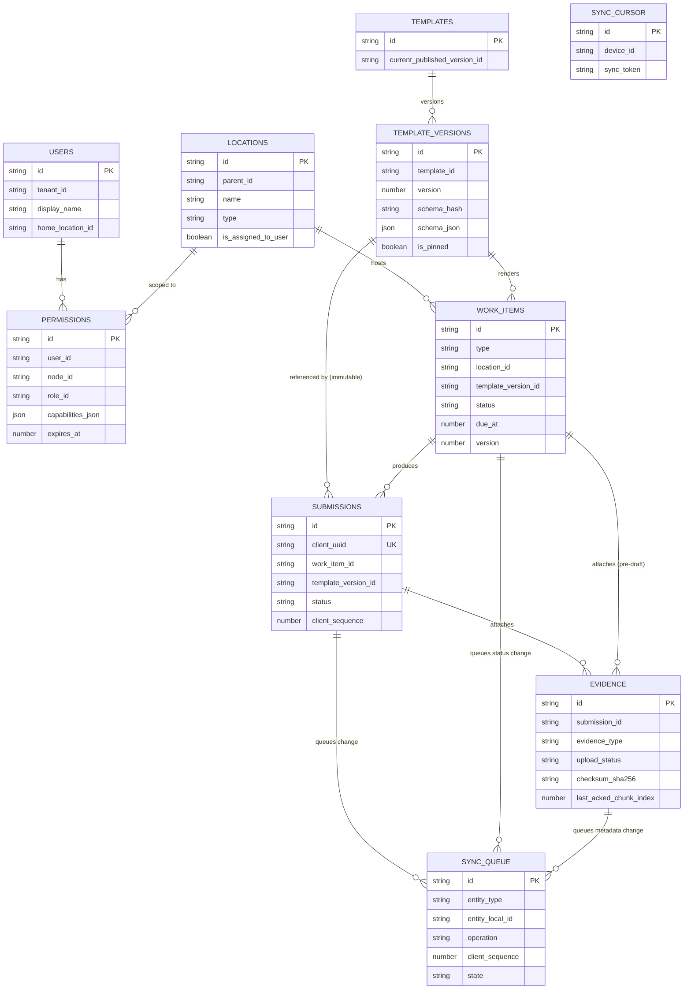
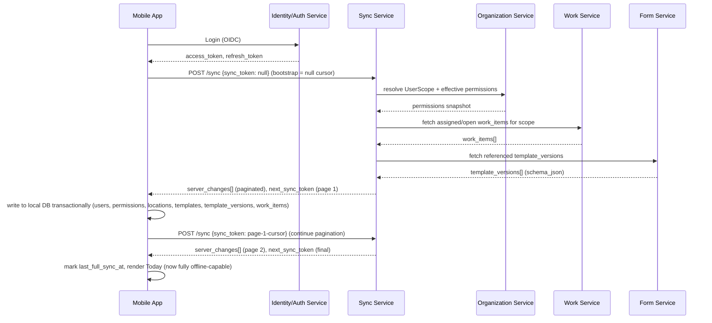
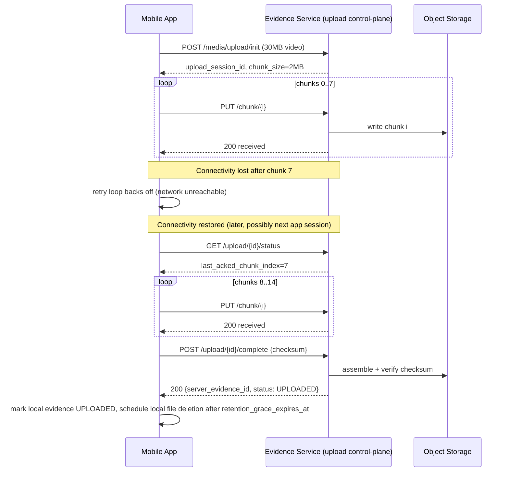

# Frontline Mobile & Offline — Low-Level Design

Module corresponds to **EPIC-05 (Mobile Offline)**. Concrete on-device schema, server sync
contract, sequence flows, algorithms, caching/eviction, concurrency, background jobs, and error
handling.

## 1. Local (On-Device) Schema — WatermelonDB

All local tables mirror the platform's `tenant_id`-carrying convention even though only one tenant
is active per session (see `high-level-design.md` §6). WatermelonDB columns are typed per its
column API (`string`, `number`, `boolean`, `json` stored as string). Every table has an implicit
WatermelonDB `id` (local primary key, client-generated UUID) in addition to any server id.

### 1.1 `users`

| Column | Type | Notes |
|---|---|---|
| id | string (PK) | Local id = server `User.id` |
| tenant_id | string | |
| display_name | string | |
| email | string | |
| avatar_url | string, nullable | |
| home_location_id | string, nullable | FK to `locations.id` |
| roles_json | json | Denormalized role labels for display only; not authorization-authoritative |
| is_current_user | boolean | True only for the single signed-in profile |
| cached_at | number (epoch ms) | Last refresh |

### 1.2 `permissions`

| Column | Type | Notes |
|---|---|---|
| id | string (PK) | `{user_id}:{node_id}:{role_id}` composite, client-generated |
| tenant_id | string | |
| user_id | string | |
| node_id | string | FK to `locations.id` (an `OrganizationNode`) |
| role_id | string | |
| capabilities_json | json | Resolved effective capability set for this scope (read/create/approve/reassign/export/administer flags) — **pre-resolved by Authorization Service**, not recomputed on-device |
| valid_from | number, nullable | Epoch ms |
| valid_to | number, nullable | Epoch ms |
| cached_at | number | Wholesale-replaced on refresh (§ HLD §3) |
| expires_at | number | `cached_at + 24h`; enforcement per functional-spec fail-closed rule |

### 1.3 `locations`

| Column | Type | Notes |
|---|---|---|
| id | string (PK) | Server `OrganizationNode.id` |
| tenant_id | string | |
| parent_id | string, nullable | |
| name | string | |
| type | string | e.g. `STORE`, `REGION` |
| path | string | Materialized path for display/breadcrumb |
| latitude | number, nullable | |
| longitude | number, nullable | |
| is_assigned_to_user | boolean | Drives pin/eviction priority |
| last_accessed_at | number | For LRU eviction |
| cached_at | number | |

### 1.4 `templates`

| Column | Type | Notes |
|---|---|---|
| id | string (PK) | Server `Template.id` |
| tenant_id | string | |
| name | string | |
| current_published_version_id | string, nullable | FK to `template_versions.id` |
| cached_at | number | |

### 1.5 `template_versions`

| Column | Type | Notes |
|---|---|---|
| id | string (PK) | Server `TemplateVersion.id` |
| tenant_id | string | |
| template_id | string | |
| version | number | |
| schema_hash | string | Integrity check against payload |
| schema_json | json | Full field/logic/branching schema — the offline renderer's source of truth |
| min_client_render_version | string | Advertised minimum RN rendering-engine capability version (HLD §8 graceful degradation) |
| published_at | number | |
| is_pinned | boolean | True while referenced by any non-terminal local `work_items` row |
| cached_at | number | |

### 1.6 `work_items`

| Column | Type | Notes |
|---|---|---|
| id | string (PK) | Server `WorkItem.id` |
| tenant_id | string | |
| type | string | One of the 11 types, source-spec §7.1 |
| location_id | string | FK to `locations.id` |
| template_version_id | string, nullable | Null for non-form work types |
| assigned_to_user_id | string, nullable | |
| status | string | `AVAILABLE`, `IN_PROGRESS`, `SUBMITTED`, `BLOCKED`, `OVERDUE`, etc. (mirrors server WorkItem state machine, client-visible subset) |
| priority | number | For Next-queue ranking |
| due_at | number, nullable | Epoch ms, server-assigned |
| local_status_dirty | boolean | True if a local transition hasn't yet been acknowledged by the server |
| version | number | Server optimistic-concurrency version, for conflict detection on mutable fields |
| server_updated_at | number | Server-authoritative last-modified time |
| cached_at | number | |

**Index:** `(tenant_id, assigned_to_user_id, status, due_at)` — supports Today/Next queries.

### 1.7 `submissions`

| Column | Type | Notes |
|---|---|---|
| id | string (PK, local) | Client-generated |
| client_uuid | string, unique | Idempotency key; `tenant_id + client_uuid` is the server-side unique submission identity (source-spec §19.2) |
| tenant_id | string | |
| work_item_id | string | FK |
| template_version_id | string | Immutable reference (source-spec §7.4/§17.1) |
| device_id | string | |
| client_sequence | number | Monotonic per-device counter |
| answers_json | json | Field-value map |
| status | string | `DRAFT`, `PENDING_UPLOAD` (has unattached evidence), `QUEUED`, `SYNCING`, `SYNCED`, `REJECTED`, `CONFLICT` |
| created_at_client | number | Device clock — display/ordering hint only |
| modified_at_client | number | Device clock |
| server_id | string, nullable | Populated once accepted |
| server_synced_at | number, nullable | |
| reject_reason_code | string, nullable | Machine-readable, populated on `REJECTED` |

**Index:** `(tenant_id, client_uuid)` unique; `(tenant_id, status)` for sync-queue scans.

### 1.8 `evidence`

| Column | Type | Notes |
|---|---|---|
| id | string (PK, local) | Client-generated |
| tenant_id | string | |
| submission_id | string, nullable | FK; nullable to allow capture before the parent draft is finalized |
| work_item_id | string | |
| field_id | string | Template field this evidence answers |
| evidence_type | string | `PHOTO`, `VIDEO`, `AUDIO`, `DOCUMENT`, `SIGNATURE` |
| local_file_uri | string | Path in encrypted media staging dir |
| file_size_bytes | number | |
| checksum_sha256 | string | Computed at capture time, verified server-side on complete |
| capture_gps_lat | number, nullable | |
| capture_gps_lng | number, nullable | |
| capture_device_meta_json | json | Model, OS version, app version, timezone offset |
| captured_at_client | number | |
| upload_status | string | `PENDING_UPLOAD`, `UPLOADING`, `UPLOADED`, `FAILED` |
| upload_session_id | string, nullable | Server-issued resumable upload session id |
| last_acked_chunk_index | number, default -1 | Resume point |
| server_evidence_id | string, nullable | Populated on complete |
| retention_grace_expires_at | number, nullable | Local file deleted after this if `UPLOADED` |

**Index:** `(tenant_id, upload_status)` — drives the upload worker's queue scan.

### 1.9 `sync_queue`

| Column | Type | Notes |
|---|---|---|
| id | string (PK, local) | Client-generated |
| tenant_id | string | |
| entity_type | string | `submission`, `work_item_status`, `evidence_metadata` |
| entity_local_id | string | FK into the owning table |
| operation | string | `CREATE`, `UPDATE` |
| payload_json | json | Snapshot of the change to send |
| client_sequence | number | Monotonic per device, defines push order |
| attempt_count | number, default 0 | |
| next_attempt_at | number | Backoff scheduling |
| state | string | `PENDING`, `IN_FLIGHT`, `FAILED` |
| last_error_code | string, nullable | |
| created_at_client | number | |

**Index:** `(tenant_id, state, next_attempt_at)` — the sync engine's primary dequeue query.

### 1.10 `sync_cursor`

| Column | Type | Notes |
|---|---|---|
| id | string (PK) | Fixed singleton value `"current"` |
| tenant_id | string | |
| device_id | string | |
| sync_token | string | Opaque server-issued cursor |
| last_full_sync_at | number, nullable | Timestamp of last bootstrap-class sync |
| last_delta_sync_at | number, nullable | |

### 1.11 Local ER Diagram



## 2. Server-Side Sync REST Contract

### 2.1 `POST /api/v1/sync`

Extends source-spec §18.2 with full field-level detail.

**Headers:** `Authorization: Bearer <token>`, `Idempotency-Key: <request_id>` (covers the whole
batch call, distinct from each change's own `client_uuid`), `X-Device-Id`, `X-App-Version`,
`X-Client-Render-Capability`.

**Request:**
```json
{
  "device_id": "device-123",
  "tenant_id": "tnt_9f1c",
  "sync_token": "eyJjdXJzb3IiOiJ...",
  "device_posture": {
    "os": "ANDROID",
    "os_version": "14",
    "app_version": "3.4.1",
    "is_rooted_or_jailbroken": false,
    "mdm_compliant": true,
    "battery_pct": 62
  },
  "changes": [
    {
      "client_uuid": "8b1a...-submission",
      "entity_type": "submission",
      "operation": "CREATE",
      "client_sequence": 1042,
      "created_at_client": "2026-09-19T08:12:03.221Z",
      "modified_at_client": "2026-09-19T08:14:11.004Z",
      "payload": {
        "work_item_id": "wi_7712",
        "template_version_id": "tv_2291_v6",
        "answers": { "field_temp": 10.2, "field_corrective_action": "Adjusted thermostat" },
        "evidence_refs": ["ev_local_44a1"]
      }
    },
    {
      "client_uuid": "wi_7712",
      "entity_type": "work_item_status",
      "operation": "UPDATE",
      "client_sequence": 1041,
      "expected_version": 3,
      "payload": { "status": "SUBMITTED" }
    }
  ]
}
```

**Response:**
```json
{
  "accepted": [
    { "client_uuid": "8b1a...-submission", "server_id": "sub_88213", "server_synced_at": "2026-09-19T08:16:02.900Z" }
  ],
  "conflicts": [
    {
      "client_uuid": "wi_7712",
      "entity_type": "work_item_status",
      "reason_code": "VERSION_CONFLICT",
      "expected_version": 3,
      "server_version": 4,
      "server_value": { "status": "IN_PROGRESS", "assigned_to_user_id": "usr_552" },
      "conflicting_fields": ["assigned_to_user_id"]
    }
  ],
  "rejected": [
    {
      "client_uuid": "9c2f...-submission",
      "reason_code": "SCHEMA_VALIDATION_FAILED",
      "message": "Field 'field_temp' is required",
      "recoverable": true
    }
  ],
  "server_changes": [
    { "entity_type": "work_item", "id": "wi_9901", "operation": "UPDATE", "payload": { "status": "OVERDUE", "version": 5 } }
  ],
  "next_sync_token": "eyJjdXJzb3IiOiJ..."
}
```

**Status codes:** `200 OK` (always, for a well-formed batch — per-item outcomes carried in body,
consistent with idempotent-batch design, source-spec P9); `400` malformed request; `401`
token expired/invalid; `403` device posture blocks sync (functional-spec FR-MOB-042); `413`
batch payload exceeds max size (client must split into smaller batches — see error table §8);
`429` rate-limited; `5xx` server error (client backs off and retries the whole batch).

### 2.2 Resumable Media Upload

**`POST /api/v1/media/upload/init`**
```json
{ "evidence_local_id": "ev_local_44a1", "tenant_id": "tnt_9f1c", "content_type": "video/mp4",
  "total_size_bytes": 30412800, "checksum_sha256": "…", "chunk_size_bytes": 2097152 }
```
Response: `{ "upload_session_id": "up_5f21", "chunk_size_bytes": 2097152, "expires_at": "..." }`

**`PUT /api/v1/media/upload/{upload_session_id}/chunk/{chunk_index}`** — binary body, headers
`Content-Range`, `Content-Length`. Response: `{ "chunk_index": 3, "received": true,
"next_expected_chunk_index": 4 }`. Re-uploading an already-acknowledged chunk index returns
`200` idempotently without re-writing (dedup by `(upload_session_id, chunk_index)`).

**`GET /api/v1/media/upload/{upload_session_id}/status`** — resume-probe endpoint, called before
resuming after any interruption. Response: `{ "last_acked_chunk_index": 3, "total_chunks": 15 }`.

**`POST /api/v1/media/upload/{upload_session_id}/complete`**
```json
{ "checksum_sha256": "…" }
```
Response: `{ "server_evidence_id": "evd_20291", "status": "UPLOADED" }`; server re-verifies the
full-file checksum against all assembled chunks before returning `200`; a mismatch returns `409`
with `reason_code: CHECKSUM_MISMATCH`, requiring the client to restart the upload session.

### 2.3 Device Registration (Push)

**`POST /api/v1/devices/register`**
```json
{ "device_id": "device-123", "platform": "ANDROID", "push_token": "fcm:...",
  "app_version": "3.4.1", "os_version": "14" }
```
Response: `{ "registered": true, "notification_preferences": { "quiet_hours": {...} } }`. Idempotent
on `(tenant_id, device_id)`; re-registration with a rotated token overwrites, never duplicates.

## 3. Sequence Diagrams

### 3.1 Sequence A — New Device Bootstrap


Bootstrap is chunked (default page target ≤ 1MB per response) rather than one unbounded payload,
so a connectivity drop mid-bootstrap resumes from the last acknowledged `next_sync_token` instead
of restarting (functional-spec §4 "Bootstrap-in-progress").

### 3.2 Sequence B — Offline Capture → Queue → Background Sync → Conflict

```mermaid
sequenceDiagram
    participant User
    participant App as Mobile App (offline)
    participant LDB as Local DB
    participant BG as Background Sync Worker
    participant Sync as Sync Service
    participant Work as Work Service

    User->>App: Open WorkItem, capture photo, submit
    App->>LDB: write evidence (PENDING_UPLOAD), submission (QUEUED), sync_queue entries
    Note over App,LDB: All writes atomic per FR-MOB-014; UI shows "saved, will sync"
    App->>App: device regains connectivity
    App->>BG: connectivity change triggers opportunistic sync
    BG->>Sync: POST /sync {changes: [submission CREATE, work_item_status UPDATE]}
    Sync->>Work: apply work_item_status UPDATE (expected_version=3)
    Work-->>Sync: 409 — server_version=4 (another device/manager changed assigned_to_user_id)
    Sync-->>BG: {accepted:[submission], conflicts:[work_item_status]}
    BG->>LDB: mark submission SYNCED; mark work_item CONFLICT, store server_value
    App->>User: "Needs your review" list shows the conflicting WorkItem
    User->>App: choose "Use server's" for assigned_to_user_id
    App->>LDB: apply resolution, re-queue as new UPDATE with expected_version=4
    App->>Sync: POST /sync {resolution change}
    Sync-->>App: accepted
```

### 3.3 Sequence C — Resumable Media Upload with Interruption



## 4. Sync Engine Pseudocode

### 4.1 Push/Pull Loop

```
function runSyncCycle(device):
    if not networkAvailable(): return SKIPPED

    acquireSingleWriterLock("sync_engine")  # see §6 concurrency
    try:
        pushBatch = dequeuePending(sync_queue, orderBy=client_sequence, limit=BATCH_SIZE, maxBytes=BATCH_MAX_BYTES)
        if pushBatch.nonEmpty() or hasPendingCursorPull(device):
            request = buildSyncRequest(
                sync_token = sync_cursor.sync_token,
                changes = pushBatch,
                device_posture = readDevicePosture()
            )
            response = httpPost("/api/v1/sync", request, idempotencyKey = requestId())

            for item in response.accepted:
                markSynced(item.client_uuid, item.server_id, item.server_synced_at)
                removeFromQueue(item.client_uuid)

            for item in response.conflicts:
                deriveConflictState(item)   # §4.3

            for item in response.rejected:
                if item.recoverable:
                    moveToFailedState(item.client_uuid, item.reason_code)  # surfaced in sync-failed UX
                else:
                    discardWithAudit(item.client_uuid, item.reason_code)

            applyServerChanges(response.server_changes)   # upsert into local cache tables
            sync_cursor.sync_token = response.next_sync_token
            sync_cursor.last_delta_sync_at = now()

        return SUCCESS
    catch NetworkError as e:
        scheduleRetry(backoffWithJitter(currentAttempt))
        return DEFERRED
    catch AuthExpiredError:
        attemptSilentRefresh()
        if refreshFailed: promptReauth(); return DEFERRED
        else: return runSyncCycle(device)  # retry immediately with fresh token
    finally:
        releaseSingleWriterLock("sync_engine")
```

### 4.2 Exponential Backoff with Jitter

```
function backoffWithJitter(attempt):
    base = min(MAX_BACKOFF_SEC, INITIAL_BACKOFF_SEC * 2^attempt)   # e.g. 5s, 10s, 20s, ... cap 300s
    jitter = base * JITTER_FACTOR * randomBetween(-1, 1)            # JITTER_FACTOR = 0.3
    delay = clamp(base + jitter, MIN_BACKOFF_SEC, MAX_BACKOFF_SEC)
    return now() + delay

# attempt_count increments on each failed cycle for the affected queue items;
# a sync_queue item moved to FAILED after MAX_ATTEMPTS (default 8, spanning ~1hr of backoff)
# for a transient reason is retried again on the next *connectivity transition* regardless of
# attempt_count reset, since a fresh connectivity event is a materially new opportunity, not a blind retry.
```

### 4.3 Local Conflict-State Derivation

```
function deriveConflictState(conflictItem):
    entity = loadLocalEntity(conflictItem.entity_type, conflictItem.client_uuid)

    if conflictItem.entity_type == "submission":
        # Submissions are immutable once created server-side (source-spec §19.3) —
        # a "conflict" here can only mean duplicate-uuid, which the server already
        # resolves by returning 200 with original identity, never as a true conflict.
        assert false, "submissions do not produce conflicts by design"

    else if isMutableMergeableDraft(entity):
        # field-level merge for drafts where safe (source-spec §19.3)
        mergedFields = {}
        for field in entity.fields:
            localVal = entity.local[field]
            serverVal = conflictItem.server_value[field]
            baseVal = entity.lastSyncedSnapshot[field]
            if localVal == serverVal:
                mergedFields[field] = localVal            # no real conflict
            elif localVal == baseVal:
                mergedFields[field] = serverVal            # only server changed — take server's
            elif serverVal == baseVal:
                mergedFields[field] = localVal             # only client changed — keep local, re-push
            else:
                markFieldConflicted(entity, field, localVal, serverVal)   # both changed differently

        if entity.hasConflictedFields():
            entity.status = "CONFLICT"
            persistConflictSnapshot(entity, conflictItem.server_value)
        else:
            entity.applyMerge(mergedFields)
            requeueForPush(entity, expected_version = conflictItem.server_version)

    else:
        # optimistic-concurrency object (task/issue) with a materially conflicting value:
        # do NOT last-write-wins — surface explicit conflict UX (source-spec §19.3)
        entity.status = "CONFLICT"
        persistConflictSnapshot(entity, conflictItem.server_value)
```

## 5. Caching / Storage-Quota Eviction Policy

- **Protected (never auto-evicted) data**: unsynced `submissions`, unsynced/ungraced `evidence`,
  `sync_queue` entries, the current `sync_cursor`, and any `template_versions` row referenced by a
  non-terminal `work_items` row (pinned). This is the "active work" set and is evicted only by
  explicit user action (discard) or successful sync + grace period expiry.
- **Evictable (LRU) data**: `locations` outside the user's current assignment, unpinned
  `template_versions`/`templates`, terminal/old `work_items` beyond the local-history window, and
  cached Knowledge documents, ranked by `last_accessed_at` ascending.
- **Eviction trigger**: runs opportunistically after every successful sync cycle and on explicit
  storage-pressure detection (OS low-storage callback), never mid-capture (to avoid evicting data a
  screen currently depends on).
- **Eviction algorithm**:
  ```
  function evictIfNeeded():
      if referenceDataUsageBytes() < BUDGET * 0.8: return
      candidates = evictableRows() sorted by last_accessed_at ascending
      for row in candidates:
          if referenceDataUsageBytes() < BUDGET * 0.7: break   # evict down to 70%, not to the edge
          delete(row)
  ```
- Pending-evidence media budget (separate pool, functional-spec FR-MOB-050) is **never** eviction
  input; at 95% it blocks new large-media capture (functional-spec §4) instead, since that data is
  not reconstructable from the server.

## 6. Concurrency Control On-Device

- **Single-writer queue**: exactly one sync-engine execution context runs at a time per device,
  enforced by an in-process mutex (`acquireSingleWriterLock`) plus a WatermelonDB-level write
  transaction per sync cycle; a manual "Sync now" tap while a background sync is already running
  attaches to the in-flight cycle's promise rather than starting a second concurrent cycle.
- **Transaction boundaries**: (a) evidence capture write (file + `evidence` row +
  `sync_queue` entry) is one WatermelonDB transaction — FR-MOB-014's atomicity guarantee; (b)
  applying a sync response (`accepted`/`conflicts`/`rejected`/`server_changes`) is one transaction
  per response, so a crash mid-apply never leaves the local cache in a state that mixes old and new
  cursor with partially-applied changes; (c) UI writes (form field edits) are per-keystroke/per-
  field autosave transactions distinct from the queue-worthy "submit" transaction, so a mid-typing
  crash loses at most the last unsaved field, not the whole draft.
- **Reader concurrency**: UI reads are WatermelonDB reactive observers (unlimited concurrent
  readers, SQLite WAL mode) and are never blocked by the sync engine's writer lock beyond normal
  SQLite WAL-mode brief write-commit latency.

## 7. Background Job Scheduling

| Job | Trigger | Platform mechanism | Frequency heuristic |
|---|---|---|---|
| Opportunistic sync | Network connectivity transition to connected | OS network-state listener (not a scheduled job) | Immediate, debounced 3s to avoid flapping |
| Periodic background sync | Time-based | Android `WorkManager` periodic work; iOS `BGAppRefreshTask` | Wi-Fi/unmetered: 15 min default; cellular: 60 min default; battery < 15% and not charging: doubled interval |
| Evidence upload worker | New `PENDING_UPLOAD` evidence row, or connectivity restored | Android `WorkManager` expedited work (foreground-service-backed for large files); iOS `BGProcessingTask` | Immediate attempt on Wi-Fi; cellular gated by FR-MOB-052 Wi-Fi-only-for-video default |
| Local-notification recompute | App foreground; successful cache refresh | In-process scheduler → OS local-notification APIs | On every Today-relevant cache change |
| Storage/eviction sweep | Post-sync; OS low-storage callback | In-process | Every sync cycle (cheap check), full sweep only if over threshold |
| Forced-upgrade version check | App foreground/launch | Lightweight HTTP GET, 24h client cache | Once per foreground if cache stale |
| Device posture refresh | Every sync handshake | Included in `/sync` request body | Every sync cycle (no separate job) |

iOS `BGProcessingTask`/`BGAppRefreshTask` scheduling is opportunistic and OS-controlled (no
guaranteed wall-clock timing); the design never assumes background sync ran within a bounded
window on iOS and always exposes a manual "Sync now" affordance plus push-triggered wake as
compensating mechanisms (consistent with functional-spec FR-MOB-051).

## 8. Error Handling Table

| Error | HTTP/code | Client handling |
|---|---|---|
| Network unreachable | (no response) | Backoff + retry (§4.2); item stays `PENDING` in `sync_queue`; UI shows offline banner, not an error |
| Request timeout | (timeout) | Treated as transient — same as network unreachable |
| `401` auth token expired mid-sync | 401 | Pause in-flight batch; attempt silent refresh; retry same batch on success; prompt re-auth on failure without discarding queued data |
| `403` device posture blocked | 403 `DEVICE_POSTURE_NONCOMPLIANT` | Block sync only (not local capture); show device-posture-blocked UX state; re-check every sync attempt |
| `409` version conflict | 409 `VERSION_CONFLICT` | Route through `deriveConflictState` (§4.3); never silently overwrite |
| `409` checksum mismatch (media complete) | 409 `CHECKSUM_MISMATCH` | Restart upload session from init; do not retry same session |
| `413` payload too large (sync batch) | 413 `BATCH_TOO_LARGE` | Halve `BATCH_SIZE`/`BATCH_MAX_BYTES` for this device going forward (adaptive) and retry the split batches |
| `413` payload too large (single media chunk) | 413 `CHUNK_TOO_LARGE` | Reduce negotiated `chunk_size_bytes` via a fresh `init` call; should not occur if server-advertised chunk size is honored, but handled defensively |
| `422`/schema validation error | 422 `SCHEMA_VALIDATION_FAILED` | Mark item `REJECTED` with `recoverable: true`; surfaced in sync-failed-needs-attention UX with an in-app edit path back into the draft |
| `429` rate limited | 429 `RATE_LIMITED` | Honor `Retry-After` header if present, else standard backoff; does not count against `attempt_count` failure budget as aggressively (rate-limit is a server signal, not a client defect) |
| `5xx` server error | 5xx | Standard backoff; after N consecutive 5xx across sync attempts, client applies a longer "circuit open" cool-down (default 5 min) before the next attempt, per HLD §7 degraded-service handling |
| Tombstoned/deleted server entity referenced locally | `server_changes` entry with `operation: "DELETE"` | Client applies tombstone: soft-deletes local row (hidden from UI) rather than hard-deleting immediately, honoring the replication-window tombstone pattern (source-spec §19.4) before physical local cleanup |
| Duplicate `client_uuid` submission replay | 200 (not an error) | Treated as success; local row marked synced using returned `server_id`, matching source-spec §19.4 duplicate-UUID rule |
