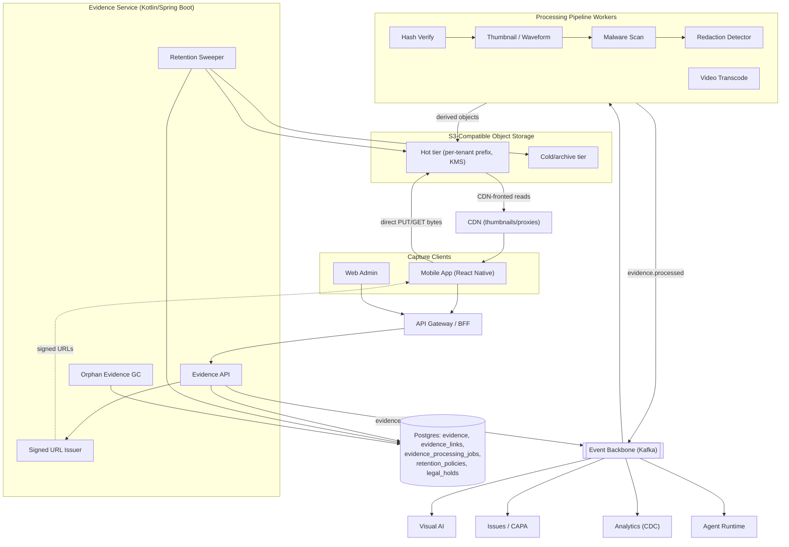
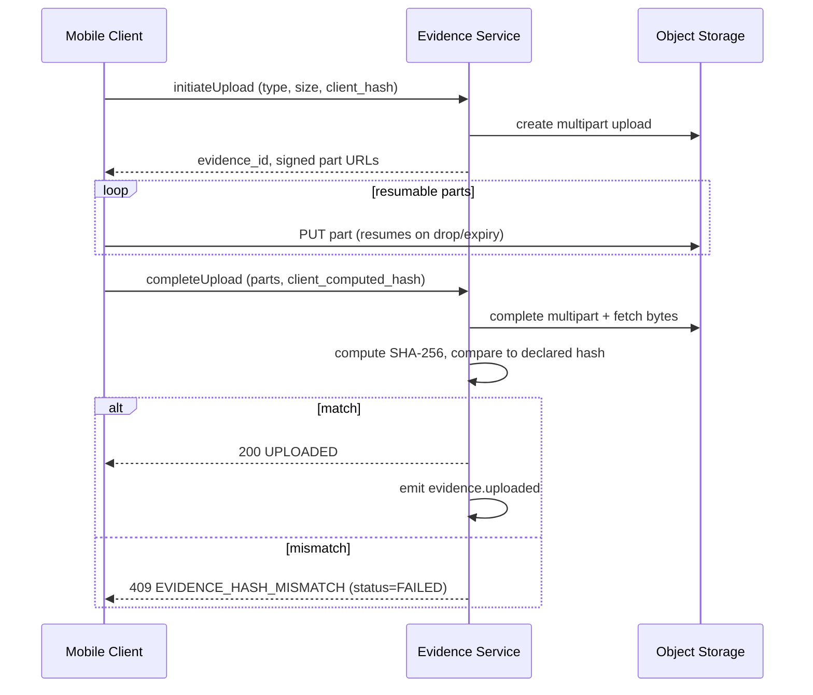
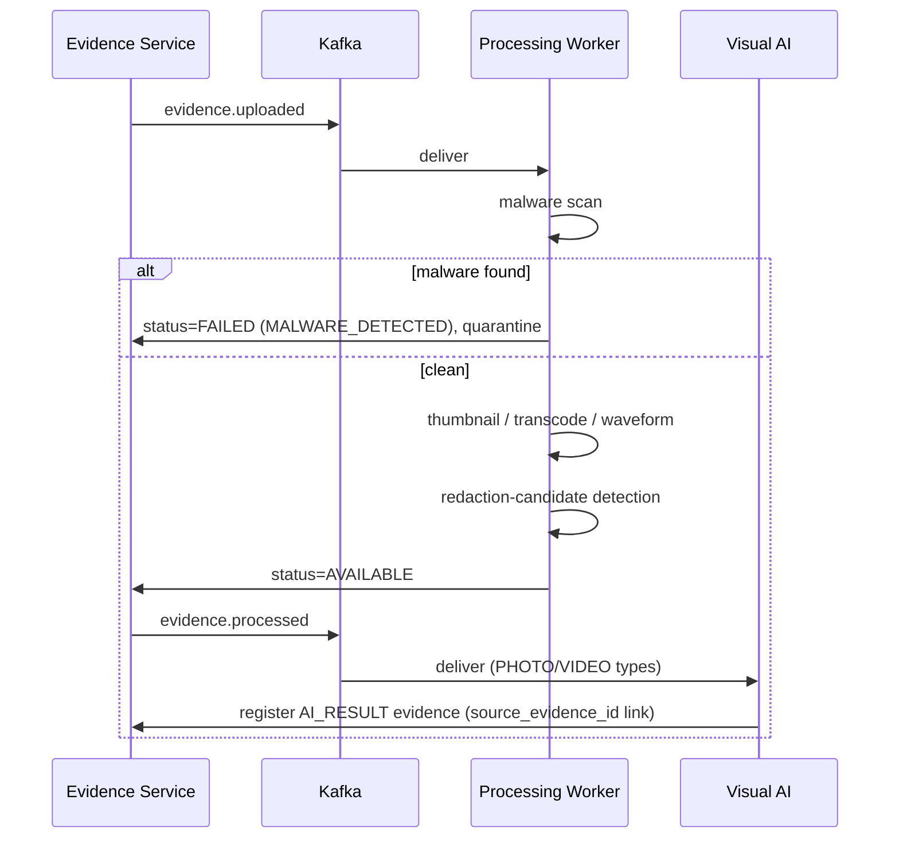
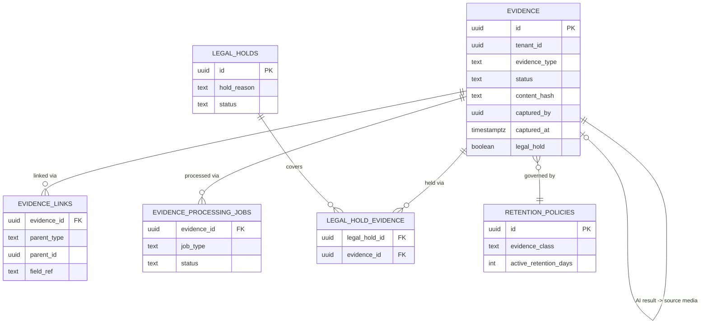
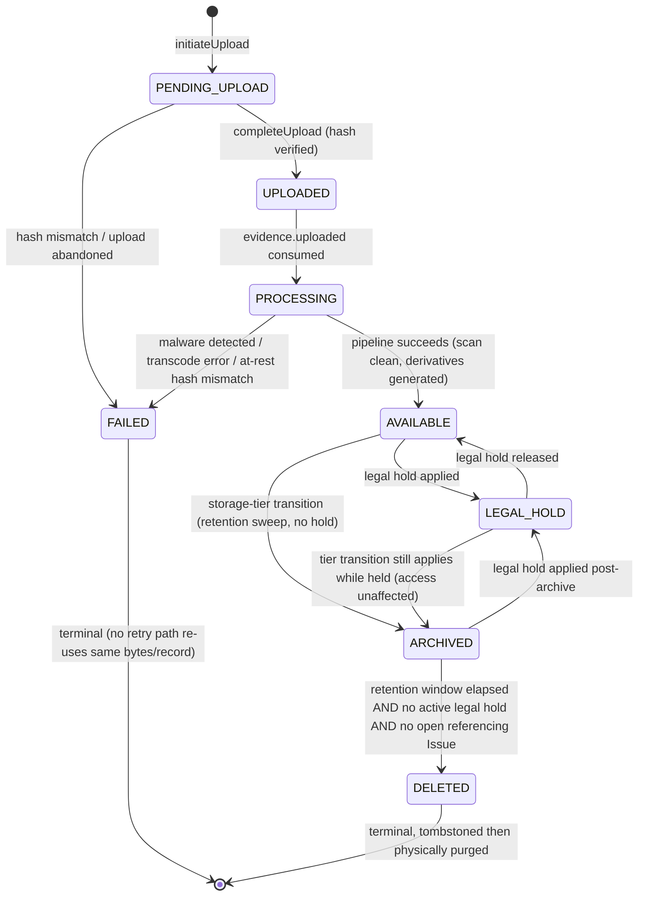

# Evidence Management — Architecture Diagrams

Module corresponds to **EPIC-06 (Evidence)**. Focused diagram set only; narrative detail lives in
`functional-spec.md`, `high-level-design.md`, and `low-level-design.md`.

## 1. Component / Container Diagram

The Evidence Service is a thin metadata + signed-access control plane; capture clients exchange
bytes directly with object storage, keeping the service's compute footprint independent of media
volume. The processing pipeline is a set of independently scalable, event-driven workers reacting
to `evidence.uploaded`, writing derived objects back to storage and publishing `evidence.processed`
for downstream consumers (Visual AI, Issues/CAPA, Analytics, Agent Runtime) to react to
asynchronously. Two background jobs — the retention sweeper and the orphan-evidence garbage
collector — operate directly against Postgres and object storage on a schedule, independent of the
request path.

## 2. Sequence Diagram — Upload (Resumable Multipart with Hash Verification)

Hash verification happens server-side immediately at upload-complete, not deferred to the
processing pipeline, so tamper/corruption during transit is caught before the record is ever
considered `UPLOADED`. Resumability means a dropped connection mid-upload never forces a
from-scratch re-capture — a core requirement given intermittent frontline connectivity.

## 3. Sequence Diagram — Processing Pipeline

The pipeline is a strict linear gate per object (scan → derive → flag) before an evidence item
becomes `AVAILABLE`; a malware hit is a hard stop that never reaches downstream consumers. Visual
AI consumes `evidence.processed` asynchronously and writes its result back as its own linked
`Evidence` row rather than mutating the source media record.

## 4. ER Diagram — Owned Entities

`Evidence` is the aggregate root; `evidence_links` is deliberately polymorphic (rather than three
separate FK columns) so a single evidence item can be referenced by a Submission and later
cross-referenced by an Issue without duplication. `retention_policies` and `legal_holds` are
tenant-level configuration/state that the retention sweeper joins against, not per-evidence data.

## 5. State Diagram — Evidence Lifecycle

This mirrors the platform Data Lifecycle in source-spec §21.4 (CREATE → ACTIVE → ARCHIVED →
RETENTION HOLD (optional) → DELETE/DESTROY), specialized for Evidence: `PENDING_UPLOAD`/`UPLOADED`/
`PROCESSING` are Evidence-specific pre-`ACTIVE` sub-states leading to `AVAILABLE` (the "ACTIVE"
equivalent), `LEGAL_HOLD` is the "RETENTION HOLD" state and can be entered from either `AVAILABLE`
or `ARCHIVED`, and deletion is only reachable when both the retention window has elapsed and no
hold or open referencing Issue blocks it (low-level-design.md §4.2).
