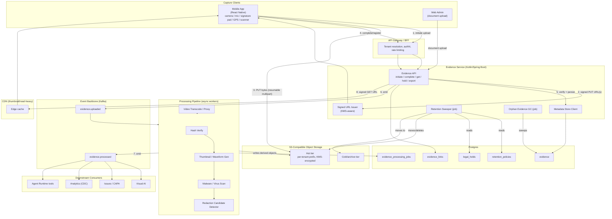

# Evidence Management — High-Level Design

Module corresponds to **EPIC-06 (Evidence)**. Implements the `Evidence Service` row of the Core
Technical Components table (source-spec §16.3: "Metadata and signed access to media | Hashing,
encryption, retention").

## 1. Module Responsibilities and Boundaries

The **Evidence Service** is a metadata and signed-access **control plane**. It:

- Owns the `Evidence`, `evidence_links`, `evidence_processing_jobs`, `retention_policies`, and
  `legal_holds` tables in Postgres (see low-level-design.md §1).
- Issues and validates signed URLs for reading and writing evidence bytes.
- Orchestrates (but does not itself execute the heavy lifting of) the processing pipeline:
  hashing, thumbnailing, transcoding, malware scanning, redaction-candidate detection.
- Enforces retention policy and legal hold as the deletion authority for evidence bytes and
  metadata.
- Emits `evidence.uploaded` and `evidence.processed` domain events for downstream consumers.

It explicitly does **not**:

- Store raw media bytes itself — those live in S3-compatible object storage per conventions.md,
  addressed by object key, never inline in Postgres.
- Interpret evidence content (compliance scoring, violation detection) — that is Visual AI's job;
  Evidence Service treats an `AI verification result` as an opaque structured payload to store and
  link.
- Own the mobile-side capture UI or local upload queue — that is Mobile/Offline's job; Evidence
  Service is the server-side counterpart the mobile client's upload queue talks to.
- Decide which form fields require evidence — that is Forms' job.

## 2. Component Diagram

## 3. Data Ownership

| Entity | Owned here? | Notes |
|---|---|---|
| `Evidence` (metadata: type, hash, chain-of-custody, lifecycle state, object key) | **Owned** | Postgres row; the canonical `Evidence` entity from source-spec §17.1 |
| `evidence_links` (polymorphic Submission/WorkItem/Issue association) | **Owned** | |
| `evidence_processing_jobs` | **Owned** | Internal to this module's pipeline orchestration |
| `retention_policies`, `legal_holds` | **Owned** | Tenant-configured, enforced here |
| Raw evidence bytes | **Not owned as data model** — hosted in object storage | Evidence Service holds the object key + KMS reference, not the bytes |
| `Submission`, `WorkItem`, `Issue` | **Referenced, not owned** | Form Service / Work Service / Issue Service own these; Evidence Service holds FK-style references via `evidence_links` |
| `AI verification result` content | **Owned as an Evidence sub-record** | The structured payload is stored as evidence (FR-EVD-010); its *production* (model inference) is owned by Visual AI |
| `AuditLog` entries for evidence access/mutation | **Written here, owned by shared platform Audit service** | Evidence Service is a writer, not the system of record for the audit trail itself |

## 4. External Interfaces

**Events produced:**

| Event | When | Consumers |
|---|---|---|
| `evidence.uploaded` | Upload-complete verified, `PENDING_UPLOAD → UPLOADED` | Processing pipeline (internal trigger) |
| `evidence.processed` | Processing pipeline reaches `AVAILABLE` or `FAILED` | Visual AI, Issues/CAPA, Analytics CDC, Agent Runtime |
| `evidence.legal_hold_applied` / `evidence.legal_hold_released` | Legal hold state change | Analytics, Audit |
| `evidence.retention_deleted` | Retention sweep purges an object | Analytics, Audit |

All follow the canonical event envelope (source-spec §18.4): `event_id`, `event_type`, `version`,
`tenant_id`, `occurred_at`, `actor_id`, `resource_id`, `trace_id`, `data`.

**APIs consumed:**

- Identity/Org Service — resolve `captured_by`/actor scope for authorization.
- Work Service / Form Service / Issue Service — validate parent existence when possible (best
  effort; offline-originated evidence may arrive before its parent, §7 FR-EVD-052).
- KMS — per-tenant data encryption keys for object storage encryption and signed URL signing.

**APIs produced:** see low-level-design.md §2 for the full REST surface (initiate upload, complete
upload, get evidence with signed read URL, apply/release legal hold, bulk export).

## 5. Scalability

- **Resumable multipart upload** for large video/document evidence: the client uploads parts
  directly to object storage against signed per-part URLs; a dropped connection resumes from the
  last acknowledged part rather than restarting, which is essential given source-spec §9
  (intermittent/unavailable connectivity is a normal operating mode, not an error state).
- **CDN for read-heavy thumbnail access:** thumbnails and low-res video proxies are cached at the
  edge (CDN in front of the object storage's public/signed-read path) since manager/executive
  Control Tower views generate high fan-out read traffic against a comparatively small, immutable
  set of derived objects. Full-resolution originals are not CDN-cached by default (larger, rarer
  reads, tighter access control needs).
- **Per-tenant storage tiering (hot/cold):** evidence transitions from hot (immediately-accessible,
  standard storage class) to cold/archive tier storage after a configurable inactivity window
  (default 90 days post-capture, before any retention-driven deletion), reducing storage cost for
  the long tail of rarely-accessed historical evidence while keeping it retrievable (with a higher
  read-latency budget, surfaced to the UI as an "archived — retrieving" state) for audits.
- **Horizontal scaling of the processing pipeline:** thumbnailing/transcoding/scanning workers are
  stateless consumers of `evidence.uploaded`, scaled independently per job type (video transcode is
  materially more CPU-intensive than photo thumbnailing and is isolated into its own worker pool /
  queue partition to avoid head-of-line blocking of cheap jobs behind expensive ones).
- **Metadata store scaling:** `evidence` table is the highest-cardinality table in the module
  (one row per captured item, potentially billions at scale per source-spec §23 target of millions
  of work items/day generating multiple evidence items each); partitioned by tenant bucket and
  time, per low-level-design.md §1.

## 6. Multi-Tenancy

- **Object storage:** every object key is prefixed `<tenant_prefix>/evidence/...` (conventions.md);
  no cross-tenant bucket sharing at the key level, and bucket policies additionally deny
  cross-prefix access as defense in depth.
- **KMS:** each tenant is provisioned its own KMS data key (or, for large/regulated enterprise
  tenants requiring dedicated isolation, a fully separate KMS key hierarchy), so a key compromise
  or legal data-destruction order for one tenant cannot affect another's evidence, and a tenant
  offboarding can be fully realized by destroying that tenant's key (crypto-shredding) rather than
  auditing every object individually.
- **Signed URLs** are minted per-request against the requesting principal's resolved tenant and
  never accept a client-supplied tenant override (conventions.md multi-tenancy rule).
- **Postgres:** `tenant_id` on every table + Row-Level Security policies as the defense-in-depth
  backstop behind application-layer scoping, per conventions.md.
- **Retention/legal-hold policy** is tenant-scoped configuration; a legal hold placed by Tenant A
  can never reference or affect Tenant B's evidence (enforced at the query layer, not just UI).

## 7. Failure Modes and Degradation

| Failure | Degradation strategy |
|---|---|
| Object storage outage (hot tier) | Evidence Service degrades to **metadata-read-only**: existing signed URLs already issued continue to work until expiry (client-cached), but new signed URL issuance for GET fails fast with a retryable error; new uploads queue client-side (Mobile/Offline's existing offline-tolerant queue absorbs this transparently) rather than failing hard. Circuit breaker trips on object-storage client after N consecutive failures to avoid cascading latency. |
| Partial/interrupted multipart upload | Uploaded parts persist server-side (object storage native multipart semantics); client resumes from last acknowledged part. Abandoned multipart uploads (client never completes) are garbage-collected by a lifecycle rule on the bucket after a configurable window (default 7 days) to avoid orphaned storage cost. |
| Virus/malware scan failure (scanner unavailable vs. scanner detects malware) | Distinguish the two: *scanner unavailable* retries with backoff and keeps the record in `PROCESSING` (bounded by an SLA timer that pages on-call if exceeded); *malware detected* immediately transitions to `FAILED` with reason `MALWARE_DETECTED`, blocks the object from ever reaching `AVAILABLE`, quarantines the object (moved to a restricted-access quarantine prefix, not deleted, for security forensics), and raises a security alert. |
| Processing pipeline worker crash mid-job | Jobs are tracked in `evidence_processing_jobs` with at-least-once delivery semantics from the event backbone; a crashed worker's job is retried by another worker instance. Idempotent job handlers (thumbnail generation keyed by evidence id + derived-object key) make retries safe. |
| KMS unavailable | Both upload (encrypt) and read (decrypt-via-signed-URL) paths degrade to hard failure with a clear `ENCRYPTION_UNAVAILABLE` error rather than falling back to unencrypted storage — encryption-at-rest is never bypassed. |
| Downstream consumer outage (e.g., Visual AI down) | `evidence.processed` events remain durably queued on the event backbone (Kafka retention + consumer offset) and are replayed once the consumer recovers; Evidence Service's own lifecycle (`AVAILABLE`) does not depend on downstream consumption succeeding. |
| Retention sweeper failure/crash | Sweep is idempotent and re-runs on its next scheduled window; a missed sweep window delays deletion (fail-safe direction — evidence over-retained briefly rather than incorrectly under-retained) and does not affect availability of existing evidence. |

## 8. Technology Choices (Justified)

- **Signed URLs over proxying bytes through application servers.** Evidence media (especially
  video) can be large relative to typical API payloads; proxying every read/write through the
  Evidence Service's application tier would make that tier's compute and network footprint scale
  with total evidence byte volume rather than with metadata-operation volume, defeating the
  point of separating a lightweight control plane from a bulk-storage data plane. Signed URLs let
  the client talk directly to (KMS-encrypted, per-tenant-scoped) object storage while the Evidence
  Service retains full authorization control over *when* and *for how long* that direct access is
  granted — matching the "Evidence Service = metadata + signed access control plane" responsibility
  split stated in source-spec §16.3.
- **Content-hash dedup.** Frontline capture workflows routinely produce retried uploads (network
  drop, app restart) of literally the same file, and some evidence (e.g., a standard permit
  document, a reused signature image scanned into multiple submissions) is legitimately
  byte-identical across records. Deduping at the content-hash layer avoids redundant storage cost
  and redundant processing-pipeline work (thumbnailing the same bytes twice) at scale (source-spec
  §23 targets millions of work items/day), while chain-of-custody metadata remains
  per-capture-event (not deduped) so provenance is never lost.
- **SHA-256 for content hashing.** Cryptographically strong, collision-resistant, and cheap enough
  to compute at mobile-device and server scale; matches the integrity/tamper-detection bar implied
  by source-spec's "evidence-first" principle (P4) and legal-hold/audit-export use cases where
  hash verification may need to withstand external scrutiny.
- **Kotlin/Spring Boot for the Evidence Service**, consistent with the platform-wide backend stack
  (conventions.md); gRPC for internal calls from Work/Form/Issue services that need to validate or
  fetch evidence references, REST behind the API Gateway for client-facing calls.
- **CDN in front of derived (thumbnail/proxy) objects only**, not originals — balances the
  read-heavy Control Tower access pattern against the tighter access-control and larger-payload
  characteristics of full-resolution originals, which are served via short-lived signed URLs
  instead.
