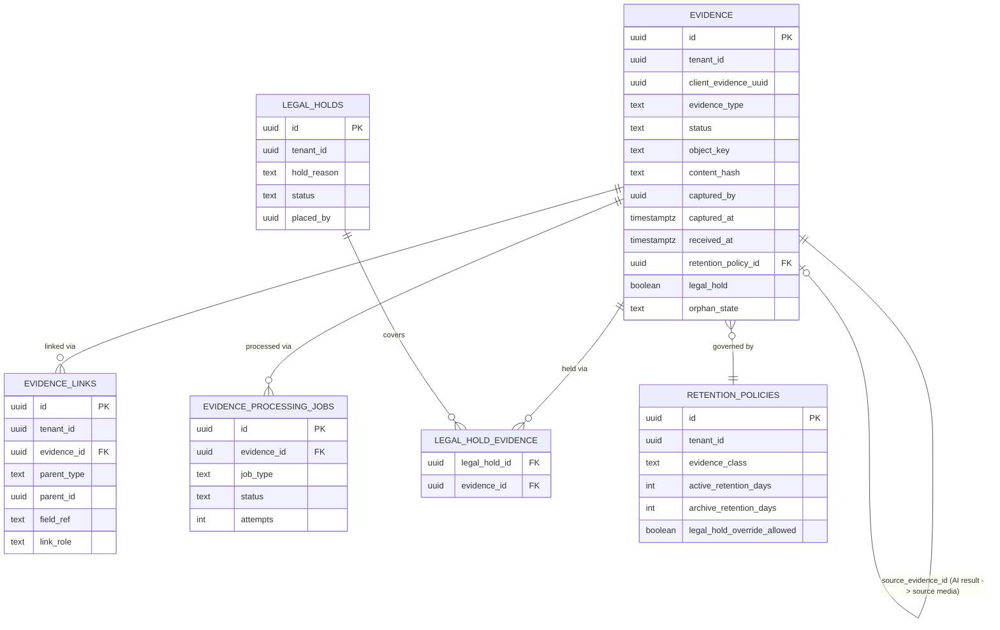

# Evidence Management — Low-Level Design

## 1. Postgres Schema

All tables carry `tenant_id` and are subject to Row-Level Security policies per conventions.md.
Primary keys are UUIDv7 (time-ordered) unless noted.

### 1.1 Tables

**evidence**

| Column | Type | Notes |
|---|---|---|
| id | uuid PK | |
| tenant_id | uuid | partition key component |
| tenant_id_bucket | smallint | generated: `hash(tenant_id) % 64` |
| client_evidence_uuid | uuid | client-generated idempotency key; unique per `(tenant_id, client_evidence_uuid)` |
| evidence_type | text | enum: `PHOTO, VIDEO, AUDIO, DOCUMENT, SIGNATURE, GPS, TIMESTAMP, DEVICE_METADATA, BARCODE_QR, AI_RESULT` |
| status | text | enum: `PENDING_UPLOAD, UPLOADED, PROCESSING, AVAILABLE, FAILED, ARCHIVED, DELETED` |
| object_key | text, nullable | object storage key; null until `PENDING_UPLOAD` allocates it |
| object_key_derived | jsonb | map of derived-object keys, e.g. `{"thumbnail": "...", "proxy_video": "...", "redacted": "..."}` |
| storage_tier | text | `HOT`, `COLD` |
| mime_type | text | |
| size_bytes | bigint, nullable | set at complete/register |
| content_hash | text, nullable | SHA-256 hex, write-once, set at verified upload-complete |
| client_declared_hash | text, nullable | as supplied by client at initiate/complete |
| dedup_of_evidence_id | uuid, nullable FK -> evidence | set when content-hash dedup applies (§6) |
| captured_by | uuid | user id |
| captured_at | timestamptz | client-reported |
| received_at | timestamptz | server-authoritative |
| device_id | uuid, nullable | Mobile/Offline device registration ref |
| app_version | text, nullable | |
| capture_location_lat | numeric(9,6), nullable | |
| capture_location_lon | numeric(9,6), nullable | |
| capture_location_accuracy_m | numeric(8,2), nullable | |
| location_source | text, nullable | `GPS, NETWORK, PASSIVE, UNAVAILABLE` |
| capture_payload | jsonb | type-specific fields (EXIF, barcode symbology/value, signature stroke ref, AI result payload, etc.) |
| source_evidence_id | uuid, nullable FK -> evidence | for `AI_RESULT`: the photo/video it was computed from |
| sensitive_flag | boolean, default false | redaction-candidate flag |
| sensitive_categories | text[], nullable | e.g. `{FACE, LICENSE_PLATE, PII_DOCUMENT}` |
| legal_hold | boolean, default false | denormalized for fast filtering; source of truth is `legal_holds` |
| retention_policy_id | uuid, nullable FK -> retention_policies | resolved at capture time |
| orphan_state | text, nullable | `NULL, PENDING_PARENT, ORPHAN_CANDIDATE, ORPHANED` |
| orphan_grace_expires_at | timestamptz, nullable | |
| late_evidence | boolean, default false | per FR-EVD-106 |
| failure_reason | text, nullable | e.g. `EVIDENCE_HASH_MISMATCH, MALWARE_DETECTED, TRANSCODE_ERROR` |
| version | bigint, default 0 | optimistic concurrency |
| created_at, updated_at | timestamptz | |
| deleted_at | timestamptz, nullable | tombstone marker |

Partitioned by LIST(`tenant_id_bucket`) then RANGE(`captured_at`) monthly sub-partitions.
Indexes: `(tenant_id, evidence_type, status)`, `(tenant_id, captured_by, captured_at desc)`,
`(client_evidence_uuid)` unique, `(content_hash)` non-unique (dedup lookup, scoped by tenant in
query), `(tenant_id, legal_hold) WHERE legal_hold`, `(tenant_id, orphan_state) WHERE orphan_state
IS NOT NULL`, `(source_evidence_id)`.

**evidence_links** (polymorphic association)

| Column | Type | Notes |
|---|---|---|
| id | uuid PK | |
| tenant_id | uuid | |
| evidence_id | uuid FK -> evidence | |
| parent_type | text | `SUBMISSION, WORK_ITEM, ISSUE` |
| parent_id | uuid | not an enforced cross-service FK (owned by Form/Work/Issue services) |
| field_ref | text, nullable | template field/question id |
| link_role | text | `PRIMARY, SECONDARY` |
| linked_at | timestamptz | |
| linked_by | uuid, nullable | null for system-linked (e.g., auto Issue cross-reference) |

Unique `(evidence_id, parent_type, parent_id, field_ref)`. Index `(tenant_id, parent_type,
parent_id)` for "get all evidence for this submission/work item/issue" — the dominant read pattern.
Exactly one `PRIMARY` row per `evidence_id` enforced via a partial unique index
`(evidence_id) WHERE link_role = 'PRIMARY'`.

**evidence_processing_jobs**

| Column | Type | Notes |
|---|---|---|
| id | uuid PK | |
| tenant_id | uuid | |
| evidence_id | uuid FK -> evidence | |
| job_type | text | `HASH_VERIFY, THUMBNAIL, TRANSCODE, WAVEFORM, MALWARE_SCAN, REDACTION_DETECT, PDF_EXTRACT` |
| status | text | `QUEUED, RUNNING, SUCCEEDED, FAILED, RETRYING` |
| attempts | int, default 0 | |
| max_attempts | int, default 5 | |
| last_error | text, nullable | |
| started_at, completed_at | timestamptz, nullable | |
| result_payload | jsonb, nullable | e.g. `{derived_key, duration_ms}` |
| created_at, updated_at | timestamptz | |

Index `(tenant_id, evidence_id, job_type)`, `(status, created_at) WHERE status IN ('QUEUED',
'RETRYING')` (worker poll queue if not using pure Kafka-consumer-group dispatch).

**retention_policies**

| Column | Type | Notes |
|---|---|---|
| id | uuid PK | |
| tenant_id | uuid, nullable | null = system default |
| evidence_class | text | tenant-defined class name, e.g. `FOOD_SAFETY_PHOTOS` |
| evidence_type_match | text[], nullable | evidence_type values this class applies to |
| template_id_match | uuid[], nullable | optional narrowing by template |
| active_retention_days | int | hot-tier window |
| archive_retention_days | int, nullable | cold-tier window after active; null = retain indefinitely |
| legal_hold_override_allowed | boolean, default true | whether legal hold can suspend deletion for this class |
| storage_tier_transition_days | int, default 90 | hot -> cold transition |
| active | boolean, default true | |
| created_at, updated_at | timestamptz | |

Index `(tenant_id, active)`.

**legal_holds**

| Column | Type | Notes |
|---|---|---|
| id | uuid PK | |
| tenant_id | uuid | |
| hold_reason | text | |
| case_reference | text, nullable | |
| filter_criteria | jsonb | filter used to select evidence (date range, location, evidence class, related object ids) |
| placed_by | uuid | |
| placed_at | timestamptz | |
| released_by | uuid, nullable | |
| released_at | timestamptz, nullable | |
| status | text | `ACTIVE, RELEASED` |

**legal_hold_evidence** (materialized membership, since `filter_criteria` is evaluated once at
placement time for auditability rather than re-evaluated dynamically)

| Column | Type | Notes |
|---|---|---|
| legal_hold_id | uuid FK -> legal_holds | |
| evidence_id | uuid FK -> evidence | |
| added_at | timestamptz | |

Composite PK `(legal_hold_id, evidence_id)`. Index `(evidence_id)` for the retention sweeper's
per-evidence legal-hold check.

### 1.2 ER Diagram



## 2. REST Endpoints

Base path `/api/v1/evidence` per conventions.md. All mutation endpoints require `Idempotency-Key`
where retries are possible; all responses on error use the standard envelope
`{ "error": { "code", "message", "trace_id" } }`.

### 2.1 Initiate Upload — `POST /api/v1/evidence:initiateUpload`

Request:
```json
{
  "client_evidence_uuid": "5b1e...-uuid",
  "evidence_type": "PHOTO",
  "mime_type": "image/jpeg",
  "declared_size_bytes": 4213890,
  "client_declared_hash": "e3b0c4...sha256",
  "parent": { "parent_type": "SUBMISSION", "parent_id": "sub-uuid", "field_ref": "q_freezer_photo" },
  "capture": {
    "captured_at": "2026-09-19T14:02:11.000Z",
    "device_id": "device-abc",
    "app_version": "4.2.0",
    "location": { "lat": 37.7749, "lon": -122.4194, "accuracy_m": 8.0, "source": "GPS" }
  }
}
```

Response `201 Created`:
```json
{
  "evidence_id": "ev-uuid",
  "status": "PENDING_UPLOAD",
  "upload": {
    "mode": "MULTIPART",
    "parts": [
      { "part_number": 1, "signed_url": "https://...&X-Amz-Signature=...", "expires_at": "2026-09-19T15:02:11Z" }
    ],
    "upload_id": "s3-multipart-upload-id"
  }
}
```
For objects under the multipart threshold, `mode: "SINGLE"` with one `signed_url` for a PUT.

Errors: `400 VALIDATION_ERROR` (unknown evidence_type/mime_type), `409 EVIDENCE_QUOTA_EXCEEDED`,
`404 PARENT_NOT_FOUND` (only when parent existence check is possible and required — offline
capture allows deferred parent resolution, see §2.2 note).

### 2.2 Complete Upload / Register — `POST /api/v1/evidence/{evidence_id}:completeUpload`

Request:
```json
{
  "upload_id": "s3-multipart-upload-id",
  "parts": [ { "part_number": 1, "etag": "\"9bb58f...\"" } ],
  "client_computed_hash": "e3b0c4...sha256"
}
```

Response `200 OK`:
```json
{
  "evidence_id": "ev-uuid",
  "status": "UPLOADED",
  "content_hash": "e3b0c4...sha256",
  "size_bytes": 4213890,
  "dedup_of_evidence_id": null
}
```

Idempotent: a retried call with the same `evidence_id` + `Idempotency-Key` after a prior success
returns the same `200` body without reprocessing (FR-EVD-033). Errors: `409
EVIDENCE_HASH_MISMATCH` (transitions record to `FAILED`), `409 UPLOAD_INCOMPLETE` (parts manifest
doesn't match object storage state), `410 UPLOAD_EXPIRED` (signed URLs expired before completion —
client must re-initiate remaining parts).

### 2.3 Get Evidence (with signed read URL) — `GET /api/v1/evidence/{evidence_id}`

Response `200 OK`:
```json
{
  "evidence_id": "ev-uuid",
  "evidence_type": "PHOTO",
  "status": "AVAILABLE",
  "content_hash": "e3b0c4...sha256",
  "captured_by": "user-uuid",
  "captured_at": "2026-09-19T14:02:11.000Z",
  "received_at": "2026-09-19T14:02:14.221Z",
  "device_id": "device-abc",
  "app_version": "4.2.0",
  "location": { "lat": 37.7749, "lon": -122.4194, "accuracy_m": 8.0, "source": "GPS" },
  "legal_hold": false,
  "sensitive_flag": false,
  "links": [ { "parent_type": "SUBMISSION", "parent_id": "sub-uuid", "field_ref": "q_freezer_photo", "link_role": "PRIMARY" } ],
  "access": {
    "raw_url": "https://cdn.example/signed?...expires=...",
    "raw_url_expires_at": "2026-09-19T14:20:00Z",
    "thumbnail_url": "https://cdn.example/thumb/signed?...",
    "thumbnail_url_expires_at": "2026-09-20T14:00:00Z"
  }
}
```
`raw_url` is omitted (only `redacted_url` present) for a caller lacking the "view unredacted
evidence" grant on `sensitive_flag = true` evidence (FR-EVD-081). Errors: `404
EVIDENCE_NOT_FOUND`, `403 SCOPE_DENIED`.

### 2.4 Apply Legal Hold — `POST /api/v1/evidence/legal-holds`

Request:
```json
{
  "hold_reason": "Litigation Hold — Case 2026-114",
  "case_reference": "CASE-2026-114",
  "filter_criteria": {
    "date_range": { "from": "2026-06-01", "to": "2026-09-01" },
    "location_ids": ["loc-uuid-1"],
    "evidence_classes": ["FOOD_SAFETY_PHOTOS"]
  }
}
```

Response `201 Created`:
```json
{ "legal_hold_id": "hold-uuid", "status": "ACTIVE", "matched_evidence_count": 1842 }
```
`DELETE /api/v1/evidence/legal-holds/{legal_hold_id}` releases the hold (requires equal/higher
role than placement, FR-EVD-071); returns `200 OK` with `{ "status": "RELEASED" }`. Attempting to
delete/force-purge evidence under an active hold via the admin delete endpoint returns `409
Conflict` with `{ "error": { "code": "EVIDENCE_UNDER_LEGAL_HOLD", ... } }`.

### 2.5 Bulk Export for Audit — `POST /api/v1/evidence:bulkExport`

Request:
```json
{
  "filter_criteria": { "legal_hold_id": "hold-uuid" },
  "include_raw": true,
  "format": "MANIFEST_ZIP"
}
```

Response `202 Accepted`:
```json
{ "export_job_id": "exp-uuid", "status": "QUEUED" }
```
Poll `GET /api/v1/evidence/exports/{export_job_id}`:
```json
{
  "export_job_id": "exp-uuid",
  "status": "COMPLETED",
  "item_count": 1842,
  "download_url": "https://cdn.example/exports/signed?...",
  "download_url_expires_at": "2026-09-26T00:00:00Z",
  "manifest_summary": { "total_size_bytes": 48213890123 }
}
```

## 3. Sequence Diagrams

### 3.1 Mobile Resumable Multipart Upload with Hash Verification

```mermaid
sequenceDiagram
    participant M as Mobile Client
    participant GW as API Gateway
    participant ES as Evidence Service
    participant OS as Object Storage

    M->>GW: POST /evidence:initiateUpload (evidence_type=VIDEO, size, client_hash)
    GW->>ES: forward (tenant resolved)
    ES->>ES: create evidence row (PENDING_UPLOAD), allocate object_key
    ES->>OS: create multipart upload
    OS-->>ES: upload_id
    ES-->>M: evidence_id, upload_id, signed part URLs
    loop each part (resumable)
        M->>OS: PUT part bytes (signed URL)
        OS-->>M: ETag
        Note over M: network drop can occur here; client retries this part<br/>or requests a fresh signed URL if expired, without restarting
    end
    M->>GW: POST /evidence/{id}:completeUpload (parts[], client_computed_hash)
    GW->>ES: forward
    ES->>OS: complete multipart upload
    OS-->>ES: object confirmed, size
    ES->>OS: (async or inline) compute/verify SHA-256 over assembled object
    alt hash matches
        ES->>ES: evidence.content_hash = hash; status = UPLOADED
        ES-->>M: 200 { status: UPLOADED, content_hash }
        ES->>ES: emit evidence.uploaded
    else hash mismatch
        ES->>ES: status = FAILED, failure_reason = EVIDENCE_HASH_MISMATCH
        ES-->>M: 409 EVIDENCE_HASH_MISMATCH
    end
```

### 3.2 Evidence Processing Pipeline (thumbnail/transcode/AI-handoff)

```mermaid
sequenceDiagram
    participant ES as Evidence Service
    participant EB as Event Backbone (Kafka)
    participant W as Processing Worker(s)
    participant OS as Object Storage
    participant VA as Visual AI

    ES->>EB: publish evidence.uploaded {evidence_id, evidence_type}
    EB->>W: deliver (consumer group: processing-pipeline)
    W->>ES: create evidence_processing_jobs rows (HASH_VERIFY done, THUMBNAIL, MALWARE_SCAN, ...)
    W->>OS: fetch object bytes / stream
    W->>W: run malware scan
    alt malware detected
        W->>ES: status=FAILED, failure_reason=MALWARE_DETECTED; quarantine object
        W->>EB: publish evidence.processed {status: FAILED}
    else clean
        W->>W: generate thumbnail / waveform / proxy video
        W->>OS: write derived object(s)
        W->>W: run redaction-candidate detector
        opt sensitive content detected
            W->>OS: write redacted derived object
            W->>ES: sensitive_flag=true, sensitive_categories=[...]
        end
        W->>ES: status = AVAILABLE; object_key_derived updated
        ES->>EB: publish evidence.processed {status: AVAILABLE}
        EB->>VA: deliver (Visual AI consumer group, for PHOTO/VIDEO types)
        VA->>ES: POST evidence:initiateUpload (evidence_type=AI_RESULT, source_evidence_id=...)
        Note over VA,ES: AI result registered as its own linked Evidence record (FR-EVD-010)
    end
```

### 3.3 Legal Hold Blocking Retention Deletion

```mermaid
sequenceDiagram
    participant Admin as Compliance Admin
    participant ES as Evidence Service
    participant DB as Postgres
    participant Sweep as Retention Sweeper (job)
    participant OS as Object Storage

    Admin->>ES: POST /evidence/legal-holds {filter_criteria}
    ES->>DB: evaluate filter -> matching evidence set
    ES->>DB: insert legal_holds row (status=ACTIVE)
    ES->>DB: insert legal_hold_evidence rows (materialized membership)
    ES->>DB: update evidence.legal_hold = true for matched set
    ES-->>Admin: 201 { legal_hold_id, matched_evidence_count }

    Note over Sweep: scheduled run (e.g. nightly)
    Sweep->>DB: select evidence past retention_policy window
    loop each candidate
        Sweep->>DB: check legal_hold_evidence for this evidence_id
        alt under active legal hold
            Sweep->>Sweep: skip; log skip reason
        else no hold, or referencing Issue still open
            Sweep->>OS: delete object (or move to cold tier if only tier-transition due)
            Sweep->>DB: evidence.status = DELETED, deleted_at = now(), tombstone
            Sweep->>EB: publish evidence.retention_deleted
        end
    end
```

## 4. Algorithms / Pseudocode

### 4.1 Content-Hash Computation and Dedup Check

```
function completeUpload(tenantId, evidenceId, parts, clientComputedHash, idempotencyKey):
    # idempotency guard
    if exists(processedRequest(tenantId, evidenceId, idempotencyKey)):
        return cachedResponse(tenantId, evidenceId, idempotencyKey)

    evidence = loadEvidence(tenantId, evidenceId)
    assert evidence.status == PENDING_UPLOAD

    objectStorage.completeMultipartUpload(evidence.object_key, parts)
    assembled = objectStorage.stat(evidence.object_key)   # size, existence check

    serverHash = sha256_stream(objectStorage.openReadStream(evidence.object_key))

    if evidence.client_declared_hash is not null and serverHash != evidence.client_declared_hash:
        evidence.status = FAILED
        evidence.failure_reason = "EVIDENCE_HASH_MISMATCH"
        save(evidence)
        return error(409, "EVIDENCE_HASH_MISMATCH")

    if clientComputedHash is not null and serverHash != clientComputedHash:
        evidence.status = FAILED
        evidence.failure_reason = "EVIDENCE_HASH_MISMATCH"
        save(evidence)
        return error(409, "EVIDENCE_HASH_MISMATCH")

    existing = findByTenantAndContentHash(tenantId, serverHash, excludeId=evidenceId)

    if existing is not null and existing.status in (UPLOADED, PROCESSING, AVAILABLE):
        # dedup: point this evidence row at the existing object, don't keep duplicate bytes
        objectStorage.delete(evidence.object_key)          # discard the just-uploaded duplicate copy
        evidence.object_key = existing.object_key
        evidence.dedup_of_evidence_id = existing.id
        evidence.content_hash = serverHash
        evidence.size_bytes = assembled.size
        evidence.status = existing.status                   # inherit current pipeline state
        evidence.object_key_derived = existing.object_key_derived  # reuse derived objects too
    else:
        evidence.content_hash = serverHash
        evidence.size_bytes = assembled.size
        evidence.status = UPLOADED

    save(evidence)
    recordIdempotentResponse(tenantId, evidenceId, idempotencyKey, response)

    if evidence.status == UPLOADED:
        eventBackbone.publish("evidence.uploaded", envelope(evidence))
    elif evidence.dedup_of_evidence_id is not null and evidence.status == AVAILABLE:
        # already processed via the original; still notify link consumers directly
        eventBackbone.publish("evidence.processed", envelope(evidence))

    return success(evidence)
```

Note: hash recomputation for large video (§14 NFR) is offloaded to an async worker rather than
performed inline when `size_bytes` exceeds the inline-verification threshold (25MB); in that case
`completeUpload` transitions to `UPLOADED` optimistically and the async `HASH_VERIFY` job performs
the same comparison, transitioning to `FAILED` retroactively (and rolling back any
already-emitted `evidence.uploaded` consumption side effects via a compensating
`evidence.processed{status:FAILED}` event) on mismatch.

### 4.2 Retention Sweep Job (Respecting Legal Holds)

```
function retentionSweep(tenantId):
    policies = loadActiveRetentionPolicies(tenantId)

    for policy in policies:
        candidates = queryEvidence(
            tenantId = tenantId,
            evidenceClassMatches = policy,
            status in (AVAILABLE, ARCHIVED),
            legal_hold = false                      # cheap first-pass filter using denormalized flag
        )

        for evidence in candidates:
            # re-check authoritative hold membership (denormalized flag is fast-path only)
            if legalHoldEvidenceExists(evidence.id):
                continue   # skip; do not deceive ourselves with a stale denormalized flag

            # skip if any referencing parent still requires retention
            for link in getPrimaryAndSecondaryLinks(evidence.id):
                if link.parent_type == "ISSUE" and issueService.getStatus(link.parent_id) != "CLOSED":
                    continue to next evidence   # open Issue keeps evidence alive regardless of policy age
                if link.parent_type in ("SUBMISSION", "WORK_ITEM") and parentStillWithinOwnRetention(link):
                    continue to next evidence

            age_days = daysSince(evidence.captured_at)

            if age_days >= policy.storage_tier_transition_days and evidence.storage_tier == "HOT":
                objectStorage.moveToArchiveTier(evidence.object_key)
                evidence.storage_tier = "COLD"
                evidence.status = ARCHIVED
                save(evidence)
                continue   # tier transition this cycle; deletion evaluated in a future cycle

            total_retention_days = policy.active_retention_days + (policy.archive_retention_days or INFINITY)

            if age_days >= total_retention_days:
                objectStorage.delete(evidence.object_key)
                if evidence.object_key_derived:
                    objectStorage.deleteAll(evidence.object_key_derived.values())
                evidence.status = DELETED
                evidence.deleted_at = now()
                save(evidence)                      # tombstone retained per §19.4 tombstone convention
                eventBackbone.publish("evidence.retention_deleted", envelope(evidence))

    logSweepSummary(tenantId, candidatesEvaluated, tierTransitioned, deleted, skippedForHold)
```

Design notes:
- The denormalized `evidence.legal_hold` boolean is a fast pre-filter only; the authoritative
  check is always against `legal_hold_evidence` to avoid deleting evidence if the denormalized
  flag was ever stale due to a bug or race — deletion is the one irreversible action in this
  module, so it never trusts a cache-like field alone.
- Sweep is idempotent: re-running it on already-deleted or already-archived evidence is a no-op
  (status guard in the query).
- Sweep runs per-tenant (or per-tenant-bucket in a batched scheduler) so one tenant's large backlog
  cannot starve another tenant's sweep window.

## 5. Caching

- **Thumbnail/CDN cache:** derived thumbnail and low-res video proxy objects are cached at the CDN
  edge with a long TTL (default 24h, matching the read signed-URL expiry for thumbnails, §11 FSD);
  cache keys are the object key (immutable once generated) so no explicit invalidation is needed —
  a re-generated thumbnail (e.g., after a redaction update) is written to a new derived key rather
  than overwriting in place.
- **Signed-URL issuance is not cached** server-side (each GET call mints a fresh short-lived URL);
  the *evidence metadata* response backing that call may be cached in Redis for a few seconds
  (bounded by the shortest field's practical staleness tolerance) to absorb read bursts on
  popular evidence (e.g., a widely-viewed audit photo) without re-querying Postgres per request.
- **Retention policy lookup** (resolving which policy applies to a newly captured evidence item) is
  cached in Redis per tenant, invalidated on policy write, since it is read on every
  `initiateUpload` call and changes infrequently.

## 6. Concurrency Control

- **Idempotent upload-complete on retry:** enforced via the `Idempotency-Key` header
  (conventions.md) recorded against `(tenant_id, evidence_id, idempotency_key)`; a retried request
  with the same key returns the cached prior response rather than re-running verification/dedup
  logic (§4.1).
- **Optimistic concurrency** on `evidence.version` for any admin-driven metadata mutation (e.g.,
  manual redaction override, correction annotation) — conflicting concurrent writes return `409
  Conflict` with the standard `conflict` payload per conventions.md; chain-of-custody core fields
  themselves are write-once and never subject to this path (FR-EVD-021).
- **Legal hold placement** is a two-phase write (evaluate filter → materialize membership rows →
  flip denormalized flags) wrapped in a single DB transaction per batch chunk (chunked for very
  large matched sets, e.g., 5,000 rows per transaction) to avoid long-held locks while still
  ensuring no evidence is left half-flagged if the process crashes mid-batch (resumable by
  re-running the same filter — placement is idempotent on `(legal_hold_id, evidence_id)`).

## 7. Background Jobs and Workers

| Job | Trigger | Notes |
|---|---|---|
| Retention Sweeper | Scheduled (default: nightly per tenant, staggered) | Pseudocode §4.2. SLA: every eligible record actioned within 24h of crossing its boundary (FSD §14 NFR). |
| Processing Pipeline Workers (thumbnail, transcode, waveform, malware scan, redaction detect) | Event-driven (`evidence.uploaded`) | Separate worker pools per job type per high-level-design.md §5; each job type retried up to `max_attempts` with exponential backoff before landing in a dead-letter queue for manual triage. |
| Orphan-Evidence Garbage Collector | Scheduled (default: hourly) | Sweeps `evidence.orphan_state = ORPHAN_CANDIDATE` rows past `orphan_grace_expires_at` (FR-EVD-101); transitions to `ORPHANED` and applies the tenant's default (usually shortest) retention policy rather than immediate deletion, to allow a final manual recovery window. |
| Abandoned Multipart Upload Cleanup | Object-storage native lifecycle rule + periodic reconciliation job | Removes storage-side multipart fragments for uploads never completed within 7 days; reconciliation job also flags corresponding `evidence` rows stuck in `PENDING_UPLOAD` past a threshold as `FAILED (UPLOAD_ABANDONED)`. |
| Integrity Audit Sampler | Scheduled (default: weekly, sampled) | Re-fetches a statistically sampled subset of `AVAILABLE`/`ARCHIVED` evidence, recomputes hash, compares to `content_hash` per FR-EVD-042; raises SEV-1 on mismatch. |
| Storage Tier Transition | Part of Retention Sweeper pass (§4.2) | Could be split into its own job at higher evidence volumes; combined in MVP for operational simplicity. |

## 8. Error Handling

| Error Code | HTTP Status | Condition | Client Guidance |
|---|---|---|---|
| `VALIDATION_ERROR` | 400 | Malformed initiate/complete request (unknown evidence_type, missing required capture fields) | Fix request; not retryable as-is |
| `EVIDENCE_QUOTA_EXCEEDED` | 409 | Tenant storage quota hit at initiate time | Surface to admin; block new uploads for tenant |
| `PARENT_NOT_FOUND` | 404 | Parent Submission/WorkItem/Issue doesn't exist and deferred resolution isn't applicable to this call context | Retry after parent sync, or use deferred-link path (mobile offline default) |
| `EVIDENCE_HASH_MISMATCH` | 409 | Server-computed hash != client-declared/computed hash | Non-retryable for the same bytes; re-capture and re-upload required |
| `UPLOAD_INCOMPLETE` | 409 | Parts manifest doesn't reconcile with object storage state | Client re-fetches part status and resubmits complete-call with corrected manifest |
| `UPLOAD_EXPIRED` | 410 | Signed URL(s) expired before completion | Re-initiate remaining parts (new signed URLs), do not restart from scratch |
| `EVIDENCE_UNDER_LEGAL_HOLD` | 409 | Attempt to force-delete/purge evidence under active hold | Not overridable via API; requires hold release by authorized role first |
| `EVIDENCE_NOT_FOUND` | 404 | Unknown or tombstoned evidence id | Non-retryable |
| `SCOPE_DENIED` | 403 | Principal lacks scope/permission (incl. raw-access grant for sensitive evidence) | Non-retryable without permission change |
| `MALWARE_DETECTED` | — (async, surfaced via evidence.status=FAILED + event) | Document/file scan flags malware | Non-retryable; original file rejected; user notified to investigate source file |
| `ENCRYPTION_UNAVAILABLE` | 503 | KMS unavailable at upload or read time | Retryable with backoff; never falls back to unencrypted path |
| `IDEMPOTENCY_KEY_REUSE_CONFLICT` | 409 | Same Idempotency-Key reused with a materially different request body | Client bug; use a fresh key per logically distinct request |
