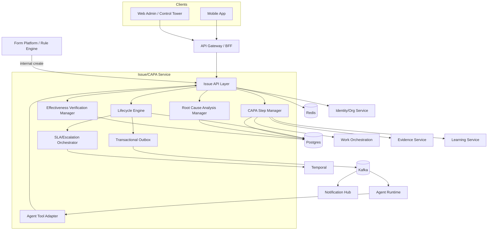
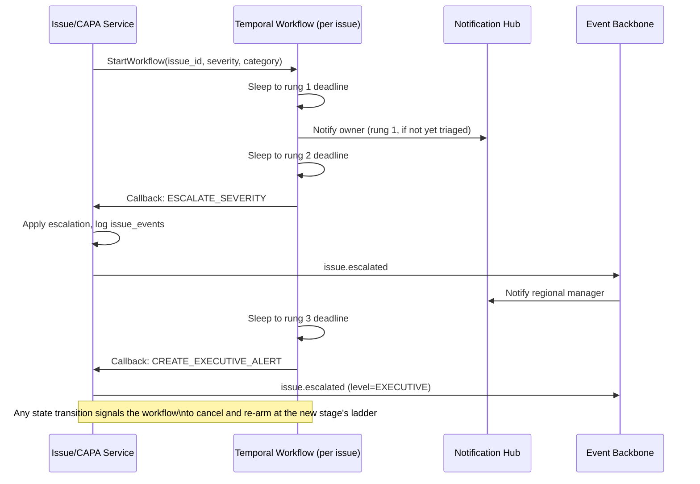
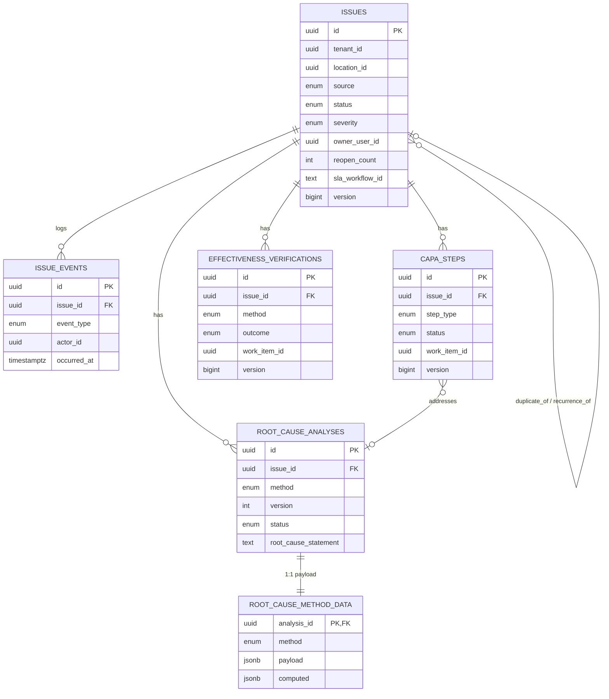
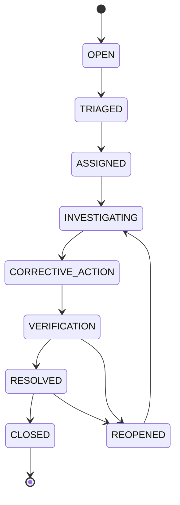

# Issues & CAPA — Architecture Diagrams

Corresponds to **EPIC-07**. Focused diagram set for this module only; narrative detail lives in
`functional-spec.md`, `high-level-design.md`, `low-level-design.md`.

## 1. Component / Container Diagram



Narration: The Issue/CAPA Service is a peer bounded context to Work Orchestration, with its own
Postgres tables and its own per-issue Temporal SLA workflow. It is reachable through the normal
gateway path (mobile/web), an internal service-to-service path from the Form Platform's rule engine
(rule-triggered creation), and a typed tool path from the Agent Runtime. The Lifecycle Engine is the
single writer of `issues.status`; every other component (CAPA, RCA, Verification managers) delegates
state-affecting writes back through it.

## 2. Sequence Diagram — Golden Scenario (Temperature Exception, Appendix A)

```mermaid
sequenceDiagram
    actor Assoc as Associate
    participant Form as Form Platform
    participant Capa as Issue/CAPA Service
    participant Agent as Compliance Monitor Agent
    participant Work as Work Orchestration
    participant Kafka as Event Backbone

    Assoc->>Form: Submit temperature reading (10.2C)
    Form->>Capa: create issue (rule TEMP-001, severity=HIGH)
    Capa->>Capa: OPEN -> TRIAGED (auto-triage)
    Capa->>Kafka: issue.created
    Kafka->>Agent: issue.created
    Agent->>Capa: get_recent_failures()
    Agent->>Capa: repeated failure detected -> escalate
    Capa->>Capa: severity HIGH -> CRITICAL; TRIAGED -> ASSIGNED -> INVESTIGATING
    Capa->>Kafka: issue.escalated
    Capa->>Work: create corrective-action WorkItem
    Assoc->>Capa: root cause analysis (FIVE_WHYS) completed
    Capa->>Capa: INVESTIGATING -> CORRECTIVE_ACTION
    Work->>Capa: task.completed
    Capa->>Capa: CORRECTIVE_ACTION -> VERIFICATION (schedule re-inspection)
    Work->>Capa: task.completed (re-inspection)
    Capa->>Capa: verification PASSED -> VERIFICATION -> RESOLVED
    Capa->>Kafka: issue.resolved
    Note over Capa: RESOLVED -> CLOSED (grace period elapses)
```

Narration: This condensed trace mirrors Appendix A end-to-end: a single temperature exception
becomes a triaged, escalated, agent-informed Issue that drives a real corrective-action WorkItem, a
completed root cause analysis, and a verified re-inspection before closing. Full detail (including
transactional boundaries and error paths) is in `low-level-design.md` §3.1.

## 3. Sequence Diagram — SLA Escalation Ladder via Temporal



Narration: One durable Temporal workflow per Issue drives the escalation ladder as a sequence of
timers; every effect (notification trigger, severity escalation, event emission) is a callback into
the Issue/CAPA Service's transactional write path rather than a direct side effect from the workflow
worker, keeping Postgres the single source of truth for Issue state.

## 4. ER Diagram — Owned Entities



Narration: `Issue` is the aggregate root; `CapaStep`, `RootCauseAnalysis` (with its 1:1 polymorphic
`RootCauseMethodData` payload) and `EffectivenessVerification` all hang off it. `issue_events` is the
append-only audit trail, decoupled from the mutable current-state tables so history survives any
future schema evolution of the mutable rows. Self-referencing FKs (`duplicate_of_issue_id`,
`recurrence_of_issue_id`) capture the two distinct linkage semantics: a duplicate (same event,
non-binding merge) vs. a recurrence (new event, closed-record immutability preserved).

## 5. Issue Lifecycle State Machine



Narration: this is the canonical `Issue` state machine from source-spec §17.3 and `conventions.md`,
reused verbatim — no tenant-specific states or renamed stages are permitted, since every other
module (Work Orchestration escalation linkage, Analytics KPIs, Agent Runtime context) reasons about
Issue state using these exact names. `REOPENED` is reachable only from `VERIFICATION` (failed
effectiveness check) or `RESOLVED` (grace-period objection), and always re-enters `INVESTIGATING`,
never skipping back to `ASSIGNED` or `OPEN`. `CLOSED` is terminal and immutable; a failure discovered
after `CLOSED` is modeled as a new Issue linked via `recurrence_of_issue_id`, not a reopening of this
state machine (functional-spec §9, FR-CAPA-062).
