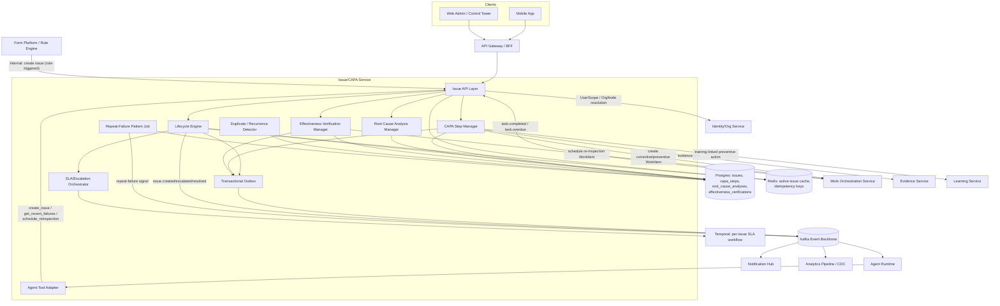

# Issues & CAPA — High-Level Design

Corresponds to **EPIC-07**. Reference: `functional-spec.md` (this module), source-spec.md §16.3
(Issue/CAPA Service row: "Issues, root cause, actions, verification — Stateful lifecycle + SLA"),
`conventions.md` (Target Tech Stack, Multi-tenancy Rule, State Machines).

## 1. Module Responsibilities

The **Issue/CAPA Service** is the authoritative owner of:
- The `Issue` aggregate and its canonical lifecycle state machine (`OPEN -> ... -> CLOSED`, with
  `REOPENED` branch) — reused verbatim, no tenant-specific state variants.
- `CapaStep`, `RootCauseAnalysis` (+ polymorphic `root_cause_method_data`), and
  `EffectivenessVerification` — the structured CAPA sub-record model.
- SLA/escalation timing for Issues, implemented as per-issue Temporal workflows.
- Issue-scoped events (`issue.created`, `issue.escalated`, `issue.resolved`) and the typed agent
  tools that create/query issues (`create_issue`, `get_recent_failures`, `schedule_reinspection`).
- Duplicate/recurrence linkage and the repeat-failure pattern signal consumed by the Compliance
  Monitor Agent.

It explicitly does **not** own: WorkItem execution state (Work Orchestration), evidence storage
(Evidence Service), rule evaluation (Form Platform / Workflow Engine), agent reasoning/policy
(Agent Runtime), or notification delivery (Notification Hub). It is a peer bounded context to Work
Service in the platform's modular-domain architecture (source-spec §16.2 — split services only
where scale/deployment/security/ownership justify it; Issues & CAPA justifies its own service
because it has a distinct, long-lived stateful lifecycle and a distinct governance/audit posture
from generic WorkItems).

## 2. Component Diagram

Narration: The Issue/CAPA Service sits alongside Work Orchestration as a peer domain service. It is
reached both through the normal client path (API Gateway) and through two internal, non-public
paths: the Form Platform's rule engine calling in directly on a matching rule (Appendix B), and the
Agent Runtime calling in through a typed Agent Tool Adapter. All lifecycle-affecting writes go
through the Lifecycle Engine, which enforces the state machine and is the single place that emits
outbox events; CAPA sub-managers (CapaStep, RCA, Verification) write their own tables but delegate
any Issue-state transition back to the Lifecycle Engine rather than mutating `issues.status`
directly, so the state machine has exactly one writer.

## 3. Data Ownership

| Entity | Owned here | Notes |
|---|---|---|
| `Issue` | Yes | Canonical `Issue` entity from source-spec §17.1; this service is the sole writer of `issues.status`. |
| `CapaStep` | Yes | Immediate correction, containment, corrective/preventive action records. |
| `RootCauseAnalysis` + `root_cause_method_data` | Yes | Versioned; polymorphic payload per method. |
| `EffectivenessVerification` | Yes | Includes re-inspection linkage metadata. |
| `issue_events` (history) | Yes | Append-only audit trail, this service's local audit feed (in addition to the platform-wide `AuditLog`). |
| `WorkItem` (referenced) | No — Work Orchestration | Referenced by ID (`escalated_work_item_id`, `capa_steps.work_item_id`); this service never writes `work_items` rows directly, always via Work Orchestration's API. |
| `Evidence` (referenced) | No — Evidence Service | Referenced by ID at the Issue and `CapaStep` level. |
| `OrganizationNode` / `UserScope` (referenced) | No — Identity/Org | Read-only resolution for default assignee, scope checks, orphaned-owner detection. |
| `AgentRun` (referenced) | No — Agent Runtime | Referenced (`agent_run_id`) on agent-created issues for traceability; this service does not own agent execution records. |
| `escalation_policies` | Yes (module-scoped copy) | This service owns its own severity/category SLA policy table; it does not fork Work Orchestration's WorkItem-level escalation policy table, though the shape is intentionally parallel (see LLD `escalation_policies_ref`). |

## 4. External Interfaces

### 4.1 Events produced
- `issue.created` — on every successful Issue creation (all four sources), after triage completes
  for auto-triage-eligible categories the event additionally reflects `status = TRIAGED` in a
  follow-up `issue.severity_changed`-shaped internal event (not part of the canonical list, kept as
  an internal-only topic).
- `issue.escalated` — on every escalation ladder step firing (`ESCALATE_SEVERITY`,
  `CREATE_EXECUTIVE_ALERT` actions) and on entry into `REOPENED`.
- `issue.resolved` — on `VERIFICATION -> RESOLVED` transition (not on `CLOSED`; `CLOSED` is
  reported via `issue_events`/CDC only, since no other module needs to react to closure beyond
  analytics, which consumes it via CDC rather than a canonical event to avoid growing the canonical
  event list unnecessarily).
- Consumers: Agent Runtime (Compliance Monitor reacts to `issue.created`/`issue.escalated` for
  pattern context; Resolution Agent reacts to `issue.created` for corrective-action proposals),
  Analytics Pipeline (all three, plus CDC for full history), Notification Hub (all three, for
  assignment/escalation/resolution notifications).

### 4.2 Events consumed
- `task.completed` (Work Orchestration) — advances the relevant `CapaStep`/`EffectivenessVerification`
  when the linked WorkItem is a corrective/preventive action or a re-inspection.
- `task.overdue` (Work Orchestration, with escalation flag) — triggers FR-CAPA-003 escalated issue
  creation, or, for a WorkItem already linked to an existing Issue's CAPA step, surfaces the overdue
  state on that step without creating a new Issue.
- `agent.action_approved` / `agent.action_rejected` (Agent Runtime) — resolves the
  `PENDING_AGENT_APPROVAL` gate for agent-created Critical issues (FR-CAPA-004); rejection deletes
  the provisional row (never entered `OPEN`, so no compensating event is needed) and logs the
  rejection into `AuditLog`.
- `training.completed` (Learning, indirect) — informs preventive-action-linked verification context
  but does not itself drive a state transition (the effectiveness verification still requires its
  own explicit evidence/outcome per FR-CAPA-050).

### 4.3 Synchronous APIs
- Public REST (`/api/v1/issues/...`) for clients — see LLD for the full endpoint list.
- Internal service-to-service endpoint (`/internal/issues`) for Form Platform rule-triggered
  creation, authenticated via service credential, not exposed through the public gateway surface.
- Typed agent tools (`create_issue`, `get_recent_failures`, `schedule_reinspection`,
  `get_task_status` for corrective-action WorkItem polling) exposed through the Agent Runtime's tool
  contract, backed by the same internal API surface with agent-specific authorization
  (autonomy-level + policy check happens in Agent Runtime before the call reaches this service; this
  service still independently enforces tenant/scope authorization — defense in depth, per §21.1).

## 5. Scalability

- **SLA timer fan-out.** Each Issue owns exactly one Temporal workflow execution for its SLA/
  escalation clock (FR-CAPA-071), started on creation (or on agent-approval) and long-lived until
  `CLOSED`. Temporal's workflow-per-entity pattern is chosen specifically because it survives
  service restarts and re-deploys without an in-memory timer wheel, and because escalation ladders
  are naturally expressed as a sequence of durable timers + signals (severity re-triage, state
  transitions, manual snooze) rather than a polling sweep for the steady-state case. A polling
  sweep (`escalation sweeper` background job, LLD) exists as a reconciliation backstop, not the
  primary trigger path.
- **High-volume issue creation during systemic events.** A single recall/incident can generate
  thousands of Issues within minutes (e.g. one rule firing across thousands of submissions from
  many locations in a short window). Mitigations: (a) issue creation is fully asynchronous from the
  caller's perspective beyond the transactional Postgres write + outbox row — Temporal workflow
  start and Kafka publication happen via the outbox relay, decoupling burst ingestion from
  downstream fan-out; (b) Temporal workflow starts are batched/rate-limited per tenant via a
  dedicated task queue per tenant tier, so one tenant's burst cannot starve another tenant's SLA
  timers (multi-tenant fairness); (c) the duplicate-detection check (FR-CAPA-041) is scoped to avoid
  an O(n²) similarity scan during a burst — it queries a bounded, indexed recent-window set, not the
  full open-issue table.
- **Read scalability.** Manager dashboards (issue list, kanban, active-issues-per-location) are
  read-heavy and latency-sensitive; an active-issues-per-location Redis cache (LLD §Caching) absorbs
  this load rather than hitting Postgres directly for every dashboard refresh, with cache
  invalidation on any write that changes an Issue's `status`, `severity`, or `owner_user_id`.

## 6. Multi-Tenancy

Follows the platform convention exactly: every table carries `tenant_id`; Postgres RLS policies are
the defense-in-depth backstop behind application-layer scoping on every query; Kafka topics are
partitioned by `tenant_id:issue_id` for ordering; the Temporal task queue is tenant-tier-scoped (see
§5) so a large enterprise tenant's SLA-timer volume is isolated from smaller tenants sharing the
default queue; the Redis active-issues cache key is prefixed `tenant:{tenant_id}:location:{...}`.
Large tenants may be isolated to a dedicated Postgres schema/cluster per the platform's tenant-tier
sharding strategy; this service has no additional sharding logic of its own beyond what the shared
data-access layer provides.

## 7. Failure Modes and Degradation

| Failure | Impact | Degradation strategy |
|---|---|---|
| Escalation timer service (Temporal) outage | New SLA workflows cannot start; running workflows cannot fire timers or process signals. | Issue creation/CAPA writes continue against Postgres (Temporal is not on the synchronous write path); the escalation sweeper background job (polling Postgres directly for issues whose computed SLA deadline has passed) becomes the primary detection path until Temporal recovers, at reduced timeliness (sweeper interval, not sub-minute timer precision). On Temporal recovery, workflows resume from durable history — no re-derivation needed. Alert fires on sustained sweeper-vs-Temporal divergence. |
| Stuck-in-`INVESTIGATING` issues | Root cause never completes; CAPA stalls; SLA breaches accumulate. | The escalation ladder itself is the primary mitigation (this is a normal, expected failure mode the SLA system exists to catch, not an incident). A secondary "stale issue" report (no `issue_events` row in N days regardless of SLA state) is surfaced to Regional Manager/Ops Admin dashboards for issues that are SLA-compliant on paper but operationally abandoned (e.g. owner snoozed every escalation). |
| Kafka/event backbone unavailable | Downstream consumers (Agent Runtime, Analytics, Notification Hub) stop receiving new issue events. | Transactional outbox pattern ensures no event is lost — rows accumulate in the outbox table and are relayed once Kafka recovers (at-least-once delivery; consumers must be idempotent on `event_id`, consistent with platform-wide idempotency principle P9). Issue lifecycle writes themselves are unaffected since the outbox write is in the same DB transaction as the state change. |
| Evidence Service unavailable | CAPA steps requiring evidence cannot be finalized. | The step can be saved in a `DRAFT`/`PENDING_EVIDENCE` sub-status referencing an Evidence upload placeholder; the step-completion gate (e.g. containment-required-before-corrective-action) blocks on evidence presence, not on Evidence Service being reachable at write time, so a transient Evidence Service outage degrades to "cannot finalize this step yet" rather than a hard failure across the whole Issue. |
| Work Orchestration unavailable | Cannot create corrective-action/re-inspection WorkItems. | The CAPA step record is created locally with `work_item_id = NULL` and a `work_item_creation_status = PENDING`; a retry worker (idempotent, keyed on `capa_step_id`) creates the WorkItem once Work Orchestration recovers. The Issue does not silently skip the corrective-action gate. |
| Agent Runtime unavailable | Agent-created issues stop arriving; `PENDING_AGENT_APPROVAL` resolution stalls. | Human-created issue paths are entirely unaffected (no dependency in that direction). Issues already pending agent approval remain pending (fail-safe: they do not auto-open) until the approval event is eventually delivered or a human manually triages them via an admin override path. |

## 8. Technology Choices (justified)

- **Temporal for SLA/escalation state machine.** Chosen over a cron/polling-only design because (a)
  escalation ladders are inherently a sequence of durable, resumable timers with the possibility of
  signals arriving out of band (re-triage, snooze, manual escalation-skip), which is exactly
  Temporal's workflow-with-signals model; (b) it gives per-issue execution history for free, useful
  for NFR-CAPA-002 (timer accuracy auditing) and for debugging a specific Issue's escalation
  behavior; (c) it is the same tool already adopted platform-wide for WorkItem scheduling/SLA
  (conventions.md), avoiding a second bespoke scheduling system.
- **Stateful lifecycle modeling in Postgres, not solely in Temporal.** The `Issue.status` column is
  the source of truth for reads (list/kanban/filter queries need fast relational queries, not
  Temporal workflow queries at scale); Temporal is the timer/escalation *driver*, not the state
  store. Every Temporal-initiated transition (e.g. an auto-escalation) still round-trips through the
  Lifecycle Engine's normal transactional write path, preserving "exactly one writer" for
  `issues.status`.
- **Postgres for CAPA/RCA data**, including the polymorphic `root_cause_method_data` JSONB column,
  rather than a separate document store: RCA payloads are small, always accessed by `analysis_id`,
  and benefit from being in the same transactional boundary as the rest of the Issue for audit
  consistency (a root cause submission and its resulting state transition commit atomically).
- **Kafka via transactional outbox**, matching platform convention, chosen over direct
  publish-on-write to guarantee the event is never lost relative to the committed state change
  (critical here specifically because `issue.escalated`/`issue.resolved` drive both compliance
  notifications and agent context — a lost event is a governance gap, not just a UX delay).
