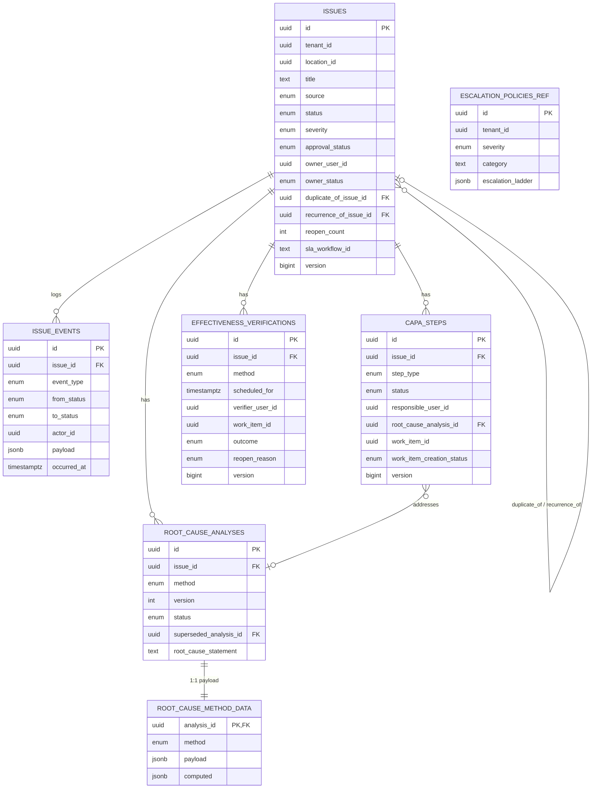
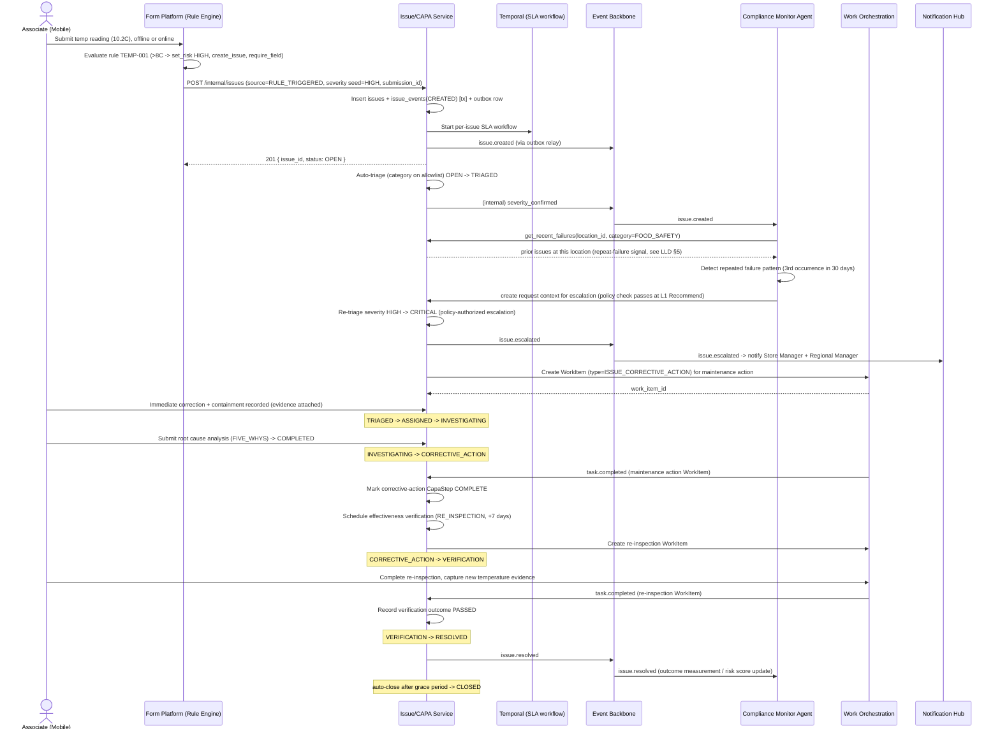
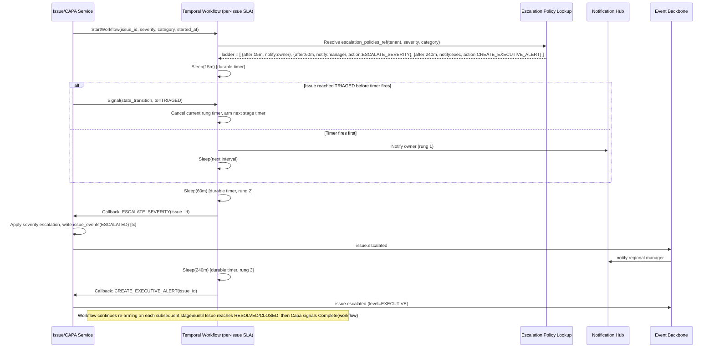

# Issues & CAPA — Low-Level Design

Corresponds to **EPIC-07**. Reference: `functional-spec.md`, `high-level-design.md` (this module),
`conventions.md` (API conventions, Postgres/RLS multi-tenancy, event envelope, state machines).

## 1. Database Schema

All tables carry `tenant_id UUID NOT NULL` with an RLS policy `USING (tenant_id =
current_setting('app.tenant_id')::uuid)` (defense-in-depth behind application-layer scoping, per
convention). All primary keys are UUIDv7 (time-ordered) unless noted. All tables have
`created_at`, `updated_at` (`timestamptz`, server-assigned). Money/duration fields use explicit
units in the column name.

### 1.1 `issues`

| Column | Type | Notes |
|---|---|---|
| `id` | UUID PK | |
| `tenant_id` | UUID | RLS key |
| `location_id` | UUID | FK to `organization_nodes`, not null |
| `title` | text | not null |
| `description` | text | |
| `category` | text | FK to tenant category catalog |
| `source` | enum | `MANUAL`, `RULE_TRIGGERED`, `WORK_ESCALATION`, `AGENT`, `RECURRENCE_OF` |
| `source_ref` | jsonb | `rule_id`/`submission_id`, `escalated_work_item_id`, `agent_run_id`, `recurrence_of_issue_id` — shape depends on `source` |
| `status` | enum | `OPEN`,`TRIAGED`,`ASSIGNED`,`INVESTIGATING`,`CORRECTIVE_ACTION`,`VERIFICATION`,`RESOLVED`,`CLOSED`,`REOPENED` |
| `severity` | enum | `LOW`,`MEDIUM`,`HIGH`,`CRITICAL` |
| `approval_status` | enum | `NONE`,`PENDING_AGENT_APPROVAL`,`APPROVED`,`REJECTED` (default `NONE`) |
| `owner_user_id` | UUID | nullable (unassignable case, FR-CAPA-062) |
| `owner_status` | enum | `NORMAL`,`ORPHANED`,`UNASSIGNABLE` |
| `contributor_user_ids` | UUID[] | |
| `initial_finding` | text | copied from rule `require_field` capture |
| `duplicate_of_issue_id` | UUID | nullable FK to `issues.id` |
| `possible_duplicate_of_issue_id` | UUID | nullable, system-suggested, non-binding |
| `recurrence_of_issue_id` | UUID | nullable FK, set when `source = RECURRENCE_OF` |
| `reopen_count` | int | default 0 |
| `triaged_by`, `triaged_at` | UUID, timestamptz | nullable |
| `assigned_at` | timestamptz | nullable |
| `resolved_at`, `closed_at` | timestamptz | nullable |
| `close_reason` | enum | `NORMAL`,`DUPLICATE`,`INVALID` |
| `sla_workflow_id` | text | Temporal workflow ID, unique per issue |
| `active_root_cause_analysis_id` | UUID | nullable FK, denormalized pointer to current RCA version |
| `version` | bigint | optimistic concurrency, incremented on every write |
| `created_by` | UUID | |
| `created_at`, `updated_at` | timestamptz | |

Indexes: `(tenant_id, location_id, status)`, `(tenant_id, owner_user_id, status)`,
`(tenant_id, severity, status)`, `(tenant_id, category, created_at)` partial for duplicate lookback
(`WHERE status NOT IN ('CLOSED')`), unique `(tenant_id, source, (source_ref->>'rule_id'),
(source_ref->>'submission_id'))` partial `WHERE source = 'RULE_TRIGGERED'` for idempotent
rule-triggered creation.

### 1.2 `issue_events` (append-only history)

| Column | Type | Notes |
|---|---|---|
| `id` | UUID PK | |
| `tenant_id` | UUID | |
| `issue_id` | UUID | FK, not null |
| `event_type` | enum | `CREATED`,`TRIAGED`,`SEVERITY_CHANGED`,`ASSIGNED`,`REASSIGNED`,`STATE_TRANSITION`,`CAPA_STEP_ADDED`,`CAPA_STEP_UPDATED`,`RCA_SUBMITTED`,`RCA_METHOD_CHANGED`,`VERIFICATION_SCHEDULED`,`VERIFICATION_RECORDED`,`ESCALATED`,`REOPENED`,`CLOSED`,`DUPLICATE_LINKED` |
| `from_status`, `to_status` | enum, nullable | for `STATE_TRANSITION` |
| `actor_id` | UUID | nullable (`NULL` = `SYSTEM`) |
| `actor_type` | enum | `USER`,`SYSTEM`,`AGENT` |
| `payload` | jsonb | event-specific detail (reason, diff, etc.) |
| `occurred_at` | timestamptz | server timestamp, authoritative |

Indexes: `(tenant_id, issue_id, occurred_at)`. Append-only (no `updated_at`, no UPDATE/DELETE grants
at the application role level).

### 1.3 `capa_steps`

| Column | Type | Notes |
|---|---|---|
| `id` | UUID PK | |
| `tenant_id` | UUID | |
| `issue_id` | UUID | FK, not null |
| `step_type` | enum | `IMMEDIATE_CORRECTION`,`CONTAINMENT`,`CORRECTIVE_ACTION`,`PREVENTIVE_ACTION` |
| `sequence` | int | ordering within `step_type` group when multiple corrective/preventive actions exist |
| `status` | enum | `DRAFT`,`PENDING_EVIDENCE`,`IN_PROGRESS`,`COMPLETE`,`CANCELLED` |
| `description` | text | |
| `performed_by` / `owner_user_id` | UUID | terminology per step_type (correction/containment use `performed_by`; corrective/preventive use `owner_user_id`) — modeled as one column `responsible_user_id` with a comment clarifying semantics per step_type |
| `responsible_user_id` | UUID | |
| `performed_at` | timestamptz | nullable until complete |
| `target_completion_date` | date | corrective/preventive only |
| `root_cause_analysis_id` | UUID | FK, nullable, links corrective/preventive action to the RCA it addresses |
| `training_assignment_id` | UUID | nullable, Learning module reference (preventive action) |
| `requires_field_work` | boolean | if true, `work_item_id` is expected |
| `work_item_id` | UUID | nullable FK (Work Orchestration), set once created |
| `work_item_creation_status` | enum | `NOT_REQUIRED`,`PENDING`,`CREATED`,`FAILED` |
| `scope_contained` | text | containment only |
| `version` | bigint | optimistic concurrency, per-step |
| `created_at`, `updated_at` | timestamptz | |

Indexes: `(tenant_id, issue_id, step_type)`, `(tenant_id, work_item_id)`.

### 1.4 `root_cause_analyses`

| Column | Type | Notes |
|---|---|---|
| `id` | UUID PK | |
| `tenant_id` | UUID | |
| `issue_id` | UUID | FK |
| `method` | enum | `FIVE_WHYS`,`FISHBONE`,`PARETO`,`FMEA`,`CUSTOM` |
| `version` | int | monotonically increasing per issue |
| `status` | enum | `IN_PROGRESS`,`COMPLETED`,`SUPERSEDED` |
| `superseded_analysis_id` | UUID | nullable, points to the prior version this one replaces |
| `custom_schema_id` | UUID | nullable, FK to tenant-registered schema (method = CUSTOM) |
| `root_cause_statement` | text | required when `status = COMPLETED` |
| `created_by` | UUID | |
| `created_at`, `completed_at` | timestamptz | |

Indexes: unique `(tenant_id, issue_id, version)`; `(tenant_id, issue_id, status)` partial
`WHERE status != 'SUPERSEDED'` to fetch the active analysis in O(1).

### 1.5 `root_cause_method_data` (polymorphic, 1:1 with `root_cause_analyses`)

| Column | Type | Notes |
|---|---|---|
| `analysis_id` | UUID PK, FK | 1:1 with `root_cause_analyses.id` |
| `tenant_id` | UUID | |
| `method` | enum | denormalized copy for query/validation convenience |
| `payload` | jsonb | validated at write time against the per-method JSON Schema (application-layer validation; Postgres `jsonb` does not enforce schema itself, kept flexible for schema evolution without migration) |
| `computed` | jsonb | derived/computed values (e.g. Pareto cumulative %, FMEA RPN ranking) recomputed server-side on every write, never client-supplied |

Payload shapes (validated in the application layer, illustrative JSON Schema fragments):
```json
// FIVE_WHYS
{ "whys": [ { "level": 1, "question": "...", "answer": "..." }, "...(>=3)" ] }

// FISHBONE
{ "categories": [ { "name": "Method", "causes": [ { "id": "c1", "text": "...", "likelihood": "MEDIUM" } ] } ],
  "selected_root_cause_id": "c1" }

// PARETO
{ "factors": [ { "factor": "Door left open", "frequency": 14 } ] }
// computed: { "sorted": [...], "cumulative_pct": [...], "cut_line_index": 2 }

// FMEA
{ "failure_modes": [
    { "id": "fm1", "failure_mode": "Compressor lag", "effect": "Temp excursion",
      "severity": 8, "occurrence": 5, "detection": 3 } ] }
// computed: { "ranked": [ { "id": "fm1", "rpn": 120 } ] }

// CUSTOM
{ "...": "validated against tenant-registered JSON Schema referenced by custom_schema_id" }
```

### 1.6 `effectiveness_verifications`

| Column | Type | Notes |
|---|---|---|
| `id` | UUID PK | |
| `tenant_id` | UUID | |
| `issue_id` | UUID | FK |
| `method` | enum | `RE_INSPECTION`,`DOCUMENT_REVIEW`,`METRIC_THRESHOLD`,`MANAGER_ATTESTATION` |
| `scheduled_for` | timestamptz | |
| `verifier_user_id` | UUID | must differ from `issues.owner_user_id` for HIGH/CRITICAL (app-layer check) |
| `work_item_id` | UUID | nullable FK (Work Orchestration), set when `method = RE_INSPECTION` |
| `outcome` | enum | `PENDING`,`PASSED`,`FAILED` |
| `outcome_notes` | text | |
| `reopen_reason` | enum | nullable; `ROOT_CAUSE_INCORRECT`,`CORRECTIVE_ACTION_INCOMPLETE`,`RECURRED`,`OTHER` — set on `FAILED` |
| `verified_by`, `verified_at` | UUID, timestamptz | nullable until outcome recorded |
| `version` | bigint | optimistic concurrency |
| `created_at`, `updated_at` | timestamptz | |

Indexes: `(tenant_id, issue_id)`, `(tenant_id, work_item_id)`, `(tenant_id, scheduled_for)` for the
verification scheduler job.

### 1.7 `escalation_policies_ref` (module-scoped SLA policy)

| Column | Type | Notes |
|---|---|---|
| `id` | UUID PK | |
| `tenant_id` | UUID | nullable = platform default |
| `severity` | enum | |
| `category` | text | nullable = applies to all categories at this severity |
| `time_to_triage_minutes` | int | |
| `time_to_assign_minutes` | int | |
| `time_to_investigate_minutes` | int | |
| `time_to_corrective_action_minutes` | int | |
| `time_to_verification_minutes` | int | |
| `escalation_ladder` | jsonb | ordered `[{ after_minutes, notify: {role|user}, action }]` |
| `containment_required` | boolean | |
| `preventive_action_required` | boolean | |
| `auto_close_grace_days` | int | default 3 |
| `auto_close_on_resolve` | boolean | default false |
| `created_at`, `updated_at` | timestamptz | |

Indexes: unique `(tenant_id, severity, category)` with `category IS NULL` as a distinct sentinel row
per severity (partial unique index).

### 1.8 ER Diagram



## 2. REST Endpoints

Base path `/api/v1/issues`. All mutating endpoints require `Idempotency-Key`, enforce
`If-Match`/`version` optimistic concurrency where noted, and emit a canonical event per §18.4
envelope. Errors follow `{ "error": { "code", "message", "trace_id" } }`.

### 2.1 Create Issue
`POST /api/v1/issues`
```json
{
  "location_id": "loc_9f2a",
  "title": "Walk-in cooler above threshold",
  "description": "Temperature recorded at 10.2C, threshold 8C",
  "category": "FOOD_SAFETY",
  "severity": "HIGH",
  "initial_finding": "Corrective action: door propped open, closed and reset",
  "evidence_ids": ["ev_1a2b"]
}
```
`201 Created`
```json
{
  "id": "iss_7c31",
  "status": "OPEN",
  "severity": "HIGH",
  "source": "MANUAL",
  "version": 1,
  "sla_workflow_id": "issue-sla-iss_7c31",
  "created_at": "2026-09-19T14:02:11Z"
}
```
Error codes: `400 VALIDATION_ERROR` (missing required evidence for category requiring it),
`403 SCOPE_DENIED` (no `issue:create` at `location_id`).

Internal variant `POST /internal/issues` (service credential only) accepts `source`, `source_ref`,
and pre-seeded `severity`, used by Form Platform (rule-triggered) and returns `200 OK` with the
existing issue (not `201`) on an idempotency-key replay match against
`(tenant_id, rule_id, submission_id)`.

### 2.2 Transition State
`POST /api/v1/issues/{id}/transition`
```json
{ "to_status": "TRIAGED", "severity": "HIGH", "category": "FOOD_SAFETY", "note": "confirmed on review" }
```
Headers: `If-Match: "1"` (current `version`).
`200 OK`
```json
{ "id": "iss_7c31", "status": "TRIAGED", "version": 2, "triaged_by": "usr_44", "triaged_at": "2026-09-19T14:05:02Z" }
```
`409 Conflict`
```json
{ "error": { "code": "VERSION_CONFLICT", "message": "Issue was modified by another actor", "trace_id": "..." } }
```
`422 Unprocessable Entity` — `{ "error": { "code": "INVALID_TRANSITION", "message": "OPEN -> VERIFICATION is not a legal transition", "trace_id": "..." } }`
`409 Conflict` — `{ "error": { "code": "ISSUE_CLOSED_IMMUTABLE", ... } }` when targeting a `CLOSED` issue.

### 2.3 Assign / Reassign
`POST /api/v1/issues/{id}/assign`
```json
{ "owner_user_id": "usr_88", "reason": "regional coverage handoff" }
```
`200 OK` — returns updated Issue; emits `issue_events` `REASSIGNED` row. `403 SCOPE_DENIED` if
target user lacks `UserScope` covering `location_id`. `409 ISSUE_CLOSED_IMMUTABLE` if terminal.

### 2.4 Add CAPA Step with Evidence
`POST /api/v1/issues/{id}/capa-steps`
```json
{
  "step_type": "CONTAINMENT",
  "description": "Isolated affected inventory, pulled 40 units",
  "scope_contained": "Lot #A2291, all units",
  "responsible_user_id": "usr_44",
  "performed_at": "2026-09-19T14:10:00Z",
  "evidence_ids": ["ev_1c9d", "ev_1c9e"]
}
```
`201 Created`
```json
{ "id": "capa_5521", "issue_id": "iss_7c31", "step_type": "CONTAINMENT", "status": "COMPLETE", "version": 1 }
```
`400 VALIDATION_ERROR` if evidence is required by tenant policy for the category and none supplied.
`422 STEP_PRECONDITION_FAILED` if `CORRECTIVE_ACTION` step submitted before containment is complete
on a containment-required category.

### 2.5 Submit Root Cause Analysis
`POST /api/v1/issues/{id}/root-cause-analyses`
```json
{
  "method": "FIVE_WHYS",
  "payload": {
    "whys": [
      {"level":1,"question":"Why was the temperature high?","answer":"Door was left open"},
      {"level":2,"question":"Why was the door left open?","answer":"Latch mechanism is loose"},
      {"level":3,"question":"Why is the latch loose?","answer":"No preventive maintenance schedule for door hardware"}
    ]
  },
  "root_cause_statement": "No PM schedule for cooler door hardware",
  "status": "COMPLETED"
}
```
`201 Created`
```json
{ "id": "rca_3391", "issue_id": "iss_7c31", "method": "FIVE_WHYS", "version": 1, "status": "COMPLETED" }
```
Changing method mid-investigation: same endpoint, server detects an existing active analysis and
creates `version = 2`, sets prior row `status = SUPERSEDED, superseded_analysis_id` back-link, and
returns the new row; response includes `"superseded_analysis_id": "rca_3391"`.
`422 SCHEMA_VALIDATION_FAILED` — payload does not conform to the method's JSON Schema.
`403 METHOD_RESTRICTED` — method not permitted for category/role.

### 2.6 Schedule Effectiveness Verification
`POST /api/v1/issues/{id}/effectiveness-verifications`
```json
{
  "method": "RE_INSPECTION",
  "scheduled_for": "2026-09-26T09:00:00Z",
  "verifier_user_id": "usr_91"
}
```
`201 Created`
```json
{ "id": "ver_6610", "issue_id": "iss_7c31", "method": "RE_INSPECTION", "outcome": "PENDING", "work_item_id": "wi_8842" }
```
`400 VALIDATION_ERROR` — `verifier_user_id == issues.owner_user_id` for HIGH/CRITICAL severity
(segregation-of-duties rule).

Recording outcome: `PATCH /api/v1/issues/{id}/effectiveness-verifications/{verification_id}`
```json
{ "outcome": "FAILED", "reopen_reason": "CORRECTIVE_ACTION_INCOMPLETE", "outcome_notes": "Door still not latching", "evidence_ids": ["ev_2201"] }
```
`200 OK` — Issue auto-transitions `VERIFICATION -> REOPENED -> INVESTIGATING` (single atomic write);
response includes the updated Issue sub-object.

### 2.7 Reopen
`POST /api/v1/issues/{id}/reopen`
```json
{ "reason": "OTHER", "note": "Customer complaint received post-close" }
```
Valid only when `status = RESOLVED` and within `auto_close_grace_days`. `409
REOPEN_WINDOW_CLOSED` once past grace period or if `status = CLOSED` (client should instead call
§2.1 with `source_ref.recurrence_of_issue_id` — surfaced as a `303 See Other`-style hint in the
error payload: `{"error":{"code":"ISSUE_CLOSED_IMMUTABLE","message":"...","recurrence_endpoint":"/api/v1/issues?recurrence_of=iss_7c31"}}`).

### 2.8 Common error code table (module-specific, in addition to platform-wide codes)

| Code | HTTP | Meaning |
|---|---|---|
| `INVALID_TRANSITION` | 422 | Requested state transition is not in the allowed edge set. |
| `ISSUE_CLOSED_IMMUTABLE` | 409 | Attempted mutation of a `CLOSED` issue outside the recurrence-link path. |
| `VERSION_CONFLICT` | 409 | Optimistic concurrency `If-Match` mismatch. |
| `STEP_PRECONDITION_FAILED` | 422 | A CAPA step gate (e.g. containment before corrective action) is not satisfied. |
| `SCHEMA_VALIDATION_FAILED` | 422 | Root cause payload fails method JSON Schema. |
| `METHOD_RESTRICTED` | 403 | Root cause method not permitted for category/role. |
| `REOPEN_WINDOW_CLOSED` | 409 | Reopen attempted after grace period or on a `CLOSED` issue. |
| `SEGREGATION_OF_DUTIES_VIOLATION` | 400 | Verifier equals owner for HIGH/CRITICAL. |
| `DUPLICATE_EVIDENCE_REQUIRED` | 400 | Category/step requires evidence and none supplied. |

## 3. Sequence Diagrams

### 3.1 Golden Scenario — Temperature Exception to Resolution (Appendix A)



Narration: this trace maps directly onto Appendix A's flow. Two governance points are explicit in
the sequence: (1) the escalation from HIGH to CRITICAL is agent-*recommended context* but the actual
severity change and issue-state write happens inside the Issue/CAPA Service under its own policy
check, not as a side effect of the agent call, keeping the Lifecycle Engine the single writer of
state (P5 — policy before AI); (2) the re-inspection is a real Work Orchestration WorkItem, not a
notional step, so its completion is what unblocks `VERIFICATION -> RESOLVED`.

### 3.2 SLA Escalation Ladder via Temporal



Narration: the Temporal workflow owns only *timing*; every state-changing effect (severity change,
`issue_events` row, event emission) is a callback into the Issue/CAPA Service's normal transactional
write path, never a direct DB write from the workflow worker. State transitions signal the workflow
to re-arm rather than letting a stale timer fire after the Issue has already progressed, which is
why FR-CAPA-071 specifies "reset/re-armed on each qualifying state transition."

### 3.3 Reopening on Failed Effectiveness Verification

```mermaid
sequenceDiagram
    actor Verifier as Verifier (Manager/Auditor)
    participant Capa as Issue/CAPA Service
    participant Work as Work Orchestration
    participant Tmp as Temporal (SLA workflow)
    participant Kafka as Event Backbone
    participant Notif as Notification Hub

    Verifier->>Work: Complete re-inspection WorkItem, evidence shows recurrence
    Work->>Capa: task.completed(work_item_id) [informational; outcome not yet recorded]
    Verifier->>Capa: PATCH /effectiveness-verifications/{id} { outcome: FAILED, reopen_reason }
    Capa->>Capa: Begin transaction
    Capa->>Capa: verification.outcome = FAILED
    Capa->>Capa: issues.status: VERIFICATION -> REOPENED -> INVESTIGATING
    Capa->>Capa: issues.reopen_count += 1
    Capa->>Capa: Insert issue_events(VERIFICATION_RECORDED), issue_events(REOPENED), issue_events(STATE_TRANSITION x2)
    Capa->>Capa: Commit transaction + outbox rows
    Capa->>Tmp: Signal(reopened) -> re-arm SLA workflow at INVESTIGATING stage clock
    Capa->>Kafka: issue.escalated (reopen counts as an escalation-class event for visibility)
    Kafka->>Notif: notify owner + regional manager: issue reopened
    Capa-->>Verifier: 200 { status: INVESTIGATING, reopen_count: 1 }
    Note over Capa: Owner may submit a new root_cause_analyses version\nor add a corrective action against the existing RCA,\nper reopen_reason
```

Narration: all four writes (verification outcome, two state transitions, reopen counter) commit in
a single database transaction so an observer never sees an intermediate state (e.g. `REOPENED`
without a `reopen_count` increment). The SLA workflow is signaled rather than restarted from scratch
so escalation history/context is preserved across the reopen.

## 4. Pseudocode

### 4.1 Severity / SLA Calculation

```
function computeSeverity(source, ruleActionSeverity, agentConfidenceBand, categoryDefault):
    if source == RULE_TRIGGERED and ruleActionSeverity is not null:
        return ruleActionSeverity                      # Appendix B: set_risk action is authoritative
    if source == AGENT:
        # map confidence band to severity floor; policy engine may still require approval
        if agentConfidenceBand == HIGH and patternRepeatCount >= 3:
            return CRITICAL
        elif agentConfidenceBand == HIGH:
            return HIGH
        else:
            return MEDIUM
    if source == WORK_ESCALATION:
        return escalatedWorkItem.riskWeightToSeverity()
    return categoryDefault or MEDIUM                    # MANUAL default

function armSlaClock(issue):
    policy = lookupEscalationPolicy(issue.tenant_id, issue.severity, issue.category)
             or lookupEscalationPolicy(issue.tenant_id, issue.severity, category=null)  # tenant default
             or platformDefaultPolicy(issue.severity)
    stageDeadline = now() + policy.time_to_<current_stage>_minutes
    for rung in policy.escalation_ladder (ordered by after_minutes):
        scheduleTimer(issue.sla_workflow_id, fireAt = stageEnteredAt + rung.after_minutes, rung)
    return stageDeadline

function onStateTransition(issue, fromStatus, toStatus):
    cancelPendingRungTimers(issue.sla_workflow_id)      # old stage's ladder no longer applies
    if toStatus not in {RESOLVED, CLOSED}:
        armSlaClock(issue)                               # re-arm for the new stage
    else:
        completeSlaWorkflow(issue.sla_workflow_id)

function onSeverityChanged(issue, newSeverity):
    issue.severity = newSeverity
    recordAuditEvent(SEVERITY_CHANGED, previous, new, actor)
    armSlaClock(issue)                                   # recompute remaining clock at new severity
```

### 4.2 Repeat-Failure Detection (for Compliance Monitor Agent's `get_recent_failures` tool)

```
function getRecentFailures(tenant_id, location_id, category, lookback_days=30, include_sibling_locations=false):
    scope_location_ids = [location_id]
    if include_sibling_locations:
        scope_location_ids += siblingLocationsUnderSameParent(location_id)

    candidates = query issues
        WHERE tenant_id = tenant_id
          AND location_id IN scope_location_ids
          AND category = category
          AND created_at >= now() - lookback_days
        ORDER BY created_at DESC

    # Pattern signal 1: same-location repeat count
    same_location_count = count(candidates WHERE location_id == location_id)

    # Pattern signal 2: recurrence-chain depth (explicit links, not just same category)
    chain_depth = 0
    cursor = mostRecentClosedIssueAt(location_id, category)
    while cursor.recurrence_of_issue_id is not null:
        chain_depth += 1
        cursor = getIssue(cursor.recurrence_of_issue_id)

    # Pattern signal 3: cross-location clustering (systemic vs. local)
    distinct_locations_affected = countDistinct(candidates.location_id)

    pattern = {
        "same_location_count": same_location_count,
        "recurrence_chain_depth": chain_depth,
        "distinct_locations_affected": distinct_locations_affected,
        "is_repeat_failure": same_location_count >= 3 or chain_depth >= 1,
        "is_systemic": distinct_locations_affected >= SYSTEMIC_THRESHOLD  # tenant-configurable, default 5
    }
    return { candidates: candidates[0:50], pattern: pattern }   # bounded result set, indexed scan only
```

This same pattern function backs the **repeat-failure pattern background job** (§6), run
periodically per tenant/category rather than only on-demand from the agent tool call, so the
Compliance Monitor Agent can also react to a proactively-published `repeat-failure signal` event
rather than needing to poll every location/category combination itself.

## 5. Caching

- **Active-issues-per-location cache** (Redis): key
  `tenant:{tenant_id}:location:{location_id}:active_issues`, value = compact JSON array of
  `{id, severity, status, owner_user_id, sla_deadline}` for all issues not in `CLOSED`. TTL 5
  minutes as a safety net; primary invalidation is event-driven — any write that changes `status`,
  `severity`, or `owner_user_id` publishes a local cache-invalidation signal (same transactional
  outbox mechanism, a lightweight internal topic) so manager dashboards see near-real-time state
  without hitting Postgres per page load. Read-through on cache miss populates from a single indexed
  query (`(tenant_id, location_id, status)` index, §1.1).
- **Escalation policy cache**: `escalation_policies_ref` rows are read on every SLA-arm operation;
  cached in-process (per service instance, short TTL ~60s) since policy changes are infrequent
  admin actions, not hot-path writes; a policy update publishes a cache-bust event to all service
  instances.
- **Idempotency-key cache** (Redis): standard platform pattern — `Idempotency-Key` + tenant + route
  hashed to a short-TTL (24h) result cache so retried mutating requests (create issue, add CAPA
  step) return the original result rather than re-executing.

## 6. Concurrency

- **Optimistic concurrency on issue state transitions.** Every mutating endpoint requires the
  caller's known `version` (via `If-Match` or body field); the update is
  `UPDATE issues SET status=..., version = version + 1 WHERE id = $1 AND version = $2`. Zero rows
  affected -> `409 VERSION_CONFLICT`, and the handler re-reads current state to return in the error
  body so the client can decide whether to retry or surface a merge UI (edge case §9.4 in the
  functional spec). The same pattern applies independently to `capa_steps`,
  `root_cause_analyses` (new version rows sidestep most conflicts by design — see below), and
  `effectiveness_verifications`.
- **Guard against double-assignment.** The assign endpoint uses a conditional update
  (`WHERE owner_user_id IS DISTINCT FROM $new_owner AND version = $expected`) inside the same
  transaction as the `issue_events(REASSIGNED)` insert; two concurrent assign requests race on the
  `version` check, and the loser gets `409 VERSION_CONFLICT` rather than silently overwriting the
  winner's assignment. There is no separate assignment lock table — the Issue row's own version
  column is the concurrency guard, keeping "exactly one writer path" for owner_user_id.
- **Root cause method versioning avoids most write conflicts by construction.** Because changing
  method (or resubmitting) creates a new `root_cause_analyses` row rather than mutating in place,
  two managers independently starting an RCA "at the same time" both succeed as separate versions;
  the UI reconciles by showing "an analysis was already started" and offering to view/continue the
  other version rather than the API itself needing to arbitrate a conflict. A genuine conflict only
  arises when two writers attempt to complete the *same* analysis version concurrently, handled by
  the standard `version` check on `root_cause_analyses`.
- **CAPA step transactional gating.** Preconditions like "containment must be recorded before
  corrective action" are checked inside the same transaction that inserts the new `capa_steps` row
  (`SELECT ... FOR SHARE` on the relevant prior step rows) to avoid a TOCTOU race between two
  concurrent step submissions.

## 7. Background Jobs

| Job | Trigger | Responsibility |
|---|---|---|
| Escalation sweeper | Cron, every 60s | Reconciliation backstop: queries issues whose computed SLA deadline (derived from `status` entry time + policy) has passed but no corresponding Temporal escalation has been recorded in `issue_events`; fires the missed escalation directly and alerts on divergence (see HLD §7 failure mode). |
| Effectiveness-verification scheduler | Cron, every 5 min, plus event-driven on `CORRECTIVE_ACTION` step completion | Finds `effectiveness_verifications` rows with `outcome = PENDING` and `scheduled_for <= now() + lookahead_window`; ensures the linked Work Orchestration WorkItem exists (retries `work_item_creation_status = PENDING/FAILED` rows), and for non-field-work methods (`DOCUMENT_REVIEW`, `MANAGER_ATTESTATION`) sends a due-soon reminder via Notification Hub. |
| Repeat-failure pattern job | Cron, every 15 min per tenant, sharded by tenant to bound query cost | Runs the §4.2 pattern function across active category/location combinations with recent issue activity (not a full scan); publishes a `repeat-failure signal` internal event when `is_repeat_failure` or `is_systemic` newly becomes true, consumed by the Compliance Monitor Agent to proactively evaluate `create_issue`/escalation rather than only on-demand. |
| Orphaned-issue-owner sweeper | Cron, nightly, plus event-driven on `UserScope` end-date | Flags issues whose `owner_user_id` lacks an active `UserScope` covering `location_id`; sets `owner_status = ORPHANED`; notifies next-level manager immediately (FR-CAPA-022). |
| Auto-close job | Cron, every 15 min | Transitions `RESOLVED` issues past `auto_close_grace_days` (and not `auto_close_on_resolve` immediate-close tenants, which close synchronously at the `VERIFICATION -> RESOLVED` transition instead) to `CLOSED`, `closed_by = SYSTEM`. |
| Outbox relay | Continuous (CDC-based or polling fallback) | Relays `issues`/`capa_steps`/`effectiveness_verifications` outbox rows to Kafka at-least-once; marks relayed rows to avoid unbounded table growth (partition/rotate old relayed rows). |

## 8. Detailed Error Handling Table

| Scenario | Detection point | System behavior | User-facing result |
|---|---|---|---|
| Duplicate rule-triggered creation (replayed submission) | Unique partial index on `(tenant_id, source, rule_id, submission_id)` | Insert conflict caught, existing issue row fetched and returned | `200 OK` with original issue, not a duplicate error — matches sync idempotency convention (§19.4) |
| Invalid state transition requested | Lifecycle Engine transition table lookup | Reject before any write | `422 INVALID_TRANSITION` with the illegal edge named |
| Transition on stale version | `version` mismatch in conditional UPDATE | No write occurs; current state re-fetched | `409 VERSION_CONFLICT` with current server state embedded |
| Mutation attempted on `CLOSED` issue | Status check in Lifecycle Engine guard, before transition-table lookup | Reject; suggest recurrence path | `409 ISSUE_CLOSED_IMMUTABLE` with `recurrence_endpoint` hint |
| CAPA step precondition unmet (e.g. no containment on containment-required category) | `SELECT ... FOR SHARE` precondition check in same transaction | Reject; no partial write | `422 STEP_PRECONDITION_FAILED` naming the missing prerequisite step |
| Root cause payload fails method schema | Application-layer JSON Schema validation before insert | Reject | `422 SCHEMA_VALIDATION_FAILED` with per-field validation errors |
| Method restricted for category/role | Policy lookup against tenant method-availability config | Reject | `403 METHOD_RESTRICTED` |
| Verifier equals owner on HIGH/CRITICAL | Segregation-of-duties check on verification create | Reject | `400 SEGREGATION_OF_DUTIES_VIOLATION` |
| Verification outcome FAILED | Normal path, not an error | Atomic reopen transition (see §3.3) | `200 OK`, issue now `INVESTIGATING`, `reopen_count` incremented |
| Reopen requested past grace period or on CLOSED | `status`/`resolved_at` + `auto_close_grace_days` check | Reject | `409 REOPEN_WINDOW_CLOSED` |
| Work Orchestration unavailable when creating corrective-action WorkItem | Downstream call failure/timeout | CapaStep saved with `work_item_creation_status = FAILED`; retry worker requeues | `201 Created` for the CapaStep itself (degraded, not blocked); async retry, no user-facing error unless retries exhausted (then admin alert) |
| Evidence Service unavailable at step finalize | Downstream call failure/timeout | Step held at `PENDING_EVIDENCE` | `202 Accepted`-style response (`status: PENDING_EVIDENCE`), retry client-side or automatically on next evidence upload callback |
| Agent attempts `create_issue` outside its policy autonomy/category allowlist | Agent Runtime policy check (upstream) + this service's independent tenant/scope re-check | Reject at the earlier boundary; if it reaches this service anyway, reject again | `403 SCOPE_DENIED` / logged as a policy violation in `AuditLog`, per defense-in-depth |
| Orphaned owner detected mid-SLA-clock | Nightly sweeper | Escalates immediately, does not pause clock | No direct API error; visible as `owner_status: ORPHANED` on the issue read model |
