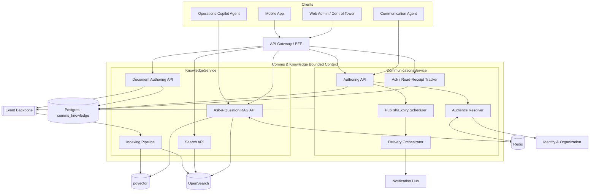
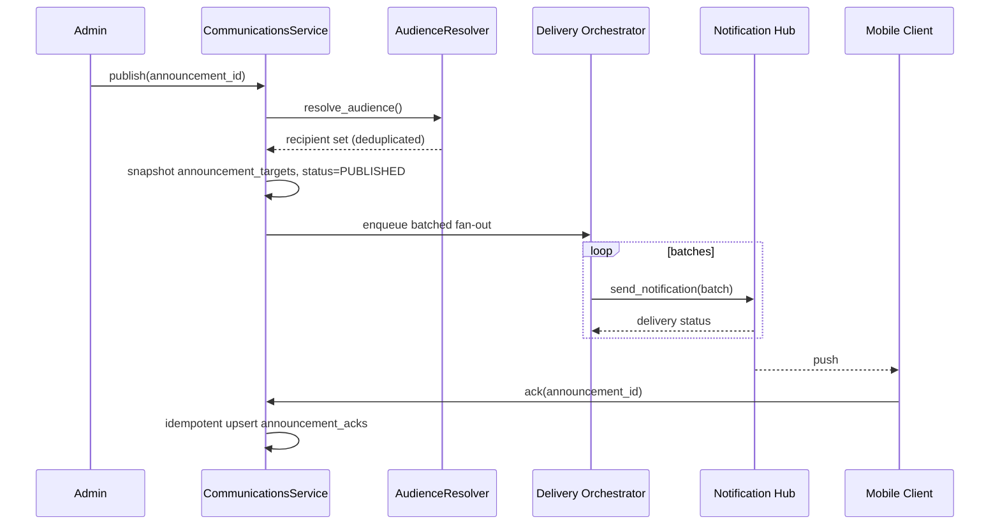
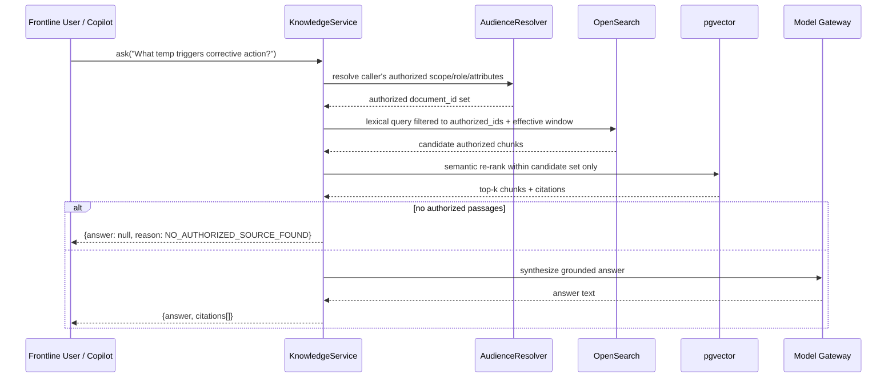
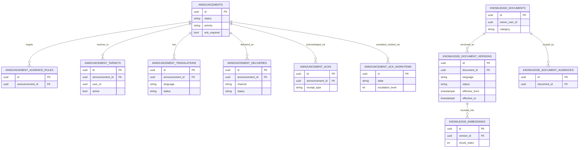
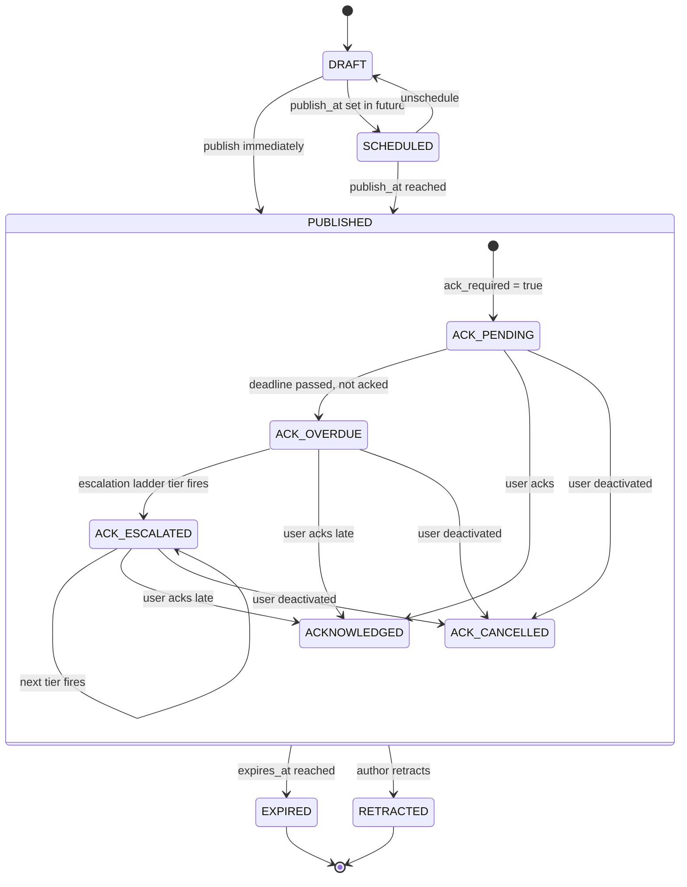

# Communications & Knowledge — Architecture Diagrams

Module: `07-communications-knowledge`

## 1. Component / Container Diagram

**Narrative**: A single bounded context is split into two deployables — `CommunicationsService`
(write-heavy, fan-out-heavy) and `KnowledgeService` (read/search-heavy) — sharing an
`AudienceResolver` pattern against Identity & Organization and a Redis cache tier, but each with its
own scaling and failure profile. Announcements flow through a Temporal-backed scheduler into
Notification Hub fan-out; knowledge documents flow through Kafka into an indexing pipeline feeding
OpenSearch and pgvector. Both external agent surfaces — the Communication Agent (writes drafts) and
the Operations Copilot (reads via RAG) — go through the same governed APIs as human users, with no
privileged bypass path.

## 2. Sequence Diagram — Announcement Fan-Out

**Narrative**: Publish snapshots the resolved, deduplicated recipient set once, then fan-out proceeds
in bounded batches against the Notification Hub, keeping the write path independent of per-recipient
synchronous work. Acknowledgement is idempotent on `client_uuid`, so offline-queued or retried acks
never double-record — required for correctness at 1M+ device scale and for mobile offline replay.

## 3. Sequence Diagram — Authorized Knowledge Search / RAG

**Narrative**: Authorization is resolved and applied as a hard filter *before* any semantic search
or generation happens — the system never runs an unfiltered similarity search and post-filters. This
is what lets the same endpoint safely serve both a human's direct search and the Operations
Copilot's `search_knowledge()` tool call: the authorization boundary is identical for both callers.

## 4. ER Diagram — Module-Owned Entities

**Narrative**: `Announcement` and `KnowledgeDocument` are the two aggregate roots. Every
authorization-relevant fact (audience rules, per-recipient targets, per-recipient deliveries and
acks) hangs off `Announcement`; every content-lifecycle fact (versions, audience scoping, embedded
chunks) hangs off `KnowledgeDocument`. Neither aggregate stores `OrganizationNode`/`User`/`Role`
data directly — they reference IDs resolved live against Identity & Organization.

## 5. State Diagram — Announcement Lifecycle

**Narrative**: The outer lifecycle (`DRAFT → SCHEDULED → PUBLISHED → EXPIRED`/`RETRACTED`) governs
visibility and delivery eligibility. Nested within `PUBLISHED`, each targeted recipient has an
independent acknowledgement sub-state machine — this is what allows one announcement to be
simultaneously `ACKNOWLEDGED` for some recipients, `ACK_ESCALATED` for others, and `ACK_CANCELLED`
for a recipient who was deactivated mid-campaign, without any global lifecycle contradiction.
