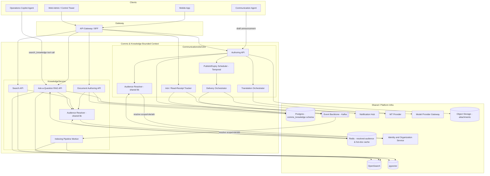

# Communications & Knowledge — High-Level Design

Module: `07-communications-knowledge`
Epic: EPIC-08

## 1. Module Responsibilities & Bounded Context Decision

**Decision: one combined "Comms & Knowledge" bounded-context service pair deployed as two
independently-scalable deployables sharing a domain module** — `CommunicationsService` and
`KnowledgeService` — rather than either (a) one monolithic deployable or (b) two fully independent
services owned by different teams with separate data stores.

**Justification:**
- The two halves share the *identical* hard problem — resolving "which authorized users/audiences
  can see this content" — against the same Identity & Organization primitives (`OrganizationNode`,
  `UserScope`, `Role`, attribute predicates). Building this authorization-resolution logic twice, in
  two services owned by two different teams, is a correctness and drift risk (conventions.md's
  tenant-isolation rule demands *every* access boundary re-prove scope; two independent
  implementations of that proof means two places to get it wrong). We build **one shared
  `AudienceResolver` library/module** used by both.
- They share the same **event-sourcing shape** on the outbound side (`message.published`,
  `message.acknowledged`, and knowledge equivalents) and the same Notification Hub integration for
  delivery (announcements) and for knowledge-check nudges (Learning integration).
  Announcements and Knowledge notably do **not** share their core write-side data model or
  their read-side query patterns: `Announcement` is a time-bound, fan-out-heavy, high-write-volume
  entity; `KnowledgeDocument` is a slow-changing, read/search-heavy, long-lived entity indexed into
  OpenSearch/pgvector. These are given **separate deployables** (`CommunicationsService`,
  `KnowledgeService`) so each can scale, deploy, and fail independently — a Notification Hub outage
  affecting `CommunicationsService` fan-out must never degrade `KnowledgeService` search/RAG
  availability, and vice versa (per-service circuit breakers/bulkheads, source-spec §22.3).
- Both deployables live in **one bounded context / one team ownership boundary** per
  conventions.md's "split services only where scale, deployment independence, security boundaries,
  or team ownership justify it" principle (source-spec §16.2) — the *scale/deployment* justification
  applies (hence two deployables), but there is no *team ownership* or *security boundary*
  justification for full domain separation, so they share one Postgres schema namespace
  (`comms_knowledge`), one module-owned event-envelope contract, and the shared `AudienceResolver`.

### 1.1 Responsibilities

`CommunicationsService`:
- Announcement authoring, versioning-of-content-corrections, audience rule storage.
- Audience resolution (via shared `AudienceResolver`) and recipient-set snapshotting at publish.
- Delivery orchestration: channel selection, fallback sequencing, dedupe, calling Notification Hub.
- Ack/read-receipt recording, non-ack escalation.
- Translation workflow orchestration (calls out to MT provider or human translation queue).
- Scheduling (publish_at/expires_at) via Temporal.io workflows (per conventions.md).

`KnowledgeService`:
- `KnowledgeDocument`/`KnowledgeDocumentVersion` lifecycle and audience scoping storage.
- Indexing pipeline: publish event → OpenSearch document indexing + pgvector embedding generation.
- Search API (lexical + semantic hybrid) with authorization-filtered query construction.
- RAG "ask a question" API: retrieval (authorization-filtered) + LLM synthesis + citation
  enforcement, exposed as the `search_knowledge()` tool the Agent Runtime's Operations Copilot calls.
- Offline-cache manifest computation (which documents are eligible/flagged for mobile offline
  caching) consumed by Mobile Offline sync.

## 2. Component Diagram

**Narrative**: Authoring flows for both announcements and knowledge documents go through the shared
`AudienceResolver`, which in turn resolves against Identity & Organization and caches the resolved
membership in Redis. Announcements flow through a Temporal-backed scheduler into a delivery
orchestrator that fans out to the Notification Hub; knowledge documents flow through Kafka into an
indexing pipeline that populates OpenSearch (lexical) and pgvector (semantic). Both the Search API
and the RAG API re-check authorization against the resolver on every read — they never trust the
index alone to have filtered correctly, matching the "prove object-level scope at every access
boundary" rule in conventions.md.

## 3. Data Ownership

| Entity | Owned by | Notes |
|---|---|---|
| `Announcement` | CommunicationsService | Source of truth for content, priority, schedule. |
| `AnnouncementTarget` (resolved audience rule + snapshot) | CommunicationsService | Snapshotted recipient set at publish time. |
| `AnnouncementTranslation` | CommunicationsService | Per-language content + staleness state. |
| `AnnouncementDelivery` | CommunicationsService | Per-recipient, per-channel delivery attempt/state. |
| `AnnouncementAck` | CommunicationsService | Per-recipient ack + read-receipt records. |
| `KnowledgeDocument` | KnowledgeService | Logical document identity, ownership, category, review cadence. |
| `KnowledgeDocumentVersion` | KnowledgeService | Immutable-once-published content + lifecycle state. |
| `KnowledgeDocumentAudience` | KnowledgeService | Audience scoping rules per document/version. |
| Resolved-audience cache entries | Shared (Redis, module-scoped keys) | Ephemeral, rebuildable from source of truth. |
| OpenSearch documents / pgvector embeddings | KnowledgeService (derived/rebuildable index) | Never authoritative — always rebuildable from `KnowledgeDocumentVersion`. |
| `OrganizationNode`, `UserScope`, `Role`, `User` | Identity & Organization (referenced only) | This module never writes these. |
| Notification delivery transport state (provider message IDs, retries) | Notification Hub (referenced via delivery-status callback) | This module owns the *business* delivery record, not transport internals. |

## 4. External Interfaces

### 4.1 Events produced

| Event | Trigger | Consumers |
|---|---|---|
| `message.published` | Announcement transitions to `PUBLISHED` | Analytics, Mobile Offline (cache manifest refresh), Agent Runtime (context for Compliance Monitor / Communication Agent feedback) |
| `message.acknowledged` | `AnnouncementAck` recorded | Analytics, escalation sweeper (cancels pending escalation) |
| `message.retracted` / `message.expired` | Announcement leaves active window | Analytics, Mobile Offline |
| `knowledge.document.published` | `KnowledgeDocumentVersion → PUBLISHED` | Indexing pipeline, Learning (knowledge-check linkage refresh), Mobile Offline |
| `knowledge.document.retired` | `KnowledgeDocumentVersion → RETIRED` | Indexing pipeline (de-index), RAG answer-cache invalidator |
| `knowledge.document.review_due` | Review-cadence reminder fires | Analytics, admin dashboard, notifies owner via Notification Hub |

### 4.2 Events consumed

| Event | Source | Effect |
|---|---|---|
| `user.role_changed`, `user.deactivated`, `user.reactivated` | Identity & Organization | Triggers audience re-resolution for active announcements + resolved-audience cache invalidation |
| `org.node_moved`, `org.node_created` | Identity & Organization | Triggers audience re-resolution for scope-based targeting/scoping rules touching the affected subtree |
| `notification.delivery_status` | Notification Hub | Updates `AnnouncementDelivery.status`; drives channel-fallback decision (FR-COMMS-011) |
| `agent.tool_executed` (informational) | Agent Runtime | Feeds analytics on Operations Copilot usage of `search_knowledge()` |

### 4.3 Synchronous APIs consumed

- Identity & Organization: scope/role/attribute resolution (`resolve_scope(node_id, as_of)`,
  `list_users_in_scope(...)`) — batched, not per-user, for audience resolution at scale.
- Notification Hub: `send_notification(channel, recipient, payload, dedupe_key)`.
- Model Provider Gateway: RAG synthesis calls (provider-agnostic, per conventions.md Agent Runtime
  gateway).
- Object Storage: signed URL issuance for announcement/document attachments.

## 5. Scalability

- **Fan-out to millions of devices**: a single `CRITICAL` announcement targeting the full tenant
  (up to 1M+ users per source-spec §23 NFR) must not be processed as 1M synchronous calls. The
  Delivery Orchestrator writes the snapshotted `AnnouncementTarget` recipient set as a durable
  Postgres row set, then emits **batched fan-out jobs** (configurable batch size, e.g. 5,000
  recipients per Kafka message) consumed by a horizontally-scaled worker pool that calls Notification
  Hub with backpressure awareness (Notification Hub's own rate limits are respected via bounded
  concurrency + retry-with-backoff, per source-spec §22.3 reliability patterns).
- **Audience resolution is precomputed, not on-demand, at publish time and cached between
  re-resolutions** (see §7 below for the trade-off discussion) — this is what makes p95 < 3s preview
  and bounded fan-out latency achievable at 100k-location / 1M-user scale.
- **Embedding pipeline throughput**: knowledge documents are lower-volume than announcements (tens
  to low-thousands of publishes/day even at largest tenants) but individual documents can be large
  (multi-page SOPs). The indexing pipeline chunks documents (semantic chunking, ~500-1000 tokens per
  chunk) and processes chunks in parallel worker pool, so embedding throughput scales with chunk
  count, not document count. Target: a 50-page document fully indexed within the 2-minute staleness
  NFR (§ functional-spec NFR table).
- **Search/RAG horizontal scaling**: `SearchAPI`/`RAGAPI` are stateless and scale horizontally behind
  the BFF; OpenSearch and pgvector are the scaling bottlenecks and are scaled per platform-wide
  search/vector-store capacity planning (shared across modules, not module-specific infra).

## 6. Multi-Tenancy

- Every Postgres row carries `tenant_id`; RLS policies enforce it as a backstop per conventions.md.
- **OpenSearch index isolation per tenant**: each tenant's knowledge documents are indexed into a
  tenant-scoped index (or index alias) — `knowledge-{tenant_id}` — rather than a single shared index
  with a `tenant_id` filter field only. Rationale: a filter-only approach relies on every query path
  correctly applying the filter (a single missed filter is a cross-tenant data leak, unacceptable
  per source-spec §21.1's "tenant identifier is not considered sufficient by itself" mandate);
  per-tenant index isolation makes cross-tenant leakage structurally harder (a query against the
  wrong index simply returns nothing, not another tenant's data) at the cost of more indices to
  manage. Large tenants get a dedicated index; small tenants may share a index-per-shard-group
  pattern with `tenant_id` as a routing key (OpenSearch custom routing) to control shard count
  growth — routing still guarantees physical shard-level segregation of query execution, not just a
  filter.
- **pgvector isolation**: embeddings table is partitioned by `tenant_id` (Postgres native
  partitioning) with the same RLS backstop as other tables; large tenants can be moved to a
  dedicated partition/cluster under the same tenant-tier sharding policy as the primary datastore
  (conventions.md).
- **Redis cache keys** are namespaced `tenant:{tenant_id}:audience:{announcement_id}` /
  `tenant:{tenant_id}:doc:{document_id}` — no cache key is ever constructed without a tenant prefix.
- **Agent Runtime retrieval** (`search_knowledge()` tool): the Agent Runtime always calls with the
  acting principal's resolved tenant+scope context; `RAGAPI` re-validates that context server-side
  rather than trusting a tenant_id passed in the tool call payload (defense against a compromised or
  misconfigured agent context).

## 7. Technology Choices (justified)

- **Why OpenSearch + pgvector combination, not one or the other**: OpenSearch gives strong lexical
  search (BM25, exact phrase/keyword matching, faceted filtering on category/language/audience
  metadata, and mature operational tooling for the platform's existing operational-data search use
  cases). pgvector gives semantic similarity search collocated with the transactional Postgres
  estate (simpler operational footprint for the vector store than standing up a fully separate
  vector database, and keeps embeddings close to the authoritative `KnowledgeDocumentVersion` rows
  for consistency). The Search API and RAG API both perform **hybrid retrieval**: an OpenSearch
  lexical/filtered pass (fast authorization + keyword pre-filter) followed by a pgvector semantic
  re-rank/expansion pass over the authorized candidate set — this ordering (authorize-then-embed-
  search) is also what keeps the semantic search authorization-safe: we never semantically search
  the *entire* corpus and then filter, we filter to the authorized+effective candidate set in
  OpenSearch first (or via a metadata-filtered pgvector query with the same authorized-ID list),
  then rank. See LLD §6 for the exact query-construction pseudocode.
- **Why audience resolution is precomputed (at publish + on relevant change events) vs. fully
  on-demand at read time**: On-demand resolution (recompute "is this user in this announcement's
  audience" at every feed load) would require walking `OrganizationNode` subtrees and attribute
  predicates per user per read — infeasible at 1M-user/100k-location scale within the p95 latency
  targets. Precomputing at publish and snapshotting `AnnouncementTarget` rows makes feed reads a
  simple indexed lookup. The trade-off is staleness: a user who joins the audience *after* publish
  would not automatically receive a past announcement unless we re-resolve. We accept this trade-off
  explicitly (FR-COMMS-015): re-resolution runs on a background schedule and on relevant identity/org
  change events *only for announcements still within their active window*, bounding the cost to
  "recently published + still active" announcements rather than the full historical set, and
  bounding staleness to the re-resolution interval (target: within 15 minutes of the triggering
  change, same cadence as the escalation sweeper).
- **Why Temporal.io for scheduling** (per conventions.md standard): `publish_at`/`expires_at`
  transitions and the non-ack escalation ladder are naturally long-running, durable, versioned
  workflows — Temporal gives replay-safe timers that survive service restarts, which a naive
  cron+DB-poll approach would need to reimplement (idempotent resume, exactly-once-effect semantics)
  from scratch.
- **Why translation is an orchestrated workflow, not a synchronous call**: human-review translation
  can take hours to days; even machine translation is treated asynchronously so authoring/publish is
  never blocked waiting on a translation provider, and so a provider outage degrades to
  "source-language-only until translation completes" rather than blocking publish (see §8 failure
  modes).

## 8. Failure Modes & Degradation

| Failure | Detection | Degradation |
|---|---|---|
| Push provider (FCM/APNs) outage | Notification Hub circuit breaker trips | Delivery Orchestrator marks push attempts `PROVIDER_UNAVAILABLE`, falls back to configured next channel (email/SMS) per FR-COMMS-011 fallback rules; in-app feed delivery is unaffected (independent of push transport) |
| Email/SMS provider outage | Notification Hub circuit breaker trips | Same fallback-chain logic; if all channels down, in-app feed remains the guaranteed channel; escalation sweeper still fires and surfaces in manager Control Tower even without notification delivery |
| Translation (MT) provider failure | Translation Orchestrator call timeout/error | Announcement/document publishes on schedule in source language regardless; affected translations remain `PENDING` with a visible "translation delayed" author-facing state; retried with backoff; does not block publish (per §7 justification) |
| OpenSearch unavailable | Search API health check / circuit breaker | Search API returns a degraded-mode response using a smaller Postgres-backed keyword fallback index (title/tag exact-match only) with a "limited search results" banner, rather than a hard failure; RAG API degrades to "knowledge search temporarily unavailable" rather than attempting ungrounded generation |
| pgvector/embedding pipeline lag | Indexing lag metric (event-to-indexed latency) exceeds NFR threshold | Newly published documents remain searchable via OpenSearch lexical index immediately (lexical indexing is on the fast synchronous-ish path); only the semantic/RAG layer is degraded until embeddings catch up; lag surfaces in Observability (source-spec §22.2 "Search/retrieval latency") |
| Identity & Organization service unavailable | Audience Resolver call failure | Cannot resolve *new* audiences (blocks new publish/preview) but cached resolved audiences from Redis continue to serve existing active announcements' delivery and existing search authorization checks up to the cache TTL, avoiding a hard outage of already-published content |
| Notification Hub delivery-status callback delayed/lost | Reconciliation job compares sent vs. acked-delivered counts periodically | Fallback-channel triggers use a timeout-based trigger (FR-COMMS-011's 15-min window) independent of receiving the callback, so a lost callback degrades to "fallback fires slightly more often than strictly necessary" rather than "fallback never fires" |
| Agent Runtime / Operations Copilot misuse of `search_knowledge()` | Policy engine + RAGAPI's own re-validation | RAGAPI independently re-checks authorization regardless of what context the Agent Runtime believes it has; a policy violation is blocked and logged (source-spec §24.1 "AI policy enforcement" acceptance test), never silently answered |

## 9. Key Design Trade-offs Summary

- Two deployables, one bounded context: operational independence without authorization-logic
  duplication.
- Precomputed audience resolution: read-time performance at massive scale, at the cost of a bounded
  re-resolution staleness window (mitigated by change-driven re-resolution, not just a timer).
- Hybrid OpenSearch+pgvector retrieval with authorize-before-embed ordering: correctness
  (no authorization leakage through semantic similarity) prioritized over a marginal latency
  saving from a single-pass semantic-only search.
- Async translation: publish-path availability prioritized over guaranteeing every locale is ready
  at publish instant.
