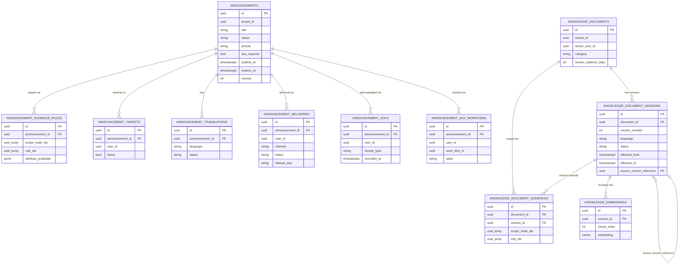
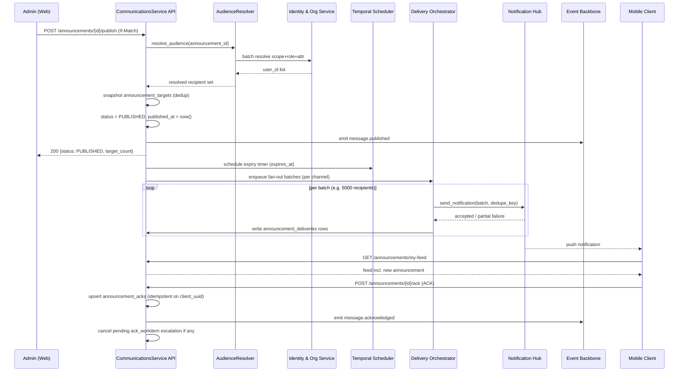
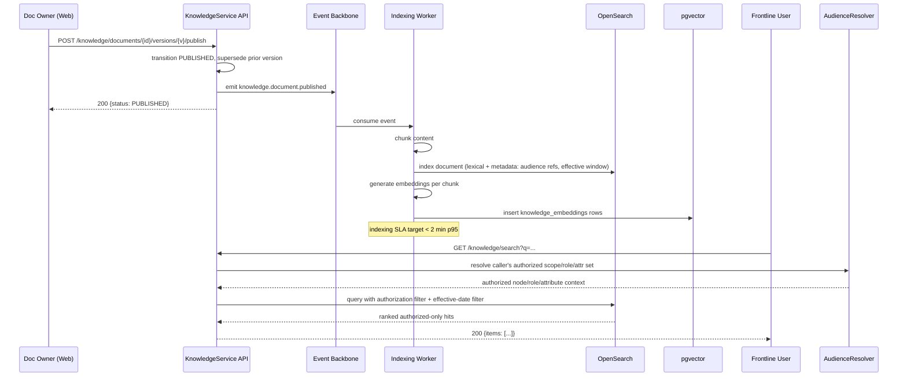
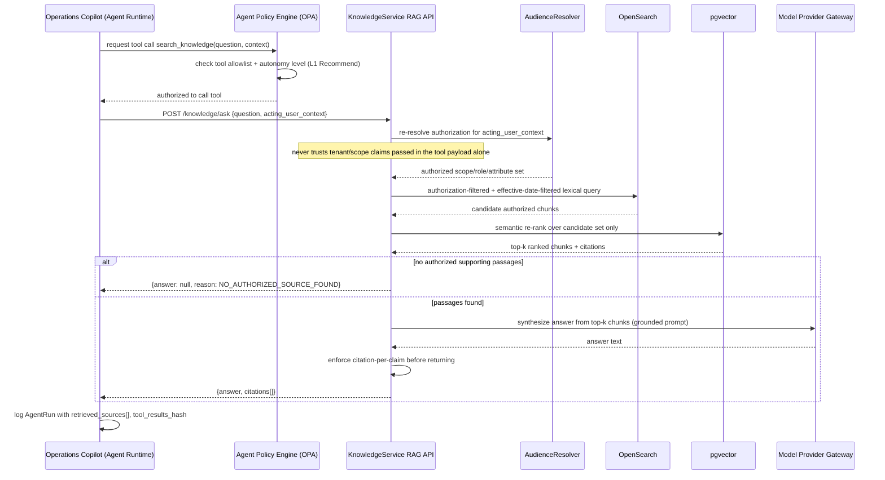

# Communications & Knowledge — Low-Level Design

Module: `07-communications-knowledge`
Schema namespace: `comms_knowledge` (Postgres)

## 1. Postgres Schema

All tables carry `tenant_id UUID NOT NULL` and are subject to Row-Level Security policies
(`USING (tenant_id = current_setting('app.tenant_id')::uuid)`) per conventions.md. Timestamps are
`TIMESTAMPTZ`. Primary keys are `UUID DEFAULT gen_random_uuid()` unless noted.

### 1.1 `announcements`

| Column | Type | Notes |
|---|---|---|
| id | UUID PK | |
| tenant_id | UUID NOT NULL | |
| title | TEXT NOT NULL | |
| body | TEXT NOT NULL | Source-language rich text (sanitized HTML/markdown) |
| source_language | VARCHAR(10) NOT NULL | BCP-47 tag |
| category | VARCHAR(40) NOT NULL | `POLICY`,`SAFETY`,`OPERATIONAL`,`HR`,`GENERAL`,custom |
| priority | VARCHAR(10) NOT NULL | `NORMAL`,`HIGH`,`CRITICAL` |
| status | VARCHAR(20) NOT NULL | `DRAFT`,`SCHEDULED`,`PUBLISHED`,`EXPIRED`,`RETRACTED` |
| ack_required | BOOLEAN NOT NULL DEFAULT false | |
| ack_deadline_type | VARCHAR(10) | `RELATIVE`,`ABSOLUTE`,NULL |
| ack_deadline_relative_hours | INT | e.g. 24 |
| ack_deadline_absolute | TIMESTAMPTZ | |
| channels | JSONB NOT NULL | e.g. `["IN_APP","PUSH","EMAIL"]` |
| publish_at | TIMESTAMPTZ | NULL = publish immediately on transition |
| published_at | TIMESTAMPTZ | Set when actually transitioned to PUBLISHED |
| expires_at | TIMESTAMPTZ | |
| retracted_at | TIMESTAMPTZ | |
| authored_by | UUID NOT NULL | FK → users (external ref) |
| authored_by_agent | BOOLEAN NOT NULL DEFAULT false | true if Communication Agent draft |
| version | INT NOT NULL DEFAULT 1 | Optimistic concurrency (ETag) |
| created_at | TIMESTAMPTZ NOT NULL DEFAULT now() | |
| updated_at | TIMESTAMPTZ NOT NULL DEFAULT now() | |

Indexes: `(tenant_id, status, publish_at)`, `(tenant_id, status, expires_at)`,
`(tenant_id, authored_by)`.

### 1.2 `announcement_audience_rules`

| Column | Type | Notes |
|---|---|---|
| id | UUID PK | |
| tenant_id | UUID NOT NULL | |
| announcement_id | UUID NOT NULL FK → announcements | |
| scope_node_ids | UUID[] NOT NULL | OrganizationNode subtree roots (union) |
| role_ids | UUID[] | Intersected (AND) with scope union, if present |
| attribute_predicate | JSONB | e.g. `{"field":"shift","op":"eq","value":"night"}` |
| created_at | TIMESTAMPTZ NOT NULL DEFAULT now() | |

Indexes: `(tenant_id, announcement_id)`.

### 1.3 `announcement_targets`

Snapshotted, de-duplicated resolved recipient set at publish time (FR-COMMS-003/015).

| Column | Type | Notes |
|---|---|---|
| id | UUID PK | |
| tenant_id | UUID NOT NULL | |
| announcement_id | UUID NOT NULL FK → announcements | |
| user_id | UUID NOT NULL | |
| resolved_at | TIMESTAMPTZ NOT NULL | |
| resolution_reason | VARCHAR(20) NOT NULL | `INITIAL`,`RERESOLVE_ADD`,`RERESOLVE_REMOVE` |
| active | BOOLEAN NOT NULL DEFAULT true | false if user exited audience on re-resolution |

Primary uniqueness: `UNIQUE (tenant_id, announcement_id, user_id)`. Indexes:
`(tenant_id, user_id, active)` for feed queries, `(tenant_id, announcement_id, active)`.

### 1.4 `announcement_translations`

| Column | Type | Notes |
|---|---|---|
| id | UUID PK | |
| tenant_id | UUID NOT NULL | |
| announcement_id | UUID NOT NULL FK → announcements | |
| language | VARCHAR(10) NOT NULL | |
| title | TEXT NOT NULL | |
| body | TEXT NOT NULL | |
| status | VARCHAR(20) NOT NULL | `PENDING`,`MACHINE_TRANSLATED`,`HUMAN_REVIEWED`,`STALE` |
| source_content_hash | TEXT NOT NULL | Hash of source title+body at translation time, used to detect drift |
| translated_at | TIMESTAMPTZ | |
| reviewed_by | UUID | |

Uniqueness: `UNIQUE (tenant_id, announcement_id, language)`.

### 1.5 `announcement_deliveries`

Per-recipient, per-channel delivery attempt record.

| Column | Type | Notes |
|---|---|---|
| id | UUID PK | |
| tenant_id | UUID NOT NULL | |
| announcement_id | UUID NOT NULL FK → announcements | |
| user_id | UUID NOT NULL | |
| channel | VARCHAR(10) NOT NULL | `IN_APP`,`PUSH`,`EMAIL`,`SMS`,`ENTERPRISE_MSG` |
| dedupe_key | TEXT NOT NULL | `{tenant_id}:{announcement_id}:{user_id}:{channel}` |
| status | VARCHAR(20) NOT NULL | `QUEUED`,`SENT`,`DELIVERED`,`FAILED`,`PROVIDER_UNAVAILABLE`,`FALLBACK_TRIGGERED` |
| failure_reason | VARCHAR(40) | e.g. `NO_CONTACT_METHOD` |
| attempted_at | TIMESTAMPTZ NOT NULL | |
| delivered_at | TIMESTAMPTZ | |
| provider_message_id | TEXT | External correlation id |

Uniqueness: `UNIQUE (tenant_id, dedupe_key)` — idempotency backstop for retried fan-out jobs.
Indexes: `(tenant_id, announcement_id, status)`, `(tenant_id, user_id, channel, attempted_at)`.

### 1.6 `announcement_acks`

| Column | Type | Notes |
|---|---|---|
| id | UUID PK | |
| tenant_id | UUID NOT NULL | |
| announcement_id | UUID NOT NULL FK → announcements | |
| user_id | UUID NOT NULL | |
| receipt_type | VARCHAR(10) NOT NULL | `READ` or `ACK` |
| client_uuid | UUID | For offline idempotent replay |
| occurred_at_client | TIMESTAMPTZ | Client-reported, non-authoritative |
| recorded_at | TIMESTAMPTZ NOT NULL DEFAULT now() | Server-authoritative timestamp |
| device_id | TEXT | |
| language_viewed | VARCHAR(10) | Which translation was shown |

Uniqueness: `UNIQUE (tenant_id, announcement_id, user_id, receipt_type)` — one ACK and one READ
per user per announcement (first-write-wins; see LLD §7 concurrency).

### 1.7 `announcement_ack_workitems`

Bridges to the universal `WorkItem` abstraction (source-spec §7.1) for escalation.

| Column | Type | Notes |
|---|---|---|
| id | UUID PK | |
| tenant_id | UUID NOT NULL | |
| announcement_id | UUID NOT NULL FK → announcements | |
| user_id | UUID NOT NULL | |
| work_item_id | UUID NOT NULL | FK → WorkItem (owned by Work Orchestration module) |
| state | VARCHAR(20) NOT NULL | `AVAILABLE`,`OVERDUE`,`ESCALATED`,`VERIFIED`(=acked),`CANCELLED` |
| escalation_level | INT NOT NULL DEFAULT 0 | |
| last_escalated_at | TIMESTAMPTZ | |

Uniqueness: `UNIQUE (tenant_id, announcement_id, user_id)`.

### 1.8 `knowledge_documents`

| Column | Type | Notes |
|---|---|---|
| id | UUID PK | Stable logical document identity |
| tenant_id | UUID NOT NULL | |
| owner_user_id | UUID NOT NULL | |
| category | VARCHAR(40) NOT NULL | |
| tags | TEXT[] | |
| review_cadence_days | INT | Nullable = no scheduled review |
| review_due_at | TIMESTAMPTZ | Computed from cadence + last review |
| created_at | TIMESTAMPTZ NOT NULL DEFAULT now() | |
| updated_at | TIMESTAMPTZ NOT NULL DEFAULT now() | |

Indexes: `(tenant_id, owner_user_id)`, `(tenant_id, category)`.

### 1.9 `knowledge_document_versions`

| Column | Type | Notes |
|---|---|---|
| id | UUID PK | |
| tenant_id | UUID NOT NULL | |
| document_id | UUID NOT NULL FK → knowledge_documents | |
| version_number | INT NOT NULL | Monotonic per (document_id, language) |
| language | VARCHAR(10) NOT NULL | |
| title | TEXT NOT NULL | |
| content | TEXT NOT NULL | Markdown/rich text body |
| content_hash | TEXT NOT NULL | For source-drift detection (translation staleness) |
| source_version_reference | UUID | Self-FK: source-language version this translation derives from |
| status | VARCHAR(20) NOT NULL | `DRAFT`,`REVIEW`,`APPROVED`,`PUBLISHED`,`SUPERSEDED`,`RETIRED` |
| effective_from | TIMESTAMPTZ | |
| effective_to | TIMESTAMPTZ | |
| published_at | TIMESTAMPTZ | |
| retired_at | TIMESTAMPTZ | |
| approved_by | UUID | |
| offline_cache_eligible | BOOLEAN NOT NULL DEFAULT false | |
| created_at | TIMESTAMPTZ NOT NULL DEFAULT now() | |

Uniqueness: `UNIQUE (tenant_id, document_id, language, version_number)`. Partial unique index:
`UNIQUE (tenant_id, document_id, language) WHERE status = 'PUBLISHED'` enforces FR-KNOW-002 (one
published version per document per language).
Indexes: `(tenant_id, document_id, status)`, `(tenant_id, status, effective_from, effective_to)`.

### 1.10 `knowledge_document_audiences`

| Column | Type | Notes |
|---|---|---|
| id | UUID PK | |
| tenant_id | UUID NOT NULL | |
| document_id | UUID NOT NULL FK → knowledge_documents | |
| version_id | UUID | NULL = applies to all versions of document; set = version-level override |
| scope_node_ids | UUID[] | |
| role_ids | UUID[] | |
| attribute_predicate | JSONB | |
| created_at | TIMESTAMPTZ NOT NULL DEFAULT now() | |

Indexes: `(tenant_id, document_id)`.

### 1.11 `knowledge_embeddings` (pgvector)

| Column | Type | Notes |
|---|---|---|
| id | UUID PK | |
| tenant_id | UUID NOT NULL | Partition key |
| version_id | UUID NOT NULL FK → knowledge_document_versions | |
| chunk_index | INT NOT NULL | |
| chunk_text | TEXT NOT NULL | |
| embedding | VECTOR(1536) NOT NULL | Dimension per model provider config |
| created_at | TIMESTAMPTZ NOT NULL DEFAULT now() | |

Table is `PARTITION BY LIST (tenant_id)` (or hash-partitioned for very large tenant counts, per
tenant-tier policy). Index: IVFFlat/HNSW vector index per partition, plus
`(tenant_id, version_id)` btree for deletion-on-retire.

### 1.12 ER Diagram



## 2. REST Endpoints

Base path `/api/v1/`. All endpoints require OAuth2/OIDC bearer auth; tenant resolved from
principal. Mutations accept `Idempotency-Key`. Mutable resources use `ETag`/`version`.

### 2.1 `POST /api/v1/announcements` — create draft

Request:
```json
{
  "title": "New cold-chain SOP effective Oct 1",
  "body": "<p>Effective October 1, all coolers must be logged every 2 hours...</p>",
  "source_language": "en",
  "category": "SAFETY",
  "priority": "HIGH",
  "ack_required": true,
  "ack_deadline_type": "RELATIVE",
  "ack_deadline_relative_hours": 24,
  "channels": ["IN_APP", "PUSH", "EMAIL"],
  "audience_rules": [
    {
      "scope_node_ids": ["node-region-northeast"],
      "role_ids": ["role-store-manager", "role-associate"],
      "attribute_predicate": null
    }
  ],
  "publish_at": "2026-09-25T13:00:00Z",
  "expires_at": "2026-11-01T00:00:00Z"
}
```
Response `201`:
```json
{ "id": "ann-8f21", "status": "SCHEDULED", "version": 1, "created_at": "2026-09-19T10:00:00Z" }
```
Errors: `400 VALIDATION_ERROR`, `403 SCOPE_DENIED` (author lacks authoring rights over a targeted
scope node).

### 2.2 `POST /api/v1/announcements/{id}/preview-audience` — audience preview (FR-COMMS-003)

Response `200`:
```json
{
  "estimated_count": 4820,
  "sample": [
    {"user_id": "u-101", "name": "J. Alvarez", "role": "Store Manager", "location": "Store #4412"},
    {"user_id": "u-204", "name": "P. Nguyen", "role": "Associate", "location": "Store #4488"}
  ],
  "resolved_at": "2026-09-19T10:02:11Z",
  "note": "Estimate only; authoritative recipient set is snapshotted at publish."
}
```

### 2.3 `POST /api/v1/announcements/{id}/publish`

Idempotent; requires `If-Match` (ETag/version). Transitions `DRAFT`/`SCHEDULED` → `PUBLISHED`
(or leaves as `SCHEDULED` if `publish_at` is future and this call only confirms scheduling).
Response `200`:
```json
{ "id": "ann-8f21", "status": "PUBLISHED", "published_at": "2026-09-25T13:00:03Z", "target_count": 4791, "version": 2 }
```
Errors: `409 CONFLICT` (version mismatch), `422 EMPTY_AUDIENCE` (resolved audience is zero — publish
blocked by default, override flag `allow_empty_audience: true` required to proceed).

### 2.4 `GET /api/v1/announcements/my-feed`

Query params: `?cursor=...&limit=50&status=ACTIVE|ALL`. Returns only announcements for which the
caller has a resolved `announcement_targets` row (`active = true`), tenant/scope enforced
server-side.

Response `200`:
```json
{
  "items": [
    {
      "id": "ann-8f21",
      "title": "New cold-chain SOP effective Oct 1",
      "priority": "HIGH",
      "ack_required": true,
      "ack_status": "PENDING",
      "ack_deadline": "2026-09-26T13:00:00Z",
      "read_status": "UNREAD",
      "published_at": "2026-09-25T13:00:03Z",
      "language_served": "en",
      "translation_available": true
    }
  ],
  "next_cursor": "eyJvZmZzZXQiOjUwfQ=="
}
```

### 2.5 `POST /api/v1/announcements/{id}/ack`

Request:
```json
{ "receipt_type": "ACK", "client_uuid": "c-uuid-99a1", "occurred_at_client": "2026-09-25T14:10:00Z", "language_viewed": "en" }
```
Response `200` (idempotent — replay returns original record, no duplicate):
```json
{ "announcement_id": "ann-8f21", "receipt_type": "ACK", "recorded_at": "2026-09-25T14:10:02Z", "duplicate": false }
```
Errors: `404 NOT_FOUND` (announcement not in caller's target set — never leaks existence to an
out-of-audience user beyond a generic not-found).

### 2.6 `POST /api/v1/knowledge/documents` — create document + first draft version

Request:
```json
{
  "category": "FOOD_SAFETY",
  "tags": ["temperature", "cold-chain"],
  "review_cadence_days": 365,
  "owner_user_id": "u-501",
  "version": {
    "language": "en",
    "title": "Cold Chain Monitoring SOP",
    "content": "# Cold Chain Monitoring\n\n1. Log cooler temperature every 2 hours...",
    "effective_from": "2026-10-01T00:00:00Z"
  },
  "audience_rules": [
    { "scope_node_ids": ["node-enterprise-root"], "role_ids": ["role-store-manager", "role-associate"] }
  ]
}
```
Response `201`:
```json
{ "document_id": "kd-3391", "version_id": "kdv-1", "status": "DRAFT", "version_number": 1 }
```

### 2.7 `POST /api/v1/knowledge/documents/{id}/versions/{versionId}/publish`

Transitions `APPROVED → PUBLISHED`, auto-supersedes the prior published version in the same
language (FR-KNOW-002), and emits `knowledge.document.published`.
Response `200`:
```json
{ "document_id": "kd-3391", "version_id": "kdv-1", "status": "PUBLISHED", "published_at": "2026-09-20T09:00:00Z", "superseded_version_id": null }
```
Errors: `409 CONFLICT` (version not in `APPROVED` state), `422 INVALID_EFFECTIVE_WINDOW`.

### 2.8 `GET /api/v1/knowledge/search`

Query params: `?q=cold+chain+temperature+log&language=en&category=FOOD_SAFETY&cursor=...&limit=20`.
Server constructs an authorization-filtered hybrid query (see §6.2 pseudocode) before ranking.

Response `200`:
```json
{
  "items": [
    {
      "document_id": "kd-3391",
      "version_id": "kdv-1",
      "title": "Cold Chain Monitoring SOP",
      "snippet": "...log cooler temperature every 2 hours and record corrective action if...",
      "score": 8.42,
      "language": "en",
      "effective_from": "2026-10-01T00:00:00Z",
      "translation_stale": false
    }
  ],
  "next_cursor": null
}
```
Note: a query returning zero authorized results is indistinguishable in shape from a query with no
matches at all (functional-spec §6 UX rule) — no `total_excluded` field is ever returned.

### 2.9 `POST /api/v1/knowledge/ask`

RAG endpoint; also the implementation behind the Agent Runtime's `search_knowledge()` tool.

Request:
```json
{ "question": "What temperature triggers a corrective action for walk-in coolers?", "language": "en" }
```
Response `200`:
```json
{
  "answer": "A walk-in cooler reading above 8°C requires a mandatory corrective action and creates a high-risk issue per the Cold Chain Monitoring SOP.",
  "citations": [
    { "document_id": "kd-3391", "version_id": "kdv-1", "title": "Cold Chain Monitoring SOP", "section_anchor": "corrective-thresholds" }
  ],
  "confidence": "HIGH",
  "answered_at": "2026-09-25T14:20:00Z"
}
```
No-answer response `200` (not an error — an authorized empty result is a valid outcome):
```json
{ "answer": null, "citations": [], "reason": "NO_AUTHORIZED_SOURCE_FOUND", "answered_at": "2026-09-25T14:21:00Z" }
```
Errors: `429 RATE_LIMITED`, `503 MODEL_PROVIDER_UNAVAILABLE` (degrades per HLD §8).

## 3. Sequence Diagrams

### 3.1 Announcement publish → audience resolution → multi-channel fan-out → ack tracking



### 3.2 Knowledge document publish → indexing → authorized search



### 3.3 AI question-answering flow enforcing authorization (feeds Operations Copilot)



## 4. Pseudocode: Audience Resolution

```
function resolve_audience(tenant_id, audience_rules, as_of = now()):
    resolved_users = empty_set()
    for rule in audience_rules:
        # Step 1: expand scope_node_ids to full subtrees (materialized path prefix match)
        candidate_node_ids = OrgService.expand_subtrees(tenant_id, rule.scope_node_ids, as_of)

        # Step 2: find UserScope rows valid as_of, whose node_id is in candidate_node_ids
        scoped_user_ids = OrgService.list_users_with_scope(
            tenant_id, candidate_node_ids, as_of
        )  # batched query, not per-user

        # Step 3: intersect with role filter if present
        if rule.role_ids is not empty:
            scoped_user_ids = filter(scoped_user_ids, lambda u: u.role_id in rule.role_ids)

        # Step 4: intersect with attribute predicate if present
        if rule.attribute_predicate is not null:
            scoped_user_ids = filter(scoped_user_ids,
                lambda u: evaluate_predicate(u.attributes, rule.attribute_predicate))

        # Step 5: drop inactive/deactivated users
        scoped_user_ids = filter(scoped_user_ids, lambda u: u.status == 'ACTIVE')

        # Union this rule's result into the overall set (rules across an announcement are unioned)
        resolved_users = union(resolved_users, scoped_user_ids)

    return deduplicate(resolved_users)

function evaluate_predicate(attributes, predicate):
    # predicate: {"field": "shift", "op": "eq", "value": "night"}
    # supported ops: eq, neq, in, not_in, gte, lte  (deterministic, no free-form eval)
    value = attributes.get(predicate.field)
    switch predicate.op:
        case 'eq': return value == predicate.value
        case 'neq': return value != predicate.value
        case 'in': return value in predicate.value
        case 'not_in': return value not in predicate.value
        case 'gte': return value >= predicate.value
        case 'lte': return value <= predicate.value

function re_resolve_active_announcements_on_change_event(event):
    # triggered by user.role_changed, user.deactivated, user.reactivated,
    # org.node_moved, org.node_created
    affected_announcements = query_announcements(
        status = 'PUBLISHED',
        publish_at <= now(),
        expires_at > now() OR expires_at IS NULL
    )
    for ann in affected_announcements:
        if not rule_scope_intersects_change(ann.audience_rules, event):
            continue  # cheap pre-filter before full re-resolution
        new_set = resolve_audience(ann.tenant_id, ann.audience_rules)
        old_set = load_active_targets(ann.id)
        additions = new_set - old_set
        removals  = old_set - new_set
        for user_id in additions:
            upsert announcement_targets(ann.id, user_id, active=true, reason='RERESOLVE_ADD')
            enqueue_delivery(ann.id, user_id)  # deliver to newly-in-scope user
        for user_id in removals:
            mark announcement_targets(ann.id, user_id, active=false, reason='RERESOLVE_REMOVE')
            if ann.ack_required:
                cancel_pending_ack_workitem(ann.id, user_id)  # per Edge Case: deactivated mid-campaign
```

## 5. Pseudocode: Authorization-Filtered Search Query Construction

```
function build_authorized_search_query(tenant_id, user_context, query_text, filters):
    # user_context: { user_id, tenant_id, active_scope_node_ids[], role_ids[], attributes{} }

    # Step 1: compute the set of document_ids the user is authorized to see, NOT by scanning
    # all documents, but by resolving which KnowledgeDocumentAudience rules match this user
    # (mirrors resolve_audience, but reversed: user -> matching audience rules -> document_ids)
    authorized_doc_ids = KnowledgeAudienceIndex.lookup_matching_documents(
        tenant_id,
        user_scope_node_ids = user_context.active_scope_node_ids,
        role_ids = user_context.role_ids,
        attributes = user_context.attributes
    )
    # KnowledgeAudienceIndex is a precomputed reverse index (see §8 caching), refreshed on
    # knowledge_document_audiences change and on user scope change — same precompute rationale
    # as announcement audience resolution (HLD §7).

    # Step 2: build OpenSearch query — bool filter clause is MANDATORY, not advisory
    os_query = {
        "query": {
            "bool": {
                "must": [
                    { "multi_match": { "query": query_text, "fields": ["title^3", "content", "tags^2"] } }
                ],
                "filter": [
                    { "terms": { "document_id": authorized_doc_ids } },  # hard authorization boundary
                    { "term": { "status": "PUBLISHED" } },
                    { "term": { "language": filters.language } } if filters.language else skip,
                    { "range": { "effective_from": { "lte": "now" } } },
                    { "bool": { "should": [
                        { "bool": { "must_not": { "exists": { "field": "effective_to" } } } },
                        { "range": { "effective_to": { "gt": "now" } } }
                    ]}}
                ]
            }
        }
    }
    return os_query

function build_rag_candidate_set(tenant_id, user_context, question):
    authorized_doc_ids = KnowledgeAudienceIndex.lookup_matching_documents(tenant_id, user_context)
    if authorized_doc_ids is empty:
        return NO_AUTHORIZED_SOURCE_FOUND

    # Lexical pre-filter narrows to plausibly-relevant + authorized chunks first (bounded candidate set)
    lexical_hits = OpenSearch.query(build_authorized_search_query(tenant_id, user_context, question, {}))
    candidate_version_ids = extract_version_ids(lexical_hits, top_n=200)

    # Semantic re-rank happens ONLY within the already-authorized, already-lexically-plausible set
    embeddings_query = pgvector.query(
        tenant_id = tenant_id,
        filter_version_ids = candidate_version_ids,  # never a bare nearest-neighbor over full corpus
        embedding = embed(question),
        top_k = 8
    )
    return embeddings_query.chunks_with_citations()
```

## 6. Caching Strategy

| Cache | Key shape | TTL / invalidation |
|---|---|---|
| Resolved-audience membership (per announcement) | `tenant:{t}:ann:{id}:audience` (Redis set of user_ids) | TTL 15 min; explicitly invalidated on relevant `user.*`/`org.*` change events (event-driven invalidation preferred over TTL expiry alone) |
| Resolved authorized-document-id set (per user "authorization fingerprint") | `tenant:{t}:userauth:{scope_hash}:docs` (Redis set) — keyed by a hash of the user's scope/role/attribute fingerprint, not raw user_id, so users with identical effective access share a cache entry | TTL 10 min; invalidated on `knowledge_document_audiences` change or user scope change |
| Hot-document cache (frequently viewed/retrieved published content) | `tenant:{t}:doc:{version_id}:content` | TTL 1 hour; invalidated immediately on new version publish/retire |
| RAG answer cache | `tenant:{t}:authfp:{scope_hash}:qhash:{question_hash}` — cache key includes the authorization fingerprint (fixed, final requirement — functional-spec.md Resolved Decisions), never just the question text, so two users with different authorized-document sets can never share a cached answer | TTL 30 min; **proactively invalidated** when any cited `version_id` transitions to `RETIRED` or a newer version of a cited document publishes |
| `my-feed` page 1 (per user) | `tenant:{t}:user:{u}:feed:p1` | TTL 60s; invalidated on new `announcement_targets` insert for that user or new ack recorded |

## 7. Concurrency Control

- **Announcement publish**: optimistic concurrency via `version`/`ETag`; concurrent publish
  attempts on the same announcement return `409 CONFLICT` per conventions.md.
- **Idempotent delivery recording**: `announcement_deliveries.dedupe_key` uniqueness constraint
  makes retried fan-out batch jobs (e.g., a worker crash-and-retry) safe — a duplicate `INSERT`
  is caught by the unique constraint and treated as a no-op success, not an error surfaced to the
  caller.
- **Idempotent ack recording**: `announcement_acks` uniqueness on `(tenant_id, announcement_id,
  user_id, receipt_type)` combined with an `INSERT ... ON CONFLICT DO NOTHING RETURNING *` pattern;
  if no row is returned (conflict occurred), the API fetches and returns the existing row with
  `duplicate: true` semantics rather than erroring — this is what makes offline-queued ack replay
  safe (functional-spec §7 "duplicate acknowledgement" edge case).
- **Knowledge document version publish**: the partial unique index
  (`WHERE status='PUBLISHED'`) makes "only one published version per document+language" a
  database-enforced invariant, not just application logic; the publish transaction does
  `UPDATE ... SET status='SUPERSEDED' WHERE document_id=? AND language=? AND status='PUBLISHED'`
  followed by the new row's `status='PUBLISHED'` update inside the same transaction, so a crash
  mid-transaction cannot leave two published versions or zero published versions in an inconsistent
  visible state (rolls back cleanly).
- **Audience re-resolution races**: re-resolution jobs for the same announcement are serialized via
  a Postgres advisory lock keyed on `announcement_id` (or a Temporal workflow-per-announcement-id
  ensuring single-flight execution) to avoid two concurrent re-resolution runs producing conflicting
  add/remove target rows.

## 8. Background Jobs

| Job | Trigger | Behavior |
|---|---|---|
| Publish scheduler | Temporal timer per announcement with `publish_at` set | Fires at `publish_at`, transitions `SCHEDULED → PUBLISHED`, triggers resolution+fan-out (idempotent — Temporal workflow ensures exactly-once effect even across worker restarts) |
| Expiry sweeper | Temporal timer per announcement with `expires_at` set | Fires at `expires_at`, transitions `PUBLISHED → EXPIRED`, removes from active feed query set, emits `message.expired` |
| Non-ack escalation sweeper | Runs every 15 min (cron-style, or Temporal schedule) | Scans `announcement_ack_workitems` where `state='AVAILABLE'` and deadline passed → transitions to `OVERDUE`, notifies manager per escalation ladder; re-scans `OVERDUE` past next escalation interval → increments `escalation_level`, notifies next tier |
| Audience re-resolution worker | Consumes `user.role_changed`, `user.deactivated`, `user.reactivated`, `org.node_moved`, `org.node_created` events | Runs §4 pseudocode `re_resolve_active_announcements_on_change_event`; also re-resolves `knowledge_document_audiences`-affected authorization fingerprint cache entries |
| Embedding pipeline worker | Consumes `knowledge.document.published` | Chunks content, generates embeddings, writes `knowledge_embeddings`; on `knowledge.document.retired`, deletes embeddings for that `version_id` and issues OpenSearch delete-by-query |
| Translation drift detector | Consumes announcement/document content-edit events | Recomputes `content_hash`/`source_content_hash` comparison; flags dependent translations `STALE` (FR-COMMS-013) |
| Review-cadence reminder | Daily scan of `knowledge_documents.review_due_at <= now() + 14 days` | Creates reminder work item for `owner_user_id`; emits `knowledge.document.review_due` |
| RAG answer-cache invalidator | Consumes `knowledge.document.retired`, `knowledge.document.published` | Scans/evicts cached answers whose citation set includes the affected `version_id` (reverse index: `version_id → cached_answer_keys`, maintained alongside the cache write) |
| Fan-out batch worker | Consumes internal fan-out batch messages from Delivery Orchestrator | Calls Notification Hub per batch with bounded concurrency; writes `announcement_deliveries`; on provider failure, marks `PROVIDER_UNAVAILABLE` and schedules fallback-channel evaluation after the configured window |

## 9. Error Handling

| Scenario | HTTP status | Error code | Notes |
|---|---|---|---|
| Publish with resolved audience of zero | 422 | `EMPTY_AUDIENCE` | Requires explicit `allow_empty_audience` override |
| Publish with stale ETag/version | 409 | `CONFLICT` | Standard optimistic concurrency response |
| Author lacks scope over a targeted node | 403 | `SCOPE_DENIED` | Enforced at audience-rule validation, before any resolution |
| Ack on announcement not in caller's target set | 404 | `NOT_FOUND` | Never distinguishes "doesn't exist" from "not authorized" |
| Duplicate ack (idempotent replay) | 200 | n/a | Returns original record with `duplicate: true`, not an error |
| Search/ask against a fully out-of-scope corpus | 200 | n/a | Empty result set / `NO_AUTHORIZED_SOURCE_FOUND`, never an error |
| Publish version when another version already `PUBLISHED` for same language | Handled transactionally | n/a | Auto-supersede, not an error, unless target version itself is not `APPROVED` |
| Publish version not in `APPROVED` state | 409 | `INVALID_STATE_TRANSITION` | |
| Effective window invalid (`effective_to <= effective_from`) | 422 | `INVALID_EFFECTIVE_WINDOW` | |
| Attachment exceeds size/count limit | 413 | `ATTACHMENT_LIMIT_EXCEEDED` | |
| Translation provider timeout | 200 (async) | n/a | Publish proceeds; translation status remains `PENDING`, surfaced to author, retried with backoff |
| OpenSearch unavailable | 200 (degraded) | n/a | Falls back to Postgres keyword index per HLD §8; response includes `degraded: true` |
| Model provider unavailable for RAG | 503 | `MODEL_PROVIDER_UNAVAILABLE` | Client shows "temporarily unavailable"; retry-after header set |
| Rate limit exceeded (tenant or principal) | 429 | `RATE_LIMITED` | Per conventions.md tenant/principal-aware rate limiting |
| Idempotency-Key reused with different payload | 409 | `IDEMPOTENCY_KEY_CONFLICT` | Standard platform-wide idempotency contract |
| Ownerless document transfer attempt (no new owner specified) | 422 | `OWNER_REQUIRED` | FR-KNOW edge case — transfer must specify new owner in same request |
| Cross-tenant document/announcement reference attempted | 403 | `SCOPE_DENIED` | Defense-in-depth; should be unreachable given RLS, but the application layer still validates and logs as a potential security event |
