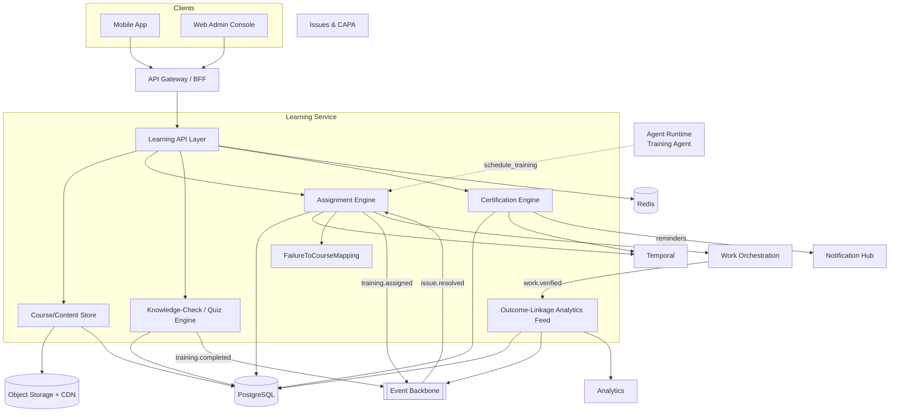
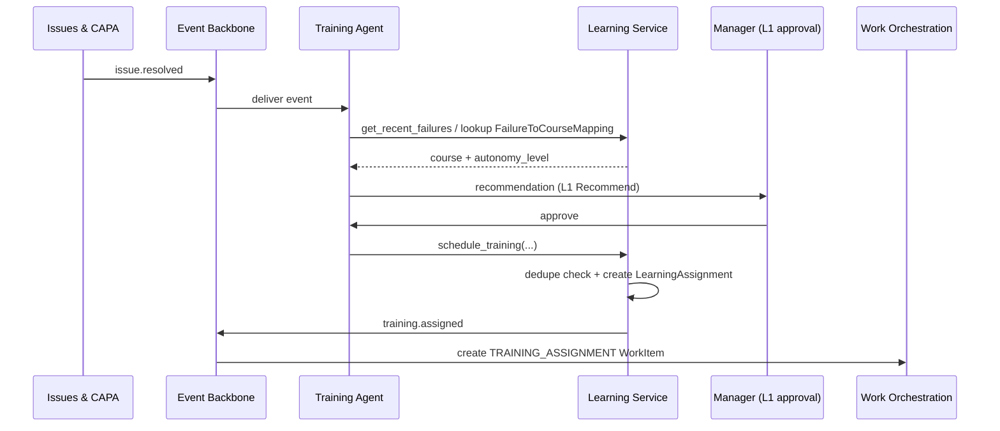
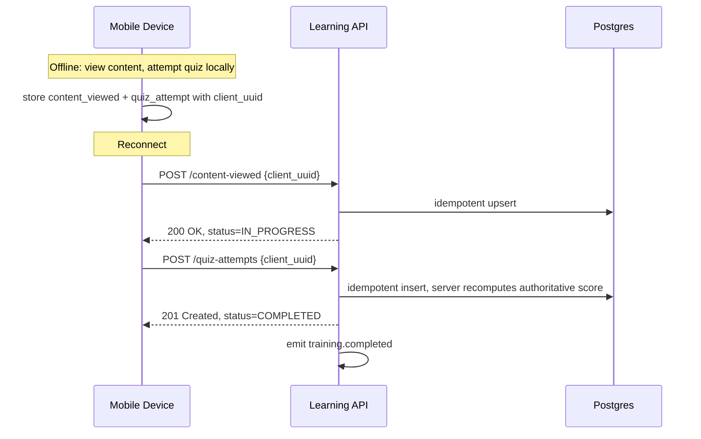
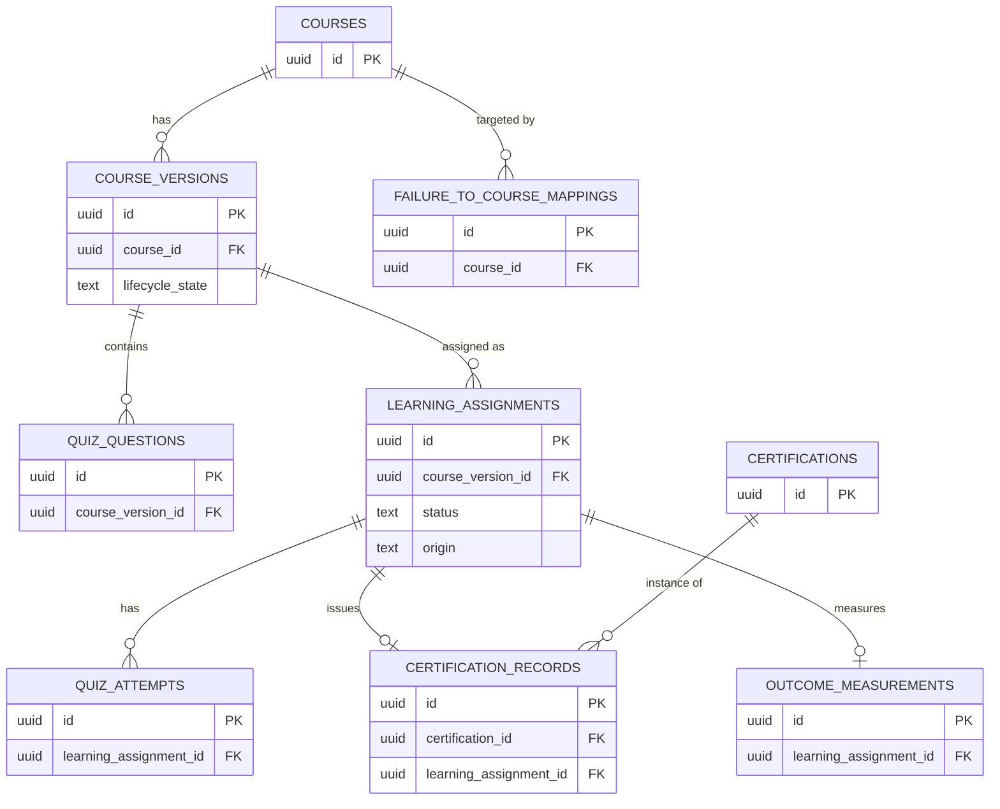

# Learning — Architecture Diagrams

Module corresponds to **EPIC-09 (Learning)**. Focused diagram set only; narrative detail lives in
functional-spec.md, high-level-design.md and low-level-design.md.

## 1. Component / Container Diagram

The Learning Service is a single deployable owning five internal components: the course/content
store (authoring + versioning), the assignment engine (all three assignment origins), the
knowledge-check engine, the certification engine, and the outcome-linkage feed. It depends on
Postgres for transactional state, object storage/CDN for content, Temporal for expiry/reminder
timers, Kafka for domain events, and Redis for hot-path caching. It integrates with Work
Orchestration (WorkItem projection), Issues/CAPA and Analytics (failure signals in, outcome facts
out), the Agent Runtime (Training Agent's `schedule_training` tool target), and Notification Hub
(reminder delivery).

## 2. Sequence Diagram — Failure-Triggered Assignment

A repeated failure (detected by Issues/CAPA or Analytics) reaches the Training Agent via the event
backbone. The agent maps the failure category to a course through Learning's
`FailureToCourseMapping` table, and — at the default L1 Recommend autonomy — surfaces the proposal
for manager approval before Learning creates the `LearningAssignment` and Work Orchestration
projects it as a `TRAINING_ASSIGNMENT` WorkItem.

## 3. Sequence Diagram — Offline Completion Sync

Content viewing and quiz attempts are recorded locally while offline, each tagged with a
`client_uuid`. On reconnect, both sync calls are idempotent — a duplicate replay returns the
original result — and the server always recomputes the authoritative quiz score rather than
trusting the client's locally computed value.

## 4. ER Diagram

`Course`/`CourseVersion` follow the platform's Template/TemplateVersion immutable-after-publish
pattern. `LearningAssignment` is the central record, referencing an immutable `CourseVersion` and
fanning out to `QuizAttempt` (0..N), an optional `CertificationRecord` (issued on qualifying
completion), and an optional `OutcomeMeasurement` (only for failure-triggered assignments with a
linked re-inspection). `FailureToCourseMapping` is the Training Agent's read-only rule table.

## 5. State Diagram — LearningAssignment Lifecycle

```mermaid
stateDiagram-v2
    [*] --> ASSIGNED
    ASSIGNED --> IN_PROGRESS: content first viewed
    IN_PROGRESS --> COMPLETED: knowledge check passed (or no check required)
    IN_PROGRESS --> FAILED: max quiz attempts exhausted without passing
    ASSIGNED --> CANCELLED: role no longer applicable / user deactivated / superseded by reissue
    IN_PROGRESS --> CANCELLED: role no longer applicable / user deactivated / superseded by reissue
    COMPLETED --> VERIFIED: linked re-inspection passes (failure-triggered only)
    COMPLETED --> FAILED: linked re-inspection fails (no improvement)
    FAILED --> ASSIGNED: re-assigned (new LearningAssignment created; not a mutation of this row)
    COMPLETED --> [*]: terminal (no re-inspection linkage - most manual/role-based training)
    VERIFIED --> [*]
    CANCELLED --> [*]
```

Most manual and role-based assignments terminate at `COMPLETED` — there is no re-inspection to
verify against. Failure-triggered assignments continue: `COMPLETED` is provisional until the linked
re-inspection resolves it to `VERIFIED` (improvement measured) or `FAILED` (no improvement, which
triggers escalation to the Compliance Monitor Agent rather than an automatic identical re-assignment,
per functional-spec FR-LEARN-046). A `FAILED` assignment's "re-assignment" is always a **new**
`LearningAssignment` row (with a fresh `origin_ref` chain), never a resurrection of the failed row,
preserving an immutable audit history of every attempt.
