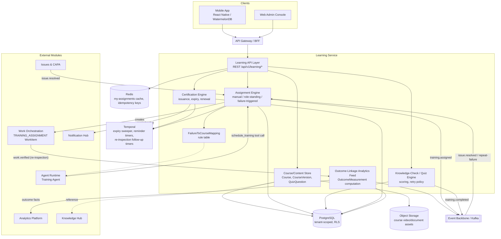

# Learning — High-Level Design

Module corresponds to **EPIC-09 (Learning)**. Implements functional-spec.md. Consistent with
conventions.md (target tech stack, multi-tenancy rule, domain model, diagram conventions).

## 1. Module Responsibilities

The **Learning Service** is a Kotlin + Spring Boot microservice (one deployable, per the platform's
modular-domain-architecture principle, source-spec §16.2) owning:

- **Course/content authoring & versioning** — `Course`, `CourseVersion`, `QuizQuestion`.
- **Assignment engine** — `LearningAssignment` creation (manual, role-standing, failure-triggered),
  lifecycle transitions, mass-assignment fan-out.
- **Knowledge-check / quiz engine** — `QuizAttempt` scoring, retry policy enforcement.
- **Certification management** — `Certification` definitions, `CertificationRecord` issuance,
  expiry-reminder scheduling, expiry-policy enforcement support (status API consumed by Work
  Orchestration).
- **Outcome-linkage analytics feed** — `OutcomeMeasurement` computation (pre/post re-inspection
  comparison) and emission of facts to the analytics/CDC pipeline.
- **Training Agent domain surface** — the `FailureToCourseMapping` rule table and the
  `schedule_training`-class tool contract the Agent Runtime invokes on Learning's behalf.

It does **not** own generic WorkItem lifecycle/scheduling/SLA (Work Orchestration), failure-pattern
detection (Issues/CAPA, Analytics), notification delivery (Notification Hub), the offline sync
transport (Mobile/Offline), or the Agent Runtime's context/policy/model machinery (Agent Runtime).

## 2. Component Diagram

## 3. Data Ownership

| Entity | Owned here? | Notes |
|---|---|---|
| `Course` | Yes | Logical course identity, tenant-scoped |
| `CourseVersion` | Yes | Immutable-after-publish, mirrors `TemplateVersion` pattern |
| `QuizQuestion` | Yes | Attached to a `CourseVersion` |
| `LearningAssignment` | Yes | Learning-domain record; source of truth for quiz/cert state |
| `QuizAttempt` | Yes | One per learner attempt |
| `Certification` | Yes | Definition |
| `CertificationRecord` | Yes | Per-user issuance/expiry history, append-only |
| `OutcomeMeasurement` | Yes | Pre/post re-inspection comparison result |
| `FailureToCourseMapping` | Yes | Rule table read by Training Agent |
| `TRAINING_ASSIGNMENT` WorkItem | **No** (Work Orchestration) | Referenced by ID; Learning is the payload/source, Work Orchestration is the generic wrapper/lifecycle |
| `Issue` | **No** (Issues/CAPA) | Referenced as `origin_ref` on failure-triggered assignments |
| `OrganizationNode` / `UserScope` / `User` | **No** (Identity/Org) | Referenced for audience scope, role-standing resolution |
| `KnowledgeDocument` | **No** (Knowledge) | May be referenced as course content |
| `AgentRun` / `AgentToolExecution` | **No** (Agent Runtime) | Training Agent's own execution trace; Learning is a tool target, not the trace owner |

**Key decision — outcome measurement links back to Issue/WorkItem tables rather than duplicating
state.** `OutcomeMeasurement` stores foreign keys (`triggering_issue_id`, `baseline_work_item_id`,
`reinspection_work_item_id`, `learning_assignment_id`) and the derived comparison
(`baseline_result`, `followup_result`, `improved`) — it does **not** copy the full Issue or
Submission payload. Rationale:

- **Single source of truth.** Issue state (source-spec §17.3) and Submission/inspection results
  are owned and mutated by Issues/CAPA and Work Orchestration respectively; duplicating them into
  Learning creates a second copy that can drift (e.g., an Issue reopened after Learning already
  recorded an outcome).
  Foreign-key linkage means a query joining outcome data always sees current, authoritative state.
- **Historical-truth principle (P7).** The comparison itself (`improved: true/false`,
  `measured_at`) is Learning-domain-specific derived fact and *is* appropriately owned/immutable here
  once computed; the underlying evidence it was computed from stays owned where it originated.
- **Avoids fan-out consistency problems.** If Learning duplicated Issue/Submission fields, every
  update to those upstream records would need a synchronous or eventually-consistent propagation
  into Learning's copies — extra failure surface for no query-performance benefit, since the
  outcome-measurement job (LLD §6) runs asynchronously off events already and can read authoritative
  state at computation time rather than a stale duplicate.
- **Analytics still gets flat facts.** The CDC/event pipeline flattens the FK-linked
  `OutcomeMeasurement` row together with denormalized dimensions (location, failure category, course)
  at ingestion into the lakehouse — the normalization discipline lives in the transactional store,
  not in the analytical one, per the platform's "warehouse for analytical workloads, transactional DB
  authoritative for operational state" principle (source-spec §16.2).

## 4. External Interfaces

### 4.1 Events Produced (envelope per source-spec §18.4)

| Event | Trigger | Key payload |
|---|---|---|
| `training.assigned` | `LearningAssignment` created (any origin) | `assignment_id`, `user_id`, `course_version_id`, `origin`, `origin_ref`, `due_at` |
| `training.completed` | `LearningAssignment` reaches `COMPLETED` | `assignment_id`, `user_id`, `course_version_id`, `quiz_attempt_id`, `score_pct`, `passed`, `is_targeted_microlearning` |
| `certification.issued` (Learning-internal extension event, namespaced `learning.certification.issued`) | `CertificationRecord` created | `record_id`, `user_id`, `certification_id`, `expires_at` |
| `certification.expiring` / `certification.expired` (`learning.certification.expiring` / `learning.certification.expired`) | Expiry-sweeper job (LLD §7) | `record_id`, `user_id`, `days_until_expiry` or `expired_at` |
| `learning.outcome_measured` | Outcome-measurement job computes a result | `outcome_measurement_id`, `assignment_id`, `improved`, `baseline_result`, `followup_result` |

Note: `training.assigned`/`training.completed` are the two canonical platform-wide events named in
source-spec §18.3; the `learning.*`-namespaced events are Learning-specific extensions following the
same envelope shape and are consumed primarily by Analytics and Communications.

### 4.2 Events Consumed

| Event (producer) | Consumed by | Effect |
|---|---|---|
| `issue.resolved` (Issues/CAPA) | Assignment Engine | Evaluated against `FailureToCourseMapping` trigger conditions (functional-spec §7) |
| repeat-failure pattern signal (Analytics, event `analytics.repeat_failure_pattern_detected`) | Assignment Engine | Alternate trigger source when the pattern spans multiple issues Issues/CAPA has already individually closed |
| `user.role_changed` / `user.deactivated` (Identity/Org) | Assignment Engine | Role-standing assignment cancellation, deactivation cleanup (functional-spec FR-LEARN-060) |
| `work.verified` (Work Orchestration, on the linked re-inspection WorkItem) | Outcome-Linkage Analytics Feed | Triggers pre/post comparison (LLD §6) |
| `agent.action_approved` (Agent Runtime) | Assignment Engine | Confirms an L1-Recommend Training Agent proposal before `training.assigned` fires |
| `template.published` equivalent — not applicable | — | Course publishing is internal to Learning, no cross-module consumption needed |

### 4.3 Synchronous APIs Consumed

| Call | Target | Purpose |
|---|---|---|
| `schedule_reinspection`-class call | Work Orchestration | Create the follow-up `AUDIT_INSPECTION` WorkItem linked to a completed failure-triggered assignment |
| Certification status check | Learning exposes this **to** Work Orchestration | Work Orchestration calls Learning's `GET /certifications/status` at WorkItem claim/assignment time when a WorkItem type is certification-gated |
| `send_notification`-class call | Notification Hub | Certification-expiry reminders, overdue-assignment nudges |
| Org/scope resolution | Identity/Org | Resolve audience scope (role + org subtree) at assignment time |

## 5. Scalability

- **Mass-assignment fan-out.** A role/org-subtree assignment (functional-spec FR-LEARN-030/031) up
  to 100k target users (platform scale target, source-spec §23) is processed as an **async batch
  job**, not a synchronous request: the API accepts the request, persists an `AssignmentBatch` row
  (`status=PENDING`), returns `202 Accepted` with a batch ID, and a Temporal workflow expands the
  target user set (paginated `UserScope` query against Identity/Org) and writes
  `LearningAssignment` rows in bounded-size batches (e.g. 500 rows/transaction) with
  `training.assigned` events published per batch, not per row, using Kafka's batched-produce path
  for throughput. Progress is queryable (`GET /assignment-batches/{id}`) for admin UX.
- **Offline content packaging / CDN distribution.** `DOCUMENT`/`VIDEO` assets are stored once in
  object storage and fronted by a CDN; the mobile client requests a signed, time-limited CDN URL
  (not a direct object-storage URL) so large-scale simultaneous downloads (e.g., a mandatory
  safety video pushed to every frontline user enterprise-wide) are absorbed by CDN edge caching
  rather than the origin/object-storage tier. Video is pre-transcoded at publish time (not
  on-demand) into the mobile-optimized bitrate profile (functional-spec FR-LEARN-053) so transcoding
  load never spikes at assignment-fan-out time.
- **Read scaling for "my assignments."** The mobile "my assignments" endpoint (used both for initial
  offline caching and periodic reconciliation) is Redis-cached per user with a short TTL (functional
  detail in LLD §5) so a mass-assignment event that suddenly makes many users poll simultaneously
  does not create a Postgres read spike.
- **Quiz-attempt write throughput.** `QuizAttempt` writes are append-only, narrow rows; no special
  scaling concern at platform scale, but attempt-sync batches from offline devices (functional-spec
  FR-LEARN-051) are processed through the platform-wide sync endpoint's batching, not a Learning-
  specific bottleneck.

## 6. Multi-Tenancy

Every table carries `tenant_id`; Postgres RLS policies scope all reads/writes as the defense-in-depth
backstop behind application-layer scoping, per conventions.md. `Course`/`CourseVersion`
`audience_scope` additionally enforces the `OrganizationNode`/`UserScope` scoping axis (a course
authored by one business unit's admin is not assignable outside its configured scope unless
explicitly enterprise-wide). Object storage keys are tenant-prefixed and KMS-encrypted, matching the
Evidence module's storage convention. CDN signed URLs are scoped to a single object and expire
short-lived (default 15 minutes) to prevent cross-tenant URL leakage/replay.

## 7. Failure Modes and Degradation

| Failure | Impact | Degradation strategy |
|---|---|---|
| Content CDN outage | Learners cannot stream/download `VIDEO`/`DOCUMENT` content not already cached on-device | Already-cached offline content remains usable (offline-first design); API layer surfaces a distinct "content temporarily unavailable, try later" state rather than a generic error; client falls back to direct (uncached, slower) object-storage signed URL as a circuit-breaker fallback path for critical safety content if CDN health check fails, rate-limited to avoid overloading origin |
| Quiz-grading service failure (if scoring is split into a sub-component / or DB write failure mid-scoring) | Learner cannot submit or receive a score | Attempt is preserved client-side (offline-style durability even when online, i.e. write-ahead to local storage before submit) with automatic retry; server-side idempotent submission (`client_uuid`) guarantees a retried submit is never double-scored or double-counted |
| Temporal unavailable | Certification-expiry sweeper, reminder timers, and re-inspection follow-up scheduling delayed | Core assignment creation, content access, and quiz submission continue to function (they do not depend on Temporal synchronously); expiry/reminder timers resume from durable Temporal state on recovery — no reminders are lost, only delayed, consistent with Work Orchestration's equivalent NFR-WORK-05 pattern |
| Event Backbone (Kafka) lag/outage | `training.assigned`/`training.completed`/outcome events delayed to consumers (Work Orchestration WorkItem projection, Analytics) | Learning Service's own transactional state (the source of truth) is unaffected; Work Orchestration's WorkItem projection and Analytics facts lag until backlog drains; dead-letter queue + replay per platform-wide reliability pattern (source-spec §22.3) |
| Object storage outage | New content uploads/authoring blocked; existing CDN-cached content for learners largely unaffected until cache expiry | Authoring API returns a clear `CONTENT_STORAGE_UNAVAILABLE` error; existing assignments/quiz functionality unaffected (decoupled from authoring path) |
| Postgres primary unavailable | Full read/write outage for Learning Service | Read replica serves "my assignments"/certification-status reads in degraded read-only mode; writes (new assignments, quiz submissions) queue client-side (offline-first mobile) or fail fast on web admin with retry guidance, consistent with platform-wide reliability patterns |

## 8. Technology Choices (module-specific)

- **PostgreSQL** for all Learning transactional entities — consistent with the platform-wide
  primary datastore choice; no module-specific justification needed beyond the platform convention.
- **Temporal** for certification-expiry sweeping, multi-offset renewal reminders, and the
  re-inspection follow-up window timer — chosen over ad hoc cron/polling because these are
  long-duration (days to years for `validity_period_days`), must survive service restarts, and
  benefit from the same durable-workflow pattern Work Orchestration already uses for SLA timers,
  keeping the platform's scheduling story uniform (conventions.md).
- **CDN + pre-transcoded, mobile-optimized video** rather than serving raw uploaded video directly —
  justified by the offline content-sync size budget (NFR-LEARN-01) and the mass-assignment
  scalability need (§5); avoids both large mobile downloads and origin-storage hotspotting.
- **Kafka** for `training.assigned`/`training.completed`/outcome events — consistent with the
  platform event backbone; Learning uses tenant-partitioned topics keyed
  `tenant_id:learning_assignment_id` for per-assignment ordering, matching the platform's general
  `tenant_id:aggregate_id` partitioning convention.
- **Redis** for the "my assignments" read cache and idempotency-key store on the quiz-attempt/
  completion-sync endpoints — consistent with platform-wide cache usage (permission cache pattern
  extended to this module's hot read path).
- **OPA/Rego is not used within Learning itself** — the `FailureToCourseMapping` rule table is a
  simple relational lookup (failure_category -> course_id), not a general policy-evaluation problem;
  OPA remains reserved for the Agent Runtime's action-authorization policy layer, which governs
  *whether* the Training Agent may call `schedule_training` at all (autonomy level, approval
  requirement) — a separate concern from *which course* the mapping table selects.
