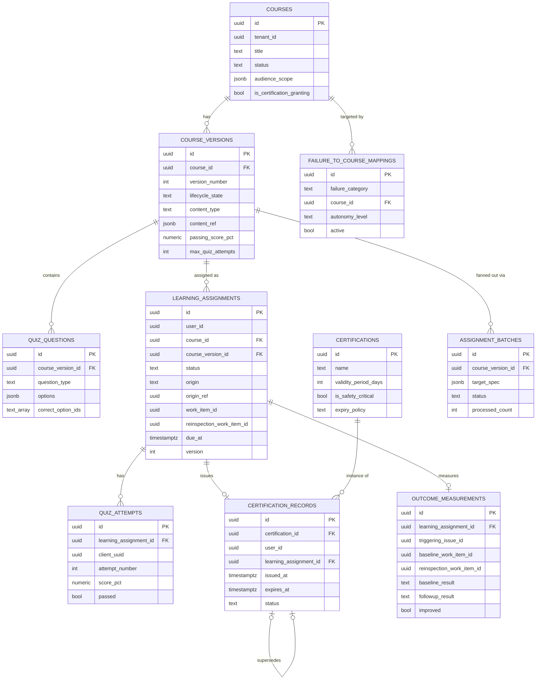
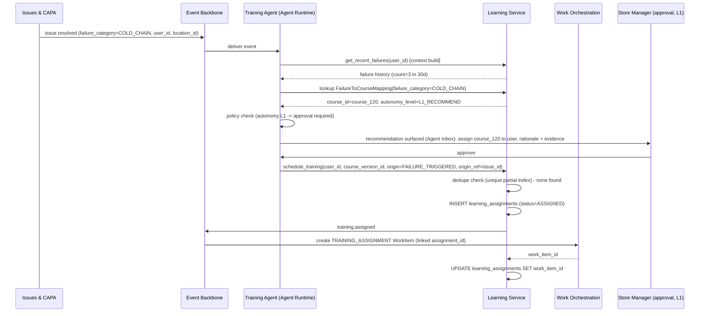
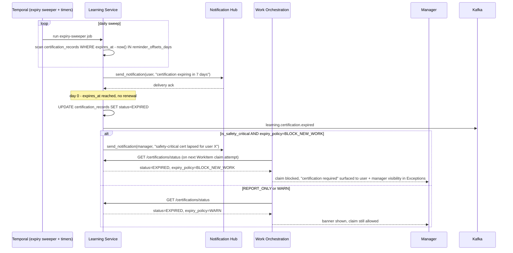

# Learning — Low-Level Design

Module corresponds to **EPIC-09 (Learning)**. Implements functional-spec.md and
high-level-design.md. Schema/API conventions consistent with conventions.md.

## 1. Postgres Schema

All tables carry `tenant_id UUID NOT NULL` with a Postgres RLS policy
`USING (tenant_id = current_setting('app.tenant_id')::uuid)` applied (defense-in-depth behind
application-layer scoping, per conventions.md). Omitted below for brevity except where noted.

### 1.1 Tables

**courses**

| Column | Type | Notes |
|---|---|---|
| id | UUID PK | |
| tenant_id | UUID NOT NULL | |
| title | TEXT NOT NULL | |
| description | TEXT | |
| category | TEXT | e.g. `SAFETY`, `COMPLIANCE`, `PRODUCT`, `PROCESS` |
| status | TEXT NOT NULL | `ACTIVE` \| `ARCHIVED` |
| audience_scope | JSONB | `{role_ids: [], org_node_ids: [], enterprise_wide: bool}` |
| is_certification_granting | BOOLEAN NOT NULL DEFAULT false | |
| tags | TEXT[] | used by `failure_to_course_mappings` lookups |
| created_by | UUID NOT NULL | FK `users.id` |
| created_at | TIMESTAMPTZ NOT NULL DEFAULT now() | |
| updated_at | TIMESTAMPTZ NOT NULL | |

Indexes: `(tenant_id, status)`, GIN `(tags)`.

**course_versions**

| Column | Type | Notes |
|---|---|---|
| id | UUID PK | |
| tenant_id | UUID NOT NULL | |
| course_id | UUID NOT NULL FK -> courses.id | |
| version_number | INTEGER NOT NULL | monotonic per course |
| lifecycle_state | TEXT NOT NULL | `DRAFT`\|`REVIEW`\|`APPROVED`\|`PUBLISHED`\|`SUPERSEDED`\|`RETIRED` |
| content_type | TEXT NOT NULL | `EXTERNAL_LINK`\|`DOCUMENT`\|`VIDEO`\|`INTERACTIVE_MODULE` (P2) |
| content_ref | JSONB NOT NULL | `{url}` or `{object_key, cdn_path, size_bytes, checksum, mime_type}` or (P2) `{units:[...]}` |
| duration_estimate_minutes | INTEGER | |
| language | TEXT NOT NULL DEFAULT 'en' | |
| requires_knowledge_check | BOOLEAN NOT NULL DEFAULT false | |
| passing_score_pct | NUMERIC(5,2) NOT NULL DEFAULT 80.00 | |
| max_quiz_attempts | INTEGER NOT NULL DEFAULT 3 | 0 = unlimited |
| randomize_questions | BOOLEAN NOT NULL DEFAULT true | |
| randomize_options | BOOLEAN NOT NULL DEFAULT true | |
| show_correct_answers_on_fail | BOOLEAN NOT NULL DEFAULT false | |
| require_content_reread_before_retry | BOOLEAN NOT NULL DEFAULT true | |
| published_at | TIMESTAMPTZ | null until `PUBLISHED` |
| published_by | UUID | |
| schema_hash | TEXT NOT NULL | hash of content_ref + quiz question set, for change detection |
| created_at | TIMESTAMPTZ NOT NULL DEFAULT now() | |

Indexes: unique `(course_id, version_number)`; `(tenant_id, lifecycle_state)`.
Immutability: application-layer trigger rejects UPDATE to `content_ref`/`content_type` once
`lifecycle_state = 'PUBLISHED'` or later (only `lifecycle_state` transitions to `SUPERSEDED`/
`RETIRED` are permitted after publish).

**quiz_questions**

| Column | Type | Notes |
|---|---|---|
| id | UUID PK | |
| tenant_id | UUID NOT NULL | |
| course_version_id | UUID NOT NULL FK -> course_versions.id | |
| sequence | INTEGER NOT NULL | display order pre-randomization |
| question_type | TEXT NOT NULL | `SINGLE_SELECT`\|`MULTI_SELECT`\|`TRUE_FALSE`\|`SHORT_ANSWER`(P2) |
| question_text | TEXT NOT NULL | |
| options | JSONB NOT NULL | `[{id, text}]` |
| correct_option_ids | TEXT[] NOT NULL | |
| points | NUMERIC(5,2) NOT NULL DEFAULT 1.00 | |

Indexes: `(course_version_id)`.

**learning_assignments**

| Column | Type | Notes |
|---|---|---|
| id | UUID PK | |
| tenant_id | UUID NOT NULL | |
| user_id | UUID NOT NULL | FK `users.id` |
| course_id | UUID NOT NULL FK -> courses.id | |
| course_version_id | UUID NOT NULL FK -> course_versions.id | bound at creation, immutable |
| status | TEXT NOT NULL | `ASSIGNED`\|`IN_PROGRESS`\|`COMPLETED`\|`VERIFIED`\|`FAILED`\|`CANCELLED` |
| origin | TEXT NOT NULL | `MANUAL`\|`ROLE_STANDING`\|`FAILURE_TRIGGERED` |
| origin_ref | UUID | Issue.id or repeat-failure pattern id (nullable, null for MANUAL/ROLE_STANDING) |
| is_targeted_microlearning | BOOLEAN NOT NULL DEFAULT false | |
| work_item_id | UUID | FK to Work Orchestration's TRAINING_ASSIGNMENT WorkItem (cross-service reference, no FK constraint) |
| reinspection_work_item_id | UUID | set on COMPLETED for failure-triggered assignments |
| reinspection_status | TEXT | `PENDING`\|`SCHEDULED`\|`UNSCHEDULABLE`\|`DONE` |
| assigned_at | TIMESTAMPTZ NOT NULL DEFAULT now() | |
| due_at | TIMESTAMPTZ | |
| started_at | TIMESTAMPTZ | first content-view timestamp |
| completed_at | TIMESTAMPTZ | |
| cancelled_reason | TEXT | `ROLE_NO_LONGER_APPLICABLE`\|`USER_DEACTIVATED`\|`SUPERSEDED_BY_REISSUE`\|admin free text |
| content_viewed | BOOLEAN NOT NULL DEFAULT false | offline-completable content-view gate |
| assigned_by | UUID | null for system/agent-generated |
| version | INTEGER NOT NULL DEFAULT 1 | optimistic concurrency |
| client_uuid | UUID | set when created via offline-originated flow (rare; assignments are normally server-created) |
| created_at | TIMESTAMPTZ NOT NULL DEFAULT now() | |
| updated_at | TIMESTAMPTZ NOT NULL | |

Indexes: `(tenant_id, user_id, status)` (my-assignments query), `(tenant_id, origin_ref)` (dedupe
check FR-LEARN-040.3), unique partial `(tenant_id, user_id, course_id, origin_ref) WHERE status IN
('ASSIGNED','IN_PROGRESS')` (enforces the dedupe rule at the DB layer, not just app layer).

**quiz_attempts**

| Column | Type | Notes |
|---|---|---|
| id | UUID PK | |
| tenant_id | UUID NOT NULL | |
| learning_assignment_id | UUID NOT NULL FK -> learning_assignments.id | |
| client_uuid | UUID NOT NULL | idempotency key for offline sync |
| attempt_number | INTEGER NOT NULL | |
| answers | JSONB NOT NULL | `{question_id: [selected_option_ids]}` |
| score_pct | NUMERIC(5,2) NOT NULL | |
| passed | BOOLEAN NOT NULL | |
| started_at | TIMESTAMPTZ NOT NULL | client-reported, non-authoritative |
| submitted_at | TIMESTAMPTZ NOT NULL | server receipt time, authoritative |
| device_id | TEXT | |
| created_at | TIMESTAMPTZ NOT NULL DEFAULT now() | |

Indexes: unique `(tenant_id, client_uuid)` (idempotent sync); `(learning_assignment_id,
attempt_number)`.

**certifications**

| Column | Type | Notes |
|---|---|---|
| id | UUID PK | |
| tenant_id | UUID NOT NULL | |
| name | TEXT NOT NULL | |
| qualifying_course_version_ids | UUID[] NOT NULL | |
| validity_period_days | INTEGER NOT NULL | |
| applicable_roles | UUID[] | Role ids |
| is_safety_critical | BOOLEAN NOT NULL DEFAULT false | |
| expiry_policy | TEXT NOT NULL DEFAULT 'REPORT_ONLY' | `REPORT_ONLY`\|`WARN`\|`BLOCK_NEW_WORK` |
| reminder_offsets_days | INTEGER[] NOT NULL DEFAULT '{30,7,1,0}' | |
| created_at | TIMESTAMPTZ NOT NULL DEFAULT now() | |

**certification_records**

| Column | Type | Notes |
|---|---|---|
| id | UUID PK | |
| tenant_id | UUID NOT NULL | |
| certification_id | UUID NOT NULL FK -> certifications.id | |
| user_id | UUID NOT NULL | |
| learning_assignment_id | UUID NOT NULL FK -> learning_assignments.id | the completion that issued it |
| issued_at | TIMESTAMPTZ NOT NULL | |
| expires_at | TIMESTAMPTZ NOT NULL | |
| status | TEXT NOT NULL | `ACTIVE`\|`EXPIRING_SOON`\|`EXPIRED`\|`SUPERSEDED` (superseded by a renewal record) |
| superseded_by_record_id | UUID | self-FK, set on renewal |
| created_at | TIMESTAMPTZ NOT NULL DEFAULT now() | |

Append-only: no physical deletes; renewal inserts a new row and sets
`superseded_by_record_id`/`status=SUPERSEDED` on the prior one.
Indexes: `(tenant_id, user_id, certification_id, status)`, `(tenant_id, expires_at)` (sweeper scan).

**outcome_measurements**

| Column | Type | Notes |
|---|---|---|
| id | UUID PK | |
| tenant_id | UUID NOT NULL | |
| learning_assignment_id | UUID NOT NULL FK -> learning_assignments.id | |
| triggering_issue_id | UUID | Issue.id (cross-service reference) |
| baseline_work_item_id | UUID NOT NULL | the original failing WorkItem/inspection |
| reinspection_work_item_id | UUID NOT NULL | |
| baseline_result | TEXT NOT NULL | `FAIL` (always FAIL by trigger definition) |
| followup_result | TEXT NOT NULL | `PASS`\|`FAIL` |
| improved | BOOLEAN NOT NULL | |
| failure_category | TEXT | denormalized for analytics convenience |
| location_id | UUID | denormalized for analytics convenience |
| measured_at | TIMESTAMPTZ NOT NULL DEFAULT now() | |

Indexes: `(tenant_id, learning_assignment_id)` unique, `(tenant_id, failure_category,
measured_at)`.

**failure_to_course_mappings**

| Column | Type | Notes |
|---|---|---|
| id | UUID PK | |
| tenant_id | UUID NOT NULL | |
| failure_category | TEXT NOT NULL | |
| location_type | TEXT | optional qualifier |
| role_id | UUID | optional qualifier |
| course_id | UUID NOT NULL FK -> courses.id | |
| autonomy_level | TEXT NOT NULL DEFAULT 'L1_RECOMMEND' | `L1_RECOMMEND`\|`L2_EXECUTE_LOW_RISK` |
| active | BOOLEAN NOT NULL DEFAULT true | |
| created_by | UUID NOT NULL | |
| created_at | TIMESTAMPTZ NOT NULL DEFAULT now() | |

Indexes: `(tenant_id, failure_category, active)`.

**assignment_batches** (mass-assignment fan-out tracking, HLD §5)

| Column | Type | Notes |
|---|---|---|
| id | UUID PK | |
| tenant_id | UUID NOT NULL | |
| course_version_id | UUID NOT NULL | |
| target_spec | JSONB NOT NULL | `{role_ids, org_node_ids}` |
| status | TEXT NOT NULL | `PENDING`\|`IN_PROGRESS`\|`COMPLETED`\|`FAILED` |
| total_targets | INTEGER | |
| processed_count | INTEGER NOT NULL DEFAULT 0 | |
| created_by | UUID NOT NULL | |
| created_at | TIMESTAMPTZ NOT NULL DEFAULT now() | |
| completed_at | TIMESTAMPTZ | |

### 1.2 ER Diagram



## 2. REST Endpoints

Base path `/api/v1/learning`. All mutation endpoints accept `Idempotency-Key`; mutable resources use
`ETag`/`version` optimistic concurrency; errors use the standard envelope
`{ "error": { "code", "message", "trace_id" } }`.

### 2.1 Assign training manually / by rule

`POST /api/v1/learning/assignments`

Request:
```json
{
  "course_version_id": "cv_9f21",
  "target": {
    "type": "ROLE",
    "role_id": "role_shift_lead",
    "org_node_ids": ["node_store_4471"],
    "auto_assign_on_role_grant": true
  },
  "due_in_days": 14,
  "origin": "MANUAL"
}
```

Response `202 Accepted` (fans out asynchronously per HLD §5) for `target.type IN (ROLE, ORG_SUBTREE)`;
`201 Created` synchronously for `target.type = USER`:
```json
{
  "assignment_batch_id": "batch_7710",
  "status": "PENDING",
  "estimated_targets": 342
}
```

Single-user variant request:
```json
{ "course_version_id": "cv_9f21", "target": { "type": "USER", "user_id": "user_88a1" }, "due_in_days": 7 }
```
Response `201 Created`:
```json
{
  "id": "la_5c02",
  "user_id": "user_88a1",
  "course_version_id": "cv_9f21",
  "status": "ASSIGNED",
  "origin": "MANUAL",
  "due_at": "2026-09-26T00:00:00Z",
  "version": 1
}
```

Errors: `404 COURSE_VERSION_NOT_FOUND`, `409 DUPLICATE_OPEN_ASSIGNMENT` (dedupe rule),
`422 COURSE_VERSION_NOT_PUBLISHED`.

### 2.2 Get my assignments (for offline caching)

`GET /api/v1/learning/my-assignments?status=ASSIGNED,IN_PROGRESS&cursor=...&limit=50`

Response:
```json
{
  "items": [
    {
      "id": "la_5c02",
      "course_id": "course_120",
      "course_version_id": "cv_9f21",
      "title": "Cold Chain Corrective Procedure",
      "content_type": "VIDEO",
      "content_ref": { "cdn_url": "https://cdn.example/.../signed", "size_bytes": 18874368, "checksum": "sha256:..." },
      "requires_knowledge_check": true,
      "status": "ASSIGNED",
      "origin": "FAILURE_TRIGGERED",
      "is_targeted_microlearning": true,
      "due_at": "2026-09-26T00:00:00Z",
      "content_viewed": false
    }
  ],
  "next_cursor": "eyJvZmZzZXQi..."
}
```
Cached in Redis per `(tenant_id, user_id, status_filter)` with TTL 60s; invalidated on any
assignment-status-changing write for that user (HLD §5).

### 2.3 Submit quiz attempt

`POST /api/v1/learning/assignments/{assignmentId}/quiz-attempts`
Header: `Idempotency-Key: <client_uuid>`

Request:
```json
{
  "client_uuid": "b3f1c2d4-...",
  "attempt_number": 1,
  "answers": { "q_001": ["opt_b"], "q_002": ["opt_a", "opt_c"] },
  "started_at": "2026-09-19T14:02:10Z"
}
```

Response `201 Created`:
```json
{
  "id": "qa_9931",
  "learning_assignment_id": "la_5c02",
  "score_pct": 85.0,
  "passed": true,
  "attempt_number": 1,
  "submitted_at": "2026-09-19T14:05:44Z",
  "assignment_status": "COMPLETED"
}
```
Duplicate submit (retried `client_uuid`) returns `200 OK` with the original attempt, not a new one.
Errors: `409 MAX_ATTEMPTS_EXHAUSTED`, `422 CONTENT_NOT_VIEWED` (content-view gate not satisfied),
`404 ASSIGNMENT_NOT_FOUND`, `410 COURSE_VERSION_SUPERSEDED_BUT_HONORED` (informational, not
blocking — see FR-LEARN-063; included only as a warning header, request still succeeds).

### 2.4 Mark content viewed offline, then sync completion

`POST /api/v1/learning/assignments/{assignmentId}/content-viewed`
Header: `Idempotency-Key: <client_uuid>`

Request:
```json
{
  "client_uuid": "a112-...",
  "viewed_at_client": "2026-09-19T09:14:00Z",
  "device_id": "device-4471",
  "view_duration_seconds": 302
}
```

Response `200 OK`:
```json
{
  "id": "la_5c02",
  "status": "IN_PROGRESS",
  "content_viewed": true,
  "started_at": "2026-09-19T09:14:00Z"
}
```
If `course_version.requires_knowledge_check = false`, this call alone transitions the assignment
straight to `COMPLETED` and emits `training.completed`. Idempotent on `client_uuid`.

### 2.5 Get certification status

`GET /api/v1/learning/certifications/status?user_id=user_88a1`

Response:
```json
{
  "items": [
    {
      "certification_id": "cert_44",
      "name": "Forklift Operation",
      "status": "EXPIRING_SOON",
      "issued_at": "2025-09-20T00:00:00Z",
      "expires_at": "2026-09-27T00:00:00Z",
      "is_safety_critical": true,
      "expiry_policy": "BLOCK_NEW_WORK"
    }
  ]
}
```
Consumed synchronously by Work Orchestration at WorkItem claim/assignment time for
certification-gated WorkItem types (functional-spec FR-LEARN-022). p95 target < 100 ms (cached,
Redis-backed, short TTL 30s since gating decisions need to be reasonably fresh).

## 3. Sequence Diagrams

### 3.1 Repeated-failure trigger -> Training Agent -> targeted microlearning assignment


The agent runs at default autonomy L1 Recommend (functional-spec assumption), so a manager approval
step gates `schedule_training`; a pre-approved `FailureToCourseMapping.autonomy_level =
L2_EXECUTE_LOW_RISK` (Phase 2) skips the manager-approval step and calls `schedule_training`
directly after the policy check.

### 3.2 Offline completion of assigned training, later sync

```mermaid
sequenceDiagram
    participant Device as Mobile Device (WatermelonDB)
    participant App as Frontline App
    participant API as Learning API
    participant DB as Postgres
    participant Kafka as Event Backbone

    Note over Device: Airplane mode
    App->>Device: read cached learning_assignments + course_content_cache
    App->>Device: user views video content fully
    Device->>Device: write content_viewed=true (local, client_uuid A)
    App->>Device: user completes knowledge check
    Device->>Device: write quiz_attempt (local, client_uuid B, computed score offline using cached answer key... )
    Note over Device: Reconnect
    App->>API: POST /content-viewed {client_uuid: A}
    API->>DB: idempotent upsert (unique client_uuid)
    DB-->>API: content_viewed=true, status=IN_PROGRESS
    API-->>App: 200 OK
    App->>API: POST /quiz-attempts {client_uuid: B}
    API->>DB: idempotent insert quiz_attempts; recompute authoritative score server-side from stored answer key
    DB-->>API: score_pct, passed, assignment_status=COMPLETED
    API->>Kafka: training.completed
    API-->>App: 201 Created (or 200 if retried)
```
Note: the client may show a provisional local score for immediate learner feedback, but the
**server always recomputes the authoritative score** from `quiz_questions.correct_option_ids` at
sync time — the client is never trusted as the scoring authority, consistent with the platform rule
that client-side computed state is provisional until server-confirmed.

### 3.3 Certification expiry reminder and escalation



## 4. Pseudocode

### 4.1 Repeated-failure-detection-to-assignment mapping

```
function onFailureSignal(event: IssueResolvedEvent | RepeatFailurePatternEvent):
    tenant_id, user_id, location_id, failure_category = extract(event)

    # 1. Determine eligibility window (FR-LEARN-040.1)
    user_level_count = countRecentFailures(
        tenant_id, user_id, failure_category, window_days = TENANT_CONFIG.user_window_days default 30)
    location_level_count = countRecentFailures(
        tenant_id, location_id, failure_category, window_days = TENANT_CONFIG.location_window_days default 30)

    if user_level_count < TENANT_CONFIG.user_threshold (default 2):
        if location_level_count >= TENANT_CONFIG.location_threshold (default 3):
            # process/equipment gap, not a personal skills gap -> route to Issues/CAPA, not Learning
            emit(IssuesCapaCandidateEvent(location_id, failure_category))
        return  # not eligible for Learning trigger

    # 2. Resolve mapping (FR-LEARN-040.2)
    mapping = findActiveMapping(tenant_id, failure_category, location_type = locationTypeOf(location_id),
                                 role_id = roleOf(user_id))
    if mapping is null:
        emitAgentInsight(kind = "NO_MAPPING_FOUND", failure_category)  # L1 Recommend insight
        return

    course_version = getPublishedVersion(mapping.course_id)

    # 3. Dedupe (FR-LEARN-040.3 / FR-LEARN-062)
    existing = findOpenAssignment(tenant_id, user_id, mapping.course_id, origin_ref = event.origin_ref)
    if existing is not null:
        return  # idempotent no-op, event redelivery safe

    concurrent_failure_triggered = countOpenAssignments(tenant_id, user_id, origin = FAILURE_TRIGGERED)
    if concurrent_failure_triggered >= TENANT_CONFIG.max_concurrent_failure_triggered (default 2):
        enqueuePending(tenant_id, user_id, mapping, event)   # PENDING_CAPACITY, dispatched FIFO later
        return

    # 4. Autonomy / approval gate
    if mapping.autonomy_level == L1_RECOMMEND:
        proposal = createAgentRecommendation(user_id, course_version, event)
        return  # actual assignment created only after agent.action_approved (see seq 3.1)

    # mapping.autonomy_level == L2_EXECUTE_LOW_RISK
    assignment = createLearningAssignment(
        tenant_id, user_id, course_version.id,
        origin = FAILURE_TRIGGERED, origin_ref = event.origin_ref,
        is_targeted_microlearning = true,
        requires_knowledge_check = true,   # forced true regardless of course default, FR-LEARN-043
        due_at = now() + TENANT_CONFIG.remediation_sla_days (default 7))
    emit(TrainingAssignedEvent(assignment))
```

### 4.2 Outcome-improvement measurement (pre/post re-inspection comparison)

```
function onReinspectionVerified(event: WorkItemVerifiedEvent):
    # Triggered by Work Orchestration's work.verified event for any AUDIT_INSPECTION WorkItem
    assignment = findLearningAssignmentByReinspectionWorkItem(event.work_item_id)
    if assignment is null:
        return  # not a Learning-linked re-inspection, ignore

    if assignment.reinspection_status != SCHEDULED:
        return  # defensive: already measured or was UNSCHEDULABLE

    baseline_work_item = getWorkItem(assignment.baseline_work_item_reference)  # the original failing check
    followup_result = evaluateCheckResult(event.submission, checkField = baseline_work_item.check_field)

    outcome = OutcomeMeasurement(
        learning_assignment_id = assignment.id,
        triggering_issue_id = assignment.origin_ref,
        baseline_work_item_id = baseline_work_item.id,
        reinspection_work_item_id = event.work_item_id,
        baseline_result = FAIL,           # true by construction - this loop only exists because baseline failed
        followup_result = followup_result,
        improved = (followup_result == PASS),
        failure_category = assignment.failure_category,   # denormalized at assignment creation
        location_id = baseline_work_item.location_id,
        measured_at = now()
    )
    insert(outcome)

    assignment.status = (VERIFIED if outcome.improved else FAILED)
    assignment.reinspection_status = DONE
    save(assignment)

    emit(OutcomeMeasuredEvent(outcome))

    if not outcome.improved:
        # FR-LEARN-046: do not auto-loop into an identical microlearning assignment
        emit(EscalateToComplianceMonitorEvent(
            reason = "training_completed_but_reinspection_failed",
            learning_assignment_id = assignment.id,
            failure_category = assignment.failure_category,
            location_id = outcome.location_id))
```

## 5. Caching Strategy

- **Offline content packaging manifest.** Each `LearningAssignment` returned by `GET
  /my-assignments` includes a `content_ref` with a CDN-signed URL, `size_bytes`, and a `checksum`
  (sha256) so the mobile client can verify integrity after download and skip re-download if an
  identical checksum is already cached locally (relevant when a role-standing reassignment points at
  the same underlying asset). The manifest additionally carries a `cache_priority` hint
  (`SAFETY_CRITICAL` > `DUE_SOON` > `STANDARD`) used by the client's eviction policy
  (functional-spec FR-LEARN-053) so in-progress and safety-critical content is protected from
  eviction ahead of older, low-priority items.
- **My-assignments cache.** Redis key `learning:my-assignments:{tenant_id}:{user_id}:{status_filter_hash}`,
  TTL 60s, invalidated eagerly on any write to that user's `learning_assignments` rows (assignment
  created, status change, quiz submitted) to avoid serving stale state right after an action the
  user just took. Certification-status cache key `learning:cert-status:{tenant_id}:{user_id}`, TTL
  30s (shorter, since Work Orchestration's claim-time gating decision needs fresher data).
- **Idempotency-key cache.** Standard Redis-backed idempotency-key store (per conventions.md) for
  the quiz-attempt and content-viewed endpoints, keyed `idem:{tenant_id}:{endpoint}:{Idempotency-Key}`,
  TTL 24h, storing the original response to short-circuit retried requests without re-executing
  business logic.

## 6. Concurrency Control

- **Idempotent completion sync.** Both `POST /content-viewed` and `POST /quiz-attempts` require
  `client_uuid` and are unique-indexed on `(tenant_id, client_uuid)`. A retried sync (duplicate
  `client_uuid` from a flaky reconnect or an at-least-once redelivery) is detected at the DB
  constraint layer and short-circuited to return the original result — never a duplicate
  `QuizAttempt` row nor a duplicate `training.completed` emission (event emission happens inside the
  same transaction that performs the idempotent insert, guarded by a `first_insert` boolean so a
  retry that hits the unique-violation path never re-publishes the event).
- **Optimistic concurrency on `learning_assignments`.** `version` column + `ETag`; a manual status
  change (e.g., manager cancels an assignment) racing against an in-flight offline-sync completion
  is resolved by `409 CONFLICT` on the losing write, surfaced to the client with the current server
  state so the UI can reconcile (e.g., "this assignment was cancelled by your manager" rather than a
  generic error).
- **Dedupe race on failure-trigger assignment creation.** The unique partial index on
  `(tenant_id, user_id, course_id, origin_ref) WHERE status IN ('ASSIGNED','IN_PROGRESS')` makes the
  dedupe check (§4.1 pseudocode) safe under concurrent event processing (e.g., `issue.resolved`
  redelivered while the first delivery's assignment creation is still in flight) — the second insert
  attempt fails the constraint and is treated as a no-op, not an error surfaced to the caller.
- **Mass-assignment batch writes.** `assignment_batches.processed_count` is incremented via a single
  `UPDATE ... SET processed_count = processed_count + :n` per sub-batch (atomic, no read-modify-write
  race) rather than read-then-write from the batch worker.

## 7. Background Jobs

| Job | Trigger | Behavior |
|---|---|---|
| **Certification-expiry sweeper** | Temporal cron workflow, daily (00:15 tenant-local, staggered across tenants to avoid a synchronized spike) | Scans `certification_records WHERE status='ACTIVE' AND expires_at <= now() + max(reminder_offsets_days)`; for each row where `now()` crosses a configured `reminder_offsets_days` boundary, calls Notification Hub and (if crossing 0) transitions `status` to `EXPIRED` and emits `learning.certification.expired`. Also flips `ACTIVE -> EXPIRING_SOON` at the largest configured offset. |
| **Outcome-measurement job** | Event-driven: `work.verified` event on a WorkItem matching a `learning_assignments.reinspection_work_item_id` (no polling needed; see §4.2 pseudocode) | Computes and persists `OutcomeMeasurement`; escalates to Compliance Monitor on non-improvement (FR-LEARN-046). |
| **Mass-assignment batch expander** | Temporal workflow, started synchronously on `POST /assignments` with `target.type IN (ROLE, ORG_SUBTREE)` | Paginates `UserScope` resolution via Identity/Org, writes `learning_assignments` in bounded sub-batches (500 rows/txn), updates `assignment_batches.processed_count`, publishes `training.assigned` per sub-batch. Retries a failed sub-batch with backoff; marks `assignment_batches.status=FAILED` only after exhausting retries, leaving successfully-processed rows intact (partial success is visible, not rolled back). |
| **PENDING_CAPACITY dispatcher** | Scheduled sweep, every 15 minutes | For users under the concurrent-failure-triggered-assignment cap (FR-LEARN-062) who have queued `PENDING_CAPACITY` triggers, re-evaluates capacity and dispatches the oldest queued trigger through the normal creation path (§4.1) if a slot has freed up. |
| **Stale offline-cache reconciliation** | Client-initiated, on each foreground/reconnect | Not server background, but server-side support: `GET /my-assignments` is the reconciliation source of truth; server does not push deltas beyond standard event-triggered notification wake-ups. |
| **Course content transcode** | Triggered on `DOCUMENT`/`VIDEO` upload during authoring (pre-publish) | Transcodes video to the mobile-optimized bitrate profile (functional-spec FR-LEARN-053) and computes `checksum`/`size_bytes` before the version can move to `REVIEW`; publish is blocked until transcode completes successfully (`lifecycle_state` cannot advance past `DRAFT` with a pending transcode). |

## 8. Error Handling

| Error code | HTTP status | Condition | Client guidance |
|---|---|---|---|
| `COURSE_VERSION_NOT_FOUND` | 404 | `course_version_id` does not exist or wrong tenant | Non-retryable; refresh course catalog |
| `COURSE_VERSION_NOT_PUBLISHED` | 422 | Attempt to assign a `DRAFT`/`REVIEW`/`RETIRED` version | Non-retryable; admin must publish first |
| `DUPLICATE_OPEN_ASSIGNMENT` | 409 | Dedupe unique-index violation on manual/role assignment attempt | Non-retryable; surface existing assignment id |
| `ASSIGNMENT_NOT_FOUND` | 404 | Assignment id invalid or not owned by caller | Non-retryable |
| `MAX_ATTEMPTS_EXHAUSTED` | 409 | Quiz attempt submitted after `max_quiz_attempts` reached | Non-retryable; assignment already transitioned to `FAILED`; surface manager-escalation messaging |
| `CONTENT_NOT_VIEWED` | 422 | Quiz submitted before `content_viewed=true` (or reset by a failed prior attempt requiring reread) | Retryable after content view; client should gate the quiz UI on this flag proactively |
| `ASSIGNMENT_CANCELLED` | 409 | Action attempted on an assignment that was cancelled (role change, deactivation, superseded) | Non-retryable; refresh assignment list |
| `VERSION_CONFLICT` | 409 | Optimistic concurrency (`ETag`/`version` mismatch) on assignment mutation | Retryable after refetch |
| `CERTIFICATION_NOT_FOUND` | 404 | Invalid `certification_id` | Non-retryable |
| `SCOPE_DENIED` | 403 | Caller lacks `learning:assign` at the target scope, or requests another user's data without `learning:view_team` | Non-retryable |
| `BATCH_NOT_FOUND` | 404 | Invalid `assignment_batch_id` on progress poll | Non-retryable |
| `CONTENT_STORAGE_UNAVAILABLE` | 503 | Object storage/CDN outage during authoring upload or content fetch fallback | Retryable with backoff; authoring blocked, existing offline-cached learner content unaffected |
| `RATE_LIMITED` | 429 | Tenant/principal rate limit exceeded | Retryable after `Retry-After` |
| Idempotent replay (not an error) | 200 | Duplicate `Idempotency-Key`/`client_uuid` on quiz-attempt or content-viewed submit | Original response returned; client treats as success |
