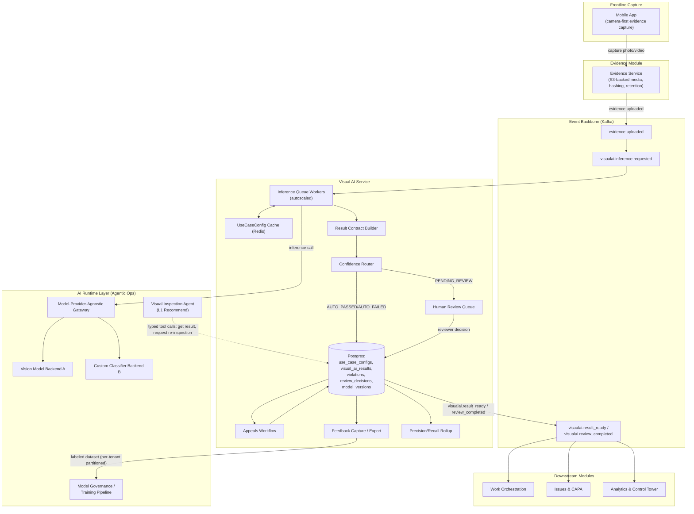
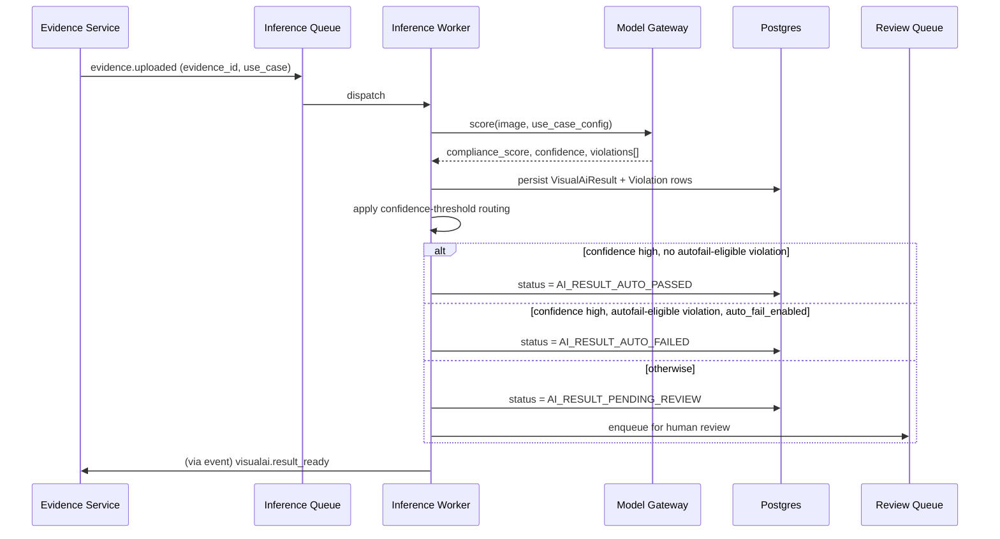
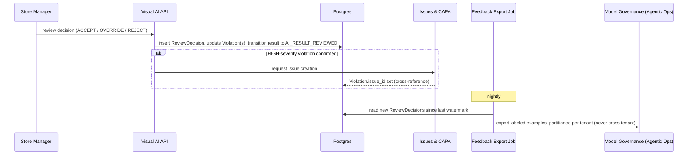
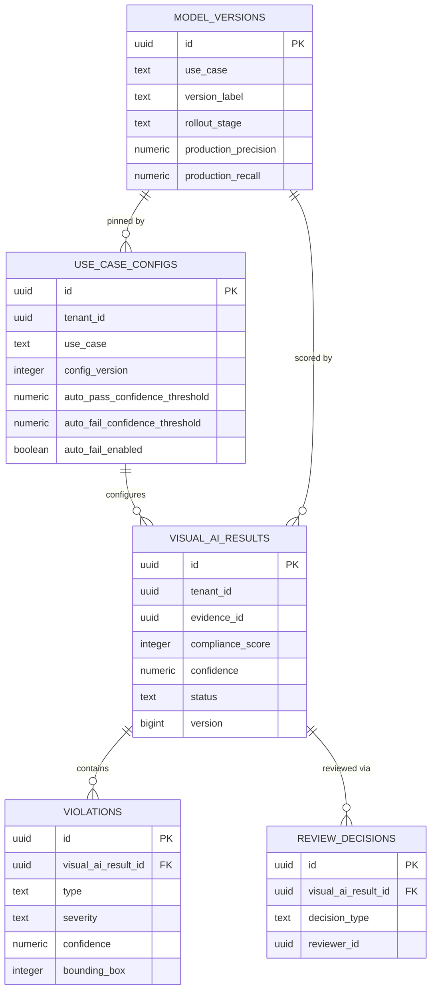

# Visual AI — Architecture Diagrams

Focused Mermaid diagrams for the Visual AI module (EPIC-10). See `high-level-design.md` and
`low-level-design.md` for full narrative and schema detail.

## 1. Component / Container Diagram



**Narration.** The Visual AI Service sits between the Evidence module (which owns the media) and
three consumer domains (Work Orchestration, Issues & CAPA, Analytics). Inference is deliberately
asynchronous and queue-mediated so that ingestion bursts never directly load the model backends,
and the model gateway is abstracted through the platform's shared AI Runtime layer so backends are
swappable per use case. The Visual Inspection Agent is a peer consumer of this module's data and
APIs, not a component inside it — it reasons about `VisualAiResult` history at its own configured
autonomy level and never bypasses the confidence router.

## 2. Sequence Diagram — Inference and Routing



**Narration.** Routing always resolves to exactly one of three outcomes, and the low-confidence
path to `AI_RESULT_PENDING_REVIEW` is the safe default — it is reached whenever thresholds are not
clearly met in either direction, and always when `auto_fail_enabled` is false for the use case.
This is the mechanism behind the §24.1 acceptance test: a low-confidence result never auto-fails.

## 3. Sequence Diagram — Review and Feedback Loop



**Narration.** Every reviewer decision does double duty: it corrects the compliance record shown
to the business (feeding Issues/CAPA when a HIGH violation is confirmed) and it becomes a labeled
training example for the model that produced the original result. The export is intentionally
batch and tenant-partitioned — no tenant's corrections ever influence another tenant's model unless
that tenant has explicitly opted into a shared program.

## 4. ER Diagram



**Narration.** `VisualAiResult` is the aggregate root of the module. `Violation` rows are
first-class children (not an embedded blob) so each can be independently reviewed, cross-referenced
to a CAPA `Issue`, and used as a discrete labeled training example. `ReviewDecision` is append-only
audit history against a result; a result can accumulate more than one (dual review, then an appeal
resolution) without losing the original.

## 5. State Diagram — VisualAiResult Lifecycle

```mermaid
stateDiagram-v2
    [*] --> AI_RESULT_PENDING: evidence.uploaded consumed, inference dispatched
    AI_RESULT_PENDING --> AI_RESULT_FAILED_PROCESSING: model backend timeout/outage,\nno usable config, or quality-gate rejection
    AI_RESULT_PENDING --> AI_RESULT_SCORED: model backend returns result contract
    AI_RESULT_FAILED_PROCESSING --> AI_RESULT_PENDING: retry (backend recovers /\nconfig configured / retaken photo)

    AI_RESULT_SCORED --> AI_RESULT_AUTO_PASSED: confidence >= auto_pass_threshold\nand no autofail-eligible violation
    AI_RESULT_SCORED --> AI_RESULT_AUTO_FAILED: confidence >= auto_fail_threshold\nand auto_fail_enabled\nand autofail-eligible violation present
    AI_RESULT_SCORED --> AI_RESULT_PENDING_REVIEW: thresholds not clearly met\n(safe default; also source-spec's\nAI_RESULT_UNREVIEWED alias)

    AI_RESULT_PENDING_REVIEW --> AI_RESULT_REVIEWED: single reviewer decision\n(ACCEPT/OVERRIDE/REJECT), dual review\nnot required or both reviewers agree
    AI_RESULT_PENDING_REVIEW --> AI_RESULT_NEEDS_ADJUDICATION: dual review required\nand reviewers disagree
    AI_RESULT_NEEDS_ADJUDICATION --> AI_RESULT_REVIEWED: higher-scope adjudicator resolves

    AI_RESULT_AUTO_PASSED --> AI_RESULT_APPEALED: appeal filed within window
    AI_RESULT_AUTO_FAILED --> AI_RESULT_APPEALED: appeal filed within window
    AI_RESULT_REVIEWED --> AI_RESULT_APPEALED: appeal filed within window

    AI_RESULT_APPEALED --> AI_RESULT_RESOLVED: resolver UPHOLDs or OVERTURNs

    AI_RESULT_AUTO_PASSED --> [*]: appeal window expires unused
    AI_RESULT_AUTO_FAILED --> [*]: appeal window expires unused
    AI_RESULT_REVIEWED --> [*]: appeal window expires unused
    AI_RESULT_RESOLVED --> [*]: terminal
```

**Narration.** The lifecycle has two safety properties by construction: (1) nothing reaches a
decided state (`AUTO_PASSED`/`AUTO_FAILED`) without first passing through `SCORED` and the
confidence router — there is no path that skips routing; and (2) every decided or reviewed state
remains appealable within its window, and an appeal always resolves to `RESOLVED`, never silently
disappearing. `AI_RESULT_UNREVIEWED` from the source-spec §12.2 contract is retained as the
external/legacy alias for whichever of `AUTO_PASSED`/`AUTO_FAILED`/`PENDING_REVIEW` a result is
before any human has touched it (see functional-spec.md §14 Resolved Decisions).
