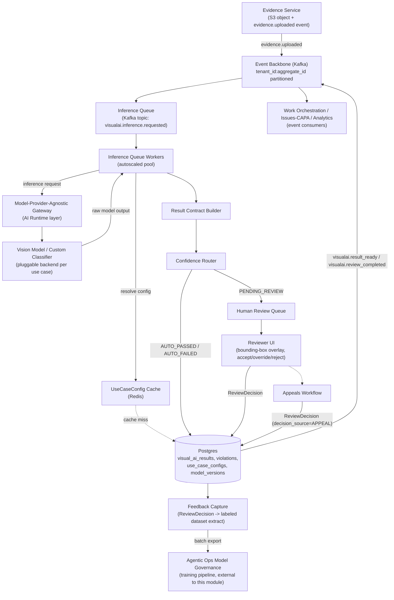

# Visual AI — High-Level Design

Corresponds to **EPIC-10**. Reads with `functional-spec.md` (this module) and the platform-wide
`conventions.md` (model-provider-agnostic gateway, Kafka event backbone, Postgres multi-tenancy,
S3 object storage).

## 1. Module Responsibilities and Boundaries

The **Visual AI Service** is an orchestration and result-store service. It does **not** run
inference itself. Its responsibilities:

1. Consume `evidence.uploaded` events for evidence fields tagged with a `visual_ai_use_case`.
2. Resolve the tenant's active `UseCaseConfig` and dispatch an inference request to the configured
   pluggable **model backend** via the platform's model-provider-agnostic gateway.
3. Normalize whatever the backend returns into the canonical result contract (§12.2 of the
   source spec) — the **result contract builder**.
4. Apply confidence-threshold routing (auto-pass / auto-fail / human-review).
5. Own the human-review queue, review decisions, and the appeals workflow.
6. Persist model/version traceability on every result.
7. Capture reviewer corrections as labeled feedback data and expose a batch export.
8. Compute and expose precision/recall metrics per tenant/use case/model version.
9. Emit `visualai.result_ready` and `visualai.review_completed` events for downstream modules.

Explicitly **not** this module's responsibility: hosting model weights/GPUs, the model gateway's
provider-routing logic itself (owned by the platform AI Runtime layer per source-spec §20), media
storage (Evidence module), WorkItem/CAPA lifecycle (Work Orchestration / Issues & CAPA), or the
Visual Inspection Agent's own reasoning/tool-selection loop (Agentic Operations) — Visual AI is a
tool that agent can call, not the agent itself.

## 2. Component Diagram

## 3. Data Ownership

Visual AI Service owns (system of record):

| Entity | Notes |
|---|---|
| `UseCaseConfig` | Per-tenant, per-use-case model binding, thresholds, taxonomy, severity map. Versioned. |
| `VisualAiResult` | The scored/routed result for one `(evidence_id, use_case_config_id)` pair. |
| `Violation` | Individual detected deviation, first-class row (not a JSON-only sub-document) — see §8 for why. |
| `ReviewDecision` | Human decision (review or appeal resolution) against a `VisualAiResult`. |
| `ModelVersion` | Catalog of model versions per use case, rollout stage, shadow/production metrics. |

Visual AI **references but does not own**:

| Entity | Owned by | Reference |
|---|---|---|
| `Evidence` | Evidence Service | `evidence_id`, resolved via signed URL, never copied into this module's storage |
| `WorkItem` | Work Orchestration | `work_item_id` on `VisualAiResult` for traceability/gating |
| `Issue` | Issues & CAPA | `issue_id` set on a `Violation` once auto-created |
| `Tenant`, `OrganizationNode`, `User`, `UserScope` | Identity/Org | scoping and review/appeal routing |
| `AgentRun` | Agentic Operations | the Visual Inspection Agent's own execution trace when it invokes this module's APIs as a tool |

## 4. External Interfaces

### 4.1 Events consumed
- `evidence.uploaded` (Evidence module) — triggers inference dispatch when the evidence's field
  metadata declares a `visual_ai_use_case`.
- `user.deactivated`, `user.role_changed` (Identity/Org) — used only to keep review-queue
  visibility and appeal-resolver routing current; not a functional trigger for inference.

### 4.2 Events produced
- `visualai.result_ready` — emitted once a `VisualAiResult` reaches any of `AI_RESULT_AUTO_PASSED`,
  `AI_RESULT_AUTO_FAILED`, or `AI_RESULT_PENDING_REVIEW` (i.e., routing has completed). Payload
  includes the full result contract plus `evidence_id`, `work_item_id`, `model_version`,
  `use_case_config_version`.
- `visualai.review_completed` — emitted on every `ReviewDecision` (review or appeal resolution),
  carrying the before/after outcome so Issues/CAPA and Analytics can react to corrections, not just
  initial results.
- `visualai.appeal_submitted` — emitted on appeal filing, primarily for Notification Hub routing
  and SLA-sweeper registration.

Both canonical events use the platform event envelope (source-spec §18.4:
`event_id, event_type, version, tenant_id, occurred_at, actor_id, resource_id, trace_id, data`).

### 4.3 REST APIs
Full endpoint catalog in `low-level-design.md` §2. Summary: configure use case/thresholds, get
result for an evidence item, submit human review decision, submit appeal, get model performance
metrics.

## 5. Scalability

- **Inference queue backpressure.** `evidence.uploaded` fan-in can spike heavily during synchronized
  campaign windows (e.g., 100k locations submitting the same planogram photo within a 2-hour
  window, NFR-VAI-04). The inference queue is a dedicated Kafka topic
  (`visualai.inference.requested`), partitioned by `tenant_id:use_case`, decoupling ingestion rate
  from inference throughput. Worker pool autoscaling is driven by consumer-group lag (target:
  keep lag under a threshold equivalent to the p95 latency budget's worth of backlog), not by CPU
  alone, since inference cost is dominated by the external model call, not local compute.
- **Backpressure over shedding.** The module never drops an inference request under load; it
  queues (accepting a longer "still analyzing" UX state, §10 of the functional spec) rather than
  failing the request, because a dropped result would silently understate compliance. If the queue
  age for a given tenant/use case exceeds a threshold, an operational alert fires (§9 Observability)
  and, optionally, a temporary fallback model backend (cheaper/faster, lower-fidelity) can be
  configured to absorb burst load with results explicitly tagged as `degraded_mode = true` and a
  lower effective confidence ceiling (forcing more results to review rather than auto-decide during
  the burst).
- **Batch vs. real-time inference trade-off.** Interactive use cases where an associate is likely
  waiting for feedback (e.g., PPE check before starting a task) are dispatched real-time
  (per-request to the model gateway). High-volume, non-blocking use cases (e.g., end-of-day
  cleanliness photos across a large campaign) may be configured (`UseCaseConfig.dispatch_mode =
  BATCH`) to accumulate into micro-batches (e.g., 50 images or 30 seconds, whichever first) before
  a single gateway call, trading a small latency increase for materially better throughput/cost on
  model backends that support batched inference. This is a per-`UseCaseConfig` setting, not a
  module-wide switch, because the right trade-off differs by use case.
- **Read scaling for the review queue and results API.** `visual_ai_results`/`violations` reads are
  served from Postgres read replicas for review-queue listing and the "get result" API (§ LLD),
  keeping the primary free for inference-worker writes; the queue additionally uses a Redis-backed
  count/summary cache per location for the review-queue badge counts shown throughout the UI.

## 6. Multi-Tenancy

- Every table carries `tenant_id`; RLS policies are the defense-in-depth backstop per conventions.
- `UseCaseConfig`, `model_versions`, and thresholds are **per-tenant** — no tenant ever inherits
  another tenant's thresholds, taxonomy, or enabled use cases implicitly. A "platform default"
  `UseCaseConfig` template exists only as a copyable starting point at tenant onboarding, never as
  a live shared row that tenants read at runtime.
- **Tenant data isolation for model training.** Per FR-VAI-062, a tenant's `ReviewDecision`-derived
  labeled data is exported only into that tenant's own model-training lineage unless the tenant has
  explicitly opted into a shared/aggregate program. The feedback export job partitions its output
  by `tenant_id` and the training pipeline (Agentic Ops-owned) enforces the same boundary on
  ingestion — this module treats it as a hard invariant to assert in tests (mirrors the platform's
  "prove object-level scope at every access boundary" rule, source-spec §21.1).
- Inference requests to the model gateway include only the minimum image/context needed for
  scoring — no cross-tenant context is ever assembled into a single model call (single-tenant
  request granularity, no batching across tenants even under the micro-batch dispatch mode above).

## 7. Failure Modes and Degradation

| Failure | Detection | Degradation strategy |
|---|---|---|
| Model backend outage/timeout | Gateway call fails/times out (circuit breaker opens after threshold) | Retry with backoff on the queue (message stays unacked); if a fallback backend is configured for the use case, route to it (tagged `degraded_mode=true`); otherwise the result is held in `AI_RESULT_PENDING` and, past a tenant-configured max-wait, surfaces as `AI_RESULT_FAILED_PROCESSING` (fail-open to "unable to analyze," never a fabricated fail — see functional spec §10 UX state) |
| Low-confidence flood overwhelming review queue | Review-queue depth/age alert crosses threshold per location or tenant | Fail-open: results continue to route to `PENDING_REVIEW` per policy (never silently auto-decided to relieve queue pressure); Operations Admin is alerted with a suggested action (temporarily raise `auto_pass_confidence_threshold` if warranted, or add reviewer capacity); the platform does not auto-adjust thresholds on its own — a threshold change is always an explicit, audited admin action (P5 — Policy before AI) |
| Model gateway partial outage (one provider down, others up) | Gateway-level circuit breaker per provider | Handled transparently below this module by the gateway's provider fallback (conventions); Visual AI only sees increased latency/occasional retries, not a hard failure, as long as at least one configured backend for the use case is healthy |
| Postgres primary unavailable | Write failures on result persistence | Inference workers hold results in the queue (unacked) rather than dropping; queue consumer backs off and retries once the primary recovers — no result is ever computed and then discarded on a downstream write failure |
| Event Backbone lag/outage | Consumer lag alert on `evidence.uploaded` topic | Inference is delayed, not lost — Kafka retains the event per its retention policy; once the backbone recovers, backlog drains through the same autoscaled worker pool (bounded by NFR-VAI-04 capacity planning) |
| Reviewer queue coverage gap (location has no active reviewer) | SLA sweeper detects a `PENDING_REVIEW` item approaching/breaching SLA with no assigned reviewer activity | Escalation ladder (reused from Work Orchestration's mechanism) notifies the next OrganizationNode level up automatically; this is the same fail-open principle — an unreviewed result never silently converts to an auto-decision just because review capacity is thin |

The consistent policy across every failure mode: **fail open to "needs human attention," never fail
open to "silently compliant" or fail closed to "silently non-compliant."** This is the direct
architectural expression of the §24.1 acceptance test and of Product Principle P5.

## 8. Technology Choices (justified)

- **Model-provider-agnostic gateway** (conventions: LiteLLM-style abstraction). Visual AI defines
  `UseCaseConfig.model_backend_ref` as a logical name resolved by the gateway to a concrete
  provider/model (e.g., a hosted vision-language model, a tenant-specific fine-tuned classifier, or
  a third-party specialized planogram-recognition vendor). This lets a tenant switch or add a
  backend per use case (e.g., adopt a specialized PPE-detection vendor while using a general
  vision-language model for cleanliness) without a Visual AI Service code change, and lets the
  platform run shadow evaluation of a new backend/version without touching call sites (§ LLD
  sequence diagram 3.3).
- **Structured, first-class `Violation` rows rather than an annotated-image blob.** Storing each
  violation as its own row (type, severity, confidence, bounding box, taxonomy linkage) rather than
  a single opaque annotated-image file or a JSON blob nested only inside the result is a deliberate
  choice because violations must be: individually reviewable (accept/override one violation without
  re-litigating the whole image), individually linkable to a CAPA `Issue`, individually usable as a
  labeled training example (a false-positive override on one violation type should not discard the
  true-positive signal on another violation in the same image), and individually queryable for
  precision/recall by violation `type` (a tenant needs to know "our missing-PPE-item detector is
  weak" specifically, not just "cleanliness use case has some errors somewhere"). An annotated-image
  blob (e.g., a PNG with boxes burned in) cannot support any of this without re-parsing pixels, and
  a same-row JSON array without a normalized table cannot be efficiently queried/aggregated at the
  scale of NFR-VAI-04's campaign volumes.
- **Kafka-based inference queue rather than direct synchronous call from the Evidence Service.**
  Decouples ingestion burst rate from inference throughput (§5) and gives natural retry/backoff and
  dead-letter semantics on model-backend failures, consistent with the platform's reliability
  patterns (source-spec §22.3).
- **Redis config cache for `UseCaseConfig`.** Every inference dispatch and every routing decision
  needs the active config; caching avoids a Postgres round trip on the hot inference path while
  still treating Postgres as authoritative (cache invalidated on config write, not solely
  TTL-expired, so a threshold change takes effect promptly per FR-VAI-024).
- **Reused escalation/SLA mechanism from Work Orchestration** rather than a bespoke timer system
  for review/appeal SLAs — avoids duplicating durable-timer infrastructure (Temporal-based per
  conventions) and keeps SLA-breach behavior consistent across the platform.
