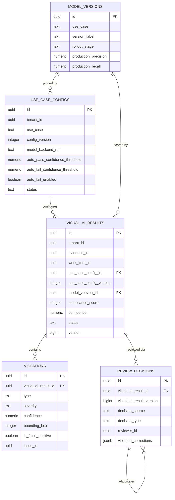
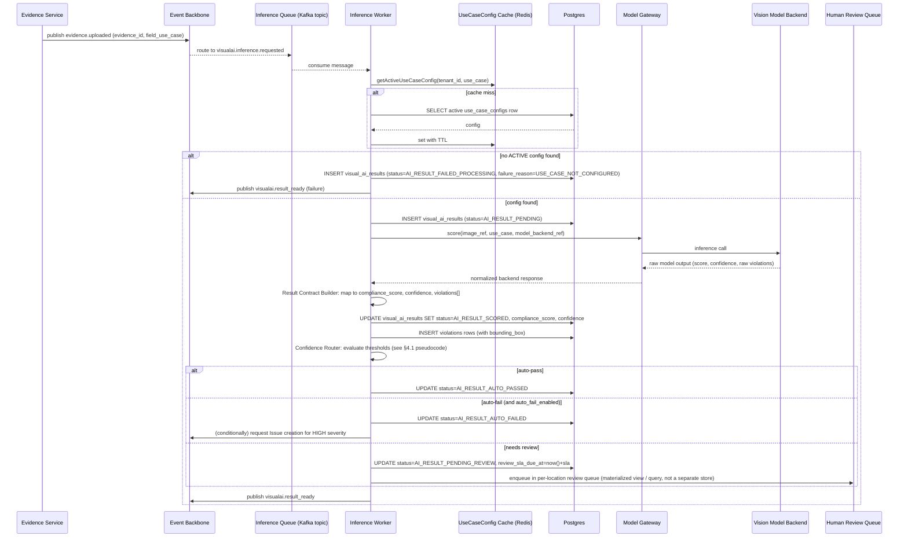
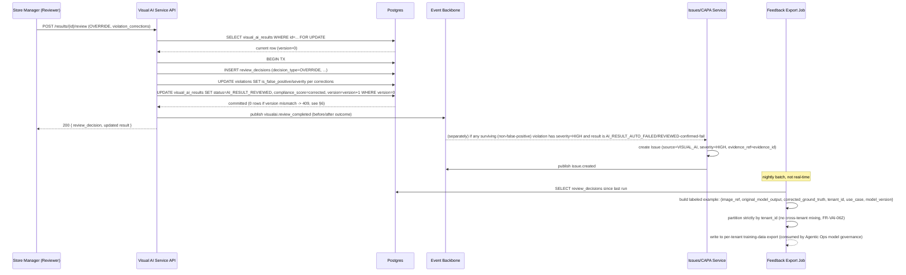

# Visual AI — Low-Level Design

## 1. Postgres Schema

### 1.1 Tables

**use_case_configs**

| Column | Type | Notes |
|---|---|---|
| id | uuid PK | |
| tenant_id | uuid | |
| use_case | text | enum: `PLANOGRAM_SHELF, PROMO_SIGNAGE, BRAND_EXECUTION, CLEANLINESS, PPE_SAFETY, ASSET_CONDITION, VEHICLE_SITE_CONDITION` |
| name | text | admin-facing label, e.g. "Flagship Planogram — Strict" |
| status | text | `DRAFT, ACTIVE, PAUSED, RETIRED` |
| config_version | integer | monotonic per `(tenant_id, use_case, name)` lineage |
| model_backend_ref | text | logical backend name resolved by the model gateway |
| model_version_id | uuid FK -> model_versions | pinned version at this config version |
| fallback_model_backend_ref | text, nullable | used on primary backend outage (NFR-VAI-05) |
| dispatch_mode | text | `REALTIME`, `BATCH` |
| batch_window_ms | integer, nullable | used when `dispatch_mode=BATCH` |
| violation_taxonomy | jsonb | array of `{type, display_name}` |
| severity_map | jsonb | `{violation_type: LOW\|MEDIUM\|HIGH}` |
| scoring_version | text | version tag for the use-case scoring formula |
| auto_pass_confidence_threshold | numeric(3,2) | 0.00–1.00 |
| auto_fail_confidence_threshold | numeric(3,2) | 0.00–1.00 |
| auto_fail_enabled | boolean | default false (FR-VAI-021) |
| min_violation_severity_for_autofail | text | default `HIGH` |
| min_violation_confidence_for_autofail | numeric(3,2) | default 0.90 |
| review_sla_minutes | integer | default 1440 (24h) |
| appeal_window_days | integer | default 7 |
| appeal_sla_days | integer | default 5 |
| dual_review_required | boolean | default false |
| quality_gate_enabled | boolean | default true |
| autofail_gate_override_reason | text, nullable | break-glass justification, NFR-VAI-03 |
| autofail_gate_override_by | uuid, nullable | actor |
| effective_from | timestamptz | |
| superseded_at | timestamptz, nullable | |
| created_by, created_at, updated_at | | |

Unique `(tenant_id, use_case, name, config_version)`. Partial unique index enforcing at most one
`ACTIVE` row per `(tenant_id, use_case, name)` lineage.

**model_versions**

| Column | Type | Notes |
|---|---|---|
| id | uuid PK | |
| use_case | text | model families are scoped per use case, may be shared cross-tenant at the backend level |
| model_backend_ref | text | |
| version_label | text | e.g. `planogram-v4.2.1` |
| rollout_stage | text | `SHADOW, ACTIVE, DEPRECATED, RETIRED` |
| promoted_at | timestamptz, nullable | when moved to ACTIVE |
| shadow_precision | numeric(4,3), nullable | snapshot at evaluation time |
| shadow_recall | numeric(4,3), nullable | |
| production_precision | numeric(4,3), nullable | rolling 30-day, updated by metrics rollup job |
| production_recall | numeric(4,3), nullable | |
| notes | text, nullable | |
| created_at, updated_at | | |

**visual_ai_results**

| Column | Type | Notes |
|---|---|---|
| id | uuid PK | |
| tenant_id | uuid | |
| evidence_id | uuid | ref to Evidence Service object, not FK-enforced cross-service |
| work_item_id | uuid, nullable | ref to Work Orchestration WorkItem |
| use_case_config_id | uuid FK -> use_case_configs | |
| use_case_config_version | integer | denormalized snapshot, immutable once set (FR-VAI-012) |
| model_version_id | uuid FK -> model_versions | |
| result_contract_version | integer | default 1 (FR-VAI-005) |
| inference_run_id | uuid, nullable | correlates to Agent Runtime/gateway call trace |
| compliance_score | integer | 0–100 |
| confidence | numeric(4,3) | 0.000–1.000 |
| status | text | enum, see §3 state diagram in architecture-diagram.md: `AI_RESULT_PENDING, AI_RESULT_SCORED, AI_RESULT_UNREVIEWED, AI_RESULT_AUTO_PASSED, AI_RESULT_AUTO_FAILED, AI_RESULT_PENDING_REVIEW, AI_RESULT_NEEDS_ADJUDICATION, AI_RESULT_REVIEWED, AI_RESULT_APPEALED, AI_RESULT_RESOLVED, AI_RESULT_FAILED_PROCESSING` |
| quality_flag | boolean | default false (FR-VAI-070) |
| degraded_mode | boolean | default false (fallback backend used under load) |
| failure_reason | text, nullable | e.g. `USE_CASE_NOT_CONFIGURED`, `MODEL_TIMEOUT` |
| source_image_width, source_image_height | integer | resolution the model scored at; anchors bounding-box coords |
| capture_occurred_at | timestamptz | from Evidence capture metadata, may predate server receipt |
| scored_at | timestamptz, nullable | |
| review_sla_due_at | timestamptz, nullable | |
| appeal_window_expires_at | timestamptz, nullable | |
| appealed_at, resolved_at | timestamptz, nullable | |
| version | bigint | optimistic concurrency, default 0 |
| created_at, updated_at | | |

Indexes: `(tenant_id, status, review_sla_due_at)` (review queue + SLA sweeper),
`(tenant_id, evidence_id, use_case_config_id)` unique (idempotency, §6),
`(tenant_id, work_item_id)`, `(use_case_config_id, model_version_id, scored_at)` (precision/recall
rollup), `(tenant_id, status)` partial where `status='AI_RESULT_APPEALED'` (appeal sweeper).

**violations**

| Column | Type | Notes |
|---|---|---|
| id | uuid PK | |
| tenant_id | uuid | |
| visual_ai_result_id | uuid FK -> visual_ai_results | |
| type | text | taxonomy value, may be `unmapped_type=true` (FR-VAI-076) |
| unmapped_type | boolean | default false |
| severity | text | `LOW, MEDIUM, HIGH` |
| original_severity | text, nullable | preserved if a reviewer changes severity |
| confidence | numeric(4,3) | |
| bounding_box | integer[4] | `[x_min, y_min, x_max, y_max]` in `source_image_width/height` pixel space |
| is_manual_addition | boolean | default false — added by a reviewer, not the model |
| is_false_positive | boolean | default false — set by reviewer override |
| autofail_eligible | boolean | computed at insert time per FR-VAI-022/076 |
| issue_id | uuid, nullable | set once auto-created in Issues/CAPA |
| created_at, updated_at | | |

Index `(visual_ai_result_id)`, `(tenant_id, type, severity, created_at)` (precision/recall by
violation type).

**review_decisions**

| Column | Type | Notes |
|---|---|---|
| id | uuid PK | |
| tenant_id | uuid | |
| visual_ai_result_id | uuid FK -> visual_ai_results | |
| visual_ai_result_version | bigint | the result's `version` at time of review (audit stability) |
| decision_source | text | `REVIEW, APPEAL` |
| decision_type | text | `ACCEPT, OVERRIDE, REJECT, UPHOLD, OVERTURN` |
| reviewer_id | uuid | |
| reviewer_role | text | snapshotted role at decision time |
| reason | text | required for OVERRIDE/REJECT/OVERTURN |
| corrected_compliance_score | integer, nullable | set on OVERRIDE/OVERTURN |
| violation_corrections | jsonb, nullable | array of `{violation_id, action: SEVERITY_CHANGE\|FALSE_POSITIVE\|ADDED, before, after}` |
| adjudicated_conflict_with | uuid, nullable FK -> review_decisions | set when this decision resolves a `NEEDS_ADJUDICATION` conflict |
| created_at | timestamptz | |

Index `(visual_ai_result_id, created_at)`, `(tenant_id, reviewer_id, created_at)`.

### 1.2 ER Diagram



## 2. REST Endpoints

All under `/api/v1/`, OAuth2/OIDC bearer, `Idempotency-Key` required on POST/PATCH, `ETag`/`version`
optimistic concurrency, cursor pagination, standard error envelope
`{"error":{"code","message","trace_id"}}`.

### 2.1 Configure use case and thresholds
`POST /api/v1/visual-ai/use-case-configs`

Request:
```json
{
  "use_case": "PLANOGRAM_SHELF",
  "name": "Flagship Planogram - Strict",
  "model_backend_ref": "vision-gateway:planogram-detector",
  "dispatch_mode": "REALTIME",
  "violation_taxonomy": [
    {"type": "missing_product", "display_name": "Missing product"},
    {"type": "wrong_facing", "display_name": "Incorrect facing"}
  ],
  "severity_map": {"missing_product": "HIGH", "wrong_facing": "MEDIUM"},
  "auto_pass_confidence_threshold": 0.90,
  "auto_fail_confidence_threshold": 0.92,
  "auto_fail_enabled": false,
  "review_sla_minutes": 1440
}
```
Response `201`:
```json
{
  "id": "ucc_7731",
  "config_version": 1,
  "status": "DRAFT",
  "model_version_id": "mv_2201",
  "created_at": "2026-09-19T14:00:00Z"
}
```
`PATCH /api/v1/visual-ai/use-case-configs/{id}` creates a new `config_version` (never mutates an
in-force version, FR-VAI-012); requires `If-Match`/`version`. Enabling `auto_fail_enabled=true`
runs the NFR-VAI-03 gate check server-side:
```json
{ "error": { "code": "PRECISION_RECALL_GATE_NOT_MET", "message": "HIGH-severity precision 0.86 < 0.90 required",
  "trace_id": "t-9", "current_metrics": {"precision": 0.86, "recall": 0.88, "window_days": 30} } }
```
`POST /api/v1/visual-ai/use-case-configs/{id}/activate` transitions `DRAFT -> ACTIVE`,
superseding the prior `ACTIVE` row for the same lineage (sets its `superseded_at`).

### 2.2 Get result for evidence
`GET /api/v1/visual-ai/results?evidence_id=ev_5521`

Response `200` (exact result contract shape from source-spec §12.2, extended):
```json
{
  "id": "var_9012",
  "evidence_id": "ev_5521",
  "work_item_id": "wi_8831",
  "compliance_score": 81,
  "confidence": 0.94,
  "status": "AI_RESULT_PENDING_REVIEW",
  "violations": [
    {
      "id": "vio_331",
      "type": "missing_product",
      "severity": "HIGH",
      "confidence": 0.96,
      "bounding_box": [120, 80, 320, 410]
    }
  ],
  "model_backend_ref": "vision-gateway:planogram-detector",
  "model_version": "planogram-v4.2.1",
  "use_case_config_version": 3,
  "result_contract_version": 1,
  "source_image_width": 1080,
  "source_image_height": 1440,
  "capture_occurred_at": "2026-09-19T13:55:02Z",
  "scored_at": "2026-09-19T13:55:14Z",
  "review_sla_due_at": "2026-09-20T13:55:14Z",
  "version": 0
}
```
`404 RESULT_NOT_FOUND` if inference has not yet started (client should treat as "processing," not
error, per functional-spec §10); a distinct `GET .../results/{id}/status` lightweight polling
endpoint returns just `{"status": "..."}"` for UI polling without the full payload.

### 2.3 Submit human review decision
`POST /api/v1/visual-ai/results/{id}/review`

Request (Override example):
```json
{
  "version": 0,
  "decision_type": "OVERRIDE",
  "reason": "Product was present but occluded by a promotional standee; not a real gap.",
  "corrected_compliance_score": 96,
  "violation_corrections": [
    {"violation_id": "vio_331", "action": "FALSE_POSITIVE"}
  ]
}
```
Response `200`:
```json
{
  "review_decision_id": "rd_441",
  "visual_ai_result": { "id": "var_9012", "status": "AI_RESULT_REVIEWED", "version": 1,
                          "compliance_score": 96 }
}
```
`409 CONFLICT` (lost race, FR-VAI-073):
```json
{ "error": { "code": "VERSION_CONFLICT", "message": "Result already reviewed", "trace_id": "t-2",
  "conflict": { "current_status": "AI_RESULT_REVIEWED", "current_version": 1,
                "existing_decision": {"decision_type": "ACCEPT", "reviewer_id": "usr_11"} } } }
```
If `dual_review_required=true` and the two decisions disagree, response is `200` with
`visual_ai_result.status = "AI_RESULT_NEEDS_ADJUDICATION"` instead of `AI_RESULT_REVIEWED`.

### 2.4 Submit appeal
`POST /api/v1/visual-ai/results/{id}/appeals`
```json
{
  "reason": "Shelf was restocked immediately after photo was taken; attaching proof.",
  "supplemental_evidence_ids": ["ev_5530"]
}
```
Response `201`:
```json
{ "appeal_id": "apl_120", "visual_ai_result": { "id": "var_9012", "status": "AI_RESULT_APPEALED" },
  "resolver": { "type": "ROLE_AT_PARENT_NODE", "resolved_user_id": "usr_88" },
  "appeal_sla_due_at": "2026-09-24T13:55:14Z" }
```
`422 APPEAL_WINDOW_EXPIRED` if filed past `appeal_window_days`. `409 APPEAL_ALREADY_EXISTS` if one
is already open for this result (single-appeal rule, FR-VAI-040).

`POST /api/v1/visual-ai/appeals/{appeal_id}/resolve`
```json
{ "decision_type": "OVERTURN", "reason": "Confirmed via timestamped follow-up photo.",
  "corrected_compliance_score": 96,
  "violation_corrections": [{"violation_id": "vio_331", "action": "FALSE_POSITIVE"}] }
```
Response `200` mirrors §2.3's shape with `visual_ai_result.status = "AI_RESULT_RESOLVED"`.

### 2.5 Get model performance metrics
`GET /api/v1/visual-ai/metrics?use_case=PLANOGRAM_SHELF&tenant_id=implicit&window_days=30`

Response `200`:
```json
{
  "use_case": "PLANOGRAM_SHELF",
  "model_version": "planogram-v4.2.1",
  "window_days": 30,
  "overall": { "precision": 0.93, "recall": 0.89, "sample_size": 4821 },
  "by_severity": {
    "HIGH": { "precision": 0.95, "recall": 0.91, "sample_size": 1203 },
    "MEDIUM": { "precision": 0.90, "recall": 0.86, "sample_size": 2114 },
    "LOW": { "precision": 0.88, "recall": 0.80, "sample_size": 1504 }
  },
  "by_violation_type": {
    "missing_product": { "precision": 0.96, "recall": 0.92, "sample_size": 990 }
  },
  "autofail_gate": { "eligible": true, "required_precision": 0.90, "required_recall": 0.85 },
  "override_rate": 0.07,
  "computed_at": "2026-09-19T02:00:00Z"
}
```
`404 NO_METRICS_AVAILABLE` if fewer than a minimum sample threshold (default 30 reviewed results)
exist in the window — returned rather than a misleadingly precise 0/0 metric.

## 3. Sequence Diagrams

### 3.1 Evidence upload -> inference -> confidence routing -> auto-pass or human-review-queue



### 3.2 Human review override -> feedback capture -> issue auto-creation for HIGH severity



### 3.3 Model version upgrade rollout with shadow-scoring before cutover

```mermaid
sequenceDiagram
    participant ADMIN as Operations Admin
    participant API as Visual AI Service API
    participant PG as Postgres
    participant W as Inference Worker
    participant GWOLD as Gateway (backend v4.2.1 - ACTIVE)
    participant GWNEW as Gateway (backend v5.0.0 - SHADOW)
    participant METRICS as Metrics Rollup Job

    ADMIN->>API: POST /model-versions (use_case, version_label=v5.0.0, rollout_stage=SHADOW)
    API->>PG: INSERT model_versions (rollout_stage=SHADOW)
    loop for each new inference on this use case (production traffic)
        W->>GWOLD: score(image) [drives real routing decision]
        GWOLD-->>W: result A (used for compliance_score/confidence/violations)
        W->>GWNEW: score(image) [shadow call, async, non-blocking]
        GWNEW-->>W: result B (stored, NOT used for routing)
        W->>PG: UPDATE visual_ai_results SET shadow_model_version_id, shadow_compliance_score, shadow_confidence (additive columns)
    end
    Note over METRICS: nightly
    METRICS->>PG: compare shadow vs. reviewed ground truth over the same sample window
    METRICS->>PG: UPDATE model_versions SET shadow_precision, shadow_recall WHERE id=v5.0.0
    ADMIN->>API: GET /visual-ai/metrics?model_version=v5.0.0&mode=shadow
    API-->>ADMIN: shadow precision/recall vs. current production precision/recall
    alt shadow metrics meet/exceed production and admin approves
        ADMIN->>API: POST /model-versions/{id}/promote
        API->>PG: UPDATE model_versions SET rollout_stage=ACTIVE, promoted_at=now() WHERE id=v5.0.0
        API->>PG: UPDATE model_versions SET rollout_stage=DEPRECATED WHERE id=v4.2.1
        API->>PG: UPDATE use_case_configs SET model_version_id=v5.0.0, config_version=config_version+1
        Note over W: subsequent inferences resolve the new ACTIVE config/version; in-flight/queued messages already carrying the old config_version are unaffected (FR-VAI-024)
    else shadow metrics insufficient
        ADMIN->>API: POST /model-versions/{id}/reject (stays SHADOW or moves to RETIRED)
    end
```

## 4. Algorithms / Pseudocode

### 4.1 Confidence-threshold routing decision

```
function routeResult(result, config):
    # result: {compliance_score, confidence, violations[]}
    # config: active UseCaseConfig

    autofail_violations = [
        v for v in result.violations
        if not v.unmapped_type
        and severityRank(v.severity) >= severityRank(config.min_violation_severity_for_autofail)
        and v.confidence >= config.min_violation_confidence_for_autofail
    ]

    if result.confidence >= config.auto_pass_confidence_threshold and len(autofail_violations) == 0:
        return AI_RESULT_AUTO_PASSED

    if config.auto_fail_enabled
       and result.confidence >= config.auto_fail_confidence_threshold
       and len(autofail_violations) > 0:
        return AI_RESULT_AUTO_FAILED

    # Safe default: never silently auto-decide on uncertain evidence
    return AI_RESULT_PENDING_REVIEW
```

Notes:
- `auto_fail_enabled` short-circuits the entire auto-fail branch when false (FR-VAI-021); a tenant
  that has not earned/enabled auto-fail always falls through to `PENDING_REVIEW` for any result
  that would otherwise fail, regardless of how high `confidence` is — this is intentional: high
  overall confidence does not substitute for the platform having validated auto-fail safety for
  that specific `UseCaseConfig` (NFR-VAI-03).
- A result can simultaneously fail the auto-pass condition (because of a HIGH violation) and fail
  the auto-fail condition (because that violation's own confidence is below
  `min_violation_confidence_for_autofail`) — this is the common "genuinely ambiguous" case and
  correctly falls through to `PENDING_REVIEW`.
- `severityRank` is a fixed ordinal (`LOW=1, MEDIUM=2, HIGH=3`), not tenant-configurable, so
  severity comparisons are unambiguous across use cases; the tenant customizes which violation
  *types* map to which severity (via `severity_map`), not the ordering of severities themselves.

### 4.2 Precision/recall computation per tenant/use case from review decisions

```
function computePrecisionRecall(tenant_id, use_case, model_version_id, window_days):
    reviewed_results = query visual_ai_results
        JOIN review_decisions ON review_decisions.visual_ai_result_id = visual_ai_results.id
        WHERE tenant_id = tenant_id
          AND use_case_config_id IN (configs for use_case)
          AND model_version_id = model_version_id
          AND review_decisions.created_at >= now() - window_days
          AND review_decisions.decision_source IN ('REVIEW', 'APPEAL')
        -- take the LATEST decision per visual_ai_result_id as ground truth
        GROUP BY visual_ai_result_id KEEP LATEST review_decision

    tp = fp = fn = tn = 0
    per_severity = {}   # same counters, keyed by violation severity
    per_type = {}       # same counters, keyed by violation type

    for result, decision in reviewed_results:
        ai_flagged_fail = (result.status in [AI_RESULT_AUTO_FAILED]
                            or (result.status == AI_RESULT_PENDING_REVIEW
                                and hasAutofailEligibleViolation(result)))
        human_confirmed_fail = (decision.decision_type == 'ACCEPT' and ai_flagged_fail) \
                                or (decision.decision_type in ('OVERRIDE','OVERTURN')
                                    and decision.corrected_compliance_score is not None
                                    and decision.corrected_compliance_score < config.pass_score_floor)

        if ai_flagged_fail and human_confirmed_fail:
            tp += 1
        elif ai_flagged_fail and not human_confirmed_fail:
            fp += 1          # AI said violation, human said false positive -> Override
        elif not ai_flagged_fail and human_confirmed_fail:
            fn += 1          # AI missed it, human/appeal added a violation or lowered score
        else:
            tn += 1

        # Per-violation breakdown: walk violation_corrections for FALSE_POSITIVE (-> FP for that
        # violation's type/severity) and ADDED (-> FN for that violation's type/severity); all
        # other original violations the reviewer did not touch count as TP for their type/severity.
        for v in result.violations:
            classification = classifyViolationOutcome(v, decision.violation_corrections)
            increment(per_severity[v.severity], classification)
            increment(per_type[v.type], classification)

    precision = tp / (tp + fp) if (tp + fp) > 0 else null
    recall = tp / (tp + fn) if (tp + fn) > 0 else null

    return {
        overall: {precision, recall, sample_size: tp+fp+fn+tn},
        by_severity: rollup(per_severity),
        by_violation_type: rollup(per_type)
    }
```

Notes:
- Ground truth is **always** the latest human decision for a given result (a reviewed-then-appealed
  result uses the appeal resolution, not the original review, as ground truth) — this keeps the
  metric consistent with FR-VAI-060/061's definition that overrides/overturns are the correction
  signal.
- Runs as the nightly **precision/recall metric rollup job** (§7) rather than computed on-demand
  per API call, since the join/aggregation is not cheap at scale (100k-location tenants); the
  metrics endpoint (§2.5) reads the job's materialized output (`model_version` rollup table columns
  `production_precision`/`production_recall` plus a per-severity/per-type metrics table not shown
  above for brevity, keyed `(model_version_id, severity|type, window_days)`).

## 5. Caching

- **UseCaseConfig cache.** Redis key `vai:ucc:{tenant_id}:{use_case}` → serialized active config,
  TTL 10 minutes as a safety net, but **actively invalidated** on every config write/activate/
  supersede so a threshold change is honored on the next inference dispatch, not merely eventually
  (FR-VAI-024). Cache-aside pattern: worker reads cache, falls back to Postgres on miss, repopulates.
- **Review-queue summary cache.** Redis key `vai:queue_count:{tenant_id}:{location_id}` →
  `{pending_review, needs_adjudication, overdue}` counts, TTL 60s, used for badge counts across
  manager UI surfaces without a live aggregate query on every screen render; invalidated
  opportunistically on `visualai.result_ready`/`visualai.review_completed` for the affected
  location, with the TTL as the correctness backstop.
- **Model version resolution cache.** Since `model_versions` changes rarely (only on
  promote/retire), the current `ACTIVE`/`SHADOW` version per use case is cached alongside the
  `UseCaseConfig` cache entry (denormalized into the same cached object) rather than as a separate
  lookup, avoiding a second cache round trip on the hot path.

## 6. Concurrency

- **Idempotent result-ready handling on event replay (FR-VAI-075).** A unique constraint on
  `visual_ai_results(tenant_id, evidence_id, use_case_config_id)` makes inference dispatch
  idempotent: on a redelivered `evidence.uploaded` event, the worker attempts
  `INSERT ... ON CONFLICT (tenant_id, evidence_id, use_case_config_id) DO NOTHING`. If the row
  already exists in any non-terminal-failure state, the worker skips re-dispatch entirely (no
  duplicate model-gateway call, no duplicate SLA timer registration); if the existing row is in
  `AI_RESULT_FAILED_PROCESSING`, the worker instead retries inference against that same row
  (`UPDATE ... WHERE status='AI_RESULT_FAILED_PROCESSING'`) rather than inserting a duplicate.
- **Optimistic concurrency on review/appeal writes.** Mirrors Work Orchestration's pattern: every
  mutating write to `visual_ai_results` requires the caller's known `version`
  (`UPDATE visual_ai_results SET status=$1, version=version+1, ... WHERE id=$2 AND version=$3`).
  Zero rows affected → `409 VERSION_CONFLICT` with current state returned (§2.3), which is also how
  FR-VAI-073 (conflicting concurrent reviews) surfaces at the API layer — the second writer decides
  whether to concur (creating a `NEEDS_ADJUDICATION` path via a distinct endpoint) or accept the
  existing decision.
- **Dual-review adjudication race.** When `dual_review_required=true`, both reviewers' submissions
  are accepted (not first-wins) as long as the result is still in `PENDING_REVIEW`/first-reviewed
  state; the **second** submission's write path checks whether its `decision_type`/corrected
  outcome differs from the first `review_decisions` row for the same result and, if so, sets status
  to `AI_RESULT_NEEDS_ADJUDICATION` instead of `AI_RESULT_REVIEWED` inside the same transaction
  (`SELECT ... FOR UPDATE` on the result row serializes the two writers).
- **Feedback export job vs. in-flight reviews.** The nightly export (§3.2, §7) reads
  `review_decisions` with `created_at < job_start_time` as its watermark so a review submitted
  mid-run is picked up on the next run rather than read in a partially-committed state; no
  distributed lock is needed since Postgres transaction visibility already guarantees the export
  only sees committed rows.

## 7. Background Jobs

| Job | Trigger | Responsibility |
|---|---|---|
| Inference queue workers | Kafka consumer group on `visualai.inference.requested`, autoscaled on consumer lag | Dispatch model-gateway calls, build result contract, run confidence routing (§3.1); pool sized per NFR-VAI-04 |
| Precision/recall metric rollup | Nightly per tenant/use-case/model-version (also incrementally re-run intraday for tenants with `auto_fail_enabled` under evaluation, so the NFR-VAI-03 gate reflects near-current data) | Computes §4.2 aggregates, writes to `model_versions.production_precision/recall` and per-severity/per-type metrics tables |
| Review SLA sweeper | Every 5 minutes | Scans `visual_ai_results WHERE status='AI_RESULT_PENDING_REVIEW' AND review_sla_due_at < now()`, fires escalation notifications via the reused Work Orchestration escalation mechanism, marks `sla_breached=true` for reporting |
| Appeal SLA sweeper | Every 15 minutes | Scans `status='AI_RESULT_APPEALED' AND appeal_sla_due_at < now()`, escalates to the next resolver level per FR-VAI-043 |
| Feedback export job | Nightly, per tenant | Builds the labeled-training-data extract from `review_decisions` since the last watermark, partitioned strictly by `tenant_id` (FR-VAI-062), delivered to the Agentic Ops training pipeline's ingestion location |
| Shadow-scoring aggregator | Continuous (inline in inference workers) + nightly rollup | Records shadow-model outputs alongside production results (§3.3) and rolls up shadow precision/recall for admin review before promotion |
| Stale-`AI_RESULT_PENDING` reconciler | Every 10 minutes | Defensive sweep for results stuck in `AI_RESULT_PENDING` beyond a timeout (e.g., a worker crashed mid-inference without acking/nacking) — requeues or marks `AI_RESULT_FAILED_PROCESSING` per NFR-VAI-01's degradation path |
| Config cache warmer | On `use_case_configs` write/activate | Proactively repopulates the Redis cache entry rather than relying purely on next-read cache-aside fill, reducing a cold-cache latency spike right after an admin changes thresholds |

## 8. Error Handling

| Condition | HTTP Status | Error Code | Client Guidance |
|---|---|---|---|
| No ACTIVE UseCaseConfig for evidence's use case | n/a (async) | `USE_CASE_NOT_CONFIGURED` (on result) | Result recorded `AI_RESULT_FAILED_PROCESSING`; WorkItem unaffected; Admin sees actionable count (FR-VAI-071) |
| Model backend timeout/outage, no fallback configured | n/a (async, retried) | `MODEL_TIMEOUT` (on result, after max retries) | Result recorded `AI_RESULT_FAILED_PROCESSING`; UI shows "unable to analyze — will retry," not a fail |
| Result not yet ready | 404 | `RESULT_NOT_FOUND` | Client treats as still-processing (poll `/status`), not a hard error |
| Review submitted against stale version | 409 | `VERSION_CONFLICT` | Re-fetch current result/decision, offer concur-or-dispute |
| Auto-fail enable requested below precision/recall gate | 422 | `PRECISION_RECALL_GATE_NOT_MET` | Show current metrics vs. required gate; offer break-glass override (audit-logged) to Enterprise Admin only |
| Appeal filed past window | 422 | `APPEAL_WINDOW_EXPIRED` | Show window that has closed; no further appeal path unless admin manually reopens |
| Duplicate appeal on same result | 409 | `APPEAL_ALREADY_EXISTS` | Show existing open appeal and its resolver |
| Config activation with invalid threshold ordering (auto_fail < auto_pass in a way that creates unreachable states) | 400 | `INVALID_THRESHOLD_CONFIGURATION` | Reject with the specific rule violated; UI inline-validates before submit |
| Violation type not in taxonomy | n/a (accepted, flagged) | `unmapped_type=true` (on violation) | Excluded from auto-fail eligibility until admin maps it (FR-VAI-076) |
| Duplicate `evidence.uploaded` redelivery | n/a (idempotent no-op) | n/a | No duplicate result created; existing result/status returned to any polling client |
| Metrics requested with insufficient sample size | 404 | `NO_METRICS_AVAILABLE` | Show "not enough reviewed data yet" rather than an unstable metric |
| Reviewer lacks `visual_ai:review` scope at result's location | 403 | `SCOPE_DENIED` | Hide result from that reviewer's queue entirely (not just block the action) |
| Bulk metrics/export request exceeds size limit | 413 | `PAYLOAD_TOO_LARGE` | Client paginates by date range or use case |
