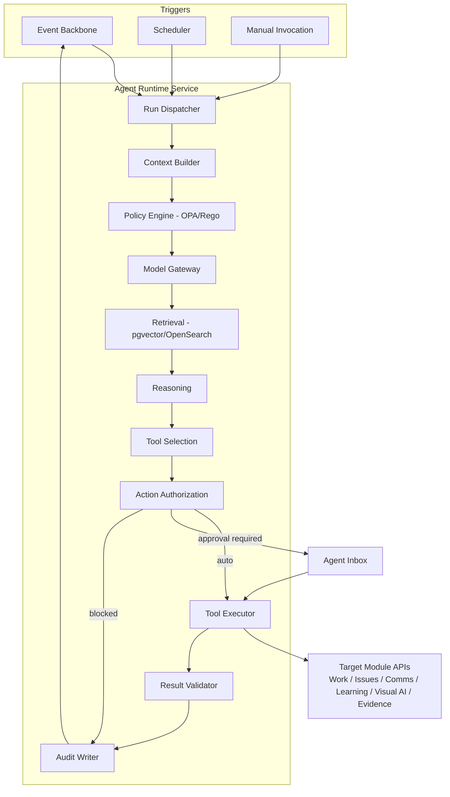
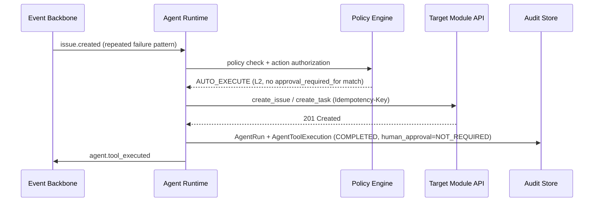
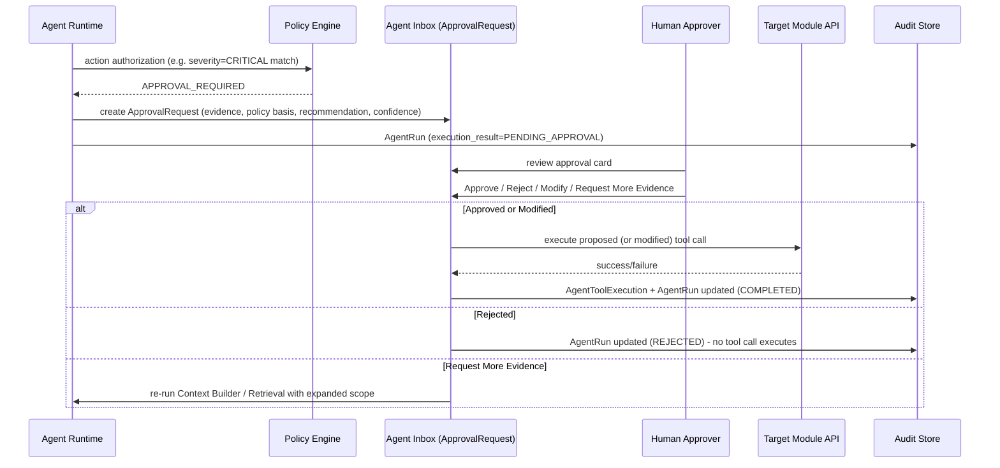
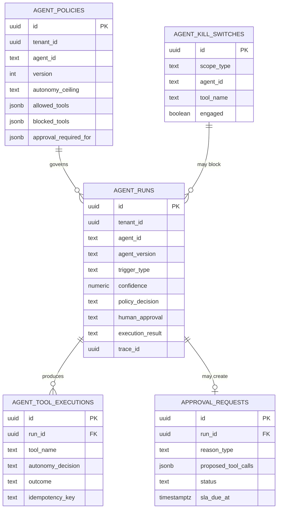
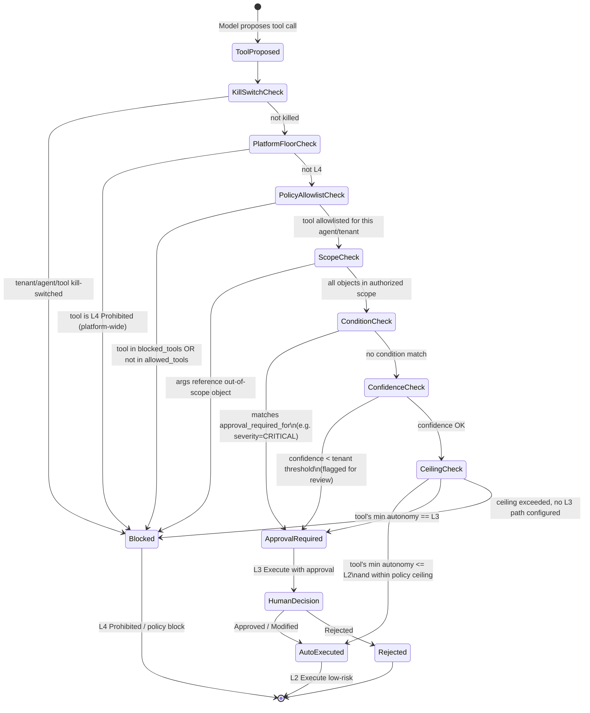

# Agentic Operations (Agent Runtime) — Architecture Diagrams

Module: `10-agentic-operations` | Epic: **EPIC-11 Agent Runtime**

Focused diagram set for this module: component/container view, two sequence diagrams (L2
auto-execute and L3 approval flows), an ER diagram of owned entities, and the Agent Autonomy Level
decision flow. Prose is kept to short narration per diagram — full rationale lives in
high-level-design.md and low-level-design.md.

## 1. Component / Container Diagram

**Narration:** The runtime is one service implementing the fixed pipeline from source-spec §13.2.
It is deliberately drawn as a hub: it consumes almost every domain event as a trigger and calls
almost every other module's write API as a tool, but it owns none of that domain state itself —
only the run/policy/approval/audit records described in §3.

## 2. Sequence Diagram — L2 Auto-Execute Flow

**Narration:** At L2, the deterministic policy check both authorizes and closes the loop in one
pass — no human touches the flow. Every fact (policy version, tool arguments/results) is still
written to the immutable audit trail before the run is marked complete, satisfying the 100%
audit-completeness NFR even when no human was involved.

## 3. Sequence Diagram — L3 Approval Flow

**Narration:** L3 is the human-in-the-loop path required by source-spec §13.4. The approval card
carries everything the approver needs (evidence, policy basis, recommendation, confidence,
impacted objects, proposed action) so the decision does not require reading raw agent internals.
A rejection never executes any tool call; a modification executes only the approver's edited
arguments, both outcomes fully audited for the human-override evaluation metric.

## 4. ER Diagram — Owned Entities

**Narration:** `AgentPolicy` is the versioned authorization contract every `AgentRun` is stamped
with; `AgentRun` fans out into one or more `AgentToolExecution` rows (the fine-grained audit/
control surface) and, when human review is triggered, exactly one `ApprovalRequest`. Kill switches
sit outside the run lifecycle and can block a run before it ever reaches tool execution.

## 5. Agent Autonomy Level Decision Flow

Reuses the L0–L4 definitions verbatim from conventions.md / source-spec §20.3.

**Narration:** Every proposed tool call walks this same deterministic gate regardless of which of
the 9 agents proposed it. Kill switches and the platform L4-prohibited floor are checked first and
always win; tenant policy (`blocked_tools`/`allowed_tools`/`approval_required_for`) is evaluated
next; confidence is an independent, additional gate that can force review even for an
otherwise-auto-executable tool. Only after all of these pass does a call reach `AutoExecuted`
(L2) — anything routed to `ApprovalRequired` becomes an Agent Inbox item (L3), and anything
`Blocked` is logged and surfaced, never silently dropped, per the source-spec §24.1 acceptance
test.
