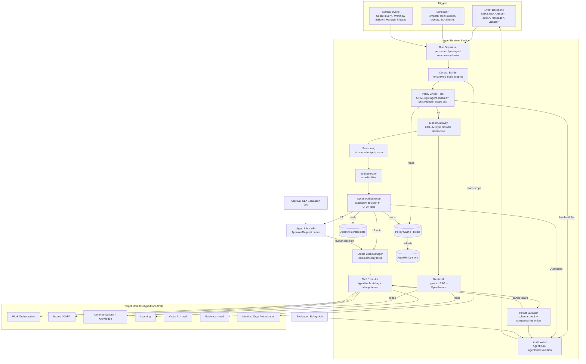

# Agentic Operations (Agent Runtime) — High-Level Design

Module: `10-agentic-operations` | Epic: **EPIC-11 Agent Runtime**

## 1. Module Responsibilities

The Agent Runtime is a single logical service (deployed as a bounded context per
conventions.md's "one deployable per bounded context" rule) with five responsibilities:

1. **Context Builder** — assembles authorized, tenant/org-scoped context for a run (never
   cross-tenant, never out-of-scope).
2. **Policy Engine** — deterministic authorization of agent behavior and tool calls (OPA/Rego),
   independent of and prior to any model call.
3. **Model Gateway** — provider-agnostic (LiteLLM-style) abstraction over LLM/statistical model
   providers, with typed tool-calling, cost/latency tracking, and prompt/agent versioning.
4. **Tool Executor** — the only path through which an agent's proposed action reaches another
   module's write API; enforces typed schemas, idempotency, and object-scope re-verification.
5. **Audit/Evaluation** — immutable run/tool-execution recording and the evaluation-metric
   pipeline (source-spec §20.5).

It explicitly does **not** own business-domain state (Issues, WorkItems, etc.) — it owns
`AgentRun`, `AgentToolExecution`, `AgentPolicy`, `ApprovalRequest`, and `AgentKillSwitch` only
(§4).

## 2. Component Diagram

**Hub framing:** Agent Runtime is both an event **consumer** (nearly every canonical event from
§18.3 can trigger a run) and an API **client** (its Tool Executor calls nearly every other
module's write/read APIs). It is drawn deliberately as the hub of the platform's automation
surface, not a peripheral add-on service — this is the direct technical expression of the
product's "governed agents" differentiator.

## 3. Data Ownership

| Entity | Owned here | Notes |
|---|---|---|
| `AgentRun` | Yes | Full execution trace per source-spec §20.4; append-only after `COMPLETED`/`FAILED`/`REJECTED` terminal state. |
| `AgentToolExecution` | Yes | One row per tool call within a run; immutable once written. |
| `AgentPolicy` | Yes | Versioned per tenant+agent(+optional org-node scope); compiled to Rego at save time. |
| `ApprovalRequest` | Yes | The Agent Inbox queue item; references its `AgentRun` and target object(s). |
| `AgentKillSwitch` | Yes | Tenant/agent/tool scoped switch state + audit of engage/disengage. |
| `AgentEvaluationMetric` (rollup) | Yes (derived) | Precomputed rollups from `AgentRun`/`AgentToolExecution` for the evaluation dashboard; source of truth remains the raw run/execution tables. |
| WorkItem, Issue, KnowledgeDocument, Submission, etc. | No (referenced only) | This module stores only IDs + hashes of arguments/results referencing these; the target module's own service is authoritative. |

## 4. External Interfaces

### 4.1 Consumed (events, as triggers)
`task.created`, `task.overdue`, `audit.submitted`, `audit.approved`, `issue.created`,
`issue.escalated`, `issue.resolved`, `training.completed`, `message.acknowledged`, plus an
internal `visualai.result_scored` event from module 09 (not in the platform's canonical list in
§18.3 but following the same envelope shape — flagged for addition to the canonical event
registry as part of EPIC-11/EPIC-10 joint delivery).

### 4.2 Produced (events)
`agent.invoked`, `agent.tool_executed`, `agent.action_approved`, `agent.action_rejected` — emitted
per §18.3, using the standard event envelope (§18.4), `resource_id` = `AgentRun.id`.

### 4.3 Consumed (synchronous APIs, as a client)
Every tool in the catalog (low-level-design.md §2) is a synchronous (gRPC internal / REST at the
gateway edge) call into the owning module's existing authoritative API — the Agent Runtime never
gets a bespoke "agent-only" backdoor API; it calls the same endpoint a human-driven UI action would
ultimately invoke, with a service-identity principal scoped to exactly the run's authorized
tenant/org-node context (see §6 multi-tenancy).

### 4.4 Produced (synchronous APIs, for humans/admins)
REST endpoints under `/api/v1/agents/*` for the Agent Inbox, policy configuration, kill switch,
and run/audit query surfaces — full contract in low-level-design.md §4.

## 5. Scalability

- **Per-tenant agent concurrency limits:** The Run Dispatcher enforces a configurable max
  concurrent runs per (tenant, agent_type) to (a) bound a noisy tenant's model spend and (b) avoid
  one tenant starving shared model-gateway capacity. Default: 20 concurrent runs per tenant across
  all agents, with a per-agent sub-limit (e.g., Visual Inspection Agent at high image-ingest
  volume gets a higher sub-limit than Executive Insights Agent). Enforced via a Redis token-bucket
  keyed `tenant_id:agent_id`.
- **Model-gateway request queuing / cost control:** The Model Gateway queues outbound model calls
  per provider with backpressure; a per-tenant monthly/daily cost ceiling (configurable) causes
  the gateway to fail closed into a "budget exceeded" state for that tenant — new runs for that
  tenant complete the Policy Check but skip the Model/Reasoning stages, log
  `RUN_SKIPPED — COST_CEILING`, and (for agents with deterministic-rule fallbacks, e.g. Compliance
  Monitor's rule-engine-mandated actions) still execute the deterministic-rule portion of behavior
  (§13.3 pattern) even when the LLM portion is throttled.
- **Horizontal scaling:** The pipeline stages are implemented as stateless workers behind the
  Run Dispatcher's queue (one logical queue per stage transition, backed by the event backbone or
  an internal work queue) so Context Builder, Retrieval, Tool Executor, etc. scale independently;
  a spike in Visual Inspection Agent volume (e.g., a large photo-audit campaign) scales that
  agent-type's worker pool without affecting Compliance Monitor throughput.
- **Retrieval scaling:** pgvector queries are read-replica-served where the platform's Postgres
  tier supports it; OpenSearch queries follow the platform's general search scaling approach —
  this module does not introduce a separate retrieval infrastructure.

## 6. Multi-Tenancy

Ties directly to source-spec §21.1: "A tenant identifier is not considered sufficient by itself;
the system must prove object-level scope at every access boundary." For the Agent Runtime this
means, concretely:

- **Context Builder scoping is structural, not advisory.** The Context Builder does not accept a
  "tenant_id" parameter and then query broadly — every underlying data-access call it makes
  (to Work Orchestration, Evidence, Knowledge, etc.) is made through that target module's own
  scoped API using a **run-scoped service credential** whose claims are minted from the
  triggering event's `tenant_id` + `resource_id`'s org-node path, never from a broader default.
  A Context Builder call literally cannot express "give me data across tenants" — there is no
  parameter shape that allows it (see pseudocode, low-level-design.md §6).
- **Vector retrieval scoping:** every pgvector query issued by the Retrieval stage carries a
  mandatory `tenant_id` filter predicate that is enforced by the retrieval service itself (defense
  in depth beyond the caller supplying it correctly) — matches source-spec §21.3 "No cross-tenant
  retrieval."
- **Model Gateway isolation:** prompts sent to external model providers never include
  cross-tenant few-shot examples or shared fine-tuning data derived from another tenant's content
  unless that tenant has explicitly opted into a cross-tenant benchmark/model-improvement program
  (opt-in, off by default, per source-spec §21.3 tenant/provider/model allowlists).
- **Audit/Approval queries** are always additionally filtered by the requesting principal's
  UserScope on top of tenant — a Regional Manager's Inbox query can never surface another
  region's `ApprovalRequest` rows even within the same tenant.
- **Acceptance-test alignment:** this design is built to satisfy source-spec §24.1's "Tenant
  isolation" acceptance test verbatim for the AI context-assembly path ("Tenant A cannot retrieve
  Tenant B records... embeddings, analytics, or agent context").

## 7. Failure Modes and Degradation Strategy

| Failure | Detection | Degradation strategy |
|---|---|---|
| **Model provider outage / rate-limit** | Model Gateway circuit breaker trips on error-rate/latency threshold. | Gateway fails over to a configured secondary provider/model where the agent's contract allows provider substitution; if no fallback or fallback also unhealthy, the run is deferred (requeued with backoff, bounded retry budget) rather than failed outright for non-time-critical agents; for time-critical paths (e.g., Compliance Monitor on a CRITICAL trigger), the deterministic-rule portion of the pattern (§13.3) still executes even with the model portion unavailable, and the run is flagged `MODEL_UNAVAILABLE — RULE_ONLY` in the audit trail, escalating to the Agent Inbox as needing human interpretation. |
| **Policy engine (OPA) unavailable** | Policy Check call times out / connection error. | **Fail closed, never open.** No tool execution is authorized without a fresh, successful policy evaluation. Behavior: (1) serve from the local Policy Cache if the cached decision is within its freshness window (short TTL, §7 low-level-design.md caching) — cache absence + engine down = block; (2) if the cache is stale or missing, the run halts at Policy Check with outcome `BLOCKED — POLICY_ENGINE_UNAVAILABLE`, logged, and (for L0 observe-only agents that need no tool authorization) may still proceed to produce read-only insight since no action is being authorized, but even this is a configurable conservative default (tenant may require full block including L0). This directly implements the acceptance-test pattern in source-spec §24.1 ("Agent attempt to call prohibited tool is blocked, logged, and surfaced") generalized to "policy unknown = treated as prohibited." |
| **Tool execution timeout** | Executor-side timeout on the downstream module call. | Tool Executor treats a timeout as an **unknown** outcome, not a failure or success — it does not retry a non-idempotent-looking call blindly; it re-checks via the target module's idempotency-key semantics (conventions.md) to determine whether the call actually landed before deciding to retry, and if still unresolved after a bounded number of checks, surfaces `PARTIAL_FAILURE`/`UNKNOWN` to Result Validation, which follows the compensating-action edge case (functional-spec.md FR-AGENT-403). |
| **Target module (e.g., Issues service) degraded** | Elevated error rate from that module's API. | Bulkhead: only that module's tool calls are affected (circuit breaker per downstream dependency) — other agents/tools continue operating; affected proposed actions queue with backoff up to a bounded window, then escalate to Agent Inbox as "action pending — service degraded" rather than silently dropping. |
| **Event backbone lag / redelivery** | Consumer lag metrics; Kafka redelivery. | Agent Runtime's event consumption is idempotent by `event_id` (dedup table/cache) so redelivery cannot double-trigger a run; backlog is processed in order per tenant partition, so a lagging backbone delays but does not corrupt run ordering. |
| **Context Builder partial data unavailability** (e.g., Evidence service down) | Downstream read failure during context assembly. | Run proceeds with a reduced context set only if the agent's contract marks that source "optional"; if the missing source is required for a safe recommendation (e.g., Visual Inspection Agent without the actual image result), the run halts and logs `BLOCKED — CONTEXT_INCOMPLETE` rather than reasoning over partial/absent evidence. |

## 8. Technology Choices (justified)

- **OPA / Rego for the policy engine** (per conventions.md): chosen because agent-action
  authorization must be (a) **testable** independently of the LLM (policy unit tests run in CI
  against fixed input fixtures — a prerequisite for the source-spec §24.1 acceptance test on
  policy enforcement being a repeatable, automatable gate, not a manual review), (b)
  **versionable** as a first-class artifact (`AgentPolicy` version ties directly to a compiled
  Rego bundle, giving exact reproducibility of "what would this policy have allowed six months
  ago"), and (c) **fast and side-effect-free** to evaluate on the hot path (a pure function over
  structured input, no network call to an LLM), which is what makes the "fail closed" guarantee
  in §7 practically enforceable — a policy engine that itself depended on a model call could not
  offer that guarantee.
- **Typed, allowlisted tool-calling instead of free-form code execution:** the model is never
  given a general code-execution or arbitrary-HTTP capability. Every action surface is a named
  tool with a fixed JSON args/return schema (low-level-design.md §2). This is a deliberate
  narrowing of the "agent" concept to keep the attack surface and the audit surface both small
  and enumerable: an auditor can list every action a given agent could ever have taken by
  reading its tool allowlist, without having to reason about what arbitrary code might do. It
  also makes Action Authorization (loop stage 8) tractable as a pure OPA decision over
  `(agent, tool, args-derived-attributes)` rather than an open-ended sandboxing problem.
- **Model-provider-agnostic gateway (LiteLLM-style):** required by source-spec §20.1 "Model:
  Provider-agnostic model abstraction" and Product Principle P10 ("Design for change... model
  providers... must be versioned and replaceable"). Concretely this lets a tenant's
  allowlisted-provider policy (source-spec §21.3) be enforced at the gateway layer, lets the
  platform swap or A/B a model per agent without touching agent business logic, and gives one
  place to enforce cost ceilings and redaction-before-send (§21.3 "Optional redaction before
  model processing").
- **pgvector for RAG:** consistent with conventions.md's choice for the Knowledge Hub; reusing the
  same vector store for Agent Runtime retrieval (rather than a separate embedding store) avoids a
  second place where tenant-scoping of embeddings could be gotten wrong, and keeps Knowledge Hub
  document versioning/effective-dating (source-spec §11.2) as the single source of truth agents
  retrieve against.
- **Advisory locks (Redis) for object-level concurrency**, not a heavier distributed transaction
  protocol: agent-vs-agent (or agent-vs-human) races on the same object are expected to be
  infrequent and short-lived (seconds, bounded by Tool Execution latency), so a lightweight
  lease-based advisory lock with a bounded TTL and safe expiry is sufficient and avoids
  introducing distributed-transaction complexity into what are ultimately independent downstream
  API calls each already transactional within their own service.
