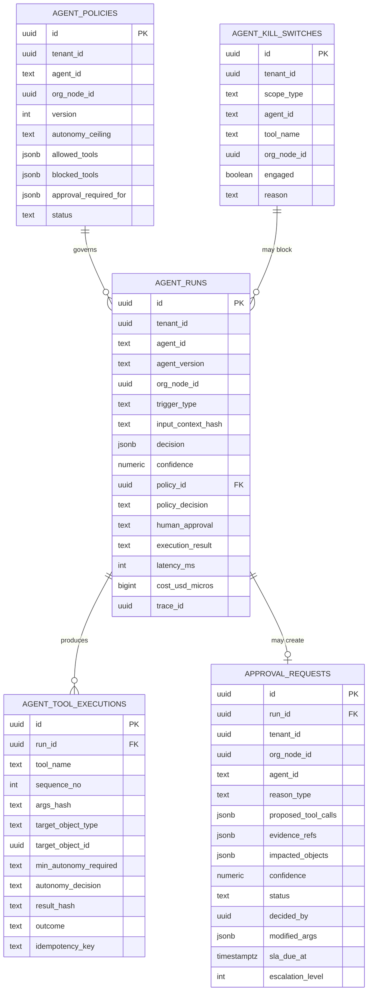
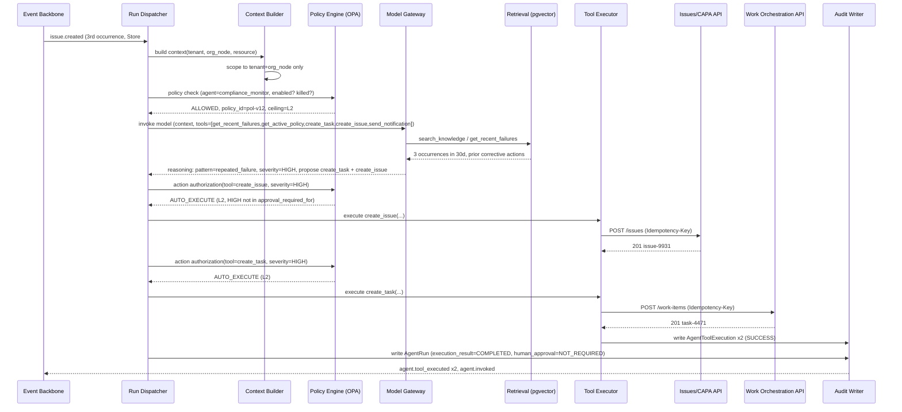
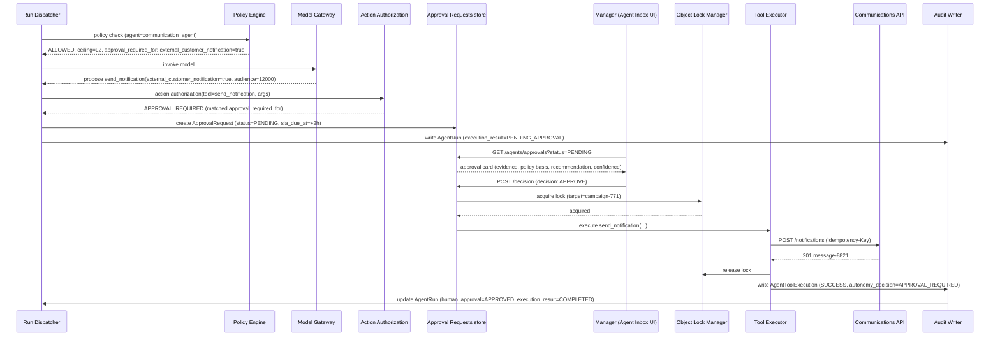
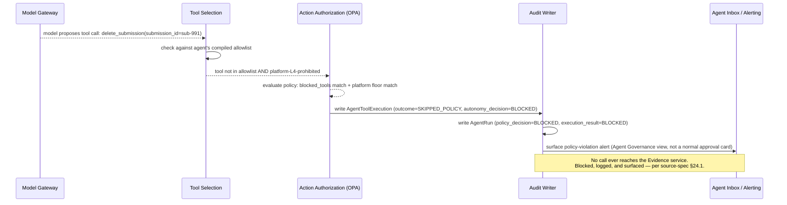

# Agentic Operations (Agent Runtime) — Low-Level Design

Module: `10-agentic-operations` | Epic: **EPIC-11 Agent Runtime**

## 1. Database Schema (PostgreSQL)

All tables carry `tenant_id` and are subject to Postgres RLS policies per conventions.md
(row-level multi-tenancy backstop behind application-layer scoping).

### 1.1 Tables

**`agent_policies`**

| Column | Type | Notes |
|---|---|---|
| `id` | uuid PK | |
| `tenant_id` | uuid, NOT NULL | RLS partition key |
| `agent_id` | text, NOT NULL | e.g. `compliance_monitor` |
| `org_node_id` | uuid, NULL | NULL = tenant-wide policy; set = scoped override for a subtree |
| `version` | int, NOT NULL | Monotonic per (tenant_id, agent_id, org_node_id) |
| `autonomy_ceiling` | text, NOT NULL | one of `L0,L1,L2,L3,L4` |
| `allowed_tools` | jsonb, NOT NULL | array of tool names |
| `blocked_tools` | jsonb, NOT NULL | array of tool names; wins over allowed |
| `approval_required_for` | jsonb, NOT NULL | array of condition expressions, e.g. `{"field":"severity","op":"=","value":"CRITICAL"}` |
| `compiled_rego` | text, NOT NULL | generated Rego bundle checksum-linked to this version |
| `status` | text, NOT NULL | `DRAFT, ACTIVE, SUPERSEDED` |
| `created_by` | uuid, NOT NULL | |
| `created_at` | timestamptz, NOT NULL | |
| `activated_at` | timestamptz, NULL | |

Indexes: `(tenant_id, agent_id, org_node_id, status)`, `(tenant_id, agent_id, version)` unique.

**`agent_kill_switches`**

| Column | Type | Notes |
|---|---|---|
| `id` | uuid PK | |
| `tenant_id` | uuid, NOT NULL | |
| `scope_type` | text, NOT NULL | `TENANT, AGENT, TOOL` |
| `agent_id` | text, NULL | set when scope_type in (AGENT, TOOL) |
| `tool_name` | text, NULL | set when scope_type = TOOL |
| `org_node_id` | uuid, NULL | optional narrower scope (Operations Admin "pause for my subtree") |
| `engaged` | boolean, NOT NULL DEFAULT false | |
| `reason` | text, NOT NULL | mandatory free text |
| `engaged_by` | uuid, NULL | |
| `engaged_at` | timestamptz, NULL | |
| `disengaged_by` | uuid, NULL | |
| `disengaged_at` | timestamptz, NULL | |

Indexes: `(tenant_id, scope_type, agent_id, tool_name, engaged)`.

**`agent_runs`** (Agent Run Record, source-spec §20.4)

| Column | Type | Notes |
|---|---|---|
| `id` | uuid PK | = `trace_id` root for this run |
| `tenant_id` | uuid, NOT NULL | |
| `agent_id` | text, NOT NULL | |
| `agent_version` | text, NOT NULL | |
| `org_node_id` | uuid, NOT NULL | scope the run was authorized against |
| `trigger_type` | text, NOT NULL | `EVENT, SCHEDULE, MANUAL` |
| `trigger_event_id` | uuid, NULL | FK-like ref to the causing event, if any |
| `model_provider` | text, NULL | |
| `model_id` | text, NULL | |
| `prompt_version` | text, NULL | |
| `input_context_hash` | text, NOT NULL | sha256 of assembled context payload |
| `retrieved_sources` | jsonb, NOT NULL DEFAULT '[]' | array of `{source_type, source_id, version}` |
| `decision` | jsonb, NULL | structured reasoning output |
| `confidence` | numeric(4,3), NULL | 0.000–1.000 |
| `policy_id` | uuid, NOT NULL | FK `agent_policies.id`, the version that governed this run |
| `policy_decision` | text, NOT NULL | `ALLOWED, BLOCKED, PARTIAL, KILL_SWITCHED` |
| `human_approval` | text, NULL | `APPROVED, REJECTED, MODIFIED, NOT_REQUIRED` |
| `approved_by` | uuid, NULL | |
| `approved_at` | timestamptz, NULL | |
| `execution_result` | text, NOT NULL | `COMPLETED, PARTIAL_FAILURE, FAILED, SUPERSEDED, BLOCKED, PENDING_APPROVAL` |
| `latency_ms` | int, NULL | |
| `cost_usd_micros` | bigint, NULL | cost in micro-dollars for precision |
| `trace_id` | uuid, NOT NULL | correlates with platform-wide observability trace_id (source-spec §22.1) |
| `created_at` | timestamptz, NOT NULL | |
| `completed_at` | timestamptz, NULL | |

Indexes: `(tenant_id, agent_id, created_at desc)`, `(tenant_id, org_node_id, created_at desc)`,
`(trace_id)`, `(execution_result)`.

**`agent_tool_executions`**

| Column | Type | Notes |
|---|---|---|
| `id` | uuid PK | |
| `run_id` | uuid, NOT NULL FK -> agent_runs.id | |
| `tenant_id` | uuid, NOT NULL | denormalized for RLS/index |
| `tool_name` | text, NOT NULL | |
| `sequence_no` | int, NOT NULL | order within the run |
| `args_hash` | text, NOT NULL | sha256 of arguments payload |
| `args_redacted` | jsonb, NULL | args with PII/sensitive fields redacted, for audit UI display |
| `target_object_type` | text, NOT NULL | e.g. `Issue`, `WorkItem` |
| `target_object_id` | uuid, NULL | |
| `min_autonomy_required` | text, NOT NULL | tool catalog value at call time |
| `autonomy_decision` | text, NOT NULL | `AUTO_EXECUTED, APPROVAL_REQUIRED, BLOCKED` |
| `result_hash` | text, NULL | sha256 of result payload |
| `outcome` | text, NOT NULL | `SUCCESS, FAILURE, TIMEOUT, PARTIAL, SKIPPED_POLICY, SKIPPED_KILL_SWITCH` |
| `idempotency_key` | text, NOT NULL | passed to the downstream module API |
| `error_code` | text, NULL | |
| `started_at` | timestamptz, NOT NULL | |
| `completed_at` | timestamptz, NULL | |

Indexes: `(run_id, sequence_no)`, `(tenant_id, target_object_type, target_object_id)`,
`(idempotency_key)` unique.

**`approval_requests`** (Agent Inbox queue)

| Column | Type | Notes |
|---|---|---|
| `id` | uuid PK | |
| `run_id` | uuid, NOT NULL FK -> agent_runs.id | |
| `tenant_id` | uuid, NOT NULL | |
| `org_node_id` | uuid, NOT NULL | drives approver-scope query |
| `agent_id` | text, NOT NULL | |
| `reason_type` | text, NOT NULL | `POLICY_L3, LOW_CONFIDENCE, BOTH` |
| `policy_basis` | jsonb, NOT NULL | the matched `approval_required_for` condition(s) or confidence comparison |
| `proposed_tool_calls` | jsonb, NOT NULL | array of `{tool_name, args}` as proposed |
| `evidence_refs` | jsonb, NOT NULL | array of `{type, id, excerpt_or_url}` |
| `impacted_objects` | jsonb, NOT NULL | array of `{object_type, object_id}` |
| `confidence` | numeric(4,3), NULL | |
| `status` | text, NOT NULL | `PENDING, APPROVED, REJECTED, MODIFIED, PENDING_MORE_EVIDENCE, STALE, SUPERSEDED, EXPIRED` |
| `decided_by` | uuid, NULL | |
| `decided_at` | timestamptz, NULL | |
| `modified_args` | jsonb, NULL | set when status = MODIFIED |
| `sla_due_at` | timestamptz, NOT NULL | drives SLA escalation job |
| `escalation_level` | int, NOT NULL DEFAULT 0 | incremented by SLA escalation job |
| `created_at` | timestamptz, NOT NULL | |

Indexes: `(tenant_id, org_node_id, status, sla_due_at)`, `(run_id)`.

### 1.2 ER Diagram



## 2. Typed Tool Catalog

Side-effect classes: **read-only** (no state change), **low-risk-write** (reversible, narrow
blast radius), **high-risk-write** (broad blast radius, hard to reverse, or externally visible).
Minimum autonomy level = the lowest autonomy at which the tool is *eligible* to auto-execute; a
tenant policy may always raise the effective required level via `approval_required_for`, but never
lower it below this platform floor.

| Tool | Args schema (key fields) | Return schema (key fields) | Side-effect class | Min. autonomy |
|---|---|---|---|---|
| `get_submission(submission_id)` | `submission_id: uuid` | `Submission` (fields per module 05) | read-only | L0 |
| `get_location(location_id)` | `location_id: uuid` | `OrganizationNode` subset | read-only | L0 |
| `get_recent_failures(location_id, item_id?, window_days)` | `location_id: uuid, item_id?: uuid, window_days: int` | `[{issue_id, occurred_at, severity, category}]` | read-only | L0 |
| `get_active_policy(tenant_id, scope)` | `scope: OrgNode ref` | `AgentPolicy` (effective) | read-only | L0 |
| `search_knowledge(query, scope)` | `query: string, scope: OrgNode ref, top_k: int` | `[{doc_id, version, excerpt, score}]` | read-only | L0 |
| `get_task_status(task_id)` | `task_id: uuid` | `WorkItem` status subset | read-only | L0 |
| `get_visual_ai_result(result_id)` | `result_id: uuid` | Visual AI result contract (source-spec §12.2) | read-only | L0 |
| `get_course_catalog(competency_tag?)` | `competency_tag?: string` | `[{course_id, title, competency_tags[]}]` | read-only | L0 |
| `create_task(location_id, assignee, due_at, title, description, work_item_type)` | as named | `{work_item_id, status}` | low-risk-write | L2 |
| `assign_task(task_id, assignee)` | `task_id: uuid, assignee: user_or_role ref` | `{work_item_id, status}` | low-risk-write | L2 |
| `schedule_reinspection(location_id, item_id, due_at)` | as named | `{work_item_id}` | low-risk-write | L2 |
| `schedule_training(target, course_id, due_at, requires_knowledge_check)` | `target: user_or_role ref` | `{learning_assignment_id}` | low-risk-write | L2 |
| `create_issue(location_id, severity, category, description, evidence_refs[])` | as named | `{issue_id, status}` | low-risk-write (default) / **high-risk-write** if `severity=CRITICAL` | L2 (L3 if CRITICAL) |
| `send_notification(audience_scope, channels[], subject, body, requires_ack)` | as named | `{message_id, estimated_recipients}` | low-risk-write (internal, narrow audience) / **high-risk-write** if `external_customer_notification=true` or audience > tenant ceiling | L2 (L3 if external/broad) |
| `request_approval(context_ref, reason)` | `context_ref, reason: string` | `{approval_request_id}` | low-risk-write (creates an Inbox item, no domain state change) | L1 |
| `create_capa_plan(issue_id, root_cause, corrective_steps[], preventive_steps[])` | as named | `{capa_plan_id}` | low-risk-write | L2 |
| `draft_workflow_template(spec_nl_description, reuse_components[])` | as named | `{template_version_id, status:"DRAFT"}` | low-risk-write (draft only; cannot publish) | L1 |
| `publish_workflow_template(...)` | n/a | n/a | **not in agent catalog — structurally absent**, see functional-spec §4.9 | **L4 (prohibited)** |
| `delete_submission(submission_id)` | n/a | n/a | high-risk-write, irreversible | **L4 (prohibited)** |
| `modify_policy(...)` | n/a | n/a | high-risk-write, governance-critical | **L4 (prohibited)** |
| `change_user_role(...)` | n/a | n/a | high-risk-write, security-critical | **L4 (prohibited)** |

Notes:
- Tools marked L4/prohibited are **not wired into any agent's callable function set at the model
  gateway level** — they appear in this table only to document the platform's explicit boundary
  and to give the OPA policy something to reference in `blocked_tools` examples/tests. An L4 tool
  can never appear in an agent's `allowed_tools`; policy validation (functional-spec §7.2) rejects
  any attempt to allowlist one.
- `create_issue` and `send_notification` are **conditionally high-risk**: the side-effect class
  and therefore the effective minimum autonomy is a function of specific argument values
  (severity, audience), not just the tool name — see the autonomy decision pseudocode (§5) which
  evaluates `approval_required_for` against argument-derived attributes, not tool name alone.

## 3. REST / Internal Endpoints

All endpoints under `/api/v1/agents/` per conventions.md API conventions (OAuth2/OIDC, tenant from
principal, `Idempotency-Key` on mutations, `ETag`/`version` optimistic concurrency, cursor
pagination, standard error envelope).

### 3.1 Invoke agent for an event (internal, called by event consumer or scheduler)
```
POST /api/v1/agents/{agent_id}/invoke
Idempotency-Key: evt-4fbd...   (= event_id or schedule-fire id)

{
  "trigger": {
    "type": "EVENT",
    "event_id": "b6b6...",
    "event_type": "issue.escalated",
    "resource_id": "issue-9931",
    "org_node_id": "node-204"
  }
}

201 Created
{
  "run_id": "run-7788",
  "status": "IN_PROGRESS"
}
```
Errors: `409 Conflict` (duplicate `event_id` already produced a run — returns the existing
`run_id`), `403 SCOPE_DENIED`, `423 AGENT_KILL_SWITCHED`.

### 3.2 Get approval queue
```
GET /api/v1/agents/approvals?status=PENDING&org_node_id=node-204&cursor=...&limit=25

200 OK
{
  "items": [
    {
      "id": "appr-551",
      "run_id": "run-7788",
      "agent_id": "resolution_agent",
      "reason_type": "POLICY_L3",
      "policy_basis": [{"field":"severity","op":"=","value":"CRITICAL"}],
      "recommendation_summary": "Create corrective task: recalibrate walk-in cooler thermostat at Store #204, due in 24h.",
      "confidence": 0.88,
      "impacted_objects": [{"object_type":"Issue","object_id":"issue-9931"}],
      "sla_due_at": "2026-09-19T20:00:00Z",
      "created_at": "2026-09-19T18:00:00Z"
    }
  ],
  "next_cursor": "..."
}
```

### 3.3 Approve / reject / modify a pending action
```
POST /api/v1/agents/approvals/{approval_id}/decision
Idempotency-Key: dec-9021...
If-Match: "3"     (ETag / version of the approval_request row)

{
  "decision": "MODIFY",
  "modified_args": {
    "create_task": { "due_at": "2026-09-21T09:00:00Z" }
  },
  "reason": "Extending due date for parts availability"
}

200 OK
{
  "approval_id": "appr-551",
  "status": "MODIFIED",
  "execution_result": "COMPLETED",
  "executed_tool_calls": [
    {"tool_name": "create_task", "outcome": "SUCCESS", "target_object_id": "task-4471"}
  ]
}
```
`decision` enum: `APPROVE, REJECT, MODIFY, REQUEST_MORE_EVIDENCE`. `REJECT`/`REQUEST_MORE_EVIDENCE`
accept a `reason` (required for REJECT). Errors: `409 Conflict` with `code: STALE_CONTEXT` when the
target object's version no longer matches what the run was built against (functional-spec
FR-AGENT-401); `422 INVALID_MODIFICATION` if `modified_args` doesn't conform to the proposed tool's
argument schema.

### 3.4 Configure agent policy
```
PUT /api/v1/agents/{agent_id}/policy
Idempotency-Key: pol-3301...

{
  "org_node_id": null,
  "autonomy_ceiling": "L2",
  "allowed_tools": ["get_recent_failures","get_active_policy","create_task","create_issue","send_notification"],
  "blocked_tools": ["delete_submission","modify_policy","change_user_role"],
  "approval_required_for": [
    {"field": "severity", "op": "=", "value": "CRITICAL"},
    {"field": "external_customer_notification", "op": "=", "value": true}
  ]
}

201 Created
{
  "policy_id": "pol-v12",
  "version": 12,
  "status": "ACTIVE",
  "impact_preview": {
    "pending_approvals_affected": 2,
    "would_now_auto_execute": ["appr-548"],
    "would_now_require_approval": []
  }
}
```
Errors: `422 POLICY_VIOLATES_PLATFORM_FLOOR` (attempted to allowlist an L4 tool or set autonomy
above the platform ceiling for that agent).

### 3.5 Engage / disengage kill switch
```
POST /api/v1/agents/kill-switch
Idempotency-Key: ks-8810...

{
  "scope_type": "AGENT",
  "agent_id": "communication_agent",
  "reason": "Incident INC-4471: pausing outbound comms drafting while templates are audited"
}

201 Created
{
  "kill_switch_id": "ks-1102",
  "engaged": true,
  "engaged_at": "2026-09-19T18:05:00Z"
}
```
```
DELETE /api/v1/agents/kill-switch/{kill_switch_id}

200 OK
{ "kill_switch_id": "ks-1102", "engaged": false, "disengaged_at": "2026-09-19T19:00:00Z" }
```

### 3.6 Get run detail (audit trail)
```
GET /api/v1/agents/runs/{run_id}

200 OK
{
  "id": "run-7788",
  "agent_id": "resolution_agent",
  "agent_version": "2.3.0",
  "policy_id": "pol-v12",
  "policy_decision": "ALLOWED",
  "confidence": 0.88,
  "retrieved_sources": [{"source_type":"KnowledgeDocument","source_id":"kd-221","version":4}],
  "tool_executions": [
    {"tool_name":"get_recent_failures","outcome":"SUCCESS","sequence_no":1},
    {"tool_name":"create_task","outcome":"SUCCESS","sequence_no":2,"autonomy_decision":"APPROVAL_REQUIRED"}
  ],
  "human_approval": "MODIFIED",
  "execution_result": "COMPLETED",
  "latency_ms": 3120,
  "cost_usd_micros": 4200,
  "trace_id": "trace-aa22"
}
```

## 4. Sequence Diagrams

### 4.1 Full loop end-to-end — Compliance Monitor, repeated failure, L2 auto-create task



### 4.2 L3 action requiring human approval through the Agent Inbox



### 4.3 Policy-engine block of a disallowed tool call (acceptance test §24.1)



## 5. Pseudocode

### 5.1 Autonomy-level decision function

```
function authorize_action(agent_id, tool_name, args, run_context) -> Decision:
    # run_context: { tenant_id, org_node_id, policy: AgentPolicy, kill_switches: [...] }

    # 1. Kill switch always wins, fail closed
    if kill_switch_engaged(run_context.kill_switches, scope=TENANT, tenant_id=run_context.tenant_id):
        return BLOCK("KILL_SWITCHED_TENANT")
    if kill_switch_engaged(run_context.kill_switches, scope=AGENT, agent_id=agent_id):
        return BLOCK("KILL_SWITCHED_AGENT")
    if kill_switch_engaged(run_context.kill_switches, scope=TOOL, tool_name=tool_name):
        return BLOCK("KILL_SWITCHED_TOOL")

    # 2. Platform floor: some tools are never automatable regardless of tenant policy
    if tool_name in PLATFORM_L4_PROHIBITED_TOOLS:
        return BLOCK("PLATFORM_PROHIBITED")

    policy = run_context.policy

    # 3. Explicit block always wins over explicit allow
    if tool_name in policy.blocked_tools:
        return BLOCK("POLICY_BLOCKED_TOOL")

    # 4. Tool must be explicitly allowlisted for this agent+tenant
    if tool_name not in policy.allowed_tools:
        return BLOCK("TOOL_NOT_ALLOWLISTED")

    # 5. Re-verify every object referenced in args is within authorized scope
    #    (defense in depth against prompt injection / retrieval contamination)
    for object_ref in extract_object_refs(args):
        if not is_in_authorized_scope(object_ref, run_context.tenant_id, run_context.org_node_id):
            return BLOCK("OUT_OF_SCOPE_OBJECT_REFERENCE")

    # 6. Evaluate approval_required_for conditions against argument-derived attributes
    derived_attrs = derive_attributes(tool_name, args)   # e.g. severity, audience_size, external_flag, cost_estimate
    for condition in policy.approval_required_for:
        if evaluate_condition(condition, derived_attrs):
            return REQUIRE_APPROVAL("POLICY_CONDITION_MATCH", condition)

    # 7. Confidence gate (independent of the above; can force review even at auto-exec tools)
    if run_context.confidence is not None and run_context.confidence < tenant_confidence_threshold(agent_id):
        return REQUIRE_APPROVAL("LOW_CONFIDENCE")

    # 8. Tool's own minimum autonomy vs. this policy's ceiling
    tool_min_autonomy = TOOL_CATALOG[tool_name].min_autonomy_required
    effective_ceiling = min(policy.autonomy_ceiling, PLATFORM_DEFAULT_CEILING[agent_id])

    if autonomy_rank(tool_min_autonomy) > autonomy_rank(effective_ceiling):
        # tool requires more autonomy than this tenant/scope currently grants
        if autonomy_rank(tool_min_autonomy) == autonomy_rank(L3):
            return REQUIRE_APPROVAL("TOOL_REQUIRES_L3")
        return BLOCK("CEILING_EXCEEDED")

    return AUTO_EXECUTE()
```

This function is evaluated as an OPA/Rego policy compiled from the `AgentPolicy` row (the
`compiled_rego` column); the pseudocode above is the logical specification the Rego module
implements, kept here as the readable contract for engineering and QA (policy unit tests assert
against exactly these branches).

### 5.2 Context-builder scoping (assemble only authorized context for the run)

```
function build_context(trigger) -> RunContext:
    tenant_id = trigger.tenant_id                       # never client-supplied; from event/principal
    org_node_id = resolve_org_node(trigger.resource_id)  # e.g. Issue -> its location's org node
    requesting_identity = mint_run_scoped_credential(
        tenant_id=tenant_id,
        org_node_subtree=org_node_id,      # credential's claims are bounded to this subtree only
        agent_id=trigger.agent_id,
        run_id=new_run_id,
        ttl=RUN_CREDENTIAL_TTL
    )

    context = {}
    for source in AGENT_CONTRACTS[trigger.agent_id].context_sources:
        # every call below uses requesting_identity — there is no code path that can
        # request data outside (tenant_id, org_node_subtree)
        result = call_module_api(
            source.module,
            source.read_method,
            identity=requesting_identity,
            params=source.params_from(trigger)
        )
        if result.error and source.required:
            return FAIL("CONTEXT_INCOMPLETE", source)
        context[source.key] = result.data

    context_hash = sha256(canonical_json(context))
    return RunContext(
        tenant_id=tenant_id,
        org_node_id=org_node_id,
        data=context,
        input_context_hash=context_hash,
        credential=requesting_identity
    )
```

The critical invariant: `requesting_identity` is minted once per run, scoped to exactly the
triggering event's tenant + org-node subtree, and is what every downstream module API call
authorizes against — the Context Builder itself never issues a query with a broader or
client-overridable scope parameter.

## 6. Caching

- **Policy cache (Redis):** key `policy:{tenant_id}:{agent_id}:{org_node_id|"*"}`, value = compiled
  decision function inputs (allowlist, blocklist, ceiling, approval conditions), TTL 60s.
  **Fail-closed invalidation:** on any `PUT /agents/{agent}/policy` write, the cache key is
  actively invalidated (delete, not just TTL expiry) as part of the same transaction's outbox
  event, so a policy tightening takes effect immediately rather than waiting out the TTL; a policy
  *loosening* still only takes effect after invalidation propagates, which is the safe direction
  to be slightly stale in. If the cache is unreachable, Policy Check falls through to a direct
  (uncached) OPA/DB read; if that also fails, per §7 of high-level-design.md the run **blocks**
  rather than assuming a permissive default.
- **Kill-switch cache:** kept separate from the policy cache with a **shorter** TTL (5s) precisely
  because it is the emergency-stop primitive — a stale "not engaged" read is the dangerous
  direction here, so the cache favors freshness over hit rate; the engage-kill-switch API call
  also does a synchronous cache-bust plus a fan-out invalidation signal (pub/sub) to all
  Run Dispatcher instances so an in-flight dispatcher doesn't rely on its next TTL cycle.
- **Retrieval cache:** `search_knowledge` results are cached per (tenant, query-hash, scope) for a
  short window (30s) to absorb duplicate near-simultaneous agent queries during a burst (e.g., a
  campaign triggering many similar Compliance Monitor runs at once); invalidated on
  `KnowledgeDocument` publish events.

## 7. Concurrency

- **Object-level advisory lock:** before Tool Execution for any write tool, the executor acquires
  a Redis lease-based lock keyed `lock:{tenant_id}:{target_object_type}:{target_object_id}` with a
  TTL slightly longer than the tool's execution timeout budget (e.g., 30s for a typical write
  call). A second run (agent or the same agent re-triggered) attempting a write against the same
  object blocks briefly (bounded wait, e.g. 5s) then, if still locked, is requeued rather than
  failed, and re-evaluates against the object's post-lock-release state once it proceeds
  (functional-spec FR-AGENT-402).
- **Approval decision vs. concurrent human edit:** the `POST /decision` endpoint requires
  `If-Match` on the `ApprovalRequest`'s version AND re-checks the *target object's* current
  version against the version captured when the `ApprovalRequest` was created; a mismatch returns
  `409 STALE_CONTEXT` (functional-spec FR-AGENT-401) rather than executing against stale
  assumptions.
- **Idempotency:** every Tool Executor call carries a deterministic `idempotency_key` derived from
  `(run_id, tool_name, sequence_no)` so a retried execution (after a timeout or dispatcher restart)
  never double-executes against the downstream module, consistent with conventions.md's mutation
  idempotency requirement.

## 8. Background Jobs

| Job | Trigger | Behavior |
|---|---|---|
| **Approval-SLA escalation** | Scheduled sweep (e.g., every 1 minute, Temporal cron workflow) | Scans `approval_requests` where `status=PENDING AND sla_due_at < now()`; escalates `escalation_level` and notifies the next org-hierarchy level's approvers (mirrors Issue SLA escalation ladder, source-spec §7.2/§10.2); at max escalation level with no action, flags the item as `EXPIRED` with an audit record (no destructive action is auto-taken — inaction never silently becomes an approval). |
| **Agent evaluation metric rollup** | Scheduled (e.g., hourly incremental, daily full) | Aggregates `agent_runs`/`agent_tool_executions` into `AgentEvaluationMetric` rows per (tenant, agent, day): precision/recall inputs (requires ground-truth join from downstream Issue/CAPA outcome), false-escalation rate (`REJECTED` / total), missed-critical-event rate (requires backfill signal from later-detected incidents — best-effort), tool selection correctness, policy adherence (`BLOCKED` count trend), unauthorized-action block rate, human override rate (`MODIFIED`+`REJECTED` / total requiring approval), outcome improvement (join to re-inspection/verification results), latency/cost percentiles. |
| **Policy cache warm/refresh** | On `AgentPolicy` activation event | Proactively populates the Redis policy cache for the newly active policy so the first run after a policy change doesn't pay a cold-cache OPA/DB round trip. |
| **Kill-switch TTL/heartbeat audit** | Scheduled (e.g., daily) | Reports any kill switch that has been engaged longer than a configurable threshold (e.g., 7 days) to Enterprise Admin as a reminder — prevents an emergency pause from being silently forgotten. |
| **Stale run reaper** | Scheduled | Any `agent_runs` row stuck `IN_PROGRESS` past a max run duration (e.g., 15 minutes) without a terminal state is forced to `FAILED — TIMEOUT_REAPED`, its locks released, and any pending `ApprovalRequest` it might have half-created is marked `SUPERSEDED`, preventing indefinite resource leakage from a crashed worker. |

## 9. Error Handling

| Error condition | Detected at | Response / code | Recovery |
|---|---|---|---|
| Duplicate trigger (same `event_id` already produced a run) | Invoke endpoint | `409 Conflict`, `code: DUPLICATE_TRIGGER`, returns existing `run_id` | No-op; caller treats as success |
| Tenant/scope mismatch on trigger | Context Builder | `403 SCOPE_DENIED` | Run never created; security-logged |
| Kill switch engaged | Policy Check | `423 AGENT_KILL_SWITCHED`, run status `BLOCKED` | Admin must disengage; run not retried automatically |
| Policy engine unavailable, no valid cache | Policy Check | Run status `BLOCKED — POLICY_ENGINE_UNAVAILABLE` | Retried by dispatcher with backoff up to bounded attempts, then surfaced to Ops alerting |
| Tool not in agent's compiled allowlist | Tool Selection / Authorization | `AgentToolExecution.outcome = SKIPPED_POLICY` | Logged + surfaced to Agent Governance view (§4.3 sequence); no retry (this is a hard policy fact, not transient) |
| Proposed args reference out-of-scope object | Action Authorization | `BLOCK("OUT_OF_SCOPE_OBJECT_REFERENCE")`, `AgentToolExecution.outcome = SKIPPED_POLICY` | Logged as a potential prompt-injection/retrieval-contamination signal for security review |
| Downstream module API returns `409 Conflict` (target object changed) | Tool Executor | `AgentToolExecution.outcome = FAILURE`, `error_code = TARGET_CONFLICT` | Result Validation triggers re-context and either re-proposes or escalates (FR-AGENT-401 pattern) |
| Downstream module API timeout | Tool Executor | `outcome = TIMEOUT` initially, resolved via idempotency-key status check | If resolved SUCCESS on recheck, updated; if truly lost, bounded retry then `PARTIAL_FAILURE` escalation (FR-AGENT-403) |
| Model output fails structured-schema parse | Reasoning stage | `agent_runs.execution_result = FAILED`, `error: MODEL_OUTPUT_INVALID` | One bounded retry with stricter output constraints, then surfaced as failed run, no silent best-effort parse |
| Approval decision on stale `ApprovalRequest`/target object | Decision endpoint | `409 Conflict`, `code: STALE_CONTEXT` | UI offers "Re-evaluate"; no execution occurs |
| Two runs racing on the same object | Tool Executor lock acquisition | Second run waits (bounded), then requeues | Re-evaluates post-lock-release state; may self-cancel as `SUPERSEDED` |
| Audit write failure after successful tool execution | Audit Writer | `agent_runs.execution_result = FAILED`, `error: AUDIT_WRITE_FAILED` | Tool execution is still recorded via outbox retry (at-least-once) — the run itself is marked failed pending confirmed audit durability, never silently marked COMPLETED without a durable audit row (NFR: 100% audit completeness) |
| Cost ceiling exceeded for tenant | Model Gateway | `agent_runs.execution_result` continues via rule-only path where available, else `RUN_SKIPPED — COST_CEILING` | Tenant admin notified; resumes next billing window or on manual override |
