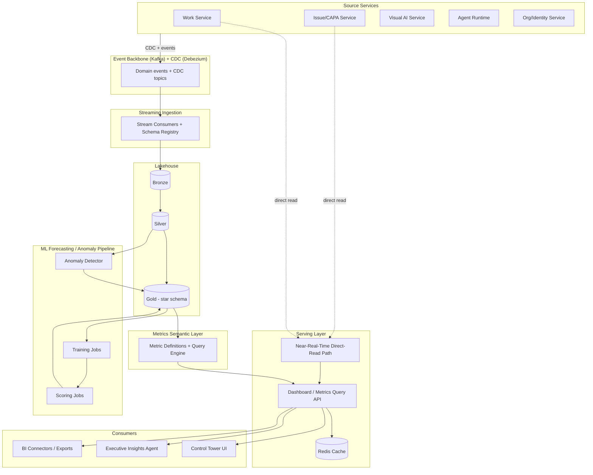
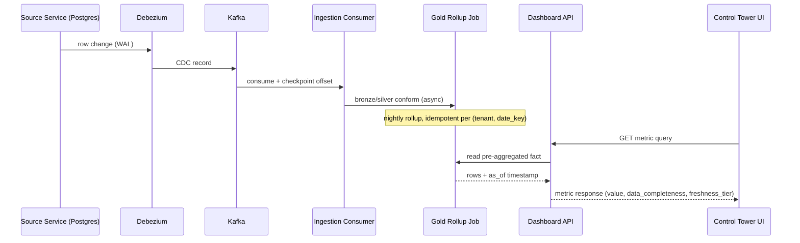
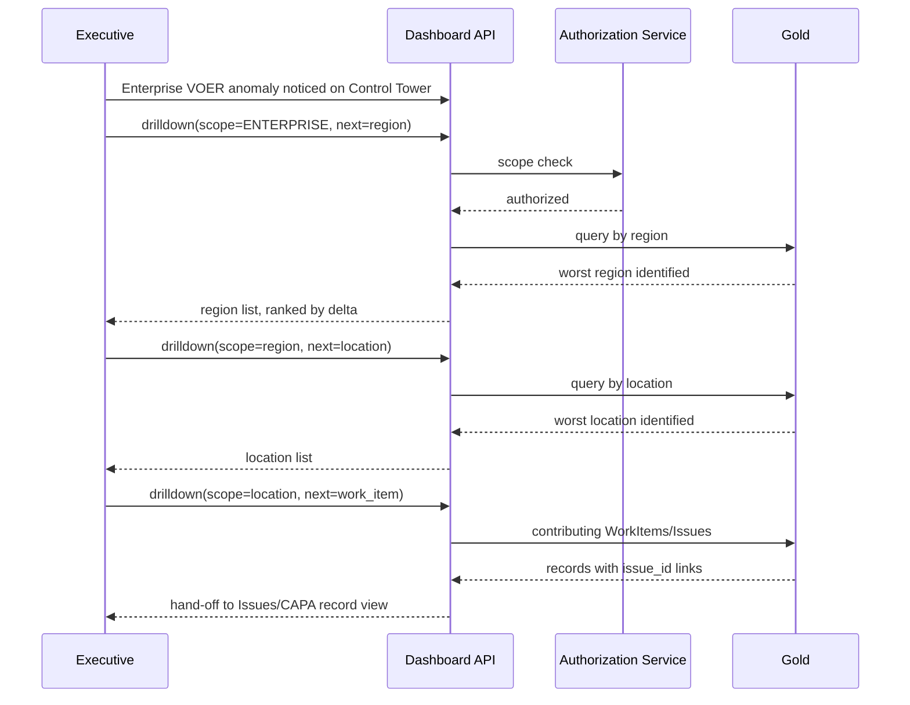
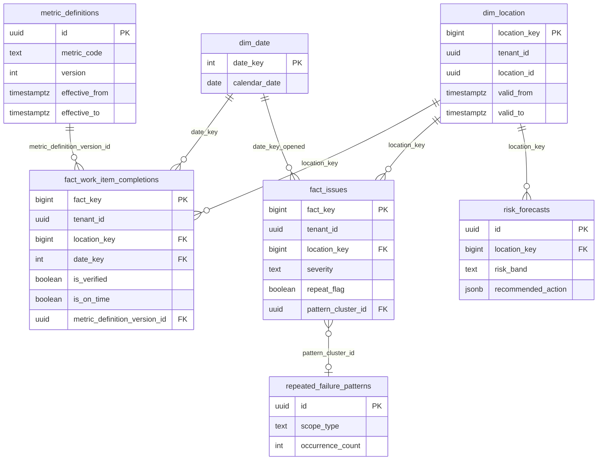

# Analytics & Control Tower — Architecture Diagrams

Module corresponds to **EPIC-12 (Control Tower)** and **EPIC-15 (Analytics & ML)**. Focused diagram
set only; narrative detail lives in high-level-design.md and low-level-design.md.

## 1. Component Diagram



This is the module's single most important structural fact: two ingestion paths feed one serving
layer. The medallion path (CDC/events -> bronze -> silver -> gold) computes every T-1 KPI and all
ML outputs; a narrow near-real-time bypass reads operational services directly for the handful of
counters (critical exceptions, unacknowledged critical issues) that cannot tolerate batch latency.
Both converge at the Dashboard API so every consumer — UI, the Executive Insights Agent, and BI
connectors — sees one coherent response shape regardless of which path served a given field.

## 2. Sequence Diagram — Ingestion to Dashboard



An event's journey from a source-service write to a dashboard-visible number crosses an
asynchronous boundary at every arrow after the initial WAL capture. The API always attaches
`as_of` and `data_completeness` so the UI can distinguish "fully current" from "computed over a
partial period" without guessing from missing data alone.

## 3. Sequence Diagram — Drill-Down from Enterprise KPI to Locations/Issues



Each hop is an independently scope-checked server query against the gold layer, never a
client-side re-filter of a broader result set already in the browser — this is what keeps
drill-down safe under the platform's tenant/scope isolation rules even as a user pivots from an
enterprise-wide view down to a single store's open issues.

## 4. ER Diagram — Gold-Layer Star Schema



The star schema is deliberately shallow: two conformed dimensions carry almost all rollup logic
(`dim_location` for the entire geography/hierarchy axis, `dim_date` for time), while
`metric_definitions` and `risk_forecasts` sit alongside the facts as first-class governed/derived
data rather than being bolted on as configuration outside the warehouse.

## 5. Data-Quality Flow — Medallion Bronze -> Silver -> Gold with Validation Gates

This module has no single object lifecycle (no `WorkItem`/`Issue`-style state machine of its own),
so in place of a state diagram this section documents the equivalent structural backbone: the
data-quality gates every record passes through as it moves from raw capture to a Control-Tower-
visible fact.

```mermaid
flowchart LR
    A[Raw CDC record / domain event] --> B{Schema Registry\ncontract valid?}
    B -- No --> B1[Dead-letter topic\n+ alert]
    B -- Yes --> C[Bronze: append-only raw write\nkeyed by event_id / table+pk+lsn]
    C --> D{Silver conformance:\ndedupe, type check,\nreferential sanity}
    D -- Fails referential check\ne.g. unknown location_id --> D1[Quarantine table\n+ data-quality alert,\nretried on next run]
    D -- Passes --> E[Silver: conformed row]
    E --> F{Gold eligibility:\nbelongs to a completed\nsource-of-truth state?}
    F -- No, e.g. WorkItem\nstill IN_PROGRESS --> F1[Held out of this run's\ngold aggregate;\nre-evaluated next run]
    F -- Yes --> G[Gold rollup job:\nidempotent per\n(tenant, date_key) partition]
    G --> H{Reconciliation check\nvs. near-real-time path\n(Issues only)}
    H -- Drift beyond tolerance --> H1[Internal data-quality alert\n(Operations Admin panel)]
    H -- Within tolerance --> I[Gold fact visible to\nDashboard API / Metrics layer]
```

Every gate either passes a record forward or routes it to an explicit remediation path (dead-letter,
quarantine, hold-for-next-run, or an internal alert) — a record is never silently dropped, and
nothing reaches the gold layer, and therefore the Control Tower UI, without having passed schema
validation, deduplication, and referential sanity checks first.
