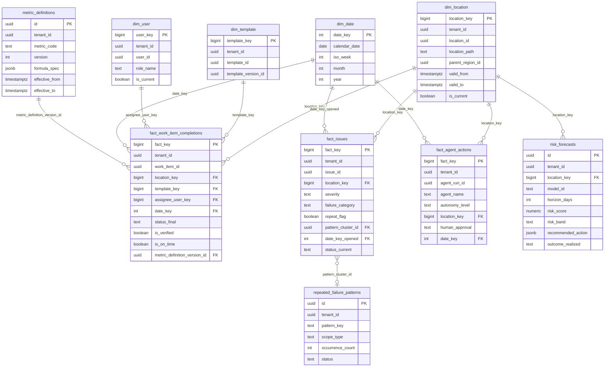
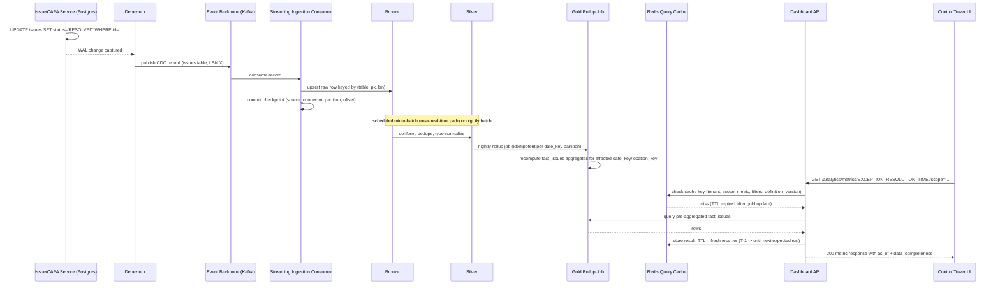
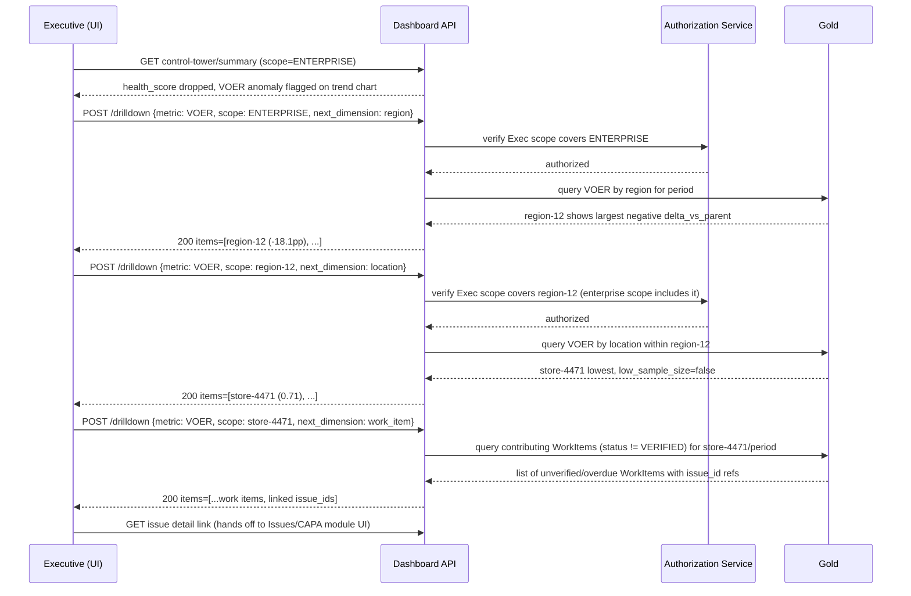
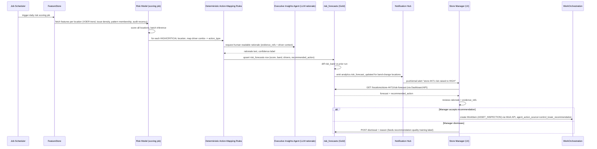

# Analytics & Control Tower — Low-Level Design

## 1. Gold-Layer Schema

The gold layer is a star schema: fact tables at the grains needed for the KPI set
(functional-spec.md §3), conformed dimensions shared across facts, and two control-plane tables
(`metric_definitions`, `risk_forecasts`) that make the semantic layer and ML outputs first-class
queryable data. All tables carry `tenant_id`; large tenants may live in a dedicated
schema/database per high-level-design.md §6.

### 1.1 Dimension Tables

**dim_location** (effective-dated snapshot of `OrganizationNode`, location-type nodes only)

| Column | Type | Notes |
|---|---|---|
| location_key | bigint PK (surrogate) | |
| tenant_id | uuid | |
| location_id | uuid | source `OrganizationNode.id` |
| location_path | text | materialized path at snapshot time |
| parent_region_id, parent_business_unit_id, parent_brand_id | uuid, nullable | denormalized rollup ancestors at snapshot time |
| location_name, location_type, timezone | text | |
| valid_from, valid_to | timestamptz | `valid_to = NULL` for current row |
| is_current | boolean | |

Unique `(tenant_id, location_id, valid_from)`. Indexed `(tenant_id, location_id, is_current)`,
`(tenant_id, parent_region_id)`.

**dim_user**

| Column | Type | Notes |
|---|---|---|
| user_key | bigint PK | |
| tenant_id | uuid | |
| user_id | uuid | source `User.id` |
| role_id, role_name | uuid, text | |
| status | text | `ACTIVE`/`DEACTIVATED` at snapshot time |
| valid_from, valid_to | timestamptz | |
| is_current | boolean | |

**dim_template**

| Column | Type | Notes |
|---|---|---|
| template_key | bigint PK | |
| tenant_id | uuid | |
| template_id | uuid | |
| template_version_id | uuid | |
| template_name, category | text | |
| risk_scoring_version | text, nullable | |

**dim_date** (standard conformed date dimension, tenant-agnostic, shared)

| Column | Type | Notes |
|---|---|---|
| date_key | int PK | `YYYYMMDD` |
| calendar_date | date | |
| iso_week, month, quarter, year | int | |
| is_month_end | boolean | used for reorg-boundary footnote logic |

### 1.2 Fact Tables

**fact_work_item_completions** (grain: one row per WorkItem terminal-state event per period bucket
it is attributed to; primarily daily grain for rollups, with a raw event-grain variant in silver)

| Column | Type | Notes |
|---|---|---|
| fact_key | bigint PK | |
| tenant_id | uuid | |
| work_item_id | uuid | source id |
| location_key | bigint FK -> dim_location | resolved to the effective-dated snapshot as of `due_at` |
| template_key | bigint FK -> dim_template, nullable | |
| assignee_user_key | bigint FK -> dim_user, nullable | |
| work_item_type | text | |
| date_key | int FK -> dim_date | attribution date = `due_at` date, per FR-ANLY-001 |
| status_final | text | terminal status observed as of ETL run: `VERIFIED, APPROVED, SUBMITTED, OVERDUE, ESCALATED, CANCELLED` |
| counts_toward_voer | boolean | copied from `work_item_types.counts_toward_voer` at fact build time |
| is_verified | boolean | `status_final = VERIFIED` and within `verification_grace_period` |
| is_on_time | boolean | `completed_at <= due_at` |
| completed_at, due_at, verified_at | timestamptz, nullable | |
| verification_method | text, nullable | `MANUAL, AUTO, AI_ASSISTED` |
| evidence_type | text, nullable | |
| risk_band | text, nullable | from form/visual-AI scoring |
| cancellation_reason | text, nullable | |
| metric_definition_version_id | uuid FK -> metric_definitions | the VOER definition version this row was evaluated under |
| ingested_at | timestamptz | bronze arrival time, for lag measurement |

Partitioned by `(tenant_id_bucket, date_key)` monthly. Indexes: `(tenant_id, location_key,
date_key)`, `(tenant_id, work_item_type, date_key)`, `(tenant_id, date_key, counts_toward_voer)`.

**fact_issues** (grain: one row per Issue, updated as it moves through its lifecycle — an SCD-2
style history table plus a "current" view)

| Column | Type | Notes |
|---|---|---|
| fact_key | bigint PK | |
| tenant_id | uuid | |
| issue_id | uuid | |
| location_key | bigint FK -> dim_location | as of `opened_at` |
| severity | text | `LOW, MEDIUM, HIGH, CRITICAL` |
| failure_category | text | |
| root_cause_method | text, nullable | |
| repeat_flag | boolean | per §3.2 pattern-matching rule |
| pattern_cluster_id | uuid, nullable | FK -> repeated_failure_patterns (see §1.3) |
| opened_at, triaged_at, first_corrective_action_at, resolved_at, closed_at | timestamptz, nullable | |
| reopened_count | int | |
| status_current | text | mirrors Issue state machine |
| acknowledged_at | timestamptz, nullable | first `TRIAGED` transition timestamp |
| date_key_opened, date_key_resolved | int FK -> dim_date, nullable | |
| ingested_at | timestamptz | |

Indexes: `(tenant_id, location_key, status_current)`, `(tenant_id, severity, status_current)`,
`(tenant_id, failure_category, date_key_opened)`, `(tenant_id, pattern_cluster_id)`.

**fact_agent_actions** (grain: one row per AgentRun recommendation/action outcome)

| Column | Type | Notes |
|---|---|---|
| fact_key | bigint PK | |
| tenant_id | uuid | |
| agent_run_id | uuid | |
| agent_name | text | e.g. `compliance_monitor`, `executive_insights` |
| autonomy_level | text | `L0..L4` |
| location_key | bigint FK -> dim_location, nullable | |
| work_item_type | text, nullable | for automation-eligibility join |
| recommendation_type | text | |
| human_approval | text, nullable | `APPROVED, REJECTED, MODIFIED, NOT_REQUIRED` |
| automation_eligible | boolean | |
| executed | boolean | true if the recommended action was actually carried out (agent or human-accepted) |
| latency_ms, cost_usd | numeric, nullable | |
| date_key | int FK -> dim_date | |

Indexes: `(tenant_id, agent_name, date_key)`, `(tenant_id, autonomy_level, human_approval)`.

### 1.3 Control-Plane and ML Tables

**metric_definitions**

| Column | Type | Notes |
|---|---|---|
| id | uuid PK | |
| tenant_id | uuid, nullable | NULL = system default, overridable per tenant |
| metric_code | text | e.g. `VOER`, `ON_TIME_COMPLETION_RATE`, `ENTERPRISE_HEALTH_SCORE` |
| version | int | monotonic per `(tenant_id, metric_code)` |
| formula_spec | jsonb | declarative numerator/denominator/filter spec consumed by the metrics query engine |
| segmentation_dimensions | text[] | allowed cuts for this version |
| effective_from | timestamptz | |
| effective_to | timestamptz, nullable | |
| created_by | uuid | |
| created_at | timestamptz | |

Unique `(tenant_id, metric_code, version)`. Partial unique index enforcing at most one row with
`effective_to IS NULL` per `(tenant_id, metric_code)`.

**risk_forecasts** (grain: one row per location per forecast run per horizon)

| Column | Type | Notes |
|---|---|---|
| id | uuid PK | |
| tenant_id | uuid | |
| location_key | bigint FK -> dim_location | |
| model_id | text | model registry identifier |
| model_trained_at | timestamptz | |
| horizon_days | int | `7` or `30` |
| forecast_run_at | timestamptz | |
| risk_score | numeric(5,2) | 0–100 |
| risk_band | text | `LOW, MEDIUM, HIGH, CRITICAL` |
| confidence_label | text | `LOW, MEDIUM, HIGH` |
| top_drivers | jsonb | ordered array `[{driver, weight, human_readable}]` |
| recommended_action | jsonb | `{action_type, target, rationale, confidence, evidence_refs[]}` |
| kpi_forecast_series | jsonb, nullable | forward point + confidence band series for the location's VOER/On-Time/Repeat-Failure, when applicable |
| outcome_realized | text, nullable | backfilled after horizon elapses: `CONFIRMED, FALSE_POSITIVE, FALSE_NEGATIVE, MONITOR_ONLY` — feeds forecast-usefulness metrics |
| created_at | timestamptz | |

Indexes: `(tenant_id, location_key, horizon_days, forecast_run_at desc)`,
`(tenant_id, risk_band, forecast_run_at)`.

**repeated_failure_patterns**

| Column | Type | Notes |
|---|---|---|
| id | uuid PK | |
| tenant_id | uuid | |
| pattern_key | text | hash of clustering attributes |
| scope_type | text | `SINGLE_LOCATION`, `CROSS_LOCATION` |
| failure_category | text | |
| root_cause_theme | text, nullable | from embedding-cluster label |
| location_keys | bigint[] | affected locations |
| occurrence_count | int | |
| first_seen_at, last_seen_at | timestamptz | |
| status | text | `ACTIVE, RESOLVED, DISMISSED` |
| detected_at | timestamptz | |

### 1.4 ER Diagram



## 2. Concurrency: Idempotent CDC Offset Tracking

**ingestion_checkpoints**

| Column | Type | Notes |
|---|---|---|
| id | uuid PK | |
| source_connector | text | e.g. `debezium.work_items`, `kafka.issue_events` |
| tenant_id | uuid, nullable | NULL for tenant-agnostic connectors partitioned differently |
| partition_key | text | Kafka partition or CDC shard identifier |
| last_committed_offset | bigint / LSN | |
| last_committed_at | timestamptz | |

- Every bronze write is wrapped in a transaction that also advances `last_committed_offset` for
  that `(source_connector, partition_key)` in the same commit (or, on platforms without
  cross-system transactions, via a write-then-checkpoint pattern with the checkpoint write
  guarded by `WHERE last_committed_offset < :new_offset` so a duplicate replay is a no-op).
- Bronze rows carry the source `event_id` (for domain events) or `(table, primary_key, lsn)` (for
  CDC) as a natural idempotency key; a bronze upsert on that key means replaying the same Kafka
  segment after a consumer restart never double-counts a row downstream.
- Silver/gold transformation jobs are pure functions of a bronze partition — re-running a job for
  an already-processed partition produces the same output (deterministic aggregation), so a job
  retry after partial failure is always safe to simply re-run from the last checkpointed bronze
  partition boundary.

## 3. REST Endpoints

Base path `/api/v1/analytics/`, standard conventions (OAuth2/OIDC, Idempotency-Key on mutations,
cursor pagination, `{error:{code,message,trace_id}}` errors).

### 3.1 Query a KPI with filters/segmentation

```
GET /api/v1/analytics/metrics/{metric_code}
  ?scope_node_id={org_node_id}
  &period_start=2026-08-01&period_end=2026-08-31
  &segment_by=location,workflow_type
  &filter[workflow_type]=AUDIT_INSPECTION
  &definition_version=latest
```

Response `200`:
```json
{
  "metric_code": "VOER",
  "metric_definition_version": "v3",
  "scope_node_id": "org-node-9911",
  "period": {"start": "2026-08-01", "end": "2026-08-31"},
  "data_completeness": "COMPLETE",
  "freshness_tier": "T-1",
  "as_of": "2026-09-19T06:02:11Z",
  "series": [
    {
      "segment": {"location": "store-4471", "workflow_type": "AUDIT_INSPECTION"},
      "value": 0.874,
      "numerator": 218,
      "denominator": 249,
      "sample_size": 249,
      "low_sample_size": false
    }
  ],
  "aggregate": {"value": 0.891, "numerator": 41230, "denominator": 46274}
}
```
Errors: `400 INVALID_SEGMENTATION` (dimension not allowed for this metric version),
`403 SCOPE_DENIED`, `404 METRIC_NOT_FOUND`, `422 DEFINITION_VERSION_NOT_FOUND_FOR_PERIOD`.

### 3.2 Get Control Tower summary for a scope

```
GET /api/v1/analytics/control-tower/summary?scope_node_id={org_node_id}&view=EXECUTIVE
```

Response `200`:
```json
{
  "scope_node_id": "org-node-root",
  "view": "EXECUTIVE",
  "as_of": "2026-09-19T06:02:11Z",
  "health_score": {
    "value": 92.4,
    "formula_version": "v2",
    "wow_delta_pct": -1.8,
    "trend_basis": "trailing_7d_avg"
  },
  "counters": {
    "critical_exceptions": 37,
    "locations_at_risk": 11,
    "repeated_failure_patterns": 8,
    "critical_issues_unacknowledged": 4
  },
  "freshness": {
    "health_score": "T-1",
    "critical_exceptions": "NEAR_REAL_TIME",
    "critical_issues_unacknowledged": "NEAR_REAL_TIME"
  },
  "data_completeness": "COMPLETE"
}
```

### 3.3 Drill-down from a KPI to contributing records

```
POST /api/v1/analytics/drilldown
{
  "metric_code": "VOER",
  "scope_node_id": "org-node-region-12",
  "period": {"start": "2026-09-01", "end": "2026-09-18"},
  "from_segment": {"region": "region-12"},
  "next_dimension": "location",
  "cursor": null,
  "limit": 25
}
```

Response `200`:
```json
{
  "next_dimension": "location",
  "items": [
    {"location_id": "store-4471", "location_name": "Store 4471 - Denver West", "value": 0.71,
     "sample_size": 34, "low_sample_size": false, "delta_vs_parent": -0.181}
  ],
  "next_cursor": "eyJvZmZzZXQiOjI1fQ==",
  "data_completeness": "COMPLETE"
}
```
Each drill-down call is server-scope-validated independently (never a client-side filter of a
previously fetched broader dataset), per functional-spec.md FR-ANLY-006. `404 NO_CONTRIBUTING_RECORDS`
is not used for a legitimate empty result — an empty `items` array with `200` is returned and the
UI renders the empty-state (FR-ANLY-018); `404` is reserved for an invalid scope/metric path.

### 3.4 Get risk forecast for a location

```
GET /api/v1/analytics/locations/{location_id}/risk-forecast?horizon_days=30
```

Response `200`:
```json
{
  "location_id": "store-4471",
  "model_id": "risk-model-v7",
  "model_trained_at": "2026-09-14T02:00:00Z",
  "horizon_days": 30,
  "forecast_run_at": "2026-09-19T02:15:00Z",
  "risk_score": 78.2,
  "risk_band": "HIGH",
  "confidence_label": "MEDIUM",
  "top_drivers": [
    {"driver": "repeat_temperature_exceptions_30d", "weight": 0.41, "human_readable": "3 repeat temperature exceptions in 30 days"},
    {"driver": "days_since_last_verified_audit", "weight": 0.27, "human_readable": "Safety audit overdue by 12 days"}
  ],
  "recommended_action": {
    "action_type": "SCHEDULE_REINSPECTION",
    "target": {"work_item_type": "ASSET_INSPECTION", "asset_id": "asset-refrig-02"},
    "rationale": "Repeated temperature exceptions on this unit with no follow-up inspection scheduled.",
    "confidence": "HIGH",
    "evidence_refs": ["issue-88213", "issue-88450", "submission-771102"]
  }
}
```
Errors: `403 SCOPE_DENIED`, `404 LOCATION_NOT_FOUND`, `409 FORECAST_NOT_YET_AVAILABLE` (new
location with insufficient history — see error table §9).

### 3.5 Schedule a report export

```
POST /api/v1/analytics/reports/schedules
Idempotency-Key: 3f9a2e10-...
{
  "name": "Weekly Regional Health - Northeast",
  "view": "REGIONAL",
  "scope_node_id": "org-node-region-12",
  "filters": {"segment_by": ["location"]},
  "schedule": {"cron": "0 6 * * MON", "timezone": "America/New_York"},
  "delivery": {"channel": "EMAIL", "recipients": ["dm-northeast@tenant.example.com"]},
  "format": "PDF"
}
```

Response `201`:
```json
{
  "id": "report-sched-5521",
  "status": "ACTIVE",
  "next_run_at": "2026-09-22T10:00:00Z",
  "created_at": "2026-09-19T14:03:00Z"
}
```
Errors: `400 INVALID_SCHEDULE`, `403 SCOPE_DENIED` (requester scope does not cover
`scope_node_id`), `422 EXPORT_PERMISSION_REQUIRED`.

## 4. Canonical Events Produced

**`analytics.threshold_breached`** (new event owned by this module, envelope per source-spec §18.4)
```json
{
  "event_id": "...",
  "event_type": "analytics.threshold_breached",
  "version": "1",
  "tenant_id": "...",
  "occurred_at": "...",
  "resource_id": "store-4471",
  "trace_id": "...",
  "data": {
    "metric_code": "REPEAT_FAILURE_RATE",
    "scope_node_id": "store-4471",
    "severity": "CRITICAL",
    "threshold_value": 0.20,
    "observed_value": 0.34,
    "evaluation_window": "sustained_3d"
  }
}
```

**`analytics.risk_forecast_updated`** — emitted after each forecast run for locations whose
`risk_band` changed since the prior run, consumed by Notification Hub (for manager alerting) and
Agent Runtime (Executive Insights Agent context refresh).

## 5. Sequence Diagrams

### 5.1 CDC Event -> Streaming Ingestion -> Gold Aggregate Update -> Dashboard Read



### 5.2 Drill-Down Resolving from an Enterprise KPI Anomaly to Locations/Issues



### 5.3 Risk Forecast Generation and Surfacing with Recommended Action



## 6. Pseudocode

### 6.1 Verified Operational Execution Rate

```
function compute_voer(tenant_id, scope_node_id, period_start, period_end, segment_by[], definition_version):
    definition = resolve_metric_definition(tenant_id, "VOER", period_start, period_end, definition_version)
    # definition.formula_spec includes: counted_types_exclusions, verification_grace_period_days,
    # cancellation_exclusion_reasons

    location_keys = resolve_effective_location_keys(scope_node_id, period_start, period_end)
    # NOTE: resolves against dim_location snapshots valid during the period, not current hierarchy
    # (functional-spec.md FR-ANLY-022) -- may return DIFFERENT location_key rows for different
    # sub-ranges of the period if a reorg happened mid-period; caller aggregates across all of them.

    denominator_rows = SELECT * FROM fact_work_item_completions
        WHERE tenant_id = tenant_id
          AND location_key IN location_keys
          AND date_key BETWEEN date_key(period_start) AND date_key(period_end)
          AND counts_toward_voer = true
          AND NOT (status_final = 'CANCELLED' AND cancellation_reason IN definition.cancellation_exclusion_reasons)

    for row in denominator_rows:
        row.is_verified_for_voer = (
            row.status_final == 'VERIFIED'
            AND (row.verified_at - row.due_at) <= definition.verification_grace_period_days
        )
        # a late verification beyond grace period counts as NOT verified for VOER,
        # but is separately tallied for a "late verification" diagnostic metric

    grouped = group_by(denominator_rows, segment_by)   # e.g. by location, workflow_type, risk_band
    result = []
    for group_key, rows in grouped:
        numerator = count(r for r in rows if r.is_verified_for_voer)
        denominator = count(rows)
        sample_size = denominator
        result.append({
            segment: group_key,
            value: numerator / denominator if denominator > 0 else null,
            numerator: numerator,
            denominator: denominator,
            sample_size: sample_size,
            low_sample_size: sample_size < MIN_SAMPLE_SIZE_DEFAULT   # 10, tenant-configurable
        })
    return {
        metric_definition_version: definition.version,
        series: result,
        aggregate: aggregate_across(result)
    }
```

### 6.2 Anomaly Detection on a KPI Time Series (seasonal-adjusted z-score)

```
function detect_kpi_anomaly(tenant_id, scope_node_id, metric_code, as_of_date, lookback_days=90):
    series = get_daily_metric_series(tenant_id, scope_node_id, metric_code,
                                      start=as_of_date - lookback_days, end=as_of_date)
    if count(series) < MIN_ANOMALY_HISTORY_DAYS:            # e.g. 21 days
        return { anomaly: false, reason: "insufficient_history" }

    # 1. seasonal adjustment: remove day-of-week effect via a simple STL-style decomposition
    #    (or, minimally, day-of-week median subtraction) so a normal "Monday dip" is not flagged
    dow_baseline = { dow: median(v.value for v in series if v.date.day_of_week == dow)
                     for dow in range(0, 7) }
    residuals = [ v.value - dow_baseline[v.date.day_of_week] for v in series ]

    # 2. robust central tendency + spread (median / MAD, not mean/stddev, to resist outlier skew
    #    from the very exceptions we are trying to detect)
    center = median(residuals[:-1])                          # exclude today's point from baseline
    mad = median(abs(r - center) for r in residuals[:-1])
    robust_sigma = 1.4826 * mad                               # MAD-to-sigma consistency constant

    today_residual = residuals[-1]
    if robust_sigma == 0:
        z = 0 if today_residual == center else INFINITY
    else:
        z = (today_residual - center) / robust_sigma

    # 3. minimum-volume gate (functional-spec.md FR-ANLY-023) -- do not flag an anomaly driven
    #    by statistical noise at a low-volume location
    today_sample_size = get_sample_size(series, as_of_date)
    if today_sample_size < MIN_SAMPLE_SIZE_DEFAULT:
        return { anomaly: false, reason: "low_sample_size", sample_size: today_sample_size }

    is_anomaly = abs(z) >= ANOMALY_Z_THRESHOLD                # default 3.0
    direction = "DEGRADATION" if (today_residual < center and metric_is_higher_better(metric_code)) else "IMPROVEMENT"

    return {
        anomaly: is_anomaly,
        z_score: z,
        direction: direction,
        observed_value: series[-1].value,
        expected_value: center + dow_baseline[as_of_date.day_of_week],
        sample_size: today_sample_size
    }
```

### 6.3 Repeated Failure Pattern Clustering (supporting §3.2/§5 FR-ANLY-010)

```
function detect_repeated_failure_patterns(tenant_id, lookback_days=90):
    issues = SELECT * FROM fact_issues
        WHERE tenant_id = tenant_id AND opened_at >= now() - lookback_days

    # exact-category clustering: same location + same failure_category
    single_location_groups = group_by(issues, key = (location_key, failure_category))
    for key, group in single_location_groups:
        if count(group) >= SINGLE_LOCATION_THRESHOLD:              # default 3
            upsert_pattern(scope_type="SINGLE_LOCATION", key=key, group=group)

    # cross-location clustering: same failure_category + shared attribute (brand/equipment/supplier)
    # plus a similarity pass over free-text root-cause notes to catch same-cause issues logged
    # under different categories
    embeddings = embed_texts([i.root_cause_notes for i in issues if i.root_cause_notes])
    clusters = agglomerative_cluster(embeddings, distance_threshold=SIMILARITY_THRESHOLD)
    for cluster in clusters:
        shared_attr = find_common_attribute(cluster.issues, attrs=["brand", "equipment_model", "supplier"])
        if shared_attr and count(distinct_locations(cluster.issues)) >= CROSS_LOCATION_MIN_LOCATIONS   # default 3
           and count(cluster.issues) >= CROSS_LOCATION_THRESHOLD:                                       # default 5
            upsert_pattern(scope_type="CROSS_LOCATION", key=shared_attr, group=cluster.issues)
```

## 7. Caching

| Cache | Key shape | TTL | Invalidation |
|---|---|---|---|
| KPI query result | `tenant:{id}:metric:{code}:v{def_version}:scope:{node}:period:{start}-{end}:seg:{hash(segments+filters)}` | Matches metric's freshness tier: near-real-time = 2 min, T-1 = until next expected gold-rollup completion (set from job orchestrator's completion webhook, with a hard ceiling of 26h as a backstop) | Explicit purge on successful gold rollup completion for affected `(tenant, date_key)` partitions; passive TTL expiry otherwise |
| Control tower summary | `tenant:{id}:cts:{scope}:{view}` | 2 min (blends near-real-time counters with T-1 health score; capped to the tightest included tier) | Same as above plus purge on `analytics.threshold_breached` for the scope |
| Risk forecast | `tenant:{id}:risk:{location_id}:{horizon}` | Until next schering job's `forecast_run_at` (typically 24h) | Purge on new `risk_forecasts` row insert for that location/horizon |
| Drill-down page | `tenant:{id}:drill:{metric}:{scope}:{dimension}:{cursor}` | 60s (short-lived; drill-downs are interactive and lower-volume, short TTL avoids stale pagination without needing an aggressive invalidation scheme) | Passive expiry |

Cache values include the same `data_completeness`/`as_of` metadata as the live response so a
cache hit is indistinguishable in payload shape from a cache miss, and the client-side stale-data
banner logic (FR-ANLY-017) reads `as_of` regardless of cache path.

## 8. Background Jobs

| Job | Trigger | Grain | Notes |
|---|---|---|---|
| Streaming ingestion (bronze writer) | Continuous, Kafka consumer | Per-message | Checkpointed per §2 |
| Silver conformance job | Near-real-time counters: every 5 min micro-batch; general silver: hourly | Per bronze partition since last run | Dedup on natural key, schema validation against Schema Registry contract; malformed records to DLQ |
| Gold rollup — `fact_work_item_completions`, `fact_issues` | Nightly, 02:00 tenant-local (staggered across tenants to spread load) | Per `(tenant, date_key)` partition, idempotent overwrite | Must complete by 06:00 tenant-local per NFR; alert if any tenant's job has not completed by 05:30 |
| Gold rollup — near-real-time counters | Every 5 min | Direct-read path, not gold-dependent (writes a lightweight cache-refresh, not a gold table) | See high-level-design.md §2 bypass path |
| Nightly reconciliation | Nightly, after gold rollup | Compares near-real-time-path Issue counts vs. gold `fact_issues` for same period | Drift beyond tolerance (default 2%) raises internal data-quality alert |
| Risk model scoring | Daily, 02:15 tenant-local (after gold rollup dependency) | All locations, batch inference | Writes `risk_forecasts`; diffs risk_band vs. prior run to trigger `analytics.risk_forecast_updated` |
| Risk model retraining | Weekly (risk model), monthly (long-horizon KPI forecast models), or immediately on detected feature/label drift alert | Per tenant or tenant-cohort | Gated by model-quality metrics (precision at alert, lead time) before promotion to serving; failed gate keeps prior model serving with staleness label |
| Repeated-failure pattern detection | Daily, after `fact_issues` rollup | Tenant-wide | See §6.3 pseudocode |
| Forecast outcome backfill | Daily | Per `risk_forecasts` row whose horizon has elapsed | Sets `outcome_realized`, feeding forecast-usefulness metrics (functional-spec.md FR-ANLY-009) |
| Scheduled report runner | Per report's cron schedule | Per report definition | Re-evaluates requester's current scope at run time (functional-spec.md FR-ANLY-013), not frozen at creation |
| Bronze retention/compaction | Daily | Per tenant/table | Compacts small files, applies tenant data-retention policy for raw layer |

## 9. Error Handling

| Condition | HTTP code | Error code | Client handling |
|---|---|---|---|
| Requested metric not defined | 404 | `METRIC_NOT_FOUND` | Show "unknown metric" state, log for investigation |
| Segmentation dimension not allowed for metric/version | 400 | `INVALID_SEGMENTATION` | Show available dimensions from error payload |
| No `metric_definition` version covers requested period | 422 | `DEFINITION_VERSION_NOT_FOUND_FOR_PERIOD` | Surface as a data-gap, prompt narrower period |
| Requesting scope not covered by principal's UserScope | 403 | `SCOPE_DENIED` | Standard scope-denied UX, no data leakage in error body |
| Drill-down next_dimension invalid for current metric | 400 | `INVALID_DRILLDOWN_DIMENSION` | Show allowed next dimensions |
| Location has insufficient history for a forecast | 409 | `FORECAST_NOT_YET_AVAILABLE` | UI shows "Forecast available once N days of history accumulate" with a progress indicator |
| Model past hard staleness ceiling, forecast suppressed | 200 (with flag) | n/a — `forecast_suppressed: true` in payload | UI falls back to rules-based risk band, per high-level-design.md §7 |
| Gold partition for requested period not yet complete | 200 (partial) | n/a — `data_completeness: "PARTIAL"` | Render FR-ANLY-016 partial-data state |
| Export/report scope exceeds requester's current access | 403 | `EXPORT_PERMISSION_REQUIRED` | Block export, log attempt to AuditLog |
| Schedule cron/timezone malformed | 400 | `INVALID_SCHEDULE` | Inline form validation |
| Idempotency-Key replay on report schedule creation | 200 (original resource) | n/a | Return original `report-sched-*` id, no duplicate schedule created |
| Warehouse query timeout/backend outage | 503 | `ANALYTICS_BACKEND_UNAVAILABLE` | Client falls back to last cached response with extended-staleness banner |
| Reconciliation drift beyond tolerance (internal, not customer-facing) | n/a (internal alert) | `RECONCILIATION_DRIFT` | Operations Admin data-quality panel notification, not surfaced on Executive Control Tower |
