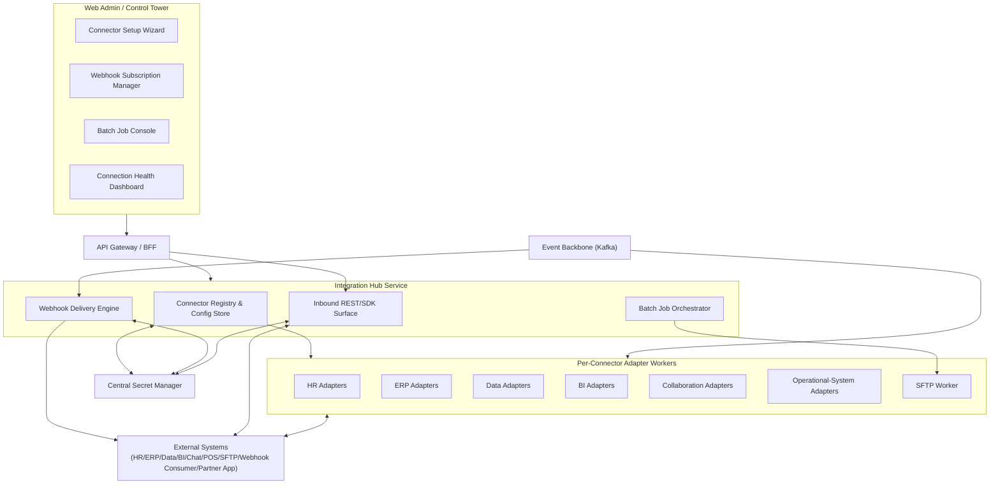
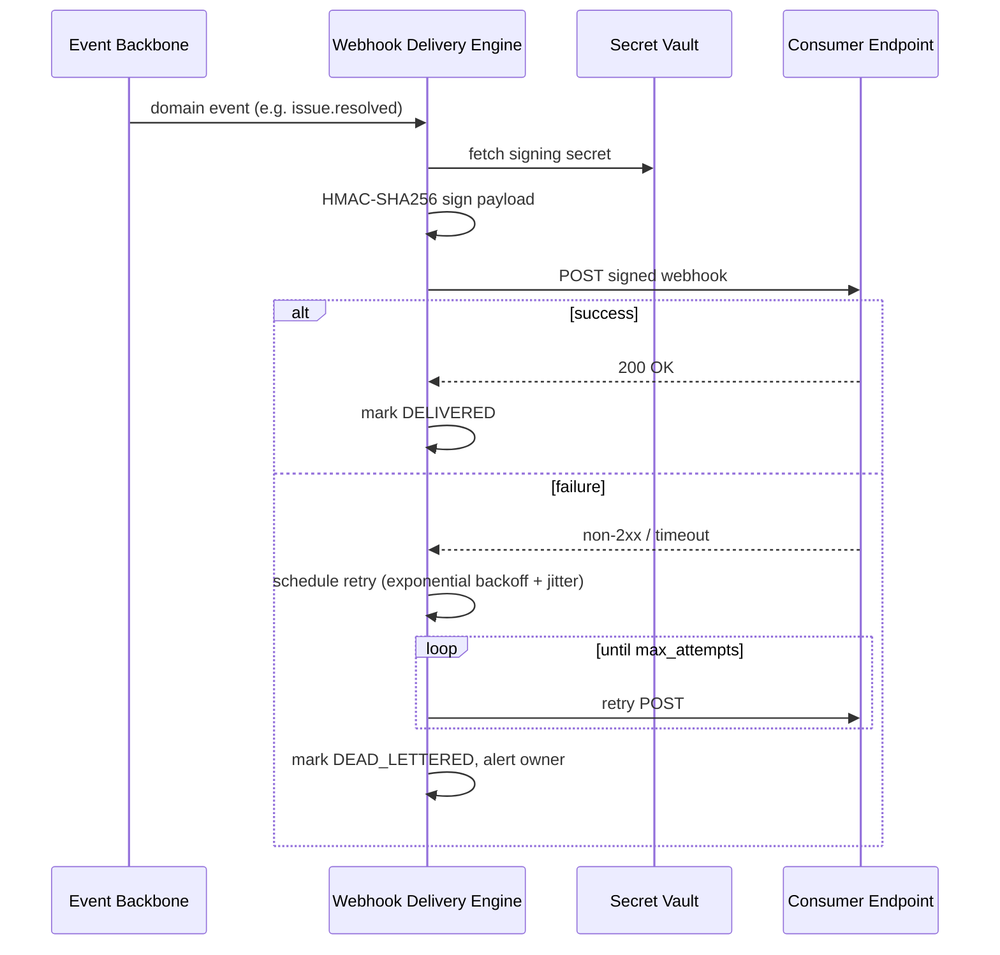
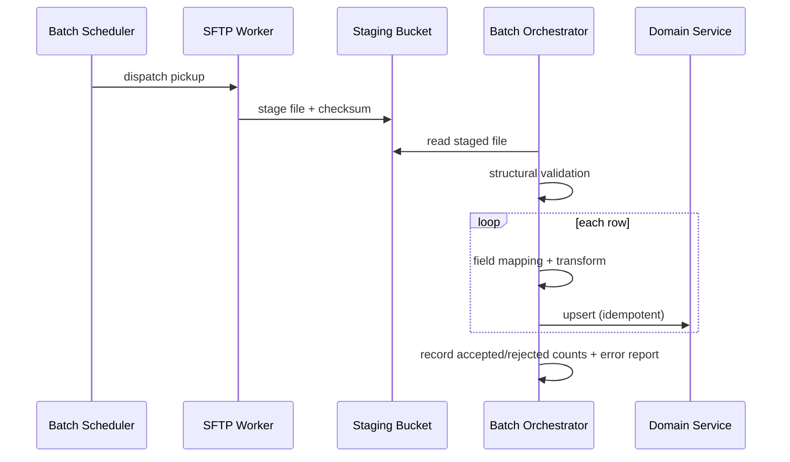
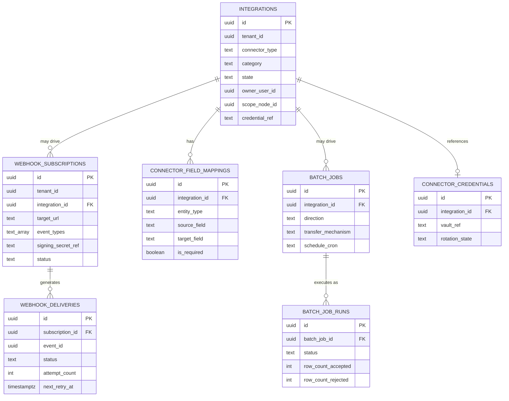
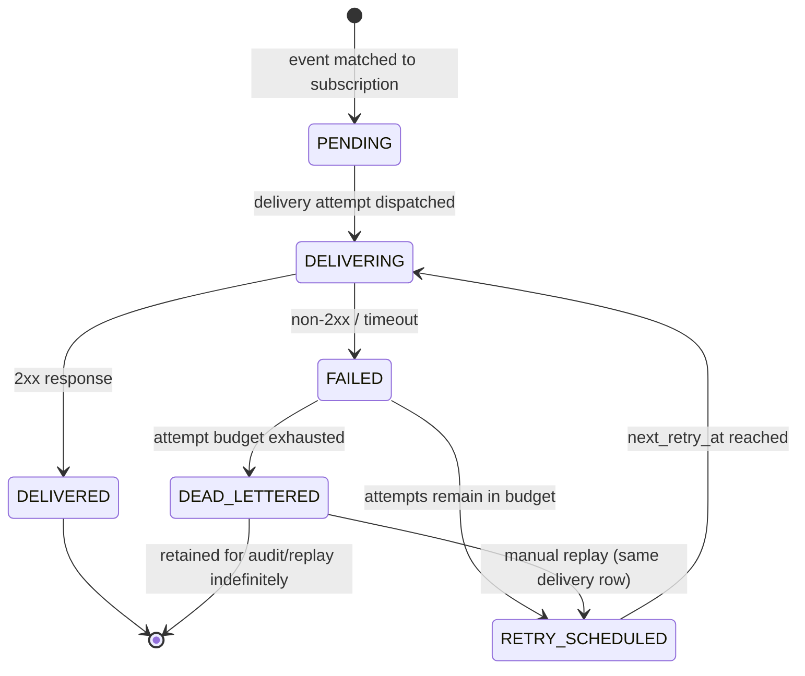

# Integration Hub — Architecture Diagrams

Module: `12-integrations-extensibility`
Epic: EPIC-13 (Integration Hub)

## 1. Component Diagram

**Narration**: The Integration Hub Service sits behind the API Gateway alongside every other
domain service, but it is unusual in fanning both directions: inward from the admin UI for
configuration, and outward through per-category adapter workers to the entire external system
landscape. The Connector Registry is the single source of configuration truth and the only
component that writes credential *references*; actual secrets always round-trip through the
Central Secret Manager. The Webhook Delivery Engine and every adapter worker consume the same
tenant-partitioned Event Backbone that the rest of the platform publishes to, making this module the
platform's largest single consumer of the canonical event catalog.

## 2. Sequence Diagram — Webhook Delivery with Retry

**Narration**: Every delivery is attempted, and on failure the engine schedules a retry using
exponential backoff with jitter rather than hammering a failing consumer. After the configured
attempt budget is exhausted the delivery is dead-lettered and the subscription owner is alerted; the
delivery remains permanently replayable from the delivery log, and — critically — a replay reuses
the same `(subscription_id, event_id)` delivery row rather than creating a new one, so retries and
manual replays can never cause duplicate downstream processing on a correctly implemented consumer.

## 3. Sequence Diagram — SFTP/CSV Batch Ingestion

**Narration**: Batch ingestion decouples the slow, fragile SFTP transfer from validation and
ingestion by staging the file in object storage first. Structural validation can fail the whole
file early and cheaply; row-level validation isolates bad records so one malformed row never blocks
the rest of the file, and every downstream write is idempotent on the record's external reference so
a re-run of the same file is always safe.

## 4. ER Diagram — Owned Entities

**Narration**: `Integration` is the aggregate root for a configured connector, referencing (not
owning) its credential by vault path through `ConnectorCredential`. A single `Integration` can drive
zero or more `WebhookSubscription`s and/or `BatchJob`s depending on its transfer mechanism, and owns
its own versioned `ConnectorFieldMapping` set. `WebhookDelivery` rows are uniquely keyed on
`(subscription_id, event_id)` — the schema-level guarantee behind idempotent replay.

## 5. State Diagram — WebhookDelivery Lifecycle

**Narration**: A delivery cycles through `PENDING → DELIVERING` on every attempt, and `FAILED`
attempts either get rescheduled or, once the retry budget is exhausted, become `DEAD_LETTERED`.
Dead-lettered deliveries are not deleted — they remain in the delivery log indefinitely and can be
moved back to `RETRY_SCHEDULED` by an explicit manual replay, which updates this same row (never
inserts a new one), which is what keeps replay safe against duplicate downstream processing.
