# Integration Hub — High-Level Design

Module: `12-integrations-extensibility`
Epic: EPIC-13 (Integration Hub)

## 1. Module Responsibilities

The **Integration Hub Service** is a modular-domain service (per conventions.md architectural
principle) with four cohesive responsibilities that all share the same governance envelope
(connection state, owner, scope, secret rotation, rate limits, monitoring, retry, audit):

1. **Connector registry & configuration** — the catalog of connector types, per-tenant
   `Integration` configuration, field mapping, and scope/owner assignment.
2. **Webhook delivery engine** — durable, retryable, signed, idempotent outbound delivery of
   platform domain events to tenant/partner-configured HTTP endpoints, plus delivery log and replay.
3. **Credential vault integration** — never stores secrets itself; brokers all credential
   read/write/rotation against the platform's central secret manager and stores only references.
4. **Batch job orchestrator** — schedules and runs SFTP/CSV import/export jobs, including
   validation, field mapping reuse, and per-run reporting.

It also exposes the **inbound API/SDK surface** (service-credential auth, scoped, rate-limited) that
lets custom/partner integrations pull from or push to the platform directly, reusing the same
connector-registry and audit primitives as first-party connectors.

This module does not own business logic for the systems it integrates — it is a transport,
governance, and observability layer sitting between the platform's domain services and the outside
world.

## 2. Component Diagram

```mermaid
flowchart TD
    subgraph AdminSurface["Web Admin / Control Tower"]
        Wizard["Connector Setup Wizard"]
        WebhookUI["Webhook Subscription Manager"]
        BatchUI["Batch Job Console"]
        HealthUI["Connection Health Dashboard"]
    end

    subgraph Gateway["API Gateway / BFF"]
        GW["Tenant-aware routing, authN, rate limiting"]
    end

    subgraph Hub["Integration Hub Service"]
        Registry["Connector Registry & Config Store\n(Integration, ConnectorFieldMapping)"]
        MappingEngine["Field Mapping / Transform Engine"]
        WebhookEngine["Webhook Delivery Engine\n(WebhookSubscription, WebhookDelivery)"]
        BatchOrch["Batch Job Orchestrator\n(BatchJob, BatchJobRun)"]
        HealthMon["Health & Rate-Limit Monitor"]
        InboundAPI["Inbound REST/SDK Surface\n(service credentials)"]
        AuditEmit["Audit Log Emitter"]
    end

    subgraph AdapterWorkers["Per-Connector Adapter Workers"]
        HRAdapter["HR Adapters\n(Workday/SuccessFactors/BambooHR-class)"]
        ERPAdapter["ERP Adapters\n(SAP/Oracle/Dynamics-class)"]
        DataAdapter["Data Adapters\n(Snowflake/BigQuery/Databricks-class)"]
        BIAdapter["BI Adapters\n(Power BI/Tableau-class)"]
        CollabAdapter["Collaboration Adapters\n(Teams/Slack-class)"]
        OpsAdapter["Operational-System Adapters\n(POS/Inventory/WFM/Maintenance)"]
        SFTPWorker["SFTP Pickup/Drop Worker"]
    end

    subgraph Secrets["Central Secret Manager"]
        Vault["Vault (KMS-backed)\nConnectorCredential secrets,\nwebhook signing secrets,\nservice-credential secrets"]
    end

    subgraph EventBackbone["Event Backbone (Kafka)"]
        DomainTopics["Domain event topics\n(task.*, audit.*, issue.*, ...)"]
        IntTopics["integration.* lifecycle topics"]
    end

    subgraph External["External Systems"]
        ExtHR["HR System"]
        ExtERP["ERP System"]
        ExtWarehouse["Data Warehouse"]
        ExtBI["BI Tool"]
        ExtChat["Teams / Slack"]
        ExtOps["POS / Inventory / WFM / Maintenance"]
        ExtSFTP["SFTP Server"]
        WebhookConsumer["Webhook Consumer Endpoint"]
        PartnerApp["Partner App (SDK)"]
    end

    AdminSurface --> GW --> Hub
    Registry --> MappingEngine
    Registry <--> Vault
    WebhookEngine <--> Vault
    InboundAPI <--> Vault
    Registry --> AdapterWorkers
    BatchOrch --> SFTPWorker
    HRAdapter <--> ExtHR
    ERPAdapter <--> ExtERP
    DataAdapter --> ExtWarehouse
    BIAdapter --> ExtBI
    CollabAdapter <--> ExtChat
    OpsAdapter <--> ExtOps
    SFTPWorker <--> ExtSFTP

    DomainTopics --> WebhookEngine
    DomainTopics --> AdapterWorkers
    WebhookEngine --> WebhookConsumer
    Hub --> IntTopics
    AuditEmit --> DomainTopics
    HealthMon --> HealthUI
    InboundAPI <--> PartnerApp
    GW --> InboundAPI
```

Notes:
- All adapter workers and the webhook engine consume from the tenant-partitioned Event Backbone
  (`tenant_id:aggregate_id` keying, per conventions.md) so per-tenant ordering is preserved without
  a global bottleneck.
- The Registry is the only component that talks to the vault for configuration purposes; adapter
  workers and the webhook engine request short-lived decrypted credentials from the vault at
  execution time and never persist them locally, even in memory beyond the call.

## 3. Data Ownership

| Entity | Owned here? | Notes |
|---|---|---|
| `Integration` | Yes (owns) | Connector configuration, state, owner, scope, health. |
| `WebhookSubscription` | Yes (owns) | Canonical entity per conventions.md. |
| `WebhookDelivery` | Yes (owns) | Per-attempt delivery record, status, retry schedule. |
| `ConnectorFieldMapping` | Yes (owns) | Source→platform field mapping + transforms, versioned per `Integration`. |
| `ConnectorCredential` (reference only) | Yes (owns reference; not the secret) | Stores `vault_ref`, rotation metadata, expiry hints. The secret bytes live only in the central secret manager. |
| `BatchJob` / `BatchJobRun` | Yes (owns) | Batch schedule/config and per-execution history. |
| `OrganizationNode`, `User` | No (references) | Consumed for scope resolution; owned by Identity & Organization. |
| `WorkItem`, `Issue`, `Evidence` (metadata) | No (references) | Read as event payloads / query sources for outbound sync; owned by Work Orchestration, Issues/CAPA, Evidence. |
| `AuditLog` | No (writes into shared store) | Uses the platform-wide `AuditLog` entity/table owned by the Security/Audit cross-cutting concern, written by every module including this one. |
| SAML/OIDC/SCIM configuration | No | Owned entirely by Identity & Organization; this module only surfaces it in the catalog UI as a cross-reference link. |

## 4. External Interfaces

**Consumed (inbound to this module):**
- Nearly the entire canonical domain event catalog (source-spec §18.3: `task.*`, `audit.*`,
  `issue.*`, `training.*`, `message.*`, `agent.*`) — this module is the platform's broadest single
  event consumer, since any of these can be the trigger for a webhook subscription or an outbound
  connector push.
- `OrganizationNode` scope-resolution calls to Identity & Organization (synchronous, cached).
- Analytics semantic-layer queries for BI connector pull-mode.

**Produced (outbound from this module):**
- `integration.connected`, `integration.disconnected`, `integration.degraded`,
  `integration.credential_rotated`, `integration.credential_expiring`,
  `webhook.subscription_created`, `webhook.delivery_failed`, `webhook.delivery_dead_lettered`,
  `batch_job.completed`, `batch_job.failed` — an internal lifecycle event set consumed by
  Notification Hub (owner alerts) and Analytics (integration adoption/health metrics per
  source-spec §26.2).
- Signed HTTP webhook deliveries to external consumer URLs.
- Outbound calls to third-party HR/ERP/Data/BI/Collaboration/Operational-system APIs.
- SFTP file drops / warehouse extract writes.

**Exposed (this module's own surface):**
- Inbound REST API (`/api/v1/integrations/*`, `/api/v1/webhooks/*`, `/api/v1/batch-jobs/*`) for
  admin configuration and for service-credential-authenticated partner/custom integrations.
- SDK (TypeScript/Java/Python) wrapping the above.

## 5. Scalability

- **Per-tenant rate limiting and backpressure**: every adapter worker pool and the webhook delivery
  engine enforce a per-tenant token-bucket rate limit (Redis-backed counters, per conventions.md
  cache choice) so a single tenant's runaway integration (e.g., a misconfigured high-frequency
  polling connector, or a webhook consumer that is slow to ack, causing attempt pile-up) cannot
  starve other tenants' delivery throughput. Limits are configurable per tenant tier and independent
  per connector category (an ERP outage backing up ERP-adapter retries does not throttle webhook
  delivery for the same tenant).
- **Webhook fan-out volume**: for tenants with many subscriptions on a high-volume event type (e.g.,
  `task.completed` fanned out to 20 subscriptions), delivery is fanned out by dedicated delivery
  workers reading from a per-tenant-partitioned internal delivery queue (not by re-publishing to
  Kafka per subscription), so fan-out cost scales with subscription count without multiplying event
  backbone load.
- **Worker pool sizing**: adapter workers are horizontally scaled Kubernetes deployments (per
  conventions.md IaC), independently scaled per connector category based on category-specific
  throughput/latency profiles (batch-heavy ERP adapters vs. high-frequency webhook delivery).
- **Batch job concurrency**: the batch orchestrator caps concurrent running jobs per tenant (default
  3) to prevent one tenant's large CSV import from starving compute shared across the orchestrator's
  worker pool; jobs beyond the cap queue and run in submission order.

## 6. Multi-Tenancy

- **Strict connector-credential isolation per tenant**: every `ConnectorCredential` reference,
  vault path, and webhook signing secret is scoped to exactly one tenant. There is no shared
  credential across tenants for any connector type, even for tenants using the same external SaaS
  vendor account at the organizational level (each tenant configures its own OAuth app registration
  or API key) — this avoids a scope/blast-radius mismatch where one tenant's credential could ever
  be replayed against another tenant's external system.
- **Tenant-scoped rate limits and quotas** (NFR-INT-006) enforced independently of the shared API
  Gateway per-principal limits, since integration traffic patterns (bursty batch jobs, webhook
  fan-out) differ materially from interactive user traffic.
- **Row-level security**: `integrations`, `webhook_subscriptions`, `webhook_deliveries`,
  `connector_field_mappings`, `batch_jobs`, `batch_job_runs` all carry `tenant_id` with Postgres RLS
  policies as the defense-in-depth backstop, per conventions.md.
- **Vault namespacing**: secret vault paths are namespaced by `tenant_id` (e.g.,
  `secret/tenants/{tenant_id}/integrations/{integration_id}`), and the vault's own access policy
  denies cross-namespace reads even to this module's own service identity outside the tenant context
  of the current request.

## 7. Failure Modes & Degradation

| Failure mode | Detection | Degradation strategy |
|---|---|---|
| External system outage (HR/ERP/BI/Ops system unreachable) | Adapter worker call failures exceed threshold within a rolling window | Per-connector **circuit breaker** opens: further calls short-circuit immediately (no additional load on the failing system or wasted worker capacity), `Integration.health_state` → `FAILING`, owner alerted; breaker half-opens on a backoff schedule to probe recovery. |
| Webhook consumer endpoint down/slow | Consecutive delivery failures or elevated response latency for a subscription | Exponential backoff retry per NFR-INT-002; after budget exhaustion, delivery `DEAD_LETTERED` and subscription flagged; sustained failure across many events on the same subscription trips a subscription-level circuit breaker to stop wasting delivery-worker capacity on a guaranteed-failing endpoint, resuming on manual re-enable or a long-interval health probe. |
| Secret expiry | Vault-reported TTL approaching, or a live call returns an auth-failure error code recognized as credential-related | `CREDENTIAL_EXPIRING` alert ladder (FR-INT-053); if expiry is reached before rotation, `Integration.health_state` → `FAILING` with a specific `CREDENTIAL_EXPIRED` reason code (not a generic failure), directing the admin straight to rotation. |
| Malformed payload from external system (HR/ERP feed, SFTP file, inbound webhook from a collaboration tool) | Schema/structural validation failure at ingestion | Payload is **quarantined**: written to a per-integration dead-letter/quarantine store with the raw payload, validation errors, and timestamp, rather than partially applied or silently dropped; does not block subsequent valid payloads/rows (isolation at the record level per FR-INT-042). |
| Event Backbone lag/outage | Consumer lag metrics on webhook-engine/adapter consumer groups | Webhook delivery and outbound adapter pushes fall behind but do not lose events (Kafka retention + consumer offset resumption); delivery latency SLO (NFR-INT-001) is reported as breached during the outage window rather than silently absorbed. |
| Runaway/misconfigured integration (e.g., infinite retry loop, excessive polling) | Per-tenant rate-limit/quota breach | Tenant-scoped rate limiter throttles at the source; sustained breach auto-pauses the offending `Integration` and alerts the owner and platform on-call, protecting shared adapter-worker capacity for other tenants. |

## 8. Technology Choices (Justified)

- **Webhook signing via HMAC-SHA256 with rotating secrets**: HMAC is chosen over asymmetric
  signing (e.g., RSA/ECDSA-signed JWT-per-delivery) because (a) it is computationally cheap at
  high fan-out volume, (b) it requires no PKI/certificate lifecycle for either side, and (c) it is
  the de facto standard consumers already expect (Stripe/GitHub/Slack webhook conventions), lowering
  partner integration effort. Rotating secrets with a dual-secret grace window (FR-INT-022) is used
  instead of a single long-lived secret because a compromised or leaked signing secret otherwise has
  no bounded blast radius; periodic rotation is a standard security control (conventions.md "key
  rotation") extended here to per-subscription granularity.
- **Batch SFTP via a staging-bucket pattern**: rather than having adapter workers read/write
  directly against tenant SFTP servers inline with the ingestion pipeline, files are first pulled
  into (or staged for push from) a per-tenant-prefixed object-storage staging bucket (S3-compatible,
  per conventions.md). This is chosen because (a) SFTP connections are comparatively slow/fragile
  and holding one open across a long validation+ingestion pipeline is wasteful and failure-prone,
  (b) object storage gives durable at-least-once semantics and cheap re-processing (a failed
  validation run can re-read the staged file without re-fetching over SFTP), and (c) it decouples
  the SFTP transfer worker's concurrency/connection limits from the batch orchestrator's
  validation/ingestion throughput, which scale differently.
- **Vault-referenced credentials, never locally persisted**: aligns with conventions.md "central
  secret management" and NFR-INT-005; storing only a `vault_ref` in this module's Postgres tables
  means a database compromise of the Integration Hub schema alone never exposes usable credentials.
- **Per-connector adapter workers as independently scaled deployments** rather than one monolithic
  sync worker: matches conventions.md's modular-domain-first principle — connector categories have
  materially different throughput, latency, and failure profiles (a Snowflake extract job and a
  Slack outbound notification have nothing in common operationally), so independent scaling and
  independent circuit breakers avoid one category's failure mode degrading another's.
- **Kafka consumer groups (not polling) for outbound event-driven delivery**: consistent with the
  platform-wide Event Backbone choice (conventions.md); gives durable, replayable, ordered-per-key
  delivery of domain events into the webhook engine and adapter workers without this module needing
  its own separate durability layer for "what changed since last time."
