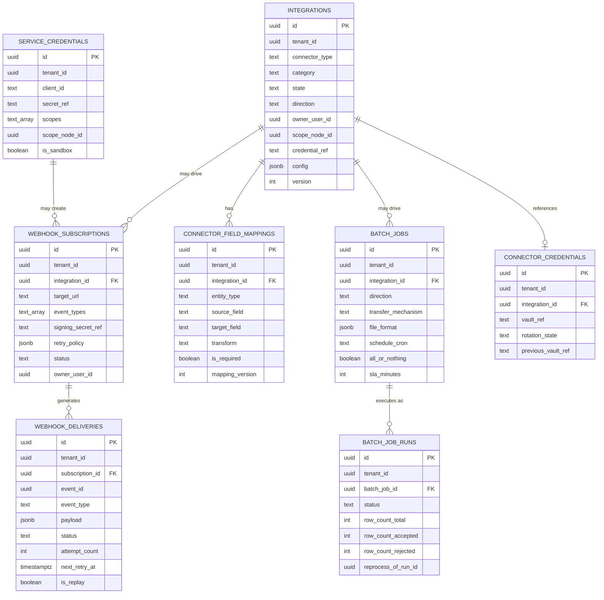
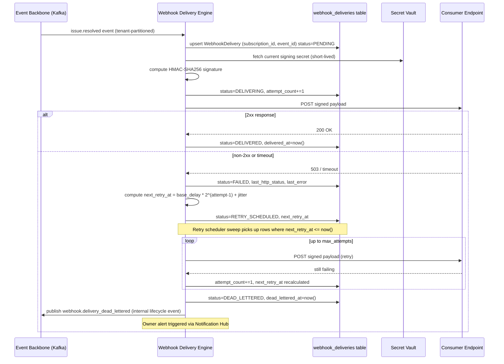
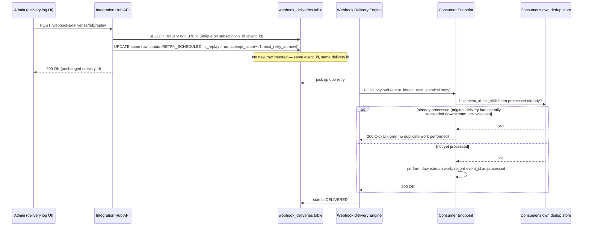
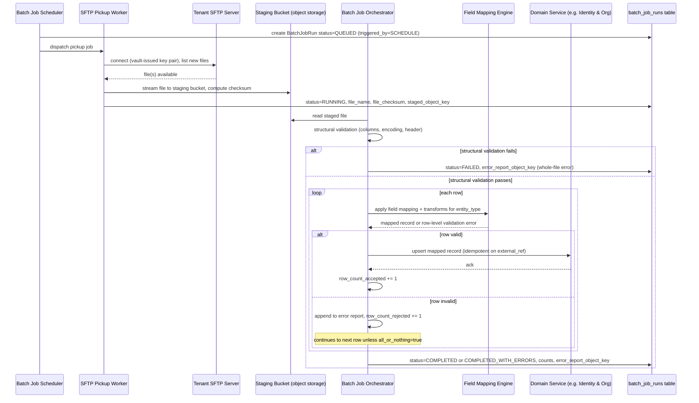

# Integration Hub — Low-Level Design

Module: `12-integrations-extensibility`
Epic: EPIC-13 (Integration Hub)

## 1. Database Schema (PostgreSQL)

All tables carry `tenant_id` (RLS-enforced per conventions.md) and standard audit columns
(`created_at`, `created_by`, `updated_at`, `updated_by`) omitted below for brevity except where a
field name matters for logic.

### 1.1 `integrations`

| Column | Type | Notes |
|---|---|---|
| `id` | uuid, PK | |
| `tenant_id` | uuid, NOT NULL | RLS partition key |
| `connector_type` | text, NOT NULL | e.g. `WORKDAY`, `SAP_ERP`, `SNOWFLAKE`, `POWER_BI`, `SLACK`, `GENERIC_SFTP`, `GENERIC_REST` |
| `category` | text, NOT NULL | `HR`, `ERP`, `DATA`, `BI`, `COLLABORATION`, `OPERATIONAL`, `CUSTOM` (`IDENTITY` category rows are cross-reference stubs owned by module 01) |
| `name` | text, NOT NULL | admin-assigned display name |
| `state` | text, NOT NULL | `NOT_CONFIGURED`, `CONFIGURED`, `ACTIVE`, `DEGRADED`, `FAILING`, `CREDENTIAL_EXPIRING`, `DISABLED` |
| `direction` | text, NOT NULL | `INBOUND`, `OUTBOUND`, `BIDIRECTIONAL` |
| `owner_user_id` | uuid, NOT NULL, FK → `users.id` | receives health/failure alerts |
| `scope_node_id` | uuid, NOT NULL, FK → `organization_nodes.id` | bounds data access subtree |
| `credential_ref` | text, NOT NULL | vault path/key id; never the secret itself |
| `credential_expires_at` | timestamptz, NULL | populated when external system communicates TTL |
| `config` | jsonb, NOT NULL | connector-specific config (endpoints, polling interval, feature toggles) |
| `sync_schedule` | text, NULL | cron expression for polling/batch-style connectors; NULL for pure event-driven |
| `last_sync_at` | timestamptz, NULL | |
| `last_health_check_at` | timestamptz, NULL | |
| `consecutive_failure_count` | int, NOT NULL DEFAULT 0 | drives `FAILING` transition |
| `version` | int, NOT NULL DEFAULT 1 | optimistic concurrency |
| `deleted_at` | timestamptz, NULL | soft delete |

Indexes: `(tenant_id, state)`, `(tenant_id, category)`, `(tenant_id, owner_user_id)`.

### 1.2 `webhook_subscriptions`

| Column | Type | Notes |
|---|---|---|
| `id` | uuid, PK | |
| `tenant_id` | uuid, NOT NULL | |
| `integration_id` | uuid, NULL, FK → `integrations.id` | NULL for a partner-created subscription not tied to a first-party connector |
| `target_url` | text, NOT NULL | HTTPS only, enforced at write |
| `event_types` | text[], NOT NULL | subset of the canonical event catalog |
| `filter_expression` | text, NULL | e.g. `location.region == "APAC"` |
| `signing_secret_ref` | text, NOT NULL | vault ref, current secret |
| `signing_secret_ref_prev` | text, NULL | vault ref, previous secret during rotation grace window |
| `secret_rotation_grace_until` | timestamptz, NULL | both secrets valid until this time |
| `retry_policy` | jsonb, NOT NULL | `{max_attempts, base_delay_seconds, max_delay_seconds, jitter}` |
| `status` | text, NOT NULL | `ACTIVE`, `PAUSED`, `PENDING_URL_VERIFICATION`, `DISABLED` |
| `owner_user_id` | uuid, NOT NULL | |
| `created_by_credential_id` | uuid, NULL, FK → `service_credentials.id` | set when created by a partner via API |
| `version` | int, NOT NULL DEFAULT 1 | |

Indexes: `(tenant_id, status)`, GIN index on `event_types`.

### 1.3 `webhook_deliveries`

| Column | Type | Notes |
|---|---|---|
| `id` | uuid, PK | |
| `tenant_id` | uuid, NOT NULL | |
| `subscription_id` | uuid, NOT NULL, FK → `webhook_subscriptions.id` | |
| `event_id` | uuid, NOT NULL | from the canonical event envelope; immutable |
| `event_type` | text, NOT NULL | |
| `payload` | jsonb, NOT NULL | the exact event envelope delivered (or to be delivered) |
| `status` | text, NOT NULL | `PENDING`, `DELIVERING`, `DELIVERED`, `FAILED`, `RETRY_SCHEDULED`, `DEAD_LETTERED` |
| `attempt_count` | int, NOT NULL DEFAULT 0 | |
| `last_attempt_at` | timestamptz, NULL | |
| `last_http_status` | int, NULL | |
| `last_error` | text, NULL | |
| `next_retry_at` | timestamptz, NULL | drives the retry scheduler poll |
| `delivered_at` | timestamptz, NULL | |
| `dead_lettered_at` | timestamptz, NULL | |
| `is_replay` | boolean, NOT NULL DEFAULT false | true once a manual replay has been triggered on this row |
| `replay_of_delivery_id` | uuid, NULL | self-reference; set when this row itself resulted from a replay of a prior dead-lettered row that was re-materialized (see §5b) |

Unique constraint: **`(subscription_id, event_id)`** — this is the mechanism that guarantees a
replay never creates a second delivery row for the same event/subscription pair (FR-INT-024,
source-spec §24.1). A replay updates the existing row (resets `status`, increments `attempt_count`,
clears `next_retry_at` for immediate redelivery) rather than inserting a new one.

Indexes: `(tenant_id, subscription_id, status)`, `(status, next_retry_at)` for the retry scheduler
sweep, `(tenant_id, event_id)`.

### 1.4 `connector_field_mappings`

| Column | Type | Notes |
|---|---|---|
| `id` | uuid, PK | |
| `tenant_id` | uuid, NOT NULL | |
| `integration_id` | uuid, NOT NULL, FK → `integrations.id` | |
| `entity_type` | text, NOT NULL | e.g. `WORKER`, `LOCATION`, `PRODUCT`, `WORK_ORDER` |
| `source_field` | text, NOT NULL | source system field path (dot-notation for nested) |
| `target_field` | text, NOT NULL | platform field path |
| `transform` | text, NULL | `TRIM`, `DATE_FORMAT`, `ENUM_REMAP`, `CONCAT`, `CONSTANT`, `NONE` |
| `transform_config` | jsonb, NULL | e.g. `{"from_format":"MM/DD/YYYY","to_format":"ISO8601"}` |
| `is_required` | boolean, NOT NULL DEFAULT false | drives activation validation (FR-INT-004) |
| `default_value` | text, NULL | used when source is absent and field is required |
| `mapping_version` | int, NOT NULL DEFAULT 1 | mapping is versioned per integration; a published version is immutable, mirroring TemplateVersion pattern |

Indexes: `(tenant_id, integration_id, entity_type)`.

### 1.5 `batch_jobs`

| Column | Type | Notes |
|---|---|---|
| `id` | uuid, PK | |
| `tenant_id` | uuid, NOT NULL | |
| `integration_id` | uuid, NULL, FK → `integrations.id` | NULL for a standalone generic CSV job |
| `name` | text, NOT NULL | |
| `direction` | text, NOT NULL | `IMPORT`, `EXPORT` |
| `transfer_mechanism` | text, NOT NULL | `SFTP`, `HTTPS_PRESIGNED`, `DIRECT_UPLOAD` |
| `file_format` | jsonb, NOT NULL | `{"type":"CSV","delimiter":",","encoding":"UTF-8","has_header":true}` |
| `entity_type` | text, NOT NULL | matches `connector_field_mappings.entity_type` |
| `schedule_cron` | text, NULL | NULL = manual trigger only |
| `all_or_nothing` | boolean, NOT NULL DEFAULT false | row-level vs. whole-file validation failure mode |
| `sftp_config` | jsonb, NULL | host, path, key-pair vault ref |
| `sla_minutes` | int, NOT NULL DEFAULT 30 | drives SLA-breach alerting |
| `enabled` | boolean, NOT NULL DEFAULT true | |

Indexes: `(tenant_id, enabled, schedule_cron)`.

### 1.6 `batch_job_runs`

| Column | Type | Notes |
|---|---|---|
| `id` | uuid, PK | |
| `tenant_id` | uuid, NOT NULL | |
| `batch_job_id` | uuid, NOT NULL, FK → `batch_jobs.id` | |
| `status` | text, NOT NULL | `QUEUED`, `RUNNING`, `COMPLETED`, `COMPLETED_WITH_ERRORS`, `FAILED`, `SLA_BREACHED` |
| `file_name` | text, NULL | |
| `file_checksum` | text, NULL | SHA-256 of staged file |
| `staged_object_key` | text, NULL | object-storage key in the staging bucket |
| `row_count_total` | int, NULL | |
| `row_count_accepted` | int, NULL | |
| `row_count_rejected` | int, NULL | |
| `error_report_object_key` | text, NULL | downloadable per-row error CSV |
| `started_at` | timestamptz, NULL | |
| `completed_at` | timestamptz, NULL | |
| `triggered_by` | text, NOT NULL | `SCHEDULE`, `MANUAL`, `RETRY` |
| `reprocess_of_run_id` | uuid, NULL | set when this run reprocesses only previously rejected rows |

Indexes: `(tenant_id, batch_job_id, started_at DESC)`.

### 1.7 Supporting tables (referenced, briefly)

- `service_credentials` (id, tenant_id, client_id, secret_ref, scopes[], scope_node_id, is_sandbox,
  rate_limit_tier, revoked_at) — backs FR-INT-030/031.
- `connector_credentials` (id, tenant_id, integration_id, vault_ref, rotation_state, rotation_started_at,
  previous_vault_ref, grace_until) — the reference-only credential envelope (FR-INT-052).

### 1.8 ER Diagram



## 2. REST Endpoints

Base path `/api/v1/` per conventions.md. All mutation endpoints require `Idempotency-Key`. Errors
use `{ "error": { "code", "message", "trace_id" } }`. Pagination is cursor-based.

### 2.1 Register an integration

`POST /api/v1/integrations`

Request:
```json
{
  "connector_type": "WORKDAY",
  "category": "HR",
  "name": "Workday - Global Roster",
  "direction": "INBOUND",
  "owner_user_id": "usr_8123",
  "scope_node_id": "org_root_9001",
  "credential": {
    "type": "OAUTH2_CLIENT_CREDENTIALS",
    "client_id": "wd-int-01",
    "client_secret": "•••• (write-only, forwarded to vault, never echoed back)"
  },
  "config": { "tenant_endpoint": "https://acme.workday.com/ccx/api/v1" },
  "sync_schedule": "0 */6 * * *"
}
```

Response `201 Created`:
```json
{
  "id": "int_5f2a",
  "connector_type": "WORKDAY",
  "category": "HR",
  "state": "CONFIGURED",
  "credential_ref": "secret/tenants/t_42/integrations/int_5f2a",
  "owner_user_id": "usr_8123",
  "scope_node_id": "org_root_9001",
  "version": 1,
  "created_at": "2026-09-19T10:02:11Z"
}
```

Errors: `400 VALIDATION_FAILED` (missing required field mapping activation prerequisites — only on
activate, not create), `409 CONFLICT` (duplicate `connector_type` + `name` for tenant),
`403 SCOPE_DENIED`.

### 2.2 Create a webhook subscription

`POST /api/v1/webhooks/subscriptions`

Request:
```json
{
  "target_url": "https://partner.example.com/hooks/frontline",
  "event_types": ["issue.created", "issue.resolved", "audit.approved"],
  "filter_expression": "location.region == \"APAC\"",
  "retry_policy": {
    "max_attempts": 8,
    "base_delay_seconds": 30,
    "max_delay_seconds": 43200,
    "jitter": true
  }
}
```

Response `201 Created`:
```json
{
  "id": "whsub_9a01",
  "status": "PENDING_URL_VERIFICATION",
  "signing_secret": "whsec_7f3e0c4b9a...  (shown once only)",
  "event_types": ["issue.created", "issue.resolved", "audit.approved"],
  "version": 1
}
```

The subscription starts `PENDING_URL_VERIFICATION`: the engine sends a challenge delivery
(`event_type: "webhook.url_verification"`) and flips to `ACTIVE` only once the target responds
`200` with the expected challenge echo, per functional-spec §7 (URL-ownership-change edge case).

### 2.3 Get delivery log

`GET /api/v1/webhooks/subscriptions/{id}/deliveries?status=FAILED&cursor=...&limit=50`

Response `200 OK`:
```json
{
  "items": [
    {
      "id": "whdel_11c2",
      "event_id": "evt_a93f",
      "event_type": "issue.resolved",
      "status": "DEAD_LETTERED",
      "attempt_count": 8,
      "last_http_status": 503,
      "last_error": "connection timeout",
      "last_attempt_at": "2026-09-18T22:14:03Z",
      "dead_lettered_at": "2026-09-18T22:14:03Z"
    }
  ],
  "next_cursor": "eyJvZmZzZXQiOjUwfQ=="
}
```

### 2.4 Replay a failed delivery

`POST /api/v1/webhooks/deliveries/{id}/replay`

Request: `{}` (no body needed; replay reuses the stored payload)

Response `200 OK`:
```json
{
  "id": "whdel_11c2",
  "status": "RETRY_SCHEDULED",
  "attempt_count": 9,
  "is_replay": true,
  "next_retry_at": "2026-09-19T10:05:00Z"
}
```

Note the `id` is **unchanged** — replay updates the existing `webhook_deliveries` row (unique on
`subscription_id, event_id`), it never creates a new delivery id for the same event. This is the
concrete mechanism behind the source-spec §24.1 "Integration recovery" acceptance test.

### 2.5 Rotate a secret

`POST /api/v1/webhooks/subscriptions/{id}/rotate-secret`
`POST /api/v1/integrations/{id}/rotate-credential`

Request:
```json
{ "grace_period_hours": 24 }
```

Response `200 OK`:
```json
{
  "id": "whsub_9a01",
  "new_signing_secret": "whsec_2b88f1a4c0...  (shown once only)",
  "rotation_state": "GRACE_PERIOD_ACTIVE",
  "grace_until": "2026-09-20T10:10:00Z"
}
```

### 2.6 Configure field mapping

`PUT /api/v1/integrations/{id}/field-mappings`

Request:
```json
{
  "entity_type": "WORKER",
  "mappings": [
    {"source_field": "worker.personalData.legalName", "target_field": "user.display_name", "transform": "NONE", "is_required": true},
    {"source_field": "worker.employment.hireDate", "target_field": "user.hire_date", "transform": "DATE_FORMAT", "transform_config": {"from_format":"YYYY-MM-DD","to_format":"ISO8601"}, "is_required": false},
    {"source_field": "worker.employment.costCenter", "target_field": "org_node.external_ref", "transform": "NONE", "is_required": true}
  ]
}
```

Response `200 OK`: echoes saved mappings with `mapping_version: 3`. Returns `422
FIELD_MAPPING_INVALID` with a per-field error array if a required platform field has no mapping and
no default, per FR-INT-004.

### 2.7 Trigger / schedule a batch job

`POST /api/v1/batch-jobs/{id}/runs` (manual trigger)

Response `202 Accepted`:
```json
{ "run_id": "bjr_44d1", "status": "QUEUED" }
```

`PATCH /api/v1/batch-jobs/{id}` with `{"schedule_cron": "0 2 * * *"}` updates the schedule
(version/ETag-checked, `409 CONFLICT` on stale version).

### 2.8 Signed webhook payload format

Delivered request:
```
POST https://partner.example.com/hooks/frontline
Content-Type: application/json
X-Frontline-Event-Id: evt_a93f
X-Frontline-Signature: t=1758276843,v1=5f9c1b2e8a...d41f
X-Frontline-Delivery-Attempt: 3
```
Body (exact `payload` stored in `webhook_deliveries.payload`, the canonical event envelope per
source-spec §18.4):
```json
{
  "event_id": "evt_a93f",
  "event_type": "issue.resolved",
  "version": "1",
  "tenant_id": "t_42",
  "occurred_at": "2026-09-18T22:00:00Z",
  "actor_id": "usr_2210",
  "resource_id": "iss_7781",
  "trace_id": "tr_c9a1",
  "data": { "issue_id": "iss_7781", "resolution_code": "VERIFIED" }
}
```

**HMAC verification** (consumer side, matches the SDK helper in FR-INT-032):
```
signed_content = "{timestamp}.{raw_request_body}"
expected_v1 = hex(HMAC_SHA256(key = signing_secret, message = signed_content))
valid = constant_time_equals(expected_v1, v1_from_header)
      AND abs(now() - timestamp) <= tolerance_window (default 300s)
```
During a rotation grace window the consumer (and the platform's own re-verification tooling) must
accept a signature valid under **either** the current or previous secret.

## 3. Sequence Diagrams

### 3a. Outbound webhook delivery with exponential-backoff retry and eventual DLQ



### 3b. Idempotent, replay-safe webhook redelivery (ties to §24.1 acceptance test)



### 3c. SFTP/CSV batch job: pickup -> validation -> field-mapping -> ingestion



## 4. Pseudocode

### 4.1 Idempotent webhook-consumer dedup key strategy

```
# Platform-side: guarantees at most one logical delivery row per (subscription, event)
function upsert_delivery(subscription_id, event):
    key = (subscription_id, event.event_id)
    existing = webhook_deliveries.find_by(key)
    if existing exists:
        # This happens on: (a) event redelivered by an upstream at-least-once source,
        # (b) explicit admin replay, (c) retry-scheduler re-pick.
        if existing.status in (DELIVERED,):
            return existing  # no-op; already terminal-success, do not re-dispatch spontaneously
                              # (a manual replay explicitly overrides this — see replay_delivery)
        else:
            return existing  # reuse row; scheduler will pick it up per its own status/next_retry_at
    else:
        return webhook_deliveries.insert(
            subscription_id=subscription_id,
            event_id=event.event_id,
            event_type=event.event_type,
            payload=event.envelope,
            status=PENDING,
            attempt_count=0
        )

function replay_delivery(delivery_id, actor):
    delivery = webhook_deliveries.find_by_id(delivery_id)
    # Update-in-place, never insert — this is the crux of the no-duplicate-work guarantee.
    delivery.status = RETRY_SCHEDULED
    delivery.is_replay = true
    delivery.next_retry_at = now()
    delivery.attempt_count += 1  # historical attempt count, not reset — preserves true attempt history
    webhook_deliveries.save(delivery)
    audit_log.record(actor, "WEBHOOK_DELIVERY_REPLAYED", delivery_id)
    return delivery

# Consumer-side (documented contract + SDK default implementation):
function handle_incoming_webhook(request):
    verify_hmac_signature(request)  # reject if invalid (see §2.8)
    event = parse(request.body)
    if dedup_store.has_processed(event.event_id):
        return 200 OK  # ack without reprocessing — THIS is what prevents duplicate downstream work
    result = process_event(event)          # e.g., create_corrective_task(), update_ticket()
    dedup_store.mark_processed(event.event_id, ttl = retention_window)
    return 200 OK
```

### 4.2 Retry / backoff scheduler

```
# Runs as a background worker polling on a short interval (e.g., every 5s)
function retry_scheduler_tick():
    due = webhook_deliveries.query(
        status = RETRY_SCHEDULED,
        next_retry_at <= now(),
        limit = BATCH_SIZE,
        order_by = next_retry_at ASC
    )
    for delivery in due:
        subscription = webhook_subscriptions.get(delivery.subscription_id)
        if subscription.status != ACTIVE:
            continue  # paused subscriptions retain PENDING/RETRY_SCHEDULED rows without dispatch

        delivery.status = DELIVERING
        webhook_deliveries.save(delivery)

        secret = vault.get_current_signing_secret(subscription.signing_secret_ref)
        signature = hmac_sha256(secret, f"{now_unix()}.{delivery.payload_raw}")

        response = http_post(subscription.target_url, delivery.payload, headers={
            "X-Frontline-Event-Id": delivery.event_id,
            "X-Frontline-Signature": signature,
            "X-Frontline-Delivery-Attempt": delivery.attempt_count + 1
        }, timeout = DELIVERY_TIMEOUT)

        delivery.attempt_count += 1
        delivery.last_attempt_at = now()
        delivery.last_http_status = response.status_code

        if response.is_2xx():
            delivery.status = DELIVERED
            delivery.delivered_at = now()
        else:
            delivery.last_error = response.error_summary()
            policy = subscription.retry_policy
            if delivery.attempt_count >= policy.max_attempts:
                delivery.status = DEAD_LETTERED
                delivery.dead_lettered_at = now()
                publish_internal_event("webhook.delivery_dead_lettered", delivery)
                notify_owner(subscription.owner_user_id, delivery)
            else:
                delay = min(policy.base_delay_seconds * (2 ** (delivery.attempt_count - 1)),
                             policy.max_delay_seconds)
                if policy.jitter:
                    delay = delay * random_uniform(0.5, 1.5)
                delivery.status = RETRY_SCHEDULED
                delivery.next_retry_at = now() + delay

        webhook_deliveries.save(delivery)

        # Subscription-level circuit breaker: if the last K deliveries on this subscription
        # (across events) all failed, trip a breaker to stop wasting delivery-worker capacity.
        if consecutive_subscription_failures(subscription.id) >= BREAKER_THRESHOLD:
            subscription.status = PAUSED
            subscription.pause_reason = "CIRCUIT_BREAKER"
            webhook_subscriptions.save(subscription)
            notify_owner(subscription.owner_user_id, "subscription auto-paused")
```

## 5. Caching

- **Connector config cache**: `Integration` config (excluding secrets) and active
  `ConnectorFieldMapping` sets are cached in Redis keyed `integration_config:{tenant_id}:{integration_id}`
  with a short TTL (60s) plus explicit invalidation on write, since adapter workers read this on
  every sync tick and a cold Postgres read per event would not scale at fan-out volume.
- **Webhook subscription-to-event-type index**: a Redis set per `(tenant_id, event_type)` listing
  active subscription ids is maintained (invalidated on subscription create/pause/delete) so the
  webhook engine can resolve "who subscribes to this event" in O(1) without a table scan per event.
- **Rate-limit counters**: per-tenant, per-connector-category token buckets in Redis (per
  conventions.md cache choice), consistent with the platform-wide rate-limiting pattern.
- **Vault secret cache**: explicitly **not cached** beyond the single call's lifetime — every
  delivery/sync fetches a fresh (or vault-client-cached-with-short-TTL-inside-the-vault-client)
  secret rather than this module holding decrypted secrets in its own cache, per NFR-INT-005.

## 6. Concurrency

- **Per-connector delivery ordering guarantees**: for connector types where order matters (notably
  HR sync — a `termination` event applied before a preceding `transfer` event would corrupt org
  assignment), the corresponding Kafka consumer group processes messages for a given
  `tenant_id:employee_id` key strictly in partition order (single consumer per partition, no
  out-of-order reprocessing), and the adapter applies changes with a monotonically increasing
  source-system sequence/version check (reject or requeue an update whose source sequence number is
  older than the last applied one for that entity). Webhook delivery, by contrast, makes **no
  cross-event ordering guarantee** to the consumer — consumers are documented to expect at-least-once,
  not-necessarily-ordered delivery, exactly to keep webhook fan-out horizontally scalable; where a
  consumer needs ordering it must use the event's `occurred_at`/sequence data in the payload itself.
- **Optimistic concurrency**: `integrations`, `webhook_subscriptions`, `batch_jobs` all carry
  `version`; concurrent admin edits return `409 CONFLICT` with the current version, per
  conventions.md.
- **Batch job run mutual exclusion**: a `BatchJob` cannot have two `RUNNING` `BatchJobRun`s
  simultaneously (enforced by a partial unique index on `(batch_job_id) WHERE status = 'RUNNING'`);
  a scheduled trigger that fires while a manual run is still in progress is queued, not run
  concurrently, to avoid double-processing the same staged file window.

## 7. Background Jobs

| Job | Trigger | Responsibility |
|---|---|---|
| Webhook delivery worker | Kafka consumer (continuous) | Consumes domain events, resolves matching subscriptions, upserts `WebhookDelivery`, performs first delivery attempt. |
| Retry/backoff scheduler | Interval poll (5s) | Sweeps `RETRY_SCHEDULED` rows past `next_retry_at`, re-attempts delivery per §4.2. |
| Batch job scheduler | Interval poll (1 min), cron-matching | Creates `QUEUED` `BatchJobRun`s for due `schedule_cron` jobs; enforces per-tenant concurrency cap. |
| SFTP pickup worker | Dispatched by batch job scheduler / manual trigger | Connects to tenant SFTP, stages files to object storage, computes checksum. |
| Secret-rotation reminder job | Daily | Scans `connector_credentials`/`webhook_subscriptions` for approaching `credential_expires_at`; raises `CREDENTIAL_EXPIRING` alerts at 30/14/3-day thresholds (FR-INT-053). |
| Health/circuit-breaker evaluator | Interval poll (30s) | Aggregates recent adapter/delivery outcomes per `Integration`/`WebhookSubscription`, transitions `health_state`, trips/resets circuit breakers. |
| Orphan-reference reconciliation sweep | Interval poll (5 min) + triggered on `OrganizationNode` creation | Reprocesses staged orphaned-reference records once the referenced node exists or is manually mapped (FR-INT-061); escalates/ages out per FR-INT-062. |
| Rate-limit quota reset | Rolling window (Redis TTL-based, no separate job) | Token buckets self-expire; a lightweight metrics job publishes quota-usage snapshots for the admin dashboard. |

## 8. Error Handling

| Error condition | HTTP status | Error code | Handling |
|---|---|---|---|
| Missing/invalid credential on activate | 422 | `CREDENTIAL_INVALID` | Blocks activation; wizard shows raw connector error from test-connection call. |
| Required field unmapped | 422 | `FIELD_MAPPING_INVALID` | Per-field error array returned; activation blocked; draft save allowed. |
| Webhook target not HTTPS | 400 | `VALIDATION_FAILED` | Rejected at creation, no retry logic invoked. |
| Webhook URL ownership challenge fails/times out | 400 | `URL_VERIFICATION_FAILED` | Subscription remains `PENDING_URL_VERIFICATION`; admin can retry verification. |
| Duplicate `(subscription_id, event_id)` insert attempt | — (handled internally) | — | Unique constraint causes upsert path (§4.1), not a client-visible error. |
| Delivery attempt budget exhausted | — (internal state transition) | — | `DEAD_LETTERED`; surfaced via delivery log + `webhook.delivery_dead_lettered` event, not an API error to any caller. |
| Rate limit exceeded (inbound API) | 429 | `RATE_LIMITED` | `Retry-After` header set; SDK auto-backs-off. |
| Optimistic concurrency conflict | 409 | `CONFLICT` | Returns current server version in payload for client merge/retry. |
| Scope violation (integration references a node outside actor's scope) | 403 | `SCOPE_DENIED` | Standard platform-wide error shape. |
| Structural batch file validation failure | 200 (run created) → run `status=FAILED` | `BATCH_STRUCTURAL_INVALID` (in run detail, not HTTP error) | Whole file rejected; error report explains structural issue (e.g., missing required column). |
| Row-level batch validation failure | 200 (run created) → run `status=COMPLETED_WITH_ERRORS` | `BATCH_ROW_INVALID` (per-row, in error report) | Valid rows commit; rejected rows itemized; unless `all_or_nothing=true`. |
| SFTP connection failure | — (run status) | `SFTP_UNREACHABLE` | Run `FAILED`; retried per job's own retry configuration (separate from webhook retry policy); owner alerted. |
| Credential expired mid-sync | — (run/sync status) | `CREDENTIAL_EXPIRED` | Sync marked `FAILED` with partial-completion boundary recorded; `Integration.state` → `CREDENTIAL_EXPIRING`/`FAILING`; deep link to rotation. |
| Orphaned org-node reference on ingest | — (record staged, not an error) | `ORPHANED_REFERENCE` (informational) | Record held in reconciliation queue, not rejected; see FR-INT-061. |
| PROVISIONING_CONFLICT (SCIM vs HR field write) | — (audit event, not an API error) | `PROVISIONING_CONFLICT` | Non-authoritative field write discarded and logged; authoritative source's value stands. |
