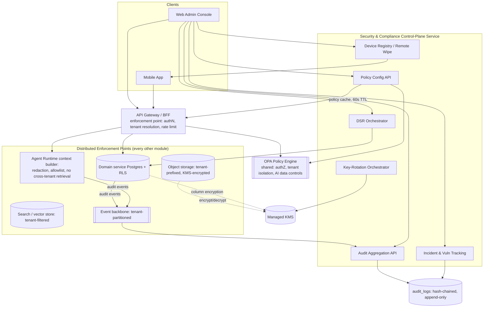
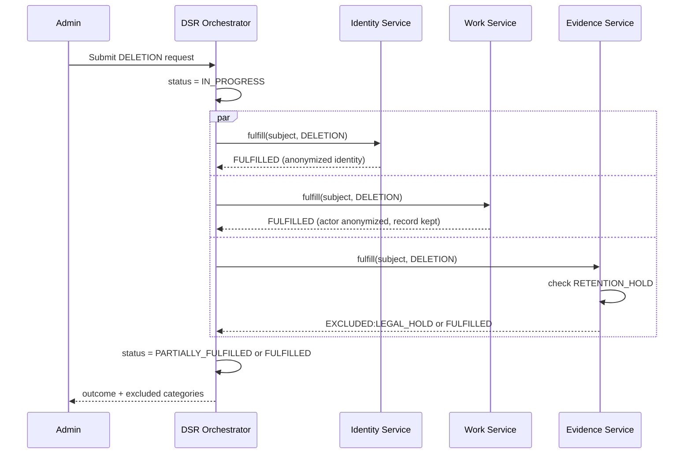
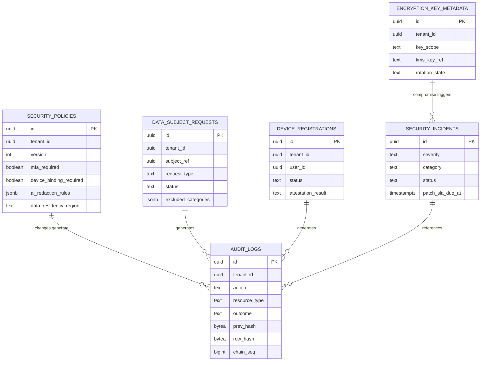
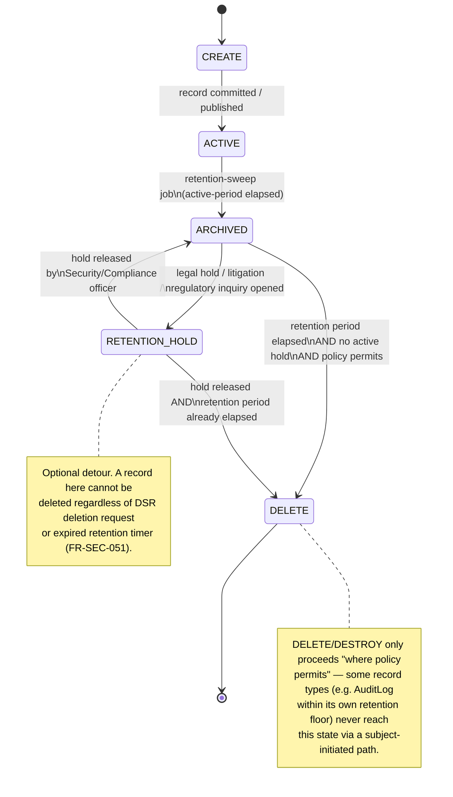

# Security, Privacy & Compliance — Architecture Diagrams

Module: `13-security-compliance`
Epic: EPIC-14

## 1. Component / container diagram



**Narrative**: the control-plane service (top box) is a normal deployable that Enterprise Admins
and Security/Compliance officers interact with directly. The bottom box, "Distributed Enforcement
Points," is not a service — it is the same enforcement contract replicated inside every other
module's own service, object storage access, search/vector layer, event consumers, and the Agent
Runtime. Policy flows one way, down, from the control plane to a short-TTL cache each enforcement
point reads; audit events flow one way, up, from every enforcement point into the central
hash-chained store. OPA is the shared decision engine used both for ordinary authorization
(reused from Identity & Org) and for the tenant-isolation/AI-data-control checks this module adds.

## 2. Sequence diagram — end-to-end tenant-isolation enforcement

```mermaid
sequenceDiagram
    participant Client
    participant GW as API Gateway
    participant OPA as OPA
    participant SVC as Domain Service
    participant PG as Postgres (RLS)
    participant OBJ as Object Storage

    Client->>GW: Request (Bearer token, tenant A)
    GW->>GW: Resolve tenant_id from token only
    GW->>OPA: authorize(principal, action, resource)
    OPA-->>GW: ALLOW (tenant A, scope X)
    GW->>SVC: forward + verified tenant/scope
    SVC->>PG: SET app.tenant_id='A'; scoped query
    PG-->>SVC: rows (RLS-backstopped)
    SVC->>OBJ: request signed URL (key must start tenant/A/)
    OBJ-->>SVC: signed URL
    SVC-->>GW: 200 response
    GW-->>Client: 200 response
    SVC-)AUDIT: async audit event (hash-chained)
```

**Narrative**: this diagram is the literal walk-through of the §24.1 acceptance test — every hop
(gateway, OPA, service, Postgres RLS, object storage) independently proves tenant A scope before
acting, so a bug at any single layer does not, by itself, expose tenant B's data. The audit emit
is asynchronous to the response path (does not add latency to the read) but is still guaranteed
durable before the *originating* action is considered complete for security-critical writes
(not shown here, since this is a read path — see LLD §4.3 for the write-path guarantee).

## 3. Sequence diagram — DSR fulfillment across services



**Narrative**: no single service can unilaterally "complete" a DSR — the orchestrator only marks
`FULFILLED` when every owning service reports back, and a `RETENTION_HOLD` on even one service's
data downgrades the outcome to `PARTIALLY_FULFILLED` with an explicit, auditable reason rather
than silently deleting around the hold or silently claiming full compliance.

## 4. ER diagram — owned entities



**Narrative**: `AUDIT_LOGS` is the hub every other owned entity connects to — every configuration
change, DSR action, device action, and incident is itself an audit event, which is what makes the
central audit store usable as compliance evidence for the module's own operation, not only for
other modules' business events.

## 5. State diagram — Data Lifecycle (source-spec §21.4)



**Narrative**: every tenant-owned record type with a lifecycle (`Submission`, `Evidence`,
`KnowledgeDocument`, `AgentRun`, and this module's own `AuditLog` under its distinct longer
retention) implements this exact four/five-state machine. `RETENTION_HOLD` is the deliberate
override point that makes the legal-hold-vs-DSR-deletion conflict (FSD §7) structurally
impossible to bypass: the state machine itself, not just application logic, blocks the
`DELETE`/`DESTROY` transition while a hold is active.
