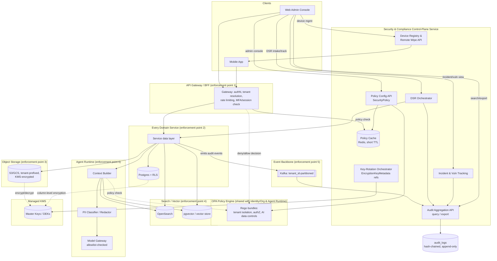

# Security, Privacy & Compliance — High-Level Design

Module: `13-security-compliance`
Epic: EPIC-14

## 1. Module responsibilities

This module has a dual nature, and both halves must be designed explicitly:

1. **Distributed enforcement mechanisms** embedded inside every other service: RLS policies in
   each service's Postgres schema, tenant-scoped cache keys, tenant-filtered search/vector
   queries, signed-URL scope checks in object storage access, tenant-context validation in event
   consumers, and AI data-control checks in the Agent Runtime's context builder. This half has
   **no single deployable** — it is a contract (this document + the LLD's pseudocode patterns)
   that every module's own service implements and is tested against.
2. **A dedicated Security/Compliance control-plane service** (`security-compliance-service`) that
   owns: `SecurityPolicy` configuration and distribution, central `AuditLog` aggregation/query/
   export, `EncryptionKeyMetadata` tracking and rotation orchestration (calling out to the KMS,
   never holding key material), `DeviceRegistration` and remote-wipe command issuance,
   `DataSubjectRequest` intake and cross-service fulfillment orchestration, and
   `SecurityIncident`/vulnerability-finding tracking.

The control-plane service is the system of record for policy and audit; enforcement happens
locally, at speed, in every other service, using policy pulled/cached from the control plane
(fail-closed on staleness — see §7).

## 2. Component diagram

**Narrative**: the control-plane service is the source of truth for `SecurityPolicy`, but it is
never on the hot path of every request — the API Gateway and every domain service read policy
from a short-TTL cache (§7) so that a control-plane outage degrades to "last known policy,
fail-closed on cache miss," not a platform-wide outage. Tenant-isolation enforcement is
*distributed*: the gateway does coarse authN/rate-limiting, each domain service's RLS-backed
Postgres does row-level enforcement, object storage does prefix+signed-URL enforcement, search/
vector does query-filter enforcement, the event backbone does per-consumer validation, and the
Agent Runtime's context builder does AI-specific enforcement (redaction, allowlist, no-cross-
tenant-retrieval) before anything reaches a model provider. OPA/Rego is the shared decision engine
behind both the authorization checks (reused from module 01) and the AI-data-control /
tenant-isolation policy decisions evaluated here and in the Agent Runtime.

## 3. Data ownership

| Entity | Owner | Notes |
|---|---|---|
| `SecurityPolicy` | This module | Tenant-scoped configuration; versioned; distributed via cache + OPA bundle. |
| `AuditLog` | This module (central aggregate) — individual services also emit locally-scoped records before forwarding | Central store is the system of record for compliance query/export; per-service emission is at-least-once with dedup keyed by `event_id`. |
| `DataSubjectRequest` | This module | Cross-service orchestration record; owning services hold the actual personal data. |
| `EncryptionKeyMetadata` | This module | **Reference-only** — key ids/ARNs and rotation state; raw key material never leaves the KMS. |
| `DeviceRegistration` | This module | Referenced by Identity/Org's session issuance (module 01) at login time. |
| `SecurityIncident` | This module | Cross-cutting; may reference records/tenants owned by any other module by id only. |
| `Tenant.residency`, `Tenant.policies` (reference fields) | Identity & Org (module 01) owns `Tenant`; this module owns the *content* and enforcement of the security/AI policy attached to it | Avoids a circular ownership dispute: module 01 owns the row, this module owns the policy schema and its enforcement semantics. |

## 4. External interfaces

- **Consumes**: `tenant.created`/`tenant.updated` events (module 01) to apply residency and
  default `SecurityPolicy` at provisioning; every domain service's canonical events (§18.3) as the
  audit event source; `user.deactivated`/`user.role_changed` events to trigger session revocation
  and audit entries; Agent Runtime's `agent.invoked`/`agent.tool_executed` events for AI-control
  audit and evaluation.
- **Produces**: `security.policy_updated`, `security.incident_created`,
  `security.incident_resolved`, `dsr.submitted`, `dsr.fulfilled`, `key.rotated`,
  `device.wiped` — consumed by Notification Hub (admin alerts), Analytics (compliance
  dashboards), and by every domain service's local policy cache invalidation listener.
- **REST**: control-plane admin/query APIs (see LLD §5) consumed by the Web Admin Console;
  no mobile-direct endpoints beyond device registration and session/MFA challenge flows (fronted
  by the gateway, backed by Identity/Org + this module's device registry).
- **OPA bundle distribution**: this module publishes Rego policy bundles (tenant isolation
  invariants, AI data-control rules) that the API Gateway, each domain service's authorization
  middleware, and the Agent Runtime's policy-check step pull and evaluate locally (sidecar OPA or
  embedded library), avoiding a network round-trip to a central policy service on every request.

## 5. Scalability

- **Audit log volume**: at 1M+ users and millions of work items/day (source-spec §23 scale
  target), audit events are expected to run into the low hundreds of millions per day at steady
  state platform-wide. Design response: Kafka topic `audit.events` partitioned by
  `tenant_id:aggregate_id` (consistent with the platform partitioning convention) feeding a
  dedicated consumer group that writes to a **time+tenant partitioned** Postgres/columnar hybrid
  (hot partitions in Postgres for the trailing 90 days supporting rich query, older partitions
  rolled to columnar/object-storage-backed cold storage such as Parquet-on-S3 queried via an
  external table engine) — avoids one unbounded table and keeps compliance query latency bounded
  regardless of total historical volume.
- **Tamper evidence at scale**: a single global hash chain across all tenants would serialize
  writes and become a throughput bottleneck. Design response: hash-chain **per tenant per
  partition** (e.g. per tenant per day), so chains can be written and verified in parallel; a
  periodic "chain-of-chains" root-hash checkpoint (e.g. hourly) is itself notarized (written to an
  independent, even-more-restricted-access store) so that even a compromise of the primary audit
  store's write path cannot rewrite history undetected without also forging the checkpoint chain.
- **Policy evaluation at scale**: OPA policy decisions are evaluated locally by each service
  against a pulled bundle (no synchronous call to the control plane per request), so policy
  evaluation scales with each service's own request throughput, not with a shared bottleneck.

## 6. Multi-tenancy — the enforcement contract this module defines

This module is where the platform's multi-tenancy rule (conventions.md) is made precise and
binding for every layer. Reusing the FSD's isolation-table concept:

| Layer | Mechanism | Enforced by | Failure mode if bypassed |
|---|---|---|---|
| API / Gateway | Tenant resolved from authenticated principal's token claim; never trusted from a client-supplied header except explicit, logged support tooling | API Gateway | Request proceeds with wrong/no tenant context — caught by layer below (defense in depth) |
| Application service | Every query/service method requires an explicit `tenant_id` + scope parameter derived from the authenticated context, never from request body/query string | Each domain service | A missing/forged parameter is a compile-time/lint failure in the shared service framework, not a runtime surprise |
| Database (Postgres) | `tenant_id` column + `FORCE ROW LEVEL SECURITY` policy on every tenant table; session variable `app.tenant_id` set per connection/transaction from the authenticated context | Postgres RLS (defense-in-depth backstop) | Even a raw/buggy SQL query from application code cannot return cross-tenant rows |
| Object storage | Key prefix `tenant/{tenant_id}/...`; signed URL minted only after a scope check against the object's tenant prefix | This module's storage-access library, used by Evidence and every service that issues signed URLs | A forged/guessed object key still fails the signed-URL scope check |
| Cache (Redis) | Key namespace `*:{tenant_id}:*` | Shared caching library convention | A cache key collision is treated as Sev-1 (FR-SEC-006) |
| Search (OpenSearch) | `tenant_id` filter injected server-side into every query, not client-suppliable | Search query builder library | A query missing the filter is rejected by the query builder, not silently executed |
| Vector retrieval | `tenant_id` metadata filter applied at the vector-store query layer before similarity ranking | Agent Runtime / Knowledge Hub retrieval tool | A cross-tenant nearest-neighbor is filtered out even if it scores higher than in-tenant results |
| Event backbone | `tenant_id` in envelope; consumer validates against its own processing context and dead-letters mismatches | Each consumer (workflow workers, Agent Runtime, analytics, notifications) | A cross-tenant event is never actioned; it is quarantined and alerted |
| Worker processing | Worker pulls tenant context from the event/job payload only, never assumes a "current tenant" from shared process state | Workflow Engine (Temporal), background job framework | Prevents cross-tenant state bleed in shared worker pools |
| Analytics / warehouse | `tenant_id` present on every fact/dimension row; BI/reporting layer enforces row-level security equivalent in the warehouse | CDC pipeline + warehouse RLS/row-policy | A dashboard query cannot aggregate across tenants unless explicitly built as a platform-internal (non-customer-facing) view |
| Exports | Every export job is scoped to one tenant's authorization context at generation time; export files are tenant-prefixed in storage and signed-URL gated | Export job framework | A generated export cannot be retrieved by a different tenant's signed-URL request |
| AI context assembly | Context builder resolves retrieval/tool calls exclusively within caller's tenant+scope; AI data controls (redaction/allowlist) applied before any data leaves the tenant boundary to a model provider | Agent Runtime context builder | Cross-tenant reference attempts are blocked and logged (FR-SEC-007) |

## 7. Failure modes and degradation

- **Audit pipeline backpressure**: emitting services buffer locally (bounded, with disk spillover)
  and retry with backoff; sustained backpressure raises a Sev-2 alert. Security-critical actions
  (role/policy/key/DSR changes) require a durable-queue acknowledgement before the originating
  action commits — if that acknowledgement cannot be obtained, the action fails closed
  (`503 AUDIT_UNAVAILABLE`) rather than proceeding unaudited. Non-critical, high-volume audit
  categories (e.g. routine read access) may degrade to best-effort with a bounded buffer during a
  transient outage, but the buffer is monitored and an unresolved backlog beyond a threshold
  escalates identically.
- **KMS unavailability**: reads/writes of already-decrypted-in-memory data continue briefly via
  short-lived cached data keys, but new decrypt/encrypt operations requiring a fresh KMS call fail
  closed — the platform returns `503 ENCRYPTION_UNAVAILABLE` for the affected operation rather
  than falling back to unencrypted storage or a cached-forever key. Object storage and database
  encryption both depend on KMS availability as a hard dependency, by design (never an optional
  security control).
- **Policy cache staleness**: the policy cache (§9 caching) uses a short TTL specifically so that
  a control-plane outage results in "operate on last-known good policy for at most N seconds,"
  never an indefinite stale-policy window; on a cache miss with the control plane unreachable, the
  enforcing service fails closed to the most restrictive applicable default (MFA/session/device
  checks default to *required*, not *optional*, when policy cannot be resolved).
- **DSR orchestrator partial failure**: if one owning service fails to report/fulfill its portion
  of a DSR, the overall `DataSubjectRequest` moves to `PARTIALLY_FULFILLED`, not `FULFILLED`; the
  orchestrator retries the failed service and surfaces the gap to the Security/Compliance officer
  rather than reporting false completion.
- **Chain-verification job finds tampering**: the affected partition is frozen for further writes
  (redirected to a quarantine partition) pending forensic review, and a `SecurityIncident` at
  `CRITICAL` severity is auto-created (see FSD §7); this is a deliberate fail-closed choice over
  "log a warning and continue," because a broken hash chain means the tamper-evidence guarantee
  for that partition is already void.

## 8. Technology choices (justified)

- **Centralized append-only audit store + per-service local audit emission**: a pure
  "each-service-owns-its-own-audit-log" model would make cross-tenant/cross-service compliance
  queries and exports (a core requirement, §4.5) impractical, and would fragment the
  tamper-evidence guarantee across N independently-securable stores. A pure "everything writes
  directly to one central store synchronously" model would make every mutating request's latency
  depend on the audit store's availability. The chosen middle path — each service emits an audit
  event onto the durable, replayable event backbone (already a platform primitive), and a
  dedicated consumer aggregates it into the hash-chained store — gets both: local services are
  decoupled from central-store latency, and the central store remains the single, queryable,
  tamper-evident system of record for compliance.
- **Postgres RLS as defense-in-depth, not the sole mechanism**: reusing the platform convention
  deliberately — application-layer scoping catches the vast majority of bugs cheaply and
  fast-fails with a clear error; RLS exists specifically to catch the *residual* class of bug
  (a missing `WHERE tenant_id = ?` in a raw query, a service-layer regression) that application
  logic alone would miss, at the cost of a small, well-understood performance overhead. This
  module mandates `FORCE ROW LEVEL SECURITY` (not just `ROW LEVEL SECURITY`) so that even the
  table owner role cannot accidentally bypass it.
- **OPA/Rego reused for AI data-control and tenant-isolation decisions, not a bespoke rules
  engine**: the platform already commits to OPA for RBAC/ABAC (module 01) and Agent Runtime tool
  policy (module 10/EPIC-11). Reusing the same engine here — rather than inventing a third policy
  language for security/AI-data rules — means one policy-testing framework, one bundle
  distribution mechanism, and one mental model for "what decided this was allowed/blocked" across
  authorization, tenant isolation, and AI governance, which directly serves the platform's
  explainability principle (P8).
- **Hash-chained Postgres partitions over a dedicated blockchain/ledger product**: a hash chain
  (each row's hash includes the previous row's hash, per tenant/partition) gives the tamper-
  evidence property the acceptance criteria need (detect *that* something changed) without the
  operational cost, latency, and vendor lock-in of a distributed ledger product, which solves a
  different problem (distributed consensus among mutually distrusting parties) that does not apply
  inside one company's own data plane. WORM (write-once-read-many) object storage is used for the
  periodic checkpoint/root-hash notarization (§5) as a second, independently-secured evidence
  trail, giving defense-in-depth against a compromised database-layer actor without adopting a
  blockchain.
