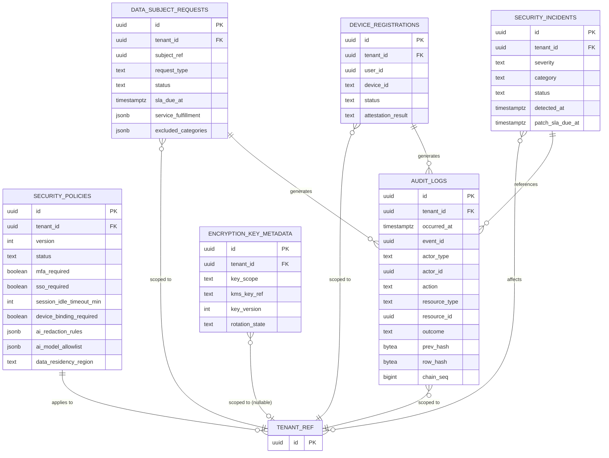
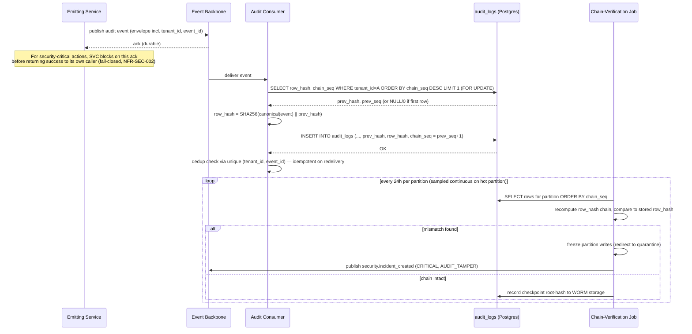

# Security, Privacy & Compliance — Low-Level Design

Module: `13-security-compliance`
Epic: EPIC-14

## 1. Database schema

All tables live in the `security_compliance` schema of the control-plane service's Postgres
database, except where noted. Every table carries `tenant_id` and `FORCE ROW LEVEL SECURITY`
(RLS policy omitted from the listing below for brevity but mandatory per FR-SEC-002), **except**
`audit_logs`, which is additionally partitioned and append-only, and `encryption_key_metadata`,
which is reference-only (no raw key material ever stored).

### 1.1 `audit_logs`

Partitioned by `(tenant_id, occurred_date)` — range-partitioned monthly per tenant-hash bucket in
practice (list of ~256 hash buckets × month) to keep individual partitions bounded regardless of
tenant size skew.

| Column | Type | Notes |
|---|---|---|
| `id` | `uuid` | PK, generated at write time |
| `tenant_id` | `uuid` | NOT NULL; partition key component |
| `occurred_at` | `timestamptz` | NOT NULL; partition key component (derives `occurred_date`) |
| `event_id` | `uuid` | NOT NULL; idempotency key for dedup on re-delivery from Kafka |
| `actor_type` | `text` | `USER` \| `SERVICE` \| `AGENT` \| `SYSTEM` |
| `actor_id` | `uuid` | Nullable for `SYSTEM` |
| `action` | `text` | e.g. `role.updated`, `audit.exported`, `agent.tool_executed`, `dsr.fulfilled` |
| `resource_type` | `text` | e.g. `User`, `SecurityPolicy`, `Submission`, `AgentRun` |
| `resource_id` | `uuid` | Nullable (e.g. login events) |
| `organization_node_id` | `uuid` | Nullable; scope context at time of action |
| `before_state` | `jsonb` | Nullable; redacted per classification registry before storage |
| `after_state` | `jsonb` | Nullable; redacted per classification registry before storage |
| `outcome` | `text` | `SUCCESS` \| `DENIED` \| `ERROR` |
| `trace_id` | `text` | Correlates to platform request tracing |
| `source_service` | `text` | Emitting service name |
| `ip_address` | `inet` | Nullable |
| `device_id` | `uuid` | Nullable, FK-by-reference to `device_registrations` |
| `prev_hash` | `bytea` | Hash of the previous row in this tenant's chain (see LLD §7) |
| `row_hash` | `bytea` | NOT NULL; SHA-256 of this row's canonical serialization + `prev_hash` |
| `chain_seq` | `bigint` | NOT NULL; monotonic sequence number per `(tenant_id, partition)` |
| `created_at` | `timestamptz` | DB-assigned; distinct from `occurred_at` (client/service-reported) |

Indexes: `(tenant_id, occurred_at DESC)`, `(tenant_id, resource_type, resource_id)`,
`(tenant_id, actor_id, occurred_at DESC)`, unique `(tenant_id, event_id)` for dedup, unique
`(tenant_id, chain_seq)` per partition.

Grants: application role has `INSERT` only (no `UPDATE`/`DELETE` grant exists on this table for
any application-facing role — enforced at the Postgres role level, not merely by convention).

### 1.2 `security_policies`

| Column | Type | Notes |
|---|---|---|
| `id` | `uuid` | PK |
| `tenant_id` | `uuid` | NOT NULL |
| `version` | `integer` | NOT NULL; monotonic per tenant |
| `status` | `text` | `ACTIVE` \| `SUPERSEDED` |
| `mfa_required` | `boolean` | Default `false` |
| `mfa_required_roles` | `text[]` | Nullable; if set, MFA required only for these roles |
| `allowed_mfa_factors` | `text[]` | e.g. `{TOTP,WEBAUTHN,PUSH,SMS}` |
| `sso_required` | `boolean` | Default `false` |
| `session_idle_timeout_min` | `integer` | Default `30` |
| `session_absolute_ttl_hours` | `integer` | Default `12` (web), mobile handled separately |
| `mobile_session_ttl_days` | `integer` | Default `30` |
| `concurrent_session_limit` | `integer` | Nullable = unlimited |
| `device_binding_required` | `boolean` | Default `false` |
| `reject_rooted_jailbroken` | `boolean` | Default `true` |
| `ai_redaction_rules` | `jsonb` | `{ "PII": "MASK", "SENSITIVE_PII": "BLOCK", ... }` |
| `ai_model_allowlist` | `jsonb` | `{ "PII": ["provider:model@version", ...], "SENSITIVE_PII": [...] }` |
| `ai_retention_override_days` | `integer` | Nullable; provider-side prompt/response retention override |
| `ai_features_disabled` | `jsonb` | `{ "agents": [...], "data_classes": [...] }` |
| `data_residency_region` | `text` | Set once at provisioning; changes require the migration runbook (FSD §10) |
| `audit_retention_years` | `integer` | Default `7` |
| `created_by` | `uuid` | Actor who authored this version |
| `created_at` | `timestamptz` | |
| `effective_at` | `timestamptz` | When this version becomes enforced |

Indexes: unique `(tenant_id, version)`, partial unique `(tenant_id) WHERE status = 'ACTIVE'`.

### 1.3 `data_subject_requests`

| Column | Type | Notes |
|---|---|---|
| `id` | `uuid` | PK |
| `tenant_id` | `uuid` | NOT NULL |
| `subject_ref` | `uuid` | Reference to `User.id` (or external identity ref for non-platform-user subjects) |
| `subject_email` | `text` | Captured at submission for correspondence, itself subject to redaction on fulfillment |
| `request_type` | `text` | `ACCESS` \| `DELETION` \| `RECTIFICATION` |
| `status` | `text` | `SUBMITTED` \| `IN_PROGRESS` \| `PARTIALLY_FULFILLED` \| `FULFILLED` \| `CLOSED` \| `REJECTED` |
| `submitted_by` | `uuid` | Requester (subject or admin on their behalf) |
| `submitted_at` | `timestamptz` | |
| `sla_due_at` | `timestamptz` | Derived: `submitted_at + 30 days` default |
| `service_fulfillment` | `jsonb` | Per-service status map: `{ "work-service": "FULFILLED", "evidence-service": "EXCLUDED:LEGAL_HOLD" }` |
| `excluded_categories` | `jsonb` | `[{ "service": "...", "category": "...", "reason": "LEGAL_HOLD"|"REGULATORY_RETENTION", "hold_ref": "uuid" }]` |
| `export_object_key` | `text` | Nullable; signed-URL-gated export bundle location for `ACCESS` |
| `fulfilled_at` | `timestamptz` | Nullable |
| `closed_at` | `timestamptz` | Nullable |

Indexes: `(tenant_id, status, sla_due_at)`, `(tenant_id, subject_ref)`.

### 1.4 `encryption_key_metadata`

| Column | Type | Notes |
|---|---|---|
| `id` | `uuid` | PK |
| `tenant_id` | `uuid` | Nullable for regional master-key rows (shared across tenants in a region) |
| `key_scope` | `text` | `REGIONAL_MASTER` \| `TENANT_DEK` |
| `region` | `text` | NOT NULL |
| `kms_key_ref` | `text` | NOT NULL; KMS ARN/resource id — **reference only, never raw key material** |
| `key_version` | `integer` | NOT NULL |
| `rotation_state` | `text` | `ACTIVE` \| `ROTATING` \| `DEPRECATED_READABLE` \| `RETIRED` |
| `last_rotated_at` | `timestamptz` | |
| `next_rotation_due_at` | `timestamptz` | |
| `customer_managed` | `boolean` | Default `false`; true for BYOK/CMK tenants |

Indexes: `(tenant_id, key_scope, rotation_state)`, unique `(kms_key_ref, key_version)`.

### 1.5 `device_registrations`

| Column | Type | Notes |
|---|---|---|
| `id` | `uuid` | PK |
| `tenant_id` | `uuid` | NOT NULL |
| `user_id` | `uuid` | NOT NULL |
| `device_id` | `text` | Client-generated stable identifier (per install) |
| `platform` | `text` | `IOS` \| `ANDROID` |
| `os_version` | `text` | |
| `app_version` | `text` | |
| `attestation_result` | `text` | `PASSED` \| `FAILED` \| `UNSUPPORTED` \| `NOT_CHECKED` |
| `rooted_jailbroken` | `boolean` | |
| `status` | `text` | `ACTIVE` \| `WIPED` \| `DEREGISTERED` |
| `registered_at` | `timestamptz` | |
| `last_seen_at` | `timestamptz` | |
| `wiped_at` | `timestamptz` | Nullable |
| `wiped_by` | `uuid` | Nullable; admin who triggered wipe |

Indexes: unique `(tenant_id, user_id, device_id)`, `(tenant_id, status)`.

### 1.6 `security_incidents`

| Column | Type | Notes |
|---|---|---|
| `id` | `uuid` | PK |
| `tenant_id` | `uuid` | Nullable if platform-wide/multi-tenant incident |
| `affected_tenant_ids` | `uuid[]` | For multi-tenant incidents |
| `severity` | `text` | `CRITICAL` \| `HIGH` \| `MEDIUM` \| `LOW` |
| `category` | `text` | `CROSS_TENANT_LEAK` \| `AUDIT_TAMPER` \| `CREDENTIAL_COMPROMISE` \| `VULNERABILITY` \| `ABUSE` \| `OTHER` |
| `source` | `text` | `AUTOMATED_DETECTION` \| `PENTEST` \| `SCAN` \| `HUMAN_REPORT` |
| `status` | `text` | `DETECTED` \| `TRIAGED` \| `CONTAINED` \| `INVESTIGATING` \| `REMEDIATED` \| `CLOSED` |
| `detected_at` | `timestamptz` | |
| `contained_at` | `timestamptz` | Nullable |
| `resolved_at` | `timestamptz` | Nullable |
| `customer_notified_at` | `timestamptz` | Nullable |
| `root_cause` | `text` | Nullable until investigation complete |
| `remediation_notes` | `text` | |
| `related_audit_log_ids` | `uuid[]` | Links to `audit_logs.id` evidencing the incident |
| `patch_sla_due_at` | `timestamptz` | Nullable; derived from severity if `category = VULNERABILITY` |

Indexes: `(tenant_id, status)`, `(severity, status)`.

## 2. ER diagram



## 3. REST endpoints

Base path `/api/v1/security/`. All endpoints require an authenticated principal; scope checks per
endpoint noted. All mutating endpoints require `Idempotency-Key` and emit a canonical audit event
and, where applicable, a domain event per §18.3/§18.4 convention.

### 3.1 Query audit log

`GET /api/v1/security/audit-logs?scope_node_id=&actor_id=&action=&resource_type=&resource_id=&from=&to=&cursor=&limit=`

Requires `audit:read` permission scoped to the queried `scope_node_id` subtree (or tenant root for
Security/Compliance officer).

Response `200`:
```json
{
  "items": [
    {
      "id": "8f2c...",
      "occurred_at": "2026-09-18T14:02:11Z",
      "actor_type": "USER",
      "actor_id": "u_5521",
      "action": "security_policy.updated",
      "resource_type": "SecurityPolicy",
      "resource_id": "sp_882",
      "outcome": "SUCCESS",
      "trace_id": "trc_a91f...",
      "chain_seq": 48213
    }
  ],
  "next_cursor": "eyJvY2N1cnJlZF9hdCI6Li4ufQ=="
}
```

### 3.2 Export audit log for compliance

`POST /api/v1/security/audit-logs/export`

Request:
```json
{
  "scope_node_id": "org_root",
  "from": "2026-01-01T00:00:00Z",
  "to": "2026-09-01T00:00:00Z",
  "format": "HASH_VERIFIABLE_JSON"
}
```

Response `202 Accepted`:
```json
{ "export_job_id": "exp_7f21", "status": "QUEUED" }
```

`GET /api/v1/security/audit-logs/export/{export_job_id}` → `200`:
```json
{
  "export_job_id": "exp_7f21",
  "status": "READY",
  "download_url": "https://.../signed?exp=...",
  "expires_at": "2026-09-19T18:00:00Z",
  "row_count": 214880,
  "chain_verified": true
}
```

Error codes: `403 SCOPE_DENIED`, `422 INVALID_DATE_RANGE`, `404 EXPORT_NOT_FOUND`.

### 3.3 Submit / track a data subject request

`POST /api/v1/security/dsr`
```json
{ "subject_ref": "u_5521", "request_type": "DELETION", "reason": "GDPR_ARTICLE_17" }
```
Response `201`:
```json
{ "id": "dsr_1102", "status": "SUBMITTED", "sla_due_at": "2026-10-19T00:00:00Z" }
```

`GET /api/v1/security/dsr/{id}` → `200`:
```json
{
  "id": "dsr_1102",
  "status": "PARTIALLY_FULFILLED",
  "service_fulfillment": {
    "identity-service": "FULFILLED",
    "work-service": "FULFILLED",
    "evidence-service": "EXCLUDED:LEGAL_HOLD"
  },
  "excluded_categories": [
    { "service": "evidence-service", "category": "audit_submission_media", "reason": "LEGAL_HOLD", "hold_ref": "hold_44" }
  ],
  "sla_due_at": "2026-10-19T00:00:00Z"
}
```

Error codes: `403 SCOPE_DENIED` (a non-admin requesting another subject's data without
authorization), `409 DSR_ALREADY_OPEN` (duplicate open request for same subject+type).

### 3.4 Configure tenant security policy

`PUT /api/v1/security/policy`
```json
{
  "mfa_required": true,
  "mfa_required_roles": ["ENTERPRISE_ADMIN", "SECURITY_OFFICER"],
  "session_idle_timeout_min": 15,
  "device_binding_required": true,
  "ai_redaction_rules": { "PII": "MASK", "SENSITIVE_PII": "BLOCK" },
  "ai_model_allowlist": { "PII": ["anthropic:claude-*"], "SENSITIVE_PII": [] }
}
```
Response `200`:
```json
{ "id": "sp_883", "version": 12, "status": "ACTIVE", "effective_at": "2026-09-19T15:00:00Z" }
```
Server-side validation blocks a policy that would lock out the acting admin (FSD §5.1) with
`422 POLICY_WOULD_LOCK_OUT_ADMIN` and a list of the offending settings.

### 3.5 Register / deregister a device

`POST /api/v1/security/devices`
```json
{ "device_id": "dev-uuid-771", "platform": "IOS", "os_version": "18.2", "app_version": "3.4.1", "attestation_token": "..." }
```
Response `201`:
```json
{ "id": "reg_9931", "status": "ACTIVE", "attestation_result": "PASSED" }
```

`DELETE /api/v1/security/devices/{id}` — user-initiated deregistration (e.g. lost device
self-report before admin wipe): `204`.

### 3.6 Trigger a remote wipe

`POST /api/v1/security/devices/{id}/wipe`
```json
{ "reason": "LOST_DEVICE" }
```
Response `202 Accepted`:
```json
{ "id": "reg_9931", "status": "WIPE_PENDING", "at_risk_unsynced_items": 3 }
```
`at_risk_unsynced_items` is populated from a best-effort last-known sync-queue depth reported by
the device at last check-in, surfaced per FSD §4.2 FR-SEC-013 warning. Error codes:
`403 SCOPE_DENIED`, `404 DEVICE_NOT_FOUND`, `409 ALREADY_WIPED`.

## 4. Sequence diagrams

### 4.1 End-to-end tenant-isolation enforcement (ties to §24.1 acceptance test)

```mermaid
sequenceDiagram
    participant Client
    participant GW as API Gateway
    participant OPA as OPA (local bundle)
    participant SVC as Domain Service
    participant PG as Postgres (RLS)
    participant OBJ as Object Storage
    participant AUD as Audit Pipeline

    Client->>GW: GET /api/v1/evidence/{id} (Bearer token, tenant A)
    GW->>GW: Resolve tenant_id + principal from token (never from client header)
    GW->>OPA: authz check (principal, action=read, resource=evidence:{id})
    OPA-->>GW: ALLOW (scoped to tenant A, node subtree X)
    GW->>SVC: forward request + verified tenant_id=A, scope=X
    SVC->>SVC: build query with tenant_id=A + scope filter (app-layer enforcement)
    SVC->>PG: SET app.tenant_id = 'A'; SELECT ... WHERE tenant_id = 'A' AND ...
    PG-->>SVC: rows (RLS additionally guarantees tenant_id='A' even if WHERE clause were wrong)
    Note over PG: If tenant B's row somehow matched app-layer filter,<br/>FORCE ROW LEVEL SECURITY still blocks it.
    SVC->>OBJ: request signed URL for object key tenant/A/evidence/{id}.jpg
    OBJ->>OBJ: verify caller tenant_id=A matches key prefix "tenant/A/"
    OBJ-->>SVC: signed URL (5 min expiry)
    SVC-->>GW: 200 { evidence metadata, media_url }
    GW-->>Client: 200 response
    SVC->>AUD: emit audit event (actor, action=evidence.read, resource, outcome=SUCCESS)
    AUD->>AUD: hash-chain append (tenant A partition)

    Note over Client,AUD: If Client instead requests an object under tenant/B/...,<br/>OBJ's prefix check fails independently of the GW/OPA decision —<br/>satisfies "Tenant A cannot retrieve Tenant B files" even under a bug upstream.
```

### 4.2 Data subject deletion request across multiple owning services with legal-hold check

```mermaid
sequenceDiagram
    participant Admin
    participant DSR as DSR Orchestrator
    participant IDN as Identity Service
    participant WORK as Work Service
    participant EVID as Evidence Service
    participant AUD as Audit Pipeline

    Admin->>DSR: POST /security/dsr {subject_ref, type=DELETION}
    DSR->>DSR: create DataSubjectRequest (status=SUBMITTED)
    DSR->>AUD: audit: dsr.submitted
    DSR->>DSR: status=IN_PROGRESS
    par fan-out to owning services
        DSR->>IDN: fulfill(subject_ref, DELETION)
        IDN->>IDN: anonymize identity PII (name/email); retain tombstone id
        IDN-->>DSR: FULFILLED
    and
        DSR->>WORK: fulfill(subject_ref, DELETION)
        WORK->>WORK: anonymize actor references on completed WorkItems (preserve operational record)
        WORK-->>DSR: FULFILLED
    and
        DSR->>EVID: fulfill(subject_ref, DELETION)
        EVID->>EVID: check RETENTION_HOLD on evidence authored/featuring subject
        alt active legal hold found
            EVID-->>DSR: EXCLUDED:LEGAL_HOLD {hold_ref}
        else no hold
            EVID->>EVID: delete/anonymize evidence media + metadata
            EVID-->>DSR: FULFILLED
        end
    end
    DSR->>DSR: aggregate results
    alt any service EXCLUDED
        DSR->>DSR: status=PARTIALLY_FULFILLED; record excluded_categories
    else all FULFILLED
        DSR->>DSR: status=FULFILLED
    end
    DSR->>AUD: audit: dsr.fulfilled (or dsr.partially_fulfilled)
    DSR-->>Admin: notify subject/admin with outcome + excluded categories (if any)
```

### 4.3 Audit log write with hash-chaining and periodic chain verification



## 5. Pseudocode

### 5.1 Hash-chain audit log integrity verification

```
function verify_chain(tenant_id, partition_range):
    prev_hash = get_partition_start_hash(tenant_id, partition_range)  # from prior checkpoint, or GENESIS
    expected_seq = get_partition_start_seq(tenant_id, partition_range)
    rows = fetch_rows_ordered(tenant_id, partition_range, order_by="chain_seq ASC")

    for row in rows:
        if row.chain_seq != expected_seq:
            return TAMPER_DETECTED(reason="SEQUENCE_GAP_OR_REORDER", at=row.id)

        recomputed = sha256(canonical_serialize(row.fields_excluding(row_hash)) + prev_hash)
        if recomputed != row.row_hash:
            return TAMPER_DETECTED(reason="HASH_MISMATCH", at=row.id)

        prev_hash = row.row_hash
        expected_seq += 1

    checkpoint_root = sha256(prev_hash + partition_range.end_marker)
    stored_checkpoint = read_worm_checkpoint(tenant_id, partition_range)

    if stored_checkpoint is not None and stored_checkpoint != checkpoint_root:
        return TAMPER_DETECTED(reason="CHECKPOINT_MISMATCH")

    write_worm_checkpoint(tenant_id, partition_range, checkpoint_root)  # first-time or refresh
    return VERIFIED(rows_checked=len(rows), root_hash=checkpoint_root)

# On TAMPER_DETECTED:
#   1. freeze further writes to this (tenant_id, partition) — route new events to quarantine partition
#   2. create SecurityIncident(severity=CRITICAL, category=AUDIT_TAMPER, related_audit_log_ids=[at])
#   3. page on-call Security/Compliance function
#   4. do NOT auto-repair — repair requires human forensic sign-off
```

### 5.2 RLS policy pattern (applied per tenant, per table) — SQL-like pseudocode

```sql
-- Applied identically to every tenant-scoped table across every service's schema.
ALTER TABLE <table_name> ENABLE ROW LEVEL SECURITY;
ALTER TABLE <table_name> FORCE ROW LEVEL SECURITY;  -- applies even to table owner role

CREATE POLICY tenant_isolation_select ON <table_name>
    FOR SELECT
    USING (tenant_id = current_setting('app.tenant_id')::uuid);

CREATE POLICY tenant_isolation_insert ON <table_name>
    FOR INSERT
    WITH CHECK (tenant_id = current_setting('app.tenant_id')::uuid);

CREATE POLICY tenant_isolation_update ON <table_name>
    FOR UPDATE
    USING (tenant_id = current_setting('app.tenant_id')::uuid)
    WITH CHECK (tenant_id = current_setting('app.tenant_id')::uuid);

CREATE POLICY tenant_isolation_delete ON <table_name>
    FOR DELETE
    USING (tenant_id = current_setting('app.tenant_id')::uuid);

-- Application connection pool middleware, executed at the START of every transaction,
-- BEFORE any domain query runs on that connection:
function bind_tenant_context(conn, authenticated_principal):
    tenant_id = authenticated_principal.tenant_id  # never from request body/query params
    if tenant_id is None:
        raise SecurityError("NO_TENANT_CONTEXT")  # fail closed — no query proceeds without it
    conn.execute("SET LOCAL app.tenant_id = %s", [tenant_id])
    # SET LOCAL scopes the setting to the current transaction only — prevents leakage
    # across pooled connections reused by a different tenant's request.

-- Support/break-glass tooling exception path (FR-SEC-008):
function bind_breakglass_context(conn, breakglass_grant):
    assert breakglass_grant.is_time_boxed_and_approved()
    log_breakglass_session_start(breakglass_grant)  # audited independent of the query itself
    conn.execute("SET LOCAL app.tenant_id = %s", [breakglass_grant.target_tenant_id])
    conn.execute("SET LOCAL app.breakglass_session_id = %s", [breakglass_grant.id])
    -- a DB-level trigger tags every row touched during a breakglass session for post-hoc review
```

## 6. Caching

- **Security policy cache**: `SecurityPolicy` (ACTIVE version per tenant) cached in Redis at key
  `secpolicy:{tenant_id}` with a **short TTL of 60 seconds** — chosen deliberately short because
  policy is security-critical and a stale MFA/session/device-binding requirement is worse than the
  extra read load of a short TTL. On cache miss, the enforcing service calls the control plane
  synchronously; if the control plane is unreachable, the service falls back to the **most
  restrictive platform default** (MFA required, standard session timeouts, device binding
  required) rather than the most permissive — fail-closed per HLD §7. A `security.policy_updated`
  event actively invalidates the cache key on write, so the 60-second TTL is a worst-case bound,
  not the typical propagation time (NFR-SEC-008 targets 60 seconds end-to-end).
- **OPA bundle cache**: Rego policy bundles (tenant isolation invariants, AI data-control rules,
  authorization rules) are pulled by each service's embedded/sidecar OPA on a 30-second poll plus
  push-invalidation on `security.policy_updated`; bundle evaluation itself is in-process and
  requires no per-request network call.
- **Audit log query cache**: query results for the admin console are cached client-side/at the BFF
  for a few seconds only to smooth pagination UX; never used to answer a compliance export (every
  export reads directly from the source of truth and re-verifies the chain segment it reads).

## 7. Concurrency

- **Audit log write ordering per tenant partition**: `chain_seq` must be strictly monotonic per
  `(tenant_id, partition)` with no gaps, because a gap is indistinguishable from tampering. The
  audit consumer serializes writes per tenant partition using `SELECT ... FOR UPDATE` on the
  last-row lookup (see sequence §4.3) — this creates a per-tenant-partition write lock, which is
  an intentional, narrow serialization point (never global) so that high-volume tenants do not
  block each other, and a single tenant's write throughput is bounded by this lock rather than by
  cross-tenant contention. For tenants with very high audit volume, the partition key additionally
  includes a bounded shard suffix (e.g. `tenant_id:shard(0-15)` chosen by a stable hash of
  `aggregate_id`), each shard maintaining its own independent chain, trading a slightly more
  complex verification job (multiple parallel chains per tenant) for parallel write throughput.
- **DSR fulfillment idempotency**: each owning service's `fulfill(subject_ref, request_id,
  request_type)` call is idempotent on `(request_id, service_name)` — a retried orchestrator call
  after a timeout does not re-run deletion logic twice or double-count fulfillment status.
- **Key rotation concurrency**: rotation transitions a DEK through `ACTIVE → ROTATING →
  DEPRECATED_READABLE → RETIRED`; reads may decrypt with either the current or the immediately
  prior `DEPRECATED_READABLE` version during the migration window, but all new writes use the new
  `ACTIVE` version from the moment rotation starts — no window exists where a write could use a
  version already marked `RETIRED`.

## 8. Background jobs

| Job | Trigger | Responsibility |
|---|---|---|
| Chain-verification job | Scheduled (every 24h per cold partition; continuous sampled checks on the hot/active partition) | Recomputes and verifies the hash chain per §5.1; freezes partitions and raises incidents on mismatch. |
| DSR fulfillment orchestrator | Triggered on `DataSubjectRequest` creation; polls for SLA-approaching reminders daily | Fans out to owning services, aggregates status, applies legal-hold exclusions, tracks SLA. |
| Key-rotation orchestrator | Scheduled (90-day cadence per key) and on-demand (compromise/offboarding trigger) | Issues new DEK version via KMS, marks old version `DEPRECATED_READABLE`, triggers background re-encryption sweep of cold data, retires old version once sweep + grace period complete. |
| Vulnerability-scan scheduler | CI-triggered (every build) + scheduled (daily dependency scan, weekly infra config scan) | Invokes scanning tooling, ingests findings into `security_incidents` (category `VULNERABILITY`), computes `patch_sla_due_at` by severity. |
| Retention-sweep job | Scheduled daily, per service | Transitions eligible records `ACTIVE → ARCHIVED → DELETE/DESTROY` per §21.4 lifecycle, checking `RETENTION_HOLD` before any delete/destroy transition. |
| Audit backlog monitor | Continuous | Watches per-service local audit buffer depth; escalates Sev-2 on sustained backpressure (HLD §7). |
| Break-glass session expiry sweep | Scheduled (every 5 min) | Revokes any break-glass grant past its time-box automatically, regardless of whether the operator logged out. |

## 9. Error handling

| Error code | HTTP status | Condition | Client guidance |
|---|---|---|---|
| `SCOPE_DENIED` | 403 | Principal lacks authorization for the requested tenant/scope/resource | Do not retry with different tenant context; re-authenticate if scope should exist |
| `NO_TENANT_CONTEXT` | 500 (internal, should never surface externally) | Application code attempted a query without a resolved tenant — treated as a bug, not a user error | Alert engineering; request fails closed |
| `AUDIT_UNAVAILABLE` | 503 | Security-critical action cannot obtain durable audit-write acknowledgement | Retry with backoff; action was not applied |
| `ENCRYPTION_UNAVAILABLE` | 503 | KMS unreachable for a required encrypt/decrypt operation | Retry with backoff; no unencrypted fallback exists |
| `POLICY_WOULD_LOCK_OUT_ADMIN` | 422 | Security policy change would remove all admin access paths | Adjust the policy change (e.g. register a device first) |
| `DSR_ALREADY_OPEN` | 409 | A DSR of the same type is already open for this subject | Track the existing request instead of resubmitting |
| `DEVICE_NOT_FOUND` | 404 | Wipe/deregister target device id not registered to this tenant | Verify device id |
| `ALREADY_WIPED` | 409 | Wipe requested on an already-`WIPED` device | No action needed; check device status |
| `EXPORT_NOT_FOUND` | 404 | Export job id unknown or expired | Re-request export |
| `INVALID_DATE_RANGE` | 422 | Export/query date range invalid or exceeds max allowed span | Narrow the range or use pagination |
| `AI_FEATURE_DISABLED` | 403 | Agent Runtime attempted an AI feature blocked by tenant/data-class policy | Surface the AI-disabled banner; not retryable until policy changes |
| `CROSS_TENANT_RETRIEVAL_BLOCKED` | 403 (internal + audited) | Agent Runtime or search attempted to resolve a cross-tenant reference | Never surfaced as a retryable client error; auto-creates a `SecurityIncident` |
| `CHAIN_VERIFICATION_FAILED` | n/a (internal job outcome) | Chain-verification job detected tampering | Freezes partition; creates `SecurityIncident` (CRITICAL); requires manual forensic review to clear |
