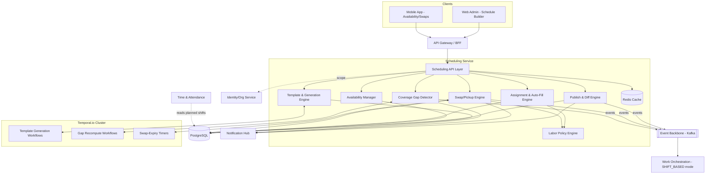
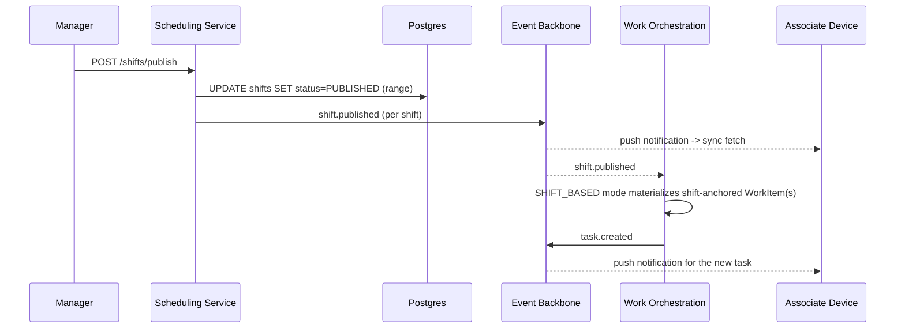
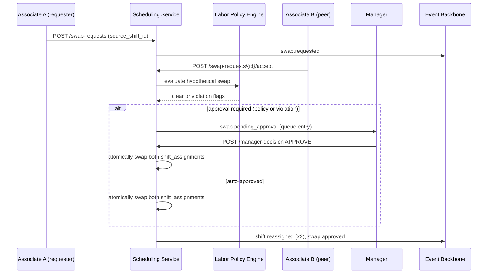
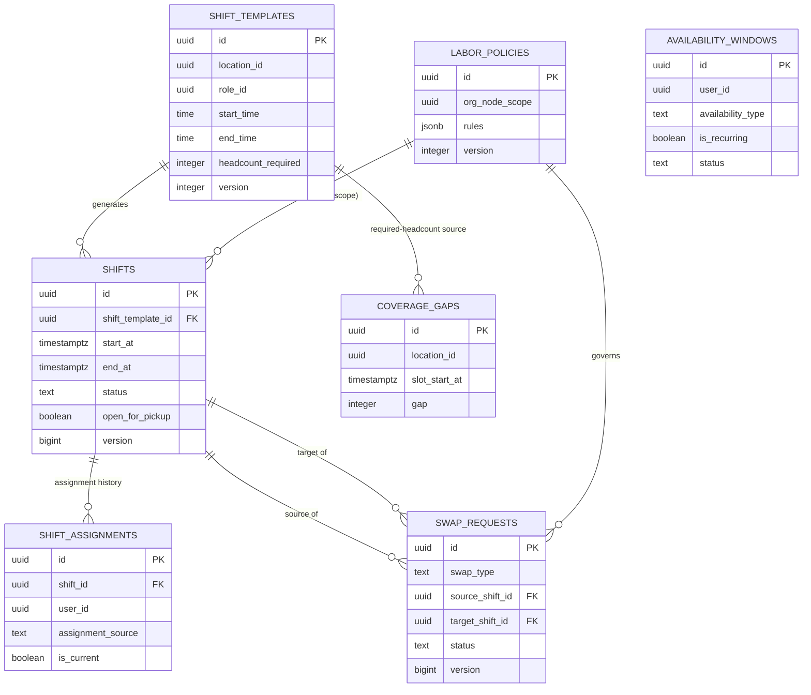
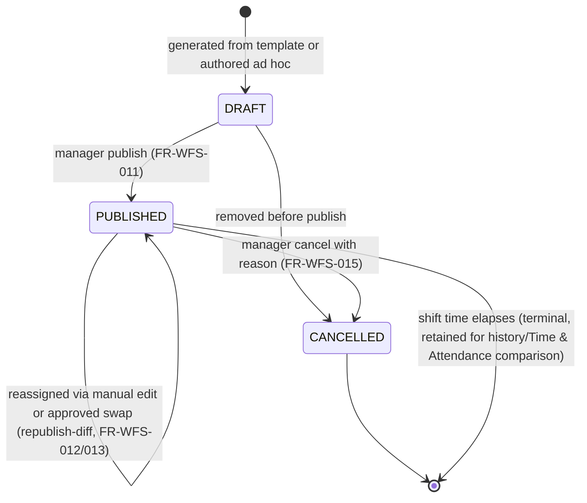
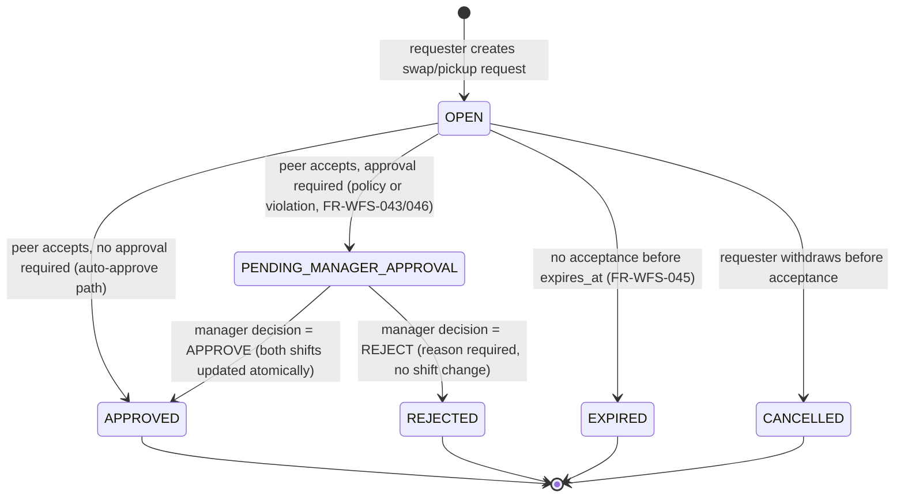

# Workforce Scheduling & Labor Management — Architecture Diagrams

## 1. Component Diagram

The Scheduling API layer fronts six engines sharing one Postgres store: **Template & Generation**
(expands `ShiftTemplate`s into `DRAFT` `Shift` rows via a per-template Temporal workflow), **Publish &
Diff** (owns the `DRAFT → PUBLISHED` transition and the changes-since-last-publish view), **Availability
Manager** (recurring/one-off/time-off windows), **Assignment & Auto-Fill** (manual and rule-based
assignment, delegating validation to the **Labor Policy Engine**), **Swap/Pickup** (the full
swap-request lifecycle, also policy-gated), and the **Coverage Gap Detector** (near-real-time gap
recomputation via per-location/role Temporal workflows). This service is intentionally a peer of, not
a subordinate to, Work Orchestration: the only coupling is the `shift.*` event contract flowing one
way into Work Orchestration's `SHIFT_BASED` schedule mode, and a narrow read API that Time &
Attendance uses for its planned-vs-actual comparison.

## 2. Sequence Diagram — Publish to Work Orchestration Consumption

Publishing is the single event that turns a roster plan into two independent, asynchronous
downstream effects: the associate sees their shift, and Work Orchestration anchors whatever
checklist/task work belongs to that shift. Neither downstream effect blocks the publish response —
the manager's publish call returns as soon as the `Shift` rows are committed and the events are
handed to the outbox/Kafka producer.

## 3. Sequence Diagram — Swap Request to Both-Shift Update

A swap only ever resolves through one of two paths — auto-approval or explicit manager approval —
but both paths converge on the same atomic both-shifts update, so the eventual `shift.reassigned`
events (and the resulting Work Orchestration re-materialization, if applicable) are identical
regardless of which approval path was taken. Full branch detail, including rejection and the
labor-law-forced-approval case, is in `low-level-design.md` §3.2.

## 4. ER Diagram

`Shift` is the hub entity, generated from `ShiftTemplate` (or authored ad hoc) and pointing forward
to its current and historical `ShiftAssignment` rows. `SwapRequest` references `Shift` twice (source
and, for a `SWAP` type, target) rather than owning assignment state itself — the actual assignment
change only happens through `ShiftAssignment` inserts once a swap resolves, keeping one single
source of truth for "who is on this shift right now." `LaborPolicy` is scoped by `OrganizationNode`
subtree (`org_node_scope`), a narrower axis than tenant isolation, and is evaluated — never stored
as a denormalized flag — against both `Shift` assignment and `SwapRequest` acceptance. `CoverageGap`
is a derived, incrementally-maintained table rather than a pure computed view, trading a small
write-amplification cost for the sub-minute read freshness the coverage-gap UX needs.

## 5. State Diagram — Shift Lifecycle

A `Shift` has a deliberately small state set compared to `WorkItem` — it models a roster slot, not
an executable unit of work, so it has no `IN_PROGRESS`/`SUBMITTED`/`VERIFIED` concept of its own;
whatever execution state exists during the shift belongs to the `WorkItem`(s) Work Orchestration
materializes against it. `PUBLISHED → PUBLISHED` self-loops represent in-place changes (reassignment,
swap resolution) that do not change the shift's top-level status but do trigger the diff/notification
machinery (functional-spec §4) and, when the assignee changes, a `shift.reassigned` event.

## 6. State Diagram — Swap Request Lifecycle

Only two paths reach `APPROVED` — direct auto-approval from `OPEN`, or explicit manager approval from
`PENDING_MANAGER_APPROVAL` — and both apply the identical atomic both-shift update (low-level-design
§6). A labor-law violation detected at acceptance time (FR-WFS-046) forces the `OPEN →
PENDING_MANAGER_APPROVAL` transition even under a tenant policy that would otherwise auto-approve,
which is why that edge is drawn unconditionally from `OPEN` rather than gated purely by the
tenant-level `SwapApprovalPolicy` setting. `REJECTED`, `EXPIRED`, and `CANCELLED` are all terminal
with no shift-side effect, preserving the original assignment unchanged.
