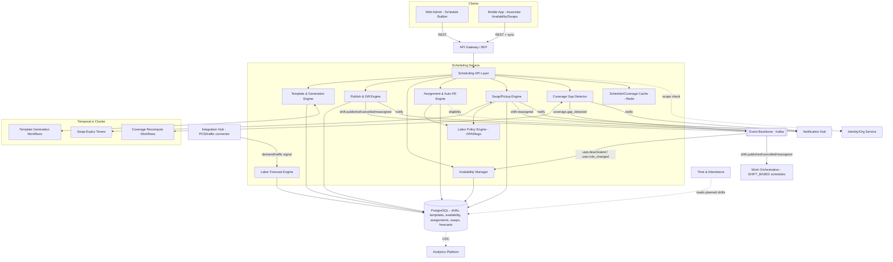

# Workforce Scheduling & Labor Management — High-Level Design

## 1. Module Responsibilities and Boundaries

The **Scheduling Service** owns everything about *who works when*: `ShiftTemplate`, `Shift`,
`AvailabilityWindow`, `ShiftAssignment`, `SwapRequest`, `LaborForecast`, and the labor-law policy
engine that governs assignment/swap validity.

**This is a different thing from Work Orchestration's Scheduling Engine, and the two must never be
conflated.** Work Orchestration's Scheduling Engine (see module 02 HLD §1/§5) decides *when a
`WorkItem` (a unit of work — a checklist, an audit, a task) is materialized*, across eight schedule
modes including `SHIFT_BASED`. This module's Scheduling Service decides *when a person is rostered
to be physically/operationally present*. The relationship is one-directional and event-mediated:
this module publishes `Shift` instances; Work Orchestration's `SHIFT_BASED` schedule mode subscribes
to them as its materialization anchor. Neither service reads the other's primary tables directly —
they integrate only through the published event contract (§4). A useful mental shorthand: **the
Scheduling Service schedules the roster; the Scheduling Engine schedules the checklist.**

Out of scope for this service (owned elsewhere, referenced by ID): employee/role/location identity
(Identity/Org), actual clock-in/out and timesheets (Time & Attendance), payroll computation
(Integration Hub payroll connectors, fed from Time & Attendance), and the `WorkItem` abstraction and
its state machine (Work Orchestration) in its entirety.

## 2. Component Diagram

## 3. Data Ownership

| Entity | Owner | Notes |
|---|---|---|
| `ShiftTemplate` | Scheduling Service | Reusable recurring definition |
| `Shift` | Scheduling Service | Concrete instance; full lifecycle owner (`DRAFT → PUBLISHED → …`) |
| `AvailabilityWindow` | Scheduling Service | Recurring + one-off + time-off, all one entity family |
| `ShiftAssignment` | Scheduling Service | Current + historical (append-only) assignment pointer per `Shift` |
| `SwapRequest` | Scheduling Service | Full swap/pickup lifecycle |
| `LaborForecast` | Scheduling Service | Rule-based MVP forecast rows |
| `LaborPolicy` | Scheduling Service | Tenant/jurisdiction-scoped rest-period/overtime rule set |
| `OrganizationNode`, `UserScope`, `Role`, `User` | Identity/Org (referenced) | Read-only reference for eligibility, timezone, scope |
| `WorkItem` | Work Orchestration (referenced) | Never read/written by this module; integration is event-only |
| `TimeClockEvent`, `Timesheet` | Time & Attendance (referenced) | This module is upstream of, and does not read, that data |

## 4. External Interfaces

### 4.1 Events Produced

`shift.published`, `shift.cancelled`, `shift.reassigned`, `shift.assignment_created`,
`availability.window_changed`, `swap.requested`, `swap.accepted`, `swap.approved`, `swap.rejected`,
`swap.expired`, `coverage.gap_detected`, `coverage.gap_resolved`, `forecast.generated`.

All emitted in the platform-standard envelope (`event_id`, `event_type`, `version`, `tenant_id`,
`occurred_at`, `actor_id`, `resource_id`, `trace_id`, `data`) per conventions.md.

`shift.published` and `shift.cancelled` are the two events with a hard downstream contract: Work
Orchestration's `SHIFT_BASED` schedule mode treats `shift.published` as the trigger to materialize
shift-anchored `WorkItem`s and `shift.cancelled` as the trigger to cancel not-yet-`IN_PROGRESS`
`WorkItem`s tied to that shift (mirroring FR-WORK-098's location-closure precedent). The event
`data` payload for both includes `shift_id`, `location_id`, `role_id`, `assignee_user_id`,
`start_at`, `end_at` (all UTC) — the minimum Work Orchestration needs to anchor materialization
without a synchronous callback into this service.

### 4.2 Events Consumed

`user.deactivated`, `user.role_changed`, `location.hours_changed`, `location.closed`,
`location.reopened` (Identity/Org — drive eligibility-loss handling, FR-WFS-097, and
open/closing-relative coverage recomputation); POS/traffic-volume events from Integration Hub
connectors feeding `LaborForecast` generation (FR-WFS-070).

### 4.3 Synchronous APIs

REST under `/api/v1/shift-templates`, `/api/v1/shifts`, `/api/v1/availability`,
`/api/v1/swap-requests`, `/api/v1/coverage-gaps`, `/api/v1/labor-forecasts` (see Low-Level Design).
Internal gRPC calls to Identity/Org for scope/eligibility resolution on the assignment/auto-fill/
swap-eligibility hot path where a cached copy is unavailable. Time & Attendance reads this module's
`Shift`/`ShiftAssignment` data via a narrow read API (`GET /api/v1/shifts?location_id=&date_range=`)
rather than direct table access, preserving service boundary even for a same-org downstream consumer.

## 5. Scalability Approach

**Target:** consistent with the platform-wide 100k-location scale NFR (source-spec §23). A typical
location generates 50–500 `Shift` rows/week (a handful of `ShiftTemplate`s × headcount × days); at
100k locations this is on the order of tens of millions of `Shift` rows/week platform-wide at full
scale — high-cardinality but bounded and far below Work Orchestration's per-WorkItem volume, so this
module does not need the same aggressive rolling-window materialization discipline, though it reuses
the same architectural pattern for consistency and future headroom:

- **Partitioning.** `shifts`, `shift_assignments`, and `availability_windows` are partitioned by
  `tenant_id_bucket = hash(tenant_id) % N` (list partition) then range-partitioned by `start_at`
  monthly, identical scheme to Work Orchestration's `work_items` table, so the same operational
  tooling (partition management, archival jobs) is reused across modules.
- **Template generation as a bounded rolling window.** Like Work Orchestration's recurrence
  materializer, `ShiftTemplate` expansion into concrete `Shift` rows runs on a rolling window
  (default 28 days ahead, tenant-configurable) rather than generating an unbounded series at
  authoring time — this keeps manual edits to a template cleanly scoped to not-yet-generated shifts
  and bounds table growth. Implemented as one Temporal workflow per `(template_id)` (workflow-per-
  series pattern, mirroring Work Orchestration's `TWF`).
- **Coverage-gap recomputation.** Rather than a location-wide nightly batch, gap recomputation is
  triggered incrementally per `(location_id, role_id, date)` bucket on any event that could change
  its answer (assignment created/removed, availability changed, template headcount changed),
  keeping NFR-WFS-03's 60-second freshness target without a full sweep; a defensive nightly
  reconciliation sweep catches any bucket that missed an incremental trigger (event delivery gaps),
  mirroring Work Orchestration's "defensive cron alongside event-driven path" pattern.
- **Publish as a single-location synchronous operation, bulk-publish as a job.** A single manager's
  weekly publish (tens of shifts) is synchronous (NFR-WFS-02); a corporate bulk action across many
  locations (e.g., "publish all locations in region for next week") runs as a background batch job
  emitting per-location results, avoiding a long-held HTTP request across thousands of locations.
- **Horizontal scaling.** Scheduling API pods are stateless and scale independently of the Temporal
  worker pools handling template generation and gap recomputation, so a burst of manager schedule-
  editing traffic does not starve background generation/recomputation throughput, or vice versa.

## 6. Multi-Tenancy

Every table carries `tenant_id`; Postgres RLS policies enforce isolation as the defense-in-depth
backstop behind application-layer scoping, per the platform-wide convention. `LaborPolicy` rows are
additionally scoped by `OrganizationNode` subtree for jurisdiction-specific rest-period/overtime
rules (FR-WFS-083) — this is a second, narrower scoping axis layered on top of tenant isolation, not
a replacement for it. Kafka messages carry `tenant_id` in both key and envelope; Temporal workflow
IDs are namespaced `{tenant_id}:shift-template:{template_id}` / `{tenant_id}:gap:{location_id}:
{role_id}`. Redis cache keys are prefixed `tenant_id:`.

## 7. Failure Modes and Degradation

| Failure | Impact | Degradation Strategy |
|---|---|---|
| Temporal cluster outage | Template generation and scheduled gap-recompute sweeps pause; swap-expiry timers cannot be newly scheduled or fired | Manual shift authoring, assignment, publish, and swap request/accept/approve continue to function directly against Postgres (Temporal is off the interactive read/write path). On recovery, generation/expiry workflows resume from durable history. A circuit breaker prevents API calls from blocking on Temporal availability. |
| Identity/Org scope service slow/unavailable | Eligibility checks on assignment/auto-fill/swap-eligibility degrade | Short-TTL Redis cache of recent scope resolutions serves most lookups; uncached checks fail closed (deny assignment) rather than open, consistent with tenant-isolation-first posture |
| Kafka backbone unavailable | Work Orchestration stops receiving `shift.published`/`shift.cancelled`; Notification Hub stops receiving swap/coverage alerts | Scheduling Service continues to accept writes and commit to Postgres; transactional outbox + relay buffers events for replay once Kafka recovers — publishing a schedule is never blocked on Kafka availability, but Work Orchestration's shift-anchored WorkItem materialization lags until the backlog drains |
| Postgres primary failure | Full write unavailability for Scheduling Service | Standard managed-Postgres failover; read replicas continue serving schedule-view/coverage reads in a brief read-only degraded mode |
| Labor Policy Engine (OPA) evaluation failure/timeout | Assignment/swap validation cannot resolve pass/fail | Fail closed for `HARD_BLOCK`-class rule sets (deny the action, surface a retry) — never silently skip labor-law validation; `WARN_OVERRIDE`-class checks degrade to "warning unavailable, proceed with caution" banner rather than blocking, since those are advisory by design |
| Integration Hub demand-signal feed unavailable | `LaborForecast` generation falls back to pure historical-hours seasonality (FR-WFS-070's fallback path) | Forecast quality degrades gracefully rather than failing; forecast rows are still generated, flagged `signal_source=INTERNAL_ONLY` so managers know external demand data was unavailable for that run |

## 8. Technology Choices (Justified)

- **Temporal.io for template generation and swap-expiry timers**, reusing the exact durable-workflow
  pattern established in Work Orchestration (module 02 HLD §8) rather than inventing a second
  scheduling primitive: template generation is a long-running, self-resuming per-series process
  (same shape as recurrence materialization), and swap expiry is a durable timer that must survive
  process restarts without a polling sweep — both are Temporal's core design target, and reusing the
  same cluster/pattern keeps operational tooling and on-call runbooks shared across modules.
- **PostgreSQL** as authoritative store (platform convention) — shift/assignment/swap data is
  relational with strong consistency needs (double-booking prevention, optimistic concurrency on
  swap acceptance races) and no operational reason to introduce a second OLTP store.
- **OPA/Rego for the Labor Policy Engine**, reusing the platform's existing policy-engine choice
  (conventions.md — OPA already selected for Agent Runtime action policy) rather than a bespoke rule
  interpreter: rest-period/overtime/minor-labor rules are exactly the kind of declarative, versioned,
  testable boolean policy Rego is designed for, and jurisdiction-specific rule sets can be authored,
  tested, and deployed independently of application code releases — critical given how often these
  rules vary and change by state/country.
- **Redis** for the schedule-view and coverage-gap read caches — sub-millisecond reads for the
  manager week-grid and the associate's "my shifts" view, standard platform cache choice, same
  invalidate-on-event pattern as Work Orchestration's Today-list cache.
- **Kafka** for all cross-module signaling (platform convention), most critically the
  `shift.published`/`shift.cancelled` contract with Work Orchestration — this is the single most
  important integration point in this module's design and is deliberately asynchronous/event-driven
  rather than a synchronous API call, so Work Orchestration's materialization throughput is decoupled
  from this module's publish-request latency, and so a Work Orchestration outage does not block a
  manager from publishing a schedule.
