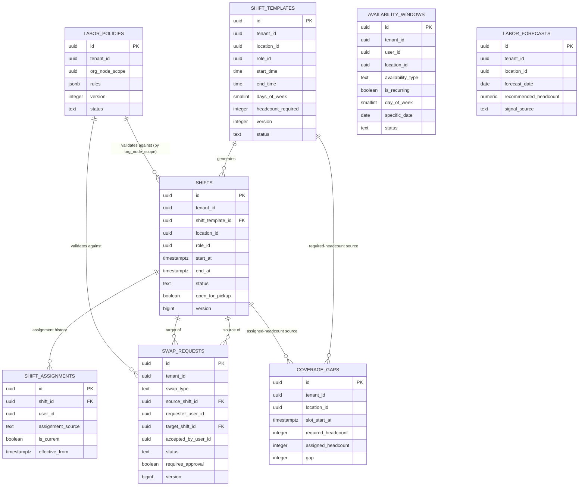
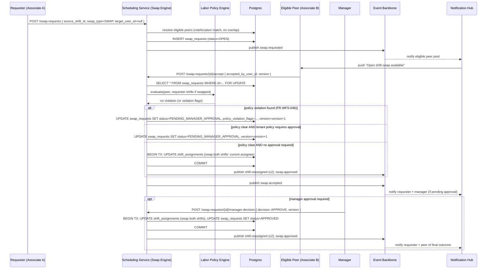
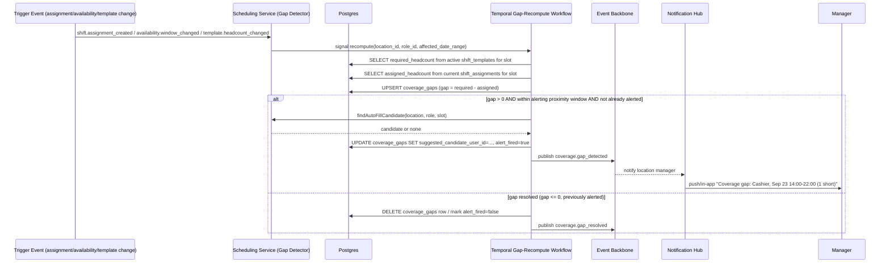

# Workforce Scheduling & Labor Management — Low-Level Design

## 1. Postgres Schema

### 1.1 Tables

**shift_templates**

| Column | Type | Notes |
|---|---|---|
| id | uuid PK | |
| tenant_id | uuid | |
| location_id | uuid | ref to `OrganizationNode` (Identity/Org, not enforced cross-service FK) |
| role_id | uuid, nullable | ref to `Role`; null = role-agnostic template |
| name | text | |
| start_time | time | local wall-clock |
| end_time | time | local wall-clock; may be < start_time (midnight-spanning, FR-WFS-091) |
| days_of_week | smallint | bitmask, bit0=Mon..bit6=Sun |
| break_rules | jsonb | `[{type, duration_minutes, earliest_offset_minutes, latest_offset_minutes}]` |
| headcount_required | integer | default 1 |
| labor_cost_weight | numeric(5,2), nullable | auto-fill priority hint |
| generation_window_days | integer | default 28 |
| high_water_mark | timestamptz, nullable | last generated-through instant, per FR-WFS generation job |
| status | text | `ACTIVE, PAUSED, ARCHIVED` |
| version | integer | template versioning (FR-WFS-004); shifts store the version they were generated from |
| created_by, created_at, updated_at | | |

Unique-ish guard: no hard DB uniqueness constraint (multiple overlapping templates at a location are
legitimate — coverage aggregates across them, FR-WFS-050).

**shifts**

| Column | Type | Notes |
|---|---|---|
| id | uuid PK | |
| tenant_id | uuid | partition key |
| tenant_id_bucket | smallint | generated `hash(tenant_id) % 64` |
| shift_template_id | uuid, nullable FK -> shift_templates | null for ad hoc shifts authored directly |
| location_id | uuid | |
| role_id | uuid, nullable | |
| start_at | timestamptz | UTC, resolved from location-local wall-clock at generation time |
| end_at | timestamptz | UTC; may cross a calendar day (FR-WFS-091) |
| display_date | date | the calendar date this shift is grouped under for UI (FR-WFS-091 tenant-configurable) |
| break_rules_snapshot | jsonb | copied from template at generation time (immutability, FR-WFS-004) |
| headcount_required | integer | copied from template at generation time |
| status | text | `DRAFT, PUBLISHED, CANCELLED` |
| open_for_pickup | boolean | default false (FR-WFS-034) |
| labor_policy_snapshot_id | uuid, nullable | which `LaborPolicy` version was evaluated at last validation |
| published_at | timestamptz, nullable | |
| cancelled_at, cancel_reason | timestamptz / text, nullable | |
| version | bigint | optimistic concurrency counter |
| created_at, updated_at | timestamptz | |

Partitioned by LIST(`tenant_id_bucket`) then RANGE(`start_at`) monthly, mirroring `work_items`.
Indexes: `(tenant_id, location_id, status, start_at)`, `(shift_template_id)`,
`(tenant_id, open_for_pickup, location_id, start_at)` partial where `open_for_pickup=true`.

**shift_assignments** (current pointer + append-only history, one row per assignment event)

| Column | Type | Notes |
|---|---|---|
| id | uuid PK | |
| tenant_id | uuid | |
| shift_id | uuid FK -> shifts | |
| user_id | uuid | ref to `User` |
| assignment_source | text | `MANUAL, AUTO_FILL, SWAP, PICKUP, SYSTEM_MIGRATION` |
| is_current | boolean | exactly one `is_current=true` row per active `shift_id` |
| assigned_by | uuid, nullable | actor; null for system/auto-fill |
| reason | text, nullable | |
| effective_from | timestamptz | |
| superseded_at | timestamptz, nullable | set when a later assignment replaces this row |
| created_at | timestamptz | |

Unique partial index `(shift_id) WHERE is_current`. Index `(user_id, effective_from desc)` for "my
shift history" and double-booking checks (FR-WFS-090/033).

**availability_windows**

| Column | Type | Notes |
|---|---|---|
| id | uuid PK | |
| tenant_id | uuid | |
| user_id | uuid | |
| location_id | uuid, nullable | null = applies to all of the user's eligible locations (FR-WFS-024) |
| availability_type | text | `AVAILABLE, PREFERRED, UNAVAILABLE, TIME_OFF` |
| is_recurring | boolean | |
| day_of_week | smallint, nullable | set when `is_recurring=true` |
| specific_date | date, nullable | set when `is_recurring=false` |
| start_time, end_time | time, nullable | null start/end = full-day |
| status | text | `ACTIVE` (default; non-time-off types), or `PENDING/APPROVED/DENIED` for `TIME_OFF` |
| approved_by, approved_at | uuid / timestamptz, nullable | time-off approval (FR-WFS-022) |
| created_at, updated_at | timestamptz | |

Index `(tenant_id, user_id, is_recurring, day_of_week)`, `(tenant_id, user_id, specific_date)`.

**swap_requests**

| Column | Type | Notes |
|---|---|---|
| id | uuid PK | |
| tenant_id | uuid | |
| swap_type | text | `SWAP, PICKUP` |
| source_shift_id | uuid FK -> shifts | the shift the requester wants to give up |
| requester_user_id | uuid | |
| target_shift_id | uuid, nullable FK -> shifts | set for `SWAP` when requester names a specific peer's shift to trade for |
| target_user_id | uuid, nullable | set for a targeted request; null = open/broadcast |
| accepted_by_user_id | uuid, nullable | who accepted (may differ from `target_user_id` for open requests) |
| status | text | `OPEN, PENDING_MANAGER_APPROVAL, APPROVED, REJECTED, EXPIRED, CANCELLED` |
| requires_approval | boolean | resolved from `SwapApprovalPolicy` at request creation, re-checked at accept time |
| policy_violation_flags | jsonb, nullable | populated if acceptance would trip a `LaborPolicy` rule (FR-WFS-046) |
| approved_by, approved_at | uuid / timestamptz, nullable | |
| rejected_by, rejected_at, rejection_reason | uuid / timestamptz / text, nullable | |
| expires_at | timestamptz | default `min(shift.start_at, created_at + 48h)` |
| version | bigint | optimistic concurrency for accept race (FR-WFS-095) |
| created_at, updated_at | timestamptz | |

Index `(tenant_id, status, expires_at)` (expiry sweep), `(target_user_id, status)`,
`(source_shift_id)`.

**labor_policies**

| Column | Type | Notes |
|---|---|---|
| id | uuid PK | |
| tenant_id | uuid | |
| org_node_scope | uuid | `OrganizationNode` subtree this policy applies to (FR-WFS-083) |
| name | text | |
| rules | jsonb | array: `[{rule_type, enforcement_mode, params}]` — see §4.2 for rule_type catalog |
| version | integer | |
| status | text | `DRAFT, ACTIVE, RETIRED` |
| created_at, updated_at | | |

**labor_forecasts**

| Column | Type | Notes |
|---|---|---|
| id | uuid PK | |
| tenant_id | uuid | |
| location_id | uuid | |
| role_id | uuid, nullable | |
| forecast_date | date | |
| recommended_headcount | numeric(6,2) | |
| estimated_labor_hours | numeric(8,2) | |
| signal_source | text | `INTERNAL_ONLY, POS_INTEGRATED, TRAFFIC_INTEGRATED` |
| generated_at | timestamptz | |
| model_version | text | rule-set version identifier (MVP: rule-based, not a trained model artifact) |

Unique `(tenant_id, location_id, role_id, forecast_date, model_version)`.
Index `(tenant_id, location_id, forecast_date)`.

**coverage_gaps** (materialized, incrementally recomputed — not derived purely on read, for the
freshness/query-latency reasons in HLD §5)

| Column | Type | Notes |
|---|---|---|
| id | uuid PK | |
| tenant_id | uuid | |
| location_id | uuid | |
| role_id | uuid, nullable | |
| slot_start_at, slot_end_at | timestamptz | the time-slot bucket this gap row describes |
| required_headcount | integer | |
| assigned_headcount | integer | |
| gap | integer | generated `required_headcount - assigned_headcount`, only rows with `gap > 0` retained |
| alert_fired | boolean | whether `coverage.gap_detected` has been emitted for this row (dedupe) |
| suggested_candidate_user_id | uuid, nullable | best auto-fill candidate if one exists (FR-WFS-053) |
| computed_at | timestamptz | |

Index `(tenant_id, location_id, slot_start_at)`.

### 1.2 ER Diagram



## 2. REST Endpoints

All under `/api/v1/`, OAuth2/OIDC bearer, `Idempotency-Key` required on POST/PATCH, `ETag`/`version`
optimistic concurrency, cursor pagination, standard error envelope
`{"error":{"code","message","trace_id"}}`.

### 2.1 Create a shift template

`POST /api/v1/shift-templates`
```json
{
  "location_id": "loc_9a1",
  "role_id": "role_cashier",
  "name": "Weekday Morning Cashier",
  "start_time": "06:00",
  "end_time": "14:00",
  "days_of_week": 31,
  "break_rules": [
    { "type": "UNPAID", "duration_minutes": 30, "earliest_offset_minutes": 180, "latest_offset_minutes": 300 }
  ],
  "headcount_required": 2
}
```
Response `201`:
```json
{ "id": "tmpl_771", "status": "ACTIVE", "version": 1, "created_at": "2026-09-19T14:00:00Z" }
```
Errors: `422 INVALID_BREAK_RULE` (FR-WFS-003), `400 VALIDATION_ERROR`, `403 SCOPE_DENIED`.

### 2.2 Generate + publish a schedule for a range

`POST /api/v1/shifts/generate`
```json
{ "location_id": "loc_9a1", "from_date": "2026-09-22", "to_date": "2026-09-28", "template_ids": ["tmpl_771"] }
```
Response `200`:
```json
{ "generated_count": 12, "shift_ids": ["shift_1", "shift_2"], "status": "DRAFT" }
```

`POST /api/v1/shifts/publish`
```json
{ "location_id": "loc_9a1", "from_date": "2026-09-22", "to_date": "2026-09-28", "acknowledge_open_gaps": false }
```
Response `200`:
```json
{
  "published_count": 12,
  "diff": {
    "added": ["shift_1", "shift_2"],
    "modified": [{ "shift_id": "shift_9", "change": "time_changed", "before": {"start_at":"..."}, "after": {"start_at":"..."} }],
    "removed": []
  }
}
```
Response `409 OPEN_COVERAGE_GAPS` (if gaps exist and `acknowledge_open_gaps=false`):
```json
{
  "error": { "code": "OPEN_COVERAGE_GAPS", "message": "3 coverage gaps in this range", "trace_id": "t-1",
    "conflict": { "gap_count": 3, "gap_ids": ["gap_1","gap_2","gap_3"] } }
}
```
Re-submitting with `acknowledge_open_gaps=true` publishes anyway and audit-logs the acknowledgement
(FR-WFS-098).

### 2.3 Assign / auto-fill

`POST /api/v1/shifts/{id}/assign`
```json
{ "user_id": "usr_552", "assignment_source": "MANUAL", "override_reason": null }
```
Response `200`:
```json
{ "shift_id": "shift_1", "user_id": "usr_552", "version": 2, "warnings": ["conflicting_availability"] }
```
Response `409 DOUBLE_BOOKED`:
```json
{ "error": { "code": "DOUBLE_BOOKED", "message": "User already assigned an overlapping shift", "trace_id": "t-2",
  "conflict": { "conflicting_shift_id": "shift_7" } } }
```
Response `422 LABOR_POLICY_VIOLATION` (hard block):
```json
{ "error": { "code": "LABOR_POLICY_VIOLATION", "message": "Minimum 10-hour rest period not met",
  "trace_id": "t-3", "conflict": { "rule_type": "MIN_REST_PERIOD", "required_hours": 10, "actual_hours": 6.5 } } }
```

`POST /api/v1/shifts/auto-fill`
```json
{ "location_id": "loc_9a1", "from_date": "2026-09-22", "to_date": "2026-09-28" }
```
Response `200`:
```json
{
  "filled": [{ "shift_id": "shift_3", "user_id": "usr_118", "rank_score": 0.92 }],
  "unfilled": [{ "shift_id": "shift_4", "reason": "NO_ELIGIBLE_CANDIDATE" }]
}
```

### 2.4 Set availability

`PUT /api/v1/availability`
```json
{
  "user_id": "usr_552",
  "is_recurring": true,
  "day_of_week": 2,
  "availability_type": "PREFERRED",
  "start_time": "08:00",
  "end_time": "16:00",
  "location_id": null
}
```
Response `201`: `{ "id": "avail_88", "created_at": "2026-09-19T10:00:00Z" }`

`POST /api/v1/availability/time-off`
```json
{ "user_id": "usr_552", "specific_date": "2026-10-01", "end_date": "2026-10-03", "reason": "Personal" }
```
Response `201`: `{ "id": "avail_99", "status": "PENDING" }`

`POST /api/v1/availability/time-off/{id}/decision`
```json
{ "decision": "APPROVED" }
```
Response `200`: `{ "id": "avail_99", "status": "APPROVED" }`

### 2.5 Request / accept / approve a swap

`POST /api/v1/swap-requests`
```json
{ "swap_type": "SWAP", "source_shift_id": "shift_1", "target_user_id": null }
```
Response `201`: `{ "id": "swap_44", "status": "OPEN", "expires_at": "2026-09-21T00:00:00Z" }`

`POST /api/v1/swap-requests/{id}/accept`
```json
{ "accepted_by_user_id": "usr_118", "version": 0 }
```
Response `200` (no approval required, `CROSS_LOCATION_ONLY` policy, same location):
```json
{ "id": "swap_44", "status": "APPROVED", "shifts_updated": ["shift_1"] }
```
Response `200` (approval required):
```json
{ "id": "swap_44", "status": "PENDING_MANAGER_APPROVAL" }
```
Response `409 ALREADY_ACCEPTED`:
```json
{ "error": { "code": "ALREADY_ACCEPTED", "message": "Swap already accepted by another user",
  "trace_id": "t-4", "conflict": { "accepted_by_user_id": "usr_205" } } }
```

`POST /api/v1/swap-requests/{id}/manager-decision`
```json
{ "decision": "APPROVE", "version": 1 }
```
Response `200`:
```json
{ "id": "swap_44", "status": "APPROVED", "shifts_updated": ["shift_1", "shift_9"] }
```

### 2.6 Get coverage gaps

`GET /api/v1/coverage-gaps?location_id=loc_9a1&from=2026-09-22&to=2026-09-28`

Response `200`:
```json
{
  "items": [
    {
      "id": "gap_1",
      "location_id": "loc_9a1",
      "role_id": "role_cashier",
      "slot_start_at": "2026-09-23T14:00:00Z",
      "slot_end_at": "2026-09-23T22:00:00Z",
      "required_headcount": 2,
      "assigned_headcount": 1,
      "gap": 1,
      "suggested_candidate_user_id": "usr_331"
    }
  ],
  "next_cursor": null
}
```

## 3. Sequence Diagrams

### 3.1 Schedule publish → notification → Work Orchestration shift-instance consumption

```mermaid
sequenceDiagram
    participant MGR as Manager (Web Admin)
    participant SS as Scheduling Service
    participant PG as Postgres
    participant KAFKA as Event Backbone
    participant NOTIF as Notification Hub
    participant DEV as Associate Device
    participant WO as Work Orchestration (Scheduling Engine)

    MGR->>SS: POST /shifts/publish (location, date range)
    SS->>PG: SELECT last-publish snapshot; compute diff
    SS->>PG: BEGIN TX: UPDATE shifts SET status=PUBLISHED, published_at=now() WHERE status=DRAFT AND range matches
    PG-->>SS: committed
    SS->>KAFKA: publish shift.published (one event per shift)
    SS-->>MGR: 200 { published_count, diff }
    KAFKA-->>NOTIF: shift.published (assignee resolved)
    NOTIF->>DEV: push "Your schedule for Sep 22-28 is published"
    DEV->>SS: GET /shifts?assignee=me&updated_since=...
    SS-->>DEV: shifts[] incl. published items
    KAFKA-->>WO: shift.published (shift_id, location_id, role_id, assignee_user_id, start_at, end_at)
    WO->>WO: SHIFT_BASED schedule mode: materialize shift-anchored WorkItem(s) anchored to shift boundaries
    WO->>KAFKA: publish task.created (for the materialized WorkItem)
    KAFKA-->>NOTIF: task.created
    NOTIF->>DEV: push "New task assigned for your shift"
```

### 3.2 Swap request → peer accept → manager approval → both shifts updated



### 3.3 Coverage-gap detection



## 4. Algorithms / Pseudocode

### 4.1 Auto-fill / basic labor-cost-aware assignment

```
function autoFill(location_id, from_date, to_date):
    unassigned_shifts = SELECT * FROM shifts
                         WHERE location_id = location_id AND status = DRAFT
                           AND start_at BETWEEN from_date AND to_date
                           AND NOT EXISTS (SELECT 1 FROM shift_assignments WHERE shift_id = shifts.id AND is_current)
                         ORDER BY start_at ASC

    results = { filled: [], unfilled: [] }

    for shift in unassigned_shifts:
        candidates = resolveEligibleUsers(shift.location_id, shift.role_id)   # UserScope-based, FR-WFS-060

        scored = []
        for user in candidates:
            if hasOverlappingAssignment(user, shift.start_at, shift.end_at):        # FR-WFS-033/090
                continue
            if exceedsConfiguredWeeklyHoursCap(user, shift):                        # avoid unintended OT
                continue
            policy_result = LaborPolicyEngine.evaluate(user, shift, hypothetical=true)
            if policy_result.hard_block_violated:
                continue                                                            # excluded outright, FR-WFS-031

            availability_score = scoreAvailability(user, shift)   # PREFERRED=3, AVAILABLE=2, unstated=1, UNAVAILABLE=-inf (excluded)
            if availability_score == -inf:
                continue
            cost_score = -blendedHourlyCost(user, shift.role_id)  # lower cost -> higher (less negative) score preferred as tiebreak
            rank_score = (role_match_weight(user, shift.role_id), availability_score, cost_score)
            scored.append((user, rank_score, policy_result.warnings))

        if scored is empty:
            results.unfilled.append({shift_id: shift.id, reason: "NO_ELIGIBLE_CANDIDATE"})
            continue

        best_user, best_score, warnings = max(scored, key=rank_score)
        assign(shift.id, best_user.id, source=AUTO_FILL, warnings=warnings)          # does not publish
        results.filled.append({shift_id: shift.id, user_id: best_user.id, rank_score: best_score})

    return results   # advisory only — manager reviews DRAFT grid before publish, FR-WFS-031
```

Notes:
- Candidate exclusion order matters: hard eligibility/overlap/hard-block-policy exclusions happen
  *before* scoring, so the ranked set only ever contains genuinely assignable candidates — the UI
  never has to explain "why was an ineligible person suggested."
- `blendedHourlyCost` is a simple lookup (base wage rate × any tenant-configured shift-differential
  multiplier for that time window) for MVP — no solver, no multi-shift joint optimization across the
  whole week (that is the deferred ML/optimizer capability, functional-spec §16).

### 4.2 Rest-period / labor-law policy evaluation

```
function evaluate(user, candidate_shift, hypothetical, existing_shifts_override=None):
    policy = resolveLaborPolicy(candidate_shift.location_id)   # walks OrganizationNode parent chain, FR-WFS-083
    existing = existing_shifts_override or currentAssignedShifts(user, window = candidate_shift.start_at +/- 14 days)

    violations = []
    for rule in policy.rules:
        match rule.rule_type:
            case MIN_REST_PERIOD:
                prev_shift = latestShiftEndingBefore(existing, candidate_shift.start_at)
                if prev_shift and (candidate_shift.start_at - prev_shift.end_at) < rule.params.min_hours:
                    violations.append(Violation(rule, actual_hours = elapsed_hours(prev_shift.end_at, candidate_shift.start_at)))
                next_shift = earliestShiftStartingAfter(existing, candidate_shift.end_at)
                if next_shift and (next_shift.start_at - candidate_shift.end_at) < rule.params.min_hours:
                    violations.append(Violation(rule, actual_hours = elapsed_hours(candidate_shift.end_at, next_shift.start_at)))

            case MAX_CONSECUTIVE_DAYS:
                consecutive = countConsecutiveWorkedDays(existing + [candidate_shift])
                if consecutive > rule.params.max_days:
                    violations.append(Violation(rule, actual_days = consecutive))

            case MAX_HOURS_PER_WEEK:
                total = sumHours(existing, week_of(candidate_shift)) + duration(candidate_shift)
                if total > rule.params.max_hours:
                    violations.append(Violation(rule, actual_hours = total))

            case MINOR_HOUR_RESTRICTION:
                if user.is_minor and violatesMinorSchedule(rule.params, existing + [candidate_shift]):
                    violations.append(Violation(rule))

            case MANDATORY_MEAL_BREAK:
                if duration(candidate_shift) >= rule.params.trigger_hours and not hasQualifyingBreak(candidate_shift, rule.params):
                    violations.append(Violation(rule))

    hard = [v for v in violations if v.rule.enforcement_mode == HARD_BLOCK]
    warn = [v for v in violations if v.rule.enforcement_mode == WARN_OVERRIDE]

    return PolicyResult(
        hard_block_violated = len(hard) > 0,
        hard_violations = hard,
        warnings = warn
    )
```

Notes:
- `hypothetical=true` (used by auto-fill and by swap-eligibility pre-checks, FR-WFS-041) evaluates
  against a candidate shift set that has not been committed, so no DB write happens as a side effect
  of scoring/ranking.
- The *same* function is called at manual-assign time (`hypothetical=false`, but evaluation logic
  identical) and again as a final sweep at publish time (FR-WFS-082) against the full to-be-published
  set, since availability or other assignments may have shifted since individual decisions were made.
- Elapsed-hours math (`elapsed_hours`, `duration`) always operates on UTC instants derived from
  location-local wall-clock times, so DST-crossing shifts (FR-WFS-092) compute true elapsed rest/
  work time, not nominal wall-clock difference.

## 5. Caching

- **Manager week-grid cache.** Redis key `schedule:{tenant_id}:{location_id}:{week_start}` →
  serialized shift/assignment grid, TTL 1h, invalidated on any `Shift`/`ShiftAssignment` mutation for
  that location/week (assignment, publish, swap resolution, cancellation).
- **Associate "my shifts" cache.** Redis key `myshifts:{tenant_id}:{user_id}` → serialized list of
  the user's `PUBLISHED` shifts across all eligible locations, TTL 24h, invalidated on
  `shift.published/cancelled/reassigned` naming that user as current or prior assignee — same
  invalidate-on-event pattern as Work Orchestration's Today-list cache.
- **Eligibility/scope cache.** Redis key `scope:{tenant_id}:{user_id}:{location_id}` short TTL
  (5 min), shared pattern with Work Orchestration's scope cache, invalidated on `user.role_changed`.
- **Coverage-gap read cache.** Redis key `gaps:{tenant_id}:{location_id}:{week_start}`, TTL 5 min
  (short, since gaps recompute near-real-time per NFR-WFS-03), invalidated on
  `coverage.gap_detected`/`coverage.gap_resolved` for that location/week.
- **Labor policy resolution cache.** Redis key `laborpolicy:{tenant_id}:{org_node_id}`, TTL 15 min —
  policy resolution (parent-chain walk) is read-heavy (evaluated on every assignment/swap check) and
  changes rarely; invalidated on `LaborPolicy` publish/update for the affected subtree.

## 6. Concurrency Control

- **Optimistic concurrency on `shifts.version`.** Every mutating shift operation (assign, publish,
  cancel) requires the caller's known `version`; zero-row-affected update returns `409 CONFLICT` with
  current server state, identical pattern to Work Orchestration's `work_items.version` handling.
- **Double-booking prevention.** Assignment is guarded both application-side (pre-check query for
  overlapping `is_current` assignments for the target user) and by a database-level exclusion
  constraint: `EXCLUDE USING gist (user_id WITH =, tstzrange(start_at, end_at) WITH &&) WHERE
  (is_current)` on a materialized view/derived table joining `shift_assignments` to `shifts` — the
  application-side check is the fast path (better error message with the conflicting shift named),
  the DB constraint is the correctness backstop against races the application check might miss under
  concurrent requests.
- **Swap-accept race (FR-WFS-095).** `accept` takes `SELECT ... FOR UPDATE` on the `swap_requests`
  row and checks `version`; the loser gets `409 ALREADY_ACCEPTED` naming the winner, mirroring Work
  Orchestration's `CLAIM`-mode race pattern (FR-WORK-099) exactly.
- **Swap approval applying both shifts atomically.** The final assignment swap (FR-WFS-044) executes
  as a single Postgres transaction: two `shift_assignments` inserts (new current rows) + two updates
  (mark prior rows `superseded_at`) + one `swap_requests` status update, all-or-nothing — a partial
  application (one shift updated, the other not) is structurally impossible.
- **Publish-time final policy sweep vs. concurrent edits.** Publish takes a row lock
  (`SELECT ... FOR UPDATE`) on all `shifts` rows in the target range for the duration of the publish
  transaction, so a concurrent assignment edit mid-publish either completes before or waits for the
  publish transaction, preventing a shift from being published against a stale assignment snapshot.

## 7. Background Jobs

| Job | Trigger | Responsibility |
|---|---|---|
| Template generation workflow | Temporal workflow per `shift_template_id` (self-scheduling) | Expands `ShiftTemplate` into `DRAFT` `Shift` rows on the rolling window (§ HLD §5); advances `high_water_mark` transactionally with inserts |
| Coverage gap recompute | Temporal workflow per `(location_id, role_id)`, signaled by relevant events; defensive nightly full sweep per tenant | Maintains `coverage_gaps` rows near-real-time (NFR-WFS-03); nightly sweep catches any bucket that missed an incremental signal |
| Swap expiry sweep | Temporal durable timer per `swap_request_id`, started at request creation with deadline `expires_at` | Transitions unaccepted `OPEN` swaps to `EXPIRED` at deadline (FR-WFS-045); secondary lightweight cron (every 15 min) reconciles any swap past `expires_at` with no running timer (defensive) |
| Availability-conflict reconciliation | Consumes `availability.window_changed` | Re-flags any `PUBLISHED` shift now conflicting with the changed window (FR-WFS-023/093); idempotent per `(shift_id, availability_window_id)` |
| Eligibility-loss reconciliation | Consumes `user.role_changed`, `user.deactivated` | Flags future `PUBLISHED` shifts for a now-ineligible user `NEEDS_ASSIGNMENT` (FR-WFS-097); does not touch past/in-progress shifts |
| Labor forecast generation | Nightly, per location (or on-demand via API) | Computes `LaborForecast` rows from historical hours + optional Integration Hub demand signal (FR-WFS-070/071) |
| Forecast accuracy tracker | Nightly, per location/period | Compares prior `LaborForecast` rows to actual-scheduled (and, once available, actual-worked from Time & Attendance) headcount; writes accuracy metric consumed by Analytics (FR-WFS-072) |
| Archival job | Nightly, per tenant partition | Moves `PUBLISHED`/`CANCELLED` shifts (and superseded `shift_assignments`) older than the tenant retention window to a cold/archive table |

## 8. Error Handling

| Condition | HTTP Status | Error Code | Client Guidance |
|---|---|---|---|
| Version mismatch on shift/swap mutation | 409 | `VERSION_CONFLICT` | Re-fetch current state, reconcile UI, retry if still valid |
| Double-booking (overlapping assignment) | 409 | `DOUBLE_BOOKED` | Show conflicting shift; block assignment |
| Hard-block labor policy violation | 422 | `LABOR_POLICY_VIOLATION` | Show specific rule and values; assignment/swap cannot proceed without an admin policy change |
| Warn-override labor policy violation, no override reason supplied | 400 | `OVERRIDE_REASON_REQUIRED` | Prompt for reason; resubmit with `override_reason` |
| Invalid break rule at template authoring | 422 | `INVALID_BREAK_RULE` | Highlight the offending break rule field |
| Zero/negative shift duration | 400 | `INVALID_SHIFT_DURATION` | Correct start/end time |
| Publish attempted with open coverage gaps, not acknowledged | 409 | `OPEN_COVERAGE_GAPS` | Show gap list; resubmit with `acknowledge_open_gaps=true` or resolve gaps first |
| Swap accept race lost | 409 | `ALREADY_ACCEPTED` | Show accepting peer; remove from open-swap list |
| Swap request not eligible (role/location/overlap) | 403 | `SWAP_INELIGIBLE` | Explain which eligibility check failed |
| Decision on non-pending swap | 409 | `SWAP_NOT_PENDING` | Re-fetch swap state, reconcile UI |
| Target assignee/peer lacks scope | 403 | `SCOPE_DENIED` | Prevent assignment/swap target selection; suggest eligible users |
| Shift/template not found | 404 | `SHIFT_NOT_FOUND` / `TEMPLATE_NOT_FOUND` | Standard not-found handling |
| Location/timezone missing at generation time | 422 | `LOCATION_TIMEZONE_UNRESOLVED` | Generation job skips that location, alerts admin, does not fail the whole run |
| Temporal unavailable on template create | 202 (accepted, deferred) | n/a — template persisted `PENDING_WORKFLOW_START` | Background reconciler starts the workflow once Temporal recovers |
| Labor Policy Engine evaluation timeout | 503 | `POLICY_ENGINE_UNAVAILABLE` | For hard-block-class checks: retry, do not fall back to allow; for warn-only checks: proceed with a "warning unavailable" banner |
| Auto-fill run with zero eligible candidates for a shift | 200 (per-item, not an error) | n/a — `unfilled[].reason = NO_ELIGIBLE_CANDIDATE` | Manager assigns manually or broadens eligibility/availability |
