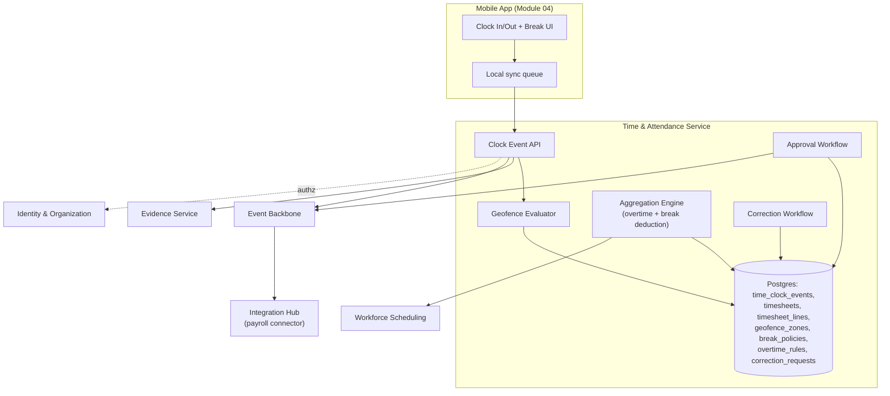
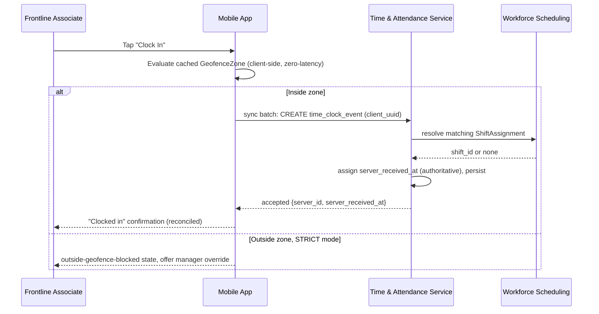
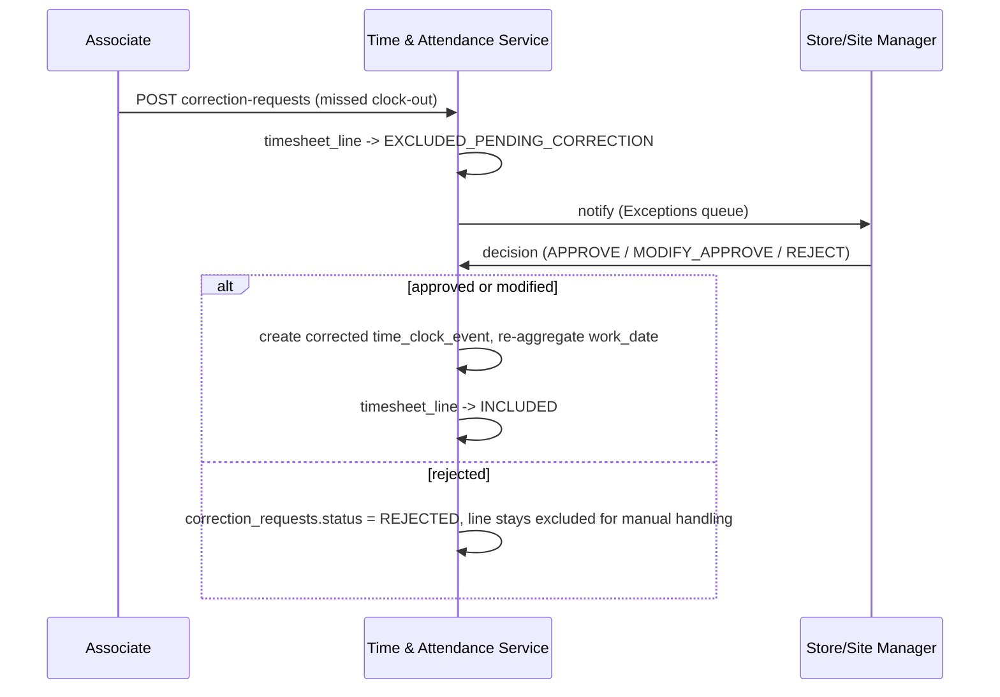
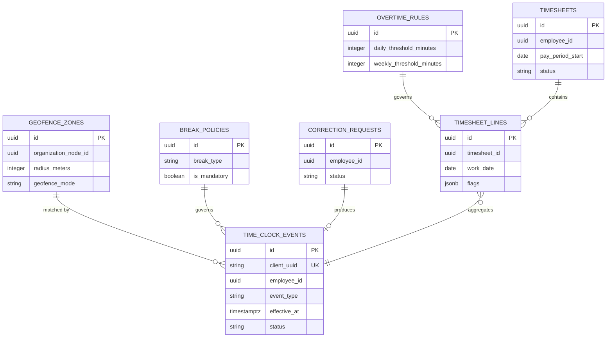

# Time & Attendance — Architecture Diagrams

Focused diagram set for this module only. Prose in `functional-spec.md`,
`high-level-design.md`, and `low-level-design.md` carries the full detail; each diagram here gets
2–4 sentences of narration.

## 1. Component / Container Diagram

This module sits behind the same offline sync ingress as every other captured evidence type: the
mobile client queues clock/break events locally and pushes them through the standard sync batch,
never calling this service synchronously from the capture UI. The Aggregation Engine is the only
component with an outbound dependency on Workforce Scheduling, and it degrades gracefully (HLD §8)
rather than blocking on that dependency. All approval and export outcomes leave the service only as
domain events on the Event Backbone, keeping the Integration Hub's payroll connector fully decoupled
from this service's internal schema.

## 2. Sequence Diagram — Clock-In with Geofence Check (Primary Flow)

The client makes the immediate allow/block decision offline using a cached, versioned copy of the
zone data so the associate is never blocked by a network call; the server re-evaluates on sync as
the authoritative, audit-of-record decision. Workforce Scheduling is consulted for planned-shift
context but a missing/late response never blocks the punch itself — only the informational
planned-vs-actual flag is affected.

## 3. Sequence Diagram — Correction Request to Timesheet Unblock

Only the affected day's `timesheet_line` is blocked while a correction is outstanding (functional-
spec FR-TA-023), not the employee's whole timesheet — this keeps one slow exception from delaying
the rest of a pay period's approvable work. A rejected request leaves the exception visible rather
than silently dropping it, so it surfaces again at approval time for manual resolution.

## 4. ER Diagram

The module's owned entities form a chain from raw capture (`TIME_CLOCK_EVENTS`) through policy
snapshots (`GEOFENCE_ZONES`, `BREAK_POLICIES`, `OVERTIME_RULES`) to aggregated pay-affecting output
(`TIMESHEET_LINES`/`TIMESHEETS`), with `CORRECTION_REQUESTS` as the audited side-channel that can
mutate the raw layer without ever deleting the original record of what actually happened.

## 5. State Diagram — Timesheet Lifecycle

```mermaid
stateDiagram-v2
    [*] --> OPEN
    OPEN --> PENDING_APPROVAL: pay-period cutoff reached / manager opens early
    PENDING_APPROVAL --> APPROVED: all non-blocked lines approved
    PENDING_APPROVAL --> OPEN: correction request raised on a line
    APPROVED --> EXPORTED: payroll export batch succeeds
    APPROVED --> OPEN: manager/HR reopen (pre-export correction)
    EXPORTED --> OPEN: HR/Payroll Admin reopen (post-export correction, emits\ntimesheet.correction_after_export)
    OPEN --> [*]: no terminal exit; timesheet always resolves to EXPORTED for a closed period
```

A timesheet moves forward through review and approval but always keeps a documented way back to
`OPEN` when a correction surfaces — even after export — because source-spec principle P7
(historical truth) requires that a payroll-affecting error be fixed through an audited reopen, never
through a silent edit of an already-approved or already-exported value. The
`correction-requested branch` shown as `PENDING_APPROVAL → OPEN` reflects that a single flagged line
can pull the whole timesheet back a stage without discarding the approval progress already made on
its sibling lines (those remain `APPROVED` at the line level per the LLD schema even while the
parent timesheet reflects `OPEN`).
