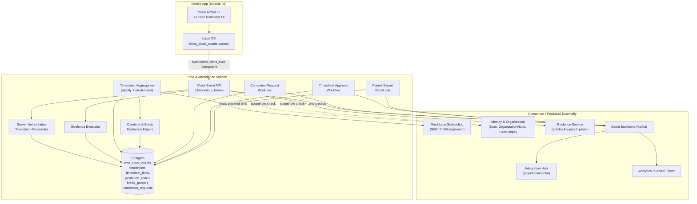

# Time & Attendance — High-Level Design

## 1. Module Responsibilities & Boundaries

The **Time & Attendance Service** owns:

- Capture and server-side authoritative reconciliation of `TimeClockEvent` rows (clock-in,
  clock-out, break-start, break-end), including geofence evaluation and duplicate-punch prevention.
- Configuration of `GeofenceZone` and `BreakPolicy` (and the tenant/`OrganizationNode`-scoped
  `OvertimeRule`, versioned alongside them).
- Aggregation of raw clock events into `Timesheet`/`TimesheetLine` daily/weekly totals, including
  break deduction and overtime computation.
- The `CorrectionRequest` lifecycle for missed/incorrect punches.
- The `Timesheet` approval lifecycle up to and including marking a timesheet `EXPORTED`.
- Producing the exportable timesheet payload and the `timesheet.approved`/`timesheet.exported`
  domain events for the Integration Hub's payroll connector.

It explicitly does **not** own: shift planning (Workforce Scheduling), payroll calculation/tax/pay
statements (external payroll system via Integration Hub), the offline sync transport or local
device database (Mobile & Offline), or employee identity/org scoping (Identity & Organization). It
is a consumer of those, not a re-implementer.

## 2. Component Diagram

## 3. Key Design Decisions & Trade-offs

| Decision | Rationale | Trade-off accepted |
|---|---|---|
| Clock events captured client-side, reconciled server-authoritative | Matches the platform-wide offline-first submission pattern (Module 04); a frontline associate must be able to punch with zero connectivity, and the server, not the device, is the single source of truth for pay-affecting time (source-spec §19.4). | Requires explicit UX communication that the displayed punch time is provisional until synced, and a clock-skew-detection path (functional-spec §5) for devices with materially wrong clocks. |
| `CorrectionRequest` as its own entity, not a `WorkItem` subtype | A correction carries pay-affecting before/after punch values and a distinct two-state (approve/reject/modify) outcome that a generic WorkItem schema would have to special-case; keeping it a first-class entity keeps the audit trail unambiguous. | A small amount of approval-routing logic (approver resolution, SLA) is duplicated in spirit from Work Orchestration rather than fully reused; mitigated by following the same UX/approval conventions. |
| Geofence and break-policy zones cached and evaluated client-side first | Consistent with Module 04's "offline is normal": the clock-in decision (allow/block) must be made with zero network latency and zero connectivity. Server re-validates on sync as a defense-in-depth check (a spoofed client geofence pass is still auditable against the synced GPS coordinates). | Client-side geofence logic must ship the same radius-check algorithm as the server and stay in lock-step; mitigated by shipping the check as pure, versioned logic bundled with the cached `GeofenceZone` payload rather than hardcoded in the app binary. |
| Nightly batch aggregation, not real-time per-punch aggregation | Timesheet totals depend on a full day's (and week's) punches, including late-arriving offline syncs and manager corrections that can land hours after the shift; computing incrementally per-event would require constant re-computation and would still need a settle/finalize step. A nightly batch (plus an on-demand recompute trigger for correction/approval flows) is simpler and matches how managers actually review (next-morning). | Same-day live "hours worked so far today" display for an associate is computed as a lightweight read-time projection over open + closed events for that day, not from the batch table, to avoid a UX gap. |
| Overtime/break policy modeled as versioned, `OrganizationNode`-scoped configuration, not code | Source-spec P10 (design for change) and the explicit requirement that overtime must not be hardcoded to one jurisdiction; a single enterprise tenant frequently spans multiple US states or countries with different labor rules. | Aggregation logic (LLD §5) must resolve the most-specific applicable rule per employee per day, adding a policy-resolution step to every aggregation run; mitigated by caching resolved policy per `(org_node, effective_date)` in Redis. |

## 4. Data Ownership

| Entity | Owned here | Referenced from here (owned elsewhere) |
|---|---|---|
| `TimeClockEvent` | Yes | — |
| `Timesheet` | Yes | — |
| `TimesheetLine` | Yes | — |
| `GeofenceZone` | Yes | — |
| `BreakPolicy` | Yes | — |
| `OvertimeRule` | Yes | — |
| `CorrectionRequest` | Yes | — |
| `Shift` / `ShiftAssignment` | No | Workforce Scheduling (Module 14) |
| `User` / `OrganizationNode` / `UserScope` | No | Identity & Organization (Module 01) |
| `Evidence` (anti-buddy-punch photo) | No (linked by reference) | Evidence Service (Module 05) |
| `Integration` / payroll connector config | No | Integrations & Extensibility (Module 12) |

## 5. External Interfaces

### 5.1 Consumed

| Interface | From | Purpose |
|---|---|---|
| `GET /internal/shifts?employee_id=&window=` (or equivalent internal gRPC) | Workforce Scheduling | Resolve the planned shift window for geofence-window eligibility, early/late flagging, and planned-vs-actual timesheet comparison. |
| `UserScope` / effective-permission resolution | Identity & Organization / Authorization Service | Who can clock in at which location, who can approve whose timesheet. |
| `OrganizationNode` effective-dated tree | Identity & Organization | Resolves the most-specific `GeofenceZone`/`BreakPolicy`/`OvertimeRule` for a given employee/location/date. |
| Offline sync batch (`POST /api/v1/sync`) | Mobile & Offline | Clock/break events travel inside the same sync batch as other offline changes, keyed by `client_uuid`. |
| Evidence upload | Evidence Service | Anti-buddy-punch photo upload/retrieval (init/chunk/complete pattern reused as-is). |

### 5.2 Produced

| Interface | To | Purpose |
|---|---|---|
| `time.clocked_in`, `time.clocked_out`, `time.break_started`, `time.break_ended` events | Event Backbone → Workforce Scheduling, Analytics | Actual-vs-planned comparison, labor analytics. |
| `timesheet.pending_approval`, `timesheet.approved`, `timesheet.exported`, `timesheet.correction_after_export` events | Event Backbone → Integration Hub (payroll connector), Analytics | Triggers payroll export; feeds control-tower KPIs. |
| `correction_request.created`, `correction_request.approved`, `correction_request.rejected` events | Event Backbone → Analytics, Notification Hub | Manager notification of pending correction requests; exception-rate KPIs. |
| REST endpoints (clock-in, clock-out, request correction, approve timesheet, get my-timesheet) | Mobile app, Web Admin | See `low-level-design.md` §2. |
| Exportable timesheet payload (per-employee, per-period, field contract in LLD §2) | Integration Hub payroll connector | Outbound-only; this module has no knowledge of destination payroll schema. |

## 6. Scalability

- **Shift-change peak load.** Clock events cluster sharply around common shift-start/end times
  (e.g. 9:00, 13:00, 17:00, 21:00 local) across every location in a tenant. The Clock Event API is
  stateless and horizontally scaled behind the API Gateway; `time_clock_events` writes are
  partition-friendly (`tenant_id`, `employee_id`) and the table is indexed for the hot write path
  (open-punch lookup) rather than for reporting reads, which go through the aggregated
  `timesheet_lines` table instead.
- **Kafka partitioning.** `time.*` events are published keyed by `tenant_id:employee_id` (per
  conventions.md ordering rule), so shift-change bursts fan out across many partitions rather than
  hot-spotting one.
- **Idempotency under retry storms.** A shift-change burst is also when connectivity is most
  likely to be spotty (many devices reconnecting at once, e.g. entering a building); the
  `client_uuid` idempotency key (shared sync pattern) absorbs duplicate-submission retries without
  duplicate `TimeClockEvent` rows, which matters more here than in steady state because retry
  volume peaks exactly when write volume peaks.
- **Aggregation job scaling.** The nightly aggregation job is sharded by `tenant_id` (and further
  by `organization_node` for very large tenants) so a large enterprise tenant's aggregation does not
  serialize behind or starve smaller tenants; each shard is an idempotent, restartable Temporal
  workflow (per conventions.md workflow engine choice) keyed by `(tenant_id, work_date)`.
- **Read scaling for manager review.** Timesheet review/approval reads are served from a read
  replica of the transactional store; the review UI's planned-vs-actual comparison denormalizes
  the relevant `Shift` fields onto `TimesheetLine` at aggregation time (rather than joining live to
  Workforce Scheduling on every read) to avoid a cross-service read dependency on the hot approval
  path.

## 7. Multi-Tenancy

- Every table carries `tenant_id`; Postgres RLS policies scope all queries as the defense-in-depth
  backstop, consistent with `conventions.md`.
- `GeofenceZone`, `BreakPolicy`, and `OvertimeRule` are additionally scoped by `organization_node_id`
  (nullable = tenant-wide default) with effective-dating, resolved via the same most-specific-wins
  pattern as `UserScope`, cached in Redis keyed `(tenant_id, org_node_id, policy_type, effective_date)`
  with a short TTL (5 min) to bound staleness after a policy change without a live lookup on every
  punch.
- A large enterprise tenant with very high punch volume (e.g. 50,000+ frontline employees) is a
  candidate for the platform's tenant-tier sharding (conventions.md primary datastore note) — the
  Time & Attendance schema has no cross-tenant joins, so it shards cleanly alongside the rest of
  that tenant's schema/cluster if promoted to dedicated infrastructure.

## 8. Failure Modes & Degradation

| Failure mode | Degradation strategy |
|---|---|
| GPS unavailable indoors / no fix within timeout | Falls back to last-known-good fix within 5 minutes (flagged `STALE_FIX`) or proceeds with `location_source: UNAVAILABLE` per tenant policy (functional-spec FR-TA-004) rather than hard-blocking the punch by default; never silently fabricates a location. |
| Device fully offline at punch time | Clock event captured and queued locally exactly like any other offline submission (Module 04); no degraded mode needed because offline is the normal operating mode, not a failure. |
| Time & Attendance Service unavailable, Mobile & Offline sync layer up | Punches keep queuing client-side (they never depend on synchronous service availability); sync retries with backoff per the shared sync engine until the service recovers — zero data loss, bounded latency to timesheet visibility. |
| Workforce Scheduling unavailable during aggregation | Aggregation proceeds without planned-vs-actual comparison for the affected run (flagged `plan_comparison_unavailable: true` on the timesheet), rather than blocking payroll-critical aggregation on a dependency that is informational only for basic hours/overtime math. A retry re-attempts the comparison once Workforce Scheduling recovers, without re-running the whole aggregation. |
| Geofence/break-policy cache (Redis) unavailable | Falls back to a direct (slower) Postgres read for policy resolution rather than blocking the punch; circuit breaker prevents cascading latency into the Clock Event API's p95 target. |
| Payroll export batch fails partway (Integration Hub / destination system down) | `Timesheet` remains `APPROVED` (not `EXPORTED`) for the failed batch; the export job is idempotent and retried per its own schedule/backoff without re-approving or double-exporting already-successful lines; a stuck export beyond an SLA threshold raises an operational alert (source-spec §22.2 integration failures monitoring). |
| Duplicate/out-of-order sync of the same clock event | Handled by `client_uuid` idempotency (standard sync duplicate-UUID rule, source-spec §19.4) and by the single-open-punch invariant enforced at the database level (LLD §6), not by client-side prevention alone. |

## 9. Technology Choices (module-specific)

- **PostgreSQL** for all Time & Attendance tables (per conventions.md primary datastore); no
  separate time-series store is needed — punch volume per employee is low (a handful of rows/day),
  unlike Module 17's IoT sensor readings, so this is deliberately *not* time-partitioned like that
  module.
- **Temporal.io** workflows for the nightly aggregation job and the payroll export batch (per
  conventions.md workflow engine choice), giving durable, resumable, versioned execution for both —
  critical because a failed/partial aggregation or export run must never be silently re-run from
  scratch in a way that double-processes already-committed lines.
- **Redis** for resolved geofence/break/overtime policy caching (§7) and for a short-TTL
  distributed lock backing the single-open-punch invariant across concurrent requests for the same
  employee (LLD §6), in addition to Postgres-level uniqueness enforcement as the durable guarantee.
- **Client-side geofence evaluation** ships as versioned, cacheable pure-function logic alongside
  the `GeofenceZone` payload in the mobile bundle/config (not hardcoded per app release), so a
  radius or zone-shape change takes effect on next cache refresh without an app store release,
  consistent with how `TemplateVersion` schemas are delivered to the client (Module 03/04 pattern).
