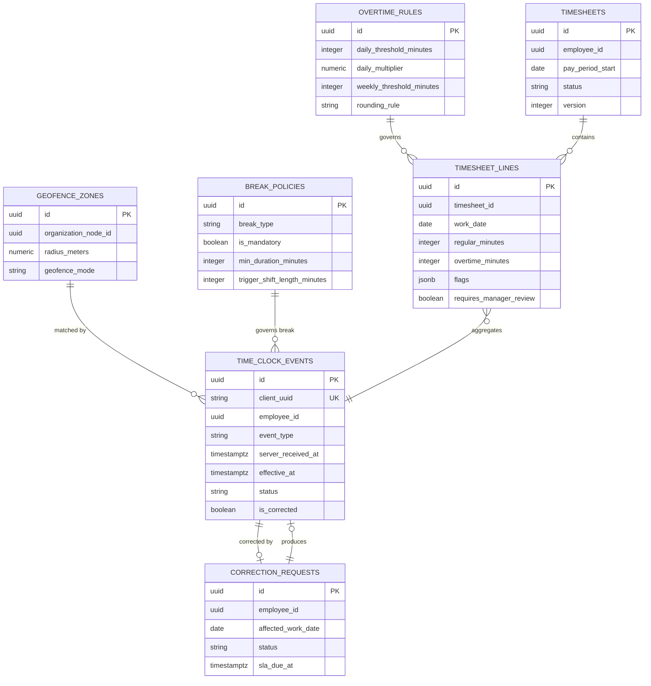

# Time & Attendance — Low-Level Design

## 1. Postgres Schema

All tables carry `tenant_id` and are subject to Postgres Row-Level Security policies per
`conventions.md`. Timestamps are `timestamptz`. Money/duration fields use integer minutes (not
floating point) to avoid rounding drift in payroll-adjacent math.

### 1.1 `geofence_zones`

| Column | Type | Notes |
|---|---|---|
| id | uuid (PK) | |
| tenant_id | uuid | |
| organization_node_id | uuid | FK `organization_nodes.id`; the location this zone belongs to |
| name | text | e.g. "Main Entrance", "Loading Dock" |
| center_latitude | numeric(9,6) | |
| center_longitude | numeric(9,6) | |
| radius_meters | integer | Default 150, range 25–1000 |
| geofence_mode | text | `STRICT` \| `ADVISORY`; enum |
| is_active | boolean | Default true |
| valid_from | timestamptz | |
| valid_to | timestamptz, nullable | |
| created_at | timestamptz | |
| updated_at | timestamptz | |

**Indexes:** `(tenant_id, organization_node_id, is_active)`.

### 1.2 `break_policies`

| Column | Type | Notes |
|---|---|---|
| id | uuid (PK) | |
| tenant_id | uuid | |
| organization_node_id | uuid, nullable | Null = tenant-wide default |
| role_id | uuid, nullable | Optional role scoping |
| version | integer | Monotonic per logical policy |
| break_type | text | `MEAL` \| `REST` |
| is_mandatory | boolean | |
| is_paid | boolean | |
| min_duration_minutes | integer | |
| max_duration_minutes | integer, nullable | Null = unbounded (still capped by `overrun_deduction_cap_minutes`) |
| overrun_deduction_cap_minutes | integer | Default 240 |
| trigger_shift_length_minutes | integer | Shift length that requires this break |
| required_count | integer | How many breaks of this type a qualifying shift requires |
| reminder_offset_minutes | integer | Minutes after trigger threshold to fire break-reminder-nudge |
| effective_from | timestamptz | |
| effective_to | timestamptz, nullable | |
| status | text | `DRAFT` \| `PUBLISHED` \| `SUPERSEDED` (mirrors TemplateVersion-style versioning) |
| created_at | timestamptz | |
| updated_at | timestamptz | |

**Indexes:** `(tenant_id, organization_node_id, role_id, status, effective_from)`.

### 1.3 `overtime_rules`

| Column | Type | Notes |
|---|---|---|
| id | uuid (PK) | |
| tenant_id | uuid | |
| organization_node_id | uuid, nullable | Null = tenant-wide default |
| version | integer | |
| daily_threshold_minutes | integer, nullable | |
| daily_multiplier | numeric(3,2), nullable | e.g. 1.50 |
| double_time_daily_threshold_minutes | integer, nullable | |
| double_time_multiplier | numeric(3,2), nullable | |
| weekly_threshold_minutes | integer, nullable | |
| weekly_multiplier | numeric(3,2), nullable | |
| consecutive_day_premium_enabled | boolean | Default false |
| consecutive_day_premium_multiplier | numeric(3,2), nullable | |
| rounding_rule | text | `NONE` \| `NEAREST_5MIN` \| `NEAREST_15MIN`; default `NONE` (functional-spec §9) |
| pay_period_type | text | `WEEKLY` \| `BIWEEKLY` |
| pay_period_anchor_date | date | First day of a reference pay period, for period boundary calc |
| effective_from | timestamptz | |
| effective_to | timestamptz, nullable | |
| status | text | `DRAFT` \| `PUBLISHED` \| `SUPERSEDED` |
| created_at | timestamptz | |

**Indexes:** `(tenant_id, organization_node_id, status, effective_from)`.

### 1.4 `time_clock_events`

| Column | Type | Notes |
|---|---|---|
| id | uuid (PK) | Server-assigned |
| tenant_id | uuid | |
| client_uuid | text | Idempotency key from mobile client; unique with `tenant_id` |
| employee_id | uuid | FK `users.id` |
| event_type | text | `CLOCK_IN` \| `CLOCK_OUT` \| `BREAK_START` \| `BREAK_END` |
| home_location_id | uuid | Snapshot of employee's home `organization_node_id` at capture time |
| worked_location_id | uuid | The `organization_node_id` actually punched at |
| geofence_zone_id | uuid, nullable | Snapshotted zone matched (or null if none matched / advisory-allowed) |
| break_policy_id | uuid, nullable | Snapshotted policy in effect (for `BREAK_START`/`BREAK_END`) |
| overtime_rule_id | uuid, nullable | Snapshotted rule in effect (denormalized for audit; aggregation re-resolves per day) |
| shift_id | uuid, nullable | FK Workforce Scheduling `Shift` (cross-service reference id, no FK constraint) |
| device_id | text | |
| client_captured_at | timestamptz | Device clock — display/ordering hint only |
| server_received_at | timestamptz | Authoritative; set on server insert |
| effective_at | timestamptz | The timestamp used for all payroll math — equals `server_received_at` unless corrected (§1.6) |
| capture_gps_lat | numeric(9,6), nullable | |
| capture_gps_lng | numeric(9,6), nullable | |
| location_source | text | `LIVE_FIX` \| `STALE_FIX` \| `UNAVAILABLE` |
| geofence_result | text | `PASS` \| `VIOLATION_ADVISORY` \| `VIOLATION_BLOCKED_OVERRIDDEN` |
| anti_buddy_mode | text | `NONE` \| `PHOTO` \| `BIOMETRIC` |
| evidence_id | uuid, nullable | FK Evidence Service object (photo mode) |
| biometric_confirmed | boolean, nullable | Device-local confirmation result, not a server template match |
| cross_location | boolean | Default false; true if `worked_location_id != home_location_id` |
| unscheduled | boolean | Default false; true if no matching `ShiftAssignment` |
| source | text | `EMPLOYEE_PUNCH` \| `MANAGER_CORRECTION` \| `SYSTEM_AUTO_CLOSE` |
| is_corrected | boolean | Default false |
| correction_request_id | uuid, nullable | FK `correction_requests.id` if `source = MANAGER_CORRECTION` |
| clock_skew_flagged | boolean | Default false |
| status | text | `OPEN` (clock-in with no matching clock-out yet) \| `CLOSED` \| `VOID` (superseded by correction) |
| created_at | timestamptz | |

**Indexes:**
- `UNIQUE (tenant_id, client_uuid)` — sync idempotency.
- `UNIQUE (tenant_id, employee_id) WHERE event_type = 'CLOCK_IN' AND status = 'OPEN'` — partial
  unique index enforcing the single-open-punch invariant at the database level (§6).
- `(tenant_id, employee_id, effective_at)` — aggregation range scan.
- `(tenant_id, worked_location_id, effective_at)` — manager/location review.

### 1.5 `timesheets`

| Column | Type | Notes |
|---|---|---|
| id | uuid (PK) | |
| tenant_id | uuid | |
| employee_id | uuid | |
| home_location_id | uuid | |
| pay_period_start | date | |
| pay_period_end | date | |
| status | text | `OPEN` \| `PENDING_APPROVAL` \| `APPROVED` \| `EXPORTED`; see state diagram in `architecture-diagram.md` |
| plan_comparison_unavailable | boolean | Default false (HLD §8 degradation flag) |
| approved_by_user_id | uuid, nullable | |
| approved_at | timestamptz, nullable | |
| exported_at | timestamptz, nullable | |
| reopened_count | integer | Default 0 |
| version | integer | Optimistic concurrency |
| created_at | timestamptz | |
| updated_at | timestamptz | |

**Indexes:** `UNIQUE (tenant_id, employee_id, pay_period_start)`; `(tenant_id, status)`.

### 1.6 `timesheet_lines`

| Column | Type | Notes |
|---|---|---|
| id | uuid (PK) | |
| tenant_id | uuid | |
| timesheet_id | uuid | FK `timesheets.id` |
| employee_id | uuid | Denormalized for query convenience |
| work_date | date | Aggregation bucket date (cross-midnight rule applied, functional-spec §5) |
| worked_location_id | uuid | |
| raw_worked_minutes | integer | Sum of clock-in-to-clock-out spans before break deduction |
| break_deducted_minutes | integer | |
| regular_minutes | integer | |
| overtime_minutes | integer | |
| double_time_minutes | integer | Default 0 |
| overtime_rule_id | uuid | Snapshot used for this line |
| break_policy_id | uuid, nullable | Snapshot used for this line |
| planned_shift_id | uuid, nullable | Workforce Scheduling reference, for variance display |
| planned_minutes | integer, nullable | |
| variance_minutes | integer, nullable | `raw_worked_minutes - planned_minutes` |
| flags | jsonb | Array of exception flag objects, e.g. `[{"type":"LATE_CLOCK_OUT","minutes":12}]` |
| requires_manager_review | boolean | Default false; set true when any flag maps to `require_manager_approval: true` policy |
| break_compliance_flag | text, nullable | `COMPLIANT` \| `MISSED_CONFIRMED` \| `MISSED_UNCONFIRMED` |
| blocked_by_correction_request_id | uuid, nullable | If a pending correction blocks inclusion in approval (functional-spec FR-TA-023) |
| status | text | `INCLUDED` \| `EXCLUDED_PENDING_CORRECTION` \| `APPROVED` |
| created_at | timestamptz | |
| updated_at | timestamptz | |

**Indexes:** `UNIQUE (tenant_id, employee_id, work_date)`; `(tenant_id, timesheet_id)`.

### 1.7 `correction_requests`

| Column | Type | Notes |
|---|---|---|
| id | uuid (PK) | |
| tenant_id | uuid | |
| employee_id | uuid | |
| requested_by_user_id | uuid | Employee or manager on their behalf |
| affected_work_date | date | |
| affected_time_clock_event_id | uuid, nullable | Null if the correction is adding a missing punch entirely |
| requested_event_type | text | `CLOCK_IN` \| `CLOCK_OUT` \| `BREAK_START` \| `BREAK_END` |
| requested_timestamp | timestamptz | |
| reason_code | text | `FORGOT_TO_CLOCK_OUT` \| `DEVICE_ISSUE` \| `SYSTEM_ERROR` \| `OTHER` |
| reason_text | text, nullable | |
| status | text | `PENDING_APPROVAL` \| `APPROVED` \| `MODIFIED_APPROVED` \| `REJECTED` |
| approver_user_id | uuid, nullable | |
| decided_at | timestamptz, nullable | |
| decision_note | text, nullable | |
| resulting_time_clock_event_id | uuid, nullable | FK the corrected/created event once approved |
| sla_due_at | timestamptz | For escalation ladder, Issues & CAPA-style pattern |
| created_at | timestamptz | |
| updated_at | timestamptz | |

**Indexes:** `(tenant_id, status, sla_due_at)` — approver queue and escalation scan;
`(tenant_id, employee_id, affected_work_date)`.

### 1.8 ER Diagram



## 2. REST Endpoints

Base path `/api/v1/` per conventions.md. All mutation endpoints require `Idempotency-Key` and
support the shared `client_uuid` pattern where the call originates from a mobile sync batch.

### 2.1 `POST /api/v1/time/clock-in`

Also reachable inside the standard offline sync batch (`entity_type: "time_clock_event"`,
`operation: "CREATE"`) exactly like a submission (Module 04 §2.1) — shown here as a standalone call
for the online path.

**Request:**
```json
{
  "client_uuid": "9f2a1c4e-clock-in",
  "employee_id": "usr_5521",
  "worked_location_id": "loc_downtown_04",
  "client_captured_at": "2026-09-23T13:01:44.210Z",
  "device_id": "device-882",
  "gps": { "lat": 37.7822, "lng": -122.4090, "accuracy_m": 12 },
  "anti_buddy_mode": "PHOTO",
  "evidence_local_ref": "ev_local_9931"
}
```

**Response `201 Created`:**
```json
{
  "id": "tce_88123",
  "client_uuid": "9f2a1c4e-clock-in",
  "event_type": "CLOCK_IN",
  "server_received_at": "2026-09-23T13:01:46.802Z",
  "effective_at": "2026-09-23T13:01:46.802Z",
  "geofence_result": "PASS",
  "worked_location_id": "loc_downtown_04",
  "cross_location": true,
  "unscheduled": false,
  "status": "OPEN"
}
```

**Errors:** `409 DUPLICATE_OPEN_PUNCH` (employee already has an open clock-in — returns the existing
open event so the client can offer "Clock Out Now"); `422 OUTSIDE_GEOFENCE` (only when
`geofence_mode: STRICT` and no override token supplied); `403 SCOPE_DENIED` (employee/location not
in caller's authorized scope, or a non-employee principal for someone else without a manager
override grant); duplicate `client_uuid` replay → `200 OK` with original `id`, per source-spec §19.4.

### 2.2 `POST /api/v1/time/clock-out`

**Request:**
```json
{
  "client_uuid": "9f2a1c4e-clock-out",
  "employee_id": "usr_5521",
  "client_captured_at": "2026-09-23T21:05:10.004Z",
  "device_id": "device-882",
  "gps": { "lat": 37.7822, "lng": -122.4090, "accuracy_m": 15 },
  "break_taken_confirmation": { "no_qualifying_break": false }
}
```

**Response `200 OK`:**
```json
{
  "id": "tce_88240",
  "event_type": "CLOCK_OUT",
  "server_received_at": "2026-09-23T21:05:12.331Z",
  "effective_at": "2026-09-23T21:05:12.331Z",
  "linked_clock_in_id": "tce_88123",
  "break_compliance_flag": "COMPLIANT",
  "status": "CLOSED"
}
```

**Errors:** `409 NO_OPEN_PUNCH` (no matching open clock-in — client should route to correction
request flow instead, functional-spec FR-TA-007); `422 BREAK_CONFIRMATION_REQUIRED` (mandatory
break not recorded and `break_taken_confirmation` omitted — client must resubmit with the field
per FR-TA-017).

### 2.3 `POST /api/v1/time/correction-requests`

**Request:**
```json
{
  "employee_id": "usr_5521",
  "affected_work_date": "2026-09-22",
  "affected_time_clock_event_id": null,
  "requested_event_type": "CLOCK_OUT",
  "requested_timestamp": "2026-09-22T21:00:00.000Z",
  "reason_code": "FORGOT_TO_CLOCK_OUT",
  "reason_text": "Left phone in locker after close."
}
```

**Response `201 Created`:**
```json
{
  "id": "cr_4471",
  "status": "PENDING_APPROVAL",
  "sla_due_at": "2026-09-24T21:00:00.000Z"
}
```

### 2.4 `POST /api/v1/time/correction-requests/{id}/decision`

**Request (approve-as-requested):**
```json
{ "decision": "APPROVE" }
```

**Request (modify-and-approve):**
```json
{ "decision": "MODIFY_APPROVE", "modified_timestamp": "2026-09-22T21:12:00.000Z", "decision_note": "Adjusted per POS close-out log." }
```

**Response `200 OK`:**
```json
{
  "id": "cr_4471",
  "status": "MODIFIED_APPROVED",
  "resulting_time_clock_event_id": "tce_88401",
  "decided_at": "2026-09-23T09:14:02.000Z"
}
```

**Errors:** `409 ALREADY_DECIDED`; `403 SCOPE_DENIED` (approver not manager-of-record for
`worked_location_id`); `422 TIMESHEET_LINE_ALREADY_APPROVED` (target line already `APPROVED`/
`EXPORTED` — must go through the reopen endpoint, §2.7, instead).

### 2.5 `POST /api/v1/time/timesheets/{id}/approve`

**Request:**
```json
{
  "version": 3,
  "line_ids": ["tsl_1001", "tsl_1002", "tsl_1003"],
  "approve_all_eligible": false
}
```

**Response `200 OK`:**
```json
{
  "id": "ts_9012",
  "status": "PENDING_APPROVAL",
  "approved_line_count": 3,
  "remaining_lines_requiring_review": 1,
  "version": 4
}
```
Status becomes `APPROVED` only once every non-excluded line is approved; response reflects partial
progress otherwise. **Errors:** `409 Conflict` (stale `version` — ETag/optimistic concurrency per
conventions.md); `422 LINE_BLOCKED_BY_CORRECTION` if a targeted line is still
`EXCLUDED_PENDING_CORRECTION`.

### 2.6 `GET /api/v1/time/timesheets/me`

`?pay_period_start=2026-09-15&pay_period_end=2026-09-21`

**Response `200 OK`:**
```json
{
  "id": "ts_9012",
  "status": "PENDING_APPROVAL",
  "pay_period_start": "2026-09-15",
  "pay_period_end": "2026-09-21",
  "totals": { "regular_minutes": 2280, "overtime_minutes": 60, "break_deducted_minutes": 150 },
  "lines": [
    {
      "id": "tsl_1001",
      "work_date": "2026-09-15",
      "worked_location_id": "loc_uptown_01",
      "regular_minutes": 480,
      "overtime_minutes": 0,
      "flags": [],
      "requires_manager_review": false
    }
  ]
}
```

### 2.7 `POST /api/v1/time/timesheets/{id}/reopen`

**Request:**
```json
{ "line_ids": ["tsl_1001"], "reason": "Payroll flagged a missing overtime adjustment." }
```

**Response `200 OK`:** `{ "id": "ts_9012", "status": "OPEN", "reopened_count": 1 }` — restricted to
Store/Site Manager or Payroll/HR Admin roles; emits `timesheet.correction_after_export` if the
timesheet was previously `EXPORTED`.

## 3. Sequence Diagrams

### 3.1 Offline Clock-In Captured Then Synced (Server-Authoritative Reconciliation)

```mermaid
sequenceDiagram
    participant User as Frontline Associate
    participant App as Mobile App (offline)
    participant LDB as Local DB
    participant BG as Background Sync Worker
    participant TA as Time & Attendance Service
    participant WFS as Workforce Scheduling

    User->>App: Tap "Clock In" (no connectivity)
    App->>App: Evaluate cached GeofenceZone locally -> PASS
    App->>LDB: Write time_clock_event (client_captured_at, status=QUEUED), sync_queue entry
    Note over App,LDB: Atomic write per Module 04 FR-MOB-014 pattern
    App->>User: "Clocked in at 1:01 PM (will confirm once synced)"
    App->>App: Connectivity restored
    App->>BG: Opportunistic sync triggers
    BG->>TA: POST /api/v1/sync {changes:[time_clock_event CREATE, client_uuid=9f2a1c4e-clock-in]}
    TA->>TA: Assign server_received_at = now(); effective_at = server_received_at
    TA->>TA: Check clock skew: |client_captured_at - server_received_at| vs tolerance (2 min default)
    alt skew within tolerance
        TA->>TA: clock_skew_flagged = false
    else skew exceeds tolerance
        TA->>TA: clock_skew_flagged = true (manager-visible, not auto-corrected)
    end
    TA->>WFS: Resolve matching ShiftAssignment for employee/location/window
    WFS-->>TA: shift_id (or none -> unscheduled=true)
    TA->>TA: Insert time_clock_event (server-authoritative), enforce single-open-punch unique index
    TA-->>BG: {accepted:[{client_uuid, server_id: tce_88123, server_received_at}]}
    BG->>LDB: Mark local event SYNCED, store server_id + server_received_at
    App->>User: Update confirmation to reconciled server time (if materially different, show discreetly)
```

### 3.2 Timesheet Generation and Manager Approval

```mermaid
sequenceDiagram
    participant Job as Nightly Aggregation Job (Temporal)
    participant TA as Time & Attendance Service
    participant WFS as Workforce Scheduling
    participant Mgr as Store/Site Manager
    participant Hub as Integration Hub

    Job->>TA: For each active employee: fetch prior-day time_clock_events
    TA->>WFS: Fetch planned Shift for the same window (best-effort)
    WFS-->>TA: shift(s) or none
    TA->>TA: Aggregate: raw_worked_minutes, break deduction (BreakPolicy), overtime split (OvertimeRule)
    TA->>TA: Derive flags (missed punch, early/late, unscheduled, geofence, break compliance)
    TA->>TA: Upsert timesheet_line (work_date), roll into timesheet (status=OPEN or PENDING_APPROVAL at period close)
    TA->>TA: Emit timesheet.pending_approval (once pay-period cutoff reached)
    Mgr->>TA: GET pending-approval timesheets for location
    TA-->>Mgr: Per-employee lines with flags + planned-vs-actual variance
    Mgr->>TA: POST /timesheets/{id}/approve {line_ids or approve_all_eligible}
    TA->>TA: Mark eligible lines APPROVED; block lines with open CorrectionRequest
    alt all non-blocked lines approved
        TA->>TA: timesheet.status = APPROVED
        TA-->>Mgr: 200 {status: APPROVED}
        TA->>Hub: emit timesheet.approved
    else lines remain unresolved
        TA-->>Mgr: 200 {status: PENDING_APPROVAL, remaining_lines_requiring_review: N}
    end
    Note over TA,Hub: Payroll Export Batch job (separate, §Background Jobs) later picks up APPROVED timesheets
```

### 3.3 Missed-Punch Correction Request / Approval Flow

```mermaid
sequenceDiagram
    participant Emp as Associate
    participant App as Mobile App
    participant TA as Time & Attendance Service
    participant Mgr as Store/Site Manager

    Emp->>App: Notices missing clock-out from yesterday
    App->>TA: POST /time/correction-requests {affected_work_date, requested_event_type=CLOCK_OUT, requested_timestamp, reason_code}
    TA->>TA: Create correction_requests row (status=PENDING_APPROVAL, sla_due_at = +24h)
    TA->>TA: Mark affected timesheet_line.status = EXCLUDED_PENDING_CORRECTION, blocked_by_correction_request_id set
    TA-->>App: 201 {id, status: PENDING_APPROVAL}
    TA->>Mgr: notify (push + Manager Exceptions queue)
    Mgr->>TA: Review before/after, reason
    alt Approve as requested
        Mgr->>TA: POST /correction-requests/{id}/decision {decision: APPROVE}
        TA->>TA: Create time_clock_event (source=MANAGER_CORRECTION, is_corrected=true), link resulting_time_clock_event_id
    else Modify and approve
        Mgr->>TA: POST /correction-requests/{id}/decision {decision: MODIFY_APPROVE, modified_timestamp}
        TA->>TA: Create time_clock_event using modified_timestamp
    else Reject
        Mgr->>TA: POST /correction-requests/{id}/decision {decision: REJECT, decision_note}
        TA->>TA: correction_requests.status = REJECTED; timesheet_line remains EXCLUDED_PENDING_CORRECTION for manual handling
    end
    TA->>TA: On approve/modify-approve: re-run aggregation for affected_work_date, unblock timesheet_line (status=INCLUDED)
    TA-->>Emp: correction_request.approved / .rejected event -> push notification
```

## 4. Timesheet Aggregation Pseudocode

```
function aggregateEmployeeDay(tenant_id, employee_id, work_date):
    events = loadClockEvents(tenant_id, employee_id, workDateWindow(work_date))
    # workDateWindow expands slightly past midnight both directions to catch cross-midnight shifts
    # per functional-spec §5 cross-midnight rule; each event is bucketed to exactly one work_date
    # using shift-start-date (or tenant-configured shift-end-date) attribution.

    spans = pairClockInOutSpans(events)   # [(clock_in, clock_out), ...]; open/missing spans -> MISSED_PUNCH flag
    breakSpans = pairBreakSpans(events)   # [(break_start, break_end), ...]

    raw_worked_minutes = sum(span.durationMinutes() for span in spans)

    policy = resolveBreakPolicy(tenant_id, employee_id, work_date)  # most-specific org-node-scoped, effective-dated
    break_deducted_minutes = 0
    for b in breakSpans:
        duration = min(b.durationMinutes(), policy.overrun_deduction_cap_minutes)
        if not policy.is_paid:
            break_deducted_minutes += duration
        # paid breaks are not deducted from worked time but ARE checked for compliance below

    break_compliance_flag = evaluateBreakCompliance(policy, raw_worked_minutes, breakSpans)
    # COMPLIANT | MISSED_CONFIRMED (employee confirmed no break) | MISSED_UNCONFIRMED (needs manager attention)

    net_worked_minutes = raw_worked_minutes - break_deducted_minutes

    flags = []
    for span in spans:
        flags += detectPunchFlags(span, resolvePlannedShift(employee_id, work_date))
        # EARLY_CLOCK_IN, LATE_CLOCK_OUT, UNSCHEDULED_PUNCH, GEOFENCE_VIOLATION (carried from event), MISSED_PUNCH

    otRule = resolveOvertimeRule(tenant_id, employee_id, work_date)
    (regular_minutes, ot_minutes, dt_minutes) = splitDailyOvertime(net_worked_minutes, otRule)

    line = upsertTimesheetLine(
        tenant_id, employee_id, work_date,
        raw_worked_minutes, break_deducted_minutes,
        regular_minutes, ot_minutes, dt_minutes,
        flags, break_compliance_flag,
        overtime_rule_id = otRule.id, break_policy_id = policy.id
    )
    return line


function splitDailyOvertime(net_minutes, rule):
    regular = net_minutes
    ot = 0
    dt = 0
    if rule.double_time_daily_threshold_minutes is not null and net_minutes > rule.double_time_daily_threshold_minutes:
        dt = net_minutes - rule.double_time_daily_threshold_minutes
        regular = net_minutes - dt
        net_minutes = regular   # remaining minutes still subject to the regular OT threshold below
    if rule.daily_threshold_minutes is not null and net_minutes > rule.daily_threshold_minutes:
        ot = net_minutes - rule.daily_threshold_minutes
        regular = net_minutes - ot
    else:
        regular = net_minutes
    return applyRounding(regular, rule.rounding_rule), applyRounding(ot, rule.rounding_rule), dt


function finalizeWeeklyOvertime(tenant_id, employee_id, pay_period_start, pay_period_end, rule):
    # Runs after all daily lines in the period are aggregated (weekly OT is computed on top of
    # daily results, never double-counting the same minutes per functional-spec FR-TA-030).
    lines = loadTimesheetLines(tenant_id, employee_id, pay_period_start, pay_period_end)
    cumulative_regular = 0
    for line in lines.sortedBy(work_date):
        cumulative_regular += line.regular_minutes
        if rule.weekly_threshold_minutes is not null and cumulative_regular > rule.weekly_threshold_minutes:
            overflow = cumulative_regular - rule.weekly_threshold_minutes
            convert = min(overflow, line.regular_minutes)
            line.regular_minutes -= convert
            line.overtime_minutes += convert
            cumulative_regular -= convert
            persist(line)
    if rule.consecutive_day_premium_enabled:
        applyConsecutiveDayPremium(lines, rule)  # flags the 7th consecutive worked day, applies premium multiplier
```

**Worked example** (daily threshold 480 min / 1.5x, weekly threshold 2400 min / 1.5x, no rounding):
an employee works 500, 500, 500, 500, 500 minutes Mon–Fri. Daily split gives 480 regular + 20 OT
each day = 2400 regular + 100 OT for the week. Cumulative regular hits exactly 2400 (the weekly
threshold) with zero minutes left to convert — so weekly OT contributes 0 additional minutes this
week (the daily calc already captured the excess); if the employee also worked Saturday 240
minutes, cumulative regular would try to exceed 2400 and those 240 minutes convert entirely to
weekly OT, since daily-threshold OT was already exhausted for the day (240 < 480, so daily
contributes 0, but weekly conversion still applies).

## 5. Geofence Validation Pseudocode

```
function evaluateGeofence(lat, lng, zones, mode_default):
    if lat is null or lng is null:
        return { result: "NO_FIX", location_source: "UNAVAILABLE" }

    best = null
    for zone in zones.filter(z => z.is_active):
        distance = haversineMeters(lat, lng, zone.center_latitude, zone.center_longitude)
        if distance <= zone.radius_meters:
            return { result: "PASS", zone_id: zone.id, distance_m: distance }
        if best is null or distance < best.distance_m:
            best = { zone_id: zone.id, distance_m: distance, mode: zone.geofence_mode }

    if best is null:
        # no zones configured for this location at all
        return { result: mode_default == "STRICT" ? "BLOCKED_NO_ZONE" : "PASS_NO_ZONE_CONFIGURED" }

    if best.mode == "ADVISORY":
        return { result: "VIOLATION_ADVISORY", zone_id: best.zone_id, distance_m: best.distance_m }
    else:
        return { result: "BLOCKED", zone_id: best.zone_id, distance_m: best.distance_m }
```

This function runs identically on-device (cached `GeofenceZone` payload, HLD §9) for the
zero-latency allow/block UX decision, and again server-side on sync/online-punch as the
authoritative, auditable evaluation; a mismatch between the two (e.g. a manipulated client) is
logged but the server's evaluation always wins for what gets persisted as `geofence_result`.

## 6. Caching

| Cached data | Store | TTL / invalidation |
|---|---|---|
| Resolved `GeofenceZone` set per `organization_node_id` | Redis + mobile local cache | 5 min server-side TTL; mobile cache refreshed on standard bootstrap/delta sync (Module 04); invalidated immediately on zone publish/deactivate via cache-bust event |
| Resolved `BreakPolicy` per `(org_node, role, effective_date)` | Redis | 5 min TTL; invalidated on policy publish |
| Resolved `OvertimeRule` per `(org_node, effective_date)` | Redis | 5 min TTL; invalidated on rule publish |
| Employee's current open punch (for duplicate-clock-in fast check) | Redis, keyed `tenant_id:employee_id:open_punch` | Write-through on clock-in/out; also re-verified against the Postgres partial unique index as the durable source of truth (cache is an optimization, not the invariant enforcer) |
| Same-day "hours worked so far" projection (associate-facing) | Computed at read time from open + closed events for the day; not cached beyond normal HTTP response caching | N/A — always fresh, low read volume per employee |

## 7. Concurrency Control

- **Single-open-punch invariant**: enforced primarily by the Postgres partial unique index
  `(tenant_id, employee_id) WHERE event_type='CLOCK_IN' AND status='OPEN'` (§1.4); a concurrent
  clock-in attempt (two devices, or a retried sync racing a first attempt) that would violate this
  index fails at the database level and is translated to `409 DUPLICATE_OPEN_PUNCH`. A Redis lock
  (`SETNX tenant:employee:clocklock`, 5s TTL) is acquired before the insert as a fast-path guard to
  avoid unnecessary DB round-trips under contention, but the index is the actual guarantee.
- **Idempotent clock events**: every clock/break event carries `client_uuid`; a retried sync of the
  same local event is a no-op that returns the original server identity (shared sync pattern,
  source-spec §19.4), never a second row.
- **Timesheet optimistic concurrency**: `timesheets.version` is checked on every approve/reopen
  call (`ETag`/`version` per conventions.md); a stale version returns `409 Conflict` with the
  current server state so a manager acting on a stale screen never silently overwrites a concurrent
  action (e.g. payroll admin reopening the same timesheet the manager is approving).
- **Aggregation idempotency**: `aggregateEmployeeDay` is safe to re-run for the same
  `(tenant_id, employee_id, work_date)` — it upserts `timesheet_lines` keyed by that tuple's unique
  constraint rather than inserting, so a retried/duplicated Temporal workflow execution never
  produces duplicate lines.
- **Correction-approval race**: approving a `CorrectionRequest` and a manager separately approving
  the parent timesheet at the same moment is resolved by the `blocked_by_correction_request_id`
  gate on `timesheet_lines` — a line cannot transition to `APPROVED` while that field is set, so the
  ordering is enforced structurally rather than by locking.

## 8. Background Jobs

| Job | Trigger | Engine | Behavior |
|---|---|---|---|
| Nightly timesheet aggregation | Scheduled, per-tenant timezone-aware cutoff (default 2:00 AM local) | Temporal workflow, sharded by `(tenant_id, organization_node_id)` | Runs `aggregateEmployeeDay` for every active employee's prior work-date; idempotent/restartable; on Workforce Scheduling unavailability, proceeds without plan comparison (HLD §8) and schedules a follow-up reconciliation attempt. |
| Weekly/period-close overtime finalization | Scheduled, at each tenant's configured pay-period boundary | Temporal workflow | Runs `finalizeWeeklyOvertime` across the closing period; transitions eligible timesheets `OPEN → PENDING_APPROVAL`. |
| Open-punch auto-close sweep | Scheduled, hourly | Temporal workflow (cron) | Finds `TimeClockEvent` rows `OPEN` past `shift.ends_at + 12h` (or, for unscheduled punches, past 16h from clock-in) with no matching clock-out; raises a system-flagged `MISSED_PUNCH` candidate for manager correction rather than force-closing (except the deactivation case, §below). |
| Deactivation auto-close | Triggered by `user.deactivated` event from Identity/Org | Event-driven worker | Auto-closes any open clock-in for the deactivated employee at the deactivation timestamp, flags `auto_closed_on_deactivation: true`, routes to manager for confirmation. |
| Correction-request SLA escalation | Scheduled, every 15 min | Temporal workflow (cron) | Scans `correction_requests` past `sla_due_at` still `PENDING_APPROVAL`; escalates notification to the next manager in the org hierarchy per the same ladder pattern as Issues & CAPA. |
| Payroll export batch | Scheduled (tenant-configured, e.g. nightly or twice per pay period) or manually triggered by Payroll/HR Admin | Temporal workflow | Selects `APPROVED` timesheets not yet `EXPORTED`, builds the export payload per employee/period, hands off to the Integration Hub payroll connector, marks `EXPORTED` on confirmed handoff; failures leave the timesheet `APPROVED` for safe retry (HLD §8). |

## 9. Error Handling Table

| Error | HTTP/code | Handling |
|---|---|---|
| Duplicate open clock-in | 409 `DUPLICATE_OPEN_PUNCH` | Return existing open event; client offers "Clock Out Now" (functional-spec FR-TA-006) |
| Clock-out with no open clock-in | 409 `NO_OPEN_PUNCH` | Client routes to correction-request creation flow instead of retrying the clock-out |
| Outside geofence, strict mode | 422 `OUTSIDE_GEOFENCE` | Client shows outside-geofence-blocked UX with distance-to-zone and manager-override path |
| Mandatory break confirmation missing | 422 `BREAK_CONFIRMATION_REQUIRED` | Client re-prompts break-taken confirmation (FR-TA-017) and resubmits |
| Correction request against already-approved/exported line | 422 `TIMESHEET_LINE_ALREADY_APPROVED` | Client directs the requester to ask for a formal reopen (§2.7) instead |
| Stale timesheet version on approve/reopen | 409 `Conflict` (standard envelope) | Client refetches current state and re-applies the manager's intended action against fresh data |
| Duplicate `client_uuid` clock event replay | 200 OK (not an error) | Original server identity returned, no duplicate row, per source-spec §19.4 |
| Workforce Scheduling unreachable during aggregation | (internal, no client-facing code) | Aggregation proceeds without plan comparison; `plan_comparison_unavailable=true`; scheduled retry reconciles once available |
| Payroll export destination failure | (internal; surfaced to Payroll/HR Admin via Integration Hub monitoring) | Timesheet stays `APPROVED`; batch retried per Integration Hub's own retry/backoff policy; no duplicate export on retry (idempotent per `(tenant_id, timesheet_id)`) |
| Geofence zone missing/deleted mid-shift | 200 OK, `geofence_result: PASS_NO_ZONE_CONFIGURED` or `BLOCKED_NO_ZONE` per tenant default | Flagged for admin visibility (functional-spec §5) rather than surfaced as a hard error to the employee |
| Scope violation (approver not manager-of-record) | 403 `SCOPE_DENIED` | Standard error envelope with `trace_id`; approval action rejected outright |
