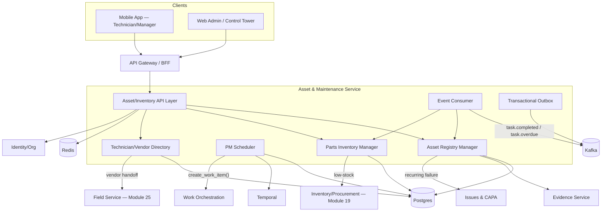
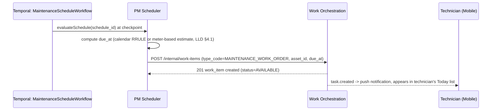
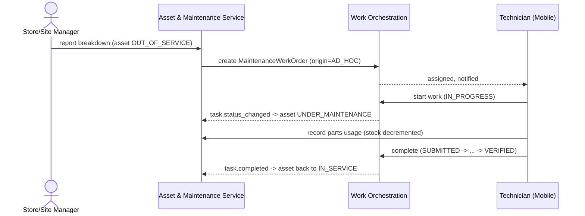
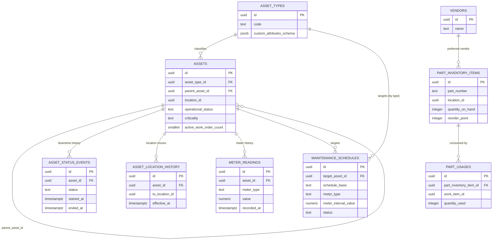
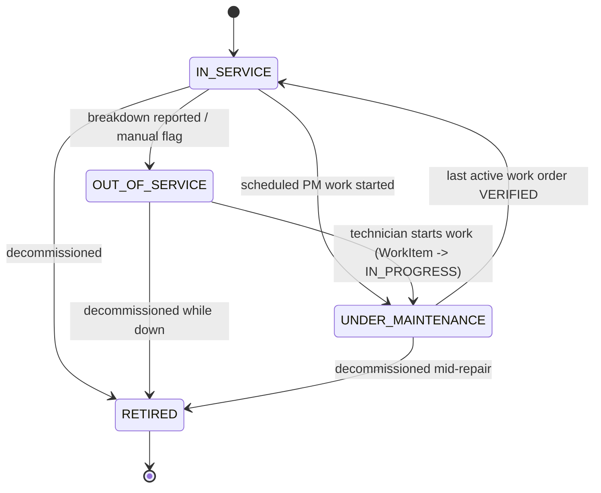

# Asset & Equipment Maintenance (CMMS) — Architecture Diagrams

Corresponds to **EPIC-16**. Focused diagram set for this module only; narrative detail lives in
`functional-spec.md`, `high-level-design.md`, `low-level-design.md`.

## 1. Component / Container Diagram

Narration: this is the same module boundary described in `high-level-design.md` §2 — the Asset &
Maintenance Service owns the Asset Registry, PM Scheduler, and Parts Inventory Manager, and the
diagram makes the one-way relationship with Work Orchestration explicit: the PM Scheduler only ever
*calls out* to create work (`create_work_item`), and the Event Consumer only ever *listens* for
completion/overdue signals. No component in this service writes to Work Orchestration's `work_items`
table directly.

## 2. Sequence Diagram — PM Schedule Materializes a MaintenanceWorkOrder

Narration: the full transactional detail (high-water-mark persistence, idempotency key shape,
retry-safety under Temporal's at-least-once activity semantics) is in `low-level-design.md` §3(a).
This condensed view exists to show the module boundary at a glance: everything left of the arrow
into Work Orchestration is this module's responsibility; everything from that point forward
(assignment, execution, completion) is Work Orchestration's.

## 3. Sequence Diagram — Breakdown Report to Completed Repair with Parts Usage

Narration: full detail, including the duplicate-breakdown check, the parts-pending completion block,
and the stock-decrement concurrency guard, is in `low-level-design.md` §3(b)/§4.2/§6. This view
highlights that asset operational status is driven entirely by consuming Work Orchestration's status
events, never by this module guessing at execution state independently.

## 4. ER Diagram — Owned Entities

Narration: `Asset` is the aggregate root of this module, with append-only history tables
(`asset_status_events`, `asset_location_history`, `meter_readings`) hanging off it to preserve
Product Principle P7 (historical truth) independent of the mutable `assets` current-state row.
`MaintenanceSchedule` targets either a single `Asset` or an `AssetType`+location-scope combination
(exactly one, enforced by a check constraint — `low-level-design.md` §1.1). `PartUsage` and
`MeterReading` both carry a `work_item_id` — a loose, unenforced cross-service reference into Work
Orchestration's `work_items` table, deliberately not modeled as a foreign key here since that table
is owned by a different bounded context.

## 5. State Diagram — Asset Operational Status

Narration: this is the `Asset.operational_status` lifecycle owned entirely by this module —
`IN_SERVICE → OUT_OF_SERVICE → UNDER_MAINTENANCE → IN_SERVICE`, plus the terminal `RETIRED` state
reachable from any non-terminal status (functional-spec §6, FR-CMMS-030/005). **This is deliberately
not a work-order state diagram.** The `MaintenanceWorkOrder` that typically drives these transitions
(via the Event Consumer reacting to `task.status_changed`/`task.completed`) has its own execution
state machine — `DRAFT → SCHEDULED → AVAILABLE → IN_PROGRESS → SUBMITTED → PENDING_REVIEW →
APPROVED → VERIFIED`, with `BLOCKED`/`OVERDUE`/`ESCALATED`/`REJECTED` branches — and that machine is
the canonical `WorkItem` state machine owned and diagrammed by Work Orchestration
(`02-work-orchestration/architecture-diagram.md`). Re-drawing it here would create a second source
of truth for the same execution state; this module instead only diagrams the asset-side effect of
that execution (a physical piece of equipment's availability), which is conceptually and temporally
distinct from — though correlated with — the work order acting on it (e.g., an asset can be manually
flagged `OUT_OF_SERVICE` with no work order yet created, and a `MaintenanceWorkOrder` can complete
without ever having taken the asset fully down, per functional-spec FR-CMMS-030).
