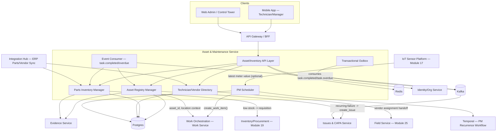

# Asset & Equipment Maintenance (CMMS) — High-Level Design

Corresponds to **EPIC-16**. Reads consistently with `conventions.md` (tech stack, multi-tenancy
rule, state machine reuse) and `new-modules-addendum.md` (Module 16 row). Detailed requirements in
`functional-spec.md`; schema/API/algorithm detail in `low-level-design.md`.

## 1. Module Responsibilities

This module is **Asset Registry + PM Scheduler + Parts Inventory service**. It is explicitly **not**
a re-implementation of `WorkItem` execution — Work Orchestration remains the single authoritative
execution engine for every `WorkItem`, including `MAINTENANCE_WORK_ORDER`. Concretely, this module
owns:

1. **Asset Registry** — `Asset`, `AssetType`, parent-child relationships, operational-status
   lifecycle, location history.
2. **PM Scheduler** — `MaintenanceSchedule` authoring and materialization (calendar and meter-based
   due-date computation), which *calls* Work Orchestration to spawn a `MaintenanceWorkOrder`; it does
   not execute or track that WorkItem's completion state itself.
3. **Parts Inventory service** — `PartInventoryItem`, `PartUsage`, stock decrement, low-stock
   alerting, reorder-requisition hook.
4. **Technician/Vendor directory** — `Technician`, `Vendor`, skill/certification matching for
   candidate-assignee resolution (assignment write itself delegates to Work Orchestration's API).

It explicitly does **not** own: `WorkItem` status transitions, escalation ladders, approval-step
resolution, or SLA timers for `MaintenanceWorkOrder` — all of that is Work Orchestration's
responsibility, invoked through its public/internal APIs (§4).

## 2. Component Diagram

Narration: mobile/web traffic reaches this service through the normal gateway path, identical to
every other module. The PM Scheduler is the only component that talks outbound to Work Orchestration
to *create* work (`create_work_item`); it never queries or mutates `work_items.status`. The Event
Consumer is the only inbound path from Work Orchestration — it listens for `task.completed` (to
transition the asset back to `IN_SERVICE` and deduct reserved parts, FR-CMMS-032/041) and
`task.overdue` (to drive the overdue-PM badge, FR-CMMS-061) — a one-way, event-driven relationship
that keeps Work Orchestration the single source of truth for execution state.

## 3. Data Ownership

| Entity | Owned here | Referenced from elsewhere |
|---|---|---|
| `Asset` | Yes (promoted from placeholder per `new-modules-addendum.md`) | `WorkItem.asset_id` (Work Orchestration), `Issue` (Issues & CAPA), `Sensor` binding (Module 17) |
| `AssetType` | Yes | — |
| `MaintenanceSchedule` | Yes | Work Orchestration's `schedules` table is a separate, analogous concept for generic `WorkItem` recurrence; this module's `MaintenanceSchedule` is a distinct table with its own meter-based mode, not a subtype of Work Orchestration's `schedules` row |
| `PartInventoryItem`, `PartUsage` | Yes | `WorkItem` (via `work_item_id` FK on `PartUsage`) |
| `Vendor`, `Technician` | Yes | `WorkItem.assignee_id`/`assignee_type=VENDOR` (Work Orchestration references by ID only) |
| `MaintenanceWorkOrder` (i.e., `WorkItem` rows with `type_code=MAINTENANCE_WORK_ORDER`) | **No** — owned entirely by Work Orchestration | This module reads/creates via API, never writes the row directly |
| `Evidence` (meter-reading photos, before/after photos) | **No** — owned by Evidence Service | Referenced by ID from `meter_readings` and `MaintenanceWorkOrder` completion payloads |
| `Issue` (recurring-failure) | **No** — owned by Issues & CAPA | Created via `create_issue` tool/API call |

## 4. External Interfaces

### Consumed (this module calls out)

- **Work Orchestration — `POST /api/v1/work-items`** (internal service-to-service variant, same
  contract shape as the public endpoint documented in `02-work-orchestration/low-level-design.md`
  §2.1), called by the PM Scheduler on schedule materialization and by the breakdown-report UI flow
  for ad-hoc creation, with `type_code = MAINTENANCE_WORK_ORDER`.
- **Work Orchestration — `PATCH /api/v1/work-items/{id}/status`** — used only by the mobile technician
  flow acting as a thin pass-through (the client calls Work Orchestration directly for status
  transitions; this module is not in that write path at all, reinforcing non-duplication).
- **Work Orchestration — type-specific transition validator registration** — this module registers a
  validator hook (checked by Work Orchestration before allowing `SUBMITTED`) that rejects the
  transition with `422 PARTS_PENDING` while an unresolved parts-needed block exists (FR-CMMS §11.3) —
  the same extension point other `WorkItem` types use for type-specific completion rules, so Work
  Orchestration's engine stays generic and this module's domain rule stays with this module.
- **Issues & CAPA — `create_issue` tool/API** — called on recurring-failure detection (FR-CMMS-023).
- **Inventory/Procurement (Module 19) — purchase requisition creation API** — called on low-stock
  alert when the tenant has that module enabled.
- **Evidence Service — `POST /api/v1/evidence`** — for meter-reading photos and before/after photos.
- **Identity/Org Service — scope/eligibility queries** — for technician service-area matching and
  asset location scoping.

### Produced (this module emits)

- `asset.created`, `asset.status_changed`, `asset.retired`, `asset.location_changed` (module-specific
  events, following the canonical envelope shape from source-spec §18.4).
- `maintenance_schedule.materialized` (internal telemetry event, mirrors Work Orchestration's
  `schedule.materialized`).
- `part_inventory.low_stock` (consumed by Notification Hub and, when enabled, Module 19).

### Consumed (this module listens)

- `task.completed`, `task.overdue`, `task.rejected` (canonical events, source-spec §18.3) — filtered
  server-side to events where `type_code = MAINTENANCE_WORK_ORDER`, driving asset status
  auto-transition (§FR-CMMS-032), overdue-PM badges, and rejected-work-order handling.
- `user.deactivated` — for technician availability reconciliation, mirroring Work Orchestration's
  assignment-reconciliation pattern.

## 5. Technology Choices and Justification

- **Why PM scheduling reuses Work Orchestration's Temporal recurrence pattern rather than building a
  second one.** Work Orchestration already solved durable, versioned, timezone-correct recurrence
  expansion (one Temporal workflow per schedule, self-scheduling checkpoints, a persisted high-water
  mark for idempotent re-materialization — see `02-work-orchestration/low-level-design.md` §4.1).
  Building an independent recurrence engine here would duplicate non-trivial correctness logic
  (RRULE timezone handling, idempotent retry safety) for zero product benefit, and would create two
  places an on-call engineer must reason about "why didn't this recurring thing fire." Instead, this
  module runs its **own** Temporal workflow per `MaintenanceSchedule` (a separate workflow type,
  `MaintenanceScheduleWorkflow`, in the same Temporal cluster/namespace pattern) that implements the
  *identical* checkpoint/high-water-mark/idempotent-materialization shape for the `CALENDAR` schedule
  basis, and adds the genuinely new logic — meter-based due-date estimation (§LLD §4.1) — as an
  additional evaluation branch inside that same workflow, rather than as a second scheduling system.
  The workflow's only side effect is calling Work Orchestration's `create_work_item` API; it never
  writes to `work_items` directly, keeping Work Orchestration authoritative even though this module
  runs its own scheduler process.
- **Postgres for `PartInventoryItem`/`PartUsage`**, not a separate inventory database — consistent
  with the platform's "modular domain architecture first, split only where justified" principle
  (source-spec §16.2); parts inventory volume (thousands of SKUs × tens of thousands of locations) is
  well within a single relational store's comfort zone and benefits from being transactionally
  consistent with the decrement-on-usage write path (§LLD §6).
- **Redis** for the asset-detail read cache and the eligible-technician candidate-list cache (short
  TTL, since eligibility changes on certification expiry/reassignment are not instantaneous-critical).
- **Kafka** for all cross-module signals (`asset.*`, `part_inventory.low_stock`), consistent with the
  platform's event-driven-for-async-workflows principle — no module calls another module's internal
  write path synchronously except the two explicitly documented synchronous calls in §4 (work-item
  creation, requisition creation), both of which are idempotent via `Idempotency-Key`.

## 6. Scalability

- Asset volume scales with location count × average asset density; NFR-CMMS-004 assumes tens of
  millions of `Asset` rows platform-wide. `Asset` and `PartInventoryItem` tables are partitioned by
  `tenant_id_bucket` (same hashing scheme as Work Orchestration's `work_items` table) to keep large
  single-tenant scans (e.g., a Regional Manager's asset-health rollup) index-local.
  read pattern.
- The PM Scheduler's per-schedule Temporal workflow count scales with `MaintenanceSchedule` count,
  not `Asset` count directly, when a schedule targets an `AssetType`+location-scope rather than a
  single asset — one workflow can materialize work orders for thousands of matching assets per
  occurrence, avoiding a workflow-per-asset explosion.
- Parts-usage writes are a small fraction of overall platform write volume (bounded by
  work-order-completion rate, not by raw event volume), so no special sharding beyond the standard
  `tenant_id`-scoped partitioning is required at initial scale targets.

## 7. Multi-Tenancy

Every table carries `tenant_id` with Postgres RLS as the defense-in-depth backstop (per
`conventions.md`), and every query additionally scopes by `location_id`/`OrganizationNode` subtree
via `UserScope`, identical to every other module. Asset criticality and PM-compliance rollups
respect the same tenant/scope isolation as Analytics — a cross-tenant asset-health query is
structurally impossible through this service's API surface, and the Control Tower's rollup views are
built from a CDC feed that itself is tenant-partitioned (source-spec §21.1).

## 8. Failure Modes and Degradation

| Failure | Degradation strategy |
|---|---|
| Work Orchestration unavailable when PM Scheduler tries to materialize | The Temporal activity retries with backoff (standard Temporal at-least-once semantics); the schedule's high-water mark is only advanced after a confirmed `create_work_item` success, so no occurrence is silently skipped — a prolonged outage produces a backlog of overdue materializations that catch up once Work Orchestration recovers, not data loss. |
| Evidence Service unavailable when a technician captures a meter-reading photo | The meter *value* (a first-class field on this module's `meter_readings` table) is still recorded immediately; the photo upload queues via the standard mobile offline/resumable-upload path and attaches asynchronously — a due-date calculation is never blocked on photo upload completing. |
| Issues & CAPA unavailable when a recurring-failure threshold fires | The `create_issue` call is retried via the standard outbox-pattern retry (transactional outbox, same pattern as Module 06 uses for `issue.created`); the underlying `MaintenanceWorkOrder`s that triggered the pattern are unaffected either way, since Issue creation is a side effect, not a gate on work-order execution. |
| Inventory/Procurement (Module 19) unavailable on low-stock alert | The `part_inventory.low_stock` event and in-app badge still fire (this module's own responsibility); the automatic requisition-creation call is queued and retried, with a manual "create requisition" fallback action always available to an Operations Admin regardless of that module's availability. |
| Redis eligible-technician cache unavailable | Falls back to a direct (uncached) Postgres query for candidate resolution — slower, not incorrect; assignment correctness never depends on cache freshness. |
| Postgres partition hot-spot on a very large single tenant's asset table | Tenant-tier-based sharding (per `conventions.md`, "large enterprise tenants may be isolated to a dedicated schema or cluster") is the escape valve, identical to the platform-wide pattern — this module does not need a bespoke solution beyond opting into that existing tiering mechanism. |
