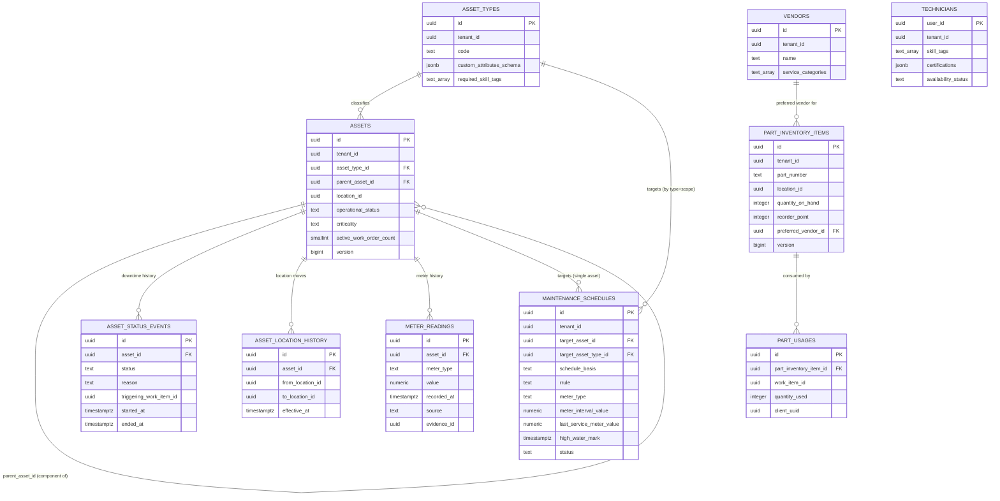
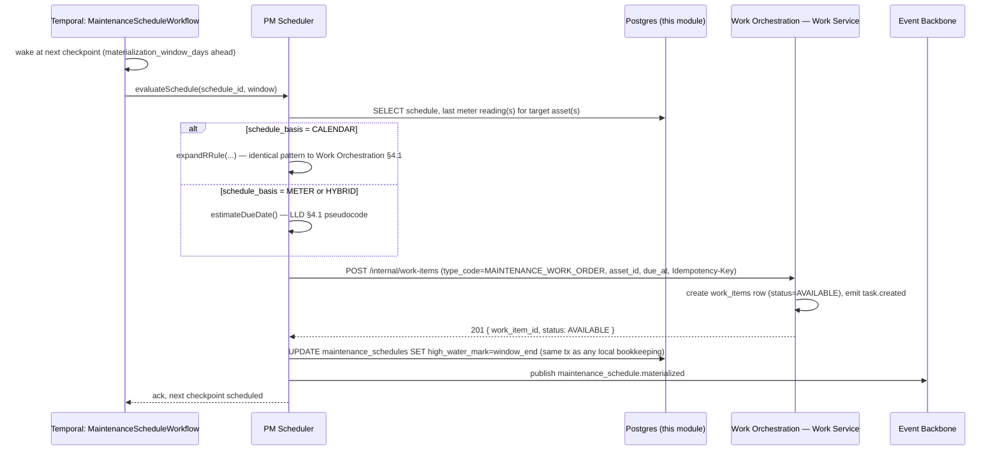

# Asset & Equipment Maintenance (CMMS) — Low-Level Design

## 1. Postgres Schema

### 1.1 Tables

**asset_types**

| Column | Type | Notes |
|---|---|---|
| id | uuid PK | |
| tenant_id | uuid | |
| code | text | tenant-unique, e.g. `WALK_IN_COOLER`, `HVAC_RTU`, `COMPRESSOR`, `POS_TERMINAL` |
| display_name | text | |
| custom_attributes_schema | jsonb | JSON Schema validating `assets.custom_attributes` |
| required_skill_tags | text[] | default technician skill requirement for this type |
| default_pm_interval_hint | jsonb, nullable | informational only, e.g. `{basis:"CALENDAR", days:90}` |
| active | boolean | |
| created_at, updated_at | timestamptz | |

Unique `(tenant_id, code)`.

**assets**

| Column | Type | Notes |
|---|---|---|
| id | uuid PK | |
| tenant_id | uuid | |
| tenant_id_bucket | smallint | generated: `hash(tenant_id) % 64`, partition key |
| asset_type_id | uuid FK -> asset_types | |
| parent_asset_id | uuid, nullable FK -> assets | child inherits `location_id` from parent at write time |
| name | text | |
| location_id | uuid | ref to OrganizationNode (not enforced cross-service FK) |
| serial_number | text, nullable | unique `(tenant_id, serial_number)` where not null |
| manufacturer | text, nullable | |
| model | text, nullable | |
| install_date | date, nullable | |
| warranty_expires_at | date, nullable | |
| purchase_cost | numeric(12,2), nullable | |
| custom_attributes | jsonb | validated against `asset_types.custom_attributes_schema` |
| operational_status | text | enum: `IN_SERVICE, OUT_OF_SERVICE, UNDER_MAINTENANCE, RETIRED` |
| criticality | text | enum: `LOW, MEDIUM, HIGH, CRITICAL` |
| active_work_order_count | smallint | denormalized counter, drives FR-CMMS-033 status-reversion logic |
| version | bigint | optimistic concurrency |
| created_at, updated_at, retired_at | timestamptz, nullable | |

Partitioned by LIST(`tenant_id_bucket`). Indexes: `(tenant_id, location_id, operational_status)`,
`(tenant_id, asset_type_id, location_id)`, `(parent_asset_id)`, `(tenant_id, criticality,
operational_status)`.

**asset_status_events** (append-only, downtime history — FR-CMMS-031)

| Column | Type | Notes |
|---|---|---|
| id | uuid PK | |
| tenant_id | uuid | |
| asset_id | uuid FK -> assets | |
| status | text | status entered |
| reason | text, nullable | `BREAKDOWN_REPORTED, SCHEDULED_PM, WORK_STARTED, WORK_VERIFIED, MANUAL_OVERRIDE, ASSET_RETIRED` |
| triggering_work_item_id | uuid, nullable | ref to `WorkItem` |
| started_at | timestamptz | |
| ended_at | timestamptz, nullable | null while current |
| actor_id | uuid, nullable | null for system-triggered |
| created_at | timestamptz | |

Index `(asset_id, started_at desc)`, partial index `(asset_id) WHERE ended_at IS NULL` (current
span lookup).

**asset_location_history** (append-only — FR-CMMS edge case 11.2)

| Column | Type | Notes |
|---|---|---|
| id | uuid PK | |
| tenant_id | uuid | |
| asset_id | uuid FK -> assets | |
| from_location_id | uuid, nullable | |
| to_location_id | uuid | |
| moved_by | uuid | |
| effective_at | timestamptz | |
| created_at | timestamptz | |

Index `(asset_id, effective_at desc)`.

**maintenance_schedules**

| Column | Type | Notes |
|---|---|---|
| id | uuid PK | |
| tenant_id | uuid | |
| name | text | |
| target_asset_id | uuid, nullable FK -> assets | set when targeting a single asset |
| target_asset_type_id | uuid, nullable FK -> asset_types | set when targeting a type + location scope |
| target_location_scope | jsonb, nullable | node id(s)/subtree selector, used with `target_asset_type_id` |
| schedule_basis | text | `CALENDAR, METER, HYBRID` |
| rrule | text, nullable | for CALENDAR/HYBRID |
| meter_type | text, nullable | `OPERATING_HOURS, CYCLES, MILEAGE, UNITS_PRODUCED` |
| meter_interval_value | numeric, nullable | e.g. 500 (hours) |
| last_service_meter_value | numeric, nullable | reset each time the schedule is satisfied |
| trigger_mode | text, nullable | `EARLIEST, LATEST` — for HYBRID only |
| template_version_id | uuid, nullable | PM checklist form |
| estimated_cost | numeric(12,2), nullable | |
| cost_approval_threshold_override | numeric(12,2), nullable | falls back to tenant default if null |
| escalation_policy_id | uuid, nullable | passed through to `create_work_item` call |
| materialization_window_days | integer | default 14, mirrors Work Orchestration convention |
| high_water_mark | timestamptz | persisted checkpoint for idempotent materialization |
| status | text | `ACTIVE, PAUSED, ARCHIVED` |
| pause_reason | text, nullable | e.g. `ASSET_RETIRED` |
| temporal_workflow_id | text | `{tenant_id}:maint_schedule:{id}` |
| created_by, created_at, updated_at | | |

Check constraint: exactly one of `target_asset_id` / `target_asset_type_id` is non-null.

**meter_readings**

| Column | Type | Notes |
|---|---|---|
| id | uuid PK | |
| tenant_id | uuid | |
| asset_id | uuid FK -> assets | |
| meter_type | text | |
| value | numeric | |
| recorded_at | timestamptz | |
| recorded_by | uuid, nullable | null when sourced from a bound `Sensor` (Module 17) |
| source | text | `MANUAL, SENSOR, WORK_ORDER_COMPLETION` |
| evidence_id | uuid, nullable | ref to `Evidence` (photo proof) |
| work_item_id | uuid, nullable | if captured during a work order |
| created_at | timestamptz | |

Index `(asset_id, meter_type, recorded_at desc)` — the read pattern for both the due-date estimator
(LLD §4.1) and the maintenance-history timeline.

**part_inventory_items**

| Column | Type | Notes |
|---|---|---|
| id | uuid PK | |
| tenant_id | uuid | |
| part_number | text | |
| description | text | |
| unit_of_measure | text | |
| location_id | uuid | |
| quantity_on_hand | integer | never negative (CHECK constraint, defense-in-depth alongside app logic) |
| reorder_point | integer | |
| reorder_quantity | integer | |
| unit_cost | numeric(12,2), nullable | |
| preferred_vendor_id | uuid, nullable FK -> vendors | |
| erp_synced | boolean | true when catalog fields are ERP-authoritative |
| version | bigint | optimistic concurrency for stock decrement (§6) |
| created_at, updated_at | timestamptz | |

Unique `(tenant_id, location_id, part_number)`. Index `(tenant_id, location_id, quantity_on_hand,
reorder_point)` for the low-stock sweep.

**part_usages**

| Column | Type | Notes |
|---|---|---|
| id | uuid PK | |
| tenant_id | uuid | |
| part_inventory_item_id | uuid FK -> part_inventory_items | |
| work_item_id | uuid | ref to `MaintenanceWorkOrder` WorkItem |
| quantity_used | integer | |
| unit_cost_at_use | numeric(12,2), nullable | snapshot for cost rollup even if catalog price changes later |
| recorded_by | uuid | |
| client_uuid | uuid, nullable | offline-capture idempotency |
| recorded_at | timestamptz | |
| created_at | timestamptz | |

Unique partial `(client_uuid)` where not null. Index `(work_item_id)`, `(part_inventory_item_id,
recorded_at desc)`.

**vendors**

| Column | Type | Notes |
|---|---|---|
| id | uuid PK | |
| tenant_id | uuid | |
| name | text | |
| service_categories | text[] | |
| contact_info | jsonb | |
| preferred | boolean | |
| erp_synced | boolean | |
| active | boolean | |
| created_at, updated_at | | |

**technicians**

| Column | Type | Notes |
|---|---|---|
| user_id | uuid PK, FK -> User (Identity/Org, cross-service ref) | |
| tenant_id | uuid | |
| skill_tags | text[] | |
| certifications | jsonb | array of `{certification_type, issued_at, expires_at}` |
| home_location_id | uuid | |
| service_area_node_ids | uuid[] | |
| availability_status | text | `AVAILABLE, ON_JOB, OFF_SHIFT` |
| created_at, updated_at | | |

Index `(tenant_id, availability_status)`, GIN index on `skill_tags`.

### 1.2 ER Diagram



Note: `MAINTENANCE_WORK_ORDER` (i.e., a `work_items` row with `type_code=MAINTENANCE_WORK_ORDER`)
is deliberately **not** in this ER diagram — it lives in Work Orchestration's schema
(`02-work-orchestration/low-level-design.md` §1) and is referenced here only by `id` (uuid, no
enforced cross-service FK) from `part_usages.work_item_id`, `meter_readings.work_item_id`, and
`asset_status_events.triggering_work_item_id`.

## 2. REST Endpoints

All under `/api/v1/`, OAuth2/OIDC bearer, `Idempotency-Key` required on POST/PATCH, `ETag`/`version`
optimistic concurrency, cursor pagination, standard error envelope
`{"error":{"code","message","trace_id"}}`.

### 2.1 Register asset
`POST /api/v1/assets`

Request:
```json
{
  "asset_type_id": "atype_cooler",
  "name": "Walk-in Cooler #2",
  "location_id": "loc_9a1",
  "serial_number": "WC2-88231",
  "manufacturer": "Traulsen",
  "model": "RHT232",
  "install_date": "2023-04-11",
  "warranty_expires_at": "2027-04-11",
  "custom_attributes": { "refrigerant_type": "R-448A", "capacity_cuft": 232 },
  "criticality": "HIGH"
}
```
Response `201`:
```json
{ "id": "asset_771", "operational_status": "IN_SERVICE", "version": 0, "created_at": "2026-09-23T10:00:00Z" }
```
Errors: `400 VALIDATION_ERROR` (custom_attributes fails asset type schema), `409 SERIAL_ALREADY_EXISTS`,
`403 SCOPE_DENIED`, `404 ASSET_TYPE_NOT_FOUND`.

### 2.2 Create / update PM schedule
`POST /api/v1/maintenance-schedules`
```json
{
  "name": "Cooler compressor 500hr service",
  "target_asset_id": "asset_772_compressor",
  "schedule_basis": "METER",
  "meter_type": "OPERATING_HOURS",
  "meter_interval_value": 500,
  "last_service_meter_value": 1200,
  "template_version_id": "tv_pm_compressor_v2",
  "estimated_cost": 350.00
}
```
Response `201`:
```json
{ "id": "sched_441", "status": "ACTIVE", "temporal_workflow_id": "tnt_88:maint_schedule:sched_441" }
```
`PATCH /api/v1/maintenance-schedules/{id}` supports partial update (requires `version`); changing
`schedule_basis` or `rrule`/`meter_interval_value` does not retroactively alter already-materialized
`MaintenanceWorkOrder`s. `POST /api/v1/maintenance-schedules/{id}/pause` and `/resume`.

Errors: `422 INVALID_TARGET` (both or neither of `target_asset_id`/`target_asset_type_id` set),
`404 TEMPLATE_VERSION_NOT_FOUND`.

### 2.3 Record meter reading
`POST /api/v1/assets/{asset_id}/meter-readings`
```json
{
  "meter_type": "OPERATING_HOURS",
  "value": 1450,
  "recorded_at": "2026-09-23T09:12:00Z",
  "evidence_id": "ev_5521",
  "work_item_id": "wi_9931",
  "client_uuid": "c-uuid-901"
}
```
Response `201`:
```json
{ "id": "mr_3301", "asset_id": "asset_772_compressor", "value": 1450 }
```
Idempotent on `client_uuid` (offline capture). A reading lower than the asset's last recorded value
for the same `meter_type` is accepted but flagged `anomalous=true` in the response (possible meter
reset/replacement — not rejected, since meter rollovers/replacements are legitimate) and does not
retroactively rewrite `last_service_meter_value` on any schedule without explicit reconciliation.

### 2.4 Record parts usage against a work order
`POST /api/v1/work-items/{work_item_id}/part-usages`
```json
{
  "part_inventory_item_id": "part_1187",
  "quantity_used": 2,
  "client_uuid": "c-uuid-902"
}
```
Response `201`:
```json
{
  "id": "pu_5502",
  "part_inventory_item_id": "part_1187",
  "quantity_used": 2,
  "remaining_quantity_on_hand": 6,
  "low_stock_triggered": false
}
```
Errors: `422 INSUFFICIENT_STOCK` (`{"available": 1, "requested": 2}`), `403 SCOPE_DENIED` (caller not
assigned to the work item and lacks `inventory:override_stockout`), `409 VERSION_CONFLICT` (concurrent
decrement race, §6).

### 2.5 Get asset maintenance history
`GET /api/v1/assets/{asset_id}/history?include_children=true&cursor=...&limit=50`

Response `200`:
```json
{
  "items": [
    {
      "event_type": "WORK_ORDER_COMPLETED",
      "occurred_at": "2026-09-20T16:40:00Z",
      "work_item_id": "wi_9931",
      "summary": "PM service completed — compressor",
      "technician": "M. Alves",
      "cost": 350.00,
      "evidence_ids": ["ev_5521", "ev_5522"]
    },
    {
      "event_type": "DOWNTIME_SPAN",
      "occurred_at": "2026-09-20T08:00:00Z",
      "ended_at": "2026-09-20T16:40:00Z",
      "reason": "SCHEDULED_PM"
    },
    {
      "event_type": "METER_READING",
      "occurred_at": "2026-09-20T08:05:00Z",
      "meter_type": "OPERATING_HOURS",
      "value": 1450
    },
    {
      "event_type": "LOCATION_MOVED",
      "occurred_at": "2026-08-01T00:00:00Z",
      "from_location_id": "loc_9a0",
      "to_location_id": "loc_9a1"
    }
  ],
  "next_cursor": null
}
```
This endpoint merges four internal tables (`asset_status_events`, `meter_readings`,
`asset_location_history`, plus a read-through call to Work Orchestration for completed
`MaintenanceWorkOrder` summaries) into one reverse-chronological feed — see §5 caching for how the
merge is kept performant.

## 3. Sequence Diagrams

### 3(a) PM schedule materializing a MaintenanceWorkOrder via Work Orchestration's API



### 3(b) Breakdown report -> ad-hoc work order -> technician completes with parts usage -> inventory deducted -> asset history updated

```mermaid
sequenceDiagram
    actor Mgr as Store/Site Manager
    participant API as Asset/Inventory API
    participant WORK as Work Orchestration
    participant DEV as Technician (Mobile)
    participant INV as Parts Inventory Manager
    participant PG as Postgres (this module)
    participant CONS as Event Consumer
    participant KAFKA as Event Backbone

    Mgr->>API: POST /assets/{id}/breakdown-reports (severity=CRITICAL)
    API->>API: duplicate-report check (FR-CMMS-022) — none found
    API->>PG: INSERT asset_status_events (OUT_OF_SERVICE, reason=BREAKDOWN_REPORTED)
    API->>PG: UPDATE assets SET operational_status=OUT_OF_SERVICE
    API->>WORK: POST /internal/work-items (type_code=MAINTENANCE_WORK_ORDER, origin=AD_HOC, asset_id)
    WORK-->>API: 201 { work_item_id: wi_9931, status: AVAILABLE }
    WORK->>KAFKA: task.created
    KAFKA-->>DEV: push notification (assigned technician)

    DEV->>WORK: PATCH /work-items/wi_9931/status target=IN_PROGRESS
    WORK->>KAFKA: task.status_changed (IN_PROGRESS)
    KAFKA-->>CONS: task.status_changed
    CONS->>PG: UPDATE assets SET operational_status=UNDER_MAINTENANCE; INSERT asset_status_events

    DEV->>INV: POST /work-items/wi_9931/part-usages (part_1187, qty=2)
    INV->>PG: UPDATE part_inventory_items SET quantity_on_hand=quantity_on_hand-2 WHERE version=$v (§6)
    PG-->>INV: committed, remaining=6
    INV->>PG: INSERT part_usages
    Note over INV: 6 > reorder_point, no low-stock alert this time

    DEV->>WORK: PATCH /work-items/wi_9931/status target=SUBMITTED
    WORK->>WORK: type-specific validator check: parts-needed block? no -> allow
    WORK->>KAFKA: task.completed-class event chain through VERIFIED
    KAFKA-->>CONS: task.completed (status=VERIFIED)
    CONS->>PG: UPDATE assets SET operational_status=IN_SERVICE (active_work_order_count reaches 0); INSERT asset_status_events (ended_at=now)
    CONS->>PG: INSERT into maintenance-history feed (implicitly via joined read at query time, §2.5)
```

### 3(c) Low-stock alert triggering a purchase requisition (hook to Module 19)

```mermaid
sequenceDiagram
    participant SWEEP as Low-Stock Sweep (cron)
    participant PG as Postgres (this module)
    participant KAFKA as Event Backbone
    participant NOTIF as Notification Hub
    participant PROC as Inventory/Procurement (Module 19)

    SWEEP->>PG: SELECT * FROM part_inventory_items WHERE quantity_on_hand <= reorder_point AND tenant_id=$t
    PG-->>SWEEP: rows below reorder point
    loop for each low-stock item not already alerted in window
        SWEEP->>KAFKA: publish part_inventory.low_stock (item, location, quantity_on_hand, reorder_point)
        KAFKA-->>NOTIF: notify Operations Admin / location manager
        alt tenant has Module 19 enabled
            KAFKA-->>PROC: part_inventory.low_stock
            PROC->>PROC: create PurchaseRequisition (qty=reorder_quantity, preferred_vendor)
            PROC-->>SWEEP: (async) requisition.created event, correlatable by part_inventory_item_id
        else Module 19 not enabled
            Note over SWEEP: badge + notification only; manual reorder workflow outside the platform
        end
    end
```
Note: this same event also fires synchronously from the parts-usage decrement path (§2.4 response
`low_stock_triggered`) so the UI can show the badge immediately rather than waiting for the next
sweep; the sweep is the defensive reconciliation pass for any decrement path that bypassed the
synchronous check (e.g., a direct ERP-driven stock adjustment).

## 4. Algorithms / Pseudocode

### 4.1 Meter-based PM due-date calculation

```
function estimateDueDate(schedule, asset, now):
    # schedule.schedule_basis in {METER, HYBRID}
    readings = SELECT value, recorded_at FROM meter_readings
               WHERE asset_id = schedule.target_asset_id
                 AND meter_type = schedule.meter_type
               ORDER BY recorded_at DESC LIMIT 20

    target_meter_value = schedule.last_service_meter_value + schedule.meter_interval_value

    if readings is empty:
        # No usage history at all — cannot estimate; flag for manual attention, do not silently skip
        return DueDateResult(due_at = null, estimated = true,
                              reason = "NO_METER_HISTORY", requires_manual_reading = true)

    latest_reading = readings[0]
    staleness = now - latest_reading.recorded_at
    STALENESS_THRESHOLD = 7 days

    if latest_reading.value >= target_meter_value:
        # Already past due right now
        return DueDateResult(due_at = now, estimated = false, reason = "THRESHOLD_ALREADY_MET")

    # Compute rolling average usage rate from the reading window (robust to a single gap/outlier
    # by using median-of-pairwise-rates rather than a naive endpoint-to-endpoint slope)
    rates = []
    for i in range(len(readings) - 1):
        dv = readings[i].value - readings[i+1].value
        dt_days = (readings[i].recorded_at - readings[i+1].recorded_at).days
        if dt_days > 0 and dv >= 0:              # skip anomalous/negative deltas (meter reset)
            rates.append(dv / dt_days)

    if rates is empty:
        # All deltas anomalous (e.g. every pair looks like a reset) — fall back to a conservative
        # tenant-configured default usage rate for this meter_type, flagged prominently
        usage_rate_per_day = tenantDefaultUsageRate(schedule.meter_type)
        estimated = true
        reason = "FALLBACK_DEFAULT_RATE"
    else:
        usage_rate_per_day = median(rates)
        estimated = staleness > STALENESS_THRESHOLD
        reason = "STALE_READING" if estimated else "PROJECTED_FROM_RECENT_READING"

    remaining_units = target_meter_value - latest_reading.value
    projected_days_out = remaining_units / max(usage_rate_per_day, EPSILON)
    due_at = latest_reading.recorded_at + projected_days_out (days)

    return DueDateResult(due_at = due_at, estimated = estimated, reason = reason,
                          requires_manual_reading = false)


# Called by the recurrence workflow (§3a) on each checkpoint evaluation:
function evaluateSchedule(schedule, now):
    if schedule.schedule_basis == CALENDAR:
        due_at = expandRRule(...)                    # unchanged Work Orchestration pattern
        materializeIfDue(schedule, due_at, estimated=false)
    elif schedule.schedule_basis == METER:
        result = estimateDueDate(schedule, asset, now)
        if result.requires_manual_reading:
            raiseAdminAlert(schedule, "PM schedule has no meter history — cannot compute due date")
            return   # do not materialize blind; do not silently skip forever either — alert fires
        materializeIfDue(schedule, result.due_at, estimated=result.estimated)
    elif schedule.schedule_basis == HYBRID:
        calendar_due = expandRRule(...)
        meter_result = estimateDueDate(schedule, asset, now)
        due_at = min(calendar_due, meter_result.due_at) if schedule.trigger_mode == EARLIEST
                 else max(calendar_due, meter_result.due_at)
        materializeIfDue(schedule, due_at, estimated=meter_result.estimated)

    # Whenever a fresh meter_reading later arrives for this asset/meter_type ahead of a materialized
    # but not-yet-AVAILABLE work order, a lightweight recompute re-runs estimateDueDate and, if the
    # projected due_at shifts by more than a tenant-configured tolerance, calls Work Orchestration's
    # PATCH /work-items/{id} to adjust due_at (not status) — the estimate is corrected, not left stale.
```

### 4.2 Parts-reservation-vs-availability check at work-order-completion time

```
function recordPartUsage(work_item_id, part_inventory_item_id, quantity_used, actor, client_uuid):
    # Idempotency check first
    existing = SELECT * FROM part_usages WHERE client_uuid = client_uuid
    if existing exists:
        return 201 existing   # idempotent replay, no double-decrement

    item = SELECT * FROM part_inventory_items
            WHERE id = part_inventory_item_id FOR UPDATE      # row lock, see §6

    if quantity_used > item.quantity_on_hand:
        if actor.has_scope("inventory:override_stockout"):
            log_override_audit_event(actor, item, quantity_used)
            # proceed — allowed to go negative-adjacent only via explicit override, tracked
        else:
            ROLLBACK
            return 422 INSUFFICIENT_STOCK { available: item.quantity_on_hand, requested: quantity_used }

    UPDATE part_inventory_items
        SET quantity_on_hand = quantity_on_hand - quantity_used, version = version + 1
        WHERE id = part_inventory_item_id AND version = item.version
    if rows_affected == 0:
        return 409 VERSION_CONFLICT     # concurrent decrement raced us, caller retries (§6)

    INSERT part_usages (part_inventory_item_id, work_item_id, quantity_used, client_uuid,
                         unit_cost_at_use = item.unit_cost, recorded_by = actor.id)

    low_stock_triggered = (item.quantity_on_hand - quantity_used) <= item.reorder_point
    if low_stock_triggered:
        emit part_inventory.low_stock(item)     # synchronous, in addition to the defensive sweep

    COMMIT
    return 201 { ..., remaining_quantity_on_hand: item.quantity_on_hand - quantity_used,
                 low_stock_triggered }


function validateCompletionTransition(work_item):    # registered with Work Orchestration as this
                                                       # type's transition validator (HLD §4)
    if work_item.type_config.block_reason == "PARTS_NEEDED"
       and work_item.type_config.parts_needed_resolved != true:
        return 422 PARTS_PENDING { blocking_parts: work_item.type_config.awaited_parts }
    return OK
```

## 5. Caching

- **Asset detail cache.** Redis key `asset:{tenant_id}:{asset_id}` → serialized asset summary
  (attributes, current operational_status, active PM overdue flags), TTL 10 min, invalidated on
  `asset.status_changed`/`asset.updated` events for that asset.
- **Maintenance-history merge cache.** Redis key `asset_history:{tenant_id}:{asset_id}:{cursor}` →
  the merged, paginated result of §2.5 (which otherwise requires a cross-service read to Work
  Orchestration for completed-work-order summaries), TTL 5 min — short, because history changes
  fairly often for actively-maintained assets, but long enough to absorb repeated manager
  page-through without re-fetching from Work Orchestration each time. Invalidated eagerly on
  `task.completed`/`asset.status_changed` for that asset rather than waiting out the TTL, to avoid a
  manager seeing a stale history right after closing a work order.
- **Eligible-technician candidate cache.** Redis key `eligible_tech:{tenant_id}:{asset_type_id}:
  {location_id}`, TTL 15 min, invalidated on `technician.certification_changed`/
  `technician.availability_changed` events.
- **Low-stock flags** are not cached — read directly off `part_inventory_items.quantity_on_hand` vs.
  `reorder_point` at write time and at sweep time, since stale low-stock state (either a false badge
  or a missed one) is a correctness concern, not merely a performance one (NFR-CMMS-003).

## 6. Concurrency Control

- **Parts stock deduction race (two work orders claim the same part concurrently).** Every
  decrement takes a row lock (`SELECT ... FOR UPDATE`) on the target `part_inventory_items` row
  inside the same transaction as the `UPDATE ... WHERE version = $v` optimistic-concurrency guard
  (§4.2 pseudocode) — the combination means: the second concurrent request either blocks briefly
  behind the row lock (if truly simultaneous) and then re-reads the now-current `quantity_on_hand`
  before deciding stockout/success, or, if using an application-side compare-and-swap without a DB
  lock (a fallback for a connection-pooled path that cannot hold a long-lived lock), receives
  `409 VERSION_CONFLICT` and retries with a fresh read. Either path guarantees `quantity_on_hand`
  never goes negative except via the explicit, audited `inventory:override_stockout` path, and no
  decrement is ever silently lost (NFR-CMMS-003).
- **Asset `active_work_order_count` reversion race (FR-CMMS-033).** Two concurrent
  `task.completed` events for two different `MaintenanceWorkOrder`s against the same asset must not
  both decrement the counter to a value that triggers a premature `IN_SERVICE` transition if a third
  work order is still open. The Event Consumer performs `UPDATE assets SET
  active_work_order_count = active_work_order_count - 1 WHERE id = $asset_id RETURNING
  active_work_order_count` inside a single statement (atomic decrement, not read-modify-write), and
  only transitions `operational_status → IN_SERVICE` when the returned value is `0`, avoiding a
  lost-update race between two consumers processing events for the same asset concurrently.
- **PM schedule high-water-mark.** Identical idempotency guarantee to Work Orchestration's own
  recurrence engine (§HLD §5 justification): the high-water mark update and the `create_work_item`
  call together are made safe against Temporal's at-least-once activity retries via the
  `Idempotency-Key` passed to Work Orchestration (`{schedule_id}:{occurrence_timestamp}`), so a
  retried materialization activity never creates a duplicate `MaintenanceWorkOrder`.
- **Meter reading out-of-order arrival.** Readings are accepted in any arrival order (mobile offline
  queue may deliver out of chronological order); the due-date estimator always re-sorts by
  `recorded_at` rather than assuming insertion order, so a late-arriving earlier reading does not
  corrupt the rolling-rate calculation.

## 7. Background Jobs

| Job | Trigger | Responsibility |
|---|---|---|
| PM due-date sweep | Temporal `MaintenanceScheduleWorkflow` per schedule (self-scheduling, mirrors Work Orchestration's recurrence workflow pattern), plus a secondary lightweight cron (every 15 min) reconciling any schedule whose next-checkpoint workflow appears stalled | Materializes due `MaintenanceWorkOrder`s per §4.1; the cron is defensive only, catching a schedule created while Temporal was degraded (mirrors Work Orchestration's `PENDING_WORKFLOW_START` reconciliation pattern) |
| Low-stock alert sweep | Cron, every 30 min per tenant partition | Defensive reconciliation pass per §3(c); catches stock adjustments that bypassed the synchronous check-on-decrement path (e.g. ERP-driven stock corrections, physical count adjustments) |
| Meter-reading staleness reconciler | Cron, daily | Re-evaluates any `METER`/`HYBRID` schedule whose latest reading has crossed the staleness threshold since the last evaluation, re-flagging its most recent materialized-but-not-yet-due work order's `due_at` as `estimated=true` if not already, and raising an admin alert for schedules with `requires_manual_reading=true` older than a configurable grace period |
| Certification-expiry sweep | Cron, daily | Scans `technicians.certifications` for entries crossing `expires_at`; invalidates the eligible-technician cache for affected `(asset_type, location)` pairs and notifies the technician/their manager ahead of expiry (configurable lead time, default 30 days) |
| Asset location-move reconciliation | Consumes `organization_node.moved`/manual asset-transfer API call | Writes `asset_location_history`, updates `assets.location_id`, and recomputes eligible-technician caching for any *new* work order created after the move (does not touch in-flight work orders per edge case §FR-CMMS 11.2) |
| Orphaned schedule sweep | Nightly | Flags `MaintenanceSchedule`s whose `target_asset_id` references a retired/deleted asset that somehow was not auto-paused (defensive against a race between retirement and an in-flight materialization), auto-pausing them |

## 8. Error Handling

| Condition | HTTP Status | Error Code | Client Guidance |
|---|---|---|---|
| Custom attributes fail asset type's JSON Schema | 400 | `VALIDATION_ERROR` | Show field-level schema violations from the validator |
| Duplicate serial number within tenant | 409 | `SERIAL_ALREADY_EXISTS` | Suggest looking up the existing asset instead of creating a duplicate |
| PM schedule with both/neither target set | 422 | `INVALID_TARGET` | Admin must pick exactly one of single-asset or type+location-scope targeting |
| No meter history for a METER schedule | 200 (schedule created, not materializing) | n/a — surfaced as an admin alert, not a request error | UI shows "awaiting first meter reading" state on the schedule |
| Insufficient stock at parts-usage recording | 422 | `INSUFFICIENT_STOCK` | Offer "request override" (if scoped) or "flag parts needed" (blocks work order, FR-CMMS §11.3) |
| Concurrent stock decrement race lost | 409 | `VERSION_CONFLICT` | Client re-fetches current stock, retries the usage recording automatically once (transparent to the technician) before surfacing a manual retry prompt |
| Work order completion attempted while parts pending | 422 | `PARTS_PENDING` | Block the completion action client-side once server confirms; show which parts are awaited |
| Duplicate breakdown report detected | 200 (non-blocking suggestion) | n/a — `possible_duplicate_of` field in response | UI shows "view existing report" vs. "report anyway" choice |
| Asset targeted by schedule is retired | 200 (schedule auto-paused) | n/a | UI shows schedule as `PAUSED — reason: ASSET_RETIRED` |
| Un-retire attempted without admin override scope | 403 | `SCOPE_DENIED` | Only an Operations Admin with an explicit override permission may un-retire; UI explains why the action is unavailable |
| Location move attempted on an asset with an active work order | 200 (move allowed, historical attribution preserved) | n/a | UI banner: "this asset has an active work order still attributed to its prior location" |
| Meter reading value lower than last recorded value | 201 (accepted, flagged) | n/a — `anomalous: true` in response | UI shows a soft warning ("lower than last reading — meter reset/replacement?") without blocking capture |
| Work Orchestration unreachable when creating a MaintenanceWorkOrder | 202 (accepted, deferred) for ad-hoc UI flow; PM materialization retries via Temporal | n/a — internal retry, `schedule.high_water_mark` not advanced until success | Ad-hoc breakdown report is retried by a background reconciler with the same idempotency key; UI shows "submitting..." rather than a false success |
