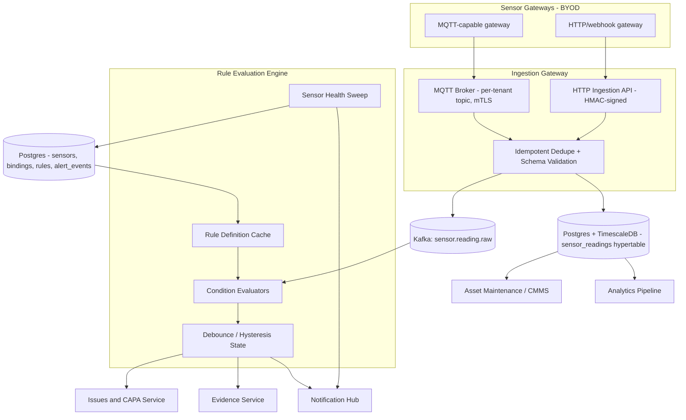
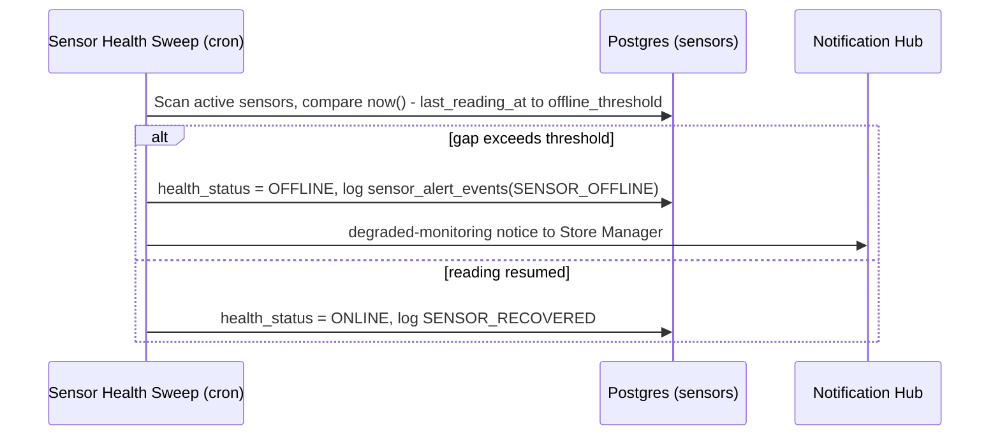
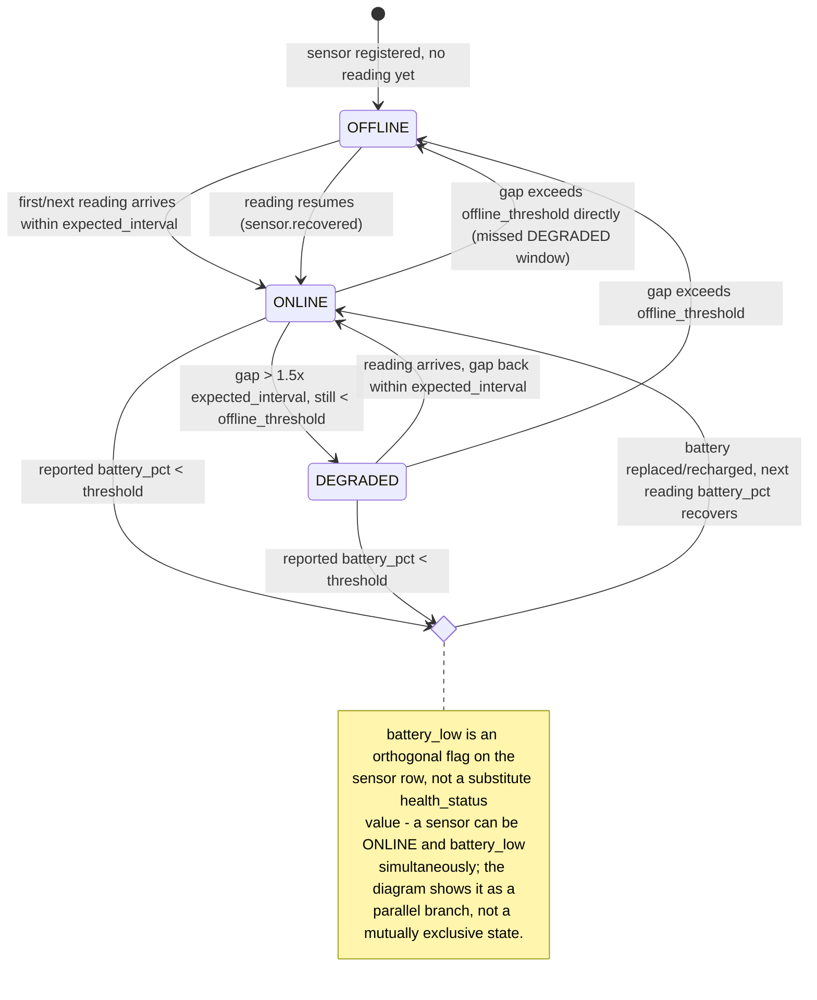

# IoT Sensor Platform — Architecture Diagrams

Focused Mermaid diagrams for this module only. See `high-level-design.md` and
`low-level-design.md` for full narrative and schema detail.

## 1. Component / Container Diagram



This module has three cooperating parts: an **Ingestion Gateway** that terminates both supported
protocols (MQTT for constrained always-connected gateways, HTTP webhook for cloud-aggregated
sources) behind one dedupe/validation/normalize step; a **Time-Series Store**
(TimescaleDB hypertable on the platform's existing Postgres fleet) that is the durable home for
readings and the source for trend queries; and a **Rule Evaluation Engine**, a Kafka-consuming
stream processor that holds per-sensor windowed state and is the only component that calls into
Issues & CAPA to create an Issue. No component writes to another module's tables directly — every
cross-module effect (`Issue`, `Evidence`, notifications) goes through that module's own API.

## 2. Sequence Diagram — Golden Path: Breach to Auto-Created Issue

```mermaid
sequenceDiagram
    participant GW as Sensor Gateway
    participant ING as Ingestion Gateway
    participant TS as TimescaleDB
    participant Eval as Rule Evaluation Engine
    participant Capa as Issues and CAPA Service
    participant Notif as Notification Hub

    GW->>ING: Publish reading (temperature = 10.2C)
    ING->>ING: Dedupe + validate
    ING->>TS: Store reading (write-through)
    ING->>Eval: Normalized reading event (via Kafka)
    Eval->>Eval: Evaluate TEMP-001 (sustained-duration > 8C for 15 min)
    Eval->>Eval: Condition held continuously past duration + debounce
    Eval->>Capa: POST /internal/issues (source=RULE_TRIGGERED)
    Capa-->>Eval: 201 { issue_id }
    Eval->>Notif: notify_role: store_manager
    Notif-->>GW: (no direct reply; manager notified out-of-band)
```

This is the sensor-driven equivalent of the platform's Appendix A golden scenario: a physically
captured value, rather than a manually submitted form field, drives the same
`create_issue`-on-breach mechanism, so everything downstream of Issue creation (SLA clock,
Compliance Monitor Agent repeat-failure detection, CAPA workflow) is identical regardless of source.

## 3. Sequence Diagram — Sensor-Offline Detection



Offline detection is poll-based rather than event-driven because there is no event to react to when
a sensor stops sending data — the sweep is the only mechanism that can notice an absence. Its
20–90s worst-case detection lag (one sweep cycle) is an accepted trade-off against NFR-IOT-004.

## 4. ER Diagram — Owned Entities

```mermaid
erDiagram
    SENSORS ||--o{ SENSOR_DEVICE_BINDINGS : "binding history"
    SENSORS ||--o{ SENSOR_READINGS : produces
    SENSORS ||--o{ SENSOR_ALERT_EVENTS : raises
    SENSOR_ALERT_RULES ||--o{ SENSOR_ALERT_EVENTS : fires
    SENSOR_ALERT_RULES }o--o| SENSOR_ALERT_RULES : superseded_by

    SENSORS {
        uuid id PK
        uuid tenant_id
        enum sensor_type
        enum health_status
        boolean battery_low
        enum status
    }
    SENSOR_DEVICE_BINDINGS {
        uuid id PK
        uuid sensor_id FK
        uuid location_id FK
        uuid asset_id FK
        timestamptz valid_from
        timestamptz valid_to
    }
    SENSOR_READINGS {
        uuid sensor_id PK-FK
        timestamptz server_received_at PK
        double value_numeric
        boolean value_boolean
        uuid location_id
        uuid asset_id
    }
    SENSOR_ALERT_RULES {
        uuid id PK
        text rule_id
        int version
        enum condition_type
        jsonb condition
        enum status
    }
    SENSOR_ALERT_EVENTS {
        uuid id PK
        uuid sensor_id FK
        uuid rule_id FK
        enum event_type
        uuid issue_id
        uuid evidence_id
    }
```

`SensorReading` is deliberately the only high-volume table here; every other entity is
low-cardinality configuration or event metadata, which is why only `sensor_readings` needs
hypertable partitioning while the rest live as ordinary Postgres tables.

## 5. State Diagram — Sensor Health Status



`health_status` itself is a strict three-state cycle (`ONLINE -> DEGRADED -> OFFLINE -> ONLINE`)
driven entirely by reading recency; `BATTERY_LOW` is modeled as an orthogonal boolean flag rather
than a fourth mutually-exclusive state, because a sensor can simultaneously be reporting normally
(`ONLINE`) and running low on battery — collapsing the two into one enum would force an artificial
priority ordering between "not reporting" and "low battery" that the product does not need.
