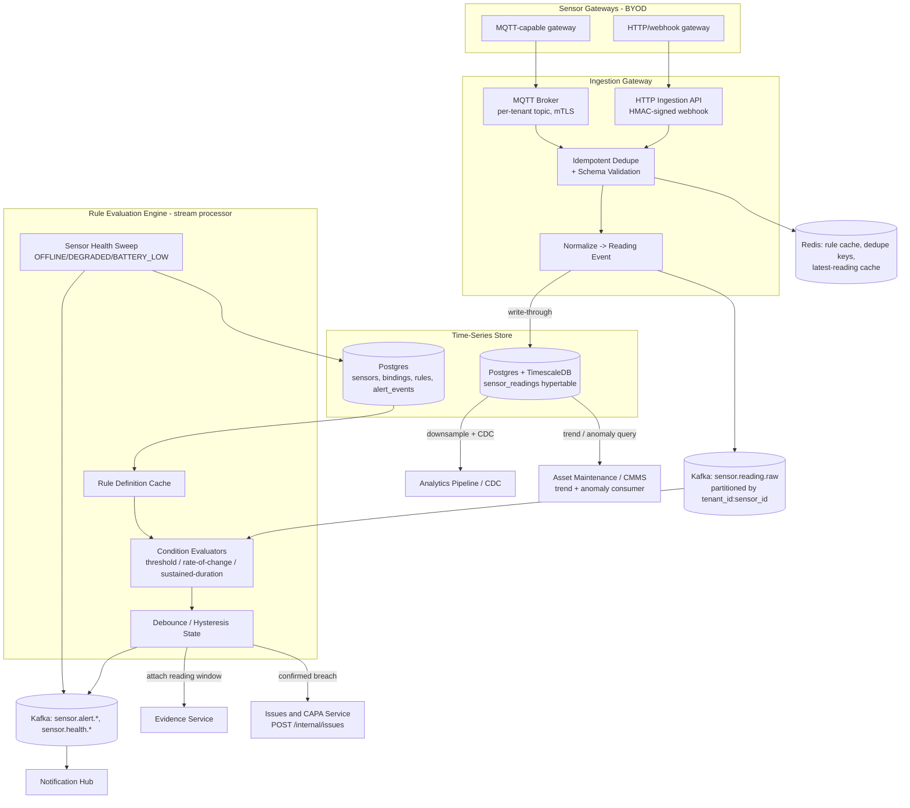

# IoT Sensor Platform — High-Level Design

Corresponds to **EPIC-16 (new)**. Reference: `functional-spec.md` (this module), source-spec.md §5
(Capability Map — "IoT/Assets") and Appendix B, `conventions.md` (Target Tech Stack, Multi-tenancy
Rule, State Machines), `new-modules-addendum.md` (Module 17 row), `06-issues-capa/high-level-design.md`
(the peer service this module calls into on breach).

## 1. Module Responsibilities

The **IoT Sensor Platform** is the authoritative owner of:

- The `Sensor`, `SensorDeviceBinding`, `SensorAlertRule`, and `SensorAlertEvent` entities, and the
  high-volume `SensorReading` time-series data.
- Two ingestion protocols (MQTT, HTTP webhook) that terminate at a shared internal ingestion contract.
- Continuous rule evaluation (threshold / rate-of-change / sustained-duration) against the live
  reading stream, including debounce/hysteresis.
- Sensor health-state computation (`ONLINE`/`DEGRADED`/`OFFLINE`/`BATTERY_LOW`).
- The trend/history query API used by the mobile/web trend chart and by Module 16's
  predictive-maintenance scoring.

It is organized around three cooperating responsibilities, matching the task's framing:

1. **Ingestion Gateway** — protocol termination (MQTT broker + HTTP webhook receiver), auth,
   idempotent de-duplication, and initial validation, before handing a normalized reading event to
   the stream.
2. **Time-Series Store** — the durable, partitioned home for `SensorReading` rows, optimized for
   high-volume writes and time-range/downsampled reads.
3. **Rule Evaluation Engine** — a stream processor that consumes the normalized reading stream,
   evaluates it against cached `SensorAlertRule` definitions per sensor, applies debounce, and on a
   confirmed breach calls into Issues & CAPA's `create_issue` internal path.

It explicitly does **not** own: the `Issue` lifecycle/state machine (Issues & CAPA), `Asset` records
or `MaintenanceWorkOrder` creation (Module 16, which only *consumes* this module's trend/anomaly
data), `Evidence` object storage (Evidence Service — this module only creates the metadata record
and hands the payload to it), or long-term analytical modeling (Analytics Pipeline, which this
module feeds via CDC/rollup export).

## 2. Component Diagram

Narration: gateways never write directly to the database; every reading passes through the
Ingestion Gateway's dedupe/validation step first, whether it arrived via MQTT or HTTP, so both
protocols converge on one normalized event shape before touching Kafka or Postgres. The Rule
Evaluation Engine is a pure consumer of that normalized stream — it never reads the raw MQTT/HTTP
payload — which keeps rule logic protocol-agnostic and lets a future third ingestion protocol
(e.g. LoRaWAN network-server webhook) plug in without touching the evaluator.

## 3. Data Ownership

| Entity | Owned here | Notes |
|---|---|---|
| `Sensor` | Yes | Registration, type, credentials, `health_status`. |
| `SensorDeviceBinding` | Yes | Effective-dated link to `OrganizationNode` and optional `Asset`. |
| `SensorReading` | Yes | High-volume time-series fact table (hypertable); immutable once written. |
| `SensorAlertRule` | Yes | Versioned rule definitions (threshold/rate-of-change/sustained-duration). |
| `SensorAlertEvent` | Yes | One row per confirmed breach/health transition; the local audit trail for this module, analogous to `issue_events`. |
| `OrganizationNode` / `UserScope` (referenced) | No — Identity/Org | Read-only resolution for binding validity and admin scope. |
| `Asset` (referenced) | No — Module 16 (CMMS) | Referenced by ID in `SensorDeviceBinding.asset_id`; this module never writes `assets` rows. |
| `Issue` (referenced) | No — Issues & CAPA | Created via the internal API; this module stores only `issue_id` back-references on `SensorAlertEvent`. |
| `Evidence` (referenced) | No — Evidence Service | This module creates the metadata record via Evidence's API; object bytes live in Evidence's object storage. |

## 4. External Interfaces

### 4.1 Calls made by this module
- **Issues & CAPA — `POST /internal/issues`** on confirmed rule breach with `create_issue: true`
  (source = `RULE_TRIGGERED`), reusing 06-issues-capa's existing internal creation contract
  verbatim — this module does not define a new Issue-creation API shape.
- **Evidence Service — `POST /api/v1/evidence`** to register a reading/window snapshot as evidence
  when a rule's `attach_as_evidence` action fires.
- **Identity/Org Service** — read-only `OrganizationNode`/`UserScope` resolution for binding
  validation and for resolving `notify_role: store_manager`-style actions to concrete recipients
  (delegated to Notification Hub, which itself resolves role → user).

### 4.2 Calls/consumption from this module (external interfaces exposed)
- **Public REST** (`/api/v1/iot/...`) for sensor registration, rule authoring, trend queries — see
  LLD for full endpoint list.
- **MQTT broker** and **HTTP webhook** ingestion endpoints (not behind the standard API Gateway/BFF
  request-shaping path — ingestion is a distinct, high-volume, machine-to-machine surface with its
  own auth model, though it still terminates TLS at the platform edge and is tenant-resolved from
  the per-sensor credential, consistent with the platform's tenant-resolution rule).
- **Asset Maintenance / CMMS (Module 16)** reads this module's trend/anomaly query API
  (`GET /api/v1/iot/sensors/{id}/readings`) to feed predictive-maintenance scoring; it does not
  subscribe to raw `sensor.reading.raw` (too high-volume for a consumer that only needs
  minute/hour-level trend), instead consuming the downsampled read API or the `sensor.health.*` /
  `sensor.alert.*` Kafka topics for event-driven triggers.
- **Events produced**: `sensor.alert.triggered`, `sensor.alert.resolved`, `sensor.offline`,
  `sensor.recovered`, `sensor.battery_low` — all in the canonical event envelope shape
  (source-spec §18.4); consumed by Notification Hub, Analytics Pipeline, and optionally Module 16.
- **Events consumed**: `asset.decommissioned` (Module 16) — if a bound `Asset` is decommissioned,
  the `SensorDeviceBinding` to it is closed automatically (mirrors FR-IOT-003's rebinding logic).

## 5. Scalability

- **Ingestion path is stateless and horizontally scalable.** MQTT broker nodes and HTTP ingestion
  pods scale independently of the database; the dedupe check (Redis, `SETNX`-style with short TTL
  keyed on `device_reading_id`) is O(1) per reading and does not serialize on a single hot key
  because it is partitioned per-sensor.
- **Kafka partitioning.** `sensor.reading.raw` is partitioned by `tenant_id:sensor_id` (per
  convention), which both preserves per-sensor ordering (required for sustained-duration/rate-of-
  change evaluation, which is inherently order-sensitive) and spreads load across partitions at the
  sensor granularity so one extremely chatty sensor cannot monopolize a tenant's entire evaluation
  throughput on its own — large tenants get many partitions.
- **Hypertable chunking and compression.** `sensor_readings` is a TimescaleDB hypertable
  partitioned by time (default 1-day chunks) and by `tenant_id` as a space dimension for large
  tenants, so writes always land in the current/near-current chunk (good insert locality) and old
  chunks compress automatically (TimescaleDB native compression) once outside the raw-resolution
  retention window (NFR-IOT-005), keeping hot-chunk write throughput independent of total historical
  data volume.
- **Backpressure.** The stream processor (rule evaluator) is a Kafka consumer group; if evaluation
  falls behind (e.g. a burst of readings during a mass-reconnect after a network blip), consumer lag
  grows but ingestion is unaffected (writes to the hypertable happen on the ingestion path directly,
  write-through, independent of evaluation lag — see component diagram). Alert latency (NFR-IOT-002)
  degrades gracefully under lag rather than ingestion blocking; sustained lag beyond a threshold
  pages on-call per the platform's Event Lag observability signal (source-spec §22.2).
- **Rule cache avoids a DB hit per reading.** The evaluator holds an in-memory (Redis-backed,
  service-local L1) cache of active `SensorAlertRule`s keyed by `sensor_type`/`sensor_id`/`tag`,
  refreshed on a short TTL plus event-driven invalidation on rule publish, so evaluating a rule
  against a reading never requires a synchronous Postgres query in the hot path (LLD §5).

## 6. Multi-Tenancy

Follows the platform convention exactly: every table (`sensors`, `sensor_device_bindings`,
`sensor_readings`, `sensor_alert_rules`, `sensor_alert_events`) carries `tenant_id` with RLS as the
defense-in-depth backstop; the MQTT topic namespace is per-tenant
(`tenants/{tenant_id}/sensors/...`) so a compromised or misconfigured gateway certificate for tenant
A structurally cannot publish onto tenant B's topic tree (broker-level ACL enforcement, not just
application-layer checks); the HTTP webhook path resolves tenant from the sensor's own credential,
never from a client-supplied header; Kafka topics are `tenant_id:sensor_id`-partitioned; the rule
cache and dedupe keys in Redis are tenant-prefixed. A large tenant with very high sensor density may
be assigned a dedicated TimescaleDB space-partition (hypertable space dimension) or, at extreme
scale, a dedicated Postgres/TimescaleDB node, consistent with the platform's tenant-tier sharding
strategy — this module adds no isolation mechanism beyond what the shared data-access layer and
broker ACL model already provide.

## 7. Failure Modes and Degradation

| Failure | Impact | Degradation strategy |
|---|---|---|
| MQTT broker outage | Gateways using MQTT cannot deliver readings in real time. | Well-behaved gateways buffer locally and replay on reconnect (FR-IOT-012); this module treats replayed readings as normal ingestion, evaluated in `device_reported_at` order for windowed conditions. Gateways without local buffering lose readings for the outage window — surfaced as a `sensor.offline` alert once `offline_threshold` elapses, not silently. |
| HTTP ingestion API degraded/slow | Webhook-based gateways experience elevated latency or 5xx; retrying gateways may create near-duplicate submissions. | Standard retry-with-backoff on the gateway side; server-side idempotent dedupe (FR-IOT-013) absorbs retries safely. Circuit breaker on downstream dependencies (Redis dedupe check, hypertable write) fails the request fast rather than hanging, so gateways get a clear retry signal. |
| Rule Evaluation Engine consumer lag/backlog | Alert latency (NFR-IOT-002) degrades; breaches are detected late. | Ingestion is unaffected (write-through path is independent, §5). Lag triggers autoscaling of evaluator consumer instances (bounded by partition count) and an on-call alert past a lag threshold. No readings are lost — the evaluator resumes from its committed Kafka offset. |
| Alert storm (many sensors breach simultaneously — e.g. a building-wide power/HVAC failure) | Naive design could create thousands of near-simultaneous Issues and overwhelm Notification Hub / managers. | (a) Debounce (§FR-IOT-021.3, §5.5 of functional spec) prevents any single flapping sensor from contributing more than one Issue per debounce window; (b) the existing-open-Issue check (functional spec §5.5(c)) prevents re-breaches on an already-open Issue from creating duplicates; (c) Issues & CAPA's own burst-handling (06-issues-capa HLD §5, "high-volume issue creation during systemic events") applies unchanged once this module calls in — this module does not need its own separate burst-throttling logic beyond not creating duplicate/flapping issues in the first place; (d) Notification Hub's own dedupe/preference-aware batching further protects the manager from a paging storm. |
| TimescaleDB/Postgres primary unavailable | No new readings can be durably stored; trend queries fail. | Ingestion Gateway briefly buffers accepted-but-unpersisted readings in a bounded in-memory/Kafka staging queue (the `sensor.reading.raw` topic itself, since writes are Kafka-first then hypertable-persisted by a dedicated sink worker rather than synchronously in the ingestion request path at very high volume — see LLD §6 concurrency note) so a brief primary outage does not reject inbound gateway traffic; sustained outage exhausts the buffer and ingestion begins rejecting with `503`, prioritizing not silently dropping data over accepting unbounded backlog. |
| Sensor health sweep job failure | `OFFLINE`/`DEGRADED` transitions stop being detected. | The sweep job is idempotent and stateless per run (recomputes from `sensors.last_reading_at`, not from its own prior run state), so a missed run is simply late, not incorrect, and the next successful run catches up fully; job failures alert on-call per standard background-job observability. |

## 8. Technology Choices (justified)

- **MQTT for constrained/always-connected gateways.** MQTT is the de facto standard for
  battery/bandwidth-constrained IoT devices (lightweight publish/subscribe over a persistent
  connection, QoS 1 at-least-once delivery, built-in Last Will and Testament which this platform
  additionally uses as a *secondary* signal for near-real-time offline detection alongside the
  polling health sweep). It is the right fit for dedicated always-connected sensor gateways (walk-in
  cooler controllers, dedicated vibration/temperature loggers).
- **HTTP webhook as the second ingestion path**, not a replacement for MQTT, because many real-world
  deployments use a vendor's own cloud gateway that already aggregates readings and can push a
  signed webhook (retrofit sensors, building-management-system exports) rather than opening an MQTT
  session to a third party. Both paths converge on the same internal normalized-event contract
  (component diagram §2) so the rest of the system (dedupe, storage, evaluation) is protocol-blind.
- **TimescaleDB extension on the existing Postgres fleet for the time-series store**, per the
  addendum's explicit guidance and the functional spec's Decision (functional-spec.md §8). Chosen
  over a dedicated time-series database (e.g. InfluxDB, a managed time-series service) for MVP
  because: (a) it keeps the platform on one operational database technology stack, avoiding a second
  system to operate, back up, secure, and staff for at MVP sensor volumes; (b) TimescaleDB's
  hypertables give the required time-partitioning, native compression, and continuous aggregates
  (for the downsampled `1m`/`1h`/`1d` trend queries, FR-IOT-050) without leaving the Postgres/SQL
  ecosystem the rest of the platform already uses, so this module's schema still participates in the
  same RLS multi-tenancy model, the same backup/DR tooling, and the same connection-pooling
  infrastructure as every other module; (c) it is compatible with the CDC-based analytics pipeline
  (Debezium) already used platform-wide, requiring no new analytics ingestion path. The explicit
  revisit trigger (functional-spec.md §8) is sustained per-tenant or platform-wide write throughput
  that a reasonably-sized TimescaleDB fleet cannot absorb even with additional space-partitioning —
  at that point, a purpose-built time-series store decoupled from the transactional fleet should be
  evaluated, likely fed by the same `sensor.reading.raw` Kafka topic this design already produces
  (so migrating the store, not the ingestion path, would be the actual future change).
- **Kafka Streams-style stream processor for rule evaluation** (implemented as a Kotlin/JVM service
  consuming Kafka via the platform's standard Kafka client, consistent with the Spring
  Boot/Kotlin backend convention — this module does not introduce a separate stream-processing
  framework like Flink at MVP scale) because: (a) the platform's event backbone is already Kafka, so
  a Kafka-native consumer avoids a second messaging system; (b) sustained-duration and rate-of-change
  conditions are naturally expressed as per-key (per-sensor) windowed state, which Kafka Streams'
  local state-store model supports directly, keyed by `tenant_id:sensor_id`, colocated with the
  partitioning scheme already chosen for ordering (§5); (c) it keeps rule evaluation as an
  independently scalable, independently deployable component from both ingestion and the
  transactional Issue-creation call, matching the platform's "split services only where scale/
  ownership justifies it" principle (source-spec §16.2) — rule evaluation has a genuinely different
  scaling profile (stream-processing, stateful windows) than the request/response Sensor Console API.
