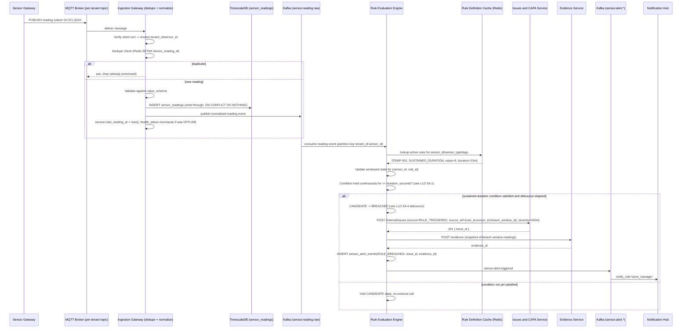
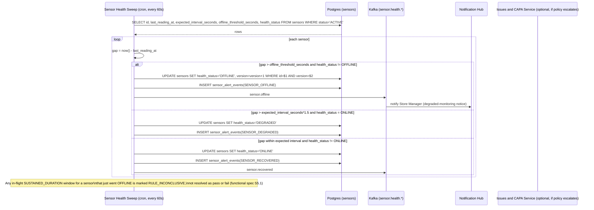

# IoT Sensor Platform — Low-Level Design

Corresponds to **EPIC-16 (new)**. Reference: `functional-spec.md`, `high-level-design.md` (this
module), `conventions.md` (API conventions, Postgres/RLS multi-tenancy, event envelope),
`06-issues-capa/low-level-design.md` (the `POST /internal/issues` contract this module calls).

## 1. Database Schema

All tables carry `tenant_id UUID NOT NULL` with an RLS policy `USING (tenant_id =
current_setting('app.tenant_id')::uuid)`, per convention. Primary keys are UUIDv7 unless noted.
`sensor_readings` is a **TimescaleDB hypertable** (see §1.3) — its primary key includes the
partitioning column, per Timescale's requirement.

### 1.1 `sensors`

| Column | Type | Notes |
|---|---|---|
| `id` | UUID PK | |
| `tenant_id` | UUID | RLS key |
| `external_device_id` | text | vendor/gateway-assigned ID; unique `(tenant_id, external_device_id)` |
| `sensor_type` | enum | `TEMPERATURE`,`HUMIDITY`,`DOOR_OPEN`,`VIBRATION`,`GENERIC_NUMERIC`,`GENERIC_BOOLEAN` |
| `display_name` | text | |
| `unit` | enum | `CELSIUS`,`FAHRENHEIT`,`PERCENT_RH`,`BOOLEAN`,`MM_PER_S2`,`GENERIC` |
| `value_schema` | jsonb | numeric range `{min,max}` or `{type:"boolean"}`; required for `GENERIC_*` types |
| `ingestion_protocol` | enum | `MQTT`,`HTTP_WEBHOOK`,`BOTH` |
| `credential_id` | UUID | FK to `sensor_credentials` (cert fingerprint or HMAC secret ref; secret material in KMS/secret manager, never stored raw) |
| `expected_interval_seconds` | int, nullable | drives `offline_threshold` default (3x this value); platform default 300s for continuous-signal sensor types (`TEMPERATURE`,`HUMIDITY`,`VIBRATION`,`GENERIC_NUMERIC`) when not set explicitly at registration; `NULL` (health monitoring disabled) by default for event-driven boolean types (`DOOR_OPEN`,`GENERIC_BOOLEAN`) — functional-spec §8 |
| `offline_threshold_seconds` | int | override; nullable, defaults from `expected_interval_seconds` |
| `health_status` | enum | `ONLINE`,`DEGRADED`,`OFFLINE` |
| `battery_low` | boolean | default false |
| `last_reading_at` | timestamptz | denormalized, updated on every accepted ingest (drives health sweep) |
| `last_battery_pct` | numeric(5,2) | nullable |
| `status` | enum | `ACTIVE`,`DECOMMISSIONED` |
| `version` | bigint | optimistic concurrency |
| `created_at`, `updated_at` | timestamptz | |

Indexes: unique `(tenant_id, external_device_id)`; `(tenant_id, health_status)` for the health
dashboard; `(tenant_id, last_reading_at)` partial `WHERE status = 'ACTIVE'` for the health sweep job.

### 1.2 `sensor_device_bindings`

| Column | Type | Notes |
|---|---|---|
| `id` | UUID PK | |
| `tenant_id` | UUID | |
| `sensor_id` | UUID | FK, not null |
| `location_id` | UUID | FK to `organization_nodes`, not null |
| `asset_id` | UUID | nullable FK (Module 16 `assets`) |
| `valid_from` | timestamptz | not null |
| `valid_to` | timestamptz | nullable = currently active |
| `bound_by` | UUID | user or `SYSTEM` |
| `created_at` | timestamptz | |

Indexes: `(tenant_id, sensor_id, valid_to)` partial `WHERE valid_to IS NULL` — enforced unique (at
most one open binding per sensor) via a partial unique index; `(tenant_id, location_id)`;
`(tenant_id, asset_id)` partial `WHERE asset_id IS NOT NULL`.

### 1.3 `sensor_readings` (hypertable)

| Column | Type | Notes |
|---|---|---|
| `sensor_id` | UUID | part of composite PK |
| `tenant_id` | UUID | RLS key; also a hypertable space-partition dimension for large tenants |
| `server_received_at` | timestamptz | part of composite PK; **hypertable time-partition column**; authoritative ordering |
| `device_reported_at` | timestamptz | device clock, untrusted, retained for forensic/skew analysis |
| `device_reading_id` | text | nullable; gateway-supplied idempotency token |
| `value_numeric` | double precision | nullable; populated for numeric sensor types |
| `value_boolean` | boolean | nullable; populated for boolean sensor types |
| `battery_pct` | numeric(5,2) | nullable, if gateway reports it alongside the reading |
| `location_id` | UUID | denormalized snapshot of the binding active at ingest (FR-IOT-003/5.4) |
| `asset_id` | UUID | denormalized snapshot, nullable |
| `binding_status` | enum | `BOUND`,`UNBOUND` — denormalized for fast filtering without a binding-history join |
| `clock_skew_suspected` | boolean | default false, set per FR-IOT-014/5.3 |
| `ingestion_path` | enum | `MQTT`,`HTTP_WEBHOOK` |

PK: `(tenant_id, sensor_id, server_received_at, device_reading_id)` — including
`device_reading_id` (empty string sentinel when absent) in the PK is what makes a raw
`INSERT ... ON CONFLICT DO NOTHING` the primary de-dupe mechanism at the storage layer, backstopping
the Redis-level dedupe check on the hot path (§6).

Hypertable configuration: time-partition on `server_received_at`, 1-day chunks; space-partition on
`tenant_id` (4–8 partitions per chunk for large multi-tenant write volume); native compression
enabled on chunks older than 7 days (columnar compression keyed by `sensor_id`); a continuous
aggregate (`sensor_readings_1m`, `_1h`, `_1d`) pre-computes min/max/avg/last per bucket for the trend
API (FR-IOT-050) so a multi-month trend query never scans raw rows.

Indexes (in addition to the hypertable's automatic time-based chunk exclusion):
`(tenant_id, sensor_id, server_received_at DESC)` on each chunk (Timescale creates this
automatically per hypertable index definition); `(tenant_id, sensor_id)` partial
`WHERE clock_skew_suspected` for admin review.

### 1.4 `sensor_alert_rules`

| Column | Type | Notes |
|---|---|---|
| `id` | UUID PK | logical rule identity across versions |
| `tenant_id` | UUID | |
| `rule_id` | text | human-facing short code, e.g. `TEMP-001`; unique `(tenant_id, rule_id)` |
| `version` | int | monotonically increasing per `rule_id` |
| `status` | enum | `DRAFT`,`ACTIVE`,`SUPERSEDED`,`RETIRED` |
| `scope_type` | enum | `SENSOR_TYPE`,`SENSOR_ID`,`SENSOR_TAG` |
| `scope_value` | text | the `sensor_type` enum value, a `sensor_id`, or a tag string, per `scope_type` |
| `condition_type` | enum | `THRESHOLD`,`RATE_OF_CHANGE`,`SUSTAINED_DURATION` |
| `condition` | jsonb | shape per `condition_type`, see §3 examples |
| `debounce_seconds` | int | default 60; minimum time past-boundary before `CANDIDATE -> BREACHED` |
| `actions` | jsonb | ordered list: `set_risk`, `require_field`, `create_issue`, `notify_role`, `create_predictive_maintenance_flag`, `attach_as_evidence` |
| `superseded_rule_version_id` | UUID | nullable, self-FK |
| `created_by`, `created_at` | UUID, timestamptz | |
| `activated_at` | timestamptz | nullable |

Indexes: unique `(tenant_id, rule_id, version)`; `(tenant_id, scope_type, scope_value, status)`
partial `WHERE status = 'ACTIVE'` — this is the exact index the Rule Definition Cache warms from.

### 1.5 `sensor_alert_events`

| Column | Type | Notes |
|---|---|---|
| `id` | UUID PK | |
| `tenant_id` | UUID | |
| `sensor_id` | UUID | FK |
| `rule_id` | UUID | nullable FK to `sensor_alert_rules.id` (null for health events) |
| `event_type` | enum | `RULE_CANDIDATE`,`RULE_BREACHED`,`RULE_RESOLVED`,`RULE_INCONCLUSIVE`,`SENSOR_OFFLINE`,`SENSOR_DEGRADED`,`SENSOR_RECOVERED`,`SENSOR_BATTERY_LOW` |
| `breach_window_id` | UUID | nullable; groups the readings that constitute a sustained-duration/rate-of-change breach window |
| `window_start`, `window_end` | timestamptz | nullable |
| `triggering_reading_snapshot` | jsonb | value(s) that caused the transition, denormalized for fast display without a hypertable re-query |
| `issue_id` | UUID | nullable FK (Issues & CAPA), set when `create_issue` fired |
| `evidence_id` | UUID | nullable FK (Evidence Service), set when `attach_as_evidence` fired |
| `acknowledged_by`, `acknowledged_at` | UUID, timestamptz | nullable; required explicit ack for `RULE_INCONCLUSIVE` (functional spec §5.1) |
| `created_at` | timestamptz | |

Indexes: `(tenant_id, sensor_id, created_at DESC)`; `(tenant_id, rule_id, breach_window_id)`;
`(tenant_id, event_type, acknowledged_at)` partial `WHERE event_type = 'RULE_INCONCLUSIVE' AND
acknowledged_at IS NULL` for the manager "needs acknowledgement" queue.

### 1.6 ER Diagram

```mermaid
erDiagram
    SENSORS ||--o{ SENSOR_DEVICE_BINDINGS : "has binding history"
    SENSORS ||--o{ SENSOR_READINGS : produces
    SENSORS ||--o{ SENSOR_ALERT_EVENTS : "raises"
    SENSOR_ALERT_RULES ||--o{ SENSOR_ALERT_EVENTS : "fires"
    SENSOR_ALERT_RULES }o--o| SENSOR_ALERT_RULES : "superseded_by"

    SENSORS {
        uuid id PK
        uuid tenant_id
        text external_device_id
        enum sensor_type
        enum unit
        enum ingestion_protocol
        enum health_status
        boolean battery_low
        timestamptz last_reading_at
        enum status
        bigint version
    }
    SENSOR_DEVICE_BINDINGS {
        uuid id PK
        uuid sensor_id FK
        uuid location_id FK
        uuid asset_id FK
        timestamptz valid_from
        timestamptz valid_to
    }
    SENSOR_READINGS {
        uuid sensor_id PK-FK
        uuid tenant_id PK
        timestamptz server_received_at PK
        text device_reading_id PK
        timestamptz device_reported_at
        double value_numeric
        boolean value_boolean
        uuid location_id
        uuid asset_id
        boolean clock_skew_suspected
    }
    SENSOR_ALERT_RULES {
        uuid id PK
        text rule_id
        int version
        enum status
        enum scope_type
        text scope_value
        enum condition_type
        jsonb condition
        int debounce_seconds
        jsonb actions
    }
    SENSOR_ALERT_EVENTS {
        uuid id PK
        uuid sensor_id FK
        uuid rule_id FK
        enum event_type
        uuid breach_window_id
        uuid issue_id
        uuid evidence_id
        timestamptz acknowledged_at
    }
```

## 2. REST / Ingestion Endpoints

Base path `/api/v1/iot/`. All mutating endpoints require `Idempotency-Key` (in addition to the
ingestion-specific dedupe key on the two ingestion endpoints), optimistic concurrency via `version`,
and emit a canonical event per §18.4 envelope. Errors follow `{ "error": { "code", "message",
"trace_id" } }`.

### 2.1 Register Sensor
`POST /api/v1/iot/sensors`
```json
{
  "external_device_id": "gw-cooler-042",
  "sensor_type": "TEMPERATURE",
  "display_name": "Walk-in Cooler #2",
  "unit": "CELSIUS",
  "ingestion_protocol": "MQTT",
  "expected_interval_seconds": 60
}
```
`201 Created`
```json
{
  "id": "sen_8a12",
  "status": "ACTIVE",
  "health_status": "OFFLINE",
  "credential": {
    "type": "MQTT_CLIENT_CERT",
    "mqtt_topic": "tenants/ten_331/sensors/sen_8a12/readings",
    "cert_download_url": "https://.../sen_8a12/cert (single-use, expires in 15m)"
  },
  "version": 1
}
```
Error codes: `400 VALIDATION_ERROR` (missing `value_schema` for `GENERIC_*` types), `409
DUPLICATE_EXTERNAL_DEVICE_ID`.

### 2.2 Bind Sensor to Location / Asset
`POST /api/v1/iot/sensors/{id}/bindings`
```json
{ "location_id": "loc_9f2a", "asset_id": "ast_5510" }
```
`201 Created` — closes any existing open binding (`valid_to = now()`) and opens the new one.
`403 SCOPE_DENIED` if caller lacks scope at `location_id`. `404 ASSET_NOT_FOUND` if `asset_id` given
but not resolvable in Module 16.

### 2.3 Ingest Reading — HTTP Webhook
`POST /api/v1/iot/sensors/{id}/readings`

Headers: `X-Signature: hmac-sha256=...` (signed with the sensor's webhook secret).
```json
{
  "readings": [
    {
      "device_reading_id": "gw-042-000913",
      "device_reported_at": "2026-09-23T08:14:02Z",
      "value": 10.2,
      "battery_pct": 62
    }
  ]
}
```
`202 Accepted`
```json
{
  "accepted": [{"device_reading_id": "gw-042-000913", "server_received_at": "2026-09-23T08:14:03.412Z"}],
  "duplicates": [],
  "rejected": []
}
```
A malformed reading (fails `value_schema`) is reported per-item in `rejected`, not as a whole-batch
`400`, so one bad reading in a batch does not block the rest:
```json
{ "rejected": [{"device_reading_id": "gw-042-000914", "code": "VALUE_SCHEMA_VIOLATION", "message": "value -400 outside configured range"}] }
```
Error codes (whole-request): `401 INVALID_SIGNATURE`, `404 SENSOR_NOT_FOUND`, `410
SENSOR_DECOMMISSIONED`.

### 2.4 Ingest Reading — MQTT
Topic: `tenants/{tenant_id}/sensors/{sensor_id}/readings`, QoS 1, payload identical JSON shape to a
single item of §2.3's `readings` array. The MQTT bridge applies the same dedupe/validation/normalize
pipeline before publishing onto the internal `sensor.reading.raw` Kafka topic; there is no separate
MQTT-specific data contract.

### 2.5 Configure Alert Rule
`POST /api/v1/iot/alert-rules`
```json
{
  "rule_id": "TEMP-001",
  "scope": { "scope_type": "SENSOR_TYPE", "scope_value": "TEMPERATURE" },
  "condition_type": "SUSTAINED_DURATION",
  "condition": {
    "field": "value",
    "operator": ">",
    "value": 8,
    "duration_seconds": 900
  },
  "debounce_seconds": 60,
  "actions": [
    {"type": "set_risk", "value": "HIGH"},
    {"type": "require_field", "value": "corrective_action"},
    {"type": "create_issue", "value": true},
    {"type": "notify_role", "value": "store_manager"},
    {"type": "attach_as_evidence", "value": true}
  ]
}
```
`201 Created` — new rule starts `status: DRAFT`; a separate `POST
/api/v1/iot/alert-rules/{id}/activate` transitions `DRAFT -> ACTIVE` (publishing invalidates the
Rule Definition Cache, §5). Editing an `ACTIVE` rule creates a new `version` row rather than mutating
in place (FR-IOT-023), returned as:
```json
{ "id": "rule_2201", "rule_id": "TEMP-001", "version": 2, "status": "DRAFT", "superseded_rule_version_id": "rule_2100" }
```
Error codes: `422 INVALID_CONDITION_SHAPE` (condition payload doesn't match `condition_type`'s
schema), `409 SCOPE_CONFLICT` (an identical `scope_type`+`scope_value` already has an `ACTIVE` rule
with the same `condition_type` — admin must supersede, not double-author).

### 2.6 Get Sensor Trend / History
`GET /api/v1/iot/sensors/{id}/readings?from=2026-09-01T00:00:00Z&to=2026-09-23T00:00:00Z&resolution=1h`

`200 OK`
```json
{
  "sensor_id": "sen_8a12",
  "resolution": "1h",
  "points": [
    {"bucket_start": "2026-09-22T23:00:00Z", "avg": 4.1, "min": 3.8, "max": 4.5, "last": 4.0}
  ],
  "breach_windows": [
    {"rule_id": "TEMP-001", "window_start": "2026-09-22T14:02:00Z", "window_end": "2026-09-22T14:19:00Z", "issue_id": "iss_7c31"}
  ],
  "anomaly_score": 0.12,
  "next_cursor": null
}
```
`resolution=raw` (bounded to a max 24h window at raw resolution to protect the query path) returns
individual readings instead of bucketed points. `400 VALIDATION_ERROR` if the requested raw window
exceeds the cap.

### 2.7 Error code table (module-specific, in addition to platform-wide codes)

| Code | HTTP | Meaning |
|---|---|---|
| `INVALID_SIGNATURE` | 401 | HTTP webhook HMAC signature does not match. |
| `SENSOR_DECOMMISSIONED` | 410 | Ingestion attempted against a `DECOMMISSIONED` sensor. |
| `VALUE_SCHEMA_VIOLATION` | 400 (per-item) | Reading value fails the sensor's `value_schema`. |
| `DUPLICATE_EXTERNAL_DEVICE_ID` | 409 | Registration with an `external_device_id` already used by this tenant. |
| `ASSET_NOT_FOUND` | 404 | Binding references an `asset_id` Module 16 cannot resolve. |
| `INVALID_CONDITION_SHAPE` | 422 | Rule `condition` payload does not match `condition_type`'s schema. |
| `SCOPE_CONFLICT` | 409 | Duplicate active rule for the same scope + condition type. |
| `RAW_WINDOW_TOO_LARGE` | 400 | Trend query requested `resolution=raw` over too wide a window. |

## 3. Sequence Diagrams

### 3.1 MQTT Reading Ingestion → Stream Evaluation → Rule Breach → Issue Auto-Creation



Narration: this mirrors Appendix A's golden scenario exactly from the point a value is known to be
"in breach" onward — the same `POST /internal/issues` contract, the same `RULE_TRIGGERED` source,
the same downstream Compliance Monitor Agent repeat-failure evaluation inside Issues & CAPA
(06-issues-capa §3.1). The only new mechanics are upstream of that call: protocol termination,
dedupe, and continuous windowed condition evaluation replacing a single manually-submitted form
value.

### 3.2 Sensor-Offline Detection and Alerting



Narration: the sweep is a reconciliation-style poller, not an event-driven trigger, because "absence
of a reading" cannot be detected by reacting to a reading event — there is nothing to react to. It
recomputes state from `last_reading_at` on every run (idempotent, no dependency on its own prior
run), so a missed sweep cycle is simply late, never wrong.

### 3.3 Debounced / Sustained-Duration Rule Evaluation (Avoiding Alert Flapping)

```mermaid
sequenceDiagram
    participant Kafka as Kafka (sensor.reading.raw)
    participant Eval as Rule Evaluation Engine
    participant State as Windowed State Store (per sensor_id+rule_id)
    participant Capa as Issues and CAPA Service

    Kafka->>Eval: reading(t1, value=8.5)  -- crosses threshold 8
    Eval->>State: open CANDIDATE window, window_start=t1
    Kafka->>Eval: reading(t2, value=6.0)  -- back in range before duration met
    Eval->>State: value back in range -> close CANDIDATE window, no breach (bounce absorbed)
    Kafka->>Eval: reading(t3, value=9.1)  -- crosses threshold again
    Eval->>State: open new CANDIDATE window, window_start=t3
    Kafka->>Eval: reading(t4=t3+16m, value=9.4)  -- still above threshold, duration_seconds=900 elapsed
    Eval->>Eval: duration condition satisfied at t4
    Eval->>Eval: check debounce_seconds elapsed since condition first held continuously (already satisfied by duration itself here)
    Eval->>Eval: check no existing OPEN sensor_alert_events(RULE_BREACHED) for (rule_id, sensor_id)
    alt no existing open breach
        Eval->>Capa: create Issue (see S3.1)
        Eval->>State: mark window BREACHED, keep tracking for RULE_RESOLVED
    else existing open breach for same rule+sensor
        Eval->>Eval: do not create a second Issue
        Eval->>Eval: append reading to existing breach_window's evidence set instead
    end
    Kafka->>Eval: reading(t5, value=6.5)  -- back in range
    Eval->>Eval: condition no longer holds -> RULE_RESOLVED
    Eval->>Capa: (optional) notify Issue that underlying condition cleared (does not auto-close Issue - CAPA lifecycle owns closure)
```



Narration: the windowed state store is what prevents flapping — a brief in-range dip resets a
`CANDIDATE` window entirely (t1→t2 above) rather than "almost" counting toward duration, matching a
strict reading of "sustained." The existing-open-breach check is what prevents flapping *after* the
first Issue is created (a sensor oscillating around the boundary after breach does not spawn a new
Issue per oscillation) — this is the mechanism referenced in functional-spec.md §5.5(c).

## 4. Pseudocode

### 4.1 Threshold Evaluation

```
function evaluateThreshold(rule, reading):
    value = extractField(reading, rule.condition.field)
    result = compare(value, rule.condition.operator, rule.condition.value)
    return CANDIDATE if result else NOT_MET
```

### 4.2 Rate-of-Change Evaluation

```
function evaluateRateOfChange(rule, reading, windowedState):
    window = rule.condition.window_seconds
    priorReading = windowedState.getReadingAt(reading.sensor_id, reading.server_received_at - window)
    if priorReading is null:
        return INSUFFICIENT_DATA           # not enough history yet; never a false breach
    rate = abs(reading.value - priorReading.value) / (window / 60.0)   # per-minute rate
    result = compare(rate, rule.condition.operator, rule.condition.value)
    return CANDIDATE if result else NOT_MET
```

### 4.3 Sustained-Duration Evaluation (with OFFLINE-gap handling)

```
function evaluateSustainedDuration(rule, reading, windowedState):
    key = (reading.sensor_id, rule.id)
    conditionHolds = compare(reading.value, rule.condition.operator, rule.condition.value)

    window = windowedState.get(key)   # { window_start, last_reading_at } or null

    if conditionHolds:
        if window is null:
            windowedState.set(key, { window_start: reading.server_received_at,
                                      last_reading_at: reading.server_received_at })
            return CANDIDATE
        else:
            gap = reading.server_received_at - window.last_reading_at
            if gap > sensorOfflineThreshold(reading.sensor_id):
                # a reporting gap occurred WHILE the value was already past threshold on both sides -
                # cannot distinguish "stayed high the whole gap" from "recovered and re-breached";
                # do not silently resolve either way (functional spec S5.1)
                windowedState.set(key, { window_start: reading.server_received_at,
                                          last_reading_at: reading.server_received_at })
                emitAlertEvent(key, type=RULE_INCONCLUSIVE, window_end=reading.server_received_at)
                return INCONCLUSIVE
            window.last_reading_at = reading.server_received_at
            elapsed = reading.server_received_at - window.window_start
            if elapsed >= rule.condition.duration_seconds:
                return DURATION_SATISFIED
            return CANDIDATE
    else:
        if window is not null:
            windowedState.clear(key)      # value returned to range before duration elapsed - reset, not a breach
        return NOT_MET
```

### 4.4 Debounce / Existing-Open-Breach Guard

```
function onConditionResult(rule, sensor_id, result, reading):
    if result == DURATION_SATISFIED or (result == CANDIDATE and rule.condition_type == THRESHOLD
                                          and debounceElapsed(rule, sensor_id, reading)):
        existingOpen = findOpenAlertEvent(rule.id, sensor_id, type=RULE_BREACHED)
        if existingOpen is not null:
            appendReadingToBreachWindow(existingOpen, reading)   # do not re-fire
            return
        breach_window_id = newId()
        for action in rule.actions (in order):
            applyAction(action, rule, sensor_id, reading, breach_window_id)
        recordAlertEvent(type=RULE_BREACHED, rule_id=rule.id, sensor_id=sensor_id,
                          breach_window_id=breach_window_id)

function debounceElapsed(rule, sensor_id, reading):
    candidateSince = windowedState.getCandidateStart(sensor_id, rule.id)
    return (reading.server_received_at - candidateSince) >= rule.debounce_seconds

function applyAction(action, rule, sensor_id, reading, breach_window_id):
    switch action.type:
        case "set_risk": stageRiskLevel(breach_window_id, action.value)
        case "require_field": stageRequiredField(breach_window_id, action.value)
        case "create_issue":
            if action.value == true:
                issue = issuesCapaClient.createIssue(
                    source=RULE_TRIGGERED,
                    source_ref={rule_id: rule.rule_id, sensor_id, breach_window_id},
                    severity=stagedRiskLevel(breach_window_id) or DEFAULT_SEVERITY,
                    idempotency_key=hash(tenant_id, rule.id, sensor_id, breach_window_id))
                linkIssueToAlertEvent(breach_window_id, issue.id)
        case "notify_role": notificationHub.notifyRole(action.value, sensor_id.location_id)
        case "attach_as_evidence":
            evidence = evidenceClient.createFromReadingWindow(breach_window_id)
            linkEvidenceToAlertEvent(breach_window_id, evidence.id)
        case "create_predictive_maintenance_flag":
            cmmsClient.flagPredictiveMaintenance(sensor_id.asset_id, breach_window_id)
```

## 5. Caching

- **Rule Definition Cache (Redis + evaluator-local in-memory L1).** Key
  `tenant:{tenant_id}:rules:{scope_type}:{scope_value}` → serialized list of `ACTIVE`
  `sensor_alert_rules`. Populated on evaluator startup by a full scan of `ACTIVE` rules per tenant
  with active sensors; refreshed on a 60s TTL as a safety net, with **event-driven invalidation**:
  publishing/superseding a rule emits an internal `rule.cache_invalidate` message the evaluator
  consumes to refresh that scope immediately (so a newly-activated rule takes effect within one
  evaluator poll cycle, not up to 60s later). This is the cache referenced in HLD §5 that keeps the
  hot evaluation path free of synchronous Postgres reads.
- **Dedupe key cache (Redis).** Key `tenant:{tenant_id}:sensor:{sensor_id}:dedupe:{device_reading_id}`,
  `SETNX` with a TTL of 48h (covers realistic gateway retry/replay windows); backstopped by the
  hypertable's own PK-based `ON CONFLICT DO NOTHING` for readings that arrive after the Redis key
  expires (belt-and-suspenders idempotency, §6).
- **Latest-reading cache (Redis).** Key `tenant:{tenant_id}:sensor:{sensor_id}:latest` → last
  reading's value + timestamp, updated on every accepted ingest; used by the Sensor Console's
  live-status tile and by the health sweep as an optional fast-path check before falling back to the
  `sensors.last_reading_at` column (source of truth) for the actual health-state decision.

## 6. Concurrency and Idempotency

- **Ingestion idempotency is enforced at two layers**: (1) the Redis `SETNX` dedupe check on the hot
  path, fast but not durable across a Redis failover; (2) the hypertable's composite primary key
  `(tenant_id, sensor_id, server_received_at, device_reading_id)` with `INSERT ... ON CONFLICT DO
  NOTHING`, durable and authoritative. A duplicate that slips past a Redis miss (e.g. right after a
  Redis failover) is still absorbed at the database layer and reported as a no-op, never a duplicate
  row.
- **Write-through vs. Kafka-first for the hypertable.** At MVP ingestion volumes the Ingestion
  Gateway writes synchronously to the hypertable and publishes to Kafka in the same request
  (write-through, as shown in §3.1) — simpler operationally and keeps `server_received_at`
  generation in one place. If sustained ingestion volume approaches NFR-IOT-001's ceiling on a given
  Postgres/TimescaleDB node, the write path can be changed to Kafka-first with a dedicated sink
  worker batching inserts (better write amplification characteristics under extreme load) without
  changing the evaluator or API contracts — flagged as a scaling lever, not built at MVP.
- **Alert-event idempotency.** The `create_issue` action's call to Issues & CAPA passes an
  `Idempotency-Key` derived deterministically from `(tenant_id, rule_id, sensor_id,
  breach_window_id)` (§4.4 pseudocode), matching the unique partial index already defined on
  `issues (tenant_id, source, rule_id, submission_id)`-style keys in 06-issues-capa LLD §1.1 (here
  `submission_id` is populated with `breach_window_id`) — an evaluator retry (e.g. after a consumer
  rebalance re-delivers an already-processed message) cannot create a second Issue.
- **Windowed evaluation state and consumer rebalances.** The Rule Evaluation Engine's windowed state
  (§4.3/§4.4) is stream-processor local state, checkpointed with the Kafka consumer offset (Kafka
  Streams changelog-topic pattern) so a consumer rebalance or restart restores in-progress
  `CANDIDATE` windows exactly rather than losing partial-duration progress or double-counting it.
- **Binding changes are append-only, not destructive.** Rebinding a sensor (§FR-IOT-003) never
  updates a `sensor_readings.location_id` retroactively — that column is written once, at ingest
  time, from whichever binding was open then; concurrent binding changes and reading ingestion
  therefore never race on the same row.

## 7. Background Jobs

| Job | Trigger | Responsibility |
|---|---|---|
| Sensor health sweep | Cron, every 60s | Recomputes `health_status` (`ONLINE`/`DEGRADED`/`OFFLINE`) per active sensor from `last_reading_at`; emits `sensor_alert_events` and Kafka health events on transitions; marks in-flight sustained-duration windows `RULE_INCONCLUSIVE` on a fresh `OFFLINE` transition (§3.2). |
| Battery-low sweep | Cron, every 15 min (batched with the health sweep's row scan) | Flags `battery_low = true` when `last_battery_pct` crosses below threshold; queues a daily-digest notification rather than an immediate push per functional-spec UX §4. |
| Rule cache refresh | Cron, every 60s (safety net) + event-driven on rule publish/supersede | Refreshes the Redis-backed Rule Definition Cache; see §5. |
| Retention / downsampling job | Cron, nightly, per-tenant sharded | Confirms TimescaleDB continuous aggregates (`_1m`,`_1h`,`_1d`) are current; triggers compression policy on chunks older than 7 days; exports chunks older than the 90-day raw-retention window (NFR-IOT-005) to the Analytics lakehouse via the existing CDC/streaming ingestion layer before they age out of raw resolution; verifies export completion before allowing the platform's standard data-lifecycle archival step to proceed. |
| Breach-window auto-resolve sweep | Cron, every 5 min | For `RULE_BREACHED` alert events whose underlying condition has since cleared (per §3.3's `RULE_RESOLVED` transition) but where the evaluator's real-time resolution message was missed (e.g. evaluator restart mid-window), reconciles state from the hypertable directly as a backstop, matching the reconciliation-sweeper pattern used elsewhere in the platform (06-issues-capa's escalation sweeper). |
| Credential rotation reminder | Cron, monthly | Flags sensors whose MQTT client cert or webhook secret is approaching its configured rotation/expiry window; notifies the Operations Admin (does not auto-rotate, since rotation requires re-provisioning the physical gateway). |

## 8. Detailed Error Handling Table

| Scenario | Detection point | System behavior | User-facing result |
|---|---|---|---|
| Duplicate reading (retrying gateway) | Redis dedupe / hypertable PK conflict | No new row written; existing reading's identity returned | `202 Accepted` with the item listed under `duplicates`, not an error |
| Reading fails `value_schema` | Ingestion Gateway validation | Reading rejected, not stored, not evaluated | Per-item `rejected` entry, `VALUE_SCHEMA_VIOLATION`, batch otherwise proceeds |
| Ingestion against decommissioned/unknown sensor | Ingestion Gateway lookup | Whole request rejected | `410 SENSOR_DECOMMISSIONED` / `404 SENSOR_NOT_FOUND` |
| HMAC signature invalid (HTTP webhook) | Signature verification before any DB access | Request rejected before touching dedupe/storage | `401 INVALID_SIGNATURE` |
| Sustained-duration window spans an OFFLINE gap | Evaluator gap check (§4.3) | Window marked `RULE_INCONCLUSIVE`, new window opened; requires explicit manager acknowledgement | Sensor Console shows an "Inconclusive — sensor gap during monitoring window" banner, not a resolved pass/fail |
| Rule breach with an already-open Issue for the same rule+sensor | Evaluator existing-open-breach check (§4.4) | New reading appended as evidence to the existing Issue; no second Issue created | No new alert banner; existing Issue's evidence list grows |
| Issues & CAPA unavailable when `create_issue` action fires | Downstream call failure/timeout | `sensor_alert_events` row saved with `issue_id = NULL` and a `issue_creation_status = PENDING`; retry worker (idempotent on the same derived key, §6) requeues | Alert banner still shows (breach is real and already detected); Issue link resolves once retry succeeds |
| Evidence Service unavailable when `attach_as_evidence` fires | Downstream call failure/timeout | Alert event saved with `evidence_id = NULL`, `evidence_creation_status = PENDING`; retried independently of Issue creation | Issue exists without the sensor-reading evidence attached yet; attaches asynchronously on retry |
| Clock skew suspected | Ingestion Gateway timestamp comparison | Reading still ingested and evaluated on `server_received_at`; flagged for admin review | `clock_skew_suspected` badge in Sensor Console reading detail, non-blocking |
| Rate-of-change evaluation with insufficient history | Evaluator windowed-state lookup (§4.2) | Returns `INSUFFICIENT_DATA`, never a false breach | No alert; rule effectively inactive for that sensor until enough history accumulates |
| Rule edited while a sustained-duration window is open | Evaluator rule-version pinning | In-flight window continues evaluating under the rule version active when it opened (FR-IOT-023) | No user-visible error; new rule version applies to windows opened after activation |
| Trend query requests `resolution=raw` over an excessive window | API validation before query execution | Rejected before hitting the hypertable | `400 RAW_WINDOW_TOO_LARGE` with the max allowed window in the message |
